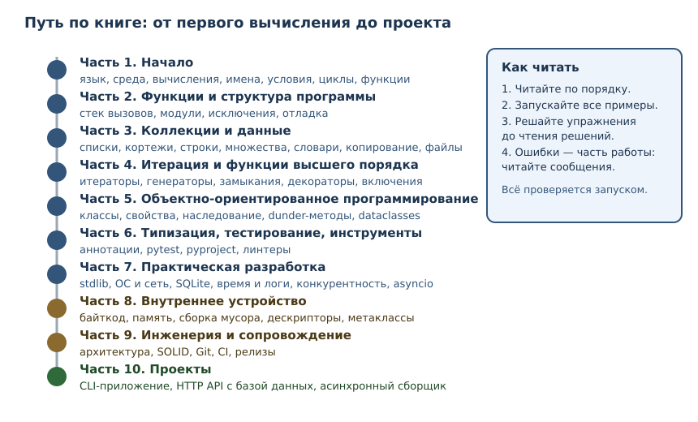

# Зачем Python и как устроена эта книга

<!-- syllanix:nav -->
**Навигация:** [← Оглавление книги](../README.md) · [Оглавление книги](../README.md) · [Далее: 02. Первая программа: вычисления и вывод →](02-first-program.md)
<!-- /syllanix:nav -->

<!-- syllanix:topics -->
**Темы главы**
1.1. [Почему Python](#почему-python)  
1.2. [Язык, интерпретатор и CPython](#язык-интерпретатор-и-cpython)  
1.3. [Исходный код, программа и REPL](#исходный-код-программа-и-repl)  
1.4. [Как устроена эта книга](#как-устроена-эта-книга)  
1.5. [Рабочая среда](#рабочая-среда)  
1.6. [Как учиться по этой книге](#как-учиться-по-этой-книге)  
1.7. [Упражнения](#упражнения)  
1.8. [Проверка понимания](#проверка-понимания)  
1.9. [Что дальше](#что-дальше)  
<!-- /syllanix:topics -->


Эта книга доводит читателя без опыта программирования до уровня, на котором он
может самостоятельно разрабатывать, тестировать и сопровождать программы на
Python. Она не обещает «выучить язык за неделю»: профессиональная разработка —
это не только синтаксис, но и умение проверять свои решения, читать чужой код,
понимать ошибки и проектировать системы, которые не разваливаются при
изменениях.

Прежде чем писать код, разберёмся, что такое Python, из каких частей состоит
рабочая среда и как устроена книга, чтобы вы понимали, зачем идёте именно в
таком порядке.

## Почему Python

Python — **язык программирования общего назначения** с динамической
типизацией, автоматическим управлением памятью и большой стандартной
библиотекой. На нём пишут веб-сервисы, автоматизируют рутинные задачи,
обрабатывают данные, обучают модели машинного обучения, администрируют
серверы и проверяют научные гипотезы.

Практические причины начать с него:

- **Читаемый код.** Синтаксис близок к естественной записи алгоритма, поэтому
  новичок тратит силы на мышление, а не на декорации.
- **Большой выбор библиотек.** Для типовой задачи уже есть проверенная
  библиотека; учиться работать с экосистемой так же важно, как писать код.
- **Быстрый цикл обратной связи.** Программу можно запустить сразу после
  изменения, без отдельной сборки.
- **Востребованность.** Python широко применяется в промышленной разработке,
  анализе данных, инфраструктуре и автоматизации тестирования.

При этом честно обозначим границы: Python — не лучший выбор для драйверов
устройств, жёстких требований к реальному времени или мобильных приложений.
Профессионализм начинается с понимания, где инструмент уместен, а где нет.
Мы будем возвращаться к этому вопросу: например, в главах о производительности
и конкурентности.

## Язык, интерпретатор и CPython

Три вещи, которые новички часто смешивают, а различать их важно.

**Язык Python** — это набор правил: как записываются выражения, какие
операции допустимы, что означает каждая конструкция. Язык существует как
спецификация и как договорённость между программистами.

**Интерпретатор** — программа, которая читает исходный код на Python и
исполняет его. Именно она сообщает об ошибках и выполняет инструкции.

**CPython** — эталонная реализация Python на языке C. Когда говорят «Python
3.14», почти всегда имеют в виду CPython 3.14. Существуют и другие реализации
(например, PyPy с JIT-компиляцией), но в этой книге мы работаем с CPython и
явно отмечаем места, где поведение — особенность реализации, а не
гарантией языка.

Это различие имеет практические следствия. Например, глубина рекурсии и
сообщения некоторых исключений — особенности CPython; они могут отличаться в
других реализациях и версиях. В книге мы будем различать:

- то, что **гарантирует язык**;
- то, что делает **конкретная реализация** (обычно CPython);
- то, что **рекомендация** разработчику.

Книга ориентирована на **Python 3.14** и проверяется на нём; большинство
примеров работает и на 3.11–3.13. Если поведение заметно менялось между
версиями, это оговаривается отдельно.

## Исходный код, программа и REPL

**Исходный код** — это текст программы, обычно в файле с расширением `.py`.
**Программа** — последовательность инструкций, которую интерпретатор
исполняет, чтобы получить результат.

Есть два основных способа работать с Python.

**Файл.** Вы сохраняете код в файл и запускаете его целиком:

```console
$ python3 program.py
```

**REPL** — интерактивный режим «read–eval–print loop»: прочитал строку,
вычислил, вывел результат, повторил. Он запускается командой `python3` без
аргументов и удобен для быстрых экспериментов.

```console
$ python3
Python 3.14.4 (main, ...) [GCC 15.2.0] on linux
Type "help", "copyright", "credits" or "license" for more information.
>>> 2 + 2
4
>>>
```

Разница принципиальна для обучения:

| | Файл | REPL |
|---|---|---|
| Что исполняется | вся программа целиком | каждая введённая строка |
| Удобно для | настоящих программ | проверки гипотез |
| Результат выражения | нужно вывести явно | выводится автоматически |
| Ошибка | прерывает программу | не мешает следующей строке |

В книге мы используем оба режима: короткие проверки удобно делать в REPL,
полноценные примеры — запускать как файлы. Блоки с `$` и `>>>` — это
**сеансы оболочки**, их не нужно копировать в файл целиком: строки с `>>>` —
ввод, строки без них — вывод.

## Как устроена эта книга

Книга состоит из десяти частей и сорока восьми глав. Порядок не случаен: части
идут от основ к прикладным проектам, а внутри частей каждая глава опирается
только на уже объяснённое.



Как устроена отдельная глава:

1. **Зачем это нужно** — место темы в реальной работе.
2. **Объяснение** — определения и правила, без которых примеры превращаются в
   фокусы.
3. **Примеры с разбором** — что именно происходит при исполнении.
4. **Типичные ошибки** — то, на чём спотыкаются чаще всего.
5. **Упражнения** — практика с проверяемым результатом.
6. **Проверка понимания** — вопросы, которые выявляют пробелы.
7. **Связи** — что уже пройдено и что будет дальше.

Два правила книги, которые стоит принять сразу.

**Все примеры проверяются.** Каждый блок кода, помеченный как исполняемый,
запускается автоматически при сборке книги, а показанный вывод сверяется с
фактическим. Если вы получили другой результат — значит, отличается версия
Python или окружение; разберитесь в причине, это полезнее, чем «подогнать»
ответ.

**Решения отделены от условий.** Решения находятся в отдельном файле, чтобы
вы могли сначала попробовать сами. Чтение решения до попытки почти не даёт
навыка: мозг узнаёт ответ, но не учится его находить.

## Рабочая среда

Для занятий нужны три вещи: Python, текстовый редактор и терминал.

### Установка Python

- **Linux.** Обычно Python уже установлен. Проверьте версию; если она ниже
  3.11, установите свежую из репозитория дистрибутива или с python.org.
- **macOS.** Установите Python с <https://www.python.org/downloads/> или через
  менеджер пакетов.
- **Windows.** Скачайте установщик с <https://www.python.org/downloads/> и при
  установке отметьте «Add Python to PATH».

Проверка версии:

```console
$ python3 --version
Python 3.14.4
```

В Windows команда может называться `python` или `py`. Это нормально: главное,
чтобы версия была не ниже 3.11.

### Первый запуск

Создайте файл `program.py` со следующим содержимым и запустите его. Этот пример
ничего не выводит: его задача — убедиться, что окружение работает.

```python exec
# Проверка среды: если этот код выполнился без ошибки,
# интерпретатор установлен и готов к работе.
```

Запуск:

```console
$ python3 program.py
```

Отсутствие вывода — ожидаемый результат. Комментарии интерпретатор
игнорирует, поэтому программа просто завершается успешно. Подробно о
комментариях — в следующей главе.

### Редактор и терминал

Подойдёт любой редактор с подсветкой синтаксиса. Важнее другое: научитесь
запускать программу из терминала, а не только нажимать «Run» в редакторе.
Понимание командной строки понадобится в главах о модулях, тестировании,
зависимостях и развёртывании.

Инструменты установки пакетов (`uv`, `pip`) мы разберём в главе 33, когда
появится первая внешняя зависимость. До этого книга использует только
стандартную библиотеку Python — так примеры остаются воспроизводимыми без
дополнительных установок.

## Как учиться по этой книге

1. **Пишите код руками.** Копирование примеров создаёт иллюзию понимания.
   Наберите пример, запустите, измените, посмотрите, что сломалось.
2. **Читайте ошибки.** Сообщение об ошибке — не наказание, а точная
   информация: файл, строка, тип и причина. В главе 11 мы разберём это
   систематически.
3. **Не пропускайте упражнения.** Упражнения — не тест, а способ построить
   навык. Если задача не решается за 15–20 минут, перечитайте раздел и
   попробуйте снова, прежде чем смотреть решение.
4. **Двигайтесь последовательно.** Книга выстроена по зависимостям понятий;
   перескакивать через главы можно, но тогда часть объяснений будет непонятна
   не из-за сложности, а из-за пропущенных предпосылок.
5. **Сомневайтесь и проверяйте.** Любое утверждение о поведении Python можно
   проверить запуском. Это привычка, которая отличает инженера.

## Упражнения

### 1. Проверка версии {#ex-ch01-01}

Запустите `python3 --version` и запишите результат. Объясните, почему книга
требует версию не ниже 3.11, хотя ориентируется на 3.14.

### 2. Язык и реализация {#ex-ch01-02}

Объясните своими словами разницу между языком Python, интерпретатором и
CPython. Приведите пример утверждения, которое гарантирует язык, и пример
утверждения, которое описывает именно CPython.

### 3. REPL по шагам {#ex-ch01-03}

Запустите REPL, введите `2 + 2`. Опишите, что произошло на каждом из трёх
шагов: чтение, вычисление, вывод. Затем введите заведомо ошибочную строку,
например `2 +`, и объясните, почему REPL продолжил работу.

### 4. Файл вместо REPL {#ex-ch01-04}

Создайте файл `hello.py` с одной строкой `2 + 2`, запустите его через
`python3 hello.py`. Объясните, почему на экране ничего не появилось, хотя в
REPL та же строка давала `4`.

### 5. Зачем запускать примеры {#ex-ch01-05}

Сформулируйте три причины, по которым в этой книге требуется запускать
примеры, а не только читать их. Свяжите ответ с идеей проверяемости.

### 6. Навигация по книге {#ex-ch01-06}

Откройте оглавление. Определите, какие части нужно пройти до главы об
асинхронности (`asyncio`) и почему именно они. Назовите не менее трёх глав,
которые логически предшествуют `asyncio`.

## Проверка понимания

1. Чем язык Python отличается от его реализации?
2. Что такое REPL и почему он удобен для экспериментов?
3. Почему одна и та же строка даёт разный результат в REPL и в файле?
4. Какие три роли различает книга: гарантия языка, особенность реализации,
   рекомендация разработчику?
5. Зачем решения упражнений вынесены в отдельный файл?

## Что дальше

Рабочая среда готова. В следующей главе вы напишете первые настоящие
программы: научитесь вычислять значения, выводить результат и понимать
сообщения об ошибках.

<!-- syllanix:nav -->
**Перед этой главой:** — это первая глава книги, начинайте отсюда.
**Связанные главы:** [03. Значения, имена, объекты и типы](03-values-names-objects.md), [07. Функции: параметры, аргументы и области видимости](07-functions.md), [09. Модули, пакеты и импорты](09-modules.md), [31. Аннотации типов и статическая проверка](31-typing.md), [33. Структура проекта, зависимости и инструменты](33-project-tooling.md), [38. Конкурентность: потоки, процессы и GIL](38-concurrency.md), [40. Производительность и профилирование](40-performance.md), [41. Безопасность приложений](41-security.md)
**Далее:** [02. Первая программа: вычисления и вывод →](02-first-program.md)
<!-- /syllanix:nav -->
