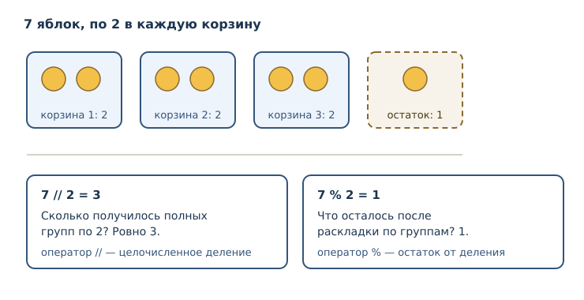
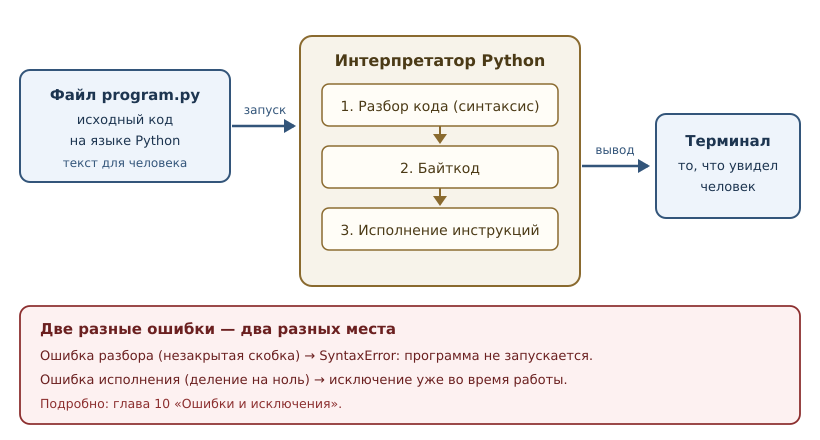

# Первая программа: вычисления и вывод

<!-- syllanix:nav -->
**Навигация:** [← 01. Зачем Python и как устроена эта книга](01-introduction.md) · [Оглавление книги](../README.md) · [Далее: 03. Значения, имена, объекты и типы →](03-values-names-objects.md)
<!-- /syllanix:nav -->

<!-- syllanix:topics -->
**Темы главы**
2.1. [Что вы сможете после этой главы](#что-вы-сможете-после-этой-главы)  
2.2. [Программа, выражение и инструкция](#expressions-statements)  
2.3. [Арифметические операторы](#arithmetic)  
2.4. [print: как показать результат](#print)  
2.5. [Строки и их соединение](#strings)  
2.6. [Комментарии](#comments)  
2.7. [Две категории ошибок](#errors)  
2.8. [Как исполняется программа](#execution)  
2.9. [Типичные ошибки начинающих](#mistakes)  
2.10. [Упражнения](#упражнения)  
2.11. [Проверка понимания](#проверка-понимания)  
2.12. [Что дальше](#что-дальше)  
<!-- /syllanix:topics -->


Программирование начинается не с синтаксиса, а с результата: вы пишете текст,
интерпретатор его исполняет, вы видите, что получилось. В этой главе вы
напишете и запустите свои первые программы, научитесь вычислять значения,
выводить их на экран и понимать сообщения об ошибках. Все примеры в книге
запускаются на Python 3.14 и проверяются автоматически, поэтому вы можете
повторить каждый из них и получить ровно тот результат, который показан.

## Что вы сможете после этой главы

- записывать вычисления и понимать, в каком порядке они выполняются;
- различать выражение и инструкцию;
- выводить значения в терминал и управлять форматом вывода;
- соединять строки и понимать, почему это работает не всегда;
- отличать синтаксическую ошибку от ошибки времени выполнения и читать
  соответствующие сообщения.

## Программа, выражение и инструкция {#expressions-statements}

**Программа** — это последовательность инструкций, которые интерпретатор
исполняет сверху вниз, одна за другой. Самая маленькая единица вычисления —
**выражение**: часть программы, которая вычисляется в значение.

```python
2 + 3
```

Здесь `2` и `3` — **операнды**, а `+` — **оператор**. Всё вместе — выражение,
значение которого равно `5`. Само по себе такое выражение в файле ничего не
покажет: его результат будет вычислен и отброшен. Чтобы результат стал виден,
нужна **инструкция** — единица исполнения, которая что-то делает: выводит
значение, связывает имя, повторяет блок кода.

Важное различие, к которому мы будем возвращаться:

| Понятие | Что это | Пример |
|---|---|---|
| выражение | вычисляется в значение | `2 + 3`, `"текст"`, `7 // 2` |
| инструкция | выполняется, не обязана давать значение | `print(2 + 3)`, `import os` |

В Python грань не всегда заметна: `print(2 + 3)` — это инструкция-выражение,
внутри которой вычисляется выражение `2 + 3`, а затем вызывается функция
`print`. Пока достаточно запомнить: выражение отвечает на вопрос «сколько?»,
инструкция — на вопрос «что сделать?».

## Арифметические операторы {#arithmetic}

Python умеет вычислять арифметику так, как вы ожидаете, с одним важным
уточнением: привычный знак деления `/` всегда даёт число с плавающей точкой (float).

```python exec
print(2 + 3)
print(10 - 4)
print(6 * 7)
print(7 / 2)
print(7 // 2)
print(7 % 2)
print(2 ** 10)
```

```output
5
6
42
3.5
3
1
1024
```

Разберём операторы:

| Оператор | Название | Что делает | Пример |
|---|---|---|---|
| `+` | сложение | сумма чисел или соединение строк | `2 + 3` → `5` |
| `-` | вычитание | разность | `10 - 4` → `6` |
| `*` | умножение | произведение | `6 * 7` → `42` |
| `/` | деление | всегда число с плавающей точкой | `7 / 2` → `3.5` |
| `//` | целочисленное деление | сколько целых раз делитель помещается | `7 // 2` → `3` |
| `%` | остаток | что осталось после целочисленного деления | `7 % 2` → `1` |
| `**` | возведение в степень | левый операнд в степень правого | `2 ** 10` → `1024` |

Обратите внимание: `7 / 2` даёт `3.5`, а не `3`. В Python 3 деление всегда
возвращает число с плавающей точкой, даже если делится нацело: `10 / 2` равно
`5.0`. Если нужен именно целый результат, используйте `//`.

Целочисленное деление и остаток удобно представлять как раскладку предметов по
корзинам.



### Углубление: отрицательные числа

Для положительных чисел `//` и `%` интуитивны. С отрицательными всё
аккуратнее: целочисленное деление округляет результат вниз, к меньшему числу,
а остаток сохраняет знак делителя.

```python exec
print(-7 // 2)
print(-7 % 2)
```

```output
-4
1
```

Проверка: `-4 * 2 + 1 = -7`. Это правило языка Python, а не особенность
конкретной реализации. Подробнее о числах — в следующей главе.

## print: как показать результат {#print}

`print` — встроенная функция, которая выводит значения в стандартный поток
вывода (обычно в терминал) и добавляет перевод строки. Ей можно передать
несколько значений через запятую: по умолчанию они разделяются пробелом.

```python exec
print("Python", "3.14")
print("Python", "3.14", sep=" — ")
print("без перевода строки", end="")
print("— и вот продолжение")
```

```output
Python 3.14
Python — 3.14
без перевода строки— и вот продолжение
```

Параметры `sep` и `end` управляют форматом:

- `sep` — строка-разделитель между значениями (по умолчанию один пробел);
- `end` — строка, добавляемая после последнего значения (по умолчанию `"\n"`).

Обратите внимание на третий пример: `end=""` убрал перевод строки, поэтому
следующий вывод продолжился в той же строке. Это стандартный приём, когда
нужно собрать вывод «в строчку».

## Строки и их соединение {#strings}

**Строка** — это текст в кавычках. Python принимает одинарные и двойные
кавычки; главное — чтобы открывающая и закрывающая совпадали.

```python exec
print("Python" + " " + "3.14")
print('одинарные кавычки тоже работают')
```

```output
Python 3.14
одинарные кавычки тоже работают
```

Оператор `+` для строк означает **конкатенацию** (соединение строк): результат —
новая строка, составленная из двух.

### Почему нельзя сложить строку и число

Интуитивно хочется написать `"версия: " + 3.14`, но Python откажется: строка
и число — значения разных типов, и правило «плюс» для них не определено.

```python exec expect-error
print("версия: " + 3.14)
```

```output
TypeError: can only concatenate str (not "float") to str
```

Сообщение говорит буквально: «можно соединять только str, а не float».
Правильный способ — привести число к строке. Это делается функцией `str`,
которую мы подробно разберём в главе 4, а пока запомните саму идею:

```python exec
print("версия: " + str(3.14))
```

```output
версия: 3.14
```

## Комментарии {#comments}

Комментарий начинается с символа `#` и продолжается до конца строки.
Интерпретатор его игнорирует: комментарии нужны людям.

```python
# Это комментарий: чему посвящён расчёт
print(2 + 2)  # комментарий может стоять и после кода
```

Хороший комментарий объясняет **зачем**, а не **что**: код уже показывает,
что происходит. Комментарий вроде `# прибавляем 2` бесполезен; комментарий
`# цена указана в копейках, поэтому делим на 100` — полезен.

## Две категории ошибок {#errors}

Ошибки — не признак того, что «не дано». Это информация: интерпретатор точно
говорит, где и что не так. В самом начале важно различать два вида.

**Синтаксическая ошибка** (`SyntaxError`) возникает при разборе кода. Код не
соответствует грамматике языка, поэтому программа не запускается вовсе.

```text
  File "program.py", line 1
    print("привет"
         ^
SyntaxError: '(' was never closed
```

**Ошибка времени выполнения** возникает, когда код синтаксически верен, но
операция невозможна. Программа начинает исполняться и прерывается на
проблемной инструкции.

```python exec expect-error
print(10 / 0)
```

```output
ZeroDivisionError: division by zero
```

```python exec expect-error
print(10 // 0)
```

```output
ZeroDivisionError: division by zero
```

Разница принципиальна: синтаксическую ошибку видно до запуска, и она всегда
затрагивает весь файл. Ошибка времени выполнения зависит от данных: тот же код
с другим делителем может сработать.

Текст сообщения зависит от версии Python: в 3.14 все операции деления на ноль
сообщают `division by zero`, а в версиях до 3.14 для `//` и `%` было
`integer division or modulo by zero`. Поэтому ориентируйтесь на **тип**
исключения (`ZeroDivisionError`), а не на текст сообщения: он может меняться
между версиями.

## Как исполняется программа {#execution}

Полезно представлять путь от текста до результата.



Три этапа объясняют поведение, которое вы уже наблюдали:

1. **Разбор.** Интерпретатор проверяет синтаксис. Если текст не соответствует
   грамматике, вы получаете `SyntaxError` и программа не запускается.
2. **Байткод.** Код превращается во внутренние инструкции — байткод. Это
   деталь реализации CPython, о ней мы поговорим в главе 42.
3. **Исполнение.** Интерпретатор выполняет инструкции сверху вниз. Именно на
   этом этапе возникают ошибки времени выполнения.

Из этого следует практическое правило: **сообщение об ошибке читают сверху
вниз**, но самое важное обычно в конце — тип ошибки и её описание, а строки
выше показывают, где это произошло.

## Типичные ошибки начинающих {#mistakes}

1. **Ждать целый результат от `/`.** `10 / 2` — это `5.0`, а не `5`.
   Используйте `//`, если нужен целый результат.
2. **Соединять строку и число через `+`.** Нужна явная строка: `str(число)`.
3. **Забыть закрыть скобку или кавычку.** Это `SyntaxError`; редактор обычно
   подсказывает место.
4. **Путать `=` и `==`.** `=` связывает имя со значением, `==` сравнивает.
   Сравнение появится в главе 4, но не перепутать их важно уже сейчас.
5. **Игнорировать текст ошибки.** В нём указаны и место, и причина; читать
   полезнее, чем сразу менять код наугад.

## Упражнения

### 1. Арифметика вручную и на компьютере {#ex-ch02-01}

Вычислите в уме, затем проверьте программой: `17 // 5`, `17 % 5`,
`2 ** 8`, `7 / 2`. Объясните, почему результаты `17 // 5` и `17 % 5` связаны
равенством `17 = 5 * 3 + 2`.

### 2. Прогнозирование вывода {#ex-ch02-02}

Что выведет `print(3, 4, sep="+")`? А `print(3, 4)`? Запишите оба ответа,
затем проверьте.

### 3. Исправление синтаксической ошибки {#ex-ch02-03}

Программа не запускается:

```text
print("Python
```

Объясните, в чём ошибка, и напишите исправленный вариант.

### 4. Соединение строк {#ex-ch02-04}

Напишите программу, которая выводит одну строку
`Python — это язык`, используя только строковые литералы и оператор `+`.

### 5. Целое или дробное {#ex-ch02-05}

Почему `print(10 / 2)` выводит `5.0`, а не `5`? Как получить именно `5`?
Ответьте текстом и подтвердите примером.

### 6. Три строки {#ex-ch02-06}

Напишите программу, которая выводит три строки: название языка, версию и
девиз книги. Используйте три отдельных вызова `print`.

### 7. Ошибка времени выполнения {#ex-ch02-07}

Следующий код падает:

```python
print("итог: " + 42)
```

Определите тип ошибки, объясните причину и исправьте код двумя способами:
через `str(...)` и через `sep` у `print`.

### 8. Деление на ноль {#ex-ch02-08}

Что произойдёт при выполнении `print(5 // 0)`? Какой тип исключения будет
поднят? Сравните с `print(5 / 0)`: одинаково ли сообщение в Python 3.14 и как
оно менялось в версиях до 3.14?

### 9. Формат вывода {#ex-ch02-09}

Напишите одну инструкцию `print` с тремя значениями — `2026`, `"Python"`,
`"3.14"` — так, чтобы вывод был ровно таким:

```text
2026 | Python | 3.14
```

### 10. Мини-задача: стоимость заказа {#ex-ch02-10}

Три товара стоят по 250 рублей. Скидка составляет 10 %. Напишите программу
из одной или нескольких инструкций `print`, которая вычисляет и выводит итог
в целых рублях, без переменных: используйте только числа и арифметические
операторы. Объясните, как вы получили целое число.

## Проверка понимания

1. Чем выражение отличается от инструкции? Приведите по два примера.
2. Почему `7 / 2` и `7 // 2` дают разные значения? Что означает каждое?
3. Что делает `sep` и чем он отличается от `end`?
4. Почему `"текст" + 5` — ошибка, а `"текст" + str(5)` — нет?
5. Чем `SyntaxError` отличается от `ZeroDivisionError` по моменту
   возникновения и по последствиям?
6. На каком этапе исполнения появляется ошибка времени выполнения?

## Что дальше

Вы научились вычислять и выводить, но пока не умеете хранить промежуточные
результаты. В следующей главе появятся имена, объекты и типы — механизм,
который превращает отдельные вычисления в настоящую программу.

<!-- syllanix:nav -->
**Перед этой главой:** [01. Зачем Python и как устроена эта книга](01-introduction.md)
**Связанные главы:** [04. Выражения, операторы и ввод данных](04-expressions-input.md), [05. Логика и управление потоком](05-control-flow.md), [07. Функции: параметры, аргументы и области видимости](07-functions.md), [10. Ошибки и исключения](10-errors-exceptions.md), [11. Отладка и трассировка](11-debugging.md), [12. Коллекции и последовательности: введение](12-collections-intro.md), [15. Строки: методы, форматирование и Unicode](15-strings.md), [16. Множества и хеширование](16-sets.md)
**Далее:** [03. Значения, имена, объекты и типы →](03-values-names-objects.md)
<!-- /syllanix:nav -->
