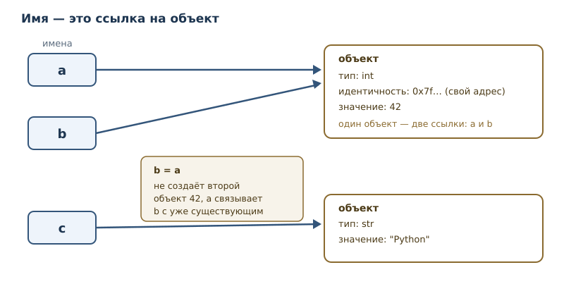
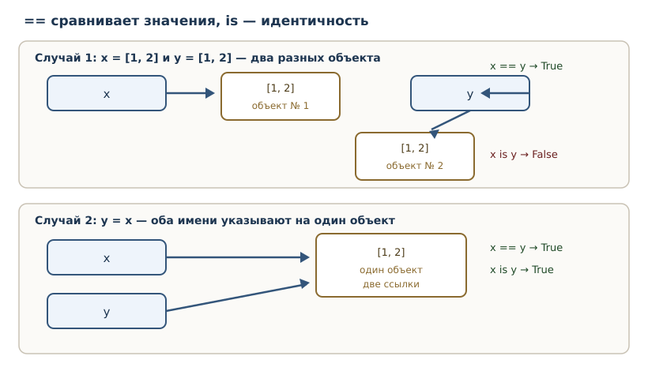

# Значения, имена, объекты и типы

<!-- syllanix:nav -->
**Навигация:** [← 02. Первая программа: вычисления и вывод](02-first-program.md) · [Оглавление книги](../README.md) · [Далее: 04. Выражения, операторы и ввод данных →](04-expressions-input.md)
<!-- /syllanix:nav -->

<!-- syllanix:topics -->
**Темы главы**
3.1. [Что вы сможете после этой главы](#что-вы-сможете-после-этой-главы)  
3.2. [Значения и объекты](#значения-и-объекты)  
3.3. [Типы](#типы)  
3.4. [Имена, переменные и присваивание](#имена-переменные-и-присваивание)  
3.5. [Идентичность и оператор is](#идентичность-и-оператор-is)  
3.6. [Двоичное представление чисел](#binary)  
3.7. [Изменяемость](#изменяемость)  
3.8. [Типичные ошибки](#типичные-ошибки)  
3.9. [Упражнения](#упражнения)  
3.10. [Проверка понимания](#проверка-понимания)  
3.11. [Что дальше](#что-дальше)  
<!-- /syllanix:topics -->


Во второй главе вы вычисляли и выводили значения, но не сохраняли их. Настоящая
программа должна помнить данные: цену товара, имя пользователя, результат
проверки. Для этого нужны имена. А чтобы понимать, что происходит с данными при
присваивании, нужно разобраться, как Python представляет их в памяти.

В этой главе мы построим рабочую модель, на которой держится всё остальное:
**значение — это объект; у объекта есть тип, идентичность и (обычно) значение;
имя — это ссылка на объект**. Модель настолько важна, что её следствия будут
всплывать в главах о коллекциях, копировании, функциях и классах.

## Что вы сможете после этой главы

- определять тип значения и объяснять, что тип означает;
- понимать, чем `int`, `float`, `str`, `bool` и `None` отличаются по смыслу и
  поведению;
- различать имя, объект и значение;
- объяснять, что делает присваивание, и почему оно не «кладёт число в коробку»;
- отличать идентичность (`is`) от равенства (`==`);
- понимать, что такое изменяемость и почему она важна.

## Значения и объекты

**Значение** — то, что программа вычисляет и хранит: число `42`, текст
`"Python"`, признак `True`. В Python всякое значение представлено **объектом**.
У объекта есть три характеристики:

1. **тип** — определяет, что за значение и какие операции допустимы;
2. **идентичность** — позволяет отличить один объект от другого;
3. **значение** (состояние) — собственно данные; у `None` нет изменяемого
   состояния — он и есть значение.

Полезно сразу отказаться от метафоры «переменная — это коробка, в которую
кладут число». У неё есть следствия, которые в Python неверны. Правильная
метафора: **имя — ярлык, привязанный к объекту**. Объект существует сам по
себе; имя лишь указывает на него.



## Типы

Тип — главная характеристика объекта. Узнать тип можно функцией `type`:

```python exec
print(type(42))
print(type(3.14))
print(type("Python"))
print(type(True))
print(type(None))
```

```output
<class 'int'>
<class 'float'>
<class 'str'>
<class 'bool'>
<class 'NoneType'>
```

Запись `<class 'int'>` означает: «это объект класса `int`». Классы мы подробно
разберём в части 5, а пока тип можно понимать как категорию значения.

### int: целые числа

Тип `int` хранит целые числа. Важная особенность Python: **размер целого не
ограничен разрядностью процессора** — ограничением служит только доступная
память. В языках с фиксированными 64-битными целыми `2 ** 100` переполнило бы
тип, а в Python это обычное число.

```python exec
print(2 ** 100)
print(2 ** 100 + 1)
```

```output
1267650600228229401496703205376
1267650600228229401496703205377
```

Это гарантия языка, а не особенность CPython.

### float: числа с плавающей точкой

Тип `float` представляет приближённые вещественные числа в двоичном формате
IEEE 754. «Приближённые» — ключевое слово: часть десятичных дробей нельзя
записать в двоичной системе точно.

```python exec
print(0.1 + 0.2)
print(1 / 3)
```

```output
0.30000000000000004
0.3333333333333333
```

Результат `0.1 + 0.2` не равен математическим `0.3`: оба слагаемых хранятся с
небольшой погрешностью, и погрешности складываются. Это не дефект Python, а
свойство двоичной арифметики с плавающей точкой; с ним сталкиваются все языки,
использующие IEEE 754. Практические следствия:

- не сравнивайте `float` на точное равенство; сравнивайте с допуском;
- для денежных расчётов используйте целые (копейки) или тип `Decimal` из
  стандартной библиотеки;
- `float` подходит для измерений, научных вычислений и графики.

### str: строки

Тип `str` хранит текст — последовательность символов Unicode. Строки
неизменяемы: после создания строку нельзя изменить, можно только создать новую.
Строки и их методы — тема главы 15; пока достаточно уметь создавать их и
выводить.

### bool: логический тип

Тип `bool` имеет ровно два значения: `True` и `False`. Он понадобится для
условий и сравнений (главы 4–5). Небольшая, но полезная деталь: `bool`
— подтип `int`, поэтому `True` ведёт себя как `1`, а `False` — как `0`.

```python exec
print(True + True)
print(type(True))
```

```output
2
<class 'bool'>
```

Сложение логических значений редко бывает осмысленным, но понимание подтипа
объясняет, почему `True` можно использовать там, где ожидается число.

### None: отсутствие значения

`None` — специальное значение типа `NoneType`, означающее «значения нет».
Оно нужно, чтобы отличать «пусто» от «ноль» или «пустая строка». Функция,
которая ничего не возвращает, возвращает именно `None` (подробнее в главе 7).

```python exec
x = None
print(x)
print(x is None)
```

```output
None
True
```

## Имена, переменные и присваивание

**Имя** (идентификатор) — слово, по которому программа обращается к объекту.
Правила: буквы, цифры и подчёркивания; первый символ — не цифра; регистр
важен (`age` и `Age` — разные имена). Стиль Python — `snake_case`:
`total_price`, `user_name`.

**Переменная** в Python — это имя, связанное с объектом. **Присваивание** —
инструкция `имя = выражение`; она вычисляет выражение и связывает имя с
результатом. Именно связывает, а не копирует.

```python exec
x = 1000
y = x
x = x + 1
print(y)
print(x)
```

```output
1000
1001
```

Разберём по шагам, потому что это ключевой пример главы:

1. `x = 1000` создаёт объект `1000` и связывает с ним имя `x`.
2. `y = x` связывает `y` с **тем же объектом**, а не с копией.
3. `x = x + 1` вычисляет `1000 + 1`, создаёт **новый** объект `1001` и
   связывает с ним имя `x`. Имя `y` по-прежнему указывает на `1000`.

Отсюда видно, почему метафора «коробки» ломается: `y = x` не копирует
содержимое, а создаёт вторую ссылку на тот же объект. А `x = x + 1` не
изменяет старый объект, а привязывает имя к новому.

### Связывание имени

Термин **связывание имени** подчёркивает, что происходит именно связь
«имя → объект». Когда имя переприсваивается, старая связь заменяется; сам
объект остаётся в памяти, пока на него есть хотя бы одна ссылка. Когда ссылок
не остаётся, объект освобождается — об этом в главе 42.

### Динамическая типизация

Python — язык с **динамической типизацией**: тип проверяется во время
исполнения, и одно и то же имя может в разные моменты указывать на объекты
разных типов.

```python exec
x = 1
print(type(x))
x = "один"
print(type(x))
print(x)
```

```output
<class 'int'>
<class 'str'>
один
```

Это не «отсутствие типов»: у каждого объекта тип есть всегда. Просто имя не
привязано к типу навсегда. Обратная сторона — часть ошибок проявляется только
при запуске; инструменты статической проверки (глава 31) помогают найти их
заранее.

## Идентичность и оператор is

**Идентичность** — свойство объекта быть именно этим объектом. Если два имени
связаны с одним объектом, проверка `a is b` истинна: объект один, значит, и
идентичность одна. Оператор `is` проверяет идентичность: `a is b` истинно,
если `a` и `b` ссылаются на один и тот же объект.

Функция `id` возвращает число, идентифицирующее объект (в CPython — его адрес);
`id` полезна для диагностики, но в коде на неё опираться не нужно.

`is` следует отличать от `==`. Оператор `==` сравнивает **значения**
(подробно — в главе 4), а `is` — **идентичность**. Для неизменяемых значений
эти проверки часто совпадают, но для изменяемых объектов — нет.



```python exec
a = [1, 2]
b = [1, 2]
c = a
print(a == b)
print(a is b)
print(a is c)
```

```output
True
False
True
```

В этом примере используется список — коллекция, которую мы подробно изучим в
главе 13; сейчас достаточно знать, что список хранит несколько значений и
изменяем. Смысл примера:

- `a == b` — значения равны (оба списка содержат `1` и `2`), поэтому `True`;
- `a is b` — это разные объекты, поэтому `False`;
- `a is c` — `c` связан с тем же объектом, что и `a`, поэтому `True`.

Практическое правило: **`is` — для идентичности и `None`; `==` — для
сравнения значений.** Сравнивать числа или строки через `is` — ошибка, которая
иногда «работает» из-за оптимизаций CPython и потому особенно опасна.

## Двоичное представление чисел {#binary}

Компьютер хранит числа в двоичной системе: только нули и единицы. Для
программиста это важно не потому, что нужно писать двоичный код, а потому что
многие «странности» вычислений объясняются именно представлением.

Целое число в двоичной записи — сумма степеней двойки. Например, `13` — это
`1101`: `8 + 4 + 1`. Python умеет показывать двоичную запись:

```python exec
print(bin(13))
print(bin(0))
print(2 ** 8)
print(0b1101)
```

```output
0b1101
0b0
256
13
```

Префикс `0b` означает «двоичный литерал»; `0b1101` — то же число, что `13`.
Кроме двоичной записи Python поддерживает восьмеричную (`0o17`) и
шестнадцатеричную (`0x1f`) — они удобны для флагов и цветов.

Двоичное представление объясняет две вещи, с которыми вы уже встречались:

- **`float` приблизителен**, потому что дробные числа хранятся в двоичном
  формате с фиксированным числом разрядов: `0.1` не представимо точно, как
  `1/3` нельзя записать конечной десятичной дробью;
- **`int` не переполняется**, потому что размер целого в Python не фиксирован:
  число занимает столько байт, сколько нужно (детали — в главе 42).

Полезные операции: `bin(x)` — двоичная строка, `int("1101", 2)` —
двоичная строка в число, `<<` и `>>` — сдвиги (побитовые операции
рассматриваются в главе 50, где разбираются ловушки представления).

## Изменяемость

**Изменяемость** — способность объекта менять своё состояние после создания.

- **Неизменяемые** (`immutable`): `int`, `float`, `str`, `bool`, `None`,
  кортежи. Операции «изменения» создают новый объект.
- **Изменяемые** (`mutable`): списки, словари, множества. Их состояние можно
  менять на месте, и это видят все имена, ссылающиеся на объект.

Списки, кортежи, множества и словари подробно разбираются в главах 13, 14, 16
и 17; здесь достаточно запомнить деление: кортеж, как и строка, после создания
не меняется, а список, словарь и множество меняются на месте.

Неизменяемость строки легко показать: `s = s + "!"` создаёт новую строку, а
старая остаётся неизменной у всех, кто на неё ссылался.

```python exec
s = "Python"
t = s
s = s + "!"
print(s)
print(t)
```

```output
Python!
Python
```

Почему это важно: для изменяемых объектов `y = x` означает, что изменение
через `y` увидят все, кто смотрит на тот же объект. Это источник многих
дефектов; подробно — в главе 18.

## Типичные ошибки

1. **Думать, что присваивание копирует объект.** `y = x` создаёт вторую
   ссылку, а не копию.
2. **Сравнивать значения через `is`.** `x is 1000` может быть `True` или
   `False` в зависимости от внутренних оптимизаций; используйте `==`.
3. **Сравнивать `None` через `==`.** Работает, но принято `x is None`: это
   проверка идентичности единственного объекта `None`.
4. **Сравнивать `float` на точное равенство.** `0.1 + 0.2 == 0.3` ложно;
   используйте допуск.
5. **Считать, что имя «принадлежит» типу.** Одно имя может указывать на
   объекты разных типов; тип принадлежит объекту.

## Упражнения

### 1. Типы значений {#ex-ch03-01}

Не запуская код, определите типы: `42`, `3.0`, `"42"`, `True`, `None`. Затем
проверьте через `type` и объясните каждое расхождение, если оно обнаружится.

### 2. Присваивание и переприсваивание {#ex-ch03-02}

Что выведет программа? Объясните по шагам.

```python
a = 5
b = a
a = a + 1
print(a)
print(b)
```

### 3. Присваивание не копирует {#ex-ch03-03}

Объясните, почему `y = x` не создаёт второй объект. Как это проверить с помощью
оператора `is`? Приведите пример.

### 4. Динамическая типизация {#ex-ch03-04}

Можно ли в Python выполнить `x = 1`, а затем `x = "текст"`? Что при этом
происходит с типами? Почему это не противоречит тому, что у каждого объекта
есть тип?

### 5. Идентичность и равенство {#ex-ch03-05}

Объясните разницу между `==` и `is` на примере двух списков с одинаковым
содержимым. Когда проверки дают разные результаты?

### 6. None {#ex-ch03-06}

Почему для проверки на `None` рекомендуют `x is None`, а не `x == None`?
Сформулируйте ответ через понятие идентичности.

### 7. Плавающая точка {#ex-ch03-07}

Почему `0.1 + 0.2` даёт `0.30000000000000004`? Что это говорит о сравнении
чисел с плавающей точкой? Предложите корректный способ сравнения.

### 8. Большие целые {#ex-ch03-08}

Вычислите `2 ** 200`. Сравните с максимальным знаковым 64-битным целым
`2 ** 63 - 1` (для беззнакового максимум — `2 ** 64 - 1`). Что это говорит об
ограничениях типа `int` в Python?

### 9. Допустимые имена {#ex-ch03-09}

Какие из имён допустимы в Python: `2x`, `_x`, `my-var`, `total_price`,
`class`, `итог`? Для недопустимых объясните причину.

### 10. Неизменяемость строк {#ex-ch03-10}

Докажите примером, что строка неизменяема. Что на самом деле происходит при
выполнении `s = s + "!"`?

### 11. Значение и объект {#ex-ch03-11}

Объясните разницу между «значение 42» и «объект типа `int` со значением 42».
Почему в Python корректнее второе описание?

### 12. Один объект — два имени {#ex-ch03-12}

Создайте два имени, которые ссылаются на один объект, и докажите это оператором
`is`. Затем переприсвойте одно из имён и объясните, почему теперь `is` даёт
`False`.

## Проверка понимания

1. Что такое объект и какие три характеристики он имеет?
2. Чем имя отличается от объекта?
3. Что означает «Python — язык с динамической типизацией»?
4. Почему `y = x` не копирует объект?
5. Чем `is` отличается от `==` и когда что применять?
6. Какие типы изменяемы, а какие нет, и почему это важно?
7. Почему `0.1 + 0.2` не равно `0.3`?

## Что дальше

Вы умеете хранить значения в именах и знаете, как устроены объекты. В
следующей главе появятся выражения посложнее: сравнения, логические связки,
ввод данных и форматирование строк — всё, что нужно для первых настоящих
программ с логикой.

<!-- syllanix:nav -->
**Перед этой главой:** [02. Первая программа: вычисления и вывод](02-first-program.md)
**Связанные главы:** [05. Логика и управление потоком](05-control-flow.md), [06. Циклы: while и for](06-loops.md), [07. Функции: параметры, аргументы и области видимости](07-functions.md), [09. Модули, пакеты и импорты](09-modules.md), [10. Ошибки и исключения](10-errors-exceptions.md), [12. Коллекции и последовательности: введение](12-collections-intro.md), [13. Списки: индексы, срезы и методы](13-lists.md), [14. Кортежи, распаковка и неизменяемость](14-tuples.md)
**Далее:** [04. Выражения, операторы и ввод данных →](04-expressions-input.md)
<!-- /syllanix:nav -->
