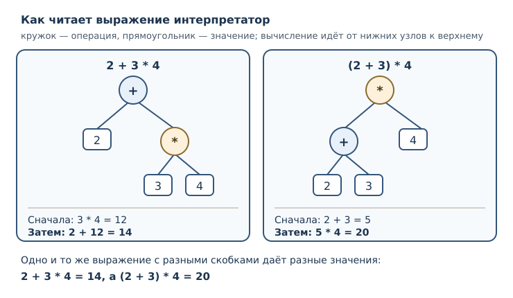
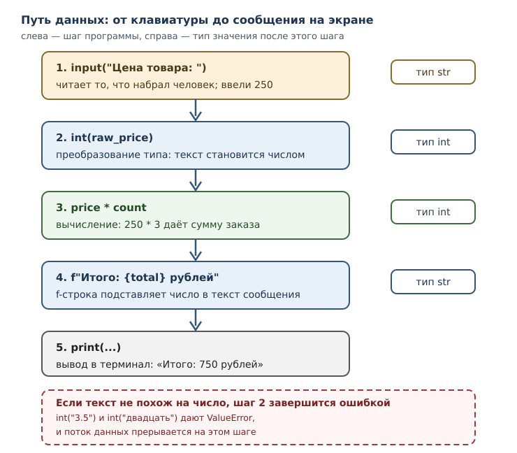

# Выражения, операторы и ввод данных

<!-- syllanix:nav -->
**Навигация:** [← 03. Значения, имена, объекты и типы](03-values-names-objects.md) · [Оглавление книги](../README.md) · [Далее: 05. Логика и управление потоком →](05-control-flow.md)
<!-- /syllanix:nav -->

<!-- syllanix:topics -->
**Темы главы**
4.1. [Что вы сможете после этой главы](#что-вы-сможете-после-этой-главы)  
4.2. [Порядок вычисления выражения](#precedence)  
4.3. [Сравнения и значения True и False](#comparisons)  
4.4. [Логические операторы](#logical)  
4.5. [Сокращённое вычисление](#short-circuit)  
4.6. [Расширенное присваивание](#augmented)  
4.7. [Ввод данных с клавиатуры](#input)  
4.8. [Преобразование типа](#conversion)  
4.9. [Форматирование строк: f-строки](#fstrings)  
4.10. [Собираем вместе](#putting-together)  
4.11. [Типичные ошибки](#mistakes)  
4.12. [Упражнения](#упражнения)  
4.13. [Проверка понимания](#проверка-понимания)  
4.14. [Что дальше](#что-дальше)  
<!-- /syllanix:topics -->


До сих пор программа знала всё заранее: числа были записаны прямо в тексте, и
результат зависел только от них. Настоящая программа ведёт себя иначе — она
получает входные значения от человека, проверяет условия и подставляет ответы в текст
сообщения. Чтобы это стало возможным, нужны три вещи: умение строить сложные
выражения и понимать, в каком порядке они вычисляются; умение сравнивать
значения и получать ответ «да» или «нет»; умение читать ввод с клавиатуры и превращать
введённый текст в число. Всё это — содержание текущей главы.

Вы уже познакомились со значениями, именами и объектами. Теперь значения
начнут соединяться в выражения, а выражения — в вычисления, которые описывают
реальную задачу: стоимость заказа, проверку возраста, подсчёт итога.

## Что вы сможете после этой главы

- читать сложное выражение и определять порядок его вычисления;
- применять скобки осознанно, а не наугад;
- получать значения `True` и `False` при помощи сравнений;
- соединять условия логическими операторами и понимать, почему `and` иногда
  не вычисляет второй операнд;
- читать ввод с клавиатуры и преобразовывать его к нужному типу;
- собирать сообщения при помощи f-строк и управлять форматом чисел.

## Порядок вычисления выражения {#precedence}

Выражение вычисляется не слева направо, как читается текст, а по правилам
старшинства операций. Это старшинство называется **приоритет операторов**: оно
задано языком и одинаково для всех программ на Python — его определяет не
конкретная реализация, а спецификация языка.

```python exec
print(2 + 3 * 4)
print((2 + 3) * 4)
```

```output
14
20
```

В первом случае умножение выполняется раньше сложения, поэтому `3 * 4`
превращается в `12`, и только потом считается `2 + 12`. Во втором случае
скобки меняют порядок: сначала вычисляется `2 + 3`, затем результат умножается.
Скобки — единственный способ переопределить приоритет, и это законный
инженерный приём: читаемость важнее краткости.

Таблица старшинства для операторов, которые вы уже знаете (от самого высокого
приоритета к самому низкому):

| Приоритет | Операторы | Что делают |
|---|---|---|
| 1 (высший) | `**` | возведение в степень |
| 2 | унарные `+`, `-` | знак числа |
| 3 | `*`, `/`, `//`, `%` | умножение, деление, остаток |
| 4 | `+`, `-` | сложение, вычитание |
| 5 | `==`, `!=`, `<`, `<=`, `>`, `>=` | сравнения |
| 6 | `not` | логическое отрицание |
| 7 | `and` | логическое «и» |
| 8 (низший) | `or` | логическое «или» |

Две тонкости, которые часто удивляют новичков. Первая: возведение в степень
связывает операнды **справа налево**, поэтому `2 ** 3 ** 2` означает
`2 ** (3 ** 2)`, а не `(2 ** 3) ** 2`.

```python exec
print(2 ** 3 ** 2)
print((2 ** 3) ** 2)
```

```output
512
64
```

Вторая тонкость: унарный минус слабее возведения в степень. Запись `-3 ** 2`
читается как `-(3 ** 2)`, то есть даёт `-9`, а не `9`.

```python exec
print(-3 ** 2)
print((-3) ** 2)
```

```output
-9
9
```

Когда выражение становится длинным, его удобно представлять деревом: каждая
операция — узел, её операнды — ветви. Вычисление идёт от листьев к корню, от
самых старших операций к самым младшим.



Практический вывод прост: если сомневаетесь в порядке — ставьте скобки. Они
ничего не ломают и снимают вопрос при чтении кода.

## Сравнения и значения True и False {#comparisons}

**Оператор сравнения** сопоставляет два значения и даёт результат типа `bool`:
`True` или `False`. Таких операторов шесть.

| Оператор | Смысл | Пример | Результат |
|---|---|---|---|
| `==` | равно | `3 == 3` | `True` |
| `!=` | не равно | `3 != 4` | `True` |
| `<` | меньше | `3 < 4` | `True` |
| `<=` | меньше или равно | `4 <= 4` | `True` |
| `>` | больше | `5 > 4` | `True` |
| `>=` | больше или равно | `5 >= 6` | `False` |

Отдельно стоит **равенство (==)**: этот оператор сравнивает именно значения, а
не идентичность объектов. Два разных объекта с одинаковым содержимым равны.
Не путайте его с `is` из предыдущей главы: `is` отвечает на вопрос «это тот же
самый объект?», а `==` — «эти значения одинаковы?».

```python exec
print(7 > 3)
print(7 == 7)
print("abc" < "abd")
print("Python" == "python")
```

```output
True
True
True
False
```

Строки сравниваются посимвольно, по кодам символов Unicode. Отсюда следует
коварное следствие: `"10" < "9"` истинно, потому что сравнивается первый
символ (`"1"` меньше `"9"`), а не числа десять и девять. Сортировка текста и
сортировка чисел — разные операции.

Результат сравнения можно сразу использовать как значение:

```python exec
x = 5
print(1 < x < 10)
print(1 < x > 2)
```

```output
True
True
```

Запись `1 < x < 10` — это **цепочка сравнений**, а не два независимых
сравнения, соединённых оператором `and`. Python читает её как «`1 < x` и при этом
`x < 10`», причём `x` вычисляется один раз. Цепочка удобна для проверки
диапазона и работает только с операторами сравнения: `1 < x and x < 10` —
эквивалентная, но более длинная запись.

Сравнивать значения разных несовместимых типов нельзя: Python не станет
угадывать, что имелось в виду.

```python exec expect-error
print(3 < "4")
```

```output
TypeError: '<' not supported between instances of 'int' and 'str'
```

Числа разных типов сравнивать можно: `1 == 1.0` истинно, потому что значение
одно и то же. Логические значения тоже участвуют в сравнениях: `True == 1`
даёт `True`.

Из сравнений складываются **логические выражения** — выражения, значением
которых служит `True` или `False`. Одно сравнение уже логическое выражение;
несколько сравнений соединяются логическими операторами.

## Логические операторы {#logical}

**Логический оператор** соединяет логические выражения. В Python их три:
`and` («и»), `or` («или») и `not` («не»).

| Оператор | Результат истинен, когда… | Пример |
|---|---|---|
| `and` | истинны оба операнда | `2 < 3 and 3 < 4` |
| `or` | истинен хотя бы один операнд | `2 > 3 or 3 < 4` |
| `not` | операнд ложен | `not 2 > 3` |

```python exec
print(2 < 3 and 3 < 4)
print(2 > 3 or 3 < 4)
print(not 2 > 3)
print(True and not False)
```

```output
True
True
True
True
```

Здесь есть важное отличие от многих других языков: `and` и `or` возвращают не
обязательно `True` или `False`, а **один из своих операндов**. Если первый
операнд уже решает исход, возвращается он сам; иначе возвращается второй.

```python exec
print(5 and 7)
print(0 and 7)
print(0 or "по умолчанию")
print("" or "запасной")
```

```output
7
0
по умолчанию
запасной
```

Почему так? Python трактует значения в логическом контексте: одни значения
считаются «истинными», другие — «ложными»; полное правило разберём в
следующей главе. Пока достаточно наблюдения: `0` и пустая строка ведут себя
как ложь, а ненулевое число и непустая строка — как истина. Отсюда практичный
приём `значение or запасное_значение`: если первое ложно, получим второе.

Обратите внимание, что `print(0 and 7)` выводит `0`, а не `False`: оператор
вернул первый операнд, потому что второй ему уже не нужен.

## Сокращённое вычисление {#short-circuit}

**Сокращённое вычисление** — свойство `and` и `or` не вычислять второй операнд,
если результат уже известен по первому. Для `and` это происходит, когда первый
операнд ложен: каким бы ни был второй, результат уже известен — он ложен и
равен первому операнду. Для `or` — когда первый операнд истинен.

Свойство кажется мелочью, но оно определяет поведение реального кода. Проверим
его, поставив в обе части связки вызов `print`: он печатает текст и ничего не
возвращает, а значит, возвращает `None`.

```python exec
print("левая часть") and print("правая часть")
print("---")
print("левая часть") or print("правая часть")
```

```output
левая часть
---
левая часть
правая часть
```

В первой связке `and` увидел слева `None`, счёл его ложным и не стал вычислять
правую часть — второй строки в выводе нет. Во второй связке `or` увидел слева
`None`, счёл его ложным и поэтому вычислил правую часть — обе строки на месте.

Из этого правила следует и практическое следствие, и источник ошибок:
побочные эффекты в правой части `and` или `or` могут не выполниться. Если
вызов функции обязателен, не прячьте его в логическую связку.

## Расширенное присваивание {#augmented}

**Расширенное присваивание** — краткая форма, которая одновременно читает имя
и записывает в него результат операции: `x += 1` вместо `x = x + 1`. Форма
работает со всеми арифметическими операторами: `-=`, `*=`, `/=`, `//=`, `%=`,
`**=`.

```python exec
x = 10
x += 5
print(x)
x -= 3
print(x)
x *= 2
print(x)
x //= 4
print(x)
x **= 2
print(x)
```

```output
15
12
24
6
36
```

Такая запись короче и яснее, когда имя длинное: `total_price += item_price`
читается лучше, чем `total_price = total_price + item_price`. Для неизменяемых
значений — чисел и строк — разницы в поведении нет: создаётся новый объект и
связывается с тем же именем.

```python exec
s = "abc"
s += "!" * 3
print(s)
```

```output
abc!!!
```

Два ограничения, о которых стоит знать сразу. Первое: `+=` для строк создаёт
новую строку и не меняет старую, потому что строки неизменяемы. Второе:
расширенное присваивание — это инструкция, а не выражение; у неё нет значения,
поэтому её нельзя вставить внутрь другого выражения.

```python syntax-error
x = 1
y = (x += 1)
```

Здесь интерпретатор сообщает синтаксическую ошибку: расширенное присваивание
нельзя использовать как значение, поэтому такая запись не разбирается вовсе.

## Ввод данных с клавиатуры {#input}

Встроенная **функция input** читает одну строку из стандартного ввода и
возвращает её как текст. Необязательный аргумент задаёт приглашение, которое
печатается перед чтением.

```python
name = input("Как вас зовут? ")
print("Привет, " + name)
```

В интерактивном сеансе это выглядит так (строки, введённые человеком, отмечены
в комментарии):

```console
Как вас зовут? Анна
Привет, Анна
```

Главное свойство `input`: **она всегда возвращает `str`**, даже если человек
набрал число. Ввод `42` даёт строку `"42"`, а не число `42`. Это не
случайность, а сознательное решение: до преобразования программа не знает,
что именно хотел ввести человек.

Проверим это без клавиатуры — возьмём строку и посмотрим, что с ней можно
делать:

```python exec
raw = "42"
print(type(raw))
print(raw + raw)
```

```output
<class 'str'>
4242
```

Сложение строк дало `4242`, а не `84`. Чтобы получить число, строку нужно
преобразовать.

## Преобразование типа {#conversion}

**Преобразование типа** — явное получение значения другого типа встроенными
функциями `int`, `float` и `str`. Программа сама решает, когда и к какому типу
преобразовывать, и это делает намерение видимым.

```python exec
print(int("42"))
print(float("3.5"))
print(str(3.5))
print(int("101", 2))
```

```output
42
3.5
3.5
5
```

Разберём подробно, потому что здесь легко ошибиться.

- `int("42")` разбирает текст как десятичное целое. Пробелы по краям
  игнорируются, поэтому `int("  42  ")` тоже даёт `42`.
- `float("3.5")` разбирает текст как число с дробной частью. Точка — десятичный
  разделитель; запятая не подходит, о ней ниже.
- `str(3.5)` делает обратное: превращает число в текст. Это нужно, чтобы
  соединить число со строкой оператором `+`.
- `int("101", 2)` разбирает текст в системе счисления с основанием 2 и даёт
  `5`. Второй аргумент пригодится, если вы работаете с двоичными данными.

Преобразование к целому отбрасывает дробную часть по направлению к нулю, но не
округляет:

```python exec
print(int(3.9))
print(int(-3.9))
print(round(2.5), round(3.5))
```

```output
3
-3
2 4
```

`int(3.9)` даёт `3`, `int(-3.9)` даёт `-3`: дробная часть отбрасывается.
Встроенная функция `round` ведёт себя иначе — округляет к ближайшему целому, а
при ровно половине выбирает чётное число, поэтому `round(2.5)` равно `2`, а
`round(3.5)` равно `4`. Если нужна «школьная» арифметика, проверяйте результат
на своих данных, а не полагайтесь на интуицию.

Если текст не похож на число, преобразование не выполнится, и программа
сообщит об ошибке времени выполнения с типом `ValueError`:

```python exec expect-error
print(int("3.5"))
```

```output
ValueError: invalid literal for int() with base 10: '3.5'
```

Сообщение буквально говорит: «некорректный литерал для int по основанию 10».
Причина в том, что `int` не разбирает дробную запись — для неё нужен `float`.
Вот исправление:

```python exec
print(int(float("3.5")))
```

```output
3
```

Запятая в русской записи числа — тоже источник ошибки: `float("3,5")`
завершится `ValueError`, потому что Python ожидает точку. Если значения вводит
человек, запятую обычно заменяют на точку, но этот приём требует работы со
строками, которую мы разберём в главе 15.

## Форматирование строк: f-строки {#fstrings}

Собирать сообщение из частей через `+` неудобно: приходится преобразовывать
каждое число в строку и следить за пробелами. **f-строка** решает эту задачу:
это строковый литерал с префиксом `f`, в котором выражения в фигурных скобках
подставляются прямо в текст.

```python exec
price = 250
count = 3
print(f"Итого: {price * count} рублей")
print(f"Скидка 10 %: {price * count * 0.1:.2f} рубля")
```

```output
Итого: 750 рублей
Скидка 10 %: 75.00 рубля
```

Внутри `{}` может стоять любое выражение: имя, арифметика, вызов функции.
После двоеточия задаётся формат. Запись `:.2f` означает «число с плавающей
точкой, два знака после точки».

```python exec
name = "Анна"
score = 7
print(f"{name}: {score:>3} из 10")
print(f"{3.14159:.3f}")
print(f"{score=}")
```

```output
Анна:   7 из 10
3.142
score=7
```

Здесь `>3` выравнивает число по правому краю в поле шириной три символа,
`:.3f` оставляет три знака после точки, а сокращение `{score=}` печатает само
выражение и его значение — удобно при отладке.

Сравните два способа собрать одну и ту же строку:

```python exec
total = 675
print("Итого: " + str(total) + " рублей")
print(f"Итого: {total} рублей")
```

```output
Итого: 675 рублей
Итого: 675 рублей
```

Результат одинаков, но во втором случае не нужно помнить о `str` и легче
заметить, где именно в строке стоит значение. Конкатенация строк, знакомая вам
по главе 2, требует, чтобы все части уже были строками; f-строка снимает это
требование и почти всегда читается лучше.

## Собираем вместе {#putting-together}

Вернёмся к задаче, с которой начиналась глава: посчитать стоимость заказа,
введённого пользователем. Программа получает две строки, преобразует их в
числа, выполняет вычисления и печатает отчёт.

```python
raw_price = input("Цена товара: ")
raw_count = input("Количество: ")
price = int(raw_price)
count = int(raw_count)
total = price * count
discount = total * 10 // 100
print(f"Товаров: {count}, сумма: {total}, скидка: {discount}, к оплате: {total - discount}")
```

Проверим ту же логику на конкретных данных, без клавиатуры:

```python exec
raw_price = "250"
raw_count = "3"
price = int(raw_price)
count = int(raw_count)
total = price * count
discount = total * 10 // 100
print(f"Товаров: {count}, сумма: {total}, скидка: {discount}, к оплате: {total - discount}")
```

```output
Товаров: 3, сумма: 750, скидка: 75, к оплате: 675
```

Обратите внимание на порядок действий: сначала ввод, затем преобразование,
затем вычисление, в конце форматирование. Каждый шаг виден в тексте программы,
и это главное достоинство явных преобразований.



## Типичные ошибки {#mistakes}

1. **Забыть преобразовать ввод.** `input()` возвращает строку, поэтому
   `age + 1` для введённого `"20"` даст `TypeError`, а не `21`. Сначала
   `int(...)` или `float(...)`.
2. **Сравнивать строки как числа.** `"10" < "9"` истинно. Если значения пришли текстом, преобразуйте их до сравнения.
3. **Путать `==` и `=`.** Одиночное `=` связывает имя, двойное `==` сравнивает.
   В условии это различие решает, работает программа или нет.
4. **Ожидать от `int` округления.** `int(2.9)` даёт `2`: дробная часть
   отбрасывается. Для округления есть `round`, и правило у него своё.
5. **Прятать важный вызов в `and`/`or`.** Из-за сокращённого вычисления
   функция в правой части может не выполниться.
6. **Считать `and`/`or` строго логическими.** Они возвращают операнд, поэтому
   `print(0 and 7)` выводит `0`, а не `False`.
7. **Забыть про запятую как десятичный разделитель.** `float("3,5")` — ошибка;
   Python ожидает точку.
8. **Писать `not` не там, где нужно.** `not x == y` означает `not (x == y)`,
   потому что сравнение старше `not`.

## Упражнения

### 1. Порядок действий {#ex-ch04-01}

Не запуская код, вычислите значения выражений: `8 + 2 * 5`, `(8 + 2) * 5`,
`2 ** 2 ** 3`, `-2 ** 2`, `17 % 5 + 17 // 5`. Затем проверьте программой и
объясните каждое расхождение, если оно обнаружится.

### 2. Скобки по делу {#ex-ch04-02}

Запишите выражение для средней температуры трёх дней: `t1`, `t2`, `t3`.
Проверьте его на значениях `10`, `12`, `14` и объясните, почему без скобок
результат был бы другим.

### 3. Прогнозирование сравнений {#ex-ch04-03}

Что выведет программа? Запишите ответы, затем проверьте.

```python
print(2 != 2)
print(2 <= 2)
print("a" < "b")
print("abc" == "abc ")
```

### 4. Цепочка сравнений {#ex-ch04-04}

Пользователь ввёл число. Напишите выражение, которое истинно, когда число
лежит в диапазоне от 1 до 100 включительно, и используйте цепочку сравнений.
Проверьте на значениях `0`, `1`, `100`, `101`.

### 5. Логические связки {#ex-ch04-05}

Для значений `a = 3`, `b = 7`, `c = 10` вычислите: `a < b and b < c`,
`a > b or b < c`, `not a == 3`. Объясните результат каждого выражения.

### 6. Сокращённое вычисление {#ex-ch04-06}

Объясните, почему выражение `print("" or "нет данных")` выводит `нет данных`,
а `print("есть" or "нет данных")` — `есть`. Как это связано с сокращённым
вычислением?

### 7. Исправление ошибки преобразования {#ex-ch04-07}

Код падает:

```python
age = input("Возраст: ")
print(age + 1)
```

Определите тип ошибки, объясните причину и исправьте код так, чтобы программа
работала для ввода `20`. Что произойдёт, если человек введёт `двадцать`?

### 8. Расширенное присваивание {#ex-ch04-08}

Перепишите последовательность инструкций, используя расширенное присваивание:

```python
score = 100
score = score + 10
score = score * 2
score = score - 20
```

Вычислите итог вручную, затем проверьте программой.

### 9. Формат отчёта {#ex-ch04-09}

Напишите программу, которая для `name = "Анна"`, `score = 7`, `total = 10`
выводит ровно одну строку:

```text
Анна: 7 из 10 (70.0 %)
```

Используйте f-строку и формат с одним знаком после точки для процента.

### 10. Мини-задача: чек {#ex-ch04-10}

Программа получает три значения: цену товара, количество и процент скидки —
как строки. Преобразуйте их, вычислите сумму без скидки, размер скидки в целых
рублях и итог, затем выведите одну строку отчёта вида
`Товаров: 3, сумма: 750, скидка: 75, к оплате: 675`. Проверьте на цене `250`,
количестве `3` и скидке `10`.

## Проверка понимания

1. Почему `2 + 3 * 4` равно `14`, а не `20`? Как изменить порядок?
2. В каком порядке вычисляется `2 ** 3 ** 2` и почему?
3. Чем `==` отличается от `is`? Какой оператор отвечает за равенство значений?
4. Что такое логическое выражение и какого типа его результат?
5. Почему `and` и `or` возвращают не обязательно `True` или `False`?
6. В чём польза сокращённого вычисления и в чём его опасность?
7. Какого типа значение возвращает `input` и почему это важно?
8. Чем `int(2.9)` отличается от `round(2.9)`?
9. Чем f-строка удобнее конкатенации строк?
10. Почему `float("3,5")` завершается ошибкой?

## Что дальше

Вы научились строить выражения, получать ответы «да» и «нет» и читать ввод у
человека. Но пока программа выполняет все инструкции подряд: она не умеет
выбирать, что делать в зависимости от ответа. Дальше появятся
[условия и ветвление](05-control-flow.md) — и сравнения, которые вы только что
освоили, станут управляющей силой программы.

<!-- syllanix:nav -->
**Перед этой главой:** [03. Значения, имена, объекты и типы](03-values-names-objects.md)
**Связанные главы:** [02. Первая программа: вычисления и вывод](02-first-program.md), [15. Строки: методы, форматирование и Unicode](15-strings.md), [28. Модель данных: dunder-методы](28-dunder.md), [50. Pythonic-код и типичные ловушки](50-pythonic-gotchas.md)
**Далее:** [05. Логика и управление потоком →](05-control-flow.md)
<!-- /syllanix:nav -->
