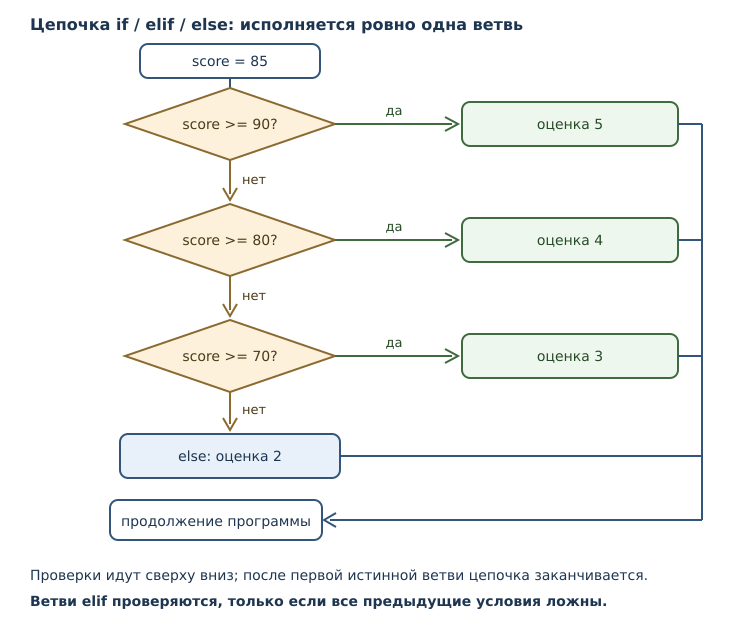
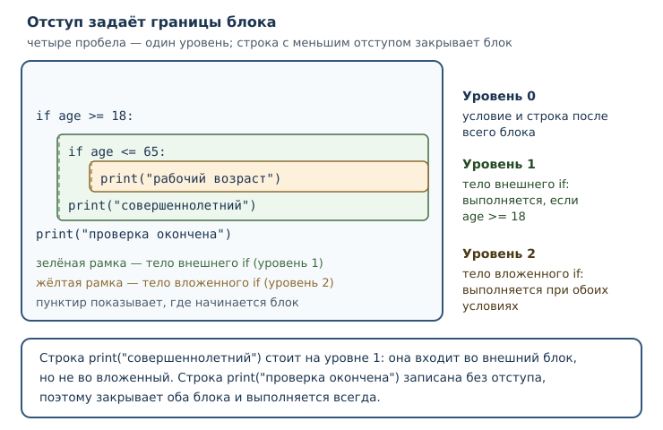

# Логика и управление потоком

<!-- syllanix:nav -->
**Навигация:** [← 04. Выражения, операторы и ввод данных](04-expressions-input.md) · [Оглавление книги](../README.md) · [Далее: 06. Циклы: while и for →](06-loops.md)
<!-- /syllanix:nav -->

<!-- syllanix:topics -->
**Темы главы**
5.1. [Что вы сможете после этой главы](#что-вы-сможете-после-этой-главы)  
5.2. [Истинность значения](#truthiness)  
5.3. [Инструкция if](#if)  
5.4. [Ветви elif и else](#elif-else)  
5.5. [Отступы и блоки](#indentation)  
5.6. [Как формулировать условие](#writing-conditions)  
5.7. [Вложенные условия и порядок проверок](#nesting)  
5.8. [Условное выражение](#conditional-expression)  
5.9. [Собираем вместе](#example)  
5.10. [Разбор: игра «угадай число»](#guessing-game)  
5.11. [Типичные ошибки](#mistakes)  
5.12. [Упражнения](#упражнения)  
5.13. [Проверка понимания](#проверка-понимания)  
5.14. [Что дальше](#что-дальше)  
<!-- /syllanix:topics -->


Программы из предыдущих глав шли по прямой: каждая инструкция выполнялась
ровно один раз и в том порядке, в каком записана. Такая программа не умеет
реагировать на входные значения — она всегда делает одно и то же. Настоящее
поведение начинается там, где появляется выбор: если возраст меньше 18, продать
билет со скидкой; если сумма заказа больше тысячи, добавить доставку бесплатно;
если ввели пустую строку, попросить повторить ввод.

Для выбора нужны две вещи: условие, которое может быть истинным или ложным, и
инструкция, которая решает, какой блок кода выполнить. В этой главе появятся
`if`, `elif` и `else`, а вместе с ними — отступы, которые в Python входят в
синтаксис и определяют границы блоков.

## Что вы сможете после этой главы

К концу главы вы будете уметь следующее.

- понимать, как Python трактует значение в логическом контексте;
- писать ветвления с одной, двумя и многими ветвями;
- объяснять, почему отступ — часть синтаксиса, а не украшение;
- выбирать между вложенными условиями и цепочкой проверок;
- записывать простое ветвление одним условным выражением;
- читать сообщения об ошибках отступов и исправлять их.

## Истинность значения {#truthiness}

Логические операторы `and` и `or` из главы 4 возвращали не обязательно `True`
или `False`, а один из операндов. Причина в том, что Python умеет трактовать
любое значение как истинное или ложное. Это правило называется **истинность
значения**.

Ложными в логическом контексте считаются:

- число `0` и `0.0` — любое нулевое число;
- пустая строка `""`;
- значение `None`;
- сам `False`;
- пустые коллекции — с ними мы познакомимся в части 3.

Все остальные значения истинны. Важно, что «нулеподобность» текста не
работает: строка `"0"` истинна, потому что это непустая строка, а не число.
Строка `" "` из одного пробела тоже истинна.

Проверить правило можно встроенной функцией `bool`, которая возвращает
логическое значение для своего аргумента:

```python exec
print(bool(0), bool(1), bool(-1))
print(bool(0.0), bool(0.0001))
print(bool(""), bool(" "), bool("0"), bool("False"))
print(bool(None), bool(False), bool(True))
```

```output
False True True
False True
False True True True
False False True
```

Вторая строка показывает, что `0.0001` истинно, хотя число очень маленькое:
важен только ноль. Третья строка — источник ошибок: любая непустая строка
истинна, даже если изображает ноль или слово «False».

Практическое следствие: проверка `if value:` короче, но она не различает
«значение равно нулю» и «значения нет». Если ноль — допустимое значение,
пишите явно: `if value != 0:` или `if value is not None:`. Явное сравнение
сообщает читателю, что именно вы проверяете, и не зависит от того, помнит ли
он правило истинности.

Есть случай, где краткая проверка уместна и даже полезна: пустой ввод. Функция
input возвращает строку, и человек может нажать Enter, ничего не набрав. Тогда
значение равно `""`, а это как раз ложное значение, поэтому `if raw:` читается
естественно: «если что-то введено». Но и здесь полезно назвать намерение
словами в комментарии или в имени переменной, чтобы следующий читатель не
гадал, проверяете вы пустоту или ноль.

## Инструкция if {#if}

**Инструкция if** выполняет блок кода только тогда, когда её **условие**
истинно. Условие — любое выражение; его результат трактуется по правилу
истинности. После условия ставится двоеточие, а тело записывается с отступом.

```python exec
age = 20
if age >= 18:
    print("доступ разрешён")
print("проверка завершена")
```

```output
доступ разрешён
проверка завершена
```

**Блок** — группа инструкций, которую исполняют как единое целое. В Python
блок выделяется отступом: строки с одинаковым отступом после `if` относятся к
его телу. Строка без отступа к блоку не относится и выполняется всегда — в
примере это `print("проверка завершена")`.

Если условие ложно, тело пропускается целиком:

```python exec
age = 15
if age >= 18:
    print("доступ разрешён")
print("проверка завершена")
```

```output
проверка завершена
```

Обратите внимание: программа не «сломалась» и не сообщила об ошибке. Ложное
условие — обычная ситуация, а не исключительная.

Тело может состоять из нескольких инструкций: все они выполняются или
пропускаются вместе.

```python exec
x = 10
if x > 5:
    print("больше пяти")
    print("вторая строка блока")
print("вне блока")
```

```output
больше пяти
вторая строка блока
вне блока
```

## Ветви elif и else {#elif-else}

Одной ветви часто мало: нужно не только сделать что-то при выполнении условия,
но и предусмотреть противоположный случай. **Ветвь else** задаёт блок, который
исполняется, когда условие ложно.

```python exec
x = 3
if x > 5:
    print("больше пяти")
else:
    print("не больше пяти")
```

```output
не больше пяти
```

**Ветвь elif** добавляет ещё одну проверку, которая выполняется только тогда,
когда все предыдущие условия оказались ложными. Цепочка может быть длинной.
Исполняется первая ветвь, чьё условие истинно: если в цепочке есть `else`,
ровно одна ветвь исполнится всегда, а без `else` при всех ложных условиях не
исполнится ни одна.

```python exec
score = 85
if score >= 90:
    print("оценка 5")
elif score >= 80:
    print("оценка 4")
elif score >= 70:
    print("оценка 3")
else:
    print("оценка 2")
```

```output
оценка 4
```

Порядок ветвей стал частью логики. Если поставить более мягкое условие первым,
до строгого очередь не дойдёт:

```python exec
score = 85
if score >= 70:
    print("зачёт")
elif score >= 90:
    print("отлично")
```

```output
зачёт
```

Второе условие здесь недостижимо: любое число, для которого истинно
`score >= 90`, истинно и для `score >= 70`, поэтому первая ветвь всегда
сработает раньше. Это не ошибка синтаксиса — программа работает, но ведёт себя
не так, как ожидал автор. Проверяя цепочку `elif`, читайте её сверху вниз и
спрашивайте: может ли эта ветвь вообще выполниться?



## Отступы и блоки {#indentation}

В большинстве языков границы блока задают фигурными скобками, а отступы нужны
только людям. В Python наоборот: **отступ** — ведущие пробелы в начале строки —
определяет, к какому блоку относится инструкция. Это решение языка, а не
соглашение оформителей, поэтому неверный отступ делает программу неверной.

Основные правила:

1. Тело `if`, `elif` и `else` записывается с отступом больше, чем строка с
   условием.
2. Все строки одного блока имеют одинаковый отступ.
3. Блок заканчивается там, где отступ уменьшается.
4. Вложенные блоки получают ещё один уровень отступа.

Рекомендация PEP 8 — четыре пробела на уровень. Это именно рекомендация стиля:
язык принимает и два пробела, и три. Но смешивать табуляцию и пробелы нельзя —
Python 3 считает это ошибкой.



Посмотрим, что происходит, когда отступ потерян или лишний. В первом примере
после `if` нет тела:

```python syntax-error
if True:
print("нет отступа")
```

Во втором примере блок начался, но следующая строка неожиданно вернулась на
прежний уровень, а затем снова ушла вправо:

```python syntax-error
if True:
    print("первая строка")
  print("отступ не совпадает")
```

Интерпретатор сообщает об ошибке отступа до запуска программы и указывает
строку. Текст сообщения зависит от версии Python, поэтому ориентируйтесь на тип
ошибки. Для первого случая это `IndentationError`, для смешения табуляции и
пробелов — `TabError`. Вот как выглядит такое сообщение (детали текста в разных
версиях отличаются):

```text
  File "program.py", line 2
    print("нет отступа")
    ^
IndentationError: expected an indented block after 'if' statement on line 1
```

Полезная привычка: настраивать редактор так, чтобы он вставлял четыре пробела
по Tab и показывал невидимые символы. Тогда ошибка отступа не появится вовсе.

Почему смешивать табуляцию и пробелы опасно: ширина табуляции зависит от
настроек редактора. Один и тот же файл в разных программах выглядит по-разному, и
человек видит один блок там, где интерпретатор видит другой. Пробелы такой
двусмысленности не создают: четыре пробела — всегда четыре пробела. Отсюда
правило: в одном файле либо только пробелы, либо только табуляция, и для Python
принято первое.

## Как формулировать условие {#writing-conditions}

Условие читают люди, а исполняет машина. Поэтому формулировка важна не меньше,
чем синтаксис. Несколько правил, которые экономят время при отладке.

**Формулируйте утвердительно.** `if age >= 18:` читается легче, чем
`if not age < 18:`, хотя это одно и то же. Отрицание заставляет читателя
выполнить в уме ещё один шаг.

**Не сравнивайте с `True` и `False`.** Запись `if is_ready == True:` избыточна:
само имя уже логическое значение, и `if is_ready:` делает то же самое. Сравнение
с `False` вдвойне опасно: `if is_ready == False:` легко превращается в
`if is_ready = False:` при невнимательной правке, а такая ошибка не всегда
заметна сразу.

**Помните о законах де Моргана.** Отрицание связки меняет оператор:

- `not (a and b)` равносильно `(not a) or (not b)`;
- `not (a or b)` равносильно `(not a) and (not b)`.

Проверим на конкретных значениях:

```python exec
a = True
b = False
print(not (a and b), (not a) or (not b))
print(not (a or b), (not a) and (not b))
```

```output
True True
False False
```

Совпадение не случайно: это тождество логики, а не особенность Python. Оно
позволяет переписать непонятное условие в понятное. Например,
`not (age < 18 or age > 65)` превращается в `age >= 18 and age <= 65`, а это
уже цепочка сравнений `18 <= age <= 65`.

## Вложенные условия и порядок проверок {#nesting}

Одно условие может стоять внутри другого. Это нужно, когда второе решение
имеет смысл только после первого.

```python exec
a = 1
b = 2
if a == 1:
    if b == 2:
        print("оба условия истинны")
```

```output
оба условия истинны
```

Вложенность работает, но у неё есть цена: каждый уровень добавляет отступ и
усложняет чтение. Часто вложенное условие можно заменить одним составным — и
тогда код становится плоским:

```python exec
a = 1
b = 2
if a == 1 and b == 2:
    print("оба условия истинны")
```

```output
оба условия истинны
```

Результат тот же, а уровней стало меньше. Логическая связка `and` здесь
работает и как соединение условий, и как
[сокращённое вычисление](04-expressions-input.md#short-circuit): если `a == 1`
ложно, вторая часть не проверяется.

Выбирайте форму по смыслу:

- **Составное условие** — когда важны все условия сразу и между ними нет
  иерархии.
- **Вложенное условие** — когда вторая проверка осмысленна только внутри
  первой, а между ветвями есть собственная логика.
- **Цепочка `elif`** — когда есть несколько взаимоисключающих вариантов.

Три уровня вложенности — сигнал, что стоит разбить задачу на части. Инструмент
для этого появится в главе 7: функции позволят вынести проверку в отдельное
имя и вернуть результат.

## Условное выражение {#conditional-expression}

Иногда нужно не выполнить блок, а выбрать одно из двух значений. Для этого
служит **условное выражение** — выражение вида `A if условие else B`. Оно
вычисляет `A`, если условие истинно, и `B` в противном случае, а результатом
служит выбранное значение.

```python exec
x = 7
print("чётное" if x % 2 == 0 else "нечётное")
```

```output
нечётное
```

Условное выражение можно присвоить имени или вставить в f-строку:

```python exec
age = 15
status = "совершеннолетний" if age >= 18 else "несовершеннолетний"
print(f"Статус: {status}")
```

```output
Статус: несовершеннолетний
```

Обратите внимание на порядок слов: сначала идёт значение для истинного случая,
потом условие, потом значение для ложного. Это отличается от `if`-инструкции,
где условие стоит первым. Читайте такую запись как вопрос: «какое из двух
значений взять, если условие истинно?».

Условные выражения можно соединять в цепочку, но злоупотреблять этим не стоит:

```python exec
temperature = 5
print("холодно" if temperature < 0 else "прохладно" if temperature < 15 else "тепло")
```

```output
прохладно
```

Работает, но читается хуже, чем цепочка `elif`. Правило простое: если
выбирается значение — берите условное выражение; если выполняются действия —
берите `if`. Смешивать не нужно.

## Собираем вместе {#example}

Задача: посчитать стоимость доставки по весу посылки. До 1 кг — 300 рублей, до
5 кг — 500 рублей, тяжелее — 800 рублей плюс 100 рублей за каждый килограмм
сверх пяти.

```python
raw_weight = input("Вес посылки, кг: ")
weight = float(raw_weight)
if weight <= 1:
    delivery = 300
elif weight <= 5:
    delivery = 500
else:
    over = weight - 5
    extra = int(over) + (1 if over > int(over) else 0)
    delivery = 800 + 100 * extra
print(f"Вес: {weight} кг, доставка: {delivery} рублей")
```

`int(over)` считает полные килограммы сверх пяти, а добавка `1` нужна, когда
остаток не целый: за начатый килограмм платят как за целый.

Проверим ту же логику на нескольких значениях, чтобы увидеть все ветви:

```python exec
raw_weight = "3.2"
weight = float(raw_weight)
if weight <= 1:
    delivery = 300
elif weight <= 5:
    delivery = 500
else:
    over = weight - 5
    extra = int(over) + (1 if over > int(over) else 0)
    delivery = 800 + 100 * extra
print(f"Вес: {weight} кг, доставка: {delivery} рублей")
```

```output
Вес: 3.2 кг, доставка: 500 рублей
```

```python exec
weight = 6.4
if weight <= 1:
    delivery = 300
elif weight <= 5:
    delivery = 500
else:
    over = weight - 5
    extra = int(over) + (1 if over > int(over) else 0)
    delivery = 800 + 100 * extra
print(f"Вес: {weight} кг, доставка: {delivery} рублей")
```

```output
Вес: 6.4 кг, доставка: 1000 рублей
```

Проверим целый вес чуть больше пяти — здесь легко ошибиться на единицу:

```python exec
weight = 6.0
if weight <= 1:
    delivery = 300
elif weight <= 5:
    delivery = 500
else:
    over = weight - 5
    extra = int(over) + (1 if over > int(over) else 0)
    delivery = 800 + 100 * extra
print(f"Вес: {weight} кг, доставка: {delivery} рублей")
```

```output
Вес: 6.0 кг, доставка: 900 рублей
```

В рабочей программе к этому коду добавилась бы защита от неверного ввода:
`float("шесть")` завершится ошибкой `ValueError`, а пустая строка не даст
числа вовсе. Проверить ввод заранее можно так:

```python
raw_weight = input("Вес посылки, кг: ")
if raw_weight == "":
    print("вес не указан")
else:
    weight = float(raw_weight)
    print(f"Принят вес {weight} кг")
```

Такая проверка не заменяет обработку ошибок из главы 10, но отсекает самый
частый случай — пустой ввод.

Разберём случай с весом `6.4`: он больше пяти, поэтому работает `else`.
Разница `6.4 - 5 = 1.4` кг; `int(1.4)` даёт `1` полный килограмм, а поскольку
остаток `0.4` не равен нулю, добавляется ещё один — итого `2` оплачиваемых
килограмма сверх пяти, `800 + 200 = 1000` рублей. Для ровно `6.0` кг остаток
равен нулю, добавки нет, и выходит `800 + 100 = 900` рублей. Здесь `int`
использован осознанно: вес может быть дробным, а плата считается целыми
рублями, причём начатый килограмм оплачивается целиком.

## Разбор: игра «угадай число» {#guessing-game}

*Адаптировано из книги «A Byte of Python» (Swaroop C H, лицензия CC BY-SA 4.0,
ревизия `84f4dd8`): текст переведён и отредактирован, структура разбора
сохранена. Изменения: сокращены повторы, добавлены запускаемые примеры и
русские сообщения, интерактивный ввод заменён заранее заданными значениями.*

Условная логика особенно наглядна в программе, которая сравнивает догадку
человека с загаданным числом. Полный интерактивный вариант выглядит так:

```python
number = 23
raw = input("Угадайте число: ")
guess = int(raw)
if guess == number:
    print("Поздравляю, вы угадали!")
elif guess < number:
    print("Немного больше")
else:
    print("Немного меньше")
print("Игра окончена")
```

Порядок проверок здесь принципиален. Сначала сравнивается равенство: если
догадка совпала, остальные ветви не проверяются вовсе. Если нет — программа
выясняет, в какую сторону ошибся человек, и сообщает, куда двигаться. Ветвь
`else` срабатывает только тогда, когда не подошли ни `if`, ни `elif`.

Чтобы увидеть каждую ветвь, запустим ту же логику с заранее заданными
догадками. Первая догадка меньше загаданного числа:

```python exec
number = 23
guess = int("10")
if guess == number:
    print("Поздравляю, вы угадали!")
elif guess < number:
    print("Немного больше")
else:
    print("Немного меньше")
```

```output
Немного больше
```

Вторая догадка совпадает:

```python exec
number = 23
guess = int("23")
if guess == number:
    print("Поздравляю, вы угадали!")
elif guess < number:
    print("Немного больше")
else:
    print("Немного меньше")
```

```output
Поздравляю, вы угадали!
```

Третья догадка больше загаданного числа, поэтому работает `else`:

```python exec
number = 23
guess = int("50")
if guess == number:
    print("Поздравляю, вы угадали!")
elif guess < number:
    print("Немного больше")
else:
    print("Немного меньше")
```

```output
Немного меньше
```

Обратите внимание на две детали, которые часто упускают. Во-первых, `int(raw)`
преобразует строку в число: без этого сравнение строки с числом дало бы `False`
всегда, а не ошибку. Во-вторых, порядок ветвей `elif` можно менять, только если
условия не пересекаются; здесь они упорядочены по возрастанию сложности
проверки, и каждая следующая ветвь рассматривает всё более узкий случай.

*Источник и характер изменений зафиксированы в `provenance/05-control-flow.yaml`.*

## Типичные ошибки {#mistakes}

1. **Забыть двоеточие.** После условия и после `else` двоеточие обязательно;
   без него программа не разбирается.
2. **Потерять отступ.** Тело условия обязано быть сдвинуто вправо. Это ошибка
   разбора, а не предупреждение.
3. **Смешать табуляцию и пробелы.** Визуально отступы могут выглядеть
   одинаково, но Python сообщит `TabError`. Настройте редактор на пробелы.
4. **Использовать `=` вместо `==`.** `if x = 5:` — синтаксическая ошибка;
   сравнение записывается двойным знаком.
5. **Путать `if` и `elif`.** Две независимые инструкции `if` проверяют оба
   условия, а цепочка `elif` — только до первого истинного. Результаты
   различаются, если условия не исключают друг друга.
6. **Ставить мягкое условие раньше строгого.** В цепочке `elif` до строгой
   ветви очередь может не дойти.
7. **Проверять число через `if value:`.** Ноль — допустимое значение, но оно
   ложно. Если ноль возможен, сравнивайте явно.
8. **Ожидать, что `bool("0")` даст `False`.** Непустая строка истинна;
   преобразование текста в число делает `int`, а не `bool`.

## Упражнения

### 1. Что напечатается {#ex-ch05-01}

Какие строки выведет программа? Запишите ответ, затем проверьте.

```python
x = 12
if x > 10:
    print("больше десяти")
print("проверка окончена")
if x < 10:
    print("меньше десяти")
```

### 2. Истинность значений {#ex-ch05-02}

Не запуская код, определите результаты: `bool(0)`, `bool("0")`, `bool("")`,
`bool(" ")`, `bool(None)`, `bool(-1)`, `bool(0.0)`. Затем проверьте и объясните
каждое значение.

### 3. Исправление отступа {#ex-ch05-03}

Программа не запускается:

```text
age = 20
if age >= 18:
print("доступ разрешён")
```

Объясните причину и запишите исправленный вариант. Почему 0 пробелов —
ошибка, а 2 или 8 — синтаксически допустимы, хотя PEP 8 рекомендует 4?

### 4. Порядок ветвей {#ex-ch05-04}

Дана цепочка:

```python
grade = 75
if grade >= 60:
    print("удовлетворительно")
elif grade >= 90:
    print("отлично")
elif grade >= 75:
    print("хорошо")
```

Что выведет программа? Почему ветви `отлично` и `хорошо` не работают так, как
задумано? Исправьте порядок условий.

### 5. Три случая {#ex-ch05-05}

Напишите программу, которая для числа `n` выводит `положительное`,
`отрицательное` или `ноль`. Проверьте на значениях `7`, `-3`, `0`.

### 6. Плоская форма {#ex-ch05-06}

Перепишите код, избавившись от вложенности:

```python
age = 25
if age >= 18:
    if age <= 65:
        print("рабочий возраст")
```

Результат должен сохраниться. Объясните, какое условие получилось и почему
эквивалентность сохраняется.

### 7. Условное выражение {#ex-ch05-07}

Перепишите выбор значения одним условным выражением:

```python
limit = 100
if limit > 50:
    message = "большой лимит"
else:
    message = "маленький лимит"
```

Затем выведите `message` через f-строку.

### 8. Ошибка с одним знаком {#ex-ch05-08}

Почему программа не запускается? Исправьте её и объясните, чем `=` отличается
от `==`.

```python syntax-error
x = 5
if x = 5:
    print("пять")
```

### 9. Билеты по возрасту {#ex-ch05-09}

Цена билета: до 6 лет — бесплатно, от 6 до 17 — 300 рублей, от 18 до 64 — 600
рублей, от 65 — 200 рублей. Напишите программу, которая получает возраст
строкой, преобразует его в целое и печатает цену через f-строку. Проверьте на
возрастах `5`, `12`, `30`, `70`.

### 10. Два if или elif {#ex-ch05-10}

Сравните две программы:

```python
x = 150
if x > 100:
    print("больше ста")
if x > 50:
    print("больше пятидесяти")
```

```python
x = 150
if x > 100:
    print("больше ста")
elif x > 50:
    print("больше пятидесяти")
```

Сколько строк выведет каждая? Объясните разницу и скажите, в каком случае
цепочка `elif` уместна и читается лучше.

## Проверка понимания

1. Какие значения Python считает ложными? Почему `bool("0")` даёт `True`?
2. Чем условие отличается от обычного выражения?
3. Что такое блок и как Python определяет его границы?
4. Почему отступ в Python — часть синтаксиса, а не оформление?
5. Чем цепочка `elif` отличается от нескольких независимых `if`?
6. Почему порядок ветвей в цепочке `elif` важен?
7. Когда выбирать условное выражение, а когда — инструкцию `if`?
8. Чем `IndentationError` отличается от `TabError` по причине возникновения?

## Что дальше

Теперь программа умеет выбирать путь. Но каждая ветвь всё ещё исполняется один
раз: чтобы обработать сто заказов, пришлось бы сто раз повторить код. Дальше
появятся [циклы](06-loops.md) — механизм, который повторяет блок, пока условие
истинно, и позволяет обрабатывать данные любого объёма.

<!-- syllanix:nav -->
**Перед этой главой:** [04. Выражения, операторы и ввод данных](04-expressions-input.md)
**Связанные главы:** [02. Первая программа: вычисления и вывод](02-first-program.md), [03. Значения, имена, объекты и типы](03-values-names-objects.md), [54. Практикум: классические задачи и разбор решений](54-practice.md)
**Далее:** [06. Циклы: while и for →](06-loops.md)
<!-- /syllanix:nav -->
