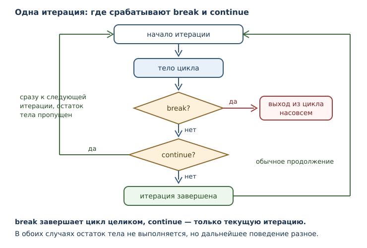
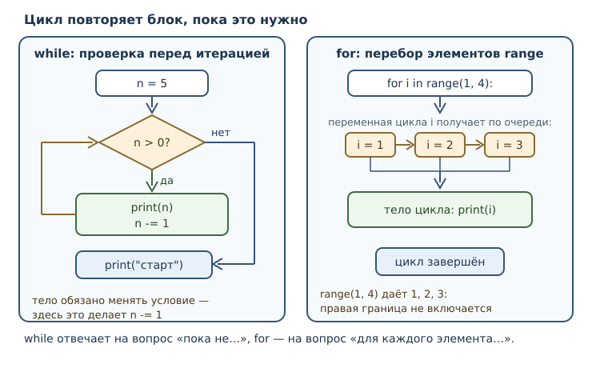

# Циклы: while и for

<!-- syllanix:nav -->
**Навигация:** [← 05. Логика и управление потоком](05-control-flow.md) · [Оглавление книги](../README.md) · [Далее: 07. Функции: параметры, аргументы и области видимости →](07-functions.md)
<!-- /syllanix:nav -->

<!-- syllanix:topics -->
**Темы главы**
6.1. [Что вы сможете после этой главы](#что-вы-сможете-после-этой-главы)  
6.2. [Цикл while](#while)  
6.3. [Цикл for и range](#for)  
6.4. [Перебор не только чисел](#other-iterables)  
6.5. [Инструкции break и continue](#break-continue)  
6.6. [Ветвь else цикла](#loop-else)  
6.7. [Вложенные циклы](#nested)  
6.8. [Бесконечный цикл](#infinite-loop)  
6.9. [Как выбрать цикл](#choosing)  
6.10. [Собираем вместе](#example)  
6.11. [Типичные ошибки](#mistakes)  
6.12. [Упражнения](#упражнения)  
6.13. [Проверка понимания](#проверка-понимания)  
6.14. [Что дальше](#что-дальше)  
<!-- /syllanix:topics -->


Условия научили программу выбирать, но не повторять. Если нужно обработать сто
заказов, написать сто одинаковых блоков — плохая идея: такой код невозможно
читать, а изменить в нём одно число придётся сто раз. Нужен механизм, который
описывает повторение **один раз** и заставляет компьютер выполнять его столько
раз, сколько требуется.

Такой механизм называется циклом. В Python есть два вида циклов, и они решают
разные задачи. Цикл `while` повторяет действия, пока условие истинно: он удобен,
когда количество повторений заранее неизвестно и определяется ходом
вычислений. Цикл `for` получает значения из итерируемого объекта: он удобен, когда
нужно обработать его элементы по очереди. Источник значений не обязательно
хранит все элементы заранее или имеет конечную длину. В этой главе появятся оба,
а также инструкции `break` и `continue`, которые управляют ходом цикла изнутри.

## Что вы сможете после этой главы

К концу главы вы будете уметь следующее.

- писать циклы `while` с корректным условием завершения;
- проходить циклом `for` по числам от `range` и по другим наборам значений;
- объяснять, почему `range(5)` даёт числа от 0 до 4, а не от 1 до 5;
- досрочно завершать цикл и пропускать часть итерации;
- отличать бесконечный цикл по ошибке от намеренного;
- выбирать подходящий вид цикла, а не тот, который первым вспомнился.

## Цикл while {#while}

**Цикл while** повторяет блок, пока его условие истинно. Условие проверяется
перед каждой **итерацией** — одним проходом тела цикла. Как только условие
становится ложным, выполнение переходит к первой инструкции после цикла.

```python exec
n = 5
while n > 0:
    print(n)
    n -= 1
print("старт")
```

```output
5
4
3
2
1
старт
```

Разберём по шагам, потому что в цикле важна именно динамика:

1. `n = 5`, условие `5 > 0` истинно — печатается `5`, затем `n` становится
   равным `4`.
2. Условие `4 > 0` истинно — печатается `4`, `n` становится `3`.
3. Так продолжается до `n = 1`: печатается `1`, `n` становится `0`.
4. Условие `0 > 0` ложно — цикл завершается, и исполняется строка после него.

Если `while` должен завершиться, **у него должен быть достижимый способ
остановки**: например, условие становится ложным или выполняется `break`.
В этом примере `n -= 1` приближает окончание цикла. Если убрать строку, `n`
останется равным `5`, а условие продолжит возвращать `True`; программа будет
бесконечно печатать число и не достигнет строки `print("старт")`.

Второй типичный образец — накопление результата. Имя-накопитель создаётся до
цикла, обновляется внутри и читается после:

```python exec
total = 0
i = 1
while i <= 10:
    total += i
    i += 1
print(total)
```

```output
55
```

Здесь `total` — сумма чисел от 1 до 10, а `i` — счётчик, который одновременно
служит условием продолжения. Две роли разделены: `total` хранит результат, `i`
управляет повтором. Путать их нельзя: если обновлять только `total`, цикл не
завершится.

## Цикл for и range {#for}

**Цикл for** по очереди присваивает **переменной цикла** элементы
**итерируемого объекта** и исполняет тело для каждого элемента. Итерируемый
объект — объект, по которому можно пройти таким образом: он умеет выдавать свои
элементы по одному.

Самый частый источник элементов — `range`.

```python exec
for i in range(5):
    print(i)
```

```output
0
1
2
3
4
```

**range** — компактная последовательность целых чисел: она хранит только
границы и вычисляет число по индексу. У неё три формы записи:

| Запись | Что даёт | Пример |
|---|---|---|
| `range(стоп)` | от `0` до `стоп - 1` | `range(5)` → 0, 1, 2, 3, 4 |
| `range(старт, стоп)` | от `старт` до `стоп - 1` | `range(2, 6)` → 2, 3, 4, 5 |
| `range(старт, стоп, шаг)` | с шагом, может быть отрицательным | `range(10, 0, -3)` → 10, 7, 4, 1 |

Проверим вторую и третью формы:

```python exec
for i in range(2, 6):
    print(i)
```

```output
2
3
4
5
```

```python exec
for i in range(10, 0, -3):
    print(i)
```

```output
10
7
4
1
```

Правая граница в `range` **не включается**. Это самая частая причина ошибок на
единицу: чтобы получить числа от 1 до 10, нужен `range(1, 11)`, а не
`range(1, 10)`.

Два крайних случая стоит знать заранее. Нулевой шаг запрещён: `range(1, 10, 0)`
поднимает ошибку `ValueError: range() arg 3 must not be zero`, потому что
непонятно, как двигаться. А шаг, уводящий от границы, даёт пустой диапазон:
`range(0, 5, -1)` не содержит ни одного числа, и цикл не выполнится ни разу.

```python exec expect-error
for i in range(1, 10, 0):
    print(i)
```

```output
ValueError: range() arg 3 must not be zero
```

```python exec
total = 0
for i in range(1, 11):
    total += i
print(total)
```

```output
55
```

Слово «ленивый» означает, что `range` не хранит все числа в памяти: он
вычисляет очередное число, когда оно понадобится. Поэтому `range(1_000_000)`
занимает считанные байты, а не мегабайты. Убедиться, что это особый объект, а
не список чисел, можно так:

```python exec
print(range(5))
print(range(2, 10, 2))
print(range(5) == range(0, 5))
```

```output
range(0, 5)
range(2, 10, 2)
True
```

Последняя строка показывает, что `range` умеет сравниваться по своему
содержимому: `range(5)` и `range(0, 5)` описывают одну и ту же
последовательность.

Переменная цикла после завершения сохраняет последнее значение. Это не ошибка,
но и не гарантия осмысленности:

```python exec
for i in range(3):
    print("итерация", i)
print("последнее значение переменной цикла:", i)
```

```output
итерация 0
итерация 1
итерация 2
последнее значение переменной цикла: 2
```

Если цикл не выполнился ни разу, имя останется в том виде, в каком было до
цикла, — или его не будет вовсе, если оно раньше не встречалось.

**Не путайте переменную цикла с управлением перебором.** Изменение `i` внутри
тела не меняет, какие значения `for` получит из `range` дальше:

```python exec
for i in range(3):
    print("до:", i)
    i = 100
```

```output
до: 0
до: 1
до: 2
```

На каждой следующей итерации `for` снова присваивает `i` очередное значение
из источника. После цикла `i` будет равна `100`, так как именно это значение
присвоено в последней итерации.

## Перебор не только чисел {#other-iterables}

`range` — удобный, но не единственный итерируемый объект. Например, строку
можно перебрать посимвольно:

```python exec
word = "кот"
for ch in word:
    print(ch)
```

```output
к
о
т
```

Тот же приём работает с любой строкой: `for` не интересует, что именно за
объект перед ним, — ему достаточно, чтобы объект умел выдавать элементы по
очереди. Коллекции из части 3 тоже окажутся итерируемыми, и цикл `for` станет
основным способом их обработки. Подробнее о механизме, который стоит за
перебором, — в главе 20.

## Инструкции break и continue {#break-continue}

Иногда нужно прервать цикл раньше, чем закончится его условие, или пропустить
часть тела. Для этого есть две инструкции.

**break** немедленно завершает ближайший цикл: управление переходит к первой
инструкции после него, остальные итерации не выполняются.

```python exec
for n in range(1, 20):
    if n * n > 50:
        break
    print(n)
print("первое число с квадратом больше 50:", n)
```

```output
1
2
3
4
5
6
7
первое число с квадратом больше 50: 8
```

Цикл мог бы идти до 19, но как только встретилось `8`, условие `64 > 50`
оказалось истинным, и `break` остановил перебор. Без `break` пришлось бы
перебирать весь диапазон и проверять результат отдельно.

**continue** не завершает цикл, а переходит к следующей итерации, пропуская
остаток тела. В `while` после `continue` снова проверяется условие, а в `for`
запрашивается следующее значение. Поэтому в `while` важно не пропустить
обновление счётчика.

```python exec
for i in range(1, 11):
    if i % 2:
        continue
    print(i)
```

```output
2
4
6
8
10
```

Условие `i % 2` истинно для нечётных чисел, поэтому для них `continue`
перескакивает печать. Чётные числа доходят до `print` и печатаются.

Разница между инструкциями принципиальна:

| Инструкция | Что делает | Что происходит с циклом |
|---|---|---|
| `break` | выходит из цикла | цикл завершён |
| `continue` | пропускает остаток итерации | цикл продолжается |

Типичная ошибка — написать `break` там, где нужен `continue`. Тогда цикл
завершится при первом совпадении, а оставшиеся элементы не будут обработаны.

Другая опасность — `continue` до изменения переменной, от которой зависит
условие `while`. Следующий код **не запускайте без ограничения времени**:

```python
n = 0
while n < 3:
    if n == 1:
        continue  # n остаётся равным 1
    n += 1
```

Когда `n == 1`, инструкция `continue` возвращает управление к проверке
`n < 3`, и число больше не меняется. Чтобы исправить код, убедитесь, что
обновление `n` не пропускается:

```python exec
n = 0
while n < 3:
    n += 1
    if n == 1:
        continue
    print(n)
```

```output
2
3
```



## Ветвь else цикла {#loop-else}

У циклов в Python есть особенность, которой нет во многих языках: после тела
можно поставить `else`. **Ветвь else цикла** исполняется, если цикл **нормально завершился без**
`break`: закончились значения `for` или стало ложным условие `while`. Если
произошли `break`, `return` или необработанное исключение, ветвь не выполняется.

Удобнее всего это работает при поиске. Проверим, простое ли число: перебираем
возможные делители и прерываемся, как только нашли хоть один.

```python exec
n = 49
if n < 2:
    print("не простое")
else:
    for d in range(2, n):
        if n % d == 0:
            print("делитель", d)
            break
    else:
        print("простое число")
```

```output
делитель 7
```

Для `49` делитель нашёлся, `break` сработал, и ветвь `else` пропущена. Теперь
возьмём число без делителей:

```python exec
n = 47
if n < 2:
    print("не простое")
else:
    for d in range(2, n):
        if n % d == 0:
            print("делитель", d)
            break
    else:
        print("простое число")
```

```output
простое число
```

Проверка `n < 2` нужна отдельно: единица и ноль — не простые числа, а
`range(2, n)` для них пуст, поэтому без этой проверки ветвь `else` сразу
объявила бы число простым.

Цикл прошёл весь диапазон и не прервался — значит, делителей нет. Без `else`
пришлось бы заводить отдельное имя-признак, ставить его в `False`, менять в
теле и проверять после цикла. Ветвь `else` убирает эту лишнюю механику, а
главное — делает намерение явным: «если поиск не прервался».

Ветвь `else` работает и с `while`:

```python exec
n = 0
while n < 3:
    n += 1
else:
    print("цикл завершился без break")
```

```output
цикл завершился без break
```

## Вложенные циклы {#nested}

Цикл может стоять внутри другого цикла. Внешний цикл отвечает за строки,
внутренний — за элементы внутри строки. Классический пример — таблица
умножения:

```python exec
for i in range(1, 3):
    for j in range(1, 4):
        print(f"{i * j:3}", end="")
    print()
```

```output
  1  2  3
  2  4  6
```

Запись `f"{i * j:3}"` резервирует минимум три позиции для вывода числа;
`end=""` не добавляет перевод строки. Подробное форматирование строк — в главе 15.

Внутренний цикл выполняется целиком на каждой итерации внешнего: для `i = 1`
три числа, затем для `i = 2` ещё три. Общее число итераций тела внутреннего
цикла равно произведению длин диапазонов: `2 * 3 = 6`.

Важно помнить: `break` действует только на **ближайший** цикл. Внутренний
`break` не выходит из внешнего.

```python exec
for i in range(1, 4):
    for j in range(1, 4):
        if j == 2:
            break
        print(i, j)
```

```output
1 1
2 1
3 1
```

Внутренний цикл каждый раз прерывается на `j = 2`. Управление переходит
**к первой инструкции после внутреннего цикла**, но всё ещё внутри тела
внешнего цикла. В данном примере таких инструкций нет — поэтому начинается
следующая итерация внешнего цикла. Проверим важную разницу:

```python exec
for i in range(2):
    for j in range(3):
        break
    print("после внутреннего:", i)
```

```output
после внутреннего: 0
после внутреннего: 1
```

Если нужен выход из обоих циклов, можно проверить условие во внешнем цикле
или вынести поиск в функцию — этот приём появится в главе 7.

## Бесконечный цикл {#infinite-loop}

**Бесконечный цикл** — повторение без достижения завершения. Для `while`
причиной может быть неизменно истинное условие без достижимого `break`;
для `for` — неограниченный итератор. Если цикл бесконечен по ошибке,
программа может расходовать ресурсы и не выполнять последующий код. Это
не означает, что она обязательно перестаёт реагировать на ввод: некоторые
программы намеренно обрабатывают события в цикле.

Но бесконечный цикл бывает и намеренным. Схема `while True` с `break` внутри —
стандартный приём для программ, которые работают до определённого события:
пока пользователь не выберет выход, пока не поступит нужный сигнал.

```python exec
count = 0
while True:
    count += 1
    if count > 3:
        break
    print(count)
print("вышли при count =", count)
```

```output
1
2
3
вышли при count = 4
```

Условие `True` истинно всегда, поэтому цикл завершается только через `break`.
Форма `while True` подходит, когда выход зависит от события внутри тела.
Но если условие простое и известно заранее, запись `while count <= 3`
часто яснее: выбор зависит от структуры задачи.

Если программа всё же зависла, её прерывают с клавиатуры: в терминале это
обычно `Ctrl+C`. Это действие оболочки и среды, а не часть языка, но знать о
нём полезно.

## Как выбрать цикл {#choosing}

Оба цикла умеют повторять, но устроены по-разному. Сравним схемы: у `while`
управляет условие, и после тела управление возвращается к его проверке; у `for`
элементы берутся из готового набора, и цикл заканчивается, когда набор исчерпан.



| Вопрос | `while` | `for` |
|---|---|---|
| Сколько повторений? | определяется условием | определяется количеством выдаваемых значений |
| Что управляет повтором? | условие | итератор и его исчерпание |
| Может ли не завершиться? | да, если условие остаётся истинным и нет выхода | да, если источник неограничен и нет `break` |
| Типичная задача | «пока не…», подсчёт шагов | обработка элементов, обход диапазона |

Полезно проследить цикл вручную на бумаге: выписать строку заголовка, затем
две-три итерации со значениями всех имён. Почти все ошибки в циклах видны
именно на третьей итерации, а не на первой.

Практическое правило: если задачу можно сформулировать как «для каждого
элемента из набора сделай…», берите `for`. Если как «повторяй, пока не
выполнится условие», берите `while`. Когда подходят оба варианта и источник конечен, `for` обычно удобнее:
обновлять отдельный счётчик вручную не нужно. Однако у Python бывают
неограниченные итераторы, поэтому сам `for` не гарантирует конечности;
подробности будут в главе 20.

## Собираем вместе {#example}

Разберём задачу, в которой `while` уместнее `for`: сколько шагов нужно, чтобы
привести число к единице по правилу «чётное делим пополам, нечётное умножаем
на три и прибавляем единицу». Заранее число шагов неизвестно — идеальный
случай для цикла с условием.

```python exec
n = 6
steps = 0
while n != 1:
    if n % 2 == 0:
        n //= 2
    else:
        n = 3 * n + 1
    steps += 1
print(steps)
```

```output
8
```

Проследим: `6 → 3 → 10 → 5 → 16 → 8 → 4 → 2 → 1`. Каждая стрелка — одна
итерация, всего их восемь. Для начального значения `6` это проверенный путь
к единице. Но **из изменения `n` на каждом шаге не следует, что любой такой
цикл обязательно закончится**: значения могут снова повториться. Вопрос о
достижении единицы для всех положительных целых чисел — открытая гипотеза
Коллатца. В настоящей программе для неизвестного входа можно ввести лимит
шагов и явно сообщать, если он превышен.

Второй пример — сумма цифр числа. Здесь `while` работает как «разбор числа по
одной цифре справа налево»:

```python exec
n = 1234
total = 0
while n > 0:
    total += n % 10
    n //= 10
print(total)
```

```output
10
```

`n % 10` даёт последнюю цифру, `n //= 10` отбрасывает её. Цикл идёт, пока в
числе остались цифры. Тот же результат можно получить через строки, но
арифметический путь короче и не требует преобразований типов.

## Типичные ошибки {#mistakes}

1. **Забыть изменить условие.** Если в теле `while` счётчик не меняется,
   программа зависнет. Проверяйте: что именно делает условие ложным?
2. **Ошибка на единицу в `range`.** `range(1, 10)` даёт числа от 1 до 9.
   Правая граница не включается.
3. **Ожидать от `range` список.** `print(range(5))` печатает `range(0, 5)`, а не
   `[0, 1, 2, 3, 4]`. Это разные вещи.
4. **Путать `break` и `continue`.** `break` завершает цикл, `continue`
   пропускает остаток текущей итерации.
5. **Рассчитывать, что `break` выйдет из всех циклов.** Он действует только на
   ближайший.
6. **Ожидать, что `else` выполнится после `break`.** Ветвь `else` цикла
   выполняется при нормальном завершении без `break`.
7. **Менять условие в неправильном направлении.** `while n > 0` с `n += 1`
   уводит от завершения, а не к нему.
8. **Считать, что тело цикла выполнится хотя бы раз.** `while` проверяет
   условие до первой итерации; при ложном условии тело не выполнится вовсе.
9. **Пропустить обновление при `continue` в `while`.** Если счётчик не изменится,
   повторение может стать бесконечным.
10. **Думать, что `for` всегда конечен.** Источник значений иногда неограничен.
11. **Менять переменную `for`, ожидая повлиять на следующий элемент.**
    Переменная снова получает значение из источника при следующей итерации.

## Упражнения

### 1. Прогнозирование {#ex-ch06-01}

Что выведет программа? Запишите ответ до запуска.

```python
i = 0
while i < 3:
    print(i)
    i += 1
print("конец")
```

### 2. Сумма диапазона {#ex-ch06-02}

Напишите цикл, который считает сумму чисел от 1 до 100. Проверьте результат:
должно получиться `5050`.

### 3. Ошибка на единицу {#ex-ch06-03}

Автор хотел напечатать числа от 1 до 5, но написал `for i in range(1, 5)`.
Что получится? Исправьте программу и объясните правило правой границы.

### 4. Обратный отсчёт {#ex-ch06-04}

Напишите цикл, который печатает числа от 10 до 1, а затем строку `пуск`.
Используйте `range` с отрицательным шагом.

### 5. Степени двойки {#ex-ch06-05}

Напечатайте степени двойки от `2 ** 1` до `2 ** 10`, каждую с новой строки.
Не используйте вручную записанные числа: вычислите их в цикле.

### 6. Исправление бесконечного цикла {#ex-ch06-06}

Программа зависает:

```python
n = 10
while n > 0:
    print(n)
```

Объясните причину и исправьте код так, чтобы он напечатал числа от 10 до 1.

### 7. Первый делитель {#ex-ch06-07}

Напишите программу, которая находит наименьший делитель числа `n` (больше
единицы) и печатает его. Используйте `break`. Проверьте на `n = 91` и
`n = 97`.

### 8. Пропуск значений {#ex-ch06-08}

Напечатайте все числа от 1 до 30, которые делятся на 3, но не делятся на 5.
Используйте `continue` хотя бы один раз.

### 9. Простое число {#ex-ch06-09}

Напишите программу с ветвью `else` цикла, которая печатает `простое`,
`составное` или `ни то ни другое` для целого числа `n`. Проверьте на
`49`, `47`, `2`, `1` и `0`. Числа меньше 2 не являются ни простыми,
ни составными.

### 10. Мини-задача: таблица {#ex-ch06-10}

Напечатайте таблицу умножения от 1 до 5 в виде строк, где числа выровнены по
ширине три символа:

```text
  1  2  3  4  5
  2  4  6  8 10
  3  6  9 12 15
  4  8 12 16 20
  5 10 15 20 25
```

Используйте вложенные циклы, `f"{...:3}"` и `end=""`.

### 11. Пропущенный счётчик {#ex-ch06-11}

Почему цикл ниже не достигает `print("готово")`? Не запускайте его как есть;
исправьте код и проверьте, что выводятся числа `1`, `2`, `3`.

```python
n = 0
while n < 3:
    if n == 1:
        continue
    n += 1
    print(n)
print("готово")
```

### 12. Перебор строки {#ex-ch06-12}

Используя `for` и `if`, подсчитайте в строке `"молоко"` количество букв
`о` и выведите число. Ожидаемый результат — `3`.

### 13. Изменение переменной `for` {#ex-ch06-13}

Предскажите вывод без запуска. Почему следующая итерация не начинается с 101?

```python
for i in range(2):
    i = 100
    print(i)
```

## Проверка понимания

1. Чем `while` отличается от `for` по способу управления повтором?
2. Почему `range(5)` даёт 0, 1, 2, 3, 4, а не 1, 2, 3, 4, 5?
3. Что такое итерация и чем она отличается от цикла?
4. Чем `break` отличается от `continue`?
5. Когда исполняется ветвь `else` цикла?
6. Почему `break` во внутреннем цикле не завершает внешний?
7. Назовите две причины появления бесконечного цикла.
8. Почему `range(1_000_000)` не занимает много памяти?
9. Куда переходит управление после `break` во вложенном цикле?
10. Почему `continue` внутри `while` иногда приводит к бесконечному циклу?

**Сверка с первоисточниками:**
[спецификация циклов в Python](https://docs.python.org/3/reference/compound_stmts.html#the-while-statement),
[синтаксис и примеры из Python Tutorial](https://docs.python.org/3/tutorial/controlflow.html),
[тип `range`](https://docs.python.org/3/library/stdtypes.html#ranges),
[неограниченные итераторы](https://docs.python.org/3/library/itertools.html#itertools.count).

## Что дальше

Программы научились повторять действия, но по-прежнему состоят из одного
длинного списка инструкций. Когда код растёт, его нужно делить на части с
понятными именами. Дальше появятся [функции](07-functions.md): они позволят
дать имя целому фрагменту работы, вызывать его многократно и возвращать
результат.

<!-- syllanix:nav -->
**Перед этой главой:** [05. Логика и управление потоком](05-control-flow.md)
**Связанные главы:** [02. Первая программа: вычисления и вывод](02-first-program.md), [03. Значения, имена, объекты и типы](03-values-names-objects.md), [04. Выражения, операторы и ввод данных](04-expressions-input.md), [17. Словари: отображения и структурирование данных](17-dicts.md), [20. Итераторы и протокол итерации](20-iterators.md), [21. Генераторы и ленивые вычисления](21-generators.md), [23. Функциональные приёмы и включения](23-functional.md), [54. Практикум: классические задачи и разбор решений](54-practice.md)
**Далее:** [07. Функции: параметры, аргументы и области видимости →](07-functions.md)
<!-- /syllanix:nav -->
