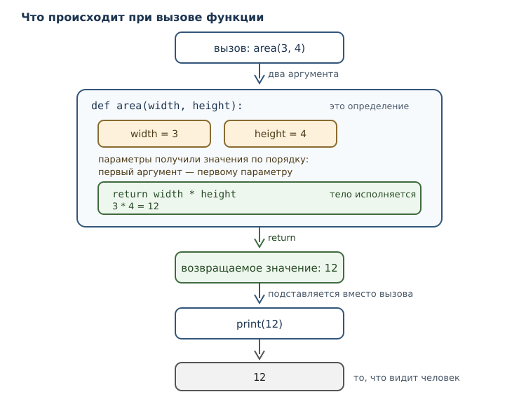
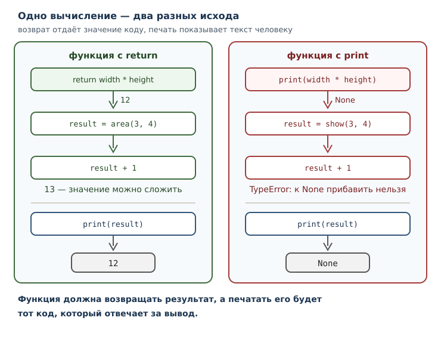

# Функции: параметры, аргументы и области видимости

<!-- syllanix:nav -->
**Навигация:** [← 06. Циклы: while и for](06-loops.md) · [Оглавление книги](../README.md) · [Далее: 08. Стек вызовов, области видимости и рекурсия →](08-recursion-scope.md)
<!-- /syllanix:nav -->

<!-- syllanix:topics -->
**Темы главы**
7.1. [Что вы сможете после этой главы](#что-вы-сможете-после-этой-главы)  
7.2. [Зачем нужна функция](#why)  
7.3. [Инструкция def и вызов функции](#def)  
7.4. [Параметры и аргументы](#parameters)  
7.5. [Возвращаемое значение и return](#return)  
7.6. [Позиционные и именованные аргументы](#args-kinds)  
7.7. [Аргументы по умолчанию](#defaults)  
7.8. [Локальная область видимости](#local-scope)  
7.9. [docstring: документация внутри функции](#docstring)  
7.10. [Как проектировать функцию](#design)  
7.11. [Собираем вместе](#example)  
7.12. [Типичные ошибки](#mistakes)  
7.13. [Упражнения](#упражнения)  
7.14. [Проверка понимания](#проверка-понимания)  
7.15. [Что дальше](#что-дальше)  
<!-- /syllanix:topics -->


К этой главе программа умеет вычислять, выбирать и повторять, но остаётся
одним длинным списком инструкций. Чем больше задач, тем труднее такой список
читать: через сто строк уже не помнишь, зачем нужна переменная `t`, а
одинаковые вычисления приходится копировать в нескольких местах и потом
исправлять во всех сразу.

Функция решает обе проблемы. Она даёт **имя** фрагменту работы, а значит,
позволяет вызвать этот фрагмент из любого места и описать его поведение один
раз. Функция принимает данные через параметры и возвращает результат, поэтому
её можно использовать как строительный блок: собирать из маленьких понятных
частей большие программы.

Эта глава — поворотная. До сих пор вы писали линейные сценарии; после неё
программа становится набором функций с именами, и именно так выглядит
профессиональный код.

## Что вы сможете после этой главы

К концу главы вы будете уметь следующее.

- выделять повторяющееся вычисление в функцию с понятным именем;
- различать параметр и аргумент и не путать их в объяснениях;
- возвращать результат и объяснять, чем `return` отличается от `print`;
- передавать аргументы по позиции и по имени;
- задавать аргументы по умолчанию и понимать, когда они вычисляются;
- объяснять, почему имя, созданное внутри функции, не видно снаружи.

## Зачем нужна функция {#why}

Начнём с задачи, в которой видно проблему. Нужно посчитать площадь двух
прямоугольников и их суммарную площадь.

```python exec
first = 3 * 4
second = 2 * 3
print(first)
print(second)
print(first + second)
```

```output
12
6
18
```

Пока вычислений два, всё просто. Но представьте, что формула изменится —
например, понадобится округлять результат или учитывать единицы измерения.
Придётся найти все места с `*` и исправить каждое, ничего не пропустив. Чем
больше копий, тем выше риск.

Перепишем программу с функцией:

```python exec
def area(width, height):
    return width * height

print(area(3, 4))
print(area(2, 3))
print(area(3, 4) + area(2, 3))
```

```output
12
6
18
```

Результат тот же, но теперь формула записана **один раз** и у неё есть имя
`area`. Если правило изменится, править нужно одну строку. Если понадобится
третий прямоугольник, добавится одна строка вызова, а не три строки
вычислений.

**Функция** — именованный блок кода, который можно вызывать многократно. У неё
есть имя, а параметры и возвращаемое значение — не всегда:

1. **имя** — по нему функцию вызывают; оно есть у любой функции;
2. **параметры** — данные, которые функция принимает; их может не быть;
3. **результат** — значение, которое она возвращает вызывающему коду; если
   `return` нет, результатом становится `None`.

## Инструкция def и вызов функции {#def}

Функцию создаёт **инструкция def**. Она связывает имя с объектом-функцией: до
вызова тело не исполняется, интерпретатор только запоминает, что делать при
вызове.

```python exec
def greet():
    print("Привет!")

print("функция определена")
greet()
greet()
```

```output
функция определена
Привет!
Привет!
```

Обратите внимание на порядок: строка `функция определена` печатается раньше
приветствия, хотя `def` записан выше. Определение лишь создаёт функцию; работа
начинается в момент **вызова функции** — выражения `имя(аргументы)`.

Тело функции выделяется отступом, как тело условия или цикла. Всё, что
относится к функции, сдвинуто вправо; строка без отступа — уже не часть
функции.

У функции может не быть параметров: `greet()` ничего не принимает. Но чаще
данные нужны, и тогда в скобках `def` перечисляются имена.

## Параметры и аргументы {#parameters}

Два слова, которые постоянно путают, и различать их нужно строго.

- **Параметр** — имя в определении функции. В записи `def greet(name):` слово
  `name` — параметр.
- **Аргумент** — значение, которое передаётся при вызове. В записи
  `greet("Анна")` строка `"Анна"` — аргумент.

Проще говоря: параметр — это «место» в определении, аргумент — то, что в это
место попало при конкретном вызове. У одной функции много вызовов, и у каждого
свой аргумент.

```python exec
def greet(name):
    return f"Привет, {name}!"

print(greet("Анна"))
print(greet("Борис"))
```

```output
Привет, Анна!
Привет, Борис!
```

При вызове Python сопоставляет аргументы параметрам и создаёт для них имена
внутри функции. `name` существует только во время этого вызова: в следующем
вызове появится новое `name` с новым значением.



Сопоставление по порядку работает так: первый аргумент попадает первому
параметру, второй — второму.

```python exec
def power(base, exp):
    return base ** exp

print(power(2, 10))
print(power(10, 2))
```

```output
1024
100
```

Два вызова с одинаковыми числами и разными результатами: `2 в степени 10`
равно `1024`, а `10 в степени 2` равно `100`. Порядок аргументов значим, и
перепутать его легко, потому что оба числа выглядят одинаково допустимо.

## Возвращаемое значение и return {#return}

**Инструкция return** завершает функцию и передаёт вызывающему коду
**возвращаемое значение**. Именно это значение подставляется вместо вызова в
выражении.

```python exec
def area(width, height):
    return width * height

print(area(3, 4))
print(area(2, 3) + area(4, 5))
```

```output
12
26
```

Во второй строке два вызова участвуют в сложении: каждый вернул число, и `+`
сложил числа. Функция, которая возвращает результат, ведёт себя как обычное
значение — её можно сравнивать, складывать и подставлять в f-строку.

`return` завершает функцию немедленно: код после него в этом вызове не
выполняется. Это позволяет записать проверку и сразу выйти:

```python exec
def check(n):
    if n < 0:
        return "отрицательное"
    return "неотрицательное"

print(check(-5))
print(check(0))
```

```output
отрицательное
неотрицательное
```

Для `-5` сработал первый `return`, и до второго дело не дошло. Для `0` первое
условие ложно, поэтому выполнился второй `return`.

Если функция дошла до конца, не встретив `return`, её результатом становится
`None`. То же происходит при `return` без выражения:

```python exec
def nothing():
    return

value = nothing()
print(value)
print(nothing() is None)
```

```output
None
True
```

Это не мелочь: функция без `return` возвращает `None`, и попытка использовать
такой результат в арифметике приведёт к ошибке `TypeError`.

### print не возвращает значение

Самое частое непонимание на этом этапе — путать печать и возврат. `print`
показывает значение в терминале, но сам ничего не возвращает. Проверим:

```python exec
result = print("печатаю")
print(result)
```

```output
печатаю
None
```

Сначала `print` вывел строку, затем вернул `None`, и этот `None` был присвоен
имени `result`. Если бы функция должна была вернуть число, а вместо `return`
внутри стоял `print`, снаружи получился бы `None`, а не число.



Правило: `return` — для того, кто вызывает; `print` — для человека, который
смотрит на экран. Обычно функция должна возвращать результат, а печатать его
будет тот код, который отвечает за вывод.

## Позиционные и именованные аргументы {#args-kinds}

Аргумент можно передать двумя способами. **Позиционный аргумент** сопоставляется
параметрам по порядку. **Именованный аргумент** записывается как
`параметр=значение` и сопоставляется по имени, независимо от порядка.

```python exec
def power(base, exp):
    return base ** exp

print(power(2, 10))
print(power(exp=10, base=2))
```

```output
1024
1024
```

Результат один и тот же: во втором вызове порядок задан именами. Именованный
аргумент удобен, когда у функции много параметров и хочется явно показать, что
куда передаётся.

Правила смешивания простые: позиционные аргументы идут первыми, именованные —
после них. Именованный аргумент перед позиционным — синтаксическая ошибка,
потому что Python не смог бы понять, какому параметру отдать позицию.

```python syntax-error
def power(base, exp):
    return base ** exp

print(power(base=2, 10))
```

Вот как выглядит корректное смешивание:

```python exec
def power(base, exp):
    return base ** exp

print(power(2, exp=3))
```

```output
8
```

Если аргументов не хватает или их слишком много, вызов завершается ошибкой
`TypeError` с точным описанием. Такие сообщения полезно читать, а не
игнорировать: в них указано имя функции и имя параметра.

```python exec expect-error
def power(base, exp):
    return base ** exp

print(power(2))
```

```output
TypeError: power() missing 1 required positional argument: 'exp'
```

## Аргументы по умолчанию {#defaults}

**Аргумент по умолчанию** задаёт значение параметра на случай, если при вызове
его не передали. В определении это выглядит как `параметр=значение`.

```python exec
def greet(name, greeting="Привет"):
    return f"{greeting}, {name}!"

print(greet("Анна"))
print(greet("Анна", "Здравствуй"))
print(greet("Анна", greeting="Добрый день"))
```

```output
Привет, Анна!
Здравствуй, Анна!
Добрый день, Анна!
```

Три вызова — три способа: без второго аргумента, с позиционным вторым и с
именованным вторым. Все три работают, потому что у `greeting` есть значение по
умолчанию.

Важная деталь: значение по умолчанию вычисляется **один раз**, в момент
определения функции, а не при каждом вызове. Для чисел и строк это не
заметно, потому что они неизменяемы. Но если однажды значением по умолчанию
станет изменяемый объект, все вызовы будут делить одно и то же состояние —
подробный разбор этого случая будет в главе 18. Пока достаточно запомнить
правило: значение по умолчанию вычисляется один раз.

Параметры с умолчаниями должны идти после параметров без них. Иначе получится
неоднозначность: непонятно, какому параметру отдать единственный позиционный
аргумент.

## Локальная область видимости {#local-scope}

**Локальная область видимости** — область, в которой видны имена, созданные
внутри функции. Эти имена существуют только во время вызова и исчезают после
его завершения.

```python exec
def make():
    y = 10
    return y

print(make())
```

```output
10
```

Имя `y` создано внутри функции. Снаружи его нет:

```python exec expect-error
def make():
    y = 10
    return y

print(make())
print(y)
```

```output
NameError: name 'y' is not defined
```

Именно `NameError`: имя `y` не определено в том месте, где его пытаются
прочитать. Это не сбой, а следствие того, что у функции своя область имён.

Параметры тоже локальны: `name` из `greet` существует только внутри вызова.

Снаружи внутрь, однако, смотреть можно: глобальные имена видны в функции.

```python exec
x = 5

def show():
    print(x)

show()
```

```output
5
```

А вот переприсвоить глобальное имя из функции простая запись не позволяет.
Если имя присваивается внутри функции, Python считает его локальным — и тогда
чтение до присваивания становится ошибкой.

```python exec expect-error
x = 5

def broken():
    print(x)
    x = 10

broken()
```

```output
UnboundLocalError: cannot access local variable 'x' where it is not associated with a value
```

Сообщение точное: `x` считается локальным именем, но к моменту чтения ещё не
связан со значением. Полная модель областей видимости, включая инструкцию
`global`, будет в следующей главе. Пока достаточно правила: имена, которым
функция присваивает значения, локальны для неё.

Практический вывод: не делайте функцию неявно зависящей от глобальных имён.
Передавайте данные через параметры и возвращайте результат — тогда функцию
можно понять, не читая всю программу.

## docstring: документация внутри функции {#docstring}

Первая инструкция функции может быть строковым литералом — **docstring (строка
документации)**. Это не комментарий: строка остаётся частью функции и доступна
через атрибут `__doc__`, а инструменты показывают её в справке.

```python exec
def area(width, height):
    """Вернуть площадь прямоугольника."""
    return width * height

print(area(3, 4))
print(area.__doc__)
```

```output
12
Вернуть площадь прямоугольника.
```

Запись `area.__doc__` — обращение к атрибуту объекта через точку; подробно
атрибуты разбираются в главе 25.

Хороший docstring отвечает на вопрос «что делает функция и что она возвращает»,
а не пересказывает код. Договорённость о формате описана в PEP 257; для
небольших учебных функций достаточно одной точной фразы. В английских docstring
PEP 257 рекомендует повелительное наклонение, а в русскоязычной документации
принят инфинитив: «Вернуть площадь прямоугольника».

Комментарий `# умножаем ширину на высоту` здесь бесполезен: это видно из кода.
Строка «Вернуть площадь прямоугольника» полезна: она называет смысл операции и
единицу измерения результата.

## Как проектировать функцию {#design}

Функция — не просто способ сократить запись. Это способ назвать часть задачи.
Несколько правил, которые делают функции полезными.

**Одна ответственность.** Функция должна делать одну вещь, и её имя должно
называть эту вещь. `area(width, height)` — хорошо. `process(width, height)` —
плохо: непонятно, что значит «обработать».

**Параметры вместо глобальных имён.** Если функция читает глобальную
переменную, её поведение зависит от состояния всей программы. С параметрами
функция самодостаточна и её легко проверить.

**Результат вместо печати.** Функция, которая возвращает значение, годится и
для вывода, и для дальнейших вычислений. Функция, которая только печатает,
годится только для вывода.

**Короткое тело.** Если функция не помещается на экран, скорее всего, внутри
несколько задач. Их стоит разделить.

Функции можно вызывать друг из друга. Это естественный способ строить
программы: маленькие функции складываются в более крупные.

```python exec
def double(n):
    return n * 2

def quadruple(n):
    return double(double(n))

print(quadruple(5))
```

```output
20
```

`quadruple` не знает, как удваивать число, — она поручает это `double`.
Каждая функция описывает свой уровень задачи, и читать такую программу легче,
чем одну длинную формулу.

## Собираем вместе {#example}

Соберём функцию, которая считает итог заказа со скидкой. Скидка —
необязательный параметр, поэтому у неё есть аргумент по умолчанию.

```python exec
def order_total(price, count, discount=0):
    total = price * count
    return total - total * discount // 100

print(order_total(250, 3))
print(order_total(250, 3, 10))
print(f"К оплате: {order_total(250, 3, 10)} рублей")
```

```output
750
675
К оплате: 675 рублей
```

Разберём устройство: `price` и `count` — обязательные параметры, `discount` —
параметр со значением по умолчанию. Внутри создаётся локальное имя `total`,
которое не видно снаружи и не мешает другим функциям. Возвращается число,
поэтому результат можно напечатать, подставить в f-строку или передать дальше.

Проверить функцию на разных данных теперь легко: меняются только аргументы, а
тело остаётся прежним.

## Типичные ошибки {#mistakes}

1. **Путать print и return.** Функция с `print` вместо `return` возвращает
   `None`; снаружи вместо числа будет `None`.
2. **Забыть вызвать функцию.** Запись `area` без скобок — это ссылка на
   функцию, а не результат. `print(area)` выведет служебное представление
   объекта, а не площадь.
3. **Перепутать порядок позиционных аргументов.** `power(10, 2)` — не то же
   самое, что `power(2, 10)`. При сомнении используйте именованные аргументы.
4. **Считать, что имя из функции видно снаружи.** Локальные имена исчезают
   после завершения вызова.
5. **Присваивать глобальному имени внутри функции без подготовки.** Python
   сделает имя локальным и чтение до присваивания даст `UnboundLocalError`.
6. **Ставить параметр с умолчанием перед обязательным.** Такой `def` не
   разбирается: непонятно, как сопоставлять аргументы.
7. **Ожидать нового значения по умолчанию при каждом вызове.** Оно вычисляется
   один раз при определении функции.
8. **Давать функции имя, не описывающее результат.** `do_it`, `handle`,
   `process` ничего не сообщают читателю.

## Упражнения

### 1. Первая функция {#ex-ch07-01}

Напишите функцию `rectangle_area(width, height)`, которая возвращает площадь
прямоугольника. Вызовите её для `3` и `4`, напечатайте результат.

### 2. Параметр или аргумент {#ex-ch07-02}

В коде ниже выпишите параметры и аргументы отдельными списками:

```python
def repeat(text, times):
    return text * times

print(repeat("да", 3))
```

Сколько параметров у функции? Сколько аргументов в вызове?

### 3. Печать или возврат {#ex-ch07-03}

Сравните две функции:

```python
def show_area(width, height):
    print(width * height)

def get_area(width, height):
    return width * height
```

Что выведет `show_area(2, 5)`? Что вернёт `get_area(2, 5)`? Почему
`print(show_area(2, 5) + 1)` приводит к ошибке, а
`print(get_area(2, 5) + 1)` — нет?

### 4. Порядок аргументов {#ex-ch07-04}

Функция `power(base, exp)` возвращает `base ** exp`. Что вернут вызовы
`power(2, 5)`, `power(5, 2)`, `power(exp=2, base=5)`? Объясните разницу.

### 5. Аргумент по умолчанию {#ex-ch07-05}

Напишите функцию `ticket_price(age, base=600)`, которая возвращает цену
билета: для возраста до 18 лет — половина базовой цены, иначе базовая. Проверьте
на возрастах `12` и `30`.

### 6. Исправление ошибки вызова {#ex-ch07-06}

Код падает:

```text
TypeError: power() missing 1 required positional argument: 'exp'
```

Вот функция и вызов:

```python
def power(base, exp):
    return base ** exp

print(power(2))
```

Объясните причину и исправьте вызов двумя способами: позиционным аргументом и
именованным.

### 7. Локальная область {#ex-ch07-07}

Что произойдёт при выполнении программы? Объясните.

```python
def compute():
    result = 42
    return result

print(compute())
print(result)
```

### 8. docstring {#ex-ch07-08}

Напишите функцию `celsius_to_fahrenheit(celsius)`, которая переводит
температуру по формуле `celsius * 9 / 5 + 32`. Добавьте docstring и напечатайте
его через `__doc__`. Проверьте на `0` и `100`.

### 9. Функция из функции {#ex-ch07-09}

Напишите функции `square(n)` и `sum_of_squares(a, b)`, где вторая использует
первую. Проверьте на `a = 3`, `b = 4`.

### 10. Мини-задача: чек {#ex-ch07-10}

Напишите функцию `order_total(price, count, discount=0)`, которая возвращает
итог заказа: стоимость без скидки минус скидка в целых рублях. Затем напишите
функцию `format_receipt(price, count, discount=0)`, которая вызывает первую и
возвращает строку вида `Товаров: 3, к оплате: 675 рублей`. Проверьте на
`250`, `3` и скидке `10`.

## Проверка понимания

1. Чем параметр отличается от аргумента?
2. Почему тело функции не выполняется в момент определения?
3. Чем `return` отличается от `print` и почему это важно?
4. Что вернёт функция, в которой нет `return`?
5. Как передать аргумент по имени и зачем это нужно?
6. Когда вычисляется значение аргумента по умолчанию?
7. Почему локальное имя не видно снаружи функции?
8. Почему `power(base=2, 10)` — синтаксическая ошибка?
9. Зачем нужен docstring, если есть комментарии?

## Что дальше

Функции уже позволяют строить программы из частей. Но осталось много вопросов:
сколько вызовов может быть активно одновременно, откуда функция знает о
внешних именах, как работает вызов функции из неё самой. Дальше появятся
[стек вызовов](08-recursion-scope.md#call-stack), полная модель
[областей видимости](08-recursion-scope.md#scope) и
[рекурсия](08-recursion-scope.md#recursion) — приём, который делает функции
особенно выразительными.

<!-- syllanix:nav -->
**Перед этой главой:** [06. Циклы: while и for](06-loops.md)
**Связанные главы:** [02. Первая программа: вычисления и вывод](02-first-program.md), [03. Значения, имена, объекты и типы](03-values-names-objects.md), [04. Выражения, операторы и ввод данных](04-expressions-input.md), [05. Логика и управление потоком](05-control-flow.md), [13. Списки: индексы, срезы и методы](13-lists.md), [15. Строки: методы, форматирование и Unicode](15-strings.md), [17. Словари: отображения и структурирование данных](17-dicts.md), [18. Ссылки, алиасы и копирование](18-references-copy.md)
**Далее:** [08. Стек вызовов, области видимости и рекурсия →](08-recursion-scope.md)
<!-- /syllanix:nav -->
