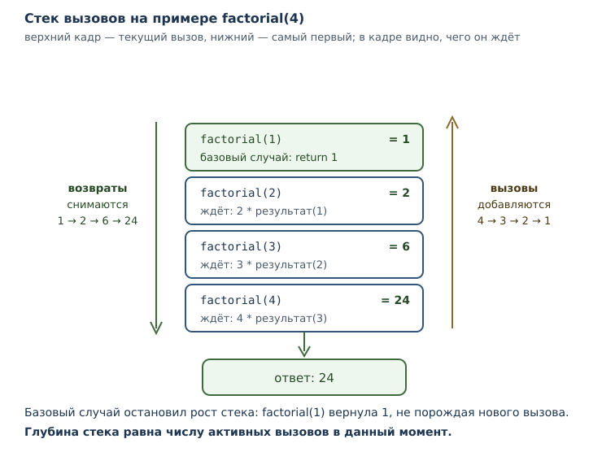
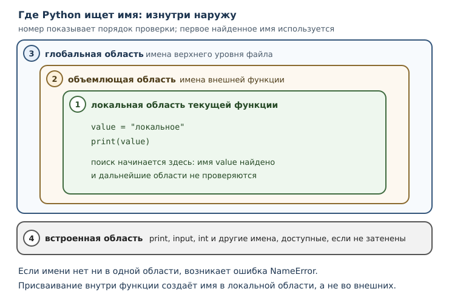

# Стек вызовов, области видимости и рекурсия

<!-- syllanix:nav -->
**Навигация:** [← 07. Функции: параметры, аргументы и области видимости](07-functions.md) · [Оглавление книги](../README.md) · [Далее: 09. Модули, пакеты и импорты →](09-modules.md)
<!-- /syllanix:nav -->

<!-- syllanix:topics -->
**Темы главы**
8.1. [Что вы сможете после этой главы](#что-вы-сможете-после-этой-главы)  
8.2. [Стек вызовов](#call-stack)  
8.3. [Кадр стека](#frame)  
8.4. [Области видимости](#scope)  
8.5. [Объемлющая область видимости](#enclosing)  
8.6. [Глобальная область видимости и инструкция global](#global)  
8.7. [Рекурсия](#recursion)  
8.8. [Предел рекурсии](#limit)  
8.9. [Собираем вместе](#example)  
8.10. [Типичные ошибки](#mistakes)  
8.11. [Упражнения](#упражнения)  
8.12. [Проверка понимания](#проверка-понимания)  
8.13. [Что дальше](#что-дальше)  
<!-- /syllanix:topics -->


В прошлой главе функция выглядела как чёрный ящик: передали аргументы —
получили результат. Пока вызовы идут по одному, этого достаточно. Но
программы состоят из функций, которые вызывают другие функции, а те — третьи.
В момент, когда ошибка случается на глубине пяти вызовов, нужно понимать, кто
кого вызвал и какие имена были видны в каждом месте.

Ответ на оба вопроса даёт одна и та же конструкция — **стек вызовов**: список
активных вызовов, в котором каждый вызов хранит свои параметры и локальные
имена. Из этого устройства естественно вырастают правила видимости имён и
приём, который называется рекурсией: функция, вызывающая саму себя.

Эта глава объясняет, что происходит в момент вызова. Это не абстракция:
именно устройство стека объясняет порядок вывода вложенных вызовов, ошибку
`UnboundLocalError` и сообщение о превышении глубины рекурсии.

## Что вы сможете после этой главы

К концу главы вы будете уметь следующее.

- описывать, что добавляется в стек при вызове и что снимается после возврата;
- объяснять, почему вложенные вызовы печатают строки в обратном порядке;
- различать локальную, объемлющую, глобальную и встроенную области видимости;
- понимать, когда нужна инструкция global и почему её применяют редко;
- писать рекурсивные функции с базовым случаем и объяснять их завершение;
- распознавать предел рекурсии и отличать ограничение CPython от свойства
  языка.

## Стек вызовов {#call-stack}

**Стек вызовов** — структура данных, в которой хранятся активные вызовы
функций: каждый вызов добавляет запись, а завершение её снимает. Стек работает
по принципу «последним пришёл — первым вышел»: последний начатый вызов
завершается раньше остальных.

Пока функция выполняется, вызовы внутри неё не могут завершиться раньше, чем
она сама. Отсюда и порядок: самый глубокий вызов заканчивается первым, самый
внешний — последним.

```python exec
def inner():
    print("внутри inner")

def outer():
    print("начало outer")
    inner()
    print("конец outer")

outer()
```

```output
начало outer
внутри inner
конец outer
```

Проследим за стеком:

1. Вызов `outer()` добавляет в стек запись для `outer`. Начинается исполнение
   его тела, печатается `начало outer`.
2. Вызов `inner()` добавляет вторую запись, поверх первой. Печатается
   `внутри inner`.
3. Тело `inner` закончилось — запись снимается, управление возвращается в
   `outer` на то место, где был вызов.
4. Печатается `конец outer`, запись `outer` снимается, стек пуст.

Здесь порядок вывода совпадает с порядком строк в теле `outer`, но настоящая
причина — стек: `inner` завершается раньше, чем `outer` доходит до следующей
строки. Стек становится незаменим, когда вызовы вложены глубже или рекурсивны:
тогда порядок выполнения уже нельзя прочитать сверху вниз по тексту программы.

Чем полезно это знание? Когда вы читаете сообщение об ошибке, интерпретатор
показывает цепочку активных вызовов — от самого внешнего к самому глубокому.
По этой цепочке видно, как программа пришла в проблемное место.

```text
Traceback (most recent call last):
  File "program.py", line 7, in <module>
    a()
  File "program.py", line 2, in a
    b()
  File "program.py", line 5, in b
    return 1 / 0
ZeroDivisionError: division by zero
```

Читают её снизу вверх: последняя строка — что случилось, выше — где именно, ещё
выше — кто вызвал это место. Чтение сообщений об ошибках подробно разберём в
главе 11, а пока запомните главное: цепочка вызовов в сообщении — это и есть
стек в момент сбоя.

## Кадр стека {#frame}

**Кадр стека** — запись о конкретном активном вызове: его параметры, локальные
имена и точка возврата. У каждого вызова свой кадр, даже если функция одна и та
же.

```python exec
def show(n):
    n = n + 1
    print(n)

show(1)
show(10)
```

```output
2
11
```

Первый вызов создал кадр с параметром `n = 1`; после возврата кадр исчез.
Второй вызов создал новый кадр с `n = 10`. Значение из первого вызова никак не
повлияло на второй: кадры независимы, хотя функция одна.

Отсюда важное следствие: локальные имена не «общие для функции», они общие для
**вызова**. Два одновременных вызова одной функции (например, при рекурсии)
имеют два разных кадра с разными значениями одноимённых параметров.



## Области видимости {#scope}

**Область видимости** — правило, определяющее, какое имя видит код в данной
точке: локальное, объемлющее, глобальное или встроенное. Это не «место в
файле», а именно правило поиска.

В Python четыре уровня:

| Уровень | Что содержит | Где виден |
|---|---|---|
| локальная | имена, созданные в текущей функции | только внутри неё |
| объемлющая | имена внешней функции | во вложенной функции |
| глобальная | имена верхнего уровня файла | во всём файле |
| встроенная | имена вроде `print`, `input`, `int` | если не затенена |

Поиск идёт изнутри наружу: сначала локальная область, затем объемлющая, затем
глобальная, затем встроенная. Первое найденное имя используется. Если имени
нет нигде, возникает `NameError`.

```python exec
x = "глобальное"

def outer():
    x = "объемлющее"

    def inner():
        x = "локальное"
        print(x)

    inner()
    print(x)

outer()
print(x)
```

```output
локальное
объемлющее
глобальное
```

Три имени `x` живут в трёх разных областях, и каждое `print` видит ближайшее.
Это не ошибка и не путаница: так устроен поиск. Но читаемость такого кода
низкая, поэтому в реальных программах одинаковые имена на разных уровнях лучше
не использовать без необходимости.



[Локальная область видимости](07-functions.md#local-scope) знакома вам по
прошлой главе: имя, созданное в функции, не видно снаружи. Новое здесь — то, что вложенная функция видит имена внешней.

## Объемлющая область видимости {#enclosing}

**Объемлющая область видимости** — область внешней функции, имена которой
видны вложенной функции. Она появляется, когда одна функция определена внутри
другой.

```python exec
def outer():
    message = "привет"

    def inner():
        print(message)

    inner()

outer()
```

```output
привет
```

`inner` не имеет собственного имени `message`, поэтому поиск поднимается на
уровень выше и находит его в кадре `outer`. Такой доступ работает только на
чтение: если `inner` попытается присвоить `message`, Python создаст локальное
имя и внешнее останется прежним.

Переприсвоить имя объемлющей области из вложенной функции можно только со
специальным объявлением. Оно понадобится, когда речь пойдёт о замыканиях, — это
тема главы 22. Пока достаточно понимать направление поиска: изнутри наружу.

Практическая рекомендация: вложенные функции полезны, когда внутренняя нужна
только внешней. Если функция нужна кому-то ещё, определяйте её на верхнем
уровне.

## Глобальная область видимости и инструкция global {#global}

**Глобальная область видимости** — область модуля: имена, созданные на верхнем
уровне файла. Они видны во всех функциях этого файла.

Читать глобальные имена можно свободно — это мы уже видели. Проблема возникает
при присваивании: если функция присваивает имя, Python считает его локальным,
даже если такое же имя есть наверху.

```python exec expect-error
counter = 0

def broken():
    counter += 1

broken()
```

```output
UnboundLocalError: cannot access local variable 'counter' where it is not associated with a value
```

**Инструкция global** объявляет, что имя относится к глобальной области, а не к
локальной. После такого объявления присваивание меняет глобальное значение.

```python exec
counter = 0

def bump():
    global counter
    counter += 1

bump()
bump()
print(counter)
```

```output
2
```

Работает, но подумайте, чем вы за это платите. Функция `bump` теперь зависит от
внешнего состояния: её нельзя вызвать в отрыве от программы, нельзя проверить
без подготовки глобального имени, и её поведение меняется от того, сколько раз
её вызвали раньше. В маленькой учебной программе это терпимо, в большой —
источник трудноуловимых дефектов.

Практическое правило: **global применяют редко**. Если функция должна вернуть
изменённое значение — пусть она его вернёт, а вызывающий код решит, куда его
записать. Инструкция global уместна в узких случаях: счётчики, настройки
модуля, состояние, которое действительно одно на всю программу.

## Рекурсия {#recursion}

**Рекурсия** — приём, при котором функция вызывает саму себя для меньшей
подзадачи. Это не особый синтаксис: вызов `factorial(n - 1)` ничем не
отличается от любого другого вызова. Особенным его делает то, что кадр вызова
оказывается в стеке поверх такого же кадра.

Классический пример — факториал. Факториал числа `n` — произведение всех чисел
от 1 до `n`; при этом `n! = n * (n - 1)!`.

```python exec
def factorial(n):
    if n <= 1:
        return 1
    return n * factorial(n - 1)

print(factorial(5))
print(factorial(3))
```

```output
120
6
```

**Базовый случай** — условие, при котором функция возвращает результат без
нового вызова. Здесь это `n <= 1`. Без базового случая рекурсия была бы
бесконечной: каждый вызов порождал бы следующий, и стек рос бы, пока
интерпретатор не остановит его по пределу рекурсии.

Разберём `factorial(3)` по шагам:

1. `factorial(3)`: `3 > 1`, нужен `3 * factorial(2)`. Кадр с `n = 3` ждёт.
2. `factorial(2)`: нужен `2 * factorial(1)`. Кадр с `n = 2` ждёт.
3. `factorial(1)`: базовый случай, возвращает `1`. Кадр снимается.
4. В кадре `n = 2` получаем `2 * 1 = 2`, возвращаем `2`. Кадр снимается.
5. В кадре `n = 3` получаем `3 * 2 = 6`, возвращаем `6`. Кадр снимается.

Обратите внимание: пока идёт спуск, ни один результат ещё не вычислен — все
кадры ждут. Вычисления начинаются на обратном пути, когда базовый случай
завершил самый глубокий вызов.

Тот же результат можно получить циклом:

```python exec
def factorial_loop(n):
    result = 1
    for i in range(2, n + 1):
        result *= i
    return result

print(factorial_loop(5))
```

```output
120
```

Рекурсия не быстрее и не «правильнее» цикла. Она бывает выразительнее, когда
задача естественно сводится к меньшей копии себя: обход дерева, разбор
вложенной структуры, алгоритмы «разделяй и властвуй». Когда структура задачи
линейная, цикл обычно проще.

Рекурсивная функция обязана приближаться к базовому случаю. В `factorial`
каждый вызов уменьшает `n` на единицу, поэтому до `1` можно дойти за конечное
число шагов. Если аргумент не уменьшается, рекурсия не завершится.

```python exec
def digit_sum(n):
    if n < 10:
        return n
    return n % 10 + digit_sum(n // 10)

print(digit_sum(1234))
```

```output
10
```

Здесь базовый случай — однозначное число. Каждый шаг отбрасывает последнюю
цифру, поэтому число шагов равно числу цифр.

## Предел рекурсии {#limit}

**Предел рекурсии** — ограничение глубины стека вызовов, которое защищает от
переполнения. Если рекурсия не доходит до базового случая, программа
останавливается с ошибкой `RecursionError`, а не падает молча.

```python exec expect-error
def endless(n):
    return endless(n + 1)

endless(0)
```

```output
RecursionError: maximum recursion depth exceeded
```

Сообщение говорит буквально: «превышена максимальная глубина рекурсии».
Интерпретатор заметил, что стек растёт слишком сильно, и остановил программу —
это лучше, чем исчерпать память.

Важно различать уровни. `RecursionError` и само понятие предела — часть
поведения Python, но **конкретное число** задаёт реализация. В CPython предел
по умолчанию около 1000 вызовов; в других реализациях значение может
отличаться. Это не гарантия языка, а деталь реализации, о которой полезно
знать, но нельзя опираться на точное число в переносимом коде.

Что делать, если глубины не хватает? Обычно — переписать алгоритм циклом.
Увеличение предела допустимо как временная мера для конкретной задачи, но оно
не решает проблему: растущий стек всё равно ограничен памятью. Кроме того,
слишком глубокая рекурсия легко превращается в медленный и хрупкий код.

## Собираем вместе {#example}

Сравним два естественно рекурсивных алгоритма. Первый — уже знакомый
факториал, второй — наибольший общий делитель по алгоритму Евклида, где
рекурсия заменяет цикл почти без потерь в ясности.

```python exec
def gcd(a, b):
    if b == 0:
        return a
    return gcd(b, a % b)

print(gcd(84, 36))
print(gcd(1071, 462))
```

```output
12
21
```

Базовый случай — `b == 0`: тогда ответом служит `a`. Иначе задача сводится к
паре `(b, a % b)`, и остаток строго меньше `b`, поэтому последовательность
вызовов конечна. Для `84` и `36` цепочка такая: `(84, 36) → (36, 12) → (12, 0)`,
ответ `12`.

Обратите внимание на две вещи, которые делают эту рекурсию корректной:
базовый случай существует, и каждый шаг уменьшает второй аргумент. Проверять
эти два свойства полезнее, чем запоминать пример.

## Типичные ошибки {#mistakes}

1. **Забыть базовый случай.** Рекурсия не остановится и завершится
   `RecursionError`.
2. **Базовый случай недостижим.** Например, `n == 1` при шаге `n -= 2`:
   чётные числа до единицы не дойдут.
3. **Не уменьшать аргумент.** Вызов `factorial(n)` внутри `factorial(n)` —
   бесконечная рекурсия, даже если базовый случай записан.
4. **Ожидать, что локальные имена общие для функции.** Они принадлежат кадру,
   а кадров может быть несколько.
5. **Считать, что вложенная функция может менять имя внешней.** Присваивание
   создаёт локальное имя; для изменения нужен особый механизм из главы 22.
6. **Пользоваться global без нужды.** Функция, меняющая глобальное состояние,
   труднее проверяется и хуже переносится.
7. **Путать глобальную область с встроенной.** `print` доступен всегда, а имя
   верхнего уровня — только в своём файле.
8. **Увеличивать предел рекурсии вместо переписывания алгоритма.** Это лечит
   симптом, а не причину.

## Упражнения

### 1. Порядок вывода {#ex-ch08-01}

Что выведет программа? Запишите ответ до запуска и объясните порядок строк.

```python
def first():
    print("первая")

def second():
    first()
    print("вторая")

second()
```

### 2. Кадры независимы {#ex-ch08-02}

Что выведет программа и почему второе число не зависит от первого?

```python
def step(n):
    n = n * 10
    print(n)

step(1)
step(2)
```

### 3. Три области видимости {#ex-ch08-03}

Определите, какие строки выведет программа, и объясните, какое имя видит
каждый `print`.

```python
value = "глобальное"

def outer():
    value = "объемлющее"

    def inner():
        value = "локальное"
        print(value)

    inner()
    print(value)

outer()
print(value)
```

### 4. Чтение из объемлющей области {#ex-ch08-04}

Почему следующий код работает, хотя `message` не передана в `inner` как
параметр?

```python
def outer():
    message = "готово"

    def inner():
        print(message)

    inner()

outer()
```

### 5. global {#ex-ch08-05}

Исправьте программу, чтобы она напечатала `3`, и объясните, почему без
исправления возникает ошибка.

```python
total = 0

def add():
    total += 1
    return total

add()
add()
add()
print(total)
```

### 6. Исправление рекурсии {#ex-ch08-06}

Программа завершается ошибкой. Найдите причину и исправьте функцию.

```python
def countdown(n):
    print(n)
    countdown(n - 1)

countdown(3)
```

### 7. Факториал {#ex-ch08-07}

Напишите рекурсивную функцию `factorial(n)` с базовым случаем и проверьте её на
`0`, `1` и `6`. Чему равно `6!`?

### 8. Сумма цифр {#ex-ch08-08}

Напишите рекурсивную функцию `digit_sum(n)`, которая возвращает сумму цифр
натурального числа. Проверьте на `1234` и `9`.

### 9. Предел рекурсии {#ex-ch08-09}

Объясните, почему функция ниже приводит к `RecursionError`, и перепишите её
циклом с тем же результатом.

```python
def total(n):
    return n + total(n - 1)

print(total(5))
```

### 10. Мини-задача: Евклид {#ex-ch08-10}

Напишите рекурсивную функцию `gcd(a, b)` для наибольшего общего делителя.
Проверьте на `(84, 36)` и `(17, 5)`. Объясните, почему рекурсия завершается.

## Проверка понимания

1. Что такое стек вызовов и почему он работает по принципу «последним пришёл —
   первым вышел»?
2. Что хранится в кадре стека?
3. Почему два вызова одной функции не мешают друг другу?
4. Какие четыре области видимости существуют и в каком порядке идёт поиск?
5. Чем глобальная область отличается от встроенной?
6. Зачем нужна инструкция global и почему её не любят?
7. Что такое базовый случай и что будет, если его забыть?
8. Почему предел рекурсии нельзя считать гарантией языка?
9. Когда рекурсия уместнее цикла?

## Что дальше

Вы понимаете, как исполняется вызов и как ищутся имена. Но до сих пор вся
программа живёт в одном файле. Настоящие проекты состоят из многих файлов,
поэтому дальше речь пойдёт о том, как Python находит код в них: появятся
[модули, пакеты и инструкция import](09-modules.md) — а вместе с ними и точка
входа программы.

<!-- syllanix:nav -->
**Перед этой главой:** [07. Функции: параметры, аргументы и области видимости](07-functions.md)
**Связанные главы:** [02. Первая программа: вычисления и вывод](02-first-program.md), [03. Значения, имена, объекты и типы](03-values-names-objects.md), [04. Выражения, операторы и ввод данных](04-expressions-input.md), [05. Логика и управление потоком](05-control-flow.md), [06. Циклы: while и for](06-loops.md), [11. Отладка и трассировка](11-debugging.md), [22. Функции как объекты: замыкания и декораторы](22-higher-order.md)
**Далее:** [09. Модули, пакеты и импорты →](09-modules.md)
<!-- /syllanix:nav -->
