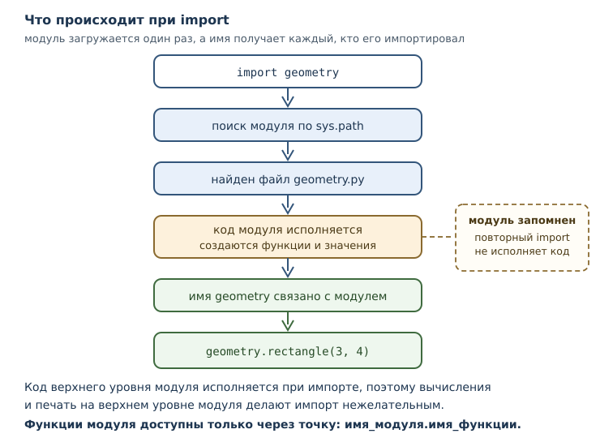
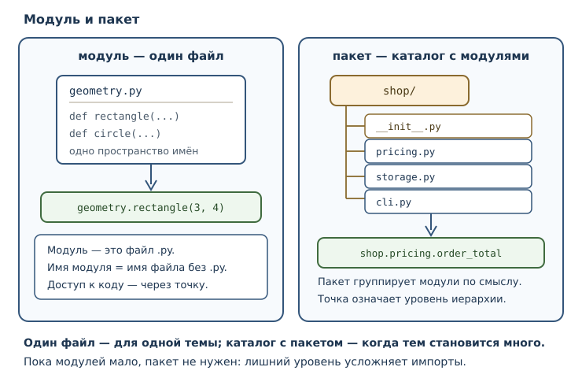

# Модули, пакеты и импорты

<!-- syllanix:nav -->
**Навигация:** [← 08. Стек вызовов, области видимости и рекурсия](08-recursion-scope.md) · [Оглавление книги](../README.md) · [Далее: 10. Ошибки и исключения →](10-errors-exceptions.md)
<!-- /syllanix:nav -->

<!-- syllanix:topics -->
**Темы главы**
9.1. [Что вы сможете после этой главы](#что-вы-сможете-после-этой-главы)  
9.2. [Модуль — это файл](#module)  
9.3. [Инструкция import](#import-statement)  
9.4. [from … import …](#from-import)  
9.5. [Пространство имён](#namespace)  
9.6. [Стандартная библиотека](#standard-library)  
9.7. [Пакеты](#package)  
9.8. [Точка входа и проверка __name__ == "__main__"](#main-guard)  
9.9. [Почему sys.path — не место для хаков](#sys-path)  
9.10. [Собираем вместе](#example)  
9.11. [Типичные ошибки](#mistakes)  
9.12. [Упражнения](#упражнения)  
9.13. [Проверка понимания](#проверка-понимания)  
9.14. [Что дальше](#что-дальше)  
<!-- /syllanix:topics -->


До этой главы вся программа жила в одном файле. Для учебных задач этого
хватало, но у одного файла есть предел: когда функций становится несколько
десятков, найти нужную труднее, чем написать новую. Кроме того, один и тот же
код нужен в разных программах — а копировать файл целиком бессмысленно.

Модуль решает эту задачу так же, как функция решала задачу повторения: даёт
имя части программы. Файл `geometry.py` становится модулем `geometry`, его
функции доступны из других файлов, а внутри модуля действует собственное
пространство имён. Python поставляется с большой **стандартной библиотекой**
таких модулей, и умение ими пользоваться отличает новичка от человека, который
работает продуктивно.

В этой главе появятся модули, пакеты, инструкция import и точка входа
программы — всё, что нужно, чтобы перейти от отдельных файлов к проекту.

## Что вы сможете после этой главы

К концу главы вы будете уметь следующее.

- разбивать программу на модули и импортировать их;
- объяснять разницу между `import module` и `from module import name`;
- понимать, что такое пространство имён и почему одинаковые имена не мешают;
- находить нужные инструменты в стандартной библиотеке;
- собирать пакет из нескольких модулей;
- отделять библиотечную часть файла от запуска через точку входа.

## Модуль — это файл {#module}

**Модуль** — файл `.py`, содержимое которого образует отдельную область имён и
может быть импортировано другим кодом. Имя модуля — имя файла без расширения.
Файл `geometry.py` даёт модуль `geometry`; файл `report_utils.py` — модуль
`report_utils`.

Внутри модуля можно писать всё то же, что и в обычном файле: функции,
переменные, инструкции. Разница в том, как этот файл используется. Посмотрим на
модуль с двумя функциями:

```python
"""Простые вычисления площадей."""

def rectangle(width, height):
    """Вернуть площадь прямоугольника."""
    return width * height

def circle(radius):
    """Вернуть площадь круга."""
    return 3.141592653589793 * radius ** 2
```

Если сохранить этот текст в файл `geometry.py`, рядом можно создать второй файл
и воспользоваться первым:

```python
import geometry

print(geometry.rectangle(3, 4))
print(geometry.circle(2))
```

Запустим второй файл из той же папки:

```console
$ python use_geometry.py
12
12.566370614359172
```

Что произошло: интерпретатор нашёл файл `geometry.py`, выполнил его код сверху
вниз (определения функций при этом только создали функции) и связал имя
`geometry` с модулем. После этого функции модуля стали доступны через точку.

Важно понимать: **код модуля верхнего уровня исполняется при импорте**. Именно
поэтому в модулях не принято писать вычисления прямо на верхнем уровне — иначе
они выполнятся при каждом импорте. Всё, что должно произойти при запуске
программы, помещают в функцию и вызывают её из точки входа.

## Инструкция import {#import-statement}

**Инструкция import** загружает модуль и связывает его имя в текущей области
видимости. После `import math` имя `math` становится доступным, а через точку
открываются имена внутри модуля.

```python exec
import math

print(math.__name__)
print(math.sqrt(16))
print(round(math.pi, 2))
```

```output
math
4.0
3.14
```

Здесь видно три вещи. Во-первых, `math` — обычный объект, у которого есть
атрибут `__name__`. Во-вторых, имена внутри модуля доступны через точку:
`math.sqrt`. В-третьих, модуль приносит не только функции, но и значения:
`math.pi` — число.

Модуль можно переименовать при импорте, если его имя длинное или конфликтует:

```python exec
import math as m

print(m.sqrt(25))
print(round(m.pi, 3))
```

```output
5.0
3.142
```



Повторный импорт того же модуля не выполняется заново: Python запоминает уже
загруженные модули и при повторном `import` просто возвращает готовый.

```python exec
import math
import math

print(math.sqrt(4))
```

```output
2.0
```

Это не оптимизация «на всякий случай», а часть модели: модуль загружается один
раз, а имя получает каждый, кто его импортирует. Подробнее о кэше модулей — в
главе 33, когда речь пойдёт об устройстве проекта.

## from … import … {#from-import}

Вторая форма импорта переносит имена из модуля прямо в текущую область
видимости. После `from math import sqrt` доступна функция `sqrt` без префикса.

```python exec
from math import sqrt, pi

print(sqrt(2))
print(round(pi, 3))
```

```output
1.4142135623730951
3.142
```

Разница между формами не косметическая:

| Запись | Что появляется в текущей области | Как обращаться |
|---|---|---|
| `import math` | имя `math` | `math.sqrt(2)` |
| `from math import sqrt` | имя `sqrt` | `sqrt(2)` |
| `import math as m` | имя `m` | `m.sqrt(2)` |

Первая форма безопаснее: имена модуля остаются внутри его пространства имён, и
вы всегда видите, откуда взялась функция. Вторая форма короче, но добавляет
имена в ваш код — а значит, может столкнуться с уже существующими.

Столкновение реально и опасно тем, что происходит молча:

```python exec
from math import sqrt

def sqrt(n):
    return n

print(sqrt(16))
```

```output
16
```

Импортированная функция была заменена собственной, и `sqrt(16)` теперь не
извлекает корень. Python не считает это ошибкой: имя — это имя, последнее
связывание побеждает. Отсюда правило: после `from ... import ...` не
переопределяйте импортированные имена, а если это необходимо, импортируйте
модуль целиком.

Третья форма — `from math import *` — переносит **все** имена модуля. Её
избегают: невозможно понять, откуда в коде появилось имя, и какие имена
перезаписаны. Явное лучше неявного.

## Пространство имён {#namespace}

**Пространство имён** — отображение имён в объекты. У модуля и функции своё
пространство: одно и то же имя в разных пространствах обозначает разные вещи и
не конфликтует.

Вы уже встречались с этим: локальная область видимости функции — тоже
пространство имён, и `x` в одной функции не имеет отношения к `x` в другой.
Модуль добавляет ещё один уровень: `math.sqrt` и `cmath.sqrt` — разные функции
с одинаковым коротким именем.

```python exec
import math

print(math.__name__)
print(hasattr(math, "sqrt"))
print(hasattr(math, "sqrt2"))
```

```output
math
True
False
```

Функция `hasattr` проверяет, есть ли у объекта атрибут с таким именем. Обратите
внимание: `sqrt2` в `math` нет, и это не ошибка — просто такое имя в этом
пространстве не определено.

Практическое следствие: полное имя `math.sqrt` однозначно. Если в программе
несколько модулей, их имена и составляют ваше пространство имён верхнего
уровня. Отсюда совет: не называйте свои модули так же, как модули стандартной
библиотеки. Файл `math.py` в папке проекта перекроет стандартный `math`, и
искать причину странного поведения можно долго.

## Стандартная библиотека {#standard-library}

**Стандартная библиотека** — поставляемый с Python набор модулей, не требующий
установки. В неё входят `math`, `random`, `json`, `pathlib`, `itertools` и
многие другие.

Несколько примеров того, что там уже есть:

- математика: корни, тригонометрия, наибольший общий делитель;
- случайные числа с возможностью зафиксировать seed;
- работа с файлами и путями;
- форматы данных: JSON, CSV;
- даты и время;
- инструменты для тестирования и отладки.

Проверим пару возможностей:

```python exec
import math

print(math.floor(3.7))
print(math.ceil(3.2))
print(math.gcd(84, 36))
```

```output
3
4
12
```

Умение искать в стандартной библиотеке — навык, который окупается быстрее
любого другого. Начинайте с вопроса «неужели для этого нет готового?» и
смотрите официальную документацию Python. Большая часть повседневных задач уже
решена, и написанный вручную код чаще содержит ошибки, чем проверенный
библиотечный.

Важно различать уровни: стандартная библиотека входит в поставку Python, но не
в сам синтаксис языка. Её модули обновляются вместе с версией Python, и часть
из них может отсутствовать в других реализациях.

## Пакеты {#package}

**Пакет** — каталог с модулями и (обычно) файлом `__init__.py`, образующий
иерархическое пространство имён. Пакет позволяет группировать модули по смыслу,
а не сваливать всё в одну папку.

Типичная структура небольшого проекта:

```text
shop/
├── __init__.py
├── pricing.py
├── storage.py
└── cli.py
```

Обращаться к модулям пакета можно через точку:

```python
from shop.pricing import order_total
from shop import storage

print(order_total(250, 3))
```

Здесь `shop` — пакет, `shop.pricing` — модуль внутри пакета. Точка означает
иерархию: сначала пакет, затем модуль, затем имя внутри модуля.

Файл `__init__.py` отмечает каталог как пакет. В простейшем случае он пуст; в
нём можно выполнить инициализацию пакета, но злоупотреблять этим не стоит:
импорт пакета не должен запускать тяжёлые действия.



Современный Python допускает и пакеты без `__init__.py` — они называются
пакетами пространства имён. Для учебных проектов проще придерживаться
классической схемы с `__init__.py`: она явнее и привычнее для инструментов.

## Точка входа и проверка __name__ == "__main__" {#main-guard}

Модуль можно запустить двумя способами: как программу и как библиотеку. Это
порождает вопрос: какой код должен выполняться в каждом случае?

Ответ даёт атрибут `__name__`. Когда файл запускают напрямую, Python
присваивает этому имени строку `"__main__"`. Когда файл импортируют, `__name__`
равен имени модуля.

```python exec
print(__name__)
```

```output
__main__
```

Проверка ``__name__ == "__main__"`` — идиома, которая позволяет файлу совмещать
обе роли. Код внутри этой проверки выполняется только при прямом запуске.

```python exec
def main():
    print("главная функция запущена")

if __name__ == "__main__":
    main()
```

```output
главная функция запущена
```

Смысл конструкции в том, что `main()` вызывается не всегда, а только когда файл
запущен как программа. Если этот же файл импортировать из другого, функция
`main` станет доступна, но не выполнится.

**Точка входа** — место, с которого начинается исполнение программы при
запуске. В скрипте это первая инструкция файла; с главной функцией — вызов
`main()`. У библиотечного модуля точки входа нет вовсе, и это правильно: код,
который начинает работать при импорте, делает модуль непредсказуемым.

Проверим вторую ветвь логики на модели: представим, что модуль импортирован и
его имя не равно `"__main__"`.

```python exec
module_name = "shop.pricing"

if module_name == "__main__":
    print("прямой запуск: код выполняется")
else:
    print("модуль импортирован: код пропущен")
```

```output
модуль импортирован: код пропущен
```

Так модуль становится и библиотекой, и программой одновременно. Это стандарт
для консольных утилит: файл `cli.py` содержит функции, которые можно
импортировать в тестах, и блок с точкой входа для запуска.

## Почему sys.path — не место для хаков {#sys-path}

Когда вы пишете `import math`, Python ищет модуль в нескольких местах. Список
этих мест хранится в `sys.path` — списке путей, который просматривается по
порядку. В него входят каталог запускаемой программы, каталог установленных
пакетов и некоторые другие места.

Соблазн новичка — дописать нужный каталог в `sys.path` прямо в коде:

```python
import sys

sys.path.insert(0, "../my_libs")  # так делать не стоит: путь зависит от машины
import my_lib
```

Так делать не стоит, и вот почему.

1. **Зависимость становится невидимой.** По коду не понять, что программа
   требует внешнего каталога с библиотекой; на другой машине это выяснится
   только при запуске.
2. **Порядок путей непредсказуем.** Добавление каталога в начало списка может
   перекрыть модуль стандартной библиотеки или установленный пакет — и ошибка
   проявится в совершенно другом месте.
3. **Ломается упаковка.** Инструменты установки и тестирования ожидают, что
   зависимости объявлены, а не подложены по пути.
4. **Ломается воспроизводимость.** Программа, работающая на вашей машине,
   перестаёт работать в CI и у коллеги.

Правильные способы решить ту же задачу:

- оформить код как пакет и установить его (`uv`, `pip`) — тогда он найдётся
  сам;
- запускать программу из корня проекта как модуль: `python -m shop.cli`;
- для локальной разработки использовать управляемое окружение, а не правку
  `sys.path` в коде.

Есть и обратный случай: модуль не находится, хотя файл рядом. Почти всегда
причина в том, что запускается не тот файл или не из той папки. Проверять
нужно структуру проекта, а не добавлять пути.

## Собираем вместе {#example}

Разделим маленькую программу на два модуля: вычисления и запуск.

Модуль `pricing.py` содержит только функции — его удобно импортировать и
тестировать:

```python
"""Расчёты для заказа."""

def order_total(price, count, discount=0):
    """Вернуть итог заказа в целых рублях."""
    total = price * count
    return total - total * discount // 100
```

Модуль `cli.py` отвечает за общение с человеком и запуск:

```python
"""Точка входа консольной программы."""

from pricing import order_total

def main():
    amount = order_total(250, 3, 10)
    print(f"К оплате: {amount} рублей")

if __name__ == "__main__":
    main()
```

Запуск:

```console
$ python cli.py
К оплате: 675 рублей
```

Разделение дало три выгоды. Вычисления не зависят от ввода и вывода, поэтому
их легко проверить. Файл `pricing.py` можно импортировать в другой программе.
А `cli.py` можно запустить и получить результат, не заглядывая внутрь.

## Типичные ошибки {#mistakes}

1. **Называть свой модуль как модуль стандартной библиотеки.** Файл `math.py`
   перекроет стандартный `math`, и импорт в других местах начнёт вести себя
   странно.
2. **Выполнять работу на верхнем уровне модуля.** Код, который печатает или
   читает файлы при импорте, срабатывает каждый раз, когда модуль импортируют.
3. **Использовать `from module import *`.** Непонятно, откуда взялись имена, и
   какие из них перезаписаны.
4. **Переопределять импортированное имя.** Своя функция `sqrt` молча заменит
   импортированную.
5. **Забыть `__init__.py` в классическом пакете.** В Python 3.3+ каталог без
   этого файла может работать как пакет пространства имён, но поведение
   зависит от структуры проекта и инструментов; в классической схеме
   `__init__.py` нужен, чтобы пакет был явным.
6. **Импортировать файл, а не модуль.** `import geometry.py` — синтаксическая
   ошибка; имя модуля пишется без расширения.
7. **Править `sys.path` в коде.** Зависимость становится невидимой, а поведение
   зависит от машины.
8. **Путать точку входа с точкой, где объявлена функция.** Точка входа — место
   запуска, а не место определения.
9. **Ожидать, что при импорте выполнится `main()`.** Без проверки
   ``__name__ == "__main__"`` он выполнится; с проверкой — нет.

## Упражнения

### 1. Имя модуля {#ex-ch09-01}

Файл называется `text_tools.py`. Как называется модуль, который он образует?
Как импортировать из него функцию `normalize` двумя способами?

### 2. Две формы импорта {#ex-ch09-02}

Объясните разницу между `import math` и `from math import sqrt`. Как в каждом
случае вызвать корень из 9? Проверьте оба варианта программой.

### 3. Прогнозирование {#ex-ch09-03}

Что выведет программа? Объясните, почему два вызова дают разные значения.

```python
import math
from math import floor

def floor(n):
    return round(n)

print(floor(2.9))
print(math.floor(2.9))
```

### 4. Пространство имён {#ex-ch09-04}

Почему `math.__name__` возвращает `math`, а не имя функции? Что это говорит о
модуле как об объекте?

### 5. Стандартная библиотека {#ex-ch09-05}

Найдите в документации Python модуль, который умеет округлять числа вверх и
вниз. Напишите программу, которая печатает `math.ceil(2.1)` и `math.floor(2.9)`,
и объясните результаты.

### 6. Пакет {#ex-ch09-06}

Дан каталог:

```text
tools/
├── __init__.py
├── text.py
└── files.py
```

Напишите две строки импорта: функцию `clean` из модуля `text` и модуль `files`
целиком. Как обращаться к функции после каждого импорта?

### 7. Точка входа {#ex-ch09-07}

Почему в примере ниже при импорте этого файла ничего не напечатается, а при
запуске напечатается?

```python
def main():
    print("работаю")

if __name__ == "__main__":
    main()
```

### 8. Исправление ошибки импорта {#ex-ch09-08}

Код падает:

```text
ModuleNotFoundError: No module named 'pricing'
```

Файл `pricing.py` лежит в той же папке, что и запускаемый файл. Назовите две
возможные причины и способ проверки.

### 9. Библиотека и программа {#ex-ch09-09}

Перепишите файл так, чтобы его функции можно было импортировать, а запуск
печатал результат:

```python
def double(n):
    return n * 2

print(double(21))
```

### 10. Мини-задача: разбиение на модули {#ex-ch09-10}

Опишите структуру из трёх файлов для программы «конвертер температур»: модуль
с формулами, модуль с функциями вывода и файл запуска. Для каждого файла
напишите, что в нём лежит и есть ли в нём проверка ``__name__ == "__main__"``.

## Проверка понимания

1. Что такое модуль и как его имя связано с именем файла?
2. Когда исполняется код верхнего уровня модуля?
3. Чем `import module` отличается от `from module import name`?
4. Почему `from module import *` считается плохой практикой?
5. Что такое пространство имён модуля?
6. Что такое пакет и зачем нужен `__init__.py`?
7. Почему при импорте файла `__name__` не равно `"__main__"`?
8. Что такое точка входа программы?
9. Почему не стоит править `sys.path` в коде?

## Что дальше

Вы умеете делить программу на модули и запускать её через точку входа. Но до
сих пор любая ошибка — деление на ноль, неверный ввод, отсутствующий файл —
обрывала программу. Дальше появятся [исключения](10-errors-exceptions.md):
механизм, который позволяет сообщать об ошибках и обрабатывать их, не теряя
управление.

<!-- syllanix:nav -->
**Перед этой главой:** [08. Стек вызовов, области видимости и рекурсия](08-recursion-scope.md)
**Связанные главы:** [02. Первая программа: вычисления и вывод](02-first-program.md), [03. Значения, имена, объекты и типы](03-values-names-objects.md), [04. Выражения, операторы и ввод данных](04-expressions-input.md), [05. Логика и управление потоком](05-control-flow.md), [06. Циклы: while и for](06-loops.md), [07. Функции: параметры, аргументы и области видимости](07-functions.md), [11. Отладка и трассировка](11-debugging.md), [19. Файлы, пути и текстовые форматы](19-files-formats.md)
**Далее:** [10. Ошибки и исключения →](10-errors-exceptions.md)
<!-- /syllanix:nav -->
