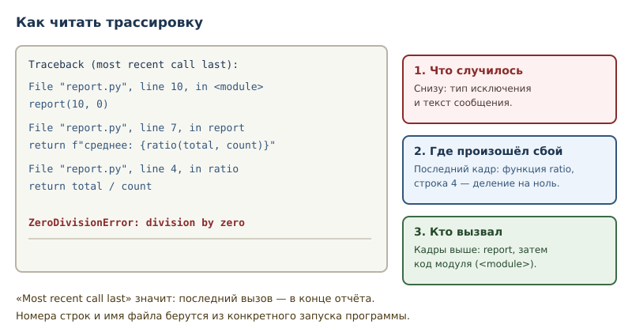
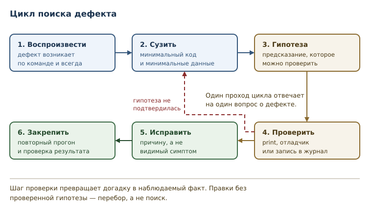

# Отладка и трассировка

<!-- syllanix:nav -->
**Навигация:** [← 10. Ошибки и исключения](10-errors-exceptions.md) · [Оглавление книги](../README.md) · [Далее: 12. Коллекции и последовательности: введение →](12-collections-intro.md)
<!-- /syllanix:nav -->

<!-- syllanix:topics -->
**Темы главы**
11.1. [Зачем эта глава](#зачем-эта-глава)  
11.2. [Трассировка: отчёт о цепочке вызовов](#traceback)  
11.3. [Что даёт трассировка при поиске дефекта](#frames)  
11.4. [Отладка через print](#print-debugging)  
11.5. [Логирование](#logging)  
11.6. [Отладчик и точки останова](#debugger)  
11.7. [Систематический поиск дефекта](#method)  
11.8. [Как сообщить о проблеме, чтобы вам помогли](#ask-help)  
11.9. [Типичные ошибки](#mistakes)  
11.10. [Упражнения](#упражнения)  
11.11. [Проверка понимания](#проверка-понимания)  
11.12. [Что дальше](#что-дальше)  
<!-- /syllanix:topics -->


Исключение — это честный сбой: программа сама сообщила, что не может
продолжить. Хуже обстоит дело, когда программа работает без ошибок и
выдаёт неверный результат. Интерпретатор молчит, исключений нет, а число
на экране неправильное. Такой дефект нужно найти самому. В этой главе вы
научитесь читать отчёт об ошибке, останавливать программу в нужном месте,
записывать события в журнал и искать причину дефекта последовательно, а не
перебором случайных правок.

## Зачем эта глава

Отладка занимает у разработчика больше времени, чем написание кода.
Причина проста: код пишется один раз по понятному плану, а дефект
проявляется в неожиданном месте и при неожиданных данных. Пока вы
действуете наугад — меняете строку, запускаете, смотрите, — время уходит
на догадки.

Инструменты отладки отвечают на конкретные вопросы. Трассировка
показывает, где именно и при какой цепочке вызовов возник сбой. Отладчик
позволяет остановить программу и посмотреть значения переменных в этот
момент. Логирование рассказывает, что происходило до сбоя, даже если
сбоя уже нет. Вместе они превращают поиск дефекта в проверяемую
процедуру.

После этой главы вы сможете:

- читать трассировку и находить в ней причину, а не только последнюю
  строку;
- использовать отладку через print осознанно и вовремя её убирать;
- настраивать логирование и выбирать уровень записи;
- ставить точку останова в отладчике и исследовать состояние программы;
- применять последовательный метод поиска дефекта вместо перебора
  правок.

## Трассировка: отчёт о цепочке вызовов {#traceback}

Когда исключение никто не перехватил, интерпретатор печатает
**трассировку** (traceback) — отчёт о месте и цепочке вызовов, которые
привели к исключению. Это не текст «что-то пошло не так», а точная карта
пути исполнения.

Покажем типичную ситуацию: функция `ratio` делит на ноль, её вызвала
функция `report`, а ту вызвал код верхнего уровня.

```text
Traceback (most recent call last):
  File "report.py", line 10, in <module>
    report(10, 0)
  File "report.py", line 7, in report
    return f"среднее: {ratio(total, count)}"
  File "report.py", line 4, in ratio
    return total / count
ZeroDivisionError: division by zero
```

Читать отчёт нужно с двух концов. Последняя строка называет тип
исключения и его сообщение: `ZeroDivisionError: division by zero`. Это
ответ на вопрос «что случилось». Верхние строки называют кадры стека
вызовов: сначала код модуля, затем `report`, затем `ratio`. Последний
кадр перед сообщением — место сбоя: строка 4 в функции `ratio`.

Слово `Traceback (most recent call last)` переводится буквально:
«трассировка, последний вызов в конце». Поэтому история вызовов идёт
сверху вниз от старого к новому, а причина сбоя — в самом низу.



Тот же путь можно получить программно: у объекта исключения есть
атрибут `__traceback__`, а модуль `traceback` умеет разбирать его на
кадры.

```python exec
import traceback

def ratio(total, count):
    return total / count

def report(total, count):
    return f"среднее: {ratio(total, count)}"

try:
    report(10, 0)
except ZeroDivisionError as error:
    for frame in traceback.extract_tb(error.__traceback__):
        print(frame.name, "строка", frame.lineno)
    print(type(error).__name__, "|", error)
```

```output
<module> строка 10
report строка 7
ratio строка 4
ZeroDivisionError | division by zero
```

Номера строк здесь считаются от начала примера. Порядок кадров совпадает
с отчётом интерпретатора: `report` вызвала `ratio`, поэтому `ratio`
оказалась последней.

## Что даёт трассировка при поиске дефекта {#frames}

Первое, что даёт трассировка — точку, с которой начинать. Не нужно
искать по всему файлу: интерпретатор назвал функцию и строку. Второе —
цепочку вызовов: видно, какие аргументы пришли в проблемную функцию и кто
их передал. Третье — тип исключения: он подсказывает категорию причины.

Полезно задавать по отчёту три вопроса подряд.

- Где сбой? Последний кадр: функция и строка.
- Откуда пришли аргументы? Предыдущий кадр: что передали в функцию.
- Почему они такие? Ещё выше: кто сформировал значения.

Часто дефект находится не там, где произошёл сбой, а на один-два кадра
выше. Деление на ноль случилось в `ratio`, но причина — пустые аргументы,
которые подготовила вызывающая функция. Поэтому трассировку читают
целиком, а не только последнюю строку.

Отчёт об ошибке ничего не говорит о том, что происходило до вызова.
Если программа обработала тысячу записей и упала на последней, вам нужна
история, а не снимок. Для истории служит логирование, о нём ниже.

## Отладка через print {#print-debugging}

Самый быстрый способ узнать, что происходит, — напечатать промежуточные
значения. Это **отладка через print**: временные `print` в местах, где
поведение расходится с ожиданием.

```python exec
def average(total, count):
    print("total =", total)
    print("count =", count)
    return total / count

print("результат =", average(10, 4))
```

```output
total = 10
count = 4
результат = 2.5
```

Приём рабочий, но у него есть правила. Подписывайте значения: `print(10)`
бесполезен, `print("count =", count)` понятен. Печатайте на границах
функции — вход и выход. Убирайте отладочные строки перед сдачей: забытый
`print` засоряет вывод и иногда раскрывает внутренние значения, которые
показывать нельзя.

Главное ограничение: print показывает только то, что вы догадались
напечатать. Если дефект в неожиданном месте, десять отладочных строк
ничего не покажут. Для случаев, когда нужен обзор, есть отладчик и
логирование.

## Логирование {#logging}

**Логирование** — запись событий программы в журнал с уровнями важности.
В отличие от print, записи остаются в файле или потоке журнала, имеют
время, источник и уровень, и их можно включать и выключать настройкой.

**Уровень логирования** — степень важности записи. Стандартные уровни
идут по возрастанию: `DEBUG`, `INFO`, `WARNING`, `ERROR`, `CRITICAL`.
Сообщения ниже установленного уровня отбрасываются, поэтому в рабочей
среде журнал не забивается подробностями.

```python exec
import logging
import sys

logging.basicConfig(stream=sys.stdout, level=logging.INFO,
                    format="%(levelname)s %(message)s")

logging.debug("подробность для разработчика")
logging.info("запуск обработки")
logging.warning("значение близко к границе")
logging.error("обработка не удалась")
```

```output
INFO запуск обработки
WARNING значение близко к границе
ERROR обработка не удалась
```

Запись уровня `DEBUG` не появилась: установленный уровень `INFO` её
отбрасывает. Параметр `stream=sys.stdout` в примере нужен только для
того, чтобы вывод попал в тот же поток, что и остальной вывод программы;
по умолчанию журнал пишется в стандартный поток ошибок.

Повысим порог — и журнал станет короче.

```python exec
import logging
import sys

logging.basicConfig(stream=sys.stdout, level=logging.ERROR,
                    format="%(levelname)s %(message)s", force=True)

logging.warning("это сообщение не появится")
logging.error("а это появится")
```

```output
ERROR а это появится
```

Здесь важен `force=True`: без него повторный `basicConfig` ничего не делает,
если корневой журнал уже настроен, и уровень остался бы прежним. В отдельных
запусках это незаметно, но в одном сеансе настройка не изменилась бы.

Выбор уровня — проектное решение, а не вкусовщина. `DEBUG` — подробности
для разработчика: значения переменных, ветви условий. `INFO` — значимые
события: запуск, завершение, количество обработанных записей. `WARNING` —
неожиданность, которую программа пережила. `ERROR` — операция не
выполнена. `CRITICAL` — программа не может продолжать работу.

Логируйте причину и контекст, а не только факт: `"недостаточно
средств: нужно 300, доступно 100"` полезнее, чем `"ошибка"`. И никогда не
записывайте в журнал пароли, токены и персональные данные: журнал живёт
долго и читается многими.

## Отладчик и точки останова {#debugger}

**Отладчик** — инструмент пошагового исполнения с остановками и
просмотром значений. **Точка останова** — место в коде, на котором
отладчик приостанавливает исполнение. В Python отладчик входит в
стандартную библиотеку: модуль `pdb`.

Самый простой способ войти в отладчик — вызвать встроенную функцию
`breakpoint()` в том месте, которое нужно исследовать. Запущенная
программа остановится и покажет приглашение `(Pdb)`. В редакторах и
средах разработки та же функция открывает графический отладчик, если он
настроен.

Основные команды `pdb` стоит знать наизусть:

| Команда | Смысл |
|---|---|
| `n` (next) | выполнить строку, не заходя внутрь вызовов |
| `s` (step) | выполнить строку, заходя внутрь вызова |
| `c` (continue) | продолжить до следующей точки останова |
| `p имя` | напечатать значение переменной |
| `pp имя` | напечатать значение подробно |
| `l` (list) | показать окружающие строки кода |
| `b место` | поставить точку останова |
| `q` (quit) | выйти из отладчика |

Сокращённый сеанс выглядит так (пути к файлу для читаемости укорочены):

```console
$ python3 -m pdb report.py
> report.py(1)<module>()
-> def ratio(total, count):
(Pdb) break report
Breakpoint 1 at report.py:6
(Pdb) continue
> report.py(6)report()
-> return f"среднее: {ratio(total, count)}"
(Pdb) p total
10
(Pdb) s
--Call--
> report.py(1)ratio()
-> def ratio(total, count):
(Pdb) p count
0
(Pdb) s
> report.py(2)ratio()
-> return total / count
(Pdb) n
ZeroDivisionError: division by zero
```

Сеанс показывает главное преимущество отладчика: вы видите значения
непосредственно перед сбоем. `total` равно 10, `count` равно 0 — причина
найдена без правок кода и повторных запусков.

Отладчик удобен, когда нужно исследовать состояние. Логирование удобно,
когда состояние нужно сохранить на будущее. Отладка через print удобна,
когда нужно проверить одну гипотезу за десять секунд. Опытный разработчик
выбирает инструмент по задаче, а не по привычке.

## Систематический поиск дефекта {#method}

Дефект — это расхождение между ожидаемым и фактическим поведением.
Искать его лучше по процедуре, а не случайными правками.



1. **Воспроизведите.** Добейтесь, чтобы дефект возникал по команде и
   всегда, а не «иногда». Запишите входные данные. Если воспроизвести не
   удаётся, у вас пока нет воспроизводимого дефекта — есть только гипотеза;
   сначала добейтесь воспроизведения, при необходимости создав особые
   условия: нагрузку, окружение, порядок событий.
2. **Сузьте.** Уберите всё лишнее: оставьте минимальный код и минимальные
   данные, при которых проблема сохраняется. Часто дефект исчезает при
   сужении — это тоже результат: вы нашли условие.
3. **Сформулируйте гипотезу.** «Функция получает `count = 0`, потому что
   фильтр отбросил все записи». Гипотеза должна быть проверяемой.
4. **Проверьте.** Напечатайте значение, поставьте точку останова,
   добавьте запись в журнал. Не меняйте код по интуиции.
5. **Исправьте.** Исправляйте причину, а не симптом. Если деление на ноль
   спрятано за проверкой `if count:`, подумайте, почему `count` стал нулём.
6. **Закрепите.** Повторите исходный сценарий и убедитесь, что дефект
   исчез, а остальное поведение не изменилось.

Шаг проверки гипотезы — ключевой. Пока гипотеза не проверена, любая
правка кода гадание. Полезно формулировать гипотезу как предсказание:
«если причина в нулевом `count`, то `print(count)` перед делением покажет
0». Предсказание либо сбывается, либо нет — и то и другое двигает поиск.

## Как сообщить о проблеме, чтобы вам помогли {#ask-help}

Постановка вопроса — инженерный навык, а не формальность. Хороший вопрос
экономит часы, плохой — дни. Минимальный набор сведений:

1. **Что вы хотели сделать** — цель, а не только шаг, на котором всё встало.
2. **Что сделали** — команда или код, минимально воспроизводящий проблему.
3. **Что ожидали** — конкретно: «должно вывести 850», а не «должно работать».
4. **Что получили** — полный текст ошибки и трассировка, а не «ошибка».
5. **Окружение** — версия Python (`python3 --version`), операционная система,
   версии библиотек (`uv run python -m pip freeze`), как запускали.
6. **Что уже проверили** — чтобы вам не советовали то же самое.

Правило минимального примера: уберите из кода всё, что не нужно для
воспроизведения. Часто уже на этом шаге ошибка становится очевидной — это
главная причина, почему минимальный пример требуют на форумах.

Что делает вопрос плохим: «не работает, помогите», скриншот вместо текста,
несколько проблем в одном сообщении, отсутствие версии и кода. Что делает
хорошим: воспроизводимый пример и точная формулировка ожидания.

И ещё: перед вопросом проверьте, что вы читали сообщение до конца. В
трассировке последняя строка — тип ошибки, а строки выше — место и цепочка
вызовов; в большинстве случаев ответ там уже есть.

## Типичные ошибки {#mistakes}

**Читать только последнюю строку.** Тип и сообщение отвечают на вопрос
«что», но не «где» и не «почему». Смотрите последний кадр и цепочку
вызовов.

**Менять код наугад.** Правка «на всякий случай» иногда скрывает симптом
и почти всегда добавляет новый дефект. Сначала гипотеза, потом правка.

**Печатать без подписей.** `print(count)` в большом выводе бесполезен.
Печатайте имя и значение, а лучше используйте логирование с уровнями.

**Оставлять отладку в коде.** Забытые `print`, `breakpoint()` и
подробные журналы попадают в рабочую версию. `breakpoint()` в
неинтерактивном процессе может остановить программу и ждать ввода, которого
не будет.

**Логировать слишком поздно.** Если журнал включается только после сбоя,
в нём нет данных о том, что к сбою привело. Логирование настраивают
заранее.

**Логировать секреты.** Пароль, токен или номер карты в журнале — это
утечка, которая переживёт сам дефект. Маскируйте такие значения.

**Игнорировать предупреждения.** Строка `SyntaxWarning` или сообщение
библиотеки часто указывает на будущую ошибку. Их разбирают, а не
отключают.

## Упражнения

### 1. Порядок кадров {#ex-ch11-01}

В программе три функции: `level_one` вызывает `level_two`, та вызывает
`level_three`, в которой происходит деление на ноль. Перехватите
исключение и напечатайте имена кадров из `traceback.extract_tb` в том
порядке, в котором они идут. Объясните, совпадает ли этот порядок с
текстом трассировки.

### 2. Чтение отчёта {#ex-ch11-02}

Дан отчёт об ошибке:

```text
Traceback (most recent call last):
  File "stats.py", line 12, in <module>
    print(ratio(10, 0))
  File "stats.py", line 5, in ratio
    return total / count
ZeroDivisionError: division by zero
```

Ответьте: в какой функции произошёл сбой, какая строка виновата, кто
вызвал функцию и как исправить код, чтобы деление на ноль не завершало
программу.

### 3. Отладка через print {#ex-ch11-03}

Функция `average(total, count)` иногда падает. Добавьте отладочные
`print` так, чтобы по выводу было видно, какие значения пришли в функцию.
Проверьте на двух вызовах: с нормальными данными и с `count = 0`.
Объясните, почему после отладки строки нужно убрать.

### 4. Уровни журнала {#ex-ch11-04}

Настройте логирование с уровнем `WARNING` и запишите по одному сообщению
каждого уровня: `DEBUG`, `INFO`, `WARNING`, `ERROR`. Какие строки
появятся в выводе и почему? Проверьте ответ запуском.

### 5. Выбор уровня {#ex-ch11-05}

Для каждого события выберите уровень логирования и обоснуйте выбор:

1. программа запустилась и прочитала настройки;
2. значение из файла оказалось больше ожидаемого, но обработка
   продолжилась;
3. платёж отклонён банком;
4. недоступна база данных, без которой работа невозможна;
5. промежуточная сумма на каждом шаге расчёта.

### 6. Команды отладчика {#ex-ch11-06}

Вы остановились в отладчике на строке, где переменная `amount` должна
быть равна 300, но результат неверный. Запишите последовательность команд
`pdb`, которая позволит: посмотреть значение `amount`, выполнить одну
строку, не заходя в вызовы, и выйти из отладчика. Объясните разницу между
`n` и `s`.

### 7. Минимальный пример {#ex-ch11-07}

Функция `final_price` из большого расчёта возвращает `-14000` вместо
`850`. Опишите, как свести задачу к минимальному примеру, и напишите
такой пример: только функция и два вызова. Найдите ошибку и исправьте её.

### 8. print или логирование {#ex-ch11-08}

Для двух ситуаций выберите инструмент и объясните выбор:

1. нужно понять, почему функция вернула не то значение, прямо сейчас, на
   своей машине;
2. нужно понять, почему обработка заказов раз в неделю завершается
   ошибкой на рабочем сервере.

### 9. Дефект в цикле {#ex-ch11-09}

Функция должна возвращать сумму чисел от 1 до `n` включительно, но
возвращает меньше. Найдите дефект, исправьте его и объясните, какое
отношение к нему имеет граница диапазона `range`.

```python
def sum_to(n):
    total = 0
    for number in range(1, n):
        total += number
    return total
```

### 10. Мини-задача: журнал перевода {#ex-ch11-10}

Напишите функцию `transfer(balance, amount)`, которая переводит деньги со
счёта. Требования:

- при входе записывайте в журнал уровня `INFO` сумму перевода и остаток;
- если сумма больше остатка, записывайте `ERROR` с обоими значениями и
  возвращайте `None`;
- при успехе возвращайте новый остаток.

Проверьте на успешном переводе и на переводе больше остатка. Настройте
формат журнала так, чтобы были видны уровень и сообщение.

## Проверка понимания

1. Что означает строка `Traceback (most recent call last)` и в каком
   порядке читать кадры?
2. Почему причина дефекта часто находится выше места сбоя в трассировке?
3. Чем отладка через print отличается от логирования по назначению и по
   срокам жизни информации?
4. Зачем нужны уровни логирования и что происходит с сообщением ниже
   установленного уровня?
5. Чем команда `n` отличается от `s` в отладчике?
6. Почему нельзя оставлять `breakpoint()` в рабочем коде?
7. Какой шаг поиска дефекта превращает догадку в проверяемую гипотезу?

## Что дальше

Вы умеете замечать сбой, объяснять его и находить причину. До сих пор
программы работали с отдельными значениями. Дальше начинается работа с
наборами данных: коллекциями и последовательностями, где на первый план
выходят порядок, индексы и длина. Об этом — в главе
[«Коллекции и последовательности: введение»](12-collections-intro.md#collections).

<!-- syllanix:nav -->
**Перед этой главой:** [10. Ошибки и исключения](10-errors-exceptions.md)
**Связанные главы:** [02. Первая программа: вычисления и вывод](02-first-program.md), [03. Значения, имена, объекты и типы](03-values-names-objects.md), [04. Выражения, операторы и ввод данных](04-expressions-input.md), [07. Функции: параметры, аргументы и области видимости](07-functions.md), [08. Стек вызовов, области видимости и рекурсия](08-recursion-scope.md), [09. Модули, пакеты и импорты](09-modules.md), [37. Время, даты и логирование](37-time-logging.md)
**Далее:** [12. Коллекции и последовательности: введение →](12-collections-intro.md)
<!-- /syllanix:nav -->
