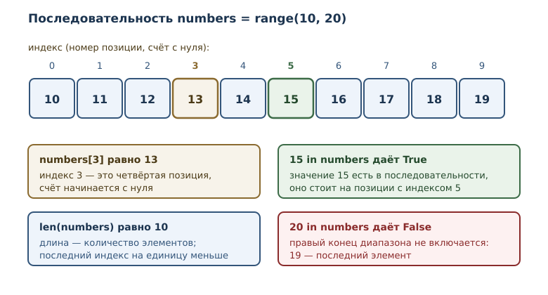
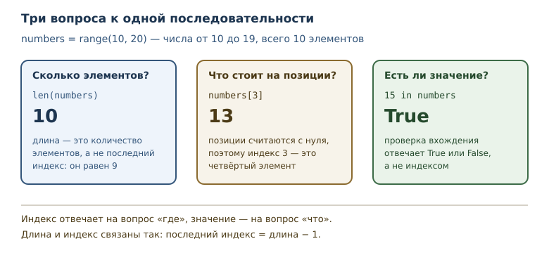

# Коллекции и последовательности: введение

<!-- syllanix:nav -->
**Навигация:** [← 11. Отладка и трассировка](11-debugging.md) · [Оглавление книги](../README.md) · [Далее: 13. Списки: индексы, срезы и методы →](13-lists.md)
<!-- /syllanix:nav -->

<!-- syllanix:topics -->
**Темы главы**
12.1. [Зачем нужны коллекции](#зачем-нужны-коллекции)  
12.2. [Коллекция и последовательность](#collections)  
12.3. [Элемент и позиция](#elements)  
12.4. [Индекс и значение — разные вещи](#index-vs-value)  
12.5. [Проверка вхождения](#membership)  
12.6. [Итерируемость](#iteration)  
12.7. [Коллекции бывают разными](#families)  
12.8. [Типичные ошибки](#mistakes)  
12.9. [Упражнения](#упражнения)  
12.10. [Проверка понимания](#проверка-понимания)  
12.11. [Что дальше](#что-дальше)  
<!-- /syllanix:topics -->


До сих пор каждое имя в программе связывалось с одним значением: одно
число, один текст, один результат. Так удобно описывать отдельный факт,
но не набор фактов. Температура за десять дней, оценки за контрольную,
символы в слове — это не одно значение, а группа связанных значений,
которую нужно хранить вместе и обрабатывать целиком. С этого места
начинается третья часть книги: работа с наборами данных.

## Зачем нужны коллекции

Представьте, что нужно посчитать среднюю температуру за десять дней.
Можно завести десять имён:

```python
t1 = 18
t2 = 21
t3 = 19
t4 = 20
```

Четыре имени ещё терпимы. Десять — уже неудобно, тысяча — невозможно:
программа не может обработать то, чего не знает по имени. Кроме того,
такой код не масштабируется: количество данных задано в тексте программы,
а не во входных данных.

**Коллекция** — объект, хранящий набор других объектов. Коллекция
позволяет обращаться с группой значений как с одной сущностью: передать в
функцию, посчитать количество элементов, пройти по ним в цикле.

**Элемент** — отдельное значение внутри коллекции. В коллекции температур
элементами будут числа 18, 21, 19, 20; сама коллекция — один объект,
содержащий четыре элемента.

Из этого сразу следует важное свойство: коллекция — тоже объект, у неё
есть тип и идентичность, как у любого значения. Поэтому коллекции можно
связывать с именами, передавать в функции и возвращать из них. Элементы
при этом остаются обычными значениями своих типов.

Конкретные виды коллекций появятся в следующих главах: списки в
[тринадцатой](13-lists.md), кортежи в [четырнадцатой](14-tuples.md),
строки как последовательности в [пятнадцатой](15-strings.md), множества в
[шестнадцатой](16-sets.md) и словари в семнадцатой. Начинать нужно с
общих понятий, которые работают для всех них.

Польза коллекции видна, когда данных становится много. Программа,
которая хранит десять температур в десяти именах, требует правки при
переходе к сотне измерений: нужно дописывать код. Программа, которая
хранит коллекцию температур, обрабатывает любое количество одинаково —
цикл проходит по элементам, а их число определяется данными, а не
текстом программы. Это и есть переход от «нескольких значений» к
«набору данных».

## Коллекция и последовательность {#collections}

Не всякая коллекция устроена одинаково. Самая привычная разновидность —
та, в которой элементы стоят в определённом порядке и к каждому можно
обратиться по номеру.

**Последовательность** — коллекция с определённым порядком элементов,
доступных по целочисленному индексу. У последовательности есть первый
элемент, второй, третий; порядок задан самой коллекцией и не меняется
произвольно между операциями.

С последовательностью вы уже работали, не зная об этом: объект `range`
из главы о циклах — настоящая последовательность. Он задаёт
последовательность целых чисел, и к его элементам можно обращаться по
индексу.

```python exec
numbers = range(10, 20)
print(len(numbers))
print(len(range(2, 10, 3)))
print(len(range(5, 5)))
```

```output
10
3
0
```

**Длина** — количество элементов в коллекции, возвращаемое функцией
`len`. У `range(10, 20)` десять элементов: числа от 10 до 19. Второй
пример показывает, что длина зависит от шага: `range(2, 10, 3)` даёт
2, 5, 8 — три элемента. Третий пример важен как граничный: диапазон
`range(5, 5)` пуст, его длина равна нулю.

`len` работает не с любым объектом, а только с теми, у которых есть
длина. Для числа её не существует.

```python exec expect-error
print(len(42))
```

```output
TypeError: object of type 'int' has no len()
```

Сообщение говорит буквально: у объекта типа `int` нет длины. Длина —
свойство коллекции, а не отдельного значения. У пустой коллекции длина
равна нулю, и это не ошибка.

## Элемент и позиция {#elements}

Место элемента в последовательности называется **позицией**. Позиции
нумеруются, и номер позиции — это **индекс**: целое число, указывающее
позицию элемента в последовательности. Нумерация начинается с нуля.

Почему с нуля, а не с единицы? Индекс удобно понимать как смещение от
начала: первый элемент стоит на нулевом расстоянии от начала, второй — на
расстоянии один. Такая нумерация делает арифметику индексов простой:
последний индекс последовательности длины `n` равен `n - 1`.



Обращение к элементу записывается квадратными скобками.

```python exec
numbers = range(10, 20)
print(numbers[0])
print(numbers[3])
print(numbers[9])
```

```output
10
13
19
```

`numbers[0]` — первый элемент, `numbers[3]` — четвёртый, `numbers[9]` —
последний. Между индексом и позицией полезно держать в голове
соответствие: индекс 0 — первая позиция, индекс 3 — четвёртая позиция.

Если индекс выходит за пределы допустимого диапазона, обращение
завершается ошибкой: элементов с такими номерами нет.

```python exec expect-error
numbers = range(10, 20)
print(numbers[10])
```

```output
IndexError: range object index out of range
```

Диапазон допустимых индексов — от `0` до `len(numbers) - 1`. Тип этой
ошибки и её типичные причины разобраны в главе о списках; здесь важно
запомнить само правило границы. Ошибка на единицу, когда берут
`numbers[len(numbers)]`, — один из самых частых дефектов начинающих.

## Индекс и значение — разные вещи {#index-vs-value}

Индекс и элемент легко перепутать, потому что оба выглядят как числа.
Различие принципиально: индекс отвечает на вопрос «где», элемент — на
вопрос «что». В `range(10, 20)` значение первого элемента равно 10, а его
индекс равен 0.

```python exec
numbers = range(10, 14)
print("длина:", len(numbers))
for position in range(len(numbers)):
    print(position, "->", numbers[position])
```

```output
длина: 4
0 -> 10
1 -> 11
2 -> 12
3 -> 13
```

Такой цикл — стандартный способ пройти по последовательности, когда нужны
и значения, и их позиции. Выражение `range(len(numbers))` даёт индексы
0, 1, 2, 3, а `numbers[position]` — значение на этой позиции. Обратите
внимание: `range(len(numbers))` не включает `len(numbers)`, иначе
последний шаг вышел бы за границу.

## Проверка вхождения {#membership}

Часто нужно узнать не «что стоит на позиции», а «есть ли такое значение
вообще». Для этого есть **проверка вхождения** — оператор `in` и его
отрицание `not in`. Результат — логическое значение `True` или `False`.

```python exec
digits = range(10)
print(7 in digits)
print(10 in digits)
print(10 not in digits)
print(0 in digits)
```

```output
True
False
True
True
```

`range(10)` содержит числа 0–9. Поэтому 7 входит, 10 не входит, а `10 not
in digits` даёт `True`. Ноль входит: он первый элемент, а не «ничего».

Что именно проверяет `in`? Он отвечает на вопрос, есть ли в коллекции
элемент, равный искомому значению. Сравнение идёт по значению, а не по
позиции и не по «похожести типа»: `0 in range(10)` истинно, потому что
ноль действительно стоит в начале, а `0.0 in range(10)` тоже истинно —
целое число и число с плавающей точкой с одинаковым значением Python
считает равными при сравнении. Это следствие общего правила сравнения,
а не особенность проверки вхождения.

Последовательность может содержать повторяющиеся элементы. Проверка
вхождения при этом отвечает просто «да», не уточняя, сколько раз
значение встречается и на какой позиции. Если нужны подробности — номер
позиции или количество, — их получают другими средствами, о которых
пойдёт речь в следующих главах.

Проверка вхождения учитывает границы последовательности, а не диапазон
чисел вообще.

```python exec
print(10 in range(1, 10))
print(9 in range(1, 10))
print(len(range(1, 10)))
```

```output
False
True
9
```

Правый конец `range` не включается: `range(1, 10)` содержит 1–9. Поэтому
10 не входит, хотя граница указана в записи. Здесь работает то же правило
полуоткрытого интервала, что и в циклах.

Вхождение определено только для коллекций. Попытка проверить вхождение в
число — ошибка типа.

```python exec expect-error
print(3 in 42)
```

```output
TypeError: argument of type 'int' is not a container or iterable
```

Сообщение подсказывает: `int` не контейнер и не итерируемый объект. Для
оператора `in` нужен объект, у которого можно проверить наличие
элемента. Подробнее про итерируемые объекты — в следующем разделе и в
главе об итераторах.

## Итерируемость {#iteration}

Последовательность можно не только индексировать, но и перебирать:
`for` проходит по элементам по порядку. Способность объекта отдавать
элементы по одному называется **итерируемостью**, а сам объект —
итерируемым. Это понятие вы уже встречали в главе о циклах; здесь оно
впервые применяется к коллекциям как к источнику данных.

```python exec
total = 0
for number in range(1, 6):
    total += number
print("сумма:", total)
```

```output
сумма: 15
```

Цикл `for number in range(1, 6)` по очереди связывает имя `number` с
элементами 1, 2, 3, 4, 5. Порядок обхода — тот же, что порядок элементов
в последовательности. Именно порядок делает сумму предсказуемой.

У последовательности есть два способа доступа к элементам: по индексу и
через перебор. Первый нужен, когда важна позиция, второй — когда нужны
значения. Оба способа согласованы: перебор идёт в том же порядке,
в котором элементы стоят по индексам.

Не всякая коллекция обязана быть последовательностью: бывают коллекции
без порядка, где индексов нет, но перебор есть. Такие типы появятся в
главах о множествах и словарях. Поэтому правило звучит так:
последовательность всегда итерируема, но итерируемый объект не всегда
последовательность.

## Коллекции бывают разными {#families}

У коллекций есть свойства, которые полезно различать ещё до знакомства с
конкретными типами.

Первое — **порядок**. У последовательности он есть и фиксирован.
Коллекция без порядка хранит элементы так, что «первого» среди них нет;
перебор возможен, а индекс — нет.

Второе — **изменяемость**. Одни коллекции можно менять после создания
(добавлять и удалять элементы), другие создаются один раз и дальше
ведут себя как значения. Неизменяемую коллекцию безопасно передавать в
функции: вызывающий код не сможет её испортить.

Третье — **уникальность**. Одни коллекции допускают повторы, другие
хранят каждый элемент не более одного раза.



Конкретные сочетания этих свойств и дают четыре основных вида коллекций,
которые ждут впереди. Пока достаточно запомнить три вопроса, на которые
умеет отвечать любая последовательность: какова её длина, что стоит на
позиции и входит ли значение.

## Типичные ошибки {#mistakes}

**Путать длину и последний индекс.** Если длина равна 10, последний
индекс равен 9. Обращение `numbers[len(numbers)]` всегда выходит за
границу.

**Путать индекс и значение.** В `range(10, 20)` значение 10 стоит на
позиции 0. Если нужен элемент с конкретным значением, его ищут проверкой
вхождения или перебором, а не обращением по индексу.

**Считать, что правый конец диапазона входит.** `range(1, 10)` содержит
девять чисел, а не десять. То же правило действует для проверки
вхождения.

**Проверять вхождение в число.** `3 in 42` — ошибка типа: число не
коллекция. Проверка вхождения имеет смысл только для объектов, которые
содержат элементы.

**Ожидать индексацию от любой коллекции.** У коллекции без порядка
индексов нет. Прежде чем писать `collection[0]`, убедитесь, что это
последовательность.

**Считать `len` универсальным.** `len` определена для коллекций, но не
для всех объектов. Для числа или логического значения её нет.

## Упражнения

### 1. Длина и последний индекс {#ex-ch12-01}

Для последовательности `numbers = range(3, 13)` определите, не запуская
код: длину, последний допустимый индекс и значение элемента с индексом
5. Затем проверьте ответы программой.

### 2. Прогнозирование вывода {#ex-ch12-02}

Что выведет программа? Запишите ответ, затем проверьте.

```python
temperatures = range(18, 24)
print(len(temperatures))
print(temperatures[2])
print(21 in temperatures)
print(30 in temperatures)
```

### 3. Граница диапазона {#ex-ch12-03}

Напишите цикл, который печатает все элементы `range(4, 9)` вместе с
индексами, а затем отдельной строкой сообщает, что индекс 5 выходит за
границу. Объясните, почему граница равна именно 5.

### 4. Функция доступа по индексу {#ex-ch12-04}

Напишите функцию `nth(sequence, position)`, которая возвращает элемент
последовательности на заданной позиции. Проверьте её на
`range(100, 105)` с позициями 0 и 4.

### 5. Проверка вхождения {#ex-ch12-05}

Напишите функцию `contains(sequence, value)`, которая возвращает
`True`, если значение входит в последовательность, и `False` иначе.
Проверьте её на `range(1, 10)` со значениями 5, 10 и 1.

### 6. Пустая последовательность {#ex-ch12-06}

Создайте пустую последовательность `range(7, 7)` и выведите её длину и
результат проверки `7 in empty`. Объясните, почему проверка вхождения не
поднимает ошибку.

### 7. Анализ вхождения {#ex-ch12-07}

Объясните, почему `10 in range(1, 10)` даёт `False`, а `9 in range(1, 10)`
даёт `True`. Как длина этой последовательности связана с ответом?

### 8. Сумма с шагом {#ex-ch12-08}

Просуммируйте элементы `range(2, 12, 2)` циклом. Сколько элементов в
этой последовательности и чему равна сумма? Проверьте оба ответа
программой.

### 9. Тип ошибки {#ex-ch12-09}

Что произойдёт при выполнении `len(3.5)`? Назовите тип исключения и
объясните, почему функция `len` не определена для числа.

### 10. Мини-задача: кратные числа {#ex-ch12-10}

Напишите функцию `count_multiples(limit, divisor)`, которая считает,
сколько чисел в последовательности `range(1, limit + 1)` делится на
`divisor` без остатка. Используйте цикл и проверку условия. Проверьте на
парах `(20, 3)` и `(10, 5)`.

## Проверка понимания

1. Чем коллекция отличается от отдельного значения? Приведите пример
   задачи, где коллекция необходима.
2. Что такое последовательность и чем она отличается от коллекции
   вообще?
3. Почему нумерация индексов начинается с нуля? Как связаны длина и
   последний индекс?
4. Чем индекс отличается от значения элемента? Покажите на примере
   `range(10, 20)`.
5. Что проверяет оператор `in` и почему `3 in 42` — ошибка?
6. Что значит «итерируемость» и почему последовательность всегда
   итерируема?
7. По каким трём свойствам различаются коллекции?

## Что дальше

Общие понятия введены: коллекция, последовательность, элемент, индекс,
длина и проверка вхождения. Теперь можно перейти к самой используемой
последовательности Python — списку. Он изменяемый, поэтому кроме чтения
элементов понадобится освоить изменение, удаление и срезы. Об этом — в
главе [«Списки: индексы, срезы и методы»](13-lists.md#list-basics).

<!-- syllanix:nav -->
**Перед этой главой:** [10. Ошибки и исключения](10-errors-exceptions.md)
**Связанные главы:** [02. Первая программа: вычисления и вывод](02-first-program.md), [03. Значения, имена, объекты и типы](03-values-names-objects.md), [04. Выражения, операторы и ввод данных](04-expressions-input.md), [06. Циклы: while и for](06-loops.md), [07. Функции: параметры, аргументы и области видимости](07-functions.md), [14. Кортежи, распаковка и неизменяемость](14-tuples.md), [15. Строки: методы, форматирование и Unicode](15-strings.md), [16. Множества и хеширование](16-sets.md)
**Далее:** [13. Списки: индексы, срезы и методы →](13-lists.md)
<!-- /syllanix:nav -->
