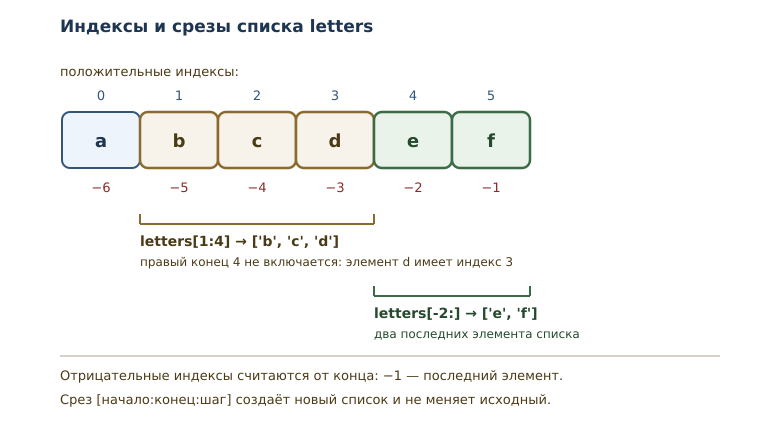

# Списки: индексы, срезы и методы

<!-- syllanix:nav -->
**Навигация:** [← 12. Коллекции и последовательности: введение](12-collections-intro.md) · [Оглавление книги](../README.md) · [Далее: 14. Кортежи, распаковка и неизменяемость →](14-tuples.md)
<!-- /syllanix:nav -->

<!-- syllanix:topics -->
**Темы главы**
13.1. [Зачем нужны списки](#why)  
13.2. [Создание списка](#list-basics)  
13.3. [Изменение элемента](#mutation)  
13.4. [Отрицательные индексы](#negative-index)  
13.5. [Срезы](#slices)  
13.6. [IndexError](#index-error)  
13.7. [Методы списка](#methods)  
13.8. [append: добавление в конец](#append)  
13.9. [Вставка, удаление и извлечение](#edit)  
13.10. [Сортировка](#sort)  
13.11. [Инструкция del](#del)  
13.12. [Срез создаёт копию](#slice-copy)  
13.13. [Список как аргумент функции](#list-argument)  
13.14. [Типичные ошибки](#mistakes)  
13.15. [Упражнения](#упражнения)  
13.16. [Проверка понимания](#проверка-понимания)  
13.17. [Что дальше](#что-дальше)  
<!-- /syllanix:topics -->


В предыдущей главе появились коллекции и последовательности, но работать
приходилось с `range` — последовательностью, которую нельзя изменить.
Настоящие данные меняются: список задач пополняется, корзина покупок
редактируется, результаты измерений сортируются. Для этого нужен список.

## Зачем нужны списки {#why}

**Список** — изменяемая упорядоченная последовательность произвольных
объектов. Три слова в этом определении важны по отдельности. Упорядоченная
— значит, у элементов есть позиции и индексы, как у любой
последовательности. Произвольных объектов — значит, в одном списке могут
лежать числа, строки и другие значения. Изменяемая — значит, список можно
менять после создания: заменять элементы, добавлять и удалять их,
переставлять.

Последнее свойство отличает список от `range`. Диапазон задаётся один раз
и не меняется; список живёт вместе с программой. Именно поэтому список —
самая используемая коллекция Python: он подходит и для хранения данных,
которые ещё будут меняться, и для накопления результатов.

После этой главы вы сможете:

- создавать списки и обращаться к элементам по индексу;
- пользоваться отрицательными индексами и срезами;
- добавлять, удалять и заменять элементы;
- сортировать список и отличать сортировку на месте от создания копии;
- понимать, почему метод списка возвращает `None`, и не попадаться на
  этом.

## Создание списка {#list-basics}

Список записывается квадратными скобками, элементы разделяются запятыми.

```python exec
numbers = [10, 20, 30, 40, 50]
print(numbers)
print(len(numbers))
print(numbers[0], numbers[3])
print(20 in numbers)
print(type(numbers).__name__)
```

```output
[10, 20, 30, 40, 50]
5
10 40
True
list
```

Список отвечает на все вопросы последовательности из
[предыдущей главы](12-collections-intro.md#collections): у него есть
длина, элементы доступны по индексу, работает проверка вхождения. При
печати список показывается в квадратных скобках — это удобная форма
записи, по которой видно и значения, и их порядок.

Пустой список записывается как `[]`. Его длина равна нулю, и это
нормальное начальное состояние, из которого список наполняется.

```python exec
squares = []
for number in range(1, 5):
    squares.append(number ** 2)
print(squares)
```

```output
[1, 4, 9, 16]
```

Такой приём — начать с пустого списка и добавлять элементы в цикле —
встречается постоянно. Метод `append` добавляет элемент в конец; о нём
подробнее ниже.

## Изменение элемента {#mutation}

Список изменяем: элементу можно присвоить новое значение по индексу.

```python exec
numbers = [10, 20, 30]
numbers[1] = 25
print(numbers)
numbers[0] = numbers[0] + 100
print(numbers)
```

```output
[10, 25, 30]
[110, 25, 30]
```

Присваивание по индексу заменяет элемент, не меняя длину списка. Это
отличие от добавления: замена возможна только для существующей позиции.
Попытка присвоить значение по индексу, которого нет, поднимает
`IndexError`.

Изменяемость — свойство самого списка, а не имени. Если два имени связаны
с одним списком, изменение видно через оба. Подробно это разобрано в
главе [о ссылках и копировании](18-references-copy.md); пока достаточно
помнить, что список — не «значение-снимок», а объект, который можно
менять.

## Отрицательные индексы {#negative-index}

Кроме индексов от начала, у последовательностей есть **отрицательный
индекс** — индекс, отсчитываемый от конца. `-1` — последний элемент,
`-2` — предпоследний, и так далее.

```python exec
numbers = [10, 20, 30, 40, 50]
print(numbers[-1])
print(numbers[-2])
print(numbers[-5])
```

```output
50
40
10
```

Отрицательный индекс удобен, когда нужен последний элемент, а длину
списка не хочется вычислять. Соответствие простое: `numbers[-1]`
равносильно `numbers[len(numbers) - 1]`. Первый элемент можно взять как
`numbers[-len(numbers)]`.

Граница действует и здесь: `numbers[-6]` для списка из пяти элементов —
ошибка, потому что такого элемента нет.

```python exec expect-error
numbers = [10, 20, 30]
print(numbers[-4])
```

```output
IndexError: list index out of range
```

## Срезы {#slices}

**Срез** — часть последовательности, задаваемая выражением
`[начало:конец:шаг]`. Срез не меняет исходный список, а создаёт новый
список из выбранных элементов. Правая граница не включается — то же
правило полуоткрытого интервала, что у `range`.

```python exec
letters = ["a", "b", "c", "d", "e", "f"]
print(letters[1:4])
print(letters[:3])
print(letters[3:])
print(letters[:])
print(letters[::2])
print(letters[1:5:2])
```

```output
['b', 'c', 'd']
['a', 'b', 'c']
['d', 'e', 'f']
['a', 'b', 'c', 'd', 'e', 'f']
['a', 'c', 'e']
['b', 'd']
```

Разберём строку за строкой. `letters[1:4]` берёт элементы с индексами 1,
2, 3 — то есть `b`, `c`, `d`; индекс 4 уже не входит. Если начало
опущено, срез начинается с нуля; если опущен конец — идёт до конца
списка. `letters[:]` копирует весь список. Третий параметр — шаг:
`letters[::2]` берёт каждый второй элемент, а `letters[1:5:2]` — каждый
второй на отрезке от 1 до 5.

Отрицательные значения работают и в срезах: они отсчитываются от конца.

```python exec
letters = ["a", "b", "c", "d", "e", "f"]
print(letters[-2:])
print(letters[:-2])
print(letters[::-1])
```

```output
['e', 'f']
['a', 'b', 'c', 'd']
['f', 'e', 'd', 'c', 'b', 'a']
```

`letters[-2:]` — два последних элемента, `letters[:-2]` — всё, кроме двух
последних, а `letters[::-1]` — перевёрнутая копия. Обратите внимание:
срез с шагом `-1` не меняет исходный список, а создаёт новый.



Срез терпим к выходящим за границы значениям: слишком большой конец
просто означает «до конца списка».

```python exec
numbers = [10, 20, 30]
print(numbers[1:100])
print(numbers[5:9])
```

```output
[20, 30]
[]
```

Это отличается от обращения по индексу: `numbers[100]` — ошибка, а
`numbers[1:100]` — допустимый срез. Причина в том, что срез описывает
диапазон позиций, а не конкретный элемент.

## IndexError {#index-error}

**IndexError** — исключение, которое поднимается при обращении к
несуществующему индексу последовательности. Причина всегда одна:
индекс вышел за допустимый диапазон `0 .. len - 1` (или, для
отрицательных, ниже `-len`).

```python exec expect-error
numbers = [10, 20, 30]
print(numbers[3])
```

```output
IndexError: list index out of range
```

В списке три элемента, допустимые индексы — 0, 1, 2. Индекс 3 означает
четвёртый элемент, которого нет. Сообщение `list index out of range`
переводится буквально: «индекс списка вне диапазона».

Типичная причина — ошибка на единицу: путают длину и последний индекс.
Если нужен последний элемент, пишите `numbers[-1]` или
`numbers[len(numbers) - 1]`, но не `numbers[len(numbers)]`.

## Методы списка {#methods}

**Метод списка** — операция над списком, вызываемая через точку:
`numbers.append(4)`. Методы меняют список или возвращают информацию о
нём. Основные методы собраны в таблице.

| Метод | Что делает | Возвращает |
|---|---|---|
| `append(x)` | добавляет `x` в конец | `None` |
| `extend(iterable)` | добавляет все элементы из iterable | `None` |
| `insert(i, x)` | вставляет `x` на позицию `i` | `None` |
| `remove(x)` | удаляет первый элемент со значением `x` | `None` |
| `pop()` | удаляет и возвращает последний элемент | элемент |
| `pop(i)` | удаляет и возвращает элемент с индексом `i` | элемент |
| `sort()` | сортирует список на месте | `None` |
| `reverse()` | переворачивает список на месте | `None` |
| `index(x)` | возвращает индекс первого вхождения `x` | индекс |
| `count(x)` | считает вхождения `x` | число |

`index(x)` поднимает `ValueError`, если значения нет, а `pop()` на пустом
списке — `IndexError`.

Обратите внимание на третий столбец: методы, которые меняют структуру и не
извлекают значение (`append`, `extend`, `insert`, `remove`, `sort`,
`reverse`), возвращают `None`. `pop` — исключение: он меняет список и
возвращает удалённый элемент, поэтому его результат можно сразу использовать,
а результат `append(...)` — нет.


## append: добавление в конец {#append}

Метод **append** добавляет один элемент в конец списка, изменяет список и
возвращает `None`.

```python exec
numbers = [10, 20]
result = numbers.append(30)
print(numbers)
print(result)
```

```output
[10, 20, 30]
None
```

Здесь кроется классическая ловушка. Запись `numbers = numbers.append(30)`
присвоит имени `numbers` значение `None` и потеряет список. Правильно
вызывать метод отдельной инструкцией.

Метод `extend` добавляет сразу несколько элементов из другого
итерируемого объекта, а `append` добавляет переданное значение как один
элемент — даже если это другой список.

```python exec
numbers = [10, 20]
numbers.extend([30, 40])
print(numbers)
numbers.extend(range(50, 53))
print(numbers)
```

```output
[10, 20, 30, 40]
[10, 20, 30, 40, 50, 51, 52]
```

## Вставка, удаление и извлечение {#edit}

Три операции покрывают большинство правок: вставить в середину, удалить
по значению, извлечь по позиции.

```python exec
numbers = [10, 20, 30]
numbers.insert(1, 15)
print(numbers)
numbers.remove(20)
print(numbers)
last = numbers.pop()
print("взяли:", last)
print(numbers)
first = numbers.pop(0)
print("взяли:", first)
print(numbers)
```

```output
[10, 15, 20, 30]
[10, 15, 30]
взяли: 30
[10, 15]
взяли: 10
[15]
```

`insert(1, 15)` ставит 15 на позицию 1 и сдвигает остальные элементы
вправо. `remove(20)` удаляет первый элемент со значением 20 — именно
значение, а не позицию. `pop()` без аргумента удаляет последний элемент и
возвращает его; `pop(0)` удаляет первый. Разница между `remove` и `pop`
принципиальна: `remove` ищет значение, `pop` работает с позицией.

Если значения нет, `remove` поднимает `ValueError`.

```python exec expect-error
numbers = [10, 20, 30]
numbers.remove(99)
```

```output
ValueError: list.remove(x): x not in list
```

## Сортировка {#sort}

**sort** сортирует список на месте и возвращает `None`; встроенная
функция `sorted` возвращает новый отсортированный список, не меняя
исходный.

```python exec
numbers = [30, 10, 50, 20]
numbers.sort()
print(numbers)
numbers.sort(reverse=True)
print(numbers)
print(numbers.sort())
```

```output
[10, 20, 30, 50]
[50, 30, 20, 10]
None
```

Третья строка вывода показывает возвращаемое значение `sort` — `None`.
Поэтому запись `numbers = numbers.sort()` обнулит имя. Если нужен новый
список, применяйте `sorted`.

```python exec
numbers = [30, 10, 50, 20]
ordered = sorted(numbers)
print(ordered)
print(numbers)
```

```output
[10, 20, 30, 50]
[30, 10, 50, 20]
```

`numbers` остался в исходном порядке, а `ordered` — новый список. Выбор
между `sort` и `sorted` зависит от того, нужен ли исходный порядок дальше.

## Инструкция del {#del}

**Инструкция del** удаляет элемент по индексу или срез. В отличие от
`remove`, она работает с позицией и не возвращает удалённое значение.

```python exec
numbers = [10, 20, 30, 40, 50]
del numbers[1]
print(numbers)
del numbers[1:3]
print(numbers)
```

```output
[10, 30, 40, 50]
[10, 50]
```

Первая `del` удалила элемент с индексом 1. Вторая удалила срез с
индексами 1 и 2 — то есть 30 и 40. После удаления элементы сдвигаются,
поэтому индексы оставшихся меняются.

## Срез создаёт копию {#slice-copy}

Срез возвращает новый список. Это важно: изменение среза не влияет на
исходный список.

```python exec
numbers = [10, 20, 30, 40, 50]
slice_copy = numbers[1:3]
slice_copy[0] = 99
print(numbers)
print(slice_copy)
```

```output
[10, 20, 30, 40, 50]
[99, 30]
```

Изменение `slice_copy` не затронуло `numbers`: это два разных объекта.
Срез `numbers[:]` — простейший способ сделать поверхностную копию
списка. Глубокая копия понадобится, если внутри списка лежат другие
изменяемые объекты; об этом — в главе о ссылках.

Срезу можно и присвоить новый список: тогда заменяется целый участок, а
не один элемент.

```python exec
numbers = [10, 20, 30, 40, 50]
numbers[1:3] = [21, 31, 41]
print(numbers)
numbers[1:3] = []
print(numbers)
```

```output
[10, 21, 31, 41, 40, 50]
[10, 41, 40, 50]
```

Первая замена поставила на место двух элементов три, поэтому список
удлинился. Вторая замена пустым списком удалила участок — это ещё один
способ удаления по срезу, равносильный `del numbers[1:3]`. Такое
присваивание меняет исходный список, потому что слева стоит не новый
объект, а участок существующего.

## Список как аргумент функции {#list-argument}

Изменяемость проявляется и при передаче в функцию: список передаётся как
объект, поэтому изменения внутри функции видны вызывающему коду.

```python exec
def add_item(items, value):
    items.append(value)

numbers = [1, 2]
add_item(numbers, 3)
print(numbers)
```

```output
[1, 2, 3]
```

Функция ничего не возвращает, но список изменился. Иногда это и нужно, а
иногда — нежелательный побочный эффект. Если функция должна вернуть новый
список, а входной сохранить, скопируйте его через срез.

```python exec
def with_item(items, value):
    result = items[:]
    result.append(value)
    return result

numbers = [1, 2]
extended = with_item(numbers, 3)
print(numbers)
print(extended)
```

```output
[1, 2]
[1, 2, 3]
```

Соглашение простое и полезное: функция меняет аргумент только тогда,
когда это следует из её названия. `add_item` звучит как действие над
списком, `with_item` — как создание нового. Название должно сообщать о
побочном эффекте, иначе читатель кода ошибётся.

## Типичные ошибки {#mistakes}

**Присваивать результат изменяющего метода.** `numbers =
numbers.append(5)` — теперь `numbers` равно `None`. Методы `append`,
`sort`, `reverse`, `insert`, `remove`, `extend` возвращают `None`.

**Путать длину и последний индекс.** Для списка из пяти элементов
последний индекс равен 4. `numbers[5]` — `IndexError`.

**Путать `remove` и `pop`.** `remove(x)` удаляет по значению и ничего не
возвращает; `pop(i)` удаляет по индексу и возвращает элемент.

**Менять список во время перебора.** Удаление элементов внутри
`for number in numbers` приводит к пропускам, потому что индексы
сдвигаются. Собирайте результат в новый список или перебирайте копию.

**Считать, что `sort` вернёт список.** Он возвращает `None`; для нового
списка есть `sorted`.

**Ожидать, что срез изменит исходный список.** Срез копирует. Для
изменения части списка используют присваивание срезу, но это отдельная
тема для практики.

## Упражнения

### 1. Чтение списка {#ex-ch13-01}

Дан список `numbers = [5, 10, 15, 20, 25]`. Не запуская код, определите:
первый элемент, последний элемент, длину, элемент с индексом 2 и
результат проверки `20 in numbers`. Проверьте ответы программой.

### 2. Изменение элементов {#ex-ch13-02}

Начните со списка `[1, 2, 3]`. Добавьте в конец 4, вставьте 0 в начало,
замените элемент с индексом 2 на 20. Выведите итоговый список и
объясните, почему после вставки индексы сдвинулись.

### 3. Срезы {#ex-ch13-03}

Для `letters = ["a", "b", "c", "d", "e", "f"]` запишите, что вернут
выражения `letters[2:5]`, `letters[-3:]` и `letters[::3]`. Проверьте
запуском и объясните каждую границу; для `letters[-3:]` начало задаётся
отрицательным индексом.

### 4. Сортировка {#ex-ch13-04}

Дан список `[4, 1, 3, 2]`. Отсортируйте его по возрастанию методом
`sort`, затем выведите убывающий порядок через `sorted`, не меняя
исходный список. Объясните разницу между двумя способами.

### 5. Удаление {#ex-ch13-05}

Дан список `[10, 20, 30, 40, 50]`. Удалите элемент с индексом 2, затем
удалите элементы с чётными индексами (0, 2, …) оставшегося списка с помощью
`del` и среза. Выведите результат.

### 6. Работа со словами {#ex-ch13-06}

Дан список `["яблоко", "груша", "банан"]`. Добавьте `"слива"`,
отсортируйте список, затем удалите первый элемент через `pop(0)`.
Выведите результат.

### 7. Ловушка append {#ex-ch13-07}

Объясните, что выведет программа, и почему это опасно:

```python
numbers = [10, 20, 30]
result = numbers.append(40)
print(result)
print(numbers)
```

### 8. Границы среза {#ex-ch13-08}

Что выведут `numbers[1:100]` и `numbers[5:9]` для
`numbers = [10, 20, 30]`? Почему срез не поднимает `IndexError`, хотя
индекс 100 в списке отсутствует?

### 9. Извлечение в цикле {#ex-ch13-09}

Дан список `[10, 20, 30, 40]`. Используя `pop()` в цикле `while`,
просуммируйте все элементы. Объясните, почему условие цикла записывается
как `while numbers:` и что произойдёт, если забыть про удаление.

### 10. Фильтр чётных {#ex-ch13-10}

Напишите функцию `evens(numbers)`, которая возвращает новый список из
чётных элементов входного списка. Используйте пустой список и `append`.
Проверьте на `[1, 2, 4, 5, 6, 7]`.

### 11. Сортировка без изменения оригинала {#ex-ch13-11}

Напишите функцию `normalize(numbers)`, которая возвращает
отсортированную копию входного списка, не меняя его. Проверьте, что
исходный список остался в прежнем порядке.

## Проверка понимания

1. Чем список отличается от `range` по изменяемости и по назначению?
2. Почему нумерация с конца начинается с `-1`, а не с `-0`?
3. Чем `numbers[3]` отличается от `numbers[3:4]` по результату и по
   поведению при выходе за границу?
4. Почему `append` возвращает `None` и чем это опасно?
5. Чем `remove` отличается от `pop` по аргументу и результату?
6. Чем `sort` отличается от `sorted`?
7. Почему срез создаёт копию, а изменение элемента — нет?

## Что дальше

Список — изменяемая последовательность. Но не все наборы данных должны
меняться: иногда важно зафиксировать состав значений и защитить его от
случайной правки. Для этого служат кортежи — неизменяемые
последовательности. Об этом — в главе
[«Кортежи, распаковка и неизменяемость»](14-tuples.md#tuples).

<!-- syllanix:nav -->
**Перед этой главой:** [12. Коллекции и последовательности: введение](12-collections-intro.md)
**Связанные главы:** [02. Первая программа: вычисления и вывод](02-first-program.md), [03. Значения, имена, объекты и типы](03-values-names-objects.md), [04. Выражения, операторы и ввод данных](04-expressions-input.md), [06. Циклы: while и for](06-loops.md), [07. Функции: параметры, аргументы и области видимости](07-functions.md), [15. Строки: методы, форматирование и Unicode](15-strings.md), [18. Ссылки, алиасы и копирование](18-references-copy.md), [19. Файлы, пути и текстовые форматы](19-files-formats.md)
**Далее:** [14. Кортежи, распаковка и неизменяемость →](14-tuples.md)
<!-- /syllanix:nav -->
