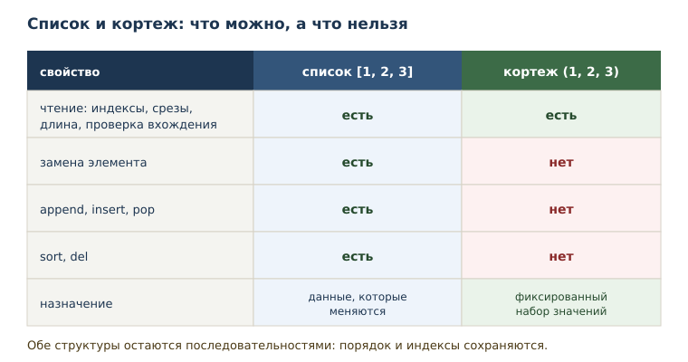
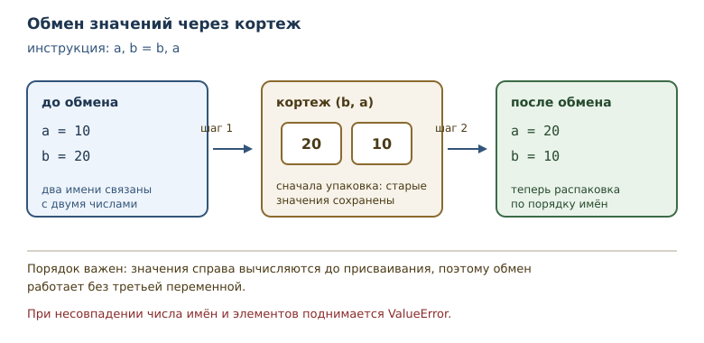

# Кортежи, распаковка и неизменяемость

<!-- syllanix:nav -->
**Навигация:** [← 13. Списки: индексы, срезы и методы](13-lists.md) · [Оглавление книги](../README.md) · [Далее: 15. Строки: методы, форматирование и Unicode →](15-strings.md)
<!-- /syllanix:nav -->

<!-- syllanix:topics -->
**Темы главы**
14.1. [Зачем нужна неизменяемость](#why)  
14.2. [Создание кортежа](#tuples)  
14.3. [Кортеж — это последовательность](#sequence)  
14.4. [Неизменяемость](#immutability)  
14.5. [Распаковка](#unpacking)  
14.6. [Упаковка кортежа](#packing)  
14.7. [Распаковка в цикле](#unpacking-loop)  
14.8. [Типичные ошибки](#mistakes)  
14.9. [Как выбрать структуру](#choosing)  
14.10. [Упражнения](#упражнения)  
14.11. [Проверка понимания](#проверка-понимания)  
14.12. [Что дальше](#что-дальше)  
<!-- /syllanix:topics -->


Список удобен, когда данные меняются. Но у изменяемости есть цена:
любой, кому доступен список, может его испортить. Для набора значений,
который должен остаться таким, каким его создали, Python предлагает
другую последовательность — кортеж. В этой главе вы познакомитесь с
кортежами, свойством неизменяемости и приёмом распаковки, который
экономит строки и делает намерение кода яснее.

## Зачем нужна неизменяемость {#why}

Представьте координату точки на плоскости: пара чисел `(3, 4)`. Если
хранить её в списке, любая функция может написать `point[0] = 100`, и
координата молча изменится. Иногда это допустимо, но для координаты,
цвета, диапазона дат или записи из базы данных изменение обычно означает
дефект. Хочется, чтобы сама структура данных защищала смысл.

**Неизменяемость** — свойство объекта не менять состояние после
создания. Неизменяемый объект можно безопасно передавать в функции и
хранить дольше: никто не сможет его испортить. **Кортеж** — неизменяемая
упорядоченная последовательность; он используется для фиксированных
наборов значений, которые логически едины.

После этой главы вы сможете:

- создавать кортежи, в том числе из одного элемента;
- отличать кортеж от списка по поведению и по назначению;
- распаковывать последовательности в имена одной инструкцией;
- возвращать из функции несколько значений;
- объяснять, что неизменяемость защищает, а что нет.

## Создание кортежа {#tuples}

Кортеж записывается перечислением значений через запятую; скобки
необязательны.

```python exec
point = (3, 4)
print(point)
print(len(point))
print(point[0], point[1])
print(4 in point)
print(type(point).__name__)
```

```output
(3, 4)
2
3 4
True
tuple
```

Скобки часто пишут для читаемости, но решающую роль играет запятая.

```python exec
a = 1, 2, 3
b = (1, 2, 3)
print(a)
print(a == b)
print(type(a).__name__)
```

```output
(1, 2, 3)
True
tuple
```

Обе записи создают кортеж, и они равны: сравниваются значения, а не форма
записи. Запятая — то, что превращает перечисление в кортеж.

Отсюда следует знаменитая ловушка с одним элементом. Запись `(5)` — это
не кортеж, а число в скобках. Кортеж из одного элемента требует запятой.

```python exec
one = (5,)
not_tuple = (5)
print(type(one).__name__, len(one))
print(type(not_tuple).__name__, not_tuple)
print(one[0])
```

```output
tuple 1
int 5
5
```

Пустой кортеж записывается как `()`. Он полезен как нейтральное значение:
например, когда функция по умолчанию возвращает «ничего».

## Кортеж — это последовательность {#sequence}

Кортеж поддерживает всё, что умеет последовательность из
[двенадцатой главы](12-collections-intro.md#collections): длину, индексы,
отрицательные индексы, срезы, проверку вхождения и перебор.

```python exec
values = (0, 1, 2, 3, 4)
print(values[1:3])
print(values[-1])
print(values[::-1])
print(2 in values)
```

```output
(1, 2)
4
(4, 3, 2, 1, 0)
True
```

Срез кортежа возвращает кортеж, а не список. Это логично: часть
неизменяемой последовательности тоже неизменяема. Перебор работает как
обычно: `for value in values` обходит элементы в порядке их записи.

### Сравнение кортежей {#tuple-comparison}

Кортежи сравниваются по элементам слева направо, как слова в словаре:
сначала сравнивается первый элемент, при равенстве — второй, и так до
первого различия.

```python exec
print((1, 2) < (1, 3))
print((1, 2) < (2, 0))
print((1, 2) == (1, 2))
print((1, 2, 3) < (1, 2))
```

```output
True
True
True
False
```

Первая пара различается вторым элементом: 2 меньше 3. Вторая — первым:
1 меньше 2, поэтому второй элемент уже не важен. Равные кортежи содержат
одинаковые элементы в одинаковом порядке. Последний пример показывает
правило для разной длины: если все общие элементы равны, более короткий
кортеж считается меньшим, поэтому `(1, 2)` меньше `(1, 2, 3)`, и
выражение с перевёрнутым порядком даёт `False`.

Такое сравнение работает, когда элементы сравнимы между собой. Кортеж с
числом и строкой на одной позиции сравнить не получится: Python не
знает, что больше.

## Неизменяемость {#immutability}

Главное отличие от списка: кортеж нельзя изменить после создания.
Попытка присвоить значение элементу поднимает `TypeError`.

```python exec expect-error
values = (1, 2, 3)
values[0] = 10
```

```output
TypeError: 'tuple' object does not support item assignment
```

Сообщение говорит буквально: объект типа `tuple` не поддерживает
присваивание элементам. Нет ни `append`, ни `remove`, ни `sort` — этих
методов у кортежа нет вовсе.

Обратите внимание на важное различие: неизменяемость запрещает менять
объект, но не запрещает связать его имя с новым объектом.

```python exec
values = (1, 2)
values = values + (3,)
print(values)
```

```output
(1, 2, 3)
```

Здесь создан новый кортеж из двух старых, и имя `values` теперь указывает
на него. Старый кортеж `(1, 2)` не изменился — он просто больше не связан
с этим именем. Это то же поведение, что у строк: операции создают новые
значения.



Неизменяемость кортежа поверхностна. Если внутри кортежа лежит список,
сам список остаётся изменяемым.

```python exec
record = ([1, 2], "данные")
record[0].append(3)
print(record)
```

```output
([1, 2, 3], 'данные')
```

Кортеж не даёт заменить элемент, но внутренний список можно менять, пока
он остаётся тем же объектом. Неизменяемость защищает структуру, а не
глубину вложенности.

## Распаковка {#unpacking}

**Распаковка** — присваивание элементов последовательности нескольким
именам одной инструкцией. Вы уже пользовались частным случаем: `a, b =
b, a` меняет значения местами без промежуточной переменной.

```python exec
a, b = 10, 20
print(a, b)
a, b = b, a
print(a, b)
```

```output
10 20
20 10
```

Слева стоят имена, справа — последовательность. Python проходит по
элементам и связывает их с именами по порядку. Справа при этом сначала
создаётся кортеж `(b, a)`, поэтому обмен работает: старые значения уже
зафиксированы до присваивания.

Число имён должно совпадать с числом элементов, иначе будет ошибка.

```python exec expect-error
first, second, third = (1, 2)
```

```output
ValueError: not enough values to unpack (expected 3, got 2)
```

Сообщение точно называет, сколько значений ожидалось и сколько пришло.
Такая ошибка возникает при неверном предположении о длине данных.

Если элементов больше, чем имён, помогает звёздочка: она собирает
остаток в список.

```python exec
first, *rest = (1, 2, 3, 4)
print(first, rest)
*start, last = (1, 2, 3, 4)
print(start, last)
```

```output
1 [2, 3, 4]
[1, 2, 3] 4
```

Звёздочка может стоять в любом месте, но одна на инструкцию. Собранный
остаток всегда список — даже если исходная последовательность была
кортежем, поскольку длина остатка заранее неизвестна.

Распаковка умеет заглядывать внутрь: если элемент сам по себе
последовательность, его можно распаковать на месте, взяв шаблон в
скобки.

```python exec
point = (1, (2, 3))
x, (y, z) = point
print(x, y, z)
```

```output
1 2 3
```

Шаблон слева повторяет структуру справа: первый элемент — число, второй —
пара чисел. Такая запись встречается, когда функция возвращает пару
«значение и его характеристики» и обе части нужны по отдельности.

Если структура не совпадает, ошибка зависит от того, чем именно. Когда во
вложенной части элементов больше, чем имён, возникает
`ValueError: too many values to unpack`; когда вложенный элемент вообще не
последовательность (например, число) — `TypeError: cannot unpack non-iterable
int object`.



## Упаковка кортежа {#packing}

**Упаковка кортежа** — неявное создание кортежа перечислением значений
через запятую. Именно она делает распаковку симметричной: справа кортеж
упаковывается, слева распаковывается.

```python exec
def divide_with_remainder(total, divisor):
    return total // divisor, total % divisor

result = divide_with_remainder(17, 5)
print(result)
quotient, remainder = divide_with_remainder(17, 5)
print(quotient, remainder)
```

```output
(3, 2)
3 2
```

Функция возвращает одно значение — кортеж, который создан упаковкой без
скобок. Вызывающий код может принять его как кортеж целиком или сразу
распаковать в два имени. Так в Python возвращают несколько значений: это
не особая конструкция языка, а обычный кортеж.

Тот же приём встроен в некоторые функции стандартной библиотеки.
Например, `divmod` возвращает частное и остаток.

```python exec
quotient, remainder = divmod(17, 5)
print(quotient, remainder)
```

```output
3 2
```

Возврат кортежа — часть контракта функции, и его стоит описать в
docstring: сколько значений, в каком порядке, что означает каждое.
Особенно это важно, когда значения одного типа: перепутать «часы» и
«минуты» легко, а ошибка проявится далеко от места вызова.

```python exec
def split_time(minutes):
    """Вернуть пару (часы, минуты) для заданного числа минут."""
    if minutes < 0:
        raise ValueError(f"минуты не могут быть отрицательными: {minutes}")
    return minutes // 60, minutes % 60

print(split_time(150))
```

```output
(2, 30)
```

Docstring называет порядок элементов, поэтому вызывающий код знает, что
первое значение — часы. Проверка на отрицательное значение показывает
ещё одно преимущество: функция сама сообщает о неверном аргументе, а не
возвращает бессмысленную пару.

### Преобразование между списком и кортежем {#conversion}

Список и кортеж легко превращаются друг в друга встроенными функциями
`list` и `tuple`. Это создаёт новый объект нужного типа и копирует
элементы.

```python exec
print(list((1, 2, 3)))
print(tuple([4, 5]))
print(len(tuple([4, 5])))
```

```output
[1, 2, 3]
(4, 5)
2
```

Преобразование полезно на границах: функция вернула кортеж, а дальше
нужен изменяемый список — сделайте `list(...)` явно. Обратное
преобразование `tuple(...)` фиксирует набор значений, полученный из
изменяемого источника.

## Распаковка в цикле {#unpacking-loop}

Распаковка работает везде, где ожидается последовательность, в том числе
в заголовке цикла.

```python exec
pairs = [(1, 2), (3, 4), (5, 6)]
for left, right in pairs:
    print(left + right)
```

```output
3
7
11
```

На каждом шаге `for` получает очередной кортеж и распаковывает его в
`left` и `right`. Такой код читается лучше, чем обращение по индексам
`pair[0]` и `pair[1]`: имена объясняют смысл значений.

### Кортежи как строки таблицы {#tuple-records}

Кортеж хорошо подходит для записи с фиксированным набором полей: пара
«название — значение», координата, результат измерения. Набор таких
записей удобно хранить списком и обходить циклом с распаковкой.

```python exec
months = [("январь", 120), ("февраль", 90), ("март", 150)]
total = 0
for name, amount in months:
    print(name, amount)
    total += amount
print("итого:", total)
```

```output
январь 120
февраль 90
март 150
итого: 360
```

Каждая строка данных — кортеж из двух элементов. Распаковка в заголовке
цикла сразу даёт осмысленные имена, поэтому в коде нет «магических»
индексов. Но порядок полей при этом фиксирован структурой записи: если в
кортеже поменять местами название и сумму, имена получат неверные значения.
Порядок стоит описать в docstring функции или в комментарии к данным. Если
позже понадобится изменить запись — добавить поле или поправить значение, —
кортеж придётся заменить новым, и это заметное место в коде: случайно
испортить данные труднее.

## Типичные ошибки {#mistakes}

**Считать `(5)` кортежем.** Это число в скобках. Кортеж из одного
элемента — `(5,)`, с запятой.

**Пытаться изменить кортеж.** `values[0] = 10`, `values.append(1)` и
`values.sort()` невозможны. Если нужна изменяемость, берите список.

**Смешивать кортеж и список в одной операции.** `(1, 2) + [3]` —
`TypeError`: складывать можно только последовательности одного типа.
Преобразование делается явно: `list(...)` или `tuple(...)`.

**Ошибаться в числе имён при распаковке.** `a, b = (1, 2, 3)` даёт
`ValueError`. Если длина заранее неизвестна, используйте звёздочку.

**Забывать про вложенные изменяемые объекты.** Кортеж с кортежами внутри
неизменяем полностью, только если все вложенные объекты неизменяемы; кортеж
со списком внутри — лишь поверхностно.

**Использовать кортеж там, где данные будут меняться.** Тогда каждая
правка превращается в создание нового кортежа: `values = values + (x,)`.
Иногда это нормально, но для накопления результатов лучше список.

## Как выбрать структуру {#choosing}

Выбор между списком и кортежем — это выбор между «будет меняться» и
«должно остаться как есть». Полезно задать три вопроса.

Первый: нужно ли добавлять или удалять элементы после создания? Если да,
нужен список: у кортежа таких операций нет.

Второй: означает ли набор значений одну сущность? Координата `(3, 4)`,
диапазон `(0, 100)`, пара «часы, минуты» — это единые значения, у
которых нет смысла менять одну часть отдельно. Для них кортеж точнее
выражает намерение.

Третий: будет ли структура использоваться как неизменяемый ключ или
храниться долго? Неизменяемость делает такое использование безопасным:
никто не испортит данные «на месте». Подробнее о том, какие объекты
подходят для ключей, — в главе о множествах.

Если ответы противоречат друг другу, начинайте со списка: он
универсальнее, а перейти к кортежу можно позже, когда станет ясно, что
изменяемость не нужна. Обратный переход тоже возможен, но обычно он
означает, что структура выбрана неверно.

## Упражнения

### 1. Чтение кортежа {#ex-ch14-01}

Дан кортеж `point = (10, 20)`. Не запуская код, определите: первый
элемент, последний элемент, длину и результат проверки `5 in point`.
Проверьте ответы программой.

### 2. Кортеж из одного элемента {#ex-ch14-02}

Объясните, чем отличаются записи `(7)` и `(7,)`. Создайте кортеж из
одного элемента, выведите его тип, длину и единственный элемент.

### 3. Срезы кортежа {#ex-ch14-03}

Для `values = (1, 2, 3, 4, 5)` запишите, что вернут `values[1:4]`,
`values[::2]` и `values[-2:]`. Проверьте и объясните, почему срез
кортежа — кортеж, а не список.

### 4. Обойти неизменяемость {#ex-ch14-04}

Дан кортеж `values = (1, 2, 3)`. Покажите, что присваивание элемента
невозможно, и получите кортеж `(1, 2, 20)` без изменения исходного
объекта. Объясните, что именно произошло.

### 5. Обмен значений {#ex-ch14-05}

Поменяйте местами значения двух имён `a = 1` и `b = 2` одной инструкцией
распаковки. Объясните, почему для этого не нужна третья переменная.

### 6. Звёздочка {#ex-ch14-06}

Для кортежа `(1, 2, 3, 4, 5)` распакуйте первое значение, остаток в
середине и последнее значение. Какие типы получились у трёх имён?

### 7. Несколько значений из функции {#ex-ch14-07}

Напишите функцию `split_time(minutes)`, которая возвращает часы и
остаток минут. Распакуйте результат в два имени и выведите, затем
выведите результат целиком для 75 минут.

### 8. Кортежи в цикле {#ex-ch14-08}

Дан список пар `[(1, "один"), (2, "два")]`. Пройдите по нему циклом,
распаковывая каждую пару, и выведите номер и название через дефис.

### 9. Возврат двух значений {#ex-ch14-09}

Напишите функцию `min_and_max(a, b)`, которая возвращает меньшее и
большее значение в этом порядке. Распакуйте результат для `(9, 4)`.

### 10. Мини-задача: расстояние от начала {#ex-ch14-10}

Дан кортеж `point = (3, 4)`. Распакуйте его в `x` и `y`, вычислите
квадрат расстояния от начала координат `x ** 2 + y ** 2`. Объясните,
почему для координаты выбран кортеж, а не список.

### 11. Сумма произведений {#ex-ch14-11}

Напишите функцию, которая принимает список пар и возвращает сумму
произведений элементов каждой пары. Проверьте на
`[(1, 2), (3, 4), (5, 6)]`.

## Проверка понимания

1. Чем кортеж отличается от списка по набору операций и по назначению?
2. Почему запись `(5)` не создаёт кортеж?
3. Что означает неизменяемость и почему она полезна при передаче данных
   в функцию?
4. Почему кортеж со списком внутри нельзя назвать полностью неизменяемым?
5. Чем упаковка отличается от распаковки кортежа?
6. Как с помощью одной инструкции поменять значения двух имён местами?
7. Что произойдёт при несовпадении числа имён и элементов при
   распаковке?

## Что дальше

Кортежи и списки задают последовательности, но текст — особая
последовательность: его элементы — символы Unicode, а операции над
текстом нужны почти в каждой программе. Об этом — в главе
[«Строки: методы, форматирование и Unicode»](15-strings.md#strings).

<!-- syllanix:nav -->
**Перед этой главой:** [13. Списки: индексы, срезы и методы](13-lists.md)
**Связанные главы:** [02. Первая программа: вычисления и вывод](02-first-program.md), [03. Значения, имена, объекты и типы](03-values-names-objects.md), [04. Выражения, операторы и ввод данных](04-expressions-input.md), [06. Циклы: while и for](06-loops.md), [07. Функции: параметры, аргументы и области видимости](07-functions.md), [12. Коллекции и последовательности: введение](12-collections-intro.md), [16. Множества и хеширование](16-sets.md), [24. Гибкие сигнатуры: *args, **kwargs и распаковка](24-signatures.md)
**Далее:** [15. Строки: методы, форматирование и Unicode →](15-strings.md)
<!-- /syllanix:nav -->
