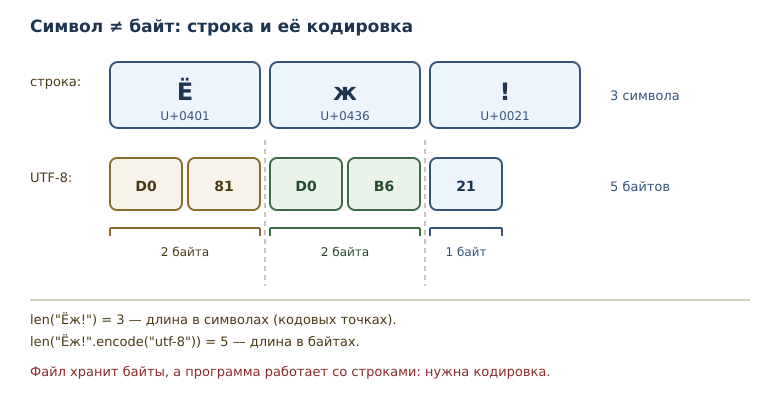
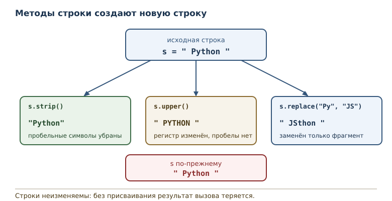

# Строки: методы, форматирование и Unicode

<!-- syllanix:nav -->
**Навигация:** [← 14. Кортежи, распаковка и неизменяемость](14-tuples.md) · [Оглавление книги](../README.md) · [Далее: 16. Множества и хеширование →](16-sets.md)
<!-- /syllanix:nav -->

<!-- syllanix:topics -->
**Темы главы**
15.1. [Зачем эта глава](#why)  
15.2. [Строковый тип](#strings)  
15.3. [Unicode](#unicode)  
15.4. [Кодировка](#encoding)  
15.5. [Escape-последовательности](#escapes)  
15.6. [Методы строки](#string-methods)  
15.7. [split и join](#split-join)  
15.8. [Сравнение строк](#string-comparison)  
15.9. [Форматирование](#formatting)  
15.10. [Типичные ошибки](#mistakes)  
15.11. [Упражнения](#упражнения)  
15.12. [Проверка понимания](#проверка-понимания)  
15.13. [Что дальше](#что-дальше)  
<!-- /syllanix:topics -->


Строки появились ещё во второй главе — как текст в кавычках. С тех пор они
использовались для вывода, но не как данные, которые нужно обрабатывать.
Между тем почти любая программа имеет дело с текстом: имена
пользователей, адреса, сообщения, файлы, ответы сети. В этой главе строка
становится полноценной последовательностью: вы научитесь разбирать её на
части, соединять обратно, сравнивать и форматировать, а также поймёте,
чем символ отличается от байта.

## Зачем эта глава {#why}

Текст — самый распространённый формат обмена данными между программами
и людьми. Пользователь вводит имя, программа сохраняет его в базе,
отправляет в письме, показывает на странице. На каждом шаге строку нужно
привести к нужному виду: убрать лишние пробелы, привести к нижнему
регистру, разделить на слова, собрать обратно с разделителями.

Кроме того, текст связан с представлением данных в памяти и в файлах.
Строка в Python — последовательность символов Unicode, а файл хранит
байты. Понимание разницы между ними избавляет от половины загадочных
ошибок при чтении данных из внешнего мира.

После этой главы вы сможете:

- обращаться со строкой как с последовательностью символов;
- объяснять, что такое Unicode, кодовая точка и кодировка;
- применять основные методы строк и понимать, что они возвращают новый
  объект;
- разбирать текст через `split` и собирать через `join`;
- сравнивать строки и понимать, почему порядок не равен алфавитному;
- форматировать значения в f-строках.

## Строковый тип {#strings}

**Строковый тип** — неизменяемая последовательность символов Unicode;
индексация и срезы работают как у других последовательностей. Строка
поддерживает всё, что вы уже знаете о последовательностях: длину,
индексы, отрицательные индексы, срезы, проверку вхождения и перебор.

```python exec
word = "Python"
print(len(word))
print(word[0], word[-1])
print(word[1:4])
print("th" in word)
print(word.upper())
```

```output
6
P n
yth
True
PYTHON
```

Длина строки — количество символов, а не байтов. Индекс указывает на
символ, срез вырезает подстроку. Проверка вхождения для строки ищет
подстроку, а не отдельный символ: `"th" in "Python"` истинно, потому что
такая последовательность символов встречается.

Неизменяемость строки означает, что её нельзя поменять на месте: нельзя
присвоить символ по индексу. Методы, которые преобразуют текст (`upper`,
`lower`, `strip`, `replace`), возвращают новую строку; методы поиска и
проверки возвращают число, `bool` или список.

## Unicode {#unicode}

**Unicode** — стандарт кодирования символов всех письменностей. Строки
Python — последовательности кодовых точек Unicode: каждая позиция в
строке соответствует одному символу стандарта, независимо от того, буква
это, цифра, иероглиф или эмодзи.

```python exec
text = "Ёж!"
print(text)
print(len(text))
print(ord("Ё"), ord("ж"), ord("!"))
print(chr(0x0401), chr(0x0436))
```

```output
Ёж!
3
1025 1078 33
Ё ж
```

Функция `ord` возвращает кодовую точку символа — целое число, под
которым символ зарегистрирован в Unicode. Функция `chr` выполняет
обратное преобразование. Кодовая точка `Ё` — 1025, `ж` — 1078. Символы
русского алфавита занимают диапазон вокруг 1024–1103, поэтому длина строки
«Ёж!» равна трём символам, хотя в UTF-8 она занимает пять байтов.

Одна тонкость: некоторые видимые символы состоят из нескольких кодовых
точек, например буква с комбинирующим ударением. В таких случаях `len`
считает кодовые точки, а не «глазом различимые знаки». Для повседневной
работы этого достаточно; более сложную обработку текста выполняют
специальные библиотеки.

## Кодировка {#encoding}

**Кодировка** — правило перевода строки в байты и обратно. Байты — это
то, что реально хранится в файле или передаётся по сети. Самая
распространённая кодировка современного мира — UTF-8: она представляет
каждую кодовую точку одним–четырьмя байтами.

```python exec
encoded = "Ёж".encode("utf-8")
print(encoded)
print(len("Ёж"), len(encoded))
print(encoded.decode("utf-8"))
print("Python".encode("utf-8"))
```

```output
b'\xd0\x81\xd0\xb6'
2 4
Ёж
b'Python'
```

Строка из двух символов занимает четыре байта: кириллическая буква в
UTF-8 кодируется двумя байтами, а латинская — одним. Печать байтов
показывает их шестнадцатеричные значения. Обратное преобразование
`decode` возвращает строку.

Если декодировать байты не той кодировкой, Python сообщит об ошибке.

```python exec expect-error
print(b"\xff".decode("utf-8"))
```

```output
UnicodeDecodeError: 'utf-8' codec can't decode byte 0xff in position 0: invalid start byte
```

Сообщение говорит, какой байт и в какой позиции не похож на корректное
начало символа UTF-8. Такая ошибка типична при чтении файла, записанного
в другой кодировке. Правило простое: кодировка чтения должна совпадать с
кодировкой записи.



## Escape-последовательности {#escapes}

**Escape-последовательность** — запись специального символа обратной
косой чертой: `\n` — перевод строки, `\t` — табуляция, `\\` —
обратная косая черта, `\"` — кавычка. С их помощью в строковый литерал
попадают символы, которые нельзя набрать напрямую или которые иначе
закончили бы строку.

```python exec
print("первая строка\nвторая строка")
print("a\tb\tc")
print("кавычки: \"текст\"")
print("обратная косая: \\")
print(r"C:\temp\new")
```

```output
первая строка
вторая строка
a	b	c
кавычки: "текст"
обратная косая: \
C:\temp\new
```

Последняя строка использует **«сырую» строку** — литерал с префиксом
`r`, в котором обратная косая черта не образует escape-последовательностей.
Так удобно записывать пути Windows и регулярные выражения. Обратите
внимание: `r"\n"` — это два символа, обратная косая черта и `n`, а не
перевод строки.

```python exec
print(len(r"\n"))
print(len("\n"))
```

```output
2
1
```

## Методы строки {#string-methods}

**Метод строки** — операция над строкой, вызываемая через точку. Метод может
вернуть новую строку (`upper`, `lower`, `strip`, `replace`), результат поиска
или проверки (`find`, `count`, `startswith`), а также список (`split`). Строка
неизменяема, поэтому методы не меняют исходный объект, а возвращают результат.

| Метод | Что делает | Пример |
|---|---|---|
| `upper()` | переводит в верхний регистр | `"abc".upper()` → `"ABC"` |
| `lower()` | переводит в нижний регистр | `"ABC".lower()` → `"abc"` |
| `strip()` | убирает пробельные символы по краям | `" a ".strip()` → `"a"` |
| `replace(a, b)` | заменяет все вхождения | `"aXa".replace("X", "-")` → `"a-a"` |
| `startswith(p)` | проверяет начало | `"file.txt".startswith("file")` → `True` |
| `endswith(s)` | проверяет конец | `"file.txt".endswith(".txt")` → `True` |
| `find(p)` | индекс первого вхождения или `-1` | `"banana".find("na")` → `2` |
| `count(p)` | число вхождений | `"banana".count("na")` → `2` |

`strip()` удаляет все пробельные символы — пробелы, табуляцию, переводы
строк, — а не только пробелы.

```python exec
word = "  Python  "
print(word.strip())
print(word.upper())
print(word.lower())
print(word.replace("Py", "JS"))
print(word)
```

```output
Python
  PYTHON  
  python  
  JSthon  
  Python  
```

Обратите внимание на последнюю строку: исходная строка не изменилась.
Методы вернули новые строки, а `word` осталось прежним. Именно поэтому
запись `word.upper()` без присваивания ничего не делает — результат
просто теряется.

Для поиска подстроки есть ещё методы, которые возвращают позицию.

```python exec
name = "report.csv"
print(name.startswith("report"))
print(name.endswith(".csv"))
print("banana".find("na"))
print("banana".find("zz"))
print("banana".count("na"))
```

```output
True
True
2
-1
2
```

`find` возвращает `-1`, если подстрока не найдена: это значение удобно
проверять, но легко забыть, что оно означает «нет», а не «позиция
минус один». `count` считает вхождения без перекрытий: в `banana`
подстрока `na` встречается дважды.



## split и join {#split-join}

**split и join** — пара операций, которая разбирает строку на части и
собирает обратно. `split` возвращает список строк, `join` собирает одну
строку из последовательности строк.

```python exec
sentence = "раз два три"
parts = sentence.split()
print(parts)
print("-".join(parts))
print("a,b,c".split(","))
print("a,,b".split(","))
```

```output
['раз', 'два', 'три']
раз-два-три
['a', 'b', 'c']
['a', '', 'b']
```

`split()` без аргумента делит по любым пробельным символам и отбрасывает
пустые части. `split(",")` делит строго по запятой, поэтому пустое поле
между двумя запятыми превращается в пустую строку — это важно при разборе
CSV-подобных данных.

У `join` порядок обратный: метод вызывается у разделителя, а аргументом
служит последовательность строк. Все элементы должны быть строками.

```python exec expect-error
print(",".join([1, 2]))
```

```output
TypeError: sequence item 0: expected str instance, int found
```

Сообщение указывает на первый неподходящий элемент: ожидалась строка,
получено число. Перед `join` числа преобразуют функцией `str` или
f-строкой.

## Сравнение строк {#string-comparison}

**Сравнение строк** происходит по кодовым точкам символов, а не по
алфавиту языка. Строки сравниваются посимвольно, пока не найдётся
различие; если одна строка служит началом другой, меньшей считается
короткая.

```python exec
print("Ё" < "А")
print("Ё" < "Я")
print("ё" == "Ё")
print("Python" < "python")
print("apple" < "banana")
print(sorted(["ёж", "арбуз", "яблоко"]))
```

```output
True
True
False
True
True
['арбуз', 'яблоко', 'ёж']
```

Результаты удивляют, пока не посмотреть на кодовые точки. Буква `Ё`
имеет код 1025, а `А` — 1040, поэтому `Ё` меньше `А`, хотя в русском
алфавите стоит позже. Заглавные латинские буквы имеют меньшие коды, чем
строчные, поэтому `"Python" < "python"` истинно. И `ё` оказалась после
`я` при сортировке.

Практический вывод: для сравнения текста без учёта регистра приводите
обе строки к одному регистру. Для «человеческой» сортировки, где `ё` стоит
после `е`, а `Ё` не уезжает в начало, нужны отдельные правила сопоставления:
их задаёт локаль (например, `locale.strxfrm`) или сторонняя библиотека.

### Почему строки неизменяемы {#why-immutable}

Неизменяемость строк — не ограничение, а полезное свойство. Строка
широко используется как значение: её передают в функции, складывают в
коллекции, используют как часть ключей и словарей. Если бы строку можно
было менять на месте, любая функция могла бы испортить текст, который ей
передали, и ошибка проявилась бы далеко от места вызова.

Кроме того, неизменяемость позволяет безопасно разделять одну строку
между разными частями программы: никто не изменит её незаметно для
остальных. Именно поэтому все методы возвращают новую строку, а не правят
исходную. Привычка «присвоить результат обратно в имя» —
`text = text.strip()` — становится естественной уже после нескольких
примеров: вы явно решаете, что дальше работаете с очищенным текстом, а
прежнее значение остаётся доступным, если оно понадобится.

Отсюда же следует практическое правило для интерфейсов: функция, которая
принимает строку, не может испортить её у вызывающего кода. Всё, что она
делает, — возвращает новую строку. Это упрощает рассуждение о программе:
достаточно смотреть на возвращаемые значения, а не следить за побочными
изменениями аргументов.

## Форматирование {#formatting}

f-строки позволяют вставлять значения в текст и управлять их видом.
После двоеточия указывается формат: количество знаков после запятой,
ширина поля, выравнивание, заполнитель.

```python exec
price = 1234.5
count = 7
print(f"цена: {price:.2f}")
print(f"цена: {price:>12,.2f}")
print(f"код: {count:03d}")
print(f"скидка: {0.15:.0%}")
```

```output
цена: 1234.50
цена:     1,234.50
код: 007
скидка: 15%
```

`.2f` задаёт два знака после запятой, `,` включает разделители тысяч,
`>12` выравнивает по правому краю в поле шириной 12, `03d` дополняет
число нулями до трёх знаков, `.0%` показывает долю в процентах без
дробной части. Форматирование не меняет значение — оно меняет только
его представление в строке.

## Типичные ошибки {#mistakes}

**Складывать строку с числом.** `"возраст: " + 42` — `TypeError`.
Используйте f-строку `f"возраст: {42}"` или `str(42)`.

**Ждать, что метод изменит строку.** `word.upper()` возвращает новую
строку; без присваивания результат теряется. Строка неизменяема.

**Путать длину строки и длину байтов.** `len("Ёж")` равно 2, а
`len("Ёж".encode("utf-8"))` — 4. Это разные величины.

**Считать порядок кодовых точек алфавитным.** `"Ё" < "А"` истинно, хотя
в алфавите наоборот. Для сравнения без учёта регистра приводите регистр.

**Делить по запятой и удивляться пустым строкам.** `"a,,b".split(",")`
даёт пустой элемент. Это корректное поведение, а не дефект.

**Передавать в `join` не строки.** Нужны строки; числа преобразуются
явно.

**Декодировать не той кодировкой.** Файл, записанный в CP1251, нельзя
читать как UTF-8: получите `UnicodeDecodeError` или неверные символы.

## Упражнения

### 1. Строка как последовательность {#ex-ch15-01}

Для строки `"Python"` определите длину, первый и последний символы,
срез `"Python"[2:5]` (символы с индексами 2, 3 и 4) и результат
проверки вхождения `"th"`.
Проверьте ответы программой.

### 2. Символы и байты {#ex-ch15-02}

Для строки `"Ёж"` выведите длину, кодовые точки обоих символов и
результат кодирования в UTF-8. Объясните, почему длина строки и длина
байтов различаются.

### 3. Escape-последовательности {#ex-ch15-03}

Посчитайте, сколько строк выведет `print("a\nb")` и какова длина строки
`"a\nb"`. Объясните разницу и проверьте с помощью `repr`.

### 4. Чистка текста {#ex-ch15-04}

Дана строка `"  Hello, World!  "`. Уберите пробелы по краям, приведите
к нижнему регистру и замените `"World"` на `"Python"`. Выведите
результат в читаемом виде через `repr`.

### 5. Разбор предложения {#ex-ch15-05}

Разделите строку `"яблоко банан груша"` на слова, выведите список слов
и отсортированный список. Объясните, почему порядок после сортировки
такой.

### 6. Нормализация имени {#ex-ch15-06}

Напишите функцию `normalize(name)`, которая убирает пробелы по краям и
приводит имя к нижнему регистру. Проверьте на `"  Alice "` и `"BOB"`.

### 7. Сравнение и регистр {#ex-ch15-07}

Проверьте, истинно ли `"Python" < "python"` и почему. Посчитайте
количество вхождений `"a"` в `"banana"` и позицию первого вхождения.

### 8. Слова и длины {#ex-ch15-08}

Разделите строку `"раз два три"` на слова и для каждого слова выведите
само слово и его длину.

### 9. Форматирование {#ex-ch15-09}

Выведите число `3.14159` с двумя знаками после запятой, число `42` в
поле шириной 5 с ведущими нулями и строку `"ok"` по центру поля шириной
10. Объясните каждый элемент формата.

### 10. Мини-задача: инициалы {#ex-ch15-10}

Напишите функцию `initials(full_name)`, которая возвращает инициалы:
первые буквы слов, переведённые в верхний регистр. Проверьте на
`"иван петров"` и `"анна сергеевна сидорова"`. Объясните, какие методы
строки понадобились.

## Проверка понимания

1. Почему строка называется неизменяемой и что это значит для методов?
2. Чем кодовая точка отличается от байта? Что считает `len`?
3. Зачем нужна кодировка и что произойдёт при неверной?
4. Чем «сырая» строка отличается от обычной?
5. Что возвращает `split` и что принимает `join`?
6. Почему `"Ё" < "А"` истинно, хотя в алфавите наоборот?
7. Что делает формат `:>12,.2f` и из каких частей он состоит?

## Что дальше

Строки, списки и кортежи хранят элементы в порядке и допускают повторы.
Но иногда важнее другое: знать, встречалось ли значение раньше, и не
хранить дубликаты. Для этого служат множества — коллекции уникальных
элементов, устроенные на хешировании. Об этом — в главе
[«Множества и хеширование»](16-sets.md#sets).

<!-- syllanix:nav -->
**Перед этой главой:** [14. Кортежи, распаковка и неизменяемость](14-tuples.md)
**Связанные главы:** [02. Первая программа: вычисления и вывод](02-first-program.md), [03. Значения, имена, объекты и типы](03-values-names-objects.md), [04. Выражения, операторы и ввод данных](04-expressions-input.md), [06. Циклы: while и for](06-loops.md), [07. Функции: параметры, аргументы и области видимости](07-functions.md), [12. Коллекции и последовательности: введение](12-collections-intro.md), [13. Списки: индексы, срезы и методы](13-lists.md), [19. Файлы, пути и текстовые форматы](19-files-formats.md)
**Далее:** [16. Множества и хеширование →](16-sets.md)
<!-- /syllanix:nav -->
