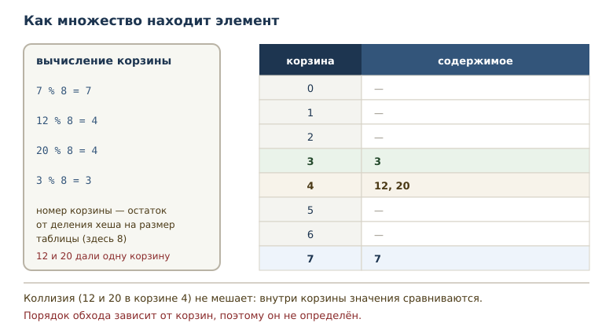
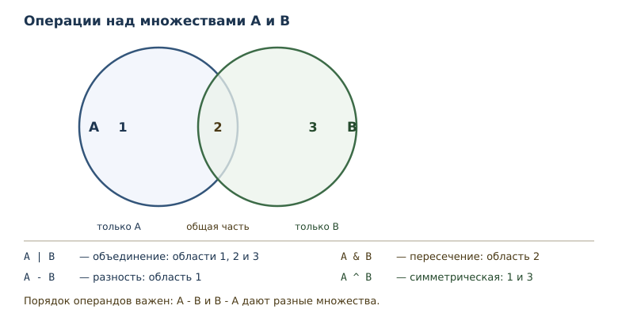

# Множества и хеширование

<!-- syllanix:nav -->
**Навигация:** [← 15. Строки: методы, форматирование и Unicode](15-strings.md) · [Оглавление книги](../README.md) · [Далее: 17. Словари: отображения и структурирование данных →](17-dicts.md)
<!-- /syllanix:nav -->

<!-- syllanix:topics -->
**Темы главы**
16.1. [Зачем нужны множества](#why)  
16.2. [Создание множества](#sets)  
16.3. [Хеширование](#hashing)  
16.4. [Хешируемость](#hashable)  
16.5. [Операции над множествами](#operations)  
16.6. [Изменение множества](#mutation)  
16.7. [Порядок обхода](#ordering)  
16.8. [frozenset](#frozenset)  
16.9. [Сравнение со списком](#vs-list)  
16.10. [Практика: общие слова](#words-practice)  
16.11. [Когда множество не подходит](#when-not)  
16.12. [Типичные ошибки](#mistakes)  
16.13. [Упражнения](#упражнения)  
16.14. [Проверка понимания](#проверка-понимания)  
16.15. [Что дальше](#что-дальше)  
<!-- /syllanix:topics -->


Списки, кортежи и строки хранят элементы в порядке и допускают повторы.
Но часто задача другая: узнать, встречалось ли значение раньше, и не
хранить дубликаты. Список посетителей, набор тегов, список городов —
здесь важен не порядок, а сам факт наличия. Для таких задач Python
предлагает множество.

## Зачем нужны множества {#why}

Представьте, что программа читает журнал посещений и должна посчитать,
сколько уникальных пользователей заходило за день. Если хранить записи
списком, придётся для каждой новой записи просматривать весь список и
проверять, нет ли её там. Чем больше данных, тем медленнее проверка.

Множество решает обе задачи сразу: оно не хранит дубликаты, поэтому
количество элементов равно количеству уникальных значений, а проверка
вхождения выполняется быстро. **Множество** — изменяемая неупорядоченная
коллекция уникальных хешируемых элементов. Все четыре слова в
определении важны: изменяемая, неупорядоченная, уникальная, хешируемая.

После этой главы вы сможете:

- создавать множества и понимать, почему в них нет повторов;
- объяснять, что такое хеширование и какие объекты хешируемы;
- выполнять объединение, пересечение и разность;
- выбирать между множеством и списком по задаче;
- использовать `frozenset`, когда нужна неизменяемость.

## Создание множества {#sets}

Множество записывается фигурными скобками с элементами через запятую.

```python exec
letters = {"a", "b", "c", "b"}
print(len(letters))
print("a" in letters)
print("z" in letters)
print(type(letters).__name__)
```

```output
3
True
False
set
```

В литерале было четыре значения, но `b` повторилось, и в множестве
осталось три элемента. Повтор не ошибка: множество просто не хранит
копии. Проверка вхождения отвечает на вопрос о наличии значения.

Пустое множество нельзя записать как `{}`: эта запись создаёт пустой
словарь, который появится в следующей главе. Для пустого множества
используется функция `set()`.

```python exec
empty = set()
print(len(empty))
print(type(empty).__name__)
print(type({}).__name__)
```

```output
0
set
dict
```

Множество можно построить из любого итерируемого объекта — так удобно
убирать повторы и преобразовывать значения.

```python exec
values = set(range(5))
print(len(values))
print(sorted(values))
print(3 in values)
```

```output
5
[0, 1, 2, 3, 4]
True
```

Обратите внимание на `sorted`: множество неупорядоченно, поэтому
печатать его напрямую рискованно — порядок вывода не определён и не
обязан совпадать между запусками и версиями. Функция `sorted` возвращает
список в понятном порядке, и такой вывод уже можно показывать.

Преобразование из списка — обычный способ получить множество
уникальных значений. При этом исходный список не меняется: создаётся
новый объект другого типа. Если после уникализации нужен именно список,
делают обратное преобразование `list(...)` или `sorted(...)`.

## Хеширование {#hashing}

Как множество узнаёт, что элемент уже есть, не перебирая все элементы?
Оно использует **хеширование** — вычисление целого числа (хеша) по
объекту. Хеш позволяет быстро проверять равенство и искать элемент:
вместо просмотра всех значений множество вычисляет хеш и обращается в
нужное место хранилища.

```python exec
print(hash(42))
print(hash((1, 2)) == hash((1, 2)))
print(hash(42) == hash(42.0))
```

```output
42
True
True
```

Для целых чисел хеш обычно совпадает со значением, но есть исключение:
`hash(-1) == -2`, потому что `-1` в CPython зарезервирован как признак
ошибки. На конкретное значение хеша в коде опираться не стоит. Равные
объекты обязаны иметь равные хеши — это требование языка, а не случайность: `42` и `42.0`
считаются равными при сравнении, поэтому их хеши тоже равны. Обратное
неверно: одинаковый хеш не гарантирует равенство, такое совпадение
называют коллизией, и она разрешается сравнением значений.



Порядок обхода множества зависит от внутреннего расположения элементов,
поэтому он не определён. Это плата за скорость: множество не обязано
помнить, в каком порядке вы добавляли значения.

Схема на рисунке учебная: в ней восемь корзин и номер вычисляется как
остаток от деления на восемь. Настоящая таблица множества устроена
сложнее — она растёт при заполнении и меняет размер, — но принцип тот
же: хеш указывает, где искать, а равенство подтверждает находку. Для
программиста важны следствия: проверка вхождения быстрая, а порядок
обхода не определён.

### Равенство и хеш {#equality-hash}

Связь между равенством и хешем — требование языка: если два объекта
равны, их хеши обязаны совпадать. Поэтому `1` и `1.0` считаются одним
элементом множества, хотя это значения разных типов.

```python exec
print({1, 2} == {2, 1})
print(1 == 1.0)
print(hash(1) == hash(1.0))
print(len({1, 1.0}))
```

```output
True
True
True
1
```

Порядок записи не влияет на равенство множеств: сравнивается состав, а
не последовательность. Единица и единица с плавающей точкой равны, их
хеши равны, поэтому в множестве остаётся один элемент. Если бы хеши
различались, множество не смогло бы найти значение, которое в нём есть.

## Хешируемость {#hashable}

**Хешируемость** — свойство объекта иметь неизменяемый хеш и участвовать
в множествах и ключах словарей. Хеш должен оставаться одним и тем же,
пока объект жив; иначе множество не смогло бы найти элемент, который уже
внутри.

Отсюда правило: изменяемые встроенные коллекции — `list`, `dict`, `set`,
`bytearray` — не хешируемы. Список нельзя положить в множество, потому что
его содержимое может измениться и хеш перестанет соответствовать
сохранённому. Это не значит, что нехешируем любой изменяемый объект:
пользовательский класс без собственных `__eq__` и `__hash__` получает хеш по
идентичности и остаётся хешируемым.

```python exec expect-error
numbers = {1, 2, 3}
numbers.add([4, 5])
```

```output
TypeError: cannot use 'list' as a set element (unhashable type: 'list')
```

Кортеж хешируем, если хешируемы все его элементы. Кортеж из чисел — да;
кортеж со списком внутри — нет, потому что список изменяем. Строки
хешируемы, числа тоже.

Важно различать хешируемость и равенство: два разных объекта могут быть
равны и обязаны иметь одинаковый хеш, но два объекта с одинаковым хешем
не обязаны быть равны.

## Операции над множествами {#operations}

**Операция над множествами** — объединение, пересечение, разность и
симметрическая разность: `|`, `&`, `-`, `^`. Они работают по правилам
теории множеств.

```python exec
a = {1, 2, 3}
b = {3, 4, 5}
print(sorted(a | b))
print(sorted(a & b))
print(sorted(a - b))
print(sorted(b - a))
print(sorted(a ^ b))
```

```output
[1, 2, 3, 4, 5]
[3]
[1, 2]
[4, 5]
[1, 2, 4, 5]
```

Разберём каждую операцию. Объединение `a | b` содержит элементы обоих
множеств. Пересечение `a & b` — только общие. Разность `a - b` — то, что
есть в `a`, но отсутствует в `b`; порядок операндов важен, поэтому
`b - a` даёт другой результат. Симметрическая разность `a ^ b` содержит
элементы, которые есть ровно в одном из множеств, то есть всё, кроме
общих.



Те же операции доступны методами, и это удобнее, когда слева не
множество, а любой итерируемый объект.

```python exec
a = {1, 2, 3}
b = {3, 4, 5}
print(sorted(a.union(b)))
print(sorted(a.intersection(b)))
print(sorted(a.difference(b)))
print(sorted(a.symmetric_difference(b)))
```

```output
[1, 2, 3, 4, 5]
[3]
[1, 2]
[1, 2, 4, 5]
```

Операции не меняют исходные множества, а возвращают новое. Для
изменения на месте у методов есть варианты `update`, `intersection_update`
и другие; их удобно использовать, когда исходные данные больше не нужны.

Полезны и отношения между множествами: включение и непересекаемость.

```python exec
print({1, 2} <= {1, 2, 3})
print({1, 2} < {1, 2, 3})
print({1, 2, 3} <= {1, 2})
print({1, 2}.isdisjoint({3, 4}))
```

```output
True
True
False
True
```

`<=` означает «подмножество или равно», `<` — «строгое подмножество»
(меньше и не равно). `isdisjoint` возвращает `True`, если общих элементов
нет.

## Изменение множества {#mutation}

Множество изменяемо: элементы можно добавлять и удалять. Но заменить
элемент по индексу нельзя — индексов у множества нет.

```python exec
values = {1, 2, 3}
values.add(4)
print(sorted(values))
values.discard(2)
values.discard(99)
print(sorted(values))
values.remove(1)
print(sorted(values))
```

```output
[1, 2, 3, 4]
[1, 3, 4]
[3, 4]
```

Метод `add` добавляет один элемент. `discard` удаляет элемент, если он
есть, и ничего не делает, если его нет; `remove` в таком случае поднимает
`KeyError`.

```python exec expect-error
values = {1, 2, 3}
values.remove(99)
```

```output
KeyError: 99
```

Выбор между `remove` и `discard` — вопрос намерения: если отсутствие
элемента означает ошибку, нужен `remove`; если это нормальная ситуация —
`discard`.

Для массовых изменений есть варианты методов «на месте». Они меняют
множество и возвращают `None` — то же правило, что у методов списка.

```python exec
a = {1, 2, 3}
a.update({3, 4, 5})
print(sorted(a))
a.difference_update({1, 2})
print(sorted(a))
```

```output
[1, 2, 3, 4, 5]
[3, 4, 5]
```

`update` добавляет все элементы переданного набора, `difference_update`
удаляет их. Оба метода меняют `a` на месте, поэтому сохранять результат
в новое имя не нужно: он равен `None`.

Обращение по индексу для множества невозможно.

```python exec expect-error
values = {1, 2, 3}
print(values[0])
```

```output
TypeError: 'set' object is not subscriptable
```

Сообщение говорит, что множество не поддерживает индексацию. Чтобы
получить элемент, множество либо проверяют на вхождение, либо
преобразуют в список или сортируют.

## Порядок обхода {#ordering}

Неупорядоченность — не мелкая деталь, а свойство, на которое нельзя
опираться. Порядок элементов множества не определён, и код не должен от
него зависеть.

```python exec
values = {"яблоко", "банан", "груша"}
print(sorted(values))
print(len(values))
```

```output
['банан', 'груша', 'яблоко']
3
```

Если нужен стабильный порядок, данные сортируют или хранят в списке.
Множество отвечает на вопросы «есть ли» и «сколько уникальных», а не «что
идёт первым».

## frozenset {#frozenset}

Иногда нужна неизменяемая версия множества. **frozenset** —
неизменяемое множество; оно может быть элементом другого множества или
ключом словаря, потому что его хеш не меняется.

```python exec
fs = frozenset({1, 2})
print(len(fs))
print(1 in fs)
print(type(fs).__name__)
sets = {fs, frozenset({3})}
print(len(sets))
print(fs in sets)
```

```output
2
True
frozenset
2
True
```

Внутрь множества `sets` попали два `frozenset`: обычное множество там
оказалось бы нехешируемым. Методы добавления у `frozenset` отсутствуют,
поэтому его безопасно хранить и передавать.

## Сравнение со списком {#vs-list}

Множество и список решают разные задачи. Список хранит порядок и
допускает повторы; множество хранит уникальность и быстро отвечает на
вопрос о вхождении. Если значения должны менять порядок, множество не
подходит; если нужен только факт наличия, множество удобнее.

Распространённый приём — преобразовать список в множество, чтобы убрать
повторы, а затем вернуться к списку.

```python exec
words = ["кот", "пёс", "кот", "кот", "пёс"]
unique = set(words)
print(len(unique))
print(sorted(unique))
```

```output
2
['кот', 'пёс']
```

Два шага — `set` для уникальности и `sorted` для порядка — покрывают
большинство задач «оставить только уникальные значения и показать их».

Ещё одно различие проявляется в проверке вхождения. Для списка Python
просматривает элементы по очереди, пока не найдёт совпадение, поэтому
время проверки растёт с длиной списка. Множество вычисляет хеш и
обращается к нужной корзине, поэтому в среднем проверка занимает
одинаковое время при любом размере. На малых данных разница незаметна,
на больших она определяет выбор структуры.

Плата за это — память на служебные структуры и потеря порядка. Поэтому
множество выбирают, когда важны уникальность и быстрая проверка
вхождения, а не когда нужен аккуратный порядок элементов.

## Практика: общие слова {#words-practice}

Вернёмся к задаче из начала главы, но с двумя наборами данных.
Преобразование списка слов в множество и операции над множествами дают
ответ в две строки.

```python exec
first = set("яблоко банан киви".split())
second = set("банан груша киви".split())
print(sorted(first & second))
print(sorted(first - second))
print(sorted(first | second))
```

```output
['банан', 'киви']
['яблоко']
['банан', 'груша', 'киви', 'яблоко']
```

Общие слова нашлись пересечением, слова только из первого набора —
разностью, полный словарь — объединением. Без множеств пришлось бы для
каждого слова перебирать другой набор.

## Когда множество не подходит {#when-not}

Множество — не замена списку. Есть три ситуации, где оно вредит.

Первая: важен порядок. Если данные нужно показывать в порядке
поступления или сортировать по нескольким полям, множество порядок
теряет.

Вторая: нужны повторы. Если каждая запись значима сама по себе —
например, история операций, — дубликаты нельзя выбрасывать.

Третья: элементы не хешируемы. Списки и словари внутрь множества не
положить, и преобразование не поможет.

В остальных случаях множество делает код короче и понятнее: проверка
вхождения читается как вопрос, а операции над наборами — как намерение.

## Типичные ошибки {#mistakes}

**Писать `{}` для пустого множества.** Это пустой словарь. Нужен `set()`.

**Ждать порядка.** Порядок элементов множества не определён, поэтому
нельзя рассчитывать на «первый элемент» и нельзя индексировать.

**Класть в множество список.** Список не хешируем; поднимается
`TypeError`. Используйте кортеж или `frozenset`.

**Путать `remove` и `discard`.** `remove` поднимает `KeyError`, если
элемента нет; `discard` молча пропускает.

**Менять множество во время перебора.** Изменение размера множества
(добавление нового элемента или удаление существующего) внутри цикла `for`
приводит к ошибке `RuntimeError: Set changed size during iteration`.
Добавление уже имеющегося элемента или удаление отсутствующего размер не
меняет и ошибки не вызывает, но полагаться на это не стоит. Соберите
изменения и примените их после цикла.

**Ожидать, что повторные значения сохранятся.** Дубликаты исчезают
молча — это и есть смысл множества.

## Упражнения

### 1. Уникальность {#ex-ch16-01}

Дан набор `{10, 20, 20, 30}`. Определите, не запуская код: длину
множества, результат проверки `20 in values` и `40 in values`. Проверьте
ответы программой.

### 2. Убрать повторы {#ex-ch16-02}

Для набора `{1, 2, 2, 3, 3, 3}` выведите количество элементов и
отсортированный список значений. Объясните, куда делись повторы.

### 3. Пересечение и объединение {#ex-ch16-03}

Для `a = {1, 2, 3, 4}` и `b = {3, 4, 5, 6}` найдите пересечение и
объединение, выводя результат в отсортированном виде.

### 4. Разности {#ex-ch16-04}

Для тех же множеств найдите `a - b`, `b - a` и симметрическую разность.
Объясните, почему `a - b` и `b - a` различаются.

### 5. Отношения множеств {#ex-ch16-05}

Проверьте три утверждения: `{1, 2}` — подмножество `{1, 2, 3}`;
`{1, 2, 3}` — подмножество самого себя; `{1, 2, 3}` — подмножество
`{1, 2}`. Объясните, чем `<=`
отличается от `<`.

### 6. Изменение множества {#ex-ch16-06}

Добавьте в множество `{1, 2, 3}` элемент 4, удалите 2, затем попробуйте
удалить 99 через `discard`. Выведите результат после каждого шага.
Почему `discard` не поднимает ошибку?

### 7. Проверка вхождения {#ex-ch16-07}

Напишите фрагмент, который проверяет, есть ли значение 2 в множестве
`{1, 2, 3}`, и выводит «есть» или «нет». Объясните, что вернёт проверка
для отсутствующего значения.

### 8. Уникальные слова {#ex-ch16-08}

Дан список слов `["кот", "пёс", "кот", "кот", "пёс"]`. Получите
множество слов, выведите количество уникальных слов и их отсортированный
список. Объясните, почему количество равно двум.

### 9. Хешируемые элементы {#ex-ch16-09}

Попробуйте добавить в множество список и объясните ошибку. Затем
создайте `frozenset` из двух элементов, проверьте его длину, вхождение и
отношение к `frozenset({1, 2, 3})`. Объясните, почему обычное множество
нельзя положить в множество, а `frozenset` можно.

### 10. Мини-задача: уникальные слова текста {#ex-ch16-10}

Напишите функцию `unique_words(text)`, которая возвращает
отсортированный список уникальных слов строки. Проверьте на
`"раз два раз три два"`. Объясните, какие операции понадобились.

## Проверка понимания

1. Чем множество отличается от списка по порядку, повторам и
   изменяемости?
2. Что такое хеширование и зачем оно нужно множеству?
3. Какие объекты хешируемы и почему список — нет?
4. Чем `remove` отличается от `discard`?
5. Что произойдёт при попытке взять `values[0]` у множества и почему?
6. Чем `frozenset` отличается от обычного множества?
7. Почему порядок элементов множества нельзя считать определённым?

## Что дальше

Множества и хеширование открывают дорогу к структуре, которая хранит
данные парами «ключ — значение»: словарю. Хеширование там работает так
же, но вместо флага наличия хранится связанное значение. Об этом — в
главе [«Словари: отображения и структурирование данных»](17-dicts.md#mapping).

<!-- syllanix:nav -->
**Перед этой главой:** [15. Строки: методы, форматирование и Unicode](15-strings.md)
**Связанные главы:** [02. Первая программа: вычисления и вывод](02-first-program.md), [03. Значения, имена, объекты и типы](03-values-names-objects.md), [04. Выражения, операторы и ввод данных](04-expressions-input.md), [06. Циклы: while и for](06-loops.md), [07. Функции: параметры, аргументы и области видимости](07-functions.md), [12. Коллекции и последовательности: введение](12-collections-intro.md), [13. Списки: индексы, срезы и методы](13-lists.md), [14. Кортежи, распаковка и неизменяемость](14-tuples.md)
**Далее:** [17. Словари: отображения и структурирование данных →](17-dicts.md)
<!-- /syllanix:nav -->
