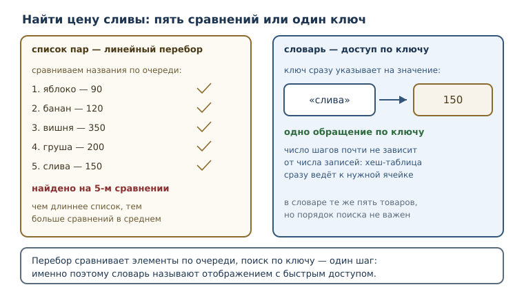
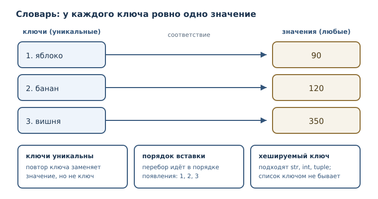

# Словари: отображения и структурирование данных

<!-- syllanix:nav -->
**Навигация:** [← 16. Множества и хеширование](16-sets.md) · [Оглавление книги](../README.md) · [Далее: 18. Ссылки, алиасы и копирование →](18-references-copy.md)
<!-- /syllanix:nav -->

<!-- syllanix:topics -->
**Темы главы**
17.1. [Что вы сможете после этой главы](#что-вы-сможете-после-этой-главы)  
17.2. [Задача, где позиция не помогает](#why-dicts)  
17.3. [Отображение и словарь](#mapping)  
17.4. [Пары «ключ — значение»](#key-value-pair)  
17.5. [Методы словаря](#dict-methods)  
17.6. [Итерация по словарю](#dict-iteration)  
17.7. [Словари как структурирование данных](#structuring)  
17.8. [Типичные ошибки](#mistakes)  
17.9. [Упражнения](#упражнения)  
17.10. [Проверка понимания](#проверка-понимания)  
17.11. [Что дальше](#что-дальше)  
<!-- /syllanix:topics -->


К этому моменту вы умеете хранить множество значений в списке, кортеже, строке
и множестве. У всех этих коллекций есть общая черта: элемент находится по
позиции или проверяется на вхождение, но у элемента нет собственного имени.
Список знает, что цена лежит третьей; он не знает, что третья цена относится
к вишне. Как только программа начинает работать не с безымянным набором
чисел, а с предметной областью — товарами, счетами, сотрудниками, настройками,
— позиции перестают помогать. Нужна другая коллекция: такая, где значение
находят по имени, а не по месту.

В этой главе появится **словарь** — коллекция пар «ключ — значение» и основной
инструмент Python для хранения именованных сведений. Вы научитесь создавать
словари, безопасно читать значения, перебирать записи и строить из них
структуры, похожие на строки таблицы или карточки.

## Что вы сможете после этой главы

- создавать словари и объяснять, чем отображение отличается от
  последовательности;
- читать значение по ключу и отличать `KeyError` от «значение не задано»;
- пользоваться методами `keys`, `values`, `items`, `get`, `pop`, `setdefault`,
  `update` и понимать, что каждый из них меняет;
- перебирать словарь по ключам, значениям и парам, не ломая его во время
  обхода;
- складывать из словарей записи с полями и решать задачи учёта и подсчёта.

## Задача, где позиция не помогает {#why-dicts}

Представьте склад, который хранит цены на три товара. Самое прямолинейное
решение — список пар:

```python
catalog = [("яблоко", 90), ("банан", 120), ("вишня", 350)]
```

Чтобы узнать цену вишни, программа перебирает пары и сравнивает названия.
Это работает, но у решения два изъяна. Первый: чем длиннее каталог, тем
больше сравнений нужно в среднем, потому что поиск идёт по порядку. Второй,
более важный: смысл элемента задаётся его позицией. Стоит поставить новый
товар в начало — и код, который обращался к `catalog[2]`, начнёт показывать
чужую цену.

```python exec
catalog = [("яблоко", 90), ("банан", 120), ("вишня", 350)]
target = "вишня"
checked = 0
for name, price in catalog:
    checked = checked + 1
    if name == target:
        print("нашли за шагов:", checked, "—", price)
```

```output
нашли за шагов: 3 — 350
```

Три шага на три товара — приемлемо для примера, но плохо масштабируется:
для тысячи товаров в худшем случае понадобится тысяча сравнений. Нам нужна
коллекция, которая находит значение по имени сразу, независимо от размера.
Такая коллекция называется отображением.



**Отображение** — абстракция «ключ → значение»: с каждым ключом связано одно
значение, и значение получают по ключу, а не по позиции. В Python отображение
реализует встроенный тип **словарь** (`dict`), и именно он используется в
подавляющем большинстве программ: конфигурации, ответы сетевых служб, записи
в базе, счётчики, индексы.

## Отображение и словарь {#mapping}

Словарь записывается в фигурных скобках: пары разделяются запятыми, ключ и
значение — двоеточием.

```python exec
prices = {"яблоко": 90, "банан": 120, "вишня": 350}
print(prices)
print(type(prices))
```

```output
{'яблоко': 90, 'банан': 120, 'вишня': 350}
<class 'dict'>
```

У словаря есть два жёстких правила, из которых вытекает всё остальное.

**Ключи уникальны.** Один и тот же ключ не может встретиться дважды: словарь
хранит не список пар, а соответствие. Если при создании литерала ключ повторён,
останется последнее значение.

```python exec
d = {"a": 1, "a": 2}
print(d)
```

```output
{'a': 2}
```

**Ключи должны быть хешируемыми.** Это требование вы уже знаете по множествам:
ключом может быть строка, число, кортеж из неизменяемых значений, но не
список. Причина та же — словарь хранит ключи в хеш-таблице. Значением же может
быть любой объект, включая изменяемый.

**Порядок вставки сохраняется.** С версии 3.7 это гарантия языка, а не
случайность конкретной реализации: словарь перебирается в том порядке, в
котором ключи появились в нём.

```python exec
d = {}
d["z"] = 1
d["a"] = 2
d["m"] = 3
print(list(d))
d["z"] = 10
print(d)
```

```output
['z', 'a', 'm']
{'z': 10, 'a': 2, 'm': 3}
```

Обратите внимание на вторую часть: присваивание по существующему ключу меняет
значение, но не переставляет ключ в конец. Порядок — это порядок первого
появления ключа.

### Как словарь находит ключ

Прямой доступ к значению по ключу возможен благодаря хеш-таблице — той же идее,
что и у множеств. Из ключа вычисляется число (хеш), и это число показывает,
в какой области таблицы искать пару. Дальше словарь сравнивает найденный ключ
с искомым и при совпадении отдаёт значение. Никакого перебора всех пар не
происходит: словарь делает почти одинаковое число шагов и на десяти записях,
и на миллионе.

Хеш-таблица не обходится без тонкостей: два разных ключа могут дать одно и то
же число, и тогда словарю приходится разрешать совпадение. Такие случаи
обрабатываются внутри и на работу программы не влияют; важно лишь то, что
ключи должны быть хешируемыми и сравнимыми на равенство. Именно поэтому
список не годится в ключи: его содержимое можно изменить, и хеш перестанет
соответствовать объекту.

### Другие способы создать словарь

Литерал в фигурных скобках — не единственный способ. Функция `dict` умеет
строить словарь из именованных аргументов и из последовательности пар.

```python exec
print(dict(a=1, b=2))
print(dict([("a", 1), ("b", 2)]))
print(dict())
```

```output
{'a': 1, 'b': 2}
{'a': 1, 'b': 2}
{}
```

Форма с именованными аргументами удобна, когда ключи — простые латинские
идентификаторы и заранее известны. Форма из пар пригодится, когда пары
приходят из другого источника: из файла, из результата запроса, из `zip`.



Сравним словарь с уже известными коллекциями.

| Коллекция | Как найти элемент | Повторы | Порядок |
|---|---|---|---|
| список | по позиции `lst[i]` | разрешены | порядок вставки |
| кортеж | по позиции `t[i]` | разрешены | порядок вставки |
| множество | проверкой `in` | запрещены | не гарантируется |
| словарь | по ключу `d[key]` | ключи уникальны | порядок вставки |

## Пары «ключ — значение» {#key-value-pair}

Элемент словаря — **пара «ключ — значение»**: ключ и связанное с ним значение.
Для пары определена одна операция чтения — квадратные скобки с ключом.

```python exec
prices = {"яблоко": 90, "банан": 120}
print(prices["яблоко"])
```

```output
90
```

Если ключа нет, словарь не возвращает «ничего»: он поднимает исключение
`KeyError`. **KeyError** — исключение при обращении к отсутствующему ключу
словаря. Это принципиальное решение: молчаливое `None` скрыло бы опечатку в
имени ключа.

```python exec expect-error
prices = {"яблоко": 90}
print(prices["груша"])
```

```output
KeyError: 'груша'
```

Для проверки наличия ключа служит `in`. Важно: `in` для словаря проверяет
именно ключи, а не значения.

```python exec
stock = {"яблоко": 3, "банан": 5}
print("банан" in stock)
print(5 in stock)
print(len(stock))
```

```output
True
False
2
```

`False` во второй строке часто удивляет: значение `5` в словаре есть, но
проверка `in` спрашивает про ключи. Ключа `5` нет.

## Методы словаря {#dict-methods}

**Метод словаря** — операция над словарём, вызываемая через точку. Методы
делятся на три группы: одни только читают, другие меняют словарь, третьи
совмещают чтение и изменение.

| Метод | Что делает | Меняет словарь |
|---|---|---|
| `keys()` | даёт ключи | нет |
| `values()` | даёт значения | нет |
| `items()` | даёт пары «ключ, значение» | нет |
| `get(key, default)` | читает значение с запасным вариантом | нет |
| `pop(key, default)` | удаляет ключ и возвращает значение | да |
| `popitem()` | удаляет последнюю пару | да |
| `setdefault(key, default)` | читает, а при отсутствии создаёт ключ | да, если ключа нет |
| `update(other)` | добавляет пары из другого словаря | да |
| `clear()` | удаляет все пары | да |

### get: чтение без исключения {#get}

**get** — метод получения значения по ключу с запасным значением вместо
исключения. Без второго аргумента запасным значением служит `None`.

```python exec
prices = {"яблоко": 90, "банан": 120}
print(prices.get("банан"))
print(prices.get("груша"))
print(prices.get("груша", 0))
```

```output
120
None
0
```

`get` не добавляет ключ в словарь: он только читает. Зато разница между
«ключа нет» и «значение равно `None`» при этом теряется — оба случая дают
`None`. Поэтому, если `None` может быть законным значением, прямое обращение
`d[key]` информативнее: оно поднимает `KeyError` только при отсутствии ключа.
`get` удобен, когда отсутствие ключа и `None` для вас равнозначны.

### Ключи, значения и пары {#keys-values-items}

```python exec
price = {"a": 1, "b": 2}
print(list(price.keys()))
print(list(price.values()))
print(list(price.items()))
```

```output
['a', 'b']
[1, 2]
[('a', 1), ('b', 2)]
```

`keys`, `values` и `items` возвращают не новые списки, а представления над
словарём: они отражают текущее содержимое и не занимают память под копию.
Именно поэтому к ним нельзя обращаться по индексу.

```python exec expect-error
d = {"a": 1}
print(d.items()[0])
```

```output
TypeError: 'dict_items' object is not subscriptable
```

Нужен именно список — оберните результат в `list(...)`.

### setdefault: прочитать или создать {#setdefault}

`setdefault` пригодится, когда значение надо получить, а при отсутствии ключа
создать. Он возвращает то значение, которое оказалось в словаре после вызова.

```python exec
d = {"a": 1, "b": 2}
print(d.pop("a"))
print(d.setdefault("c", 3))
print(d.setdefault("c", 99))
print(d)
```

```output
1
3
3
{'b': 2, 'c': 3}
```

Второй вызов `setdefault("c", 99)` вернул `3`: ключ уже существовал, и запасное
значение не понадобилось. Это отличает `setdefault` от безоговорочного
присваивания.

### update, pop и удаление {#update-pop}

```python exec
d = {"a": 1}
d.update({"b": 2}, c=3)
print(d)
print(d.pop("b"))
print(d)
```

```output
{'a': 1, 'b': 2, 'c': 3}
2
{'a': 1, 'c': 3}
```

`pop` вернул значение и удалил пару, поэтому третий `print` показывает словарь
уже без ключа `b`. Если значение не нужно, а нужен только факт удаления,
удобнее `del`.

```python exec
d = {"a": 1, "b": 2}
removed = d.pop("b")
print(removed)
print(d)
```

```output
2
{'a': 1}
```

`del` удаляет пару по ключу и ничего не возвращает; `clear` очищает словарь
целиком.

## Итерация по словарю {#dict-iteration}

**Итерация по словарю** — перебор ключей (по умолчанию), значений или пар
через `keys`, `values` и `items`; порядок вставки сохраняется. В цикле `for`
по словарю переменная получает ключ, а не пару.

```python exec
stock = {"яблоко": 3, "банан": 5}
for name in stock:
    print(name)
for name, count in stock.items():
    print(name, count)
```

```output
яблоко
банан
яблоко 3
банан 5
```

Во втором цикле пара распаковывается на две переменные — тот же приём, что и
с кортежами. Это самый частый способ обойти словарь, когда нужны и ключ,
и значение.

### Почему нельзя менять словарь во время обхода

Попытка удалить или добавить ключ, пока цикл идёт по словарю, немедленно
прерывает программу.

```python exec expect-error
d = {"a": 1, "b": 2}
for key in d:
    del d[key]
```

```output
RuntimeError: dictionary changed size during iteration
```

Причина в устройстве обхода: словарь обходит таблицу по внутренним ячейкам,
и изменение размера таблицы сбивает курсор. Правило простое: во время обхода
не меняйте набор ключей. Два безопасных способа — собрать ключи заранее или
построить новый словарь.

```python exec
d = {"a": 1, "b": 2}
for key in list(d):
    del d[key]
print(d)
```

```output
{}
```

Замена значений при обходе разрешена: набор ключей не меняется.

```python exec
d = {"a": 1, "b": 2}
for key in d:
    d[key] = d[key] * 10
print(d)
```

```output
{'a': 10, 'b': 20}
```

## Словари как структурирование данных {#structuring}

Главная практическая сила словаря в том, что он даёт полям имена. Сравните
две записи об одном студенте: кортеж и словарь.

```python
student_tuple = ("Анна", 20, 92, "Казань")
student = {"имя": "Анна", "возраст": 20, "балл": 92, "город": "Казань"}
```

В кортеже смысл элементов держится на порядке и памяти читателя: что такое
`92` и почему город последний, видно только из документации. В словаре смысл
записан в самой структуре. Поле можно добавить или удалить, и остальные поля
от этого не сдвинутся.

```python exec
student = {"имя": "Анна", "возраст": 20, "балл": 92}
student["город"] = "Казань"
student["балл"] = 95
del student["возраст"]
print(student)
```

```output
{'имя': 'Анна', 'балл': 95, 'город': 'Казань'}
```

Удаление поля не меняет порядок оставшихся: ключ `балл` остался на своём месте,
`город` добавлен в конец.

### Счётчик на словаре

Классическая задача — подсчитать, сколько раз встречается каждое слово.
Словарь «слово → количество» решает её без поиска по всему списку.

```python exec
text = "кот пёс кот кот пёс"
counts = {}
for word in text.split():
    counts[word] = counts.get(word, 0) + 1
print(counts)
```

```output
{'кот': 3, 'пёс': 2}
```

Разберём строку `counts[word] = counts.get(word, 0) + 1`. Если слово уже
встречалось, `get` вернёт текущее количество и мы прибавим единицу. Если нет —
вернётся `0`, и в словаре появится новый ключ со значением `1`. Тот же счётчик
записывают через `setdefault`:

```python exec
text = "кот пёс кот"
counts = {}
for word in text.split():
    counts.setdefault(word, 0)
    counts[word] = counts[word] + 1
print(counts)
```

```output
{'кот': 2, 'пёс': 1}
```

### Два словаря вместо одной таблицы

Иногда удобно хранить разные свойства одного набора объектов в разных
словарях с общими ключами. Так получается подобие таблицы: столбец цен и
столбец остатков.

```python exec
prices = {"яблоко": 90, "банан": 120, "вишня": 350}
stock = {"яблоко": 3, "банан": 5, "вишня": 2}
for name in prices:
    print(name, prices[name] * stock[name])
```

```output
яблоко 270
банан 600
вишня 700
```

Согласованность таких «столбцов» — забота программиста: словари не знают друг
о друге. Если ключи должны совпадать всегда, лучше хранить одну запись с
полями, а не два независимых словаря.

## Типичные ошибки {#mistakes}

1. **Обращение через точку.** `prices.яблоко` и даже `prices.apple` — ошибка:
   атрибутов у словаря по именам ключей нет. Нужны квадратные скобки.
2. **Индекс вместо ключа.** `d[0]` ищет ключ `0`, а не «первый элемент».
   Если такого ключа нет, будет `KeyError: 0`, а не `IndexError`.
3. **Изменяемый ключ.** Список ключом быть не может: словарь требует
   хешируемый объект. Сообщение об ошибке в новых версиях Python уточнили,
   но тип исключения прежний.
4. **Ожидание, что `get` создаёт ключ.** `get` только читает; для создания
   служит `setdefault` или присваивание.
5. **Пустые фигурные скобки.** `{}` — пустой словарь, а не пустое множество.
   Пустое множество записывается как `set()`.
6. **Изменение словаря во время обхода.** Удаление или добавление ключей в
   цикле даёт `RuntimeError`.
7. **Путаница `in` и значений.** `in` проверяет ключи; для проверки значений
   нужен отдельный проход по `values()`.

Ошибку с изменяемым ключом удобно увидеть, перехватив исключение и напечатав
только его тип: текст сообщения в разных версиях Python отличается.

```python exec
try:
    d = {}
    d[[1, 2]] = "список"
except TypeError as exc:
    print(type(exc).__name__)
```

```output
TypeError
```

## Упражнения

### 1. Прогнозирование вывода {#ex-ch17-01}

Не запуская код, запишите, что выведет программа. Затем проверьте.

```python
d = {"a": 1, "b": 2, "a": 3}
print(d)
print(list(d))
print(len(d))
```

Объясните, почему пар стало две, а не три, и почему порядок именно такой.

### 2. Первый словарь {#ex-ch17-02}

Создайте словарь `phonebook` с тремя именами и номерами телефонов. Выведите
номер по имени, затем добавьте четвёртую запись и выведите количество записей.

### 3. Исправление ошибки {#ex-ch17-03}

Программа падает:

```python
prices = {"яблоко": 90, "банан": 120}
print(prices["вишня"])
```

Определите тип исключения, объясните причину и исправьте код так, чтобы при
отсутствии товара печаталось `нет в продаже`.

### 4. get или квадратные скобки {#ex-ch17-04}

Опишите, в каких случаях уместно `prices[key]`, а в каких — `prices.get(key)`.
Приведите по одному примеру на каждый случай и проверьте оба.

### 5. Счётчик на setdefault {#ex-ch17-05}

Напишите программу, которая считает частоту символов в строке `"абракадабра"`,
используя `setdefault`. Выведите результат и проверьте, что сумма всех
количеств равна длине строки.

### 6. Обход в порядке ключей {#ex-ch17-06}

Дан словарь оценок. Выведите пары «имя — оценка» в алфавитном порядке имён,
не меняя сам словарь.

```python
grades = {"Борис": 4, "Анна": 5, "Вера": 3}
```

### 7. Поиск дефекта {#ex-ch17-07}

Следующий код должен удалить все товары с нулевым остатком, но падает:

```python
stock = {"яблоко": 0, "банан": 5, "вишня": 0}
for name in stock:
    if stock[name] == 0:
        del stock[name]
```

Объясните причину падения и предложите два исправления.

### 8. Слияние словарей {#ex-ch17-08}

Даны два словаря настроек: значения по умолчанию и пользовательские.
Получите итоговый словарь, в котором пользовательские значения заменяют
значения по умолчанию, и выведите его. Какой метод словаря подходит лучше
всего?

### 9. Учёт на складе {#ex-ch17-09}

Напишите программу, которая ведёт учёт склада:

- начальный словарь `stock` содержит три товара с остатками;
- товар приходит: увеличьте остаток, а если товара не было — добавьте его;
- товар уходит: уменьшите остаток, но не ниже нуля;
- в конце выведите все товары, у которых остаток меньше трёх, и общее
  количество единиц на складе.

Решите задачу без изменения словаря во время обхода.

### 10. Почему словарь быстрее списка пар {#ex-ch17-10}

Объясните своими словами, почему поиск по ключу в словаре не становится
линейно медленнее при росте числа записей, а поиск по списку пар — становится.
Подтвердите рассуждение примером: посчитайте, сколько сравнений сделает цикл
для списка из пяти пар при поиске последнего элемента и сколько шагов нужно
словарю.

## Проверка понимания

1. Чем отображение отличается от последовательности? Что из них словарь?
2. Почему ключи уникальны, а значения — нет? Что произойдёт при попытке
   задать один ключ дважды в литерале?
3. Чем `KeyError` полезнее молчаливого `None` при чтении по ключу?
4. Что проверяет `in` для словаря и как проверить наличие значения?
5. Чем `setdefault` отличается от `get`? Приведите пример, где различие видно.
6. Почему нельзя удалять ключи во время обхода словаря и какие есть
   безопасные обходные пути?
7. Зачем хранить запись в словаре, если можно взять кортеж?

## Что дальше

Словарь даёт именованный доступ к значениям, но пока все значения в наших
примерах были простыми: числа и строки. Реальные сведения редко бывают
плоскими — чаще значение само оказывается коллекцией: списком оценок,
вложенным словарём адреса, набором тегов. Тогда появляется новый вопрос:
сколько копий структуры существует в памяти и что произойдёт, если изменить
одну из них. Об этом — в следующей главе о ссылках, алиасах и копировании.

<!-- syllanix:nav -->
**Перед этой главой:** [16. Множества и хеширование](16-sets.md)
**Связанные главы:** [03. Значения, имена, объекты и типы](03-values-names-objects.md), [04. Выражения, операторы и ввод данных](04-expressions-input.md), [05. Логика и управление потоком](05-control-flow.md), [06. Циклы: while и for](06-loops.md), [07. Функции: параметры, аргументы и области видимости](07-functions.md), [10. Ошибки и исключения](10-errors-exceptions.md), [12. Коллекции и последовательности: введение](12-collections-intro.md), [13. Списки: индексы, срезы и методы](13-lists.md)
**Далее:** [18. Ссылки, алиасы и копирование →](18-references-copy.md)
<!-- /syllanix:nav -->
