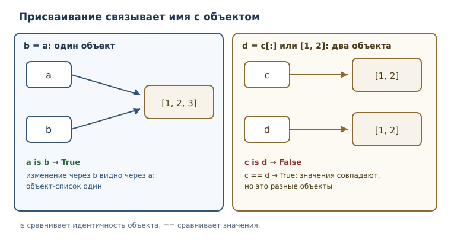
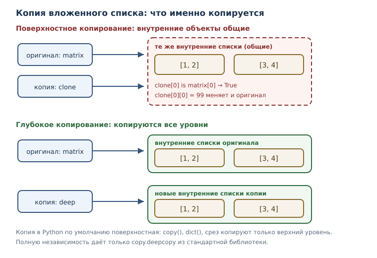

# Ссылки, алиасы и копирование

<!-- syllanix:nav -->
**Навигация:** [← 17. Словари: отображения и структурирование данных](17-dicts.md) · [Оглавление книги](../README.md) · [Далее: 19. Файлы, пути и текстовые форматы →](19-files-formats.md)
<!-- /syllanix:nav -->

<!-- syllanix:topics -->
**Темы главы**
18.1. [Что вы сможете после этой главы](#что-вы-сможете-после-этой-главы)  
18.2. [Задача: «изменил одно — поменялось другое»](#why)  
18.3. [Имена, объекты и ссылки](#references)  
18.4. [Алиасинг (псевдонимы)](#aliasing)  
18.5. [Вложенная структура](#nested)  
18.6. [Поверхностное копирование](#shallow)  
18.7. [Глубокое копирование](#deep)  
18.8. [Изменяемое значение по умолчанию](#default-arg)  
18.9. [Типичные ошибки](#mistakes)  
18.10. [Упражнения](#упражнения)  
18.11. [Проверка понимания](#проверка-понимания)  
18.12. [Что дальше](#что-дальше)  
<!-- /syllanix:topics -->


Самый неприятный класс дефектов в начале обучения выглядит так: программа
меняет одну переменную, а «портится» совсем другая. Список, который вы
передали в функцию, после вызова оказывается другим. Резервная копия,
сделанная «на всякий случай», меняется вместе с оригиналом. Причина не в
ошибке синтаксиса и не в опечатке, а в устройстве модели памяти Python:
имена не хранят значения, они ссылаются на объекты. Пока вы работаете с
числами и строками, это незаметно. Как только появляются списки, словари и
вложенные структуры, различие становится источником и ошибок, и мощных
приёмов.

В этой главе вы разберётесь, что именно происходит при присваивании, чем
`is` отличается от `==`, почему «копия» иногда оказывается лишь вторым именем
и как получить настоящую независимую копию.

## Что вы сможете после этой главы

- объяснять, что присваивание копирует ссылку, а не объект;
- предсказывать, когда изменение через одно имя видно через другое;
- различать поверхностное и глубокое копирование и выбирать нужное;
- строить вложенные структуры и понимать, какие их части общие, а какие нет;
- не попадать в ловушку изменяемого значения по умолчанию и узнавать её в
  чужом коде.

## Задача: «изменил одно — поменялось другое» {#why}

Представьте, что программа хранит список покупок и делает резервную копию
перед сортировкой.

```python exec
shopping = ["молоко", "хлеб", "сыр"]
backup = shopping
shopping.sort()
print(shopping)
print(backup)
```

```output
['молоко', 'сыр', 'хлеб']
['молоко', 'сыр', 'хлеб']
```

Сортировка изменила `shopping`, но изменилась и «копия» `backup`. Строка
`backup = shopping` не создала второй список: она связала второе имя с тем же
самым объектом. Пока вы не увидите модель, в которой имя — это ссылка, такое
поведение кажется нелогичным. С ним мы и будем разбираться.

## Имена, объекты и ссылки {#references}

Вспомним модель, введённую в главе 3: значение живёт в объекте, имя — это
способ обратиться к объекту. Инструкция присваивания не копирует объект, она
**связывает имя** с объектом. Поэтому у одного объекта может быть несколько
имён.

**Ссылочная семантика** — правило, по которому присваивание копирует ссылку
на объект, а не сам объект. Из него следует всё остальное в этой главе.



```python exec
a = [1, 2, 3]
b = a
b.append(4)
print(a)
print(a is b)
```

```output
[1, 2, 3, 4]
True
```

`a is b` истинно, потому что оба имени ссылаются на один объект. Внимание:
`is` сравнивает не значения, а **идентичность** — тот ли это объект. Для
значений служит `==`.

```python exec
a = [1, 2]
b = [1, 2]
print(a == b)
print(a is b)
```

```output
True
False
```

Два разных списка с одинаковым содержимым равны, но не идентичны. Правило
простое: `==` отвечает на вопрос «одинаковы ли значения», `is` — «это один и
тот же объект». Для `None` принято писать `is None`, потому что `None` —
единственный объект; для чисел, строк и списков сравнение через `is` почти
всегда ошибка.

С неизменяемыми объектами ссылочная семантика не видна: число нельзя изменить,
операция `b = b + 1` создаёт новый объект и связывает `b` с ним, а `a`
продолжает указывать на старое число.

```python exec
a = 10
b = a
b = b + 1
print(a, b)
```

```output
10 11
```

Ссылочная семантика — не случайность реализации, а осознанное решение языка.
Присваивание в Python не перекладывает содержимое объекта: оно связывает имя
с объектом, и это одинаково дешёвая операция и для числа, и для списка из
миллиона элементов. Благодаря такой модели большой словарь можно передать в
функцию, не копируя его: достаточно передать ссылку. Цена решения —
необходимость явно думать о том, кто владеет объектом и кто вправе его
менять.

## Алиасинг (псевдонимы) {#aliasing}

**Алиасинг (псевдонимы)** — ситуация, когда два имени ссылаются на один
изменяемый объект, поэтому изменение видно через оба. Алиасинг сам по себе — не ошибка:
иногда он нужен и удобен. Опасен он тогда, когда
программа считает имена независимыми.

```python exec
prices = {"яблоко": 90}
backup = prices
backup["банан"] = 120
print(prices)
print(prices is backup)
```

```output
{'яблоко': 90, 'банан': 120}
True
```

Алиасинг часто возникает незаметно — при передаче аргумента в функцию.
Параметр и аргумент становятся двумя именами одного объекта.

```python exec
def add_item(items, item):
    items.append(item)


numbers = [1, 2]
add_item(numbers, 3)
print(numbers)
```

```output
[1, 2, 3]
```

Функция не возвращала список, но исходный `numbers` изменился: `items` внутри
функции — это ещё одно имя того же списка. Такое поведение называют
**побочным эффектом**. Оно бывает намеренным (например, функция добавляет
запись в переданный журнал), но чаще оказывается неожиданным.

Если функция не должна менять аргумент, есть два способа: не изменять объект,
а создавать новый либо скопировать аргумент на входе и менять копию.

```python exec
def add_item(items, item):
    items = items + [item]
    return items


numbers = [1, 2]
result = add_item(numbers, 3)
print(numbers)
print(result)
```

```output
[1, 2]
[1, 2, 3]
```

Здесь `items = items + [item]` создаёт новый список и связывает с ним
локальное имя `items`; исходный объект не тронут. Это тот же приём, что и с
неизменяемыми значениями: результат — новое значение, вход — прежний.

Из этого правила следует требование к аккуратному проектированию функций.
Если функция меняет переданный объект, это должно быть видно из её имени и
документации — например, `add_item` меняет, а `with_item` возвращает новое.
Обратная ошибка тоже встречается: функция возвращает внутренний список
объекта, вызывающий код его меняет, и состояние структуры незаметно портится.
Поэтому функция, отдающая наружу коллекцию, нередко возвращает её копию, а не
сам объект. Такой приём называют защитным копированием, и он платит небольшим
расходом памяти за предсказуемость поведения.

## Вложенная структура {#nested}

До сих пор объекты были простыми. Реальные сведения устроены сложнее:
**вложенная структура** — коллекция внутри коллекции: список списков, словарь
списков и т. п. Вложенность добавляет второй уровень ссылок, и именно на нём
чаще всего ломаются интуиции о копировании.

```python exec
matrix = [[1, 2], [3, 4]]
same = matrix
same[0][0] = 99
print(matrix)
```

```output
[[99, 2], [3, 4]]
```

Разберём, что здесь есть. Есть внешний список из двух элементов. Каждый
элемент — ссылка на внутренний список. Имена `matrix` и `same` указывают на
внешний список, поэтому изменение вложенного элемента видно через оба имени.

```text
matrix ──▶ [ •, • ]        внешний список
              │  │
              ▼  ▼
          [99, 2] [3, 4]   внутренние списки
```

Имена ссылаются на внешний список; внешний список ссылается на внутренние.
Изменение `same[0][0]` идёт по цепочке: имя → внешний список → внутренний
список → элемент.

```python exec
user = {"имя": "Анна", "оценки": [4, 5]}
print(user["оценки"][0])
user["оценки"].append(3)
print(user)
```

```output
4
{'имя': 'Анна', 'оценки': [4, 5, 3]}
```

Словарь, значения которого — списки, устроен так же: ключ ведёт к объекту-
списку, и этот список можно менять, не трогая сам словарь.

## Поверхностное копирование {#shallow}

Чтобы получить независимую копию списка, его нужно явно скопировать.
**Поверхностное копирование** — копирование только верхнего уровня структуры;
вложенные объекты остаются общими. Для списка есть три равнозначных способа:
метод `copy()`, полный срез и функция `list()`.

```python exec
a = [1, 2]
b = a.copy()
b.append(3)
print(a, b)
c = a[:]
c[0] = 99
print(a, c)
```

```output
[1, 2] [1, 2, 3]
[1, 2] [99, 2]
```

Для плоского списка этого достаточно: копия независима. Но для вложенной
структуры поверхностное копирование копирует только внешний список, а
внутренние остаются теми же объектами.

```python exec
matrix = [[1, 2], [3, 4]]
clone = matrix.copy()
clone[0][0] = 99
print(matrix)
print(clone)
print(matrix[0] is clone[0])
```

```output
[[99, 2], [3, 4]]
[[99, 2], [3, 4]]
True
```

Значение `True` в последней строке — приговор: первый внутренний список у
копии и у оригинала один и тот же. Поверхностное копирование создало новый
внешний список, но элементы-ссылки скопировало как есть.



Для словаря поверхностная копия делается методом `copy()` или функцией
`dict()`; для множества — методом `copy()`. Модуль `copy` даёт общую функцию
`copy.copy`, которая работает с любым поддерживающим копирование объектом.

Стоит помнить, что многие встроенные операции возвращают новый объект, а не
меняют старый: `sorted(...)`, полный срез `[::]` и `list(...)` дают
поверхностную копию верхнего уровня. Для плоской коллекции этого достаточно,
для вложенной — нет, и различие снова решает вопрос «кто владеет внутренними
объектами».

```python exec
import copy

original = {"a": [1]}
shallow = copy.copy(original)
shallow["a"].append(2)
print(original)
print(original["a"] is shallow["a"])
```

```output
{'a': [1, 2]}
True
```

Функция `dict(other)` даёт тот же результат, что и метод `copy()`: новый
словарь, но с прежними ссылками на значения. Поэтому список внутри значения
остаётся общим.

```python exec
settings = {"темы": ["светлая"], "язык": "ru"}
shallow_copy = dict(settings)
shallow_copy["темы"].append("тёмная")
print(settings)
print(settings["темы"] is shallow_copy["темы"])
```

```output
{'темы': ['светлая', 'тёмная'], 'язык': 'ru'}
True
```

## Глубокое копирование {#deep}

Когда нужна полностью независимая структура, применяют **глубокое
копирование** — рекурсивное копирование всех вложенных объектов. В стандартной
библиотеке для этого есть `copy.deepcopy`.

```python exec
import copy

matrix = [[1, 2], [3, 4]]
deep = copy.deepcopy(matrix)
deep[0][0] = 99
print(matrix)
print(deep)
print(matrix[0] is deep[0])
```

```output
[[1, 2], [3, 4]]
[[99, 2], [3, 4]]
False
```

Теперь изменение копии не затронуло оригинал: внутренние списки тоже
скопированы. `deepcopy` обходит структуру рекурсивно, копируя каждый
изменяемый объект; для неизменяемых объектов (числа, строки, кортежи из
неизменяемых) копия не нужна, и функция возвращает тот же объект.

Глубокое копирование умеет обрабатывать и структуры, которые ссылаются сами
на себя: оно запоминает уже скопированные объекты и не уходит в бесконечную
рекурсию.

```python exec
import copy

a = [1]
a.append(a)
b = copy.deepcopy(a)
print(len(b))
print(b[1] is b)
print(b is a)
```

```output
2
True
False
```

Глубокая копия нужна, когда структура действительно должна быть независимой.
У неё есть цена: время на обход всех уровней и дополнительная память. Если
достаточно независимости верхнего уровня, поверхностного копирования хватает
и оно дешевле. Выбор диктуется задачей, а не привычкой: «всегда deepcopy» —
такая же крайность, как «никогда не копировать».

Есть и содержательное ограничение: `deepcopy` копирует только структуру
данных, а не внешние ресурсы. Если объект описывает открытый файл, сетевое
соединение или другой ресурс операционной системы, копирование такого объекта
бессмысленно: две копии не могут независимо владеть одним ресурсом. Для
подобных объектов предусмотрен отдельный протокол настройки копирования; о
нём вы узнаете, когда познакомитесь с собственными классами. Пока достаточно
запомнить: глубокое копирование — инструмент для коллекций и вложенных
структур, а не универсальное средство «сделать всё независимым».

## Изменяемое значение по умолчанию {#default-arg}

Отдельный случай ссылочной семантики — значения параметров по умолчанию.
Значение по умолчанию вычисляется один раз, при определении функции, и
сохраняется в её объекте. Если это изменяемый объект, все вызовы будут
делить его между собой.

**Изменяемое значение по умолчанию** — ошибка проектирования, когда
изменяемый объект используется как значение по умолчанию и сохраняет
изменения между вызовами.

```python exec
def collect(item, bucket=[]):
    bucket.append(item)
    return bucket


print(collect("а"))
print(collect("б"))
print(collect("в"))
```

```output
['а']
['а', 'б']
['а', 'б', 'в']
```

Функция выглядит так, будто каждый вызов начинает с пустого списка, но список
создан один раз — при определении `collect`. Все вызовы получают один и тот
же объект, поэтому результаты накапливаются. То же случится со словарём или
множеством в роли значения по умолчанию.

Исправление стандартное: по умолчанию ставить `None`, а нужный объект
создавать внутри функции.

```python exec
def collect(item, bucket=None):
    if bucket is None:
        bucket = []
    bucket.append(item)
    return bucket


print(collect("а"))
print(collect("б"))
```

```output
['а']
['б']
```

Проверка `is None` здесь обязательна: если бы мы написали `if not bucket`, то
пустой список, переданный явно, тоже считался бы отсутствующим, и вызов
`collect("а", [])` не изменил бы переданный список. `None` — обычный признак
«аргумент не передан», пока `None` не входит в число допустимых значений. Если
он допустим, безопаснее уникальный маркер-объект, например `sentinel = object()`.

## Типичные ошибки {#mistakes}

1. **Считать `b = a` копированием.** Это второе имя того же объекта.
2. **Проверять равенство через `is`.** `is` сравнивает идентичность; для
   значений нужно `==`. Исключение — сравнение с `None`.
3. **Считать `list.copy()` полной копией.** Для вложенной структуры копия
   поверхностная, внутренние объекты общие.
4. **Путать `deepcopy` с бесплатной операцией.** Она обходит всю структуру,
   поэтому дороже; для больших данных это заметно.
5. **Изменять аргумент, когда этого не ждут.** Функция, меняющая переданный
   список, обязана быть очевидной по имени и документации, иначе дефект
   всплывёт далеко от места вызова.
6. **Изменяемое значение по умолчанию.** Список, словарь или множество в
   сигнатуре сохраняет изменения между вызовами.
7. **Ждать, что кортеж защитит содержимое.** Кортеж неизменяем, но если в нём
   лежит список, сам список менять можно.

Проверим последний пункт: неизменяемость кортежа относится к набору ссылок,
а не к объектам, на которые они указывают.

```python exec
t = (1, [2, 3])
t[1].append(4)
print(t)
```

```output
(1, [2, 3, 4])
```

## Упражнения

### 1. Прогнозирование вывода {#ex-ch18-01}

Не запуская код, запишите результат. Затем проверьте и объясните.

```python
a = [1, 2]
b = a
b = b + [3]
print(a)
print(b)
```

Сравните с вариантом, где вместо `b = b + [3]` стоит `b.append(3)`.

### 2. is или == {#ex-ch18-02}

Для каждой пары значений определите, что выведет `print(x is y)` и
`print(x == y)`, и объясните различие:

```python
x = [1, 2]
y = [1, 2]
```

Затем проверьте на числах: `x = 1000`, `y = int("1000")`, а потом то же
самое с `100` вместо `1000`. Объясните, почему для небольших чисел результат
`is` отличается и почему опираться на это нельзя.

### 3. Функция портит аргумент {#ex-ch18-03}

Функция должна возвращать список без отрицательных чисел, но исходный список
тоже меняется:

```python
def positive(numbers):
    for number in numbers:
        if number < 0:
            numbers.remove(number)
    return numbers

data = [3, -1, 4, -2]
print(positive(data))
print(data)
```

Объясните, почему `data` изменился, и предложите исправление, которое
не трогает входной список.

### 4. Три способа скопировать список {#ex-ch18-04}

Скопируйте список `[1, 2, 3]` тремя способами: методом `copy()`, полным срезом
и функцией `list()`. Проверьте, что копии равны исходному списку, но не
идентичны ему, и что изменение копии не меняет исходный список.

### 5. Поверхностная ловушка {#ex-ch18-05}

Дан список списков `[[1, 2], [3, 4]]`. Сделайте его поверхностную копию,
измените `второй` вложенный список в копии и объясните, что произошло с
оригиналом. Затем повторите с `copy.deepcopy` и сравните результаты.

### 6. Вложенный словарь {#ex-ch18-06}

Дан словарь `{"имя": "Анна", "оценки": [4, 5]}`. Сделайте копию, добавьте
оценку в копию и покажите, что произойдёт с оригиналом при поверхностном и при
глубоком копировании. Объясните различие через понятие вложенной структуры.

### 7. Значение по умолчанию {#ex-ch18-07}

Функция накапливает историю вызовов, но записи «переезжают» между вызовами:

```python
def log(message, history=[]):
    history.append(message)
    return history

print(log("старт"))
print(log("шаг 1"))
```

Исправьте функцию так, чтобы каждый вызов с одним аргументом начинал новую
историю, но при явно переданном списке запись шла в него.

### 8. Копия внутри функции {#ex-ch18-08}

Напишите функцию `without_duplicates(items)`, которая возвращает новый список
без повторяющихся элементов, не изменяя входной. Проверьте на списке, который
после вызова должен остаться прежним.

### 9. Резервная копия настроек {#ex-ch18-09}

Программа хранит настройки в виде словаря, значения которого — списки.
Напишите функцию `snapshot(settings)`, которая возвращает независимую копию
настроек. Докажите независимость: измените копию и покажите, что исходные
настройки не изменились. Объясните, почему `dict(settings)` здесь не подходит.

### 10. Где алиасинг полезен {#ex-ch18-10}

Приведите два примера, когда алиасинг (два имени на один объект) полезен, и
два примера, когда он опасен. Для каждого примера напишите короткий код,
который показывает эффект, и объясните, что видит программист.

## Проверка понимания

1. Что копирует присваивание — объект или ссылку? Как это проверить?
2. Чем `is` отличается от `==` и когда `is` уместен?
3. Почему изменение списка через одно имя видно через другое имя?
4. Чем поверхностное копирование отличается от глубокого? Приведите пример,
   где различие проявляется.
5. Почему значение по умолчанию создаётся один раз, а не при каждом вызове?
6. Почему кортеж с вложенным списком нельзя назвать полностью неизменяемым?
7. В каких случаях глубокое копирование не нужно?

## Что дальше

Модель ссылок объясняет, почему структуры данных ведут себя «не так, как
кажется». Следующий шаг — вывести сведения за пределы памяти программы:
сохранить их в файл и прочитать обратно. Там та же логика продолжится на
другом уровне: файл — внешний ресурс, который нужно открыть и корректно
закрыть, а форматы вроде CSV и JSON придётся преобразовывать в знакомые
словари и списки и обратно.

<!-- syllanix:nav -->
**Перед этой главой:** [17. Словари: отображения и структурирование данных](17-dicts.md)
**Связанные главы:** [03. Значения, имена, объекты и типы](03-values-names-objects.md), [07. Функции: параметры, аргументы и области видимости](07-functions.md), [12. Коллекции и последовательности: введение](12-collections-intro.md), [13. Списки: индексы, срезы и методы](13-lists.md), [14. Кортежи, распаковка и неизменяемость](14-tuples.md)
**Далее:** [19. Файлы, пути и текстовые форматы →](19-files-formats.md)
<!-- /syllanix:nav -->
