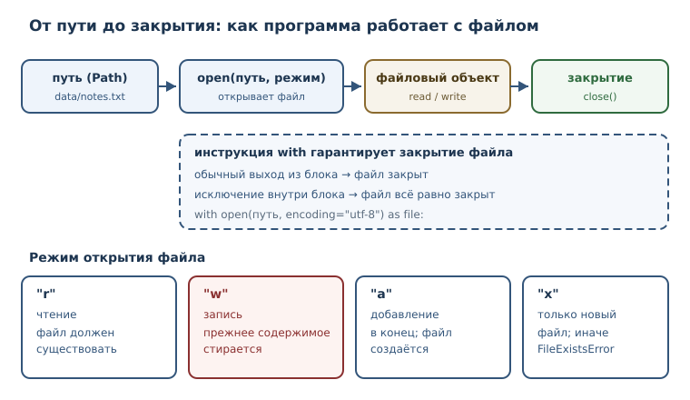
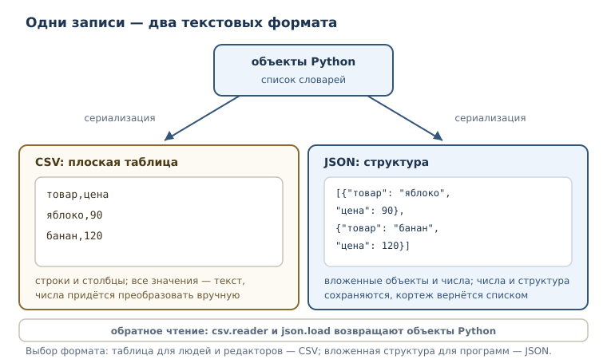

# Файлы, пути и текстовые форматы

<!-- syllanix:nav -->
**Навигация:** [← 18. Ссылки, алиасы и копирование](18-references-copy.md) · [Оглавление книги](../README.md) · [Далее: 20. Итераторы и протокол итерации →](20-iterators.md)
<!-- /syllanix:nav -->

<!-- syllanix:topics -->
**Темы главы**
19.1. [Что вы сможете после этой главы](#что-вы-сможете-после-этой-главы)  
19.2. [Зачем программе файлы](#why)  
19.3. [Путь и pathlib](#paths)  
19.4. [Открытие файла: open и режимы](#open-modes)  
19.5. [with и контекстный менеджер](#with)  
19.6. [Кодировка файла](#encoding)  
19.7. [CSV: табличные сведения](#csv)  
19.8. [JSON: обмен структурами](#json)  
19.9. [Типичные ошибки](#mistakes)  
19.10. [Упражнения](#упражнения)  
19.11. [Проверка понимания](#проверка-понимания)  
19.12. [Что дальше](#что-дальше)  
<!-- /syllanix:topics -->


Всё, что программа хранит в переменных, исчезает вместе с процессом. Для
учебных примеров этого достаточно, но настоящая работа почти всегда требует
памяти за пределами запуска: настройки должны пережить перезапуск, отчёт —
дождаться утра, а результат вычислений — попасть в другую программу. Значит,
нужно научиться читать и записывать файлы и договариваться о формате, в
котором сведения передаются.

Эта глава — про границу между программой и файловой системой. На границе
всегда есть внешние обстоятельства: файла может не быть, он может быть
занят, в нём может оказаться текст в другой кодировке. Поэтому здесь же
появится инструкция `with`, которая гарантирует корректное освобождение
ресурса, и два формата обмена — CSV и JSON.

## Что вы сможете после этой главы

- строить пути через `pathlib` и не склеивать их вручную;
- открывать файл в нужном режиме, читать его целиком, построчно и по частям;
- записывать текст, добавлять строки в конец и безопасно создавать новый файл;
- закрывать файлы надёжно, с помощью `with`, и понимать, что такое
  контекстный менеджер;
- указывать кодировку и объяснять, почему без неё возникают ошибки;
- читать и писать CSV и JSON и понимать, какие типы Python им соответствуют.

## Зачем программе файлы {#why}

Представьте программу, которая ведёт журнал заказов. Пока она работает,
заказы лежат в списке словарей. Закрыли программу — список исчез: память
принадлежала процессу, а не диску. Чтобы заказы сохранились, их нужно
**сериализовать** — превратить объекты программы в последовательность
символов или байтов, пригодную для хранения, — и записать в файл. При
следующем запуске выполняется обратная операция: файл читается и превращается
обратно в списки и словари.

**Сериализация** — преобразование объектов программы в формат, пригодный для
хранения или передачи, и обратное чтение. Формат может быть текстовым (CSV,
JSON) или двоичным; главное, что у него есть правила, по которым запись
превращается обратно в значения.

Файл отличается от коллекции в памяти ещё и тем, что он **внешний ресурс**.
Его нужно открыть, затем обязательно закрыть; он может отсутствовать; его
может одновременно держать другая программа; наконец, доступ к нему может
быть запрещён правами операционной системы. Ошибки на границе с файловой
системой — нормальная часть работы, а не признак поломки программы.

## Путь и pathlib {#paths}

**Путь** — адрес файла или каталога в файловой системе. Путь бывает
относительным (`data/report.txt`) и абсолютным (`/home/user/data/report.txt`).
Относительный путь отсчитывается от текущего каталога процесса.

Склеивать пути строками через `/` или `\\` — плохая идея: разделитель зависит
от операционной системы, а забытый разделитель даёт неверный адрес. В
стандартной библиотеке есть модуль **pathlib** — объектное представление
путей: `Path`, чтение и запись, обход каталогов.

```python exec
from pathlib import Path

p = Path("data") / "report.txt"
print(p.name)
print(p.stem)
print(p.suffix)
print(p.parent)
print(p)
```

```output
report.txt
report
.txt
data
data/report.txt
```

На Linux части пути разделяются прямым слэшем; на Windows тот же `print(p)`
покажет обратные. Чтобы вывод не зависел от системы, используйте
`p.as_posix()`.

Оператор `/` соединяет части пути и делает это по правилам текущей системы.
У объекта пути есть полезные части: `name` — имя с расширением, `stem` — имя
без расширения, `suffix` — расширение, `parent` — каталог.

`pathlib` умеет не только строить адреса. Он читает и записывает текст,
обходит каталоги и проверяет существование.

```python exec
import tempfile
from pathlib import Path

with tempfile.TemporaryDirectory() as tmp:
    folder = Path(tmp)
    (folder / "a.txt").write_text("1\n", encoding="utf-8")
    (folder / "b.txt").write_text("2\n", encoding="utf-8")
    names = []
    for item in folder.iterdir():
        names.append(item.name)
    print(sorted(names))
    print((folder / "a.txt").exists())
```

```output
['a.txt', 'b.txt']
True
```

Абсолютный путь начинается от корня файловой системы, относительный — от
текущего каталога процесса. Одна и та же программа может запускаться из
разных каталогов, поэтому в тексте программы лучше опираться на явно
построенные пути, а не на догадки о том, где она запущена. Для текущего
каталога есть `Path.cwd()`; его значение зависит от машины, поэтому в
учебных примерах его не печатают — иначе проверяемый вывод стал бы
непредсказуемым.

В примерах этой главы используется `tempfile.TemporaryDirectory` — временный
каталог, который удаляется сам. Так примеры не зависят от машины и не
оставляют мусора. В реальной программе вы работаете с каталогами проекта.

## Открытие файла: open и режимы {#open-modes}

**open** — встроенная функция, открывающая файл и возвращающая файловый
объект. **Файловый объект** — объект, через который программа читает или
записывает данные файла. Режим открытия задаётся строкой.

| Режим | Что означает |
|---|---|
| `"r"` | чтение; файл должен существовать (режим по умолчанию) |
| `"w"` | запись с усечением: файл создаётся или очищается |
| `"a"` | добавление в конец; файл создаётся, если его нет |
| `"x"` | исключительное создание: ошибка, если файл уже есть |
| `"b"` | двоичный режим, вместе с одним из основных: `"rb"`, `"wb"` |
| `"+"` | чтение и запись одновременно: `"r+"`, `"w+"` |

**Режим открытия файла** — строка режима: `'r'` чтение, `'w'` запись с
усечением, `'a'` добавление, `'x'` исключительное создание, `'b'` двоичный
режим.



Важно запомнить главное различие: `"w"` **уничтожает** прежнее содержимое
файла. Это самая частая причина потери сведений у начинающих — открыть
существующий файл на запись, чтобы «дописать», и стереть всё.

```python exec
import tempfile
from pathlib import Path

with tempfile.TemporaryDirectory() as tmp:
    path = Path(tmp) / "log.txt"
    path.write_text("старт\n", encoding="utf-8")
    with open(path, "a", encoding="utf-8") as file:
        file.write("финиш\n")
    print(path.read_text(encoding="utf-8"))
```

```output
старт
финиш
```

Режим `"x"` защищает от случайной перезаписи: если файл уже существует,
поднимается `FileExistsError`. Перехватим исключение и напечатаем только его
тип, чтобы пример не зависел от текста сообщения и от пути.

```python exec
import tempfile
from pathlib import Path

with tempfile.TemporaryDirectory() as tmp:
    path = Path(tmp) / "once.txt"
    path.write_text("занято\n", encoding="utf-8")
    try:
        with open(path, "x", encoding="utf-8") as file:
            file.write("ещё\n")
    except FileExistsError as exc:
        print(type(exc).__name__)
```

```output
FileExistsError
```

Если файла нет, а режим — `"r"`, возникает `FileNotFoundError`. Эти две
ошибки стоит знать по именам: они сообщают о разных проблемах, и
обрабатывать их нужно по-разному.

Файловый объект умеет читать разными способами. `read()` возвращает весь
текст, `readline()` — одну строку, `readlines()` — список строк. Сам файл
можно перебирать в цикле `for`, и тогда строки приходят по одной, без
загрузки всего файла в память.

```python exec
import tempfile
from pathlib import Path

with tempfile.TemporaryDirectory() as tmp:
    path = Path(tmp) / "poem.txt"
    path.write_text("раз\nдва\nтри\n", encoding="utf-8")
    with open(path, encoding="utf-8") as file:
        print(file.readline().strip())
        print(file.readlines())
```

```output
раз
['два\n', 'три\n']
```

Обратите внимание: `readlines` сохраняет символы перевода строки, поэтому
при печати списка видно `\n`. Если строки нужны без них, применяют `strip`
или `splitlines`.

Двоичный режим возвращает байты, а не строки. Он нужен для изображений,
архивов и других данных, которые не являются текстом.

```python exec
import tempfile
from pathlib import Path

with tempfile.TemporaryDirectory() as tmp:
    path = Path(tmp) / "data.bin"
    path.write_bytes(b"\x00\x01\x02")
    with open(path, "rb") as file:
        print(file.read())
```

```output
b'\x00\x01\x02'
```

## with и контекстный менеджер {#with}

Файл нужно закрывать. Пока он открыт, операционная система держит его
ресурсы, а запись может оставаться в буфере и не попасть на диск. Закрывать
вручную (`file.close()`) опасно: если между открытием и закрытием случится
исключение, строка `close` не выполнится.

**Инструкция with** — конструкция, гарантирующая корректное освобождение
ресурса (например, закрытие файла) при выходе из блока. Она работает с
**контекстным менеджером** — объектом, поддерживающим протокол
`__enter__`/`__exit__` и используемым в инструкции `with`.

```python exec
import tempfile
from pathlib import Path

with tempfile.TemporaryDirectory() as tmp:
    path = Path(tmp) / "note.txt"
    path.write_text("текст\n", encoding="utf-8")
    with open(path, encoding="utf-8") as file:
        print(file.closed, file.mode)
    print(file.closed)
```

```output
False r
True
```

Внутри блока файл открыт, после выхода — закрыт, причём независимо от того,
как блок завершился: обычным путём или исключением. Даже если внутри блока
произойдёт ошибка, `with` вызовет освобождение ресурса.

Устройство знакомо вам по обработке исключений: `with` — это сокращение для
`try`/`finally`, где в `finally` вызывается закрытие. Разница в том, что
`with` не даёт забыть про освобождение.

```python exec
import tempfile
from pathlib import Path

with tempfile.TemporaryDirectory() as tmp:
    path = Path(tmp) / "empty.txt"
    try:
        with open(path, encoding="utf-8") as file:
            print(file.read(10))
    except Exception as exc:
        print("ошибка чтения:", type(exc).__name__)
```

```output
ошибка чтения: FileNotFoundError
```

Здесь файл так и не открылся, поэтому закрывать нечего; исключение
перехвачено и обработано. В реальном коде перехватывать `Exception` широко не
стоит: лучше указать конкретный тип, как в примерах выше.

Одна инструкция `with` может управлять несколькими ресурсами сразу:
`with open(a) as first, open(b) as second:`. Ресурсы закрываются в обратном
порядке открытия. Собственные контекстные менеджеры появятся, когда вы
познакомитесь с классами и модулем `contextlib`.

## Кодировка файла {#encoding}

Текст в файле — это байты. Чтобы превратить строку в байты и обратно, нужна
кодировка. **Кодировка файла** — кодировка, используемая при чтении и записи
текстового файла; указывайте её явно, обычно UTF-8.

По умолчанию `open` берёт кодировку из локали системы. На разных машинах она
может отличаться, поэтому поведение программы окажется разным: на одной
машине файл прочитается, на другой — нет. Явный аргумент `encoding="utf-8"`
устраняет неопределённость.

```python exec
import tempfile
from pathlib import Path

with tempfile.TemporaryDirectory() as tmp:
    path = Path(tmp) / "legacy.txt"
    path.write_bytes("привет".encode("cp1251"))
    try:
        print(path.read_text(encoding="utf-8"))
    except UnicodeDecodeError as exc:
        print(type(exc).__name__)
    print(path.read_text(encoding="cp1251"))
```

```output
UnicodeDecodeError
привет
```

`UnicodeDecodeError` означает, что байты не складываются в текст по правилам
указанной кодировки. Лечится не «угадыванием», а знанием, в какой кодировке
файл был создан. Если вы сами пишете файл, пишите в UTF-8 и указывайте
`encoding="utf-8"` при каждом открытии.

## CSV: табличные сведения {#csv}

**CSV** — текстовый формат табличных данных: строки, значения разделены
запятыми или другим разделителем. Он прост, открывается в табличных
редакторах и потому популярен для обмена выгрузками. В стандартной
библиотеке есть модуль `csv`.

```python exec
import csv
import tempfile
from pathlib import Path

with tempfile.TemporaryDirectory() as tmp:
    path = Path(tmp) / "fruit.csv"
    with open(path, "w", encoding="utf-8", newline="") as file:
        writer = csv.writer(file)
        writer.writerow(["товар", "цена"])
        writer.writerow(["яблоко", 90])
        writer.writerow(["банан", 120])
    print(path.read_text(encoding="utf-8"))
```

```output
товар,цена
яблоко,90
банан,120
```

Аргумент `newline=""` при работе с `csv` рекомендуется: модуль сам управляет
переводами строк. На POSIX без него часто всё работает, а при записи на
Windows появляются лишние пустые строки, поэтому для переносимого кода его
указывают всегда.

Чтение устроено так же просто, но есть важная деталь: `csv` не знает типов.

```python exec
import csv
import tempfile
from pathlib import Path

with tempfile.TemporaryDirectory() as tmp:
    path = Path(tmp) / "fruit.csv"
    with open(path, "w", encoding="utf-8", newline="") as file:
        writer = csv.writer(file)
        writer.writerow(["товар", "цена"])
        writer.writerow(["яблоко", 90])
    with open(path, encoding="utf-8", newline="") as file:
        for row in csv.reader(file):
            print(row)
```

```output
['товар', 'цена']
['яблоко', '90']
```

Цена `90` пришла строкой `'90'`: формат хранит текст, а не числа. Чтобы
получить число, его нужно преобразовать явно — `int(row[1])`. Если этого не
сделать, сравнение и арифметика начнут вести себя неожиданно.

Когда у таблицы есть заголовок, удобнее `csv.DictReader`: он превращает
каждую строку в словарь, где ключи — названия столбцов.

```python exec
import csv
import tempfile
from pathlib import Path

with tempfile.TemporaryDirectory() as tmp:
    path = Path(tmp) / "fruit.csv"
    with open(path, "w", encoding="utf-8", newline="") as file:
        writer = csv.writer(file)
        writer.writerow(["товар", "цена"])
        writer.writerow(["яблоко", 90])
        writer.writerow(["банан", 120])
    with open(path, encoding="utf-8", newline="") as file:
        reader = csv.DictReader(file)
        for row in reader:
            print(row["товар"], row["цена"])
```

```output
яблоко 90
банан 120
```

Словарь делает код устойчивее: столбцы можно переставить, и обращение по
имени продолжит работать. Обратная сторона — значения по-прежнему строки.

## JSON: обмен структурами {#json}

**JSON** — текстовый формат обмена данными на основе объектов и массивов; в
Python ему соответствуют словари, списки, строки, числа, `True`/`False` и
`None`. JSON удобен тем, что одинаково понимается большинством языков и
сохраняет структуру: вложенные словари и списки остаются вложенными.

| Python | JSON |
|---|---|
| `dict` | объект `{...}` |
| `list`, `tuple` | массив `[...]` |
| `str` | строка `"..."` |
| `int`, `float` | число |
| `True`, `False` | `true`, `false` |
| `None` | `null` |

```python exec
import json

data = {"имя": "Анна", "оценки": [4, 5], "активна": True, "город": None}
text = json.dumps(data, ensure_ascii=False)
print(text)
print(json.loads(text))
```

```output
{"имя": "Анна", "оценки": [4, 5], "активна": true, "город": null}
{'имя': 'Анна', 'оценки': [4, 5], 'активна': True, 'город': None}
```

Функции `dumps`/`loads` работают со строкой, а `dump`/`load` — с файлом.
Аргумент `ensure_ascii=False` оставляет кириллицу как есть; без него текст
будет состоять из `\uXXXX`-последовательностей. Он корректен, но нечитаем
для человека.

```python exec
import json
import tempfile
from pathlib import Path

with tempfile.TemporaryDirectory() as tmp:
    path = Path(tmp) / "settings.json"
    settings = {"тема": "светлая", "язык": "ru"}
    with open(path, "w", encoding="utf-8") as file:
        json.dump(settings, file, ensure_ascii=False, indent=2)
    print(path.read_text(encoding="utf-8"))
    with open(path, encoding="utf-8") as file:
        loaded = json.load(file)
    print(loaded["тема"])
```

```output
{
  "тема": "светлая",
  "язык": "ru"
}
светлая
```

`indent=2` делает файл читаемым; для машинной передачи чаще используют
компактную запись без отступов.

У JSON есть границы, о которых нужно знать заранее. Кортеж при записи
превращается в массив, а при чтении вернётся списком; тип теряется. Объекты,
которые не имеют представления в JSON (например, множества), сериализовать
нельзя, а неверный текст не читается.

```python exec
import json

print(json.dumps((1, 2)))
print(type(json.loads("[1, 2]")).__name__)
try:
    json.dumps({1, 2})
except TypeError as exc:
    print(type(exc).__name__)
try:
    json.loads("{не json}")
except json.JSONDecodeError as exc:
    print(type(exc).__name__)
```

```output
[1, 2]
list
TypeError
JSONDecodeError
```

Обратите внимание на два разных исключения: `TypeError` — когда объект
нельзя превратить в JSON, `JSONDecodeError` — когда текст не разбирается
как корректный JSON. Это разные проблемы и лечатся по-разному.

JSON и CSV решают разные задачи. CSV — плоская таблица, удобная для
редакторов; JSON — структура, удобная для программ. Если сведения вложены
(заказ с позициями, пользователь с настройками), выбирайте JSON. Если это
выгрузка строк и столбцов для таблицы, CSV проще и компактнее.



## Типичные ошибки {#mistakes}

1. **Открыть на `"w"`, чтобы дописать.** Режим `"w"` очищает файл; для
   добавления служит `"a"`.
2. **Забыть закрыть файл.** Без `with` исключение оставит файл открытым, а
   запись — в буфере. Используйте `with open(...) as file`.
3. **Не указать кодировку.** Программа, работающая на одной машине, сломается
   на другой. Пишите `encoding="utf-8"` явно.
4. **Забыть `newline=""` в CSV.** На некоторых системах появляются лишние
   пустые строки.
5. **Считать значения CSV числами.** `csv` возвращает строки; преобразуйте
   явно.
6. **Склеивать пути строками.** Используйте `Path` и оператор `/`.
7. **Указывать в примере абсолютный путь.** На другой машине такого каталога
   нет; в учебных примерах используйте временный каталог.
8. **Путать `TypeError` и `JSONDecodeError`.** Первое — объект не
   сериализуется, второе — текст не разбирается.

## Упражнения

### 1. Прогнозирование вывода {#ex-ch19-01}

Не запуская код, запишите результат. Затем проверьте и объясните.

```python
import tempfile
from pathlib import Path

with tempfile.TemporaryDirectory() as tmp:
    path = Path(tmp) / "note.txt"
    path.write_text("один\nдва\n", encoding="utf-8")
    with open(path, "w", encoding="utf-8") as file:
        file.write("три\n")
    print(path.read_text(encoding="utf-8"))
```

### 2. Путь из частей {#ex-ch19-02}

Постройте путь `отчёты/2026/январь.csv` с помощью `pathlib` и выведите его
имя, имя без расширения, расширение и родительский каталог.

### 3. Чтение построчно {#ex-ch19-03}

Дан файл с тремя строками. Напишите программу, которая печатает каждую строку
с её номером, начиная с единицы, без символа перевода строки. Используйте
`enumerate` или счётчик.

### 4. Дописать, не стирая {#ex-ch19-04}

В файле уже есть строка `первая`. Напишите код, который добавит вторую строку
и выведет итоговое содержимое. Объясните, почему режим `"w"` здесь не
подходит.

### 5. Защита от перезаписи {#ex-ch19-05}

Напишите код, который создаёт файл, только если его ещё нет, и сообщает
`файл уже существует` в противном случае. Проверьте оба случая на одном
запуске.

### 6. Кодировки {#ex-ch19-06}

Запишите строку `привет` в кодировке `cp1251`, затем прочитайте файл как
UTF-8 и как `cp1251`. Объясните, почему первая попытка не удалась и что
означает `UnicodeDecodeError`.

### 7. CSV в словари {#ex-ch19-07}

Дан CSV с заголовком `товар,цена` и двумя строками. Прочитайте его через
`csv.DictReader` и выведите для каждого товара его название и цену,
преобразованную в целое число.

### 8. JSON-настройки {#ex-ch19-08}

Сохраните словарь `{"тема": "тёмная", "язык": "ru", "размер": 14}` в файл
JSON с отступами и кириллицей без экранирования, затем прочитайте файл
обратно и выведите значение ключа `размер` и его тип.

### 9. Мини-проект: журнал оценок {#ex-ch19-09}

Напишите программу, которая ведёт журнал оценок в JSON:

- при запуске читает файл `grades.json`, если он есть, иначе начинает с
  пустого словаря;
- добавляет две записи «имя → список оценок»;
- сохраняет журнал в файл;
- выводит средний балл по каждому ученику с одним знаком после запятой.

Используйте `with`, явную кодировку и временный каталог.

### 10. Выбор формата {#ex-ch19-10}

Для каждого случая выберите CSV или JSON и обоснуйте выбор:

- выгрузка продаж по дням для табличного редактора;
- конфигурация приложения с вложенными разделами;
- список контактов «имя, телефон, город»;
- заказ с несколькими позициями и адресом доставки.

Напишите короткий пример записи одного из случаев в выбранном формате.

## Проверка понимания

1. Чем файл отличается от коллекции в памяти? Что значит «внешний ресурс»?
2. Зачем нужен `pathlib`, если путь можно записать строкой?
3. Чем режимы `"w"`, `"a"` и `"x"` отличаются друг от друга?
4. Что гарантирует инструкция `with` и что такое контекстный менеджер?
5. Почему кодировку файла нужно указывать явно?
6. Почему значения CSV-файла после чтения оказываются строками?
7. Каким типам Python соответствуют объект, массив и `null` в JSON?
8. Чем `TypeError` при `json.dumps` отличается от `JSONDecodeError` при
   `json.loads`?

## Что дальше

Вы научились сохранять сведения и читать их обратно. Следующий вопрос — как
обрабатывать файл, который не помещается в память или содержит миллион строк.
Читать всё целиком расточительно, а иногда и невозможно. Ответ начнётся с
устройства цикла `for`: он не «знает» про списки — он работает с итераторами.
Об этом — в следующей главе.

<!-- syllanix:nav -->
**Перед этой главой:** [18. Ссылки, алиасы и копирование](18-references-copy.md)
**Связанные главы:** [03. Значения, имена, объекты и типы](03-values-names-objects.md), [06. Циклы: while и for](06-loops.md), [07. Функции: параметры, аргументы и области видимости](07-functions.md), [09. Модули, пакеты и импорты](09-modules.md), [10. Ошибки и исключения](10-errors-exceptions.md), [12. Коллекции и последовательности: введение](12-collections-intro.md), [13. Списки: индексы, срезы и методы](13-lists.md), [14. Кортежи, распаковка и неизменяемость](14-tuples.md)
**Далее:** [20. Итераторы и протокол итерации →](20-iterators.md)
<!-- /syllanix:nav -->
