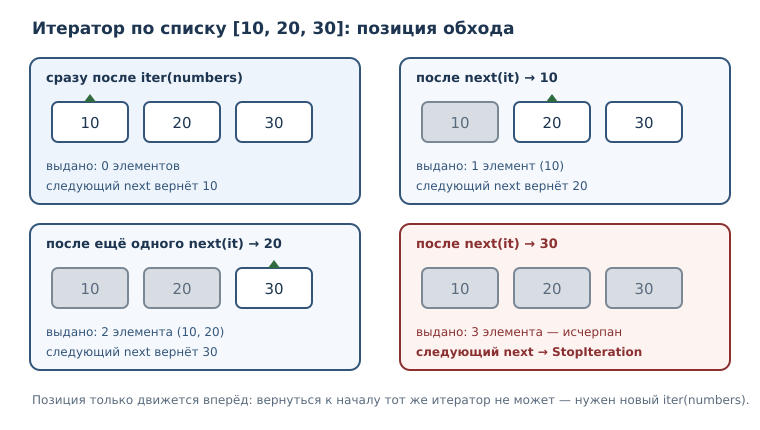
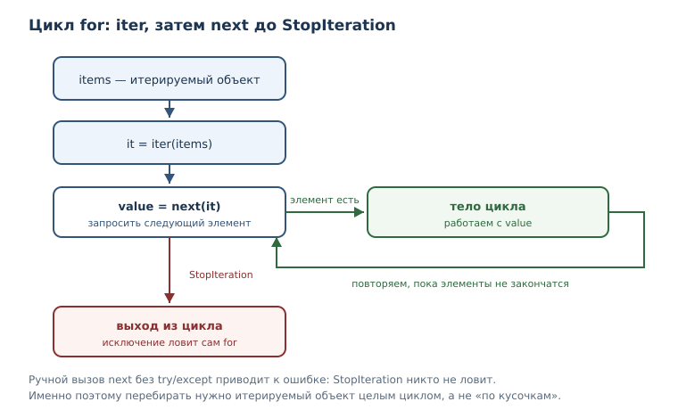

# Итераторы и протокол итерации

<!-- syllanix:nav -->
**Навигация:** [← 19. Файлы, пути и текстовые форматы](19-files-formats.md) · [Оглавление книги](../README.md) · [Далее: 21. Генераторы и ленивые вычисления →](21-generators.md)
<!-- /syllanix:nav -->

<!-- syllanix:topics -->
**Темы главы**
20.1. [Что вы сможете после этой главы](#что-вы-сможете-после-этой-главы)  
20.2. [Загадка цикла for](#why)  
20.3. [Итерируемый объект и итератор](#iterable-vs-iterator)  
20.4. [iter и next](#iter-next)  
20.5. [Протокол итерации](#protocol)  
20.6. [Состояние и исчерпание](#state)  
20.7. [Где в Python живут итераторы](#everywhere)  
20.8. [Что передавать в функцию](#design)  
20.9. [Итератор и память](#memory)  
20.10. [Типичные ошибки](#mistakes)  
20.11. [Упражнения](#упражнения)  
20.12. [Проверка понимания](#проверка-понимания)  
20.13. [Что дальше](#что-дальше)  
<!-- /syllanix:topics -->


Цикл `for` кажется волшебным: он одинаково перебирает список, строку,
словарь, диапазон `range` и файл. У этих объектов почти нет общего в
устройстве — разные типы, разное хранение, разное назначение. Общее у них
одно: все они умеют выдать **итератор** — объект, который по запросу отдаёт
элементы по одному. Цикл `for` не знает, что перебирает; он работает только
с итератором.

В этой главе вы увидите, что стоит за строкой `for x in items`, научитесь
запускать итерацию вручную через `iter` и `next`, поймёте, откуда берётся
`StopIteration`, и узнаете, почему один и тот же «перебор» иногда работает
дважды, а иногда — только один раз.

## Что вы сможете после этой главы

- объяснять разницу между итерируемым объектом и итератором;
- получать итератор из коллекции и вручную запрашивать элементы через `next`;
- распознавать исчерпание итератора и правильно обрабатывать `StopIteration`;
- объяснять, что именно делает цикл `for` на каждом шаге;
- находить дефекты, связанные с повторным использованием исчерпанного
  итератора.

## Загадка цикла for {#why}

Посмотрим на четыре цикла, которые вы уже писали.

```python exec
for item in ["яблоко", "банан"]:
    print(item)
for symbol in "аб":
    print(symbol)
for number in range(2):
    print(number)
for key in {"a": 1}:
    print(key)
```

```output
яблоко
банан
а
б
0
1
a
```

Список, строка, диапазон и словарь устроены по-разному, но `for` работает со
всеми одинаково. Причина в том, что `for` не требует от объекта «быть
коллекцией». Ему достаточно, чтобы объект умел выдать итератор — объект с
состоянием обхода. Дальше цикл просто просит у итератора следующий элемент,
пока элементы не закончатся.

Это объясняет и поведение с файлом из предыдущей главы: строки читаются по
одной, а не загружаются в память целиком. Файл — тоже источник итератора, и
каждый запрос возвращает очередную строку.

## Итерируемый объект и итератор {#iterable-vs-iterator}

Два термина, которые легко перепутать, но различать их обязательно.

**Итерируемый объект** — объект, по которому можно пройти циклом: он умеет
выдать итератор. Примеры: список, кортеж, строка, словарь, множество,
`range`, файл.

**Итератор** — объект, выдающий элементы по одному через `next` и хранящий
текущее состояние обхода. Пример: то, что возвращает функция `iter` от списка.

Ключевое различие: итерируемый объект — это **источник**, а итератор —
**курсор** с текущей позицией. Из одного списка можно получить сколько угодно
независимых итераторов; каждый будет помнить свою позицию.

```python exec
numbers = [1, 2, 3]
it = iter(numbers)
print(type(it).__name__)
print(next(it))
print(next(it))
```

```output
list_iterator
1
2
```

Сам список — не итератор: у него нет состояния обхода. Поэтому
`next` от списка — ошибка.

```python exec expect-error
print(next([1, 2, 3]))
```

```output
TypeError: 'list' object is not an iterator
```

Обратное неверно: итератор — ещё и итерируемый объект. Если
попросить у итератора итератор, он вернёт самого себя — ведь его собственная
позиция и есть позиция обхода.

```python exec
it = iter([1, 2, 3])
print(iter(it) is it)
print(it.__iter__() is it)
```

```output
True
True
```

Сравним свойства в таблице.

| Свойство | Итерируемый объект | Итератор |
|---|---|---|
| можно перебрать в `for` | да | да |
| выдаёт элементы через `next` | нет | да |
| хранит позицию обхода | нет | да |
| можно использовать повторно | да, каждый `for` начинает заново | нет, после исчерпания пуст |
| пример | `[1, 2]`, `"аб"`, `range(3)` | `iter([1, 2])` |

В разговорной речи слово «итератор» иногда применяют к любому объекту,
который можно перебрать. В этой книге термины употребляются строго: список —
итерируемый объект, но не итератор; объект, который вернул `iter`, —
итератор. Такое различение не формальность: от него зависит, можно ли
перебрать объект дважды и стоит ли ожидать от него `next`.

## iter и next {#iter-next}

**iter** — встроенная функция, получающая итератор из итерируемого объекта.
**next** — встроенная функция, запрашивающая у итератора следующий элемент;
может иметь значение по умолчанию.

```python exec
numbers = [1, 2, 3]
it = iter(numbers)
print(next(it))
print(next(it))
print(next(it))
print(next(it, "элементы закончились"))
```

```output
1
2
3
элементы закончились
```

Четвёртый вызов `next` без запасного значения поднял бы `StopIteration`.
Второй аргумент `next` превращает «элементов больше нет» в обычное значение и
избавляет от исключения — это самый удобный способ, когда исчерпание
ожидаемо.

**StopIteration** — исключение, сигнализирующее, что элементы итератора
закончились; не следует перехватывать его вручную без нужды.

```python exec expect-error
it = iter([1])
print(next(it))
print(next(it))
```

```output
StopIteration
```

`StopIteration` — не ошибка программы, а штатный сигнал «конец». Цикл `for`
ловит его сам и завершает работу; вам об этом думать не нужно. Исключение
становится проблемой только тогда, когда вы вызываете `next` вручную и
забываете, что элементы могут закончиться.

## Протокол итерации {#protocol}

**Протокол итерации** — договорённость: `__iter__` возвращает итератор,
`__next__` возвращает следующий элемент или поднимает `StopIteration`.
Именно этой договорённости достаточно, чтобы объект работал в `for`, в
`list(...)`, в `sum(...)` и в других местах, где нужен перебор.

Ручная итерация повторяет то, что делает `for`: получить итератор, затем в
цикле запрашивать элементы до `StopIteration`.

```python exec
numbers = [1, 2, 3]
it = iter(numbers)
while True:
    try:
        value = next(it)
    except StopIteration:
        break
    print(value)
```

```output
1
2
3
```

Сравните с обычным циклом:

```python exec
for value in [1, 2, 3]:
    print(value)
```

```output
1
2
3
```

Второй вариант короче и безопаснее: `for` сам получает итератор, сам ловит
`StopIteration` и сам завершает цикл. Ручная схема полезна для понимания, но
в рабочем коде её заменяют на `for`, `list`, `sum` или `next` со значением по
умолчанию.

Если объект не умеет выдать итератор, `for` не начинает работу и сообщает об
этом.

```python exec expect-error
for number in 5:
    print(number)
```

```output
TypeError: 'int' object is not iterable
```

Смысл сообщения прост: объект типа int перебирать нельзя. Число — не
коллекция и не умеет выдавать элементы, поэтому `for` даже не начинает
работу. Та же ошибка возникает при попытке передать число в `list`, `sum` или
`tuple`.



## Состояние и исчерпание {#state}

Итератор хранит позицию. Каждый вызов `next` сдвигает её вперёд, и вернуться
назад нельзя. Когда элементы заканчиваются, итератор остаётся исчерпанным
навсегда: новые элементы из него не появятся.

```python exec
it = iter([1, 2])
print(list(it))
print(list(it))
```

```output
[1, 2]
[]
```

Первый `list(it)` забрал оба элемента и довёл итератор до конца. Второй
получил уже пустой итератор и вернул пустой список. Это не дефект, а прямое
следствие модели: итератор — одноразовый курсор.

Отсюда важное различие в поведении циклов. Если перебирать **итерируемый
объект**, каждый `for` получает новый итератор и начинает с начала. Если
перебирать **итератор**, второй цикл ничего не выведет.

```python exec
numbers = [1, 2]
for value in numbers:
    print(value)
for value in numbers:
    print(value)
print("---")
it = iter(numbers)
for value in it:
    print(value)
for value in it:
    print(value)
```

```output
1
2
1
2
---
1
2
```

После разделителя напечатаны только две строки: второй проход по `it` уже
ничего не нашёл. Программа при этом не падает и не сообщает об ошибке —
именно поэтому такой дефект трудно заметить.

Два итератора одного списка независимы: у каждого своя позиция.

```python exec
first = iter([1, 2, 3])
second = iter([1, 2, 3])
print(next(first))
print(next(second))
print(next(first))
```

```output
1
1
2
```

## Где в Python живут итераторы {#everywhere}

Понимание протокола объясняет знакомые конструкции. `range` возвращает
итерируемый объект, а `iter(range(3))` — итератор `range_iterator`. Строка
даёт `str_iterator`, словарь — итератор по ключам.

```python exec
print(type(iter(range(3))).__name__)
print(type(iter("абв")).__name__)
print(type(iter({1: "a"})).__name__)
```

```output
range_iterator
str_iterator
dict_keyiterator
```

Методы словаря `keys`, `values` и `items` возвращают не итераторы, а
представления — итерируемые объекты. Поэтому `next` напрямую к ним не
применяется, но итератор из них получается.

```python exec
d = {"a": 1, "b": 2}
print(next(iter(d)))
print(list(d.keys()))
try:
    next(d.items())
except TypeError:
    print("представление — не итератор")
```

```output
a
['a', 'b']
представление — не итератор
```

Порядок обхода словаря — это порядок появления ключей, о котором вы читали в
главе о словарях. Итератор по представлению опирается на внутреннее состояние
таблицы, поэтому изменение размера словаря во время обхода прерывает работу
`RuntimeError`. Если словарь нужно менять, сначала снимите снимок ключей
списком: список независим от словаря, и его спокойно можно обходить.

```python exec
d = {"a": 1, "b": 2}
keys = list(d)
d["c"] = 3
print(keys)
print(list(d))
```

```output
['a', 'b']
['a', 'b', 'c']
```

Файл, в отличие от словарного представления, сам итератор: его
`next` возвращает очередную строку. Поэтому файл нельзя «перебрать дважды»
без повторного открытия.

```python exec
import tempfile
from pathlib import Path

with tempfile.TemporaryDirectory() as tmp:
    path = Path(tmp) / "lines.txt"
    path.write_text("раз\nдва\n", encoding="utf-8")
    with open(path, encoding="utf-8") as file:
        print(next(file).strip())
        print(next(file, "конец").strip())
        print(next(file, "конец"))
```

```output
раз
два
конец
```

Функция `enumerate` возвращает итератор пар «номер, элемент» — ещё один
пример объекта с состоянием. `sum` и `sorted` тоже принимают итератор: они
забирают из него элементы так же, как это делает `for`.

```python exec
pairs = enumerate(["а", "б"])
print(type(pairs).__name__)
print(next(pairs))
print(next(pairs))
print(sum(iter([1, 2, 3])))
print(sorted(iter([3, 1, 2])))
```

```output
enumerate
(0, 'а')
(1, 'б')
6
[1, 2, 3]
```

Наконец, проверка вхождения `in` для объектов без собственной операции поиска
тоже опирается на перебор: элементы запрашиваются по одному, пока не найдётся
нужный. Именно поэтому `in` по итератору сдвигает его позицию — ещё одна
причина не хранить итератор дольше необходимого.



## Что передавать в функцию {#design}

Из модели «источник и курсор» вытекает практическое правило проектирования.
Функция, которой нужен один проход, может принимать итерируемый объект и не
заботиться о том, коллекция это или итератор. Функция, которой нужны два
прохода, обязана получить коллекцию: если ей передать итератор, второй проход
окажется пустым.

```python exec
def describe(items):
    first_pass = 0
    for item in items:
        first_pass = first_pass + 1
    second_pass = 0
    for item in items:
        second_pass = second_pass + 1
    return first_pass, second_pass


numbers = [1, 2, 3]
print(describe(numbers))
print(describe(iter(numbers)))
```

```output
(3, 3)
(3, 0)
```

Первая строка показывает нормальную работу: список обойдён дважды. Вторая
строка — дефект: итератор отдан в функцию, первый проход его исчерпал, второй
ничего не нашёл. Ошибки не произошло, результат просто неверен. Такой дефект
опаснее исключения, потому что программа продолжает работать.

Отсюда два вывода. Если функция принимает итерируемый объект и обходит его
один раз, ей можно передавать итератор — так экономятся память и время.
Если функция может обходить объект дважды (например, сначала считает, потом
печатает), она должна либо потребовать коллекцию, либо один раз собрать
элементы в список. Документация функции — место, где это фиксируется.

Второе следствие: не храните итератор как «отложенный результат». Пока он
лежит, его может вычитать кто-то другой, и вы получите не то, что ожидали.
Храните коллекцию, а итератор создавайте в момент использования.

## Итератор и память {#memory}

Различие «источник и курсор» объясняет ещё одно важное свойство: итератор не
хранит копию элементов. Он хранит только позицию и правило, по которому
получается следующий элемент. Список из миллиона чисел занимает память под
миллион чисел; `range(1_000_000)` хранит начало, конец и шаг, а элементы
выдаёт по одному в момент запроса.

То же происходит с файлом: строки читаются по мере обхода, поэтому можно
обработать файл, который не помещается в память целиком. Если бы `for` по
файлу сначала собирал все строки в список, большие файлы были бы недоступны.

Отсюда практическое правило: если сведения нужны один раз и по порядку,
работайте с итератором. Если нужен случайный доступ, повторные проходы или
длина, нужна коллекция: список или кортеж. Преобразование итератора в список
выполняется функцией `list` и стоит памяти, пропорциональной числу элементов.

Полезно увидеть, что цикл продолжает обход с той позиции, где остановились
ручные вызовы `next`.

```python exec
numbers = range(5)
it = iter(numbers)
print(next(it))
print(next(it))
for value in it:
    print(value)
```

```output
0
1
2
3
4
```

Первые два значения забрал `next`, поэтому цикл начал с `2`. Это ещё раз
показывает: состояние принадлежит итератору, а не циклу.

## Типичные ошибки {#mistakes}

1. **Путать итерируемый объект и итератор.** Список можно перебрать, но
   `next` к нему не применим: сначала нужен `iter`.
2. **Перебирать исчерпанный итератор.** Второй `for` по тому же итератору
   ничего не сделает и не сообщит об этом.
3. **Сохранять итератор «на потом».** Если между созданием и использованием
   итератор уже кем-то вычитан, вы получите не то, что ожидали. Надёжнее
   хранить коллекцию, а итератор создавать на месте.
4. **Ловить `StopIteration` вручную без нужды.** В обычном цикле это делает
   `for`; для «взять один элемент, если он есть» есть `next(it, default)`.
5. **Менять коллекцию во время обхода.** Для словаря это даёт
   `RuntimeError`, для списка — пропуски элементов.
6. **Ожидать, что `next` вернёт `None` в конце.** Он поднимает
   `StopIteration`; `None` — обычное значение и может быть элементом.

Проверим последнюю ловушку: `None` может быть настоящим элементом, поэтому
отличить «конец» от «значение None» можно только по исключению или по
запасному значению.

```python exec
it = iter([None, "значение"])
print(next(it))
print(next(it))
print(next(it, "элементы закончились"))
```

```output
None
значение
элементы закончились
```

Отдельно стоит увидеть, как ведёт себя обход при изменении списка. В отличие
от словаря, список не поднимает исключение: итератор просто идёт по позициям,
и после удаления элемента следующие сдвигаются, из-за чего часть из них
остаётся непосещённой.

```python exec
numbers = [1, 2, 3, 4]
visited = []
for number in numbers:
    visited.append(number)
    if number == 2:
        numbers.remove(number)
print(visited)
print(numbers)
```

```output
[1, 2, 4]
[1, 3, 4]
```

Число `3` не попало в `visited`: после удаления двойки итератор перешёл к
позиции, где теперь стояло `4`. Программа не сообщила об ошибке — снова
«тихий» дефект, который обнаруживается только проверкой результата.

## Упражнения

### 1. Прогнозирование вывода {#ex-ch20-01}

Не запуская код, запишите результат. Затем проверьте и объясните каждую
строку.

```python
numbers = [10, 20]
it = iter(numbers)
print(next(it))
print(next(it, 0))
print(list(it))
```

### 2. Список или итератор {#ex-ch20-02}

Для каждого объекта определите, итератор ли это, и проверьте
догадку вызовом `next` в `try`/`except`:

- `[1, 2, 3]`
- `iter([1, 2, 3])`
- `"абв"`
- `iter("абв")`
- `range(3)`

### 3. Ручной перебор {#ex-ch20-03}

Дан итератор по списку `["а", "б", "в"]`. Напишите цикл `while`, который
печатает элементы до исчерпания, не используя `for` и не используя `list()`.

### 4. Безопасное чтение {#ex-ch20-04}

Напишите функцию `take_one(it)`, которая возвращает следующий элемент
итератора или строку `"пусто"`, если элементы закончились. Проверьте её на
итераторе из одного элемента, вызвав дважды.

### 5. Почему второй цикл пуст {#ex-ch20-05}

Объясните, почему программа печатает только `1 2`, и предложите два
исправления, чтобы оба цикла сработали:

```python
numbers = [1, 2]
it = iter(numbers)
for value in it:
    print(value)
for value in it:
    print(value)
```

### 6. Итераторы независимы {#ex-ch20-06}

Получите из одного списка два итератора. Прочитайте из них элементы в
порядке: первый, первый, второй, первый — и выведите. Объясните, почему
результат такой.

### 7. Словарное представление {#ex-ch20-07}

Дан словарь `{"a": 1, "b": 2, "c": 3}`. Получите итератор по значениям и
выведите два значения через `next`, затем остаток через `list`. Объясните,
почему `next(d.values())` напрямую не работает.

### 8. Файл как итератор {#ex-ch20-08}

Во временном каталоге создайте файл из трёх строк. Откройте его и прочитайте
две строки через `next`, затем оставшуюся — через `for`. Объясните, почему
цикл `for` не начал с первой строки.

### 9. Мини-проект: порционное чтение {#ex-ch20-09}

Напишите функцию `chunks(iterable, size)`, которая возвращает список порций
(списков) по `size` элементов, не используя срезы коллекции. Например, для
`[1, 2, 3, 4, 5]` и `size=2` результат — `[[1, 2], [3, 4], [5]]`.
Подсказка: получите итератор и набирайте элементы через `next` с запасным
значением-маркером.

### 10. Что произойдёт с StopIteration {#ex-ch20-10}

Объясните, что выведет каждая программа и почему:

```python
it = iter([1])
print(next(it, None))
print(next(it, None))
```

```python
it = iter([1])
print(next(it))
print(next(it))
```

Для второй программы опишите, как `for` обрабатывает ту же ситуацию иначе.

## Проверка понимания

1. Чем итерируемый объект отличается от итератора? Приведите пример каждого.
2. Что делает `iter` и что делает `next`?
3. Почему `next` к списку не применяется, а `for` по списку работает?
4. Когда возникает `StopIteration` и почему в обычном цикле о нём не думают?
5. Почему после исчерпания итератора он не начинается заново?
6. Что вернёт `next(it, "конец")`, если элементы ещё есть? А если нет?
7. Что именно делает `for` на каждом шаге?

## Что дальше

Протокол итерации объясняет, как устроен перебор, но писать собственный
итератор вручную неудобно: нужно хранить состояние и следить за
`StopIteration`. Следующая глава покажет, как получить итератор гораздо
проще — описать функцию, которая выдаёт значения по одному, и позволить
Python запомнить состояние за вас.

<!-- syllanix:nav -->
**Перед этой главой:** [19. Файлы, пути и текстовые форматы](19-files-formats.md)
**Связанные главы:** [03. Значения, имена, объекты и типы](03-values-names-objects.md), [04. Выражения, операторы и ввод данных](04-expressions-input.md), [06. Циклы: while и for](06-loops.md), [07. Функции: параметры, аргументы и области видимости](07-functions.md), [10. Ошибки и исключения](10-errors-exceptions.md), [12. Коллекции и последовательности: введение](12-collections-intro.md), [13. Списки: индексы, срезы и методы](13-lists.md), [14. Кортежи, распаковка и неизменяемость](14-tuples.md)
**Далее:** [21. Генераторы и ленивые вычисления →](21-generators.md)
<!-- /syllanix:nav -->
