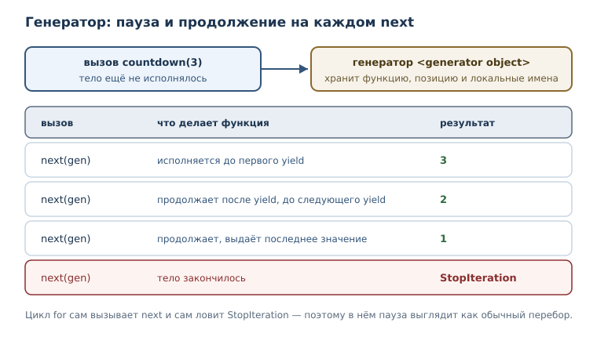
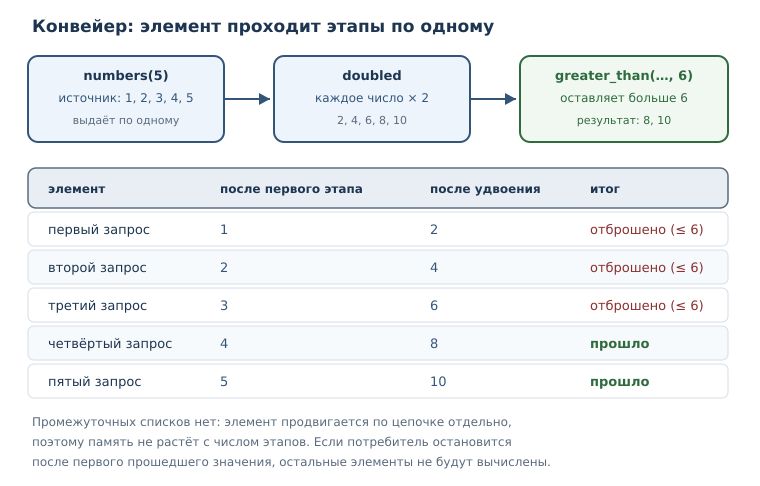

# Генераторы и ленивые вычисления

<!-- syllanix:nav -->
**Навигация:** [← 20. Итераторы и протокол итерации](20-iterators.md) · [Оглавление книги](../README.md) · [Далее: 22. Функции как объекты: замыкания и декораторы →](22-higher-order.md)
<!-- /syllanix:nav -->

<!-- syllanix:topics -->
**Темы главы**
21.1. [Что вы сможете после этой главы](#что-вы-сможете-после-этой-главы)  
21.2. [Задача: значения по требованию](#why)  
21.3. [Функция-генератор и yield](#yield)  
21.4. [Ленивые вычисления](#lazy)  
21.5. [Исчерпание генератора](#exhaustion)  
21.6. [Генераторное выражение](#genexpr)  
21.7. [Генератор, return и StopIteration](#return)  
21.8. [Конвейер из генераторов](#pipeline)  
21.9. [Генератор для чтения файла](#files)  
21.10. [Типичные ошибки](#mistakes)  
21.11. [Упражнения](#упражнения)  
21.12. [Проверка понимания](#проверка-понимания)  
21.13. [Что дальше](#что-дальше)  
<!-- /syllanix:topics -->


В предыдущей главе вы увидели, что цикл `for` работает с итератором: объектом,
который хранит позицию и выдаёт элементы по одному. Писать такой объект
вручную неудобно: нужно завести состояние, реализовать методы протокола и
аккуратно поднимать `StopIteration`. К счастью, в Python есть способ получить
итератор гораздо проще: описать функцию, которая не возвращает результат
целиком, а **выдаёт** значения по одному. Такая функция называется
**функцией-генератором**: при вызове она создаёт генератор, который позволяет
обрабатывать данные, не помещающиеся в память, и строить вычисления, которые
не делают лишней работы.

## Что вы сможете после этой главы

- писать функции-генераторы с `yield` и объяснять, когда исполняется их тело;
- получать значения из генератора через `next`, `for` и встроенные функции;
- объяснять, что такое ленивые вычисления и какую память они экономят;
- использовать генераторные выражения вместо промежуточных списков;
- распознавать исчерпание генератора и не переиспользовать его по ошибке;
- собирать конвейеры из нескольких генераторов.

Все примеры в главе исполняются и проверяются автоматически на Python 3.14,
поэтому вывод можно смело сверять со своим.

## Задача: значения по требованию {#why}

Представьте, что программа ищет в большом журнале первые три строки с
ошибкой. Журнал содержит миллион строк. Прямолинейное решение — прочитать всё
в список и потом искать:

```python
with open("app.log", encoding="utf-8") as file:
    lines = file.readlines()
```

Список займёт память под миллион строк, хотя нужны всего три. Более того,
работа будет сделана зря: остальные строки мы даже не посмотрим. Хочется
обратного: запрашивать строки по одной и остановиться, как только нашли
нужное.

Такую возможность дают генераторы. **Генератор** — итератор, создаваемый
функцией с `yield`; элементы вычисляются по требованию. В отличие от списка,
генератор не хранит все значения: он хранит состояние вычисления и выдаёт
следующее значение, когда его попросят.

## Функция-генератор и yield {#yield}

**Функция-генератор** — функция, содержащая `yield`; при вызове она не
исполняется сразу, а возвращает генератор. **yield** — инструкция, выдающая
очередное значение и приостанавливающая функцию до следующего запроса.

Сравните с обычной функцией: та при вызове исполняется целиком и возвращает
результат. Функция-генератор при вызове только создаёт объект. Тело начинает
работать при первом запросе элемента.

```python exec
def countdown(start):
    print("старт функции")
    while start > 0:
        yield start
        start = start - 1
    print("конец функции")


gen = countdown(3)
print(type(gen).__name__)
print(next(gen))
print(next(gen))
```

```output
generator
старт функции
3
2
```

Обратите внимание на порядок строк. Сначала напечатано имя типа: вызов
`countdown(3)` не выполнил ни одной строки тела. Затем `next` запустил тело до
первого `yield`: появилось `старт функции` и значение `3`. Второй `next`
продолжил с места остановки и выдал `2`.

`yield` можно представить как «пауза с возвратом значения». Функция
запоминает, где остановилась, и при следующем запросе продолжает оттуда же.
Именно поэтому генератору не нужно вручную хранить позицию: состояние
вычисления живёт в самом генераторе.

Полезно различать саму функцию-генератор и создаваемый ею объект. Функция
остаётся функцией, её можно вызывать снова и снова; каждый вызов создаёт
новый генератор со своим состоянием.

```python exec
def squares(limit):
    n = 0
    while n < limit:
        yield n * n
        n = n + 1


print(type(squares).__name__)
print(type(squares(2)).__name__)
```

```output
function
generator
```

Из этого следует практическое правило: сохранять «на потом» нужно не
результат вызова, а саму функцию, и создавать генератор в момент работы. Иначе
легко получить уже исчерпанный объект — как с итераторами в предыдущей главе.

Каждый вызов функции-генератора создаёт **новый** генератор со своим
состоянием. Два генератора одной функции независимы, как и два итератора
одного списка.

```python exec
def countdown(start):
    while start > 0:
        yield start
        start = start - 1


first = countdown(2)
second = countdown(2)
print(next(first))
print(next(second))
print(next(first))
```

```output
2
2
1
```



## Ленивые вычисления {#lazy}

**Ленивые вычисления** — вычисление значений только в момент использования;
это экономит память и позволяет обрабатывать бесконечные последовательности.
Генератор вычисляет очередное значение тогда, когда его запросили, а не
заранее.

Увидеть это можно по побочным эффектам: вставьте печать перед каждым `yield` и
посмотрите, в каком порядке идут строки.

```python exec
def squares(limit):
    number = 0
    while number < limit:
        print("вычисляем", number)
        yield number * number
        number = number + 1


for value in squares(3):
    print("получили", value)
```

```output
вычисляем 0
получили 0
вычисляем 1
получили 1
вычисляем 2
получили 4
```

Строки чередуются: одно вычисление — одно использование. Если бы генератор
работал как список, все «вычисляем» напечатались бы до первого «получили».
Именно это свойство и называют ленивостью: работа выполняется ровно в тот
момент, когда результат понадобился, и ни шагом раньше.

Представьте разницу на предельном примере: список из миллиона чисел требует
памяти под миллион чисел, а генератор — только под текущее значение и позицию.
Если обработка останавливается на третьем элементе, остальные не вычисляются
вовсе.

Ленивость позволяет описывать и бесконечные последовательности: генератор
может выдавать значения без конца, а потребитель возьмёт столько, сколько
нужно, и остановится. Список так не устроить — он обязан где-то закончиться.

```python exec
def naturals():
    n = 1
    while True:
        yield n
        n = n + 1


gen = naturals()
collected = []
for value in gen:
    if value > 3:
        break
    collected.append(value)
print(collected)
```

```output
[1, 2, 3]
```

Бесконечный генератор безопасен только до тех пор, пока потребитель
ограничивает выборку. Если передать его в `list` или `sum`, программа
попытается забрать все элементы и не завершится никогда.

## Исчерпание генератора {#exhaustion}

**Исчерпание генератора** — состояние, в котором генератор уже выдал все
элементы и больше ничего не вернёт. Как и любой итератор, генератор
одноразовый: после исчерпания он пуст навсегда.

```python exec
def countdown(start):
    while start > 0:
        yield start
        start = start - 1


gen = countdown(2)
print(list(gen))
print(list(gen))
```

```output
[2, 1]
[]
```

Первый `list(gen)` забрал оба значения, второй вызов получил уже исчерпанный
генератор и вернул пустой список. Ошибки нет — есть следствие модели:
генератор хранит одно вычисление, а не набор значений.

Запасное значение `next` позволяет безопасно дочитать генератор до конца.

```python exec
def countdown(start):
    while start > 0:
        yield start
        start = start - 1


gen = countdown(2)
print(next(gen))
print(next(gen, "конец"))
print(next(gen, "конец"))
```

```output
2
1
конец
```

После второго значения генератор приостановлен на `yield`; при следующем
`next` он дошёл до конца тела и поднял `StopIteration`. `next` с запасным
значением вернул `конец` вместо исключения. Это удобный способ дочитать генератор, не добавляя
`try`/`except`.

## Генераторное выражение {#genexpr}

**Генераторное выражение** — компактная запись генератора в круглых скобках:
`(f(x) for x in items)`. Оно выглядит похоже на заключённое в скобки выражение,
но создаёт не значение, а генератор.

```python exec
gen = (x * x for x in range(4))
print(type(gen).__name__)
print(next(gen))
print(list(gen))
```

```output
generator
0
[1, 4, 9]
```

Из четырёх квадратов первый забрал `next`, остальные три — `list`. Генераторное
выражение удобно там, где значения нужны один раз и по порядку. Например,
`sum` умеет принимать генератор напрямую и не создавать промежуточный список.

```python exec
print(sum(x * x for x in range(4)))
print(sum(n * n for n in range(1000)))
```

```output
14
332833500
```

Вторая строка вычисляет сумму квадратов тысячи чисел, не строя список из
тысячи чисел. Для такой задачи разница невелика, но на миллионах значений она
становится решающей.

Круглые скобки в генераторном выражении не превращают его в кортеж. Сравните
два выражения: `(1, 2)` — кортеж из двух чисел, а `(x for x in [1, 2])` —
генератор.

```python exec
print(type((1, 2)).__name__)
print(type((x for x in [1, 2])).__name__)
```

```output
tuple
generator
```

Если генераторное выражение — единственный аргумент функции, внешние скобки
можно опустить: `sum(x * x for x in range(4))`. Это тот же генератор, просто
запись короче.

Генераторное выражение — тоже одноразовое. Если сохранить его и использовать
дважды, второй раз оно окажется исчерпанным.

```python exec
gen = (n for n in [1, 2, 3])
print(3 in gen)
print(list(gen))
```

```output
True
[]
```

Проверка вхождения идёт по генератору и останавливается, как только находит
элемент. Здесь искомое `3` — последний элемент, поэтому после успешной
проверки генератор исчерпан и `list(gen)` возвращает пустой список. Если бы
мы искали `2`, поиск остановился бы раньше и `list(gen)` вернул бы `[3]`.
Если искомого элемента нет, поиск забирает генератор до конца.

## Генератор, return и StopIteration {#return}

Внутри генератора можно использовать `return`. Он не возвращает значение
циклу, а **завершает** генератор: следующий запрос элемента получит
`StopIteration`. Это удобно, когда работу нужно прекратить досрочно.

```python exec
def first_positive(numbers):
    for n in numbers:
        if n > 0:
            yield n
            return


print(list(first_positive([-2, -1, 3, 4])))
```

```output
[3]
```

Функция выдала первое положительное число и завершилась. Четвёрка из списка
так и не была рассмотрена. Такой приём часто применяют в поиске: как только
найдено нужное, дальше идти незачем.

Важно различать два способа закончить генератор. Если функция просто доходит
до конца тела, генератор исчерпывается. Если встречается `return`,
генератор тоже исчерпывается, но раньше. В обоих случаях `for` увидит
`StopIteration` и спокойно завершит цикл.

## Конвейер из генераторов {#pipeline}

Генераторы хорошо соединяются друг с другом: каждый следующий берёт элементы
из предыдущего. Получается **конвейер** — цепочка обработки, в которой
элементы продвигаются по одному.

```python exec
def numbers(limit):
    n = 1
    while n <= limit:
        yield n
        n = n + 1


def doubled(items):
    for item in items:
        yield item * 2


def greater_than(items, threshold):
    for item in items:
        if item > threshold:
            yield item


pipeline = greater_than(doubled(numbers(5)), 6)
print(list(pipeline))
```

```output
[8, 10]
```

Разберём движение одного элемента. `numbers(5)` выдаёт `1`, `doubled` получает
его и выдаёт `2`, `greater_than` получает `2`, сравнивает с `6` и отбрасывает.
Затем запрашивается следующий элемент из начала цепочки. Так продолжается,
пока не дойдёт до `8` и `10`, которые проходят фильтр.

Преимущество конвейера в том, что промежуточные коллекции не создаются.
Каждый этап хранит только своё состояние. Если бы каждый шаг строил список,
память росла бы с каждым этапом, а работа выполнялась бы целиком на каждом
шаге.

Проверим, что конвейер действительно продвигает элементы по одному: попросим
всего одно значение и посмотрим, сколько работы успел сделать источник.

```python exec
def traced(items, label):
    for item in items:
        print(label, "выдаёт", item)
        yield item


def doubled(items):
    for item in items:
        yield item * 2


gen = doubled(traced([1, 2, 3], "источник"))
print(next(gen))
print("---")
print(list(gen))
```

```output
источник выдаёт 1
2
---
источник выдаёт 2
источник выдаёт 3
[4, 6]
```

Первый `next` заставил источник выдать только первый элемент. Остальные были
вычислены лишь при втором проходе. Это и есть смысл конвейера: каждый этап
работает ровно столько, сколько требует потребитель.



## Генератор для чтения файла {#files}

Самое частое практическое применение генераторов — построчная обработка
файлов. Генератор открывает файл, читает строки по одной и выдаёт только
подходящие. Память при этом не зависит от размера файла.

```python exec
import tempfile
from pathlib import Path


def find_lines(path, keyword):
    with open(path, encoding="utf-8") as file:
        for line in file:
            if keyword in line:
                yield line.strip()


with tempfile.TemporaryDirectory() as tmp:
    path = Path(tmp) / "journal.txt"
    path.write_text("старт\nошибка 1\nшаг\nошибка 2\nфиниш\n", encoding="utf-8")
    for line in find_lines(path, "ошибка"):
        print(line)
```

```output
ошибка 1
ошибка 2
```

Инструкция `with` находится **внутри** генератора. Файл открывается, когда
начинается обход, и закрывается, когда генератор завершается — дочитан до
конца, закрыт явно или уничтожен сборщиком мусора. Если потребитель прервал
обход раньше, файл остаётся открытым до завершения генератора, поэтому
генераторы, владеющие ресурсами, стоит дочитывать или закрывать явно.

Такой генератор уместен и тогда, когда строк очень много, и тогда, когда
нужны первые несколько: в обоих случаях лишняя работа не выполняется.

При этом генераторы не делают программу быстрее автоматически: приостановка и
возобновление функции стоят небольших накладных расходов. Их сила — в памяти
и в возможности остановиться раньше. Для маленькой коллекции список проще и
часто быстрее; генератор выбирают, когда важен объём сведений или досрочный
выход из обработки.

## Типичные ошибки {#mistakes}

1. **Ждать, что генератор выполнится при вызове.** Вызов функции-генератора
   только создаёт объект; работа начинается с первого `next` или `for`.
2. **Переиспользовать исчерпанный генератор.** Второй проход ничего не даст и
   не сообщит об ошибке.
3. **Путать `return` с выдачей значения.** `return` завершает генератор;
   значение возврата в цикл `for` не попадает.
4. **Сохранять генераторное выражение «на потом».** Оно одноразовое; если
   нужно несколько проходов, постройте список.
5. **Передавать бесконечный генератор в `list` или `sum`.** Эти функции
   попытаются забрать все элементы и не завершатся. Ограничивайте выборку.
6. **Отлаживать генератор как обычную функцию.** Тело исполняется частями, и
   точка остановки не видна в исходнике без понимания `yield`.
7. **Забывать, что генератор — итератор.** Всё, что вы знаете об исчерпании и
   `StopIteration`, действует и здесь.

Отдельная сложность — отладка. Обычная функция исполняется целиком, и
точка останова показывает её состояние один раз. Генератор исполняется
частями: остановка срабатывает на каждом запросе, а между запросами функция
«спит». Если поведение кажется странным, помогает печать внутри генератора:
по ней видно, сколько раз тело продвинулось и на каком значении
остановилось.

Проверим третью ловушку: `return` в генераторе не даёт значения, а завершает
его.

```python exec
def one_then_stop():
    yield "первое"
    return "не выдаётся"
    yield "второе"


print(list(one_then_stop()))
```

```output
['первое']
```

Строка после `return` недостижима, поэтому второго значения нет. Если бы
`return` возвращал значение в цикл, `list` содержал бы два элемента — но это
не так.

## Упражнения

### 1. Прогнозирование вывода {#ex-ch21-01}

Не запуская код, запишите результат. Затем проверьте и объясните порядок строк.

```python
def speak():
    print("начало")
    yield 1
    print("середина")
    yield 2
    print("конец")


gen = speak()
print(next(gen))
print(next(gen))
print(next(gen, "пусто"))
```

### 2. Первый генератор {#ex-ch21-02}

Напишите функцию-генератор `countdown(n)`, которая выдаёт числа от `n` до `1`.
Проверьте её через `list` и через `for`, не создавая промежуточный список.

### 3. Ленивость на практике {#ex-ch21-03}

Напишите генератор `naturals(limit)`, который печатает `вычисляю` перед каждым
выдаваемым числом. Используйте его в цикле и остановитесь после третьего
элемента через `break`. Объясните, сколько раз напечаталось `вычисляю` и
почему.

### 4. Генераторное выражение {#ex-ch21-04}

Для списка `[3, 1, 4, 1, 5]` постройте генераторное выражение, удваивающее
каждый элемент, и выведите первые два значения через `next`, затем остаток
через `list`.

### 5. Сумма без списка {#ex-ch21-05}

Вычислите сумму квадратов чисел от 1 до 100, используя генераторное выражение
внутри `sum`. Объясните, почему промежуточный список здесь не нужен.

### 6. Исчерпание {#ex-ch21-06}

Объясните, почему программа печатает `[1, 2]` и `[]`. Предложите два
исправления, чтобы оба вывода были одинаковыми:

```python
gen = (n for n in [1, 2])
print(list(gen))
print(list(gen))
```

### 7. Ранний выход {#ex-ch21-07}

Напишите генератор `first_even(numbers)`, который выдаёт первое чётное число и
завершается. Проверьте на списке `[3, 5, 8, 10]` и объясните, почему
`list(...)` содержит один элемент.

### 8. Конвейер {#ex-ch21-08}

Соберите конвейер из трёх генераторов: источник выдаёт числа от 1 до 10,
второй оставляет нечётные, третий возводит в квадрат. Выведите результат
списком и объясните, сколько элементов проходит через каждый этап.

### 9. Мини-проект: строки с ключевым словом {#ex-ch21-09}

Напишите генератор `find_lines(path, keyword)`, который читает файл построчно
и выдаёт только строки, содержащие ключевое слово. Проверьте на временном
файле из пяти строк, выведите найденные строки и объясните, почему файл не
загружается в память целиком.

### 10. Генератор или список {#ex-ch21-10}

Для каждой задачи выберите генератор или список и обоснуйте выбор:

- вывести первые 10 членов последовательности;
- отсортировать все оценки класса по убыванию;
- посчитать сумму чисел, введённых в файле;
- вернуть результат, который вызывающий код будет перебирать трижды.

Для одного из случаев «генератор» напишите пример, для одного из случаев
«список» — тоже.

## Проверка понимания

1. Что происходит при вызове функции-генератора и когда начинает исполняться
   её тело?
2. Чем `yield` отличается от `return`?
3. Что такое ленивые вычисления и какую память они экономят?
4. Почему генератор нельзя перебрать дважды?
5. Чем генераторное выражение отличается от заключённого в скобки выражения?
6. Что произойдёт, если передать бесконечный генератор в `list`?
7. Как связаны генератор, итератор и `StopIteration`?

## Что дальше

Генераторы показали, что функция не обязана быть «чёрным ящиком», который
считает результат целиком. Следующий шаг — взглянуть на функции как на
обычные объекты: их можно передавать, хранить в структурах, возвращать из
других функций и оборачивать, добавляя поведение. Об этом — в главе о
замыканиях и декораторах.

<!-- syllanix:nav -->
**Перед этой главой:** [20. Итераторы и протокол итерации](20-iterators.md)
**Связанные главы:** [03. Значения, имена, объекты и типы](03-values-names-objects.md), [06. Циклы: while и for](06-loops.md), [07. Функции: параметры, аргументы и области видимости](07-functions.md), [09. Модули, пакеты и импорты](09-modules.md), [10. Ошибки и исключения](10-errors-exceptions.md), [12. Коллекции и последовательности: введение](12-collections-intro.md), [13. Списки: индексы, срезы и методы](13-lists.md), [14. Кортежи, распаковка и неизменяемость](14-tuples.md)
**Далее:** [22. Функции как объекты: замыкания и декораторы →](22-higher-order.md)
<!-- /syllanix:nav -->
