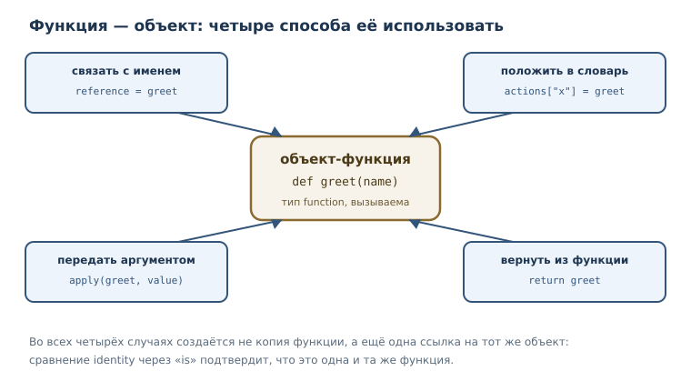
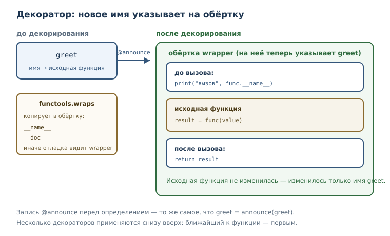

# Функции как объекты: замыкания и декораторы

<!-- syllanix:nav -->
**Навигация:** [← 21. Генераторы и ленивые вычисления](21-generators.md) · [Оглавление книги](../README.md) · [Далее: 23. Функциональные приёмы и включения →](23-functional.md)
<!-- /syllanix:nav -->

<!-- syllanix:topics -->
**Темы главы**
22.1. [Что вы сможете после этой главы](#что-вы-сможете-после-этой-главы)  
22.2. [Функция — обычный объект](#first-class)  
22.3. [Функции высшего порядка](#higher-order)  
22.4. [Замыкание](#closure)  
22.5. [Декоратор](#decorator)  
22.6. [functools.wraps: сохранить имя и документацию](#wraps)  
22.7. [Несколько декораторов на одной функции](#stacking)  
22.8. [Модуль functools](#functools)  
22.9. [Типичные ошибки](#mistakes)  
22.10. [Упражнения](#упражнения)  
22.11. [Проверка понимания](#проверка-понимания)  
22.12. [Что дальше](#что-дальше)  
<!-- /syllanix:topics -->


До сих пор функция была для нас «действием»: вы её определяете, вызываете и
получаете результат. Но в Python функция — ещё и значение, такой же объект,
как число или список. Её можно связать с именем, положить в словарь, передать
другой функции, вернуть из неё и даже завернуть в обёртку, которая изменит
поведение. Эта возможность — не трюк для избранных, а рабочий инструмент:
именно на ней строятся сортировка по ключу, декораторы, обработчики событий,
регистрация плагинов и многое другое.

В главе вы увидите две связанные идеи. Первая — функция как значение, которую
можно передавать и возвращать. Вторая — **замыкание**: функция, которая
запоминает имена из объемлющей области и продолжает ими пользоваться после её
завершения. На замыкании держатся **декораторы** — способ добавить функции
новое поведение, не переписывая её тело.

## Что вы сможете после этой главы

- объяснять, что функция в Python — объект, и использовать это на практике;
- передавать функции в функции и возвращать их как результат;
- писать замыкания и понимать, какие имена они захватывают;
- изменять захваченную переменную через `nonlocal`;
- писать декораторы с `functools.wraps` и не терять имя и документацию;
- отличать вызов функции от ссылки на неё.

Все примеры в главе запускаются автоматически, поэтому вы можете сверять свои
результаты с напечатанными.

## Функция — обычный объект {#first-class}

**Функция первого класса** — обычный объект, который можно передавать,
хранить в структурах и возвращать из других функций. В Python все функции
первого класса: ограничений на них нет, и это не отдельный вид функций, а
свойство языка.

Что это даёт на практике? Функцию можно связать с другим именем и вызвать
через него. Никакого копирования не происходит: оба имени указывают на один
объект, как и в случае со списками из главы о ссылках.

```python exec
def greet(name):
    return "привет, " + name


reference = greet
print(type(greet).__name__)
print(reference("Анна"))
print(greet is reference)
```

```output
function
привет, Анна
True
```

Тип `function` — не особенность вывода, а настоящий тип объекта, как `int` или
`list`. Функции можно складывать в списки, словари и кортежи. Например,
таблица команд превращает строку в действие.

```python exec
def add(a, b):
    return a + b


def multiply(a, b):
    return a * b


operations = {"сложить": add, "умножить": multiply}
print(operations["сложить"](2, 3))
print(operations["умножить"](2, 3))
```

```output
5
6
```

Обратите внимание на запись `operations["сложить"](2, 3)`: сначала по ключу
получается функция, затем она вызывается с двумя аргументами. Именно так
устроены многие диспетчеры команд и обработчики событий.

У функции есть и собственные атрибуты, как у любого объекта. Два самых
полезных — `__name__` и `__doc__`: имя и строка документации.

```python exec
def greet(name):
    """Возвращает приветствие."""
    return "привет, " + name


print(greet.__name__)
print(greet.__doc__)
print(callable(greet))
print(callable("строка"))
```

```output
greet
Возвращает приветствие.
True
False
```

`callable` проверяет, можно ли вызвать объект. Строку вызвать нельзя, функцию —
можно, и именно поэтому функцию разрешено передать туда, где ожидается
«что-то, что можно вызвать».

## Функции высшего порядка {#higher-order}

**Функция высшего порядка** — функция, принимающая другие функции как
аргументы или возвращающая функцию. Самый простой пример — применить функцию
дважды.

```python exec
def apply_twice(func, value):
    return func(func(value))


def double(x):
    return x * 2


print(apply_twice(double, 3))
```

```output
12
```

Здесь `apply_twice` получает `double` как аргумент и вызывает её дважды:
`double(3)` равно `6`, затем `double(6)` равно `12`. Обратите внимание, что
передаётся не результат вызова, а сама функция — без скобок. Разница между
`double` и `double(3)` — ключевая: первое означает «вот функция», второе —
«вычисли результат».

Функция высшего порядка позволяет отделить «что делать» от «как обходить
данные». `apply_twice` знает, как применить действие дважды, но не знает, что
именно за действие. В главе о функциональных приёмах вы увидите, что на этой
идее построены `map`, `filter` и сортировка по ключу.



## Замыкание {#closure}

Функция высшего порядка может не только принимать функцию, но и возвращать
её. Если возвращаемая функция использует имена из внешней функции, получается
**замыкание** — функция, которая захватывает имена (переменные) из объемлющей
области видимости и продолжает ими пользоваться после её завершения.
Захватывается именно имя, а не снимок значения, — ниже это показано на примере.

```python exec
def make_multiplier(factor):
    def multiply(value):
        return value * factor

    return multiply


double = make_multiplier(2)
triple = make_multiplier(3)
print(double(10), triple(10))
```

```output
20 30
```

Разберём, что произошло. `make_multiplier(2)` создала локальную переменную
`factor = 2` и вернула функцию `multiply`. К моменту вызова `double(10)`
функция `make_multiplier` давно завершилась, но `multiply` продолжает видеть
`factor`. Это и есть захват: имя `factor` хранится в замыкании вместе с
функцией.

Повторный вызов `make_multiplier(3)` создаёт **другое** замыкание со своим
`factor`. Два замыкания независимы, как два итератора одного списка.

Механику областей видимости и правило поиска имён мы разбирали в главе об
областях видимости и рекурсии (глава 8). Здесь важно только следствие: имя,
которого нет в локальной области, функция ищет в объемлющей, и это имя
остаётся доступным, даже когда внешняя функция уже вернула результат.

### nonlocal: изменение захваченной переменной {#nonlocal}

Замыкание может не только читать внешнее имя, но и менять его. Обычное
присваивание создало бы локальную переменную, поэтому нужно явно указать, что
имя относится к объемлющей области, — для этого служит инструкция `nonlocal`.

```python exec
def make_counter():
    count = 0

    def step():
        nonlocal count
        count = count + 1
        return count

    return step


counter = make_counter()
print(counter())
print(counter())
print(counter())
```

```output
1
2
3
```

Без `nonlocal` строка `count = count + 1` создала бы локальную `count` и
программа упала бы с `UnboundLocalError`: имя используется до присваивания.
`nonlocal` говорит: «это имя из объемлющей функции, меняй именно его».

Два замыкания одной внешней функции могут делить состояние — это основа
объектов со скрытым состоянием, которые позже станут классами.

```python exec
def make_pair():
    count = 0

    def increase():
        nonlocal count
        count = count + 1
        return count

    def read():
        return count

    return increase, read


increase, read = make_pair()
print(increase())
print(increase())
print(read())
```

```output
1
2
2
```

`increase` и `read` захватили одну и ту же переменную `count`, поэтому чтение
видит изменения, сделанные увеличением.

Захват имеет и обратную сторону: замыкание удерживает объекты живыми, пока
само существует. Если функция захватила большой список, память не освободится,
даже когда внешняя функция давно завершилась. Для небольших значений это
незаметно, но в долгоживущей программе захваченные структуры стоит
освобождать явно — например, не хранить замыкание дольше, чем нужно.
Поэтому замыкания хорошо подходят для небольших настроек, счётчиков и
фабрик функций, но плохо — для хранения снимков больших коллекций.

### Замыкание хранит имя, а не значение

Тонкость, которую полезно увидеть один раз: замыкание запоминает **имя** из
объемлющей области, а не снимок его значения. Если имя меняется после
создания замыкания, функция увидит новое значение.

```python exec
def make_actions():
    actions = []
    for step in range(3):
        def action():
            return step

        actions.append(action)
    return actions


for action in make_actions():
    print(action())
```

```output
2
2
2
```

Все три функции захватили одну и ту же переменную `step`, а к моменту вызова
она уже равна `2`. Чтобы получить разные значения, захватывают параметр, а не
переменную цикла: например, фабрика принимает `step` аргументом.

## Декоратор {#decorator}

**Декоратор** — функция, принимающая функцию и возвращающая новую функцию с
расширенным поведением; применяется синтаксисом `@`. Декоратор — частный
случай функции высшего порядка: он получает функцию и возвращает функцию.

Сначала соберём декоратор вручную, без синтаксиса `@`.

```python exec
def announce(func):
    def wrapper(value):
        print("вызов", func.__name__)
        return func(value)

    return wrapper


def greet(name):
    return "привет, " + name


greet_with_log = announce(greet)
print(greet_with_log("Анна"))
```

```output
вызов greet
привет, Анна
```

`announce` получила `greet`, создала локальную функцию `wrapper`, которая
печатает строку и вызывает исходную функцию, и вернула обёртку. Исходная
функция не изменилась — изменилось то, что мы вызываем.

Синтаксис `@` делает то же самое короче: строка `@announce` перед
определением означает `greet = announce(greet)`.

```python exec
def announce(func):
    def wrapper(value):
        print("вызов", func.__name__)
        return func(value)

    return wrapper


@announce
def greet(name):
    return "привет, " + name


print(greet("Анна"))
```

```output
вызов greet
привет, Анна
```

Обратите внимание: после декорирования имя `greet` указывает уже на `wrapper`.
Поэтому при вызове сначала работает обёртка, а внутри неё — исходная функция.
Такой приём используют для логирования, проверки аргументов, измерения
времени, повторных попыток и кэширования.

Декораторы ценны не только в отладке. В библиотеках они помечают функции как
команды, регистрируют обработчики, ограничивают доступ и проверяют права.
Общее у всех применений одно: обёртка добавляет поведение, не меняя тело
исходной функции. Поэтому декоратор — способ расширения, а не переписывания.



Наш декоратор подходит только функциям с одним параметром. Универсальная
обёртка должна принимать любые аргументы и передавать их дальше без потерь;
синтаксис для этого появится в главе о гибких сигнатурах (глава 24). Пока
достаточно понимать устройство: декоратор — это функция, которая возвращает
функцию.

Ограничение полезно осознать, потому что оно объясняет, почему «настоящие»
декораторы выглядят сложнее. Обёртка повторяет сигнатуру исходной функции:
если та принимает два аргумента, обёртка объявляет два. Такой код работает,
но привязывает декоратор к одной форме вызова. Библиотечные декораторы
поэтому принимают любые аргументы и передают их как есть — именно этот приём
мы разберём в следующей части книги.

## functools.wraps: сохранить имя и документацию {#wraps}

У обёртки есть неприятный побочный эффект: она теряет «личность» исходной
функции. Имя `greet` теперь принадлежит `wrapper`, а документация и имя
оригинала спрятаны внутри. Это ломает отладку, автодокументацию и справочные
системы.

**functools.wraps** — декоратор, сохраняющий у обёрнутой функции метаданные
исходной: имя, docstring, модуль, квалифицированное имя, аннотации — и ссылку
на оригинал в `__wrapped__`. Он применяется к самой обёртке внутри декоратора.

```python exec
import functools


def announce(func):
    @functools.wraps(func)
    def wrapper(value):
        print("вызов", func.__name__)
        return func(value)

    return wrapper


@announce
def greet(name):
    """Возвращает приветствие."""
    return "привет, " + name


print(greet("Анна"))
print(greet.__name__)
print(greet.__doc__)
```

```output
вызов greet
привет, Анна
greet
Возвращает приветствие.
```

Без `functools.wraps` две последние строки показали бы `wrapper` и `None`.
Наличие `wraps` в декораторе — признак аккуратной реализации: он стоит одной
строки, а экономит часы отладки.

## Несколько декораторов на одной функции {#stacking}

Декораторы можно навешивать друг на друга. Важно помнить порядок: ближайший к
функции декоратор применяется первым, поэтому при вызове внешний слой
срабатывает раньше внутреннего.

```python exec
def first(func):
    def wrapper(value):
        print("первый: до")
        result = func(value)
        print("первый: после")
        return result

    return wrapper


def second(func):
    def wrapper(value):
        print("второй: до")
        result = func(value)
        print("второй: после")
        return result

    return wrapper


@first
@second
def greet(name):
    return "привет, " + name


print(greet("Анна"))
```

```output
первый: до
второй: до
второй: после
первый: после
привет, Анна
```

Запись читается снизу вверх: `greet` сначала оборачивается в `second`, затем
результат — в `first`. При вызове внешняя обёртка (`first`) входит первой и
выходит последней, как матрёшка. Так устроены сочетания «логирование + проверка
аргументов + кэширование»: каждый слой отвечает за своё.

## Модуль functools {#functools}

**Модуль functools** — модуль стандартной библиотеки с инструментами для
работы с функциями: `wraps`, `partial`, `lru_cache`. С `wraps` вы уже
познакомились. `partial` создаёт вызываемый объект-обёртку, в котором часть
аргументов уже зафиксирована.

```python exec
import functools


def power(base, exponent):
    return base ** exponent


square = functools.partial(power, exponent=2)
print(square(5))
print(power(5, 2))
```

```output
25
25
```

`partial` не переопределяет функцию, а создаёт обёртку: при вызове `square(5)`
недостающий аргумент `exponent` подставляется равным `2`. Это удобно, когда
функцию с несколькими аргументами нужно передать туда, где ожидается функция
с меньшим числом параметров.

Третий инструмент, `lru_cache`, запоминает результаты вызовов и возвращает
готовый ответ при повторных аргументах. Это разновидность кэширования; мы
разберём её в главе о производительности (глава 40), а пока достаточно знать,
что такой инструмент существует и живёт в `functools`.

## Типичные ошибки {#mistakes}

1. **Передать результат вместо функции.** `apply_twice(double(3), 3)` —
   ошибка: `double(3)` уже число, а не функция. Нужно `apply_twice(double, 3)`.
2. **Забыть вернуть обёртку из декоратора.** Тогда именем функции станет
   `None` (`greet = broken(greet)`), и декорирование пройдёт молча. `TypeError`
   возникнет только при первом вызове — поэтому такая ошибка диагностируется
   позже, чем хотелось бы.
3. **Забыть `nonlocal`.** Присваивание имени из объемлющей области создаёт
   локальную переменную, и замыкание перестаёт видеть общую.
4. **Не применять `functools.wraps`.** Обёртка теряет имя и документацию;
   трассировки и справочники показывают `wrapper`.
5. **Считать, что декоратор меняет исходную функцию.** Он возвращает новую;
   исходная остаётся доступной внутри обёртки и продолжает работать, если её
   вызвать напрямую.
6. **Путать декоратор с паттерном «декоратор».** В Python декоратор — это
   синтаксис `@` и функция-обёртка; одноимённый паттерн проектирования решает
   другую задачу и будет обсуждаться отдельно.

Проверим вторую ошибку: если декоратор забыл вернуть обёртку, имя функции
становится `None`.

```python exec expect-error
def broken(func):
    def wrapper(value):
        return func(value)


@broken
def greet(name):
    return "привет, " + name


print(greet("Анна"))
```

```output
TypeError: 'NoneType' object is not callable
```

## Упражнения

### 1. Прогнозирование вывода {#ex-ch22-01}

Не запуская код, запишите результат. Затем проверьте и объясните.

```python
def apply_twice(func, value):
    return func(func(value))


def add_one(x):
    return x + 1


print(apply_twice(add_one, 5))
print(apply_twice(add_one(5), 5))
```

### 2. Функция в словаре {#ex-ch22-02}

Создайте словарь из трёх функций: `приветствие`, `прощание`, `вопрос`.
Напишите программу, которая по названию действия вызывает нужную функцию и
печатает результат. Обработайте неизвестное название.

### 3. Функция высшего порядка {#ex-ch22-03}

Напишите функцию `combine(first, second, value)`, которая применяет `first`,
затем `second` к результату. Проверьте её на функциях удвоения и прибавления
единицы.

### 4. Замыкание-умножитель {#ex-ch22-04}

Напишите функцию `make_adder(amount)`, возвращающую функцию, которая
прибавляет `amount` к аргументу. Создайте две такие функции и проверьте, что
они независимы.

### 5. Счётчик с nonlocal {#ex-ch22-05}

Напишите функцию `make_counter()`, возвращающую функцию без аргументов.
Каждый вызов возвращает следующее число, начиная с единицы. Проверьте, что
два независимых счётчика не влияют друг на друга.

### 6. Декоратор-логгер {#ex-ch22-06}

Напишите декоратор `log_call`, который перед вызовом функции печатает её имя,
а затем возвращает результат. Примените его к функции с одним аргументом и
проверьте вывод.

### 7. wraps на практике {#ex-ch22-07}

Возьмите декоратор из упражнения 6, добавьте `functools.wraps` и сравните
`__name__` и `__doc__` декорированной функции до и после добавления `wraps`.
Объясните различие.

### 8. Декоратор с параметром {#ex-ch22-08}

Напишите декоратор `repeat(times)`, который вызывает функцию несколько раз и
возвращает последний результат. Подсказка: это три уровня вложенности —
внешняя функция принимает параметр, средняя получает функцию, внутренняя
вызывает её.

### 9. Мини-проект: проверка аргументов {#ex-ch22-09}

Напишите декоратор `require_positive`, который перед вызовом функции с одним
числовым аргументом проверяет, что аргумент больше нуля, и печатает сообщение
об ошибке вместо вызова, если условие нарушено. Проверьте на положительном и
отрицательном значении.

### 10. Замыкание или класс {#ex-ch22-10}

Сравните два способа хранить состояние: замыкание `make_counter` и словарь с
ключом-счётчиком. Напишите оба варианта и объясните, в чём разница для
вызывающего кода. Когда, по вашему мнению, замыкание удобнее?

## Проверка понимания

1. Что значит «функция первого класса»? Приведите три действия, которые
   можно делать с функцией.
2. Чем `double` отличается от `double(3)` при передаче в функцию высшего
   порядка?
3. Что такое замыкание и почему захваченное имя остаётся доступным после
   завершения внешней функции?
4. Зачем нужно `nonlocal`? Что произойдёт, если его не указать?
5. Что делает декоратор и что означает строка `@announce`?
6. Зачем `functools.wraps`, если декоратор работает и без него?
7. Чем `functools.partial` отличается от новой функции, написанной вручную?

## Что дальше

Функции как объекты открыли способ передавать поведение. Следующая глава
доводит эту идею до практических приёмов: включения, лямбда-выражения,
`map` и `filter`, сортировка по ключу и чистые функции. Вы увидите, что
многие задачи, которые раньше требовали цикла с накоплением, записываются
одной выразительной строкой. При этом мы будем следить за читаемостью: короткая
запись хороша тогда, когда она понятна с первого взгляда.

<!-- syllanix:nav -->
**Перед этой главой:** [21. Генераторы и ленивые вычисления](21-generators.md)
**Связанные главы:** [03. Значения, имена, объекты и типы](03-values-names-objects.md), [06. Циклы: while и for](06-loops.md), [07. Функции: параметры, аргументы и области видимости](07-functions.md), [08. Стек вызовов, области видимости и рекурсия](08-recursion-scope.md), [09. Модули, пакеты и импорты](09-modules.md), [13. Списки: индексы, срезы и методы](13-lists.md), [14. Кортежи, распаковка и неизменяемость](14-tuples.md), [17. Словари: отображения и структурирование данных](17-dicts.md)
**Далее:** [23. Функциональные приёмы и включения →](23-functional.md)
<!-- /syllanix:nav -->
