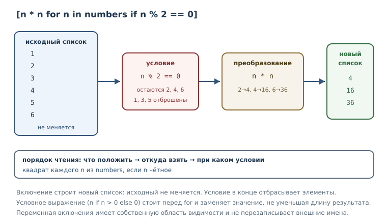
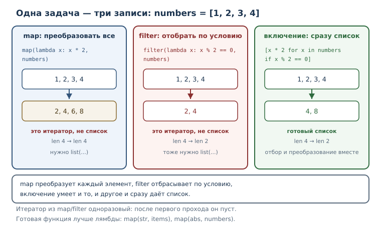

# Функциональные приёмы и включения

<!-- syllanix:nav -->
**Навигация:** [← 22. Функции как объекты: замыкания и декораторы](22-higher-order.md) · [Оглавление книги](../README.md) · [Далее: 24. Гибкие сигнатуры: *args, **kwargs и распаковка →](24-signatures.md)
<!-- /syllanix:nav -->

<!-- syllanix:topics -->
**Темы главы**
23.1. [Что вы сможете после этой главы](#что-вы-сможете-после-этой-главы)  
23.2. [Списковое включение](#list-comprehension)  
23.3. [Словарное и множественное включения](#dict-set)  
23.4. [Лямбда-выражение](#lambda)  
23.5. [map и filter](#map-filter)  
23.6. [Сортировка по ключу](#sort-key)  
23.7. [Чистые функции](#pure)  
23.8. [Типичные ошибки](#mistakes)  
23.9. [Упражнения](#упражнения)  
23.10. [Проверка понимания](#проверка-понимания)  
23.11. [Что дальше](#что-дальше)  
<!-- /syllanix:topics -->


В предыдущей главе функции стали объектами: их можно передавать, возвращать и
оборачивать. Теперь пора применить эту идею к повседневным задачам обработки
коллекций. Очень часто программа делает одно и то же: берёт элементы,
преобразует каждый, отбрасывает лишние и складывает результат в новую
коллекцию. Записывать это циклом с накоплением — правильно, но многословно.
Python предлагает более короткие и выразительные формы: **включения**,
**лямбда-выражения**, **map** и **filter**, **сортировку по ключу**.

Смысл этих приёмов не в том, чтобы писать меньше символов, а в том, чтобы
намерение читалось сразу: «взять квадраты всех чётных чисел» лучше выражать
одним выражением, чем пятью строками цикла. При этом у краткости есть предел:
когда выражение перестаёт быть понятным, его место занимает обычный цикл.
Умение вовремя вернуться к циклу — такая же часть мастерства, как умение
записать преобразование одной строкой.

## Что вы сможете после этой главы

- строить списки, словари и множества включениями с условиями;
- писать короткие лямбда-выражения и понимать их ограничения;
- применять `map` и `filter` и объяснять, чем они отличаются от включений;
- сортировать по вычисляемому ключу, в том числе по нескольким признакам;
- отличать чистые функции от функций с побочными эффектами.

Всё, что показано в главе, исполняется и проверяется автоматически, поэтому
примеры можно запускать и сверять вывод. Особенно полезно менять условия и
смотреть, как меняется результат: так включения и ключи сортировки
запоминаются быстрее, чем при чтении.

## Списковое включение {#list-comprehension}

**Списковое включение** — компактное выражение, строящее новый список из
итерируемого объекта, возможно с условием. Запись состоит из трёх частей:
что положить в результат, откуда брать элементы и при каком условии.

```python exec
squares = [n * n for n in range(5)]
print(squares)
```

```output
[0, 1, 4, 9, 16]
```

Читается так: «для каждого `n` из `range(5)` положить `n * n` в список».
Переменная `n` существует только внутри включения; после него она не
создаётся (в отличие от обычного цикла, где имя остаётся в области видимости).

Условие после `if` отбрасывает ненужные элементы.

```python exec
numbers = [3, -1, 4, -2, 5]
positive = [n for n in numbers if n > 0]
print(positive)
```

```output
[3, 4, 5]
```

Можно преобразовывать элементы и одновременно фильтровать; можно собирать
строки и вызывать методы.

Условие в конце включения отбрасывает элементы. А если нужно не отбросить, а
заменить значение, применяют условное выражение перед `for`. Разница видна по
результату: в первом случае длина списка уменьшается, во втором — нет.

```python exec
numbers = [3, -1, 4]
clamped = [n if n > 0 else 0 for n in numbers]
print(clamped)
print([n for n in numbers if n > 0])
```

```output
[3, 0, 4]
[3, 4]
```

`[n if n > 0 else 0 for n in numbers]` читается как «для каждого `n` положить
`n`, если оно положительное, иначе `0`». Это условное выражение, знакомое по
главе об управлении потоком, а не фильтр.

```python exec
names = ["анна", "борис"]
capitalized = [name.capitalize() for name in names]
print(capitalized)
```

```output
['Анна', 'Борис']
```

Включение умеет обходить несколько коллекций сразу — так получается «склейка»
вложенных списков.

```python exec
matrix = [[1, 2], [3, 4]]
flat = [n for row in matrix for n in row]
print(flat)
```

```output
[1, 2, 3, 4]
```

Читается слева направо: сначала `for row in matrix`, затем `for n in row`.
Порядок важен: если поменять части местами, получится ошибка или не тот
результат.

Переменная включения живёт в собственной области видимости и не перезаписывает
внешнюю. Это отличает включение от обычного цикла, где имя остаётся после
завершения.

```python exec
n = 100
squares = [n * n for n in range(3)]
print(squares)
print(n)
```

```output
[0, 1, 4]
100
```

После включения `n` по-прежнему равно `100`: внутри работала своя `n`. Такая
изоляция — ещё одна причина предпочитать включение: оно не оставляет
«случайных» имён в окружающем коде.

Сравним включение с эквивалентным циклом.

```python
squares = []
for n in range(5):
    squares.append(n * n)
```

Оба варианта дают `[0, 1, 4, 9, 16]`. Включение короче и прямо говорит, что
строится новый список. Цикл уместнее, когда внутри нужно несколько действий,
обработка ошибок или ранний выход.



## Словарное и множественное включения {#dict-set}

Включения строят не только списки. **Словарное включение** — выражение вида
`{k: v for ...}`, строящее словарь. **Включение множества** — выражение вида
`{x for ...}`, строящее множество.

```python exec
prices = {"яблоко": 90, "банан": 120}
expensive = {name: price for name, price in prices.items() if price > 100}
print(expensive)
```

```output
{'банан': 120}
```

Словарное включение удобно для «переворота» словаря и для построения нового
словаря с вычисленными значениями.

```python exec
original = {"a": 1, "b": 2}
inverted = {value: key for key, value in original.items()}
print(inverted)
```

```output
{1: 'a', 2: 'b'}
```

Если два ключа совпадут, в словаре останется последнее значение — как при
обычном присваивании по ключу. Это важно помнить при «перевороте»: значения
должны быть уникальными, иначе часть сведений потеряется.

Множественное включение применяют, когда нужны уникальные значения.

```python exec
words = ["кот", "пёс", "кот"]
lengths = {len(word) for word in words}
print(lengths)
```

```output
{3}
```

Все слова трёхбуквенные, поэтому во множестве остался один элемент. Круглых
скобок у множественного включения нет, а фигурные скобки без двоеточия
означают именно множество, не словарь.

## Лямбда-выражение {#lambda}

**Лямбда-выражение** — анонимная функция из одного выражения; оно уместно для
коротких коллбэков и ключей сортировки. Название пришло из математической
логики, но в Python это просто компактная функция без имени.

```python exec
double = lambda x: x * 2
print(double(5))
print(type(double).__name__)
```

```output
10
function
```

Слева от двоеточия — параметры, справа — выражение, которое вычисляется и
возвращается. Лямбда может принимать несколько аргументов и значения по
умолчанию, но не может содержать инструкции: присваивание, `if`-инструкцию,
`return`, `yield` внутри неё не записать.

Лямбда может принимать значения по умолчанию — так же, как обычная функция.

```python exec
double = lambda value, factor=2: value * factor
print(double(5), double(5, 3))
```

```output
10 15
```

Ключевое ограничение лямбды — выразительность. Как только логика требует
нескольких шагов, обычная функция с именем читается лучше.

```python
def is_long_name(name):
    return len(name) > 4
```

Такая функция объясняет себя названием, и её можно переиспользовать. Лямбду
пишут там, где функция нужна один раз и её смысл очевиден из контекста:
например, в аргументе `key` при сортировке.

## map и filter {#map-filter}

До появления включений обработку коллекций выражали двумя функциями высшего
порядка. **map** — функция, применяющая функцию к каждому элементу итерируемого
объекта и возвращающая итератор. **filter** — функция, оставляющая элементы,
для которых предикат истинен, и возвращающая итератор.

```python exec
numbers = [1, 2, 3]
doubled = map(lambda x: x * 2, numbers)
print(type(doubled).__name__)
print(list(doubled))
print(list(doubled))
```

```output
map
[2, 4, 6]
[]
```

Обратите внимание на две вещи. `map` возвращает не список, а итератор — вы
уже знаете, что он одноразовый, поэтому второй `list` пуст. И `map` принимает
функцию первым аргументом: это функция высшего порядка, как в прошлой главе.

```python exec
numbers = [0, 1, 2, 3, 4]
evens = filter(lambda x: x % 2 == 0, numbers)
print(type(evens).__name__)
print(list(evens))
```

```output
filter
[0, 2, 4]
```

`filter` оставляет элементы, для которых функция вернула истинное значение.
Если передать `None` вместо функции, останутся все элементы, истинные по
своему значению.

```python exec
print(list(map(str, [1, 2])))
print(list(filter(None, [0, 1, "", "а", None])))
```

```output
['1', '2']
[1, 'а']
```

Для большинства задач включение читается лучше, чем `map` с лямбдой.

```python exec
numbers = [1, 2, 3]
print([x * 2 for x in numbers])
print(list(map(lambda x: x * 2, numbers)))
```

```output
[2, 4, 6]
[2, 4, 6]
```

Результат одинаковый, но первая строка короче и не требует разбирать порядок
аргументов. `map` и `filter` уместны, когда функция уже существует и её не
нужно оборачивать: например, `map(str, items)` или `filter(bool, items)`.
Когда же логика задана лямбдой, включение почти всегда яснее.



## Сортировка по ключу {#sort-key}

**Ключ сортировки** — функция, вычисляющая значение для сравнения элементов
при сортировке. Сортировка сравнивает не сами элементы, а результаты ключа:
это позволяет упорядочивать объекты по любому признаку, не меняя их.

```python exec
words = ["груша", "яблоко", "слива"]
print(sorted(words, key=len))
print(sorted(words, key=lambda w: w[-1]))
```

```output
['груша', 'слива', 'яблоко']
['груша', 'слива', 'яблоко']
```

В первом случае ключ — длина слова; во втором — последняя буква. Если ключи
совпадают, сохраняется исходный порядок элементов: сортировка в Python
устойчивая. В примере `груша` и `слива` одинаковой длины, и `груша` осталась
первой, потому что стояла раньше.

`key` может быть готовой функцией, если она уже делает то, что нужно.
Сортировка строк по умолчанию сравнивает коды символов, поэтому заглавные
буквы идут раньше строчных. Приведение к нижнему регистру даёт другой,
«человеческий» порядок.

```python exec
names = ["Анна", "борис", "Вера"]
print(sorted(names))
print(sorted(names, key=str.lower))
```

```output
['Анна', 'Вера', 'борис']
['Анна', 'борис', 'Вера']
```

`key` работает и у метода списка `sort`, который сортирует на месте.

```python exec
numbers = [5, 1, 4]
numbers.sort(reverse=True)
print(numbers)
```

```output
[5, 4, 1]
```

Ключ может быть и готовой функцией, и лямбдой. Для нескольких признаков
возвращают кортеж: сортировка сравнивает сначала первый элемент, затем второй.

```python exec
records = [("Анна", 92), ("Борис", 78), ("Вера", 92)]
by_score_desc = sorted(records, key=lambda item: (-item[1], item[0]))
print(by_score_desc)
```

```output
[('Анна', 92), ('Вера', 92), ('Борис', 78)]
```

Минус перед баллом меняет порядок на убывание, а имя упорядочивает записи с
одинаковым баллом. Такой приём — стандартный способ задать «сортировать по
убыванию балла, при равенстве — по возрастанию имени».

Устойчивость сортировки стоит увидеть отдельно: элементы с одинаковым ключом
сохраняют исходный порядок. Благодаря этому сортировку можно применять
несколько раз — сначала по второстепенному признаку, затем по главному.

```python exec
records = [("Анна", 92), ("Борис", 78), ("Вера", 92), ("Глеб", 78)]
print(sorted(records, key=lambda item: item[1]))
```

```output
[('Борис', 78), ('Глеб', 78), ('Анна', 92), ('Вера', 92)]
```

Борис и Глеб получили одинаковый балл и остались в том порядке, в котором
стояли в исходном списке. Без устойчивости результат зависел бы от деталей
алгоритма, и поведение программы было бы трудно предсказать.

## Чистые функции {#pure}

**Чистая функция** — функция, чей результат зависит только от аргументов и
которая не изменяет внешнее состояние. У неё два свойства: одинаковые
аргументы всегда дают одинаковый результат, и вызов не оставляет следов —
не меняет аргументы, не пишет в файл, не печатает.

```python exec
def add_item(items, item):
    return items + [item]


def add_in_place(items, item):
    items.append(item)
    return items


data = [1, 2]
print(add_item(data, 3))
print(data)
print(add_in_place(data, 3))
print(data)
```

```output
[1, 2, 3]
[1, 2]
[1, 2, 3]
[1, 2, 3]
```

`add_item` чистая: она возвращает новый список и не трогает исходный.
`add_in_place` меняет аргумент — это побочный эффект, о котором вы читали в
главе о ссылках. Обе функции могут быть полезны, но чистая предсказуемее:
вызывающий код не должен помнить, что произошло с его списком.

Чистота — это про предсказуемость, а не про запрет на изменения. Чистая
функция может вызывать другие чистые функции и заводить локальные переменные;
ей нельзя лишь зависеть от внешнего изменяемого состояния — например, от
глобального списка, который в другом месте программы кто-то дополняет. Если
результат зависит от такого списка, одинаковый вызов может дать разный ответ.

Чистые функции хорошо сочетаются с включениями и `map`: каждая операция
преобразует значение, не меняя вход. Из таких операций удобно собирать
конвейеры обработки и легко писать тесты — результат зависит только от
аргументов.

Побочные эффекты не запрещены: программа обязана печатать, писать файлы и
менять состояние. Правило другое — их место должно быть очевидным. Функция
обработки данных лучше остаётся чистой, а запись результата выполняет
отдельный шаг. Тогда преобразование можно проверить отдельно от ввода-вывода,
а ошибку в расчёте не приходится искать среди файловых операций.

`map` умеет принимать несколько коллекций сразу, если функция ждёт несколько
аргументов.

```python exec
print(list(map(lambda a, b: a + b, [1, 2], [10, 20])))
```

```output
[11, 22]
```

Такая форма полезна, когда нужно попарно объединить две последовательности
одинаковой длины. Если длины разные, `map` остановится на самой короткой, и
это стоит проверять явно, если полнота данных важна.

## Типичные ошибки {#mistakes}

1. **Включение ради включения.** Если нужно просто скопировать список,
   `[x for x in items]` заменяется на `list(items)`.
2. **Побочные эффекты внутри включения.** Печать, запись в файл или
   изменение другого списка внутри включения делают код неочевидным; для
   действий с эффектами нужен обычный цикл.
3. **Слишком сложная лямбда.** Лямбда из длинного выражения с несколькими
   условиями нечитаема; дайте функции имя.
4. **Забыть про итератор.** `map` и `filter` возвращают итератор: его нельзя
   перебрать дважды, а при печати он показывает не значения.
5. **Путать сортировку чисел и строк.** Числа в строках сортируются
   лексикографически: `"10"` окажется раньше `"9"`.
6. **Потеря данных при перевороте словаря.** Если значения не уникальны,
   часть пар исчезнет.
7. **Считать `sort` и `sorted` одним и тем же.** `sort` меняет список на
   месте и возвращает `None`; `sorted` возвращает новый список.

Проверим вторую ловушку: включение с печатью выглядит как преобразование, но
его результат — список `None`, а настоящая работа — побочный эффект.

```python exec
result = [print(x) for x in [1, 2]]
print(result)
```

```output
1
2
[None, None]
```

Выражение `print(x)` возвращает `None`, поэтому в списке оказались два `None`.
Если нужен только вывод, пишите цикл; если нужно преобразование — возвращайте
значение.

## Упражнения

### 1. Прогнозирование вывода {#ex-ch23-01}

Не запуская код, запишите результат. Затем проверьте и объясните.

```python
numbers = [1, 2, 3, 4]
result = [n * n for n in numbers if n % 2 == 0]
print(result)
print(numbers)
```

### 2. Первое включение {#ex-ch23-02}

Для списка `[5, 12, 7, 20]` постройте включением список чисел, больших десяти.
Затем постройте второй список — их квадратов.

### 3. Словарное включение {#ex-ch23-03}

Дан словарь цен. Постройте новый словарь, в котором цены увеличены на 10 %,
округлённые до целого (`round`). Выведите оба словаря, чтобы было видно, что
исходный не изменился.

### 4. Множественное включение {#ex-ch23-04}

Дан список слов с повторами. Постройте множество первых букв этих слов и
выведите его. Объясните, почему элементов меньше, чем слов.

### 5. Лямбда или def {#ex-ch23-05}

Для каждой задачи выберите лямбду или обычную функцию и обоснуйте выбор:

- удвоить число в аргументе `key`;
- проверить, что пароль длиннее восьми символов и содержит цифру;
- взять последнюю букву слова для сортировки.

Для одного из случаев напишите код.

### 6. map и filter {#ex-ch23-06}

Дан список чисел. Получите список их абсолютных значений через `map` и список
неотрицательных чисел через `filter`. Выведите оба результата и объясните,
почему к результатам применён `list`.

### 7. Включение вместо map {#ex-ch23-07}

Перепишите выражение `list(map(lambda x: x + 1, numbers))` включением.
Сравните читаемость и объясните, какой вариант предпочтительнее и почему.

### 8. Сортировка по двум признакам {#ex-ch23-08}

Дан список пар «товар, цена». Отсортируйте его по цене по убыванию, а при
равной цене — по названию по возрастанию. Объясните, зачем в ключе минус.

### 9. Мини-проект: отчёт по оценкам {#ex-ch23-09}

Дан словарь «ученик → список оценок». Постройте:

- словарь средних оценок (округлённых до одного знака);
- список учеников, у которых средняя оценка выше четырёх;
- отсортированный по средней оценке список пар «ученик, средняя оценка».

Используйте включения, лямбду и сортировку по ключу.

### 10. Чистая функция {#ex-ch23-10}

Напишите чистую функцию `apply_discount(prices, percent)`, возвращающую новый
словарь с уменьшенными ценами. Докажите чистоту: вызовите её и покажите, что
исходный словарь не изменился. Затем напишите нечистый вариант и объясните
разницу.

## Проверка понимания

1. Из каких частей состоит списковое включение и в каком порядке они
   читаются?
2. Чем словарное включение отличается от множественного по записи?
3. Когда лямбда уместна и когда её стоит заменить обычной функцией?
4. Что возвращают `map` и `filter` и почему результат иногда оборачивают в
   `list`?
5. Как отсортировать записи по убыванию одного признака и возрастанию
   другого?
6. Чем чистая функция отличается от функции с побочным эффектом?
7. Почему включение с `print` внутри даёт список `None`?

## Что дальше

Практические ловушки функционального стиля и вопросы производительности разобраны в главах 50 и 52.

Вы научились коротко выражать преобразования коллекций и сортировать по
вычисляемым признакам. Следующая глава — о гибких сигнатурах: как писать
функции, принимающие произвольное число аргументов, и как передавать
аргументы из готовых структур. Без этого не обходится ни одна универсальная
обёртка и ни один декоратор для функций с разными параметрами.

<!-- syllanix:nav -->
**Перед этой главой:** [22. Функции как объекты: замыкания и декораторы](22-higher-order.md)
**Связанные главы:** [02. Первая программа: вычисления и вывод](02-first-program.md), [03. Значения, имена, объекты и типы](03-values-names-objects.md), [04. Выражения, операторы и ввод данных](04-expressions-input.md), [05. Логика и управление потоком](05-control-flow.md), [06. Циклы: while и for](06-loops.md), [07. Функции: параметры, аргументы и области видимости](07-functions.md), [09. Модули, пакеты и импорты](09-modules.md), [12. Коллекции и последовательности: введение](12-collections-intro.md)
**Далее:** [24. Гибкие сигнатуры: *args, **kwargs и распаковка →](24-signatures.md)
<!-- /syllanix:nav -->
