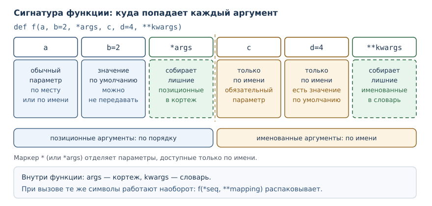

# Гибкие сигнатуры: *args, **kwargs и распаковка

<!-- syllanix:nav -->
**Навигация:** [← 23. Функциональные приёмы и включения](23-functional.md) · [Оглавление книги](../README.md) · [Далее: 25. Объекты и классы →](25-objects-classes.md)
<!-- /syllanix:nav -->

<!-- syllanix:topics -->
**Темы главы**
24.1. [Зачем это нужно](#why)  
24.2. [Что вы сможете после этой главы](#что-вы-сможете-после-этой-главы)  
24.3. [Сигнатура как контракт](#signature)  
24.4. [Параметр *args: лишние позиционные аргументы](#varargs)  
24.5. [Параметр **kwargs: лишние именованные аргументы](#kwargs)  
24.6. [Маркеры / и *: кто как передаётся](#markers)  
24.7. [Распаковка аргументов](#unpacking-arguments)  
24.8. [Форвардинг: зачем это на практике](#forwarding)  
24.9. [Сигнатуры в стандартной библиотеке](#stdlib-signatures)  
24.10. [Типичные ошибки](#mistakes)  
24.11. [Упражнения](#упражнения)  
24.12. [Проверка понимания](#проверка-понимания)  
24.13. [Что дальше](#что-дальше)  
<!-- /syllanix:topics -->


Функция с неизменным списком параметров удобна, пока все вызовы похожи друг
на друга. Но есть задачи, где число аргументов заранее неизвестно: обёртка,
которая должна передать вызов дальше без потерь; `print`, принимающий сколько
угодно значений; сборщик адреса с произвольным набором параметров запроса.
Для таких случаев Python позволяет описать параметры, которые забирают «всё
остальное». В этой главе вы научитесь читать и писать подобные сигнатуры,
отличать объявление параметра от распаковки в вызове и ограничивать гибкость
там, где она мешает ловить ошибки.

## Зачем это нужно {#why}

Представьте обёртку над функцией: она печатает имя функции, вызывает её с
теми же аргументами и возвращает результат. Если у функции два параметра,
их можно повторить в обёртке. Если параметров десять или их состав меняется,
повторять бессмысленно: обёртка должна принять любые аргументы и передать их
дальше без изменений. Именно так устроены декораторы из главы 22.

Вторая причина — интерфейсы с переменным числом однотипных значений. `print`
принимает любое количество объектов, `max` тоже. Такой контракт естественно
описывается параметром, который собирает остаток аргументов в одну структуру.

У гибкости есть цена. Функция, принимающая «что угодно», не сообщит, что вы
перепутали имя аргумента: лишнее имя молча попадёт во внутренний словарь.
Поэтому вторая половина главы — о том, как сузить способы вызова. Маркеры `/`
и `*` в сигнатуре говорят, какой аргумент передаётся по месту, а какой только
по имени.

## Что вы сможете после этой главы

- читать сигнатуру любой сложности и объяснять, куда попадёт каждый аргумент;
- объявлять параметры `*args` и `**kwargs` и понимать, какие значения
  получаются внутри функции;
- ограничивать способы передачи аргументов маркерами `/` и `*`;
- распаковывать последовательности и словари в момент вызова;
- отличать объявление параметра от распаковки аргументов.

## Сигнатура как контракт {#signature}

**Сигнатура** — это описание того, как функцию разрешено вызывать: список её
параметров, их порядок, виды и значения по умолчанию. В обиходе сигнатуру
называют вместе с именем функции, но `inspect.signature` показывает только
список параметров.

Три способа связи параметра и аргумента вы уже знаете: аргумент может быть
позиционным (передаётся по месту), именованным (передаётся по имени
параметра) и может отсутствовать, если у параметра есть значение по
умолчанию. Вот как выглядит простая сигнатура, если попросить Python
показать её:

```python exec
import inspect

def area(width, height=1):
    return width * height

print(inspect.signature(area))
print(area(2, 3))
print(area(2))
print(area(width=2, height=3))
```

```output
(width, height=1)
6
2
6
```

`inspect.signature` возвращает описание сигнатуры; при печати оно выглядит
почти как строка `def`, только без имени функции и двоеточия. Уже здесь
видно правило: параметр со значением по умолчанию можно не передавать.
Обратите внимание, что `area(2)` и `area(2, 3)` дают разные результаты, но
оба вызова корректны.

Когда параметров много, а вызовов ещё больше, сигнатура становится главным
документом функции. Человек читает её раньше, чем тело, и строит по ней
вызов. Дальше мы расширим набор инструментов, которым описывается контракт.

## Параметр *args: лишние позиционные аргументы {#varargs}

**Параметр *args** — параметр с одной звёздочкой, который собирает лишние
позиционные аргументы в кортеж.

Слово «лишние» здесь ключевое. Обычные параметры получают свои значения по
порядку, а всё, что осталось после них, попадает в кортеж:

```python exec
def total(*numbers):
    print("получено:", numbers)
    return sum(numbers)

print(total(1, 2, 3))
print(total())
print(total(10))
```

```output
получено: (1, 2, 3)
6
получено: ()
0
получено: (10,)
10
```

Разберём вывод. В первом вызове переданы три аргумента, и все три оказались
в кортеже `numbers`. Во втором вызове аргументов нет вовсе, поэтому кортеж
пуст, а `sum` от пустой последовательности даёт `0`. В третьем вызове
кортеж состоит из одного элемента — обратите внимание на запятую в `(10,)`:
именно она отличает кортеж от простого числа в скобках.

Имя `args` — соглашение, а не требование языка: параметр можно назвать
`numbers`, `values` или как угодно иначе. Значение имеет звёздочка. При этом
внутри функции параметр ведёт себя как обычный кортеж: его нельзя изменить,
но можно перебрать в цикле, взять длину или распаковать.

Обычные параметры должны стоять до `*args`; сам `*args` может быть и первым —
пример `def total(*numbers)` это показывает. После `*args` нельзя объявить
обычный позиционный параметр: всё, что идёт дальше, доступно только по имени
(об этом — ниже, в разделе о маркерах).

## Параметр **kwargs: лишние именованные аргументы {#kwargs}

**Параметр **kwargs** — параметр с двумя звёздочками, который собирает лишние
именованные аргументы в словарь.

```python exec
def describe(name, **extra):
    print("имя:", name)
    print("остальное:", extra)
    print("ключи по алфавиту:", sorted(extra))

describe("Аня", city="Москва", age=30)
describe("Боря")
```

```output
имя: Аня
остальное: {'city': 'Москва', 'age': 30}
ключи по алфавиту: ['age', 'city']
имя: Боря
остальное: {}
ключи по алфавиту: []
```

Здесь `name` получил значение по месту, а два именованных аргумента попали в
словарь. Порядок ключей в словаре сохраняется в порядке передачи: `city`
идёт раньше `age`. Функция `sorted` возвращает список ключей по алфавиту,
поэтому порядок в последней строке другой — `['age', 'city']`. Это полезное
наблюдение: словарь помнит порядок вставки, а сортировка его меняет.

Ключи в `**kwargs` всегда строки. Если попытаться передать что-то иное,
Python откажется ещё до входа в тело функции, и это защищает от путаницы
между позиционными и именованными аргументами.

## Маркеры / и *: кто как передаётся {#markers}

Гибкость удобна не всегда. Публичной функции полезно запретить часть способов
вызова: например, разрешить передавать число только по месту, чтобы имя
параметра можно было потом изменить, не ломая чужие вызовы.

**Параметр только для позиционных аргументов** — параметр, перечисленный до
маркера `/`; передать его по имени нельзя.

**Параметр только для именованных аргументов** — параметр, стоящий после
маркера `*` или после `*args`; передать его по месту нельзя.

```python exec
def percent(number, /, total):
    return number / total * 100

print(percent(1, 4))
print(percent(1, total=4))
```

```output
25.0
25.0
```

Параметр `number` стоит до `/`, поэтому его можно передать только по месту.
Параметр `total` — обычный, для него допустимы оба способа. Проверим запрет:

```python exec expect-error
def percent(number, /, total):
    return number / total * 100

print(percent(number=1, total=4))
```

```output
TypeError: percent() got some positional-only arguments passed as keyword arguments: 'number'
```

Сообщение буквально говорит: «функция получила позиционно-только аргументы,
переданные как именованные», и называет виновника. Теперь обратный случай —
маркер `*` делает параметры именованными:

```python exec
def format_price(amount, *, currency="руб.", digits=2):
    return f"{amount:.{digits}f} {currency}"

print(format_price(1234.5))
print(format_price(1234.5, currency="$", digits=0))
```

```output
1234.50 руб.
1234 $
```

Второй вызов передаёт `currency` и `digits` по имени, и порядок имён не важен.
Позиционная передача после `*` запрещена:

```python exec expect-error
def format_price(amount, *, currency="руб."):
    return f"{amount} {currency}"

print(format_price(10, "руб."))
```

```output
TypeError: format_price() takes 1 positional argument but 2 were given
```

Полная сигнатура собирается из всех видов параметров в строгом порядке:
позиционно-только, обычные, `*args`, только именованные, `**kwargs`. Вот
пример, где присутствуют все пять видов:

```python exec
def f(a, b=2, *args, c, d=4, **kwargs):
    print(a, b, args, c, d, kwargs)

f(1, c=3)
f(1, 2, 3, 4, c=5, d=6, e=7)
```

```output
1 2 () 3 4 {}
1 2 (3, 4) 5 6 {'e': 7}
```

| Вид параметра | Запись | Как передать | Что внутри |
|---|---|---|---|
| обычный | `a` | по месту или по имени | значение |
| только позиционный | `a, /` | только по месту | значение |
| только именованный | `*, c` | только по имени | значение |
| сбор позиционных | `*args` | по месту, сколько угодно | кортеж |
| сбор именованных | `**kwargs` | по имени, сколько угодно | словарь |



Порядок в `def` не случайность, а требование грамматики. Каждый вид отвечает
за свой участок вызова, и Python проверяет вызов именно по этому порядку:
сначала раздаёт значения обычным параметрам, затем складывает остаток в
`*args`, потом ищет именованные параметры и только после этого наполняет
`**kwargs`.

## Распаковка аргументов {#unpacking-arguments}

**Распаковка аргументов** — передача последовательности как набора
позиционных аргументов (`*seq`) и словаря как набора именованных (`**mapping`).

Здесь легко запутаться, потому что символ тот же, а направление обратное. В
объявлении звёздочка собирает аргументы в кортеж или словарь; в вызове она их
разбирает на отдельные аргументы:

```python exec
def box(width, height, depth=1):
    return width * height * depth

sizes = [2, 3]
params = {"depth": 5}

print(box(*sizes))
print(box(*sizes, **params))
print(box(2, **{"height": 3}))
print(*sizes)
```

```output
6
30
6
2 3
```

В первом вызове список из двух элементов превратился в два позиционных
аргумента. Во втором добавился словарь: ключ `depth` совпал с именем
параметра. Третий вызов смешивает обычный аргумент и распаковку словаря.
Последняя строка показывает, что распаковка работает с любой функцией:
`print(*sizes)` напечатал два числа через пробел.

Распаковка подчиняется тем же правилам, что и обычная передача, поэтому
конфликты видны сразу:

```python exec expect-error
def box(width, height):
    return width * height

print(box(2, 3, width=4))
```

```output
TypeError: box() got multiple values for argument 'width'
```

Один и тот же параметр получил значение дважды: сначала по месту, потом по
имени. Второй типичный случай — нестроковые ключи в словаре:

```python exec expect-error
def box(width, height):
    return width * height

print(box(**{1: 2}))
```

```output
TypeError: keywords must be strings
```

Распаковка при вызове работает с любым итерируемым объектом, а не только со
списком: подойдут кортеж, множество, генератор. Важно лишь, чтобы число
элементов совпало с числом свободных позиционных параметров.

## Форвардинг: зачем это на практике {#forwarding}

Самое частое применение сборных параметров — передать вызов дальше, не
разбирая его на части. Так устроены обёртки, декораторы и функции-посредники:

```python exec
def add(a, b):
    return a + b

def trace(func, *args, **kwargs):
    print("вызов:", func.__name__, args, kwargs)
    result = func(*args, **kwargs)
    print("результат:", result)
    return result

print(trace(add, 2, 3))
print(trace(add, a=2, b=3))
```

```output
вызов: add (2, 3) {}
результат: 5
5
вызов: add () {'a': 2, 'b': 3}
результат: 5
5
```

Обёртка не знает, как именно вызовут `add`: по месту или по имени. Она
принимает любые аргументы и возвращает их функции в том же виде. В главе 22
такой приём оформляют декоратором, а `functools.wraps` сохраняет у обёртки
имя и строку документации исходной функции.

У форвардинга есть тёмная сторона: он скрывает контракт. Функция вида
`def handler(*args, **kwargs)` принимает любую опечатку в имени аргумента и
не сообщает об ошибке. Если такая функция — часть публичного интерфейса,
читатель не узнает из сигнатуры, что ей нужно передать. Поэтому общее правило
простое: сборные параметры уместны в обёртках и в функциях с действительно
переменным набором значений, а в прикладном коде лучше перечислить параметры
явно.

## Сигнатуры в стандартной библиотеке {#stdlib-signatures}

Маркеры и сборные параметры — не экзотика для учебных примеров. Функции
стандартной библиотеки описаны так же, и их сигнатуру можно прочитать тем же
`inspect.signature`:

```python exec
import inspect

print(inspect.signature(print))
print(inspect.signature(sorted))
print(sorted([3, 1, 2], reverse=True))
```

```output
(*args, sep=' ', end='\n', file=None, flush=False)
(iterable, /, *, key=None, reverse=False)
[3, 2, 1]
```

Читаем первую строку: `print` принимает любое число позиционных аргументов
(`*args`), а `sep`, `end`, `file` и `flush` доступны только по имени. Именно
поэтому `print("a", "b", sep="-")` работает, а `print("a", "b", "-")` просто
напечатает три значения через пробел — третий аргумент попадёт в `*args`, а
не в `sep`.

Вторая строка показывает оба маркера сразу. `iterable` стоит до `/`, то есть
передаётся только по месту. `key` и `reverse` стоят после `*`, то есть
доступны только по имени: `sorted(data, my_key)` вызовет ошибку, а
`sorted(data, key=my_key)` сработает. У этого решения есть причина: имена
`key` и `reverse` читаются как часть смысла, а позиционный порядок легко
перепутать.

| Функция | Что собирает | Что только по имени |
|---|---|---|
| `print` | все значения для печати | `sep`, `end`, `file`, `flush` |
| `sorted` | итерируемое значение | `key`, `reverse` |
| `max` | значения для сравнения | `key`, `default` |

Такой стиль проектирования полезен и в своём коде: обязательные данные
передаются по месту, настройки — по имени. Читатель сразу видит, что
влияет на результат, а что лишь уточняет поведение.

## Типичные ошибки {#mistakes}

1. **Считать, что внутри `*args` лежит список.** Там кортеж: `numbers` нельзя
   дополнить методом `append`, зато можно распаковать и перебрать.
2. **Путать сбор и распаковку.** `def f(*args)` собирает аргументы, а `f(*seq)`
   разбирает последовательность. Один символ, два противоположных действия.
3. **Оставлять `def f(*args, **kwargs)` в публичном API.** Любая опечатка в
   имени проходит молча, а документация перестаёт быть обязательной.
4. **Забывать про маркер `*`.** После него позиционная передача запрещена, и
   вызов `f(10, "руб.")` падает, хотя выглядит естественно.
5. **Передавать в `**` словарь с нестроковыми ключами.** Ключи обязаны быть
   строками, иначе `TypeError: keywords must be strings`.
6. **Думать, что значение по умолчанию защищает от изменяемых объектов.**
   Параметр по умолчанию вычисляется один раз при определении функции; эту
   ловушку мы разбирали в главе 18, и сборные параметры её не отменяют.

## Упражнения

### 1. Прогноз вывода {#ex-ch24-01}

Не запуская код, определите, что напечатает программа, и объясните каждый
результат:

```python
def f(*args, **kwargs):
    return len(args), len(kwargs)

print(f(1, 2, 3))
print(f(a=1))
print(f(1, b=2))
```

Запишите три строки вывода, затем проверьте себя запуском.

### 2. Сборка строки с keyword-only параметром {#ex-ch24-02}

Напишите функцию `join_words(*words, sep=" ")`, которая соединяет слова
разделителем `sep` и возвращает одну строку. Вызов `join_words("a", "b")`
должен дать `a b`, а `join_words("a", "b", sep="-")` — `a-b`. Объясните,
почему `sep` нельзя передать позиционно.

### 3. Исправление сигнатуры {#ex-ch24-03}

Программа падает:

```python
def area(width, height):
    return width * height

print(area(2, 3, 4))
```

Объясните причину ошибки и предложите два исправления: одно через `*args`,
другое через явный третий параметр со значением по умолчанию.

### 4. Распаковка при вызове {#ex-ch24-04}

Даны `coords = [2, 3]` и `opts = {"depth": 5}`. Есть функция
`box(width, height, depth=1)`, возвращающая произведение трёх аргументов.
Вызовите её так, чтобы получить `30`, используя обе распаковки. Сколько
вариантов вызова вы можете предложить?

### 5. Сумма произвольного числа значений {#ex-ch24-05}

Напишите функцию `sum_all(*numbers)`, возвращающую сумму всех аргументов.
Проверьте четыре случая: без аргументов, одно значение, целые числа, числа
с дробной частью. Объясните, что вернётся в каждом случае и почему.

### 6. Смешанная сигнатура {#ex-ch24-06}

Объявите функцию `describe(name, /, *tags, **meta)`, которая печатает имя,
кортеж меток и словарь дополнительных сведений. Вызовите её так, чтобы имя
было передано по месту, две метки — позиционно, а город — по имени. Какие
вызовы этой функции невозможны?

### 7. Анализ: чем плоха универсальная функция {#ex-ch24-07}

Сравните две сигнатуры: `def send(*args, **kwargs)` и
`def send(recipient, text, *, urgent=False)`. Для каждой ответьте, что
произойдёт при вызове с опечаткой `urgentt=True`. Подтвердите ответ кодом.

### 8. Только позиционный параметр {#ex-ch24-08}

Напишите функцию `divide(dividend, divisor, /)`, возвращающую результат
деления. Убедитесь, что вызов по имени невозможен, и объясните, зачем в
библиотеках объявляют такие параметры.

### 9. Мини-проект: сборка адреса {#ex-ch24-09}

Напишите функцию `build_url(base, *segments, **query)`, которая соединяет
базовый адрес и сегменты пути через `/`, а параметры запроса добавляет через
`?` и `&`. Вызов
`build_url("https://example.com", "api", "users", page=1, limit=10)` должен
дать `https://example.com/api/users?page=1&limit=10`. Предусмотрите случай
без параметров запроса.

### 10. Форвардинг с отчётом {#ex-ch24-10}

Напишите функцию `trace(func, *args, **kwargs)`, которая печатает имя
функции, полученные аргументы, затем вызывает `func` с теми же аргументами
и печатает результат. Проверьте её на функции умножения двух чисел при
вызове по месту и по имени.

## Проверка понимания

1. Чем параметр отличается от аргумента? Приведите пример объявления и
   пример вызова, где одно и то же слово играет разные роли.
2. Какого типа значение получает параметр `*args` внутри функции? Почему это
   важно для изменений?
3. Что делает маркер `/` в сигнатуре? А маркер `*` без имени параметра?
4. В чём разница между `def f(*args)` и `f(*values)`? Направление действия
   какого символа меняется?
5. Почему `f(**{1: 2})` завершается ошибкой ещё до выполнения тела функции?
6. Когда универсальная сигнатура `*args, **kwargs` уместна, а когда вредит?

## Что дальше

Сборные параметры и маркеры дают контроль над тем, как вызывают функцию. С
этого места начинается переход к объектам: в следующей главе
[«Объекты и классы»](25-objects-classes.md) вы увидите, что класс — это тоже
способ описать контракт, только вместо списка параметров у него есть
атрибуты и методы, а вызов класса создаёт значение нового типа.

<!-- syllanix:nav -->
**Перед этой главой:** [23. Функциональные приёмы и включения](23-functional.md)
**Связанные главы:** [06. Циклы: while и for](06-loops.md), [07. Функции: параметры, аргументы и области видимости](07-functions.md), [14. Кортежи, распаковка и неизменяемость](14-tuples.md), [17. Словари: отображения и структурирование данных](17-dicts.md), [22. Функции как объекты: замыкания и декораторы](22-higher-order.md)
**Далее:** [25. Объекты и классы →](25-objects-classes.md)
<!-- /syllanix:nav -->
