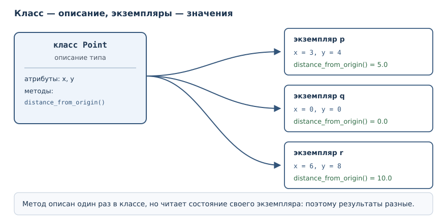
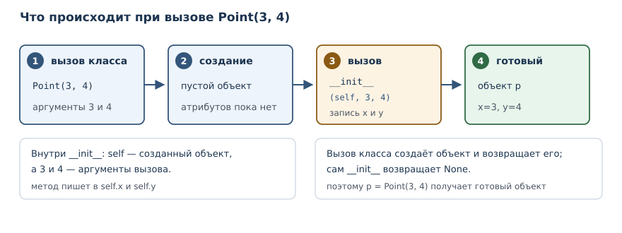

# Объекты и классы

<!-- syllanix:nav -->
**Навигация:** [← 24. Гибкие сигнатуры: *args, **kwargs и распаковка](24-signatures.md) · [Оглавление книги](../README.md) · [Далее: 26. Атрибуты, свойства и инкапсуляция →](26-encapsulation.md)
<!-- /syllanix:nav -->

<!-- syllanix:topics -->
**Темы главы**
25.1. [Зачем это нужно](#why)  
25.2. [Что вы сможете после этой главы](#что-вы-сможете-после-этой-главы)  
25.3. [Класс — это тип, экземпляр — значение](#class-instance)  
25.4. [Атрибуты экземпляра](#attributes)  
25.5. [Методы и параметр self](#methods)  
25.6. [Метод инициализации и конструктор](#init)  
25.7. [Состояние и поведение: счёт](#account)  
25.8. [У каждого экземпляра своё состояние](#independent-state)  
25.9. [Объекты и ссылки](#objects-references)  
25.10. [Объекты вокруг нас](#objects-everywhere)  
25.11. [Углубление: когда класс лишний](#when-not)  
25.12. [Типичные ошибки](#mistakes)  
25.13. [Упражнения](#упражнения)  
25.14. [Проверка понимания](#проверка-понимания)  
25.15. [Что дальше](#что-дальше)  
<!-- /syllanix:topics -->


До сих пор вы работали со значениями, которые придумал кто-то другой: числа,
строки, списки, словари. Их типы уже описаны в языке, и вам оставалось
пользоваться готовым набором операций. Дальше начинается следующий уровень:
вы описываете собственный тип, соединяете в нём данные и поведение и создаёте
сколько угодно значений этого типа. Так программисты моделируют предметную
область — счёт в банке, точку на плоскости, заказ в интернет-магазине.

## Зачем это нужно {#why}

Представьте точку на плоскости. Её можно описать словарём:
`{"x": 3, "y": 4}`. Работает, пока точек немного и пока все помнят, какие
ключи обязательны. Но словарь не мешает опечататься: `{"x": 3, "z": 4}`
выглядит так же правдоподобно, а функция, считающая расстояние, обнаружит
проблему только в момент вызова. Поведение — расстояние, сдвиг, отражение —
приходится хранить отдельно от данных, и связь между ними держится на
договорённости.

Класс убирает эту договорённость из головы программиста и переносит в код.
Он описывает, какие атрибуты есть у значения и какие операции с ним
возможны. Второй вызов класса создаёт второе независимое значение с тем же
набором возможностей. Это и есть главная идея объектного подхода: тип
описывается один раз, а значений этого типа может быть сколько угодно.

## Что вы сможете после этой главы

- объявлять класс и создавать его экземпляры;
- объяснять разницу между классом и экземпляром;
- объявлять атрибуты и методы и понимать роль параметра `self`;
- писать метод инициализации и объяснять, чем конструктор отличается от
  этого метода;
- читать тип и состояние созданного объекта и замечать, когда состояние
  нарушено.

## Класс — это тип, экземпляр — значение {#class-instance}

**Класс** — описание нового типа: какие атрибуты и методы имеют его
экземпляры.

**Экземпляр** — объект, созданный по описанию класса и имеющий собственное
состояние.

Объявление класса начинается со слова `class`, за которым идёт имя и
двоеточие; тело класса — обычный блок с отступом. Простейший класс может
быть пустым:

```python exec
class Point:
    pass

p = Point()
print(type(p))
print(type(Point))
print(p.__class__.__name__)
```

```output
<class '__main__.Point'>
<class 'type'>
Point
```

Обратите внимание: имя `Point` обозначает сразу две вещи, но в разных ролях.
Слева от вызова `Point()` оно означает класс — описание. Результат вызова,
связанный с именем `p`, — экземпляр. Проверка `type(p)` сообщает, что тип
экземпляра — `Point`, а `type(Point)` показывает, что сам класс имеет тип
`type`. Класс и экземпляр не одно и то же: первый описывает, второй существует.

Слово `pass` в теле означает «здесь пока ничего нет». Вызов
класса создаёт экземпляр, даже если класс пуст: у него есть тип, но нет
своего состояния.



## Атрибуты экземпляра {#attributes}

**Атрибут** — именованное значение, связанное с объектом и доступное через
точку.

Пока класс пуст, состояние можно добавить снаружи: достаточно присвоить
значение атрибуту экземпляра. Синтаксис тот же, что при обращении к методам
строки: имя объекта, точка, имя атрибута.

```python exec
class Point:
    pass

p = Point()
p.x = 3
p.y = 4
print(p.x, p.y)
p.x = 10
print(p.x)

q = Point()
print(hasattr(q, "x"))
```

```output
3 4
10
False
```

Первые два присваивания создают у `p` два атрибута. Второе присваивание
`p.x = 10` не создаёт новый атрибут, а заменяет значение существующего.
Второй экземпляр `q` чист: `hasattr(q, "x")` возвращает `False`, потому что
атрибуты принадлежат экземпляру, а не классу и не другому экземпляру.

Гибкость здесь обманчива. Присваивание атрибута никогда не проверяет, что
вы написали правильное имя: `p.collor = "red"` создаст третий атрибут вместо
ошибки. Кроме того, пока атрибут не присвоен, его нет, и чтение даёт
`AttributeError`. Оба неудобства лечатся дисциплиной: атрибуты объявляют в
одном месте, а доступ к ним ограничивают методами. Об этом — следующая глава.

## Методы и параметр self {#methods}

**Метод** — функция, определённая в классе и получающая экземпляр первым
аргументом.

**`self`** — первый параметр обычного метода, ссылающийся на экземпляр, у
которого метод вызван.

Объявление метода ничем не отличается от объявления функции, кроме места:
оно находится внутри тела класса. Первый параметр по соглашению называют
`self`, и через него метод обращается к состоянию своего экземпляра.

```python exec
class Point:
    def distance_from_origin(self):
        return (self.x ** 2 + self.y ** 2) ** 0.5

p = Point()
p.x = 3
p.y = 4
print(p.distance_from_origin())
print(Point.distance_from_origin(p))
```

```output
5.0
5.0
```

Оба вызова равносильны. Запись `p.distance_from_origin()` — сокращение:
Python сам подставляет `p` первым аргументом, поэтому `self` внутри метода
указывает на `p`. Запись `Point.distance_from_origin(p)` делает то же самое
явно: метод берётся у класса и вызывается с экземпляром. Второй вариант
показывает механизм, первый — то, как им пользуются.

Отсюда следует типичная ошибка новичка: вызвать метод у класса, забыв
экземпляр.

```python exec expect-error
class Point:
    def distance_from_origin(self):
        return 0

print(Point.distance_from_origin())
```

```output
TypeError: Point.distance_from_origin() missing 1 required positional argument: 'self'
```

Сообщение точное: не хватает одного позиционного аргумента `self`. Метод —
обычная функция, и без экземпляра ему не с чем работать.

## Метод инициализации и конструктор {#init}

Присваивать атрибуты снаружи неудобно: легко создать объект, у которого
забыли половину состояния. Правильное место для начальных значений — метод
инициализации.

**Метод инициализации `__init__`** — метод, который Python вызывает
автоматически после создания экземпляра; в нём задают начальное состояние.

**Конструктор** — операция создания экземпляра (вызов класса), за которой
следует `__init__`.

```python exec
class Point:
    def __init__(self, x, y):
        self.x = x
        self.y = y

    def distance_from_origin(self):
        return (self.x ** 2 + self.y ** 2) ** 0.5

p = Point(3, 4)
print(p.x, p.y)
print(p.distance_from_origin())
print(isinstance(p, Point))
```

```output
3 4
5.0
True
```

Что происходит при вызове `Point(3, 4)`:

1. создаётся новый экземпляр класса `Point`;
2. Python вызывает `__init__` и передаёт ему этот экземпляр первым
   аргументом, а следом — аргументы из вызова;
3. метод записывает значения в атрибуты экземпляра;
4. готовый экземпляр возвращается как результат вызова.



Слово «конструктор» здесь стоит употреблять аккуратно. В Python конструктор —
это вызов класса, который создаёт объект; `__init__` лишь заполняет уже
созданный экземпляр и ничего не возвращает. Если попытаться вернуть из него
значение, Python откажется:

```python exec expect-error
class Point:
    def __init__(self, x, y):
        self.x = x
        return 1

p = Point(3, 4)
print(p.x)
```

```output
TypeError: __init__() should return None, not 'int'
```

Второй важный факт: `__init__` — обычный метод по правилам вызова. У него
есть параметр `self`, и его можно вызвать вручную, хотя нужно это редко.
Двойное подчёркивание в имени означает, что метод участвует в модели данных
языка, а не просто лежит в классе. Подробно такие имена разберём в главе 28.

## Состояние и поведение: счёт {#account}

Класс полезен, когда между атрибутами есть связь, которую нельзя нарушать.
Счёт в банке: баланс не должен уходить в минус, а операции меняют его
согласованно.

```python exec
class Account:
    def __init__(self, owner, balance=0):
        if balance < 0:
            raise ValueError("баланс не может быть отрицательным")
        self.owner = owner
        self.balance = balance

    def deposit(self, amount):
        if amount <= 0:
            raise ValueError("сумма должна быть положительной")
        self.balance += amount
        return self.balance

    def withdraw(self, amount):
        if amount > self.balance:
            raise ValueError("недостаточно средств")
        self.balance -= amount
        return self.balance

acc = Account("Аня", 100)
print(acc.deposit(50))
print(acc.withdraw(30))
print(acc.balance)
try:
    acc.withdraw(1000)
except ValueError as error:
    print("отказ:", error)
```

```output
150
120
120
отказ: недостаточно средств
```

Здесь видно разделение обязанностей. Атрибуты `owner` и `balance` хранят
состояние. Методы `deposit` и `withdraw` — единственный предусмотренный способ
изменить баланс, и каждый проверяет условие перед изменением. Проверка в
`__init__` не даёт создать счёт сразу с отрицательным балансом. Пока внешний
код пользуется методами, инвариант «баланс не отрицателен» сохраняется.
Нарушить его можно только прямым присваиванием `acc.balance = -1` в обход
методов, и именно от этого защищает инкапсуляция — тема следующей главы.

## У каждого экземпляра своё состояние {#independent-state}

Методы хранятся в классе и общие для всех экземпляров, а атрибуты — у каждого
свои. Поэтому два счётчика считают независимо:

```python exec
class Counter:
    def __init__(self):
        self.value = 0

    def click(self):
        self.value += 1
        return self.value

a = Counter()
b = Counter()
print(a.click(), a.click(), b.click())
print(a.value, b.value)
```

```output
1 2 1
2 1
```

Три вызова идут слева направо: два раза щёлкает `a`, один раз `b`. В конце
у `a` значение 2, у `b` — 1. Каждый экземпляр хранит собственный набор
атрибутов; общим остаётся только описание класса.

## Объекты и ссылки {#objects-references}

Присваивание в Python не копирует объект, а связывает имя со значением. Для
классов это особенно заметно, потому что экземпляр — изменяемое значение.

```python exec
class Counter:
    def __init__(self):
        self.value = 0

a = Counter()
b = a
b.value = 5
print(a.value)
print(a is b)
```

```output
5
True
```

Имена `a` и `b` указывают на один и тот же объект, поэтому изменение через
`b` видно через `a`. Проверка `is` подтверждает тождество. Если нужен
независимый объект, его создают вторым вызовом класса, а не вторым именем.
Ссылочная семантика и копирование подробно разобраны в главе 18; для классов
действует то же правило.

## Объекты вокруг нас {#objects-everywhere}

Собственные классы — не отдельный мир, а продолжение того, что вы уже
используете. Каждое значение в Python — экземпляр какого-нибудь класса, и
методы, которыми вы пользовались с первых глав, объявлены именно в классах:

```python exec
text = "Python"
print(type(text))
print(type(3))
print(type([1, 2]))
print(text.upper())
print(" ".join(["a", "b"]))
```

```output
<class 'str'>
<class 'int'>
<class 'list'>
PYTHON
a b
```

`type` возвращает класс значения. Запись `text.upper()` — тот же механизм,
что `p.distance_from_origin()`: метод получает строку как первый аргумент.
Её можно переписать явно: `str.upper(text)`. То же с `" ".join([...])`:
разделитель — строка, у которой вызван метод, а список — обычный аргумент.

Отсюда следует полезная привычка: читая незнакомый метод, спрашивайте, у
какого класса он вызван. `sort` — метод списка: он сортирует на месте и
возвращает `None`. `sorted` — встроенная функция: она возвращает новый список
и не меняет исходный. Путать их опасно. Собственный класс отличается от встроенного
только тем, что его описали вы.

## Углубление: когда класс лишний {#when-not}

Класс — не универсальный ответ на любую задачу. Если сущность только хранит
несколько связанных значений и не имеет собственного поведения, класс
добавляет церемонию без пользы: словарь, кортеж или специальный класс данных
(о них в главе 29) справятся короче.

Класс оправдан, когда выполняется хотя бы одно условие:

- есть **инвариант** — правило, которое нельзя нарушать (баланс не
  отрицателен, ширина положительна);
- несколько операций работают с одним и тем же состоянием, и логика их
  связана (положить и снять деньги, добавить и удалить книгу);
- объект нельзя позволить собрать «наполовину»: все обязательные значения
  задаются в методе инициализации.

Для точки с двумя координатами без операций достаточно кортежа. Для счёта с
балансом и правилом «не уходить в минус» класс уместен, потому что правило
живёт в методах и проверяется при каждом изменении. Выбор структуры данных —
часть проектирования, и следующий раздел объясняет, как защитить инвариант
от обхода снаружи.

## Типичные ошибки {#mistakes}

1. **Забыть `self` в объявлении метода.** Обычно это проявляется как
   `TypeError` — неверное число аргументов или несовместимый тип. Но если
   первый параметр случайно совместим по типу, ошибка может выглядеть как
   неверное значение, а не как падение.
2. **Забыть присвоить атрибут в `__init__`.** Чтение даёт `AttributeError`,
   а не значение по умолчанию.
3. **Опечататься в имени атрибута.** `p.collor = "red"` создаст новый
   атрибут: присваивание не проверяет имена.
4. **Ждать от `print(p)` содержательного вывода.** По умолчанию печатается
   имя класса и адрес объекта; читаемое представление задаётся отдельно,
   в главе 28.
5. **Считать, что `b = a` копирует объект.** Оба имени указывают на один
   экземпляр.
6. **Возвращать значение из `__init__`.** Метод обязан вернуть `None`.
7. **Путать класс и экземпляр.** `Point` описывает, `Point()` создаёт;
   методы первого уровня вызываются у экземпляра.

## Упражнения

### 1. Прогноз вывода {#ex-ch25-01}

Не запуская код, определите, что напечатает программа:

```python
class Box:
    def __init__(self, width, height):
        self.width = width
        self.height = height

    def area(self):
        return self.width * self.height

b = Box(2, 5)
print(b.area())
b.width = 10
print(b.area())
print(type(b).__name__)
```

Запишите три строки и объясните, почему вторая отличается от первой.

### 2. Класс Rectangle {#ex-ch25-02}

Объявите класс `Rectangle` с методом инициализации, принимающим ширину и
высоту. Добавьте методы `area()` и `perimeter()`. Создайте прямоугольник
3×4 и напечатайте площадь и периметр.

### 3. Исправление ошибки {#ex-ch25-03}

Класс задуман так, чтобы метод возвращал приветствие, но вызов падает:

```text
class Greeter:
    def greet(name):
        return "Привет, " + name

g = Greeter()
print(g.greet())
```

Объясните, чего не хватает, и исправьте класс двумя способами: добавив
параметр `self` и вызвав метод через класс с явной передачей экземпляра.

### 4. Счётчик с командами {#ex-ch25-04}

Объявите класс `Counter` с методами `click()`, `reset()` и `value()`,
который возвращает текущее значение. Проверьте последовательность: два
щелчка, сброс, один щелчок. Обратите внимание, что имя метода не должно
совпадать с именем атрибута — объясните, почему.

### 5. Анализ ссылок {#ex-ch25-05}

Создайте один экземпляр класса `Counter`, свяжите с ним два имени, измените
значение через второе имя и проверьте первое. Затем создайте второй
экземпляр и повторите проверку. Объясните разницу результатами и кодом.

### 6. Класс Temperature {#ex-ch25-06}

Объявите класс `Temperature` с атрибутом в градусах Цельсия и методами
`to_fahrenheit()` и `is_freezing()`. Проверьте на значениях 0, 100 и −10.
Методы не должны изменять состояние объекта.

### 7. Валидация в инициализации {#ex-ch25-07}

Добавьте в класс `Rectangle` проверку: ширина и высота обязаны быть
положительными, иначе поднимается `ValueError` с понятным сообщением.
Проверьте оба случая: корректный и некорректный.

### 8. Стек {#ex-ch25-08}

Объявите класс `Stack` с методами `push(value)`, `pop()` и `size()`.
Внутреннее хранилище — список, созданный в `__init__`. Проверьте:
положили два значения, сняли одно, посмотрели размер. Что произойдёт при
попытке снять значение из пустого стека?

### 9. Мини-проект: библиотека {#ex-ch25-09}

Объявите два класса: `Book` (название, автор, год) и `Library` (список книг,
методы `add(book)` и `titles()`). Добавьте две книги и напечатайте их
названия. Подумайте, почему список книг должен принадлежать экземпляру
`Library`, а не классу.

### 10. Словарь или класс {#ex-ch25-10}

Одну и ту же сущность — книгу с названием, автором и годом — опишите двумя
способами: словарём и классом с методом `describe()`. Напишите короткий
вывод о том, какой способ лучше защищает от опечаток и почему. Подтвердите
вывод примером кода.

## Проверка понимания

1. Чем класс отличается от экземпляра? Что означает `type(p)` и что —
   `type(Point)`?
2. Почему метод получает `self` первым аргументом, хотя при вызове
   `p.method()` вы его не передаёте?
3. Что произойдёт, если убрать `self` из объявления метода? А если забыть
   присвоить атрибут в `__init__`?
4. Чем конструктор отличается от метода инициализации? Что возвращает
   `__init__`?
5. Почему `b = a` не создаёт второй объект? Как получить независимый
   экземпляр?
6. Зачем хранить данные и поведение в одном классе, если можно держать
   словарь и отдельные функции?

## Что дальше

Вы научились описывать типы и создавать значения, но состояние пока открыто:
любой код может записать в атрибут что угодно. В следующей главе
[«Атрибуты, свойства и инкапсуляция»](26-encapsulation.md) вы увидите, как
закрыть состояние за методами и свойствами, чтобы инварианты класса нельзя
было нарушить случайно.

<!-- syllanix:nav -->
**Перед этой главой:** [24. Гибкие сигнатуры: *args, **kwargs и распаковка](24-signatures.md)
**Связанные главы:** [03. Значения, имена, объекты и типы](03-values-names-objects.md), [07. Функции: параметры, аргументы и области видимости](07-functions.md), [10. Ошибки и исключения](10-errors-exceptions.md), [15. Строки: методы, форматирование и Unicode](15-strings.md), [18. Ссылки, алиасы и копирование](18-references-copy.md), [27. Наследование, полиморфизм и композиция](27-inheritance.md), [28. Модель данных: dunder-методы](28-dunder.md), [29. Dataclasses, протоколы и абстрактные классы](29-dataclasses-protocols.md)
**Далее:** [26. Атрибуты, свойства и инкапсуляция →](26-encapsulation.md)
<!-- /syllanix:nav -->
