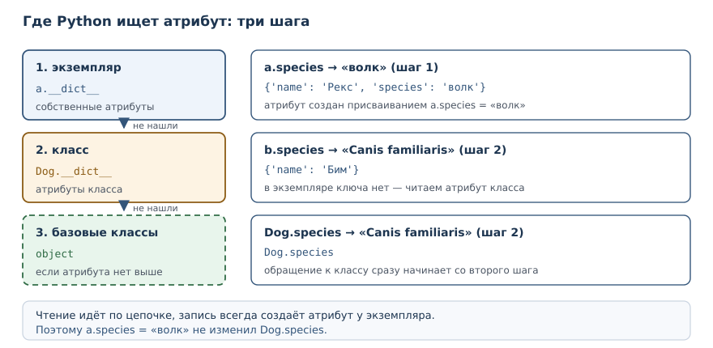
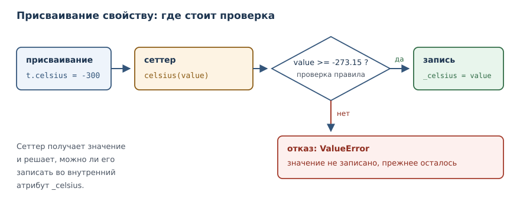

# Атрибуты, свойства и инкапсуляция

<!-- syllanix:nav -->
**Навигация:** [← 25. Объекты и классы](25-objects-classes.md) · [Оглавление книги](../README.md) · [Далее: 27. Наследование, полиморфизм и композиция →](27-inheritance.md)
<!-- /syllanix:nav -->

<!-- syllanix:topics -->
**Темы главы**
26.1. [Зачем это нужно](#why)  
26.2. [Что вы сможете после этой главы](#что-вы-сможете-после-этой-главы)  
26.3. [Атрибуты класса и атрибуты экземпляра](#class-instance-attributes)  
26.4. [Инкапсуляция и соглашения об именах](#encapsulation)  
26.5. [Свойства: вычисляемый атрибут](#property)  
26.6. [Сеттер и контроль инвариантов](#setter)  
26.7. [Границы API класса](#class-api)  
26.8. [Типичные ошибки](#mistakes)  
26.9. [Упражнения](#упражнения)  
26.10. [Проверка понимания](#проверка-понимания)  
26.11. [Что дальше](#что-дальше)  
<!-- /syllanix:topics -->


В предыдущей главе состояние объекта было открыто: любой код мог записать в
атрибут что угодно, включая значение, нарушающее правила класса. Счёт
допускал отрицательный баланс, прямоугольник — отрицательную сторону. Это
не ошибка языка, а вопрос дисциплины: Python позволяет закрыть состояние, но
не делает это автоматически. В этой главе вы научитесь разделять атрибуты
класса и экземпляра, обозначать внутренние части класса соглашениями и
проверять значения в момент присваивания с помощью свойств.

## Зачем это нужно {#why}

Представьте, что класс `Account` из прошлой главы используется в большом
приложении. Баланс хранится в атрибуте, и рано или поздно кто-то напишет
`acc.balance = acc.balance - 500` без проверки. Отрицательный баланс не
вызовет ошибки, но нарушит правило предметной области: списать больше, чем
есть, нельзя. Найти потом, где именно это произошло, трудно, потому что
присваивание атрибута нигде не отмечено в коде класса.

Инкапсуляция решает эту задачу: состояние перестаёт быть доступным напрямую,
а изменения проходят через методы и свойства, которые проверяют правила. У
читателя кода появляется единственное место, где можно найти проверку, а у
автора класса — возможность менять внутреннее устройство, не ломая чужие
вызовы.

## Что вы сможете после этой главы

- различать атрибуты класса и атрибуты экземпляра и объяснять порядок поиска;
- замечать классическую ловушку с изменяемым атрибутом класса;
- объяснять, что инкапсуляция в Python опирается на соглашения, а не на
  запреты;
- объявлять свойства, доступные без скобок, и управлять присваиванием через
  сеттер;
- применять искажение имён и понимать, от чего оно защищает.

## Атрибуты класса и атрибуты экземпляра {#class-instance-attributes}

**Атрибут экземпляра** — атрибут, хранящийся в конкретном экземпляре и
образующий его состояние.

**Атрибут класса** — атрибут, хранящийся в классе и общий для всех
экземпляров, если экземпляр не переопределил его.

Разница видна, если объявить атрибут прямо в теле класса, вне методов:

```python exec
class Dog:
    species = "Canis familiaris"

    def __init__(self, name):
        self.name = name

a = Dog("Рекс")
b = Dog("Бим")
print(Dog.species)
print(a.species, b.species)
print(a.name, b.name)
a.species = "волк"
print(a.species, b.species, Dog.species)
print(a.__dict__)
print(b.__dict__)
```

```output
Canis familiaris
Canis familiaris Canis familiaris
Рекс Бим
волк Canis familiaris Canis familiaris
{'name': 'Рекс', 'species': 'волк'}
{'name': 'Бим'}
```

`species` объявлен в классе, поэтому доступен и через класс, и через любой
экземпляр. `name` создаётся в методе инициализации у каждого экземпляра
отдельно. Присваивание `a.species = "волк"` не изменило класс: оно создало
атрибут экземпляра, который перекрыл классовый. Словари экземпляров
показывают это прямо: у `a` два собственных атрибута, у `b` — один.

Отсюда правило поиска атрибута: сначала экземпляр, затем класс, затем
базовые классы. Чтение `a.species` ищет в `a.__dict__`, не находит и
поднимается к классу. Именно поэтому атрибут класса удобно использовать для
значений по умолчанию, одинаковых для всех.



| Вид | Где хранится | Кто видит | Типичное применение |
|---|---|---|---|
| атрибут экземпляра | `self.x = ...` в `__init__` | только этот экземпляр | состояние объекта |
| атрибут класса | тело класса | все экземпляры | общие константы, счётчики |

Экземпляр может переопределить атрибут класса: тогда у него появится
собственный атрибут с тем же именем, и чтение пойдёт по цепочке — сначала
экземпляр, затем класс.

### Ловушка изменяемого атрибута класса {#mutable-class-attribute}

Атрибут класса общий, поэтому изменяемое значение в нём опасно: все
экземпляры увидят одни и те же изменения.

```python exec
class Box:
    items = []

    def add(self, item):
        self.items.append(item)

a = Box()
b = Box()
a.add("яблоко")
print(a.items)
print(b.items)
print(a.items is b.items)
```

```output
['яблоко']
['яблоко']
True
```

`a.items` и `b.items` — один и тот же список, потому что чтение атрибута
поднялось к классу, а метод `append` изменил найденный там объект. Ошибка
тихая: ни исключения, ни предупреждения. Лечится она просто — создавать
изменяемое состояние в методе инициализации:

```python exec
class Box:
    def __init__(self):
        self.items = []

    def add(self, item):
        self.items.append(item)

a = Box()
b = Box()
a.add("яблоко")
print(a.items)
print(b.items)
```

```output
['яблоко']
[]
```

Правило короткое: неизменяемые значения (числа, строки, кортежи из
неизменяемых элементов) можно держать в классе; списки, словари и множества —
только в экземпляре.

## Инкапсуляция и соглашения об именах {#encapsulation}

**Инкапсуляция** — сокрытие внутреннего состояния за методами и свойствами,
чтобы сохранять инварианты класса.

В Python нет ключевого слова `private` и нет запрета на доступ к атрибуту.
Инкапсуляция строится на соглашениях, и это осознанное решение языка:
Python доверяет программисту и задаёт границы соглашениями, а не запретами.

Граница обозначается именем. Атрибут или метод с одним подчёркиванием в
начале считается внутренним: `_balance`, `_normalize`. Это сигнал «не
трогайте снаружи, автор может изменить это без предупреждения». Python не
мешает обратиться к `_balance`, но читатель кода понимает, что делает это
на свой риск.

Второй уровень — искажение имён. **Искажение имён** — автоматическое
преобразование имени `__name` в `_Class__name`, не дающее случайно
переопределить внутренний атрибут. Два подчёркивания в начале и не более
одного в конце заставляют интерпретатор переименовать атрибут при разборе
класса:

```python exec
class Wallet:
    def __init__(self):
        self.__balance = 0

    def add(self, amount):
        self.__balance += amount

    def balance(self):
        return self.__balance

w = Wallet()
w.add(100)
print(w.balance())
print(w.__dict__)
```

```output
100
{'_Wallet__balance': 100}
```

Внутри класса имя `self.__balance` читается и пишется нормально, а в словаре
экземпляра видно итоговое `_Wallet__balance`. Зачем это нужно? Чтобы
подкласс, объявив свой `__balance`, не перекрыл случайно внутренний атрибут
базового класса: у каждого класса получится своё имя. От прямого доступа это
не защищает — `w._Wallet__balance` по-прежнему доступно, — но защищает от
случайного столкновения имён.

| Имя | Смысл | Пример |
|---|---|---|
| `name` | публичное | `self.name` |
| `_name` | внутреннее, по соглашению | `self._balance` |
| `__name` | искажается в `_Class__name` | `self.__balance` |
| `__name__` | зарезервировано языком | `__init__` |

Последняя строка важна: имена с двумя подчёркиваниями с обеих сторон
(`__init__`, `__repr__`) не искажаются. Они принадлежат модели данных языка,
и подменять их своим смыслом нельзя. Искажение работает только для имён,
которые начинаются с двух подчёркиваний и заканчиваются не более чем одним.

Как проверить, что инкапсуляция действительно работает? Попробуйте нарушить
инвариант снаружи. Если получилось — граница проведена плохо. Для счёта
проверка звучит так: «попробуйте сделать баланс отрицательным, не вызывая
методов класса». Пока `balance` — обычный атрибут, это удаётся одной строкой.
После перехода на свойство только для чтения такая попытка завершается
ошибкой, и единственный путь изменить состояние проходит через проверку.
Такой эксперимент полезнее чтения кода: он показывает, что именно гарантирует
класс.

## Свойства: вычисляемый атрибут {#property}

Инкапсуляция не обязана означать «методы вместо полей». Хороший интерфейс
читается как обычное обращение к атрибуту, но позволяет проверить значение.
Для этого служит свойство.

**property** — декоратор, превращающий метод в вычисляемый атрибут, доступный
без скобок.

```python exec
class Temperature:
    def __init__(self, celsius):
        self._celsius = celsius

    @property
    def celsius(self):
        return self._celsius

t = Temperature(20)
print(t.celsius)
print(t._celsius)
```

```output
20
20
```

Метод `celsius` объявлен с декоратором `@property`, поэтому обращение
`t.celsius` вызывает его без скобок. Снаружи это выглядит как атрибут, а
внутри работает код. Приватного атрибута здесь нет: `t._celsius` доступен,
но соглашение говорит, что изменять его напрямую не следует.

Главное преимущество свойств в том, что переход от атрибута к свойству не
ломает вызывающий код. Класс мог хранить `self.celsius` как обычный атрибут;
когда понадобилась проверка, атрибут заменили свойством, а вызовы
`t.celsius` и `t.celsius = 25` остались прежними. Именно поэтому в Python
принято начинать с простого атрибута, а свойство добавлять тогда, когда
появилось правило.

Свойство может быть и только для чтения — достаточно объявить метод с
`@property` и не добавлять сеттер:

```python exec
class Circle:
    def __init__(self, radius):
        self._radius = radius

    @property
    def area(self):
        return 3.14159 * self._radius ** 2

c = Circle(2)
print(round(c.area, 2))
```

```output
12.57
```

Площадь не хранится: она вычисляется при каждом обращении. Так исключается
рассинхронизация — нельзя забыть пересчитать площадь после изменения
радиуса. Попытка присвоить значение свойству только для чтения завершается
ошибкой:

```python exec expect-error
class Circle:
    @property
    def area(self):
        return 1.0

c = Circle()
print(c.area)
c.area = 5
```

```output
AttributeError: property 'area' of 'Circle' object has no setter
```

## Сеттер и контроль инвариантов {#setter}

**Сеттер** — метод, вызываемый при присваивании значению свойства; он
позволяет проверить значение до записи.

Сеттер объявляется декоратором `@имя_свойства.setter` и носит то же имя,
что и геттер:

```python exec
class Temperature:
    def __init__(self, celsius):
        self.celsius = celsius

    @property
    def celsius(self):
        return self._celsius

    @celsius.setter
    def celsius(self, value):
        if value < -273.15:
            raise ValueError("ниже абсолютного нуля")
        self._celsius = value

t = Temperature(20)
print(t.celsius)
t.celsius = 25
print(t.celsius)
try:
    t.celsius = -300
except ValueError as error:
    print("отказ:", error)
print(t._celsius)
try:
    Temperature(-300)
except ValueError as error:
    print("отказ при создании:", error)
```

```output
20
25
отказ: ниже абсолютного нуля
25
отказ при создании: ниже абсолютного нуля
```

Присваивание `t.celsius = -300` вызвало сеттер, тот проверил значение и
поднял исключение. Внутреннее поле осталось прежним — 25. Это и есть
инвариант: объект либо находится в допустимом состоянии, либо изменение
отклоняется с объяснением.

Та же проверка работает при создании: конструктор присваивает через свойство,
поэтому недопустимое значение не попадёт даже в новый объект.

Так же защищают состояние, которое меняется только методами. Баланс счёта
удобно сделать свойством только для чтения, а изменение — операциями:

```python exec
class Account:
    def __init__(self, balance=0):
        if balance < 0:
            raise ValueError("баланс не может быть отрицательным")
        self._balance = balance

    @property
    def balance(self):
        return self._balance

    def withdraw(self, amount):
        if amount > self._balance:
            raise ValueError("недостаточно средств")
        self._balance -= amount
        return self._balance

acc = Account(100)
print(acc.balance)
print(acc.withdraw(30))
```

```output
100
70
```

Снаружи баланс читается как атрибут, но записать его напрямую нельзя:
сеттера нет, поэтому `acc.balance = 1000` поднимет `AttributeError`.
Единственный путь изменить баланс — метод `withdraw`, где есть проверка.
Граница API класса описана самим кодом, а не комментарием.



## Границы API класса {#class-api}

Инкапсуляция — это ещё и решение о том, что класс показывает наружу. У
каждого класса есть публичная часть (то, чем пользуются снаружи) и
внутренняя (то, что может измениться). Провести границу помогает вопрос:
«если я изменю это завтра, сломаются ли чужие вызовы?»

Публичным стоит делать минимум: методы, которые выражают намерение, и
свойства для чтения состояния. Внутренние детали — промежуточные вычисления,
служебные поля, кэши — помечают одним подчёркиванием и не обещают сохранить.
Такой минимализм не про экономию строк: чем меньше поверхности, тем меньше
придётся поддерживать и тем проще менять устройство класса.

### Атрибут или свойство: правило выбора {#attribute-or-property}

Начинать почти всегда стоит с обычного атрибута. Свойство добавляют, когда
появляется правило, которое нужно проверять при присваивании, или когда
значение нужно вычислять. Проверка в отдельном методе `set_balance()` хуже
свойства: её можно забыть вызвать, а присваивание свойству происходит в любом
коде, который пишет в это имя.

Есть и цена. Свойство медленнее прямого доступа к атрибуту, потому что за
ним стоит вызов функции, и оно усложняет чтение класса. Если правило простое
и никогда не изменится, обычного атрибута достаточно. Если правило есть —
свойство делает его обязательным, а не рекомендованным.

### Что считать публичным {#public-surface}

Полезно заранее перечислить публичный интерфейс класса: методы, которые
образуют его смысл. Для счёта это `deposit`, `withdraw`, `balance`; для
прямоугольника — `width`, `height`, `area`. Всё остальное — внутреннее.

Признак хорошей границы: снаружи не нужно знать, как класс хранит состояние.
Можно заменить `_celsius` на `_kelvin`, поправить методы — и ни один
вызывающий код не заметит. Если же снаружи постоянно обращаются к
`acc._balance`, граница проведена неправильно: либо поле должно быть
публичным, либо для чтения нужно свойство.

## Типичные ошибки {#mistakes}

1. **Хранить изменяемое значение в атрибуте класса.** Список в теле класса
   общий для всех экземпляров; создавайте его в `__init__`.
2. **Считать искажение имён защитой.** `__balance` превращается в
   `_Class__balance` и остаётся доступным; это защита от столкновения имён,
   а не от чтения.
3. **Писать в сеттере `self.celsius = value` вместо `self._celsius`.** Такая
   запись снова вызовет сеттер, и получится бесконечная рекурсия.
4. **Забывать сеттер и удивляться `AttributeError`.** Свойство без сеттера
   доступно только для чтения; это осознанное решение, а не дефект.
5. **Проверять значение в методе, но оставлять атрибут открытым.** Пока
   `acc.balance` можно записать напрямую, инвариант не защищён.
6. **Использовать `__` для публичных полей.** Два подчёркивания усложняют
   доступ и подсказки, но ничего не скрывают; для публичного поля нужно имя
   без подчёркиваний.
7. **Проверять значение только в конструкторе.** Если сеттера нет, а поле
   открыто, проверка в `__init__` защищает ровно один момент — создание
   объекта. Дальше любой код изменит состояние в обход правила.

## Упражнения

### 1. Прогноз вывода {#ex-ch26-01}

Определите, что напечатает программа, и объясните каждую строку:

```python
class Cat:
    legs = 4

    def __init__(self, name):
        self.name = name

a = Cat("Мурка")
b = Cat("Барсик")
b.legs = 3
print(a.legs, b.legs, Cat.legs)
print(a.__dict__)
print(b.__dict__)
```

### 2. Атрибут класса для константы {#ex-ch26-02}

Объявите класс `Circle` с атрибутом класса `PI = 3.14159` и атрибутом
экземпляра `radius`. Метод `area()` должен использовать `PI`. Создайте два
круга и проверьте, что оба видят одну и ту же константу, а радиусы у них
разные.

### 3. Исправление общей коллекции {#ex-ch26-03}

Класс задуман так, чтобы у каждого студента был свой список оценок, но
оценки появляются у всех сразу:

```text
class Student:
    grades = []

    def add_grade(self, grade):
        self.grades.append(grade)

a = Student()
b = Student()
a.add_grade(5)
print(b.grades)
```

Объясните причину и исправьте класс.

### 4. Свойство только для чтения {#ex-ch26-04}

Объявите класс `Rectangle` с шириной и высотой и свойством `area` только для
чтения. Проверьте, что площадь считается, а присваивание `r.area = 10`
поднимает ошибку.

### 5. Сеттер с проверкой {#ex-ch26-05}

Добавьте в класс `Rectangle` свойство `width` с сеттером: ширина обязана
быть положительной, иначе поднимается `ValueError`. Проверьте корректное
присваивание и отказ.

### 6. Искажение имён {#ex-ch26-06}

Объявите класс `Wallet` с внутренним атрибутом `__balance`, методом
`add(amount)` и свойством `balance` только для чтения. Напечатайте словарь
экземпляра и объясните, почему ключ выглядит не так, как в исходном коде.

### 7. Анализ: свойство вместо атрибута {#ex-ch26-07}

Класс хранил температуру как обычный атрибут `self.celsius`. Понадобилось
запретить значения ниже абсолютного нуля. Объясните, почему можно заменить
атрибут свойством и не менять ни одного вызова снаружи. Подтвердите примером
кода, где старый и новый вариант вызываются одинаково.

### 8. Счётчик созданных объектов {#ex-ch26-08}

Объявите класс `Counter` с атрибутом класса `total`, который увеличивается
в методе инициализации при создании каждого экземпляра. Создайте три
экземпляра и напечатайте `total` через класс и через экземпляр. Объясните,
почему запись `self.total += 1` работает не так, как `type(self).total += 1`.

### 9. Исправление рекурсии {#ex-ch26-09}

Свойство вызывает само себя и падает с `RecursionError`:

```text
class Temperature:
    def __init__(self, celsius):
        self.celsius = celsius

    @property
    def celsius(self):
        return self.celsius

    @celsius.setter
    def celsius(self, value):
        self.celsius = value
```

Найдите ошибку и исправьте класс так, чтобы значение хранилось во внутреннем
атрибуте.

### 10. Мини-проект: товар со скидкой {#ex-ch26-10}

Объявите класс `Product` с названием и ценой. Цена задаётся свойством с
проверкой: отрицательная цена отклоняется. Добавьте свойство только для
чтения `price_with_discount`, возвращающее цену со скидкой 10 % с
округлением до двух знаков. Проверьте изменение цены и отказ при
отрицательном значении.

## Проверка понимания

1. Чем атрибут класса отличается от атрибута экземпляра? В каком порядке
   Python ищет атрибут при чтении?
2. Почему список в теле класса опасен, а число — нет?
3. Что такое инкапсуляция в Python, если запретов на доступ нет?
4. От чего защищает искажение имён и от чего не защищает?
5. Зачем нужен сеттер, если можно проверить значение в отдельном методе?
6. Почему свойство только для чтения поднимает `AttributeError` при
   присваивании, а не принимает значение молча?

## Что дальше

Состояние теперь защищено правилами класса. Следующий шаг — повторное
использование: в главе [«Наследование, полиморфизм и композиция»](27-inheritance.md)
вы увидите, как строить новые классы на основе существующих, когда это
помогает, и почему композиция часто оказывается надёжнее.

<!-- syllanix:nav -->
**Перед этой главой:** [25. Объекты и классы](25-objects-classes.md)
**Связанные главы:** [03. Значения, имена, объекты и типы](03-values-names-objects.md), [07. Функции: параметры, аргументы и области видимости](07-functions.md), [10. Ошибки и исключения](10-errors-exceptions.md), [17. Словари: отображения и структурирование данных](17-dicts.md), [22. Функции как объекты: замыкания и декораторы](22-higher-order.md)
**Далее:** [27. Наследование, полиморфизм и композиция →](27-inheritance.md)
<!-- /syllanix:nav -->
