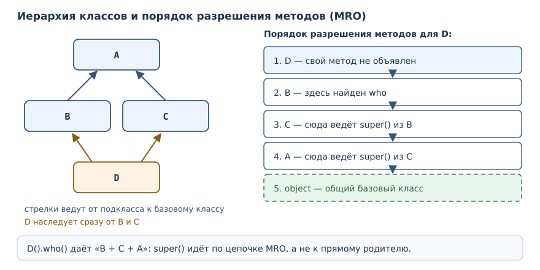
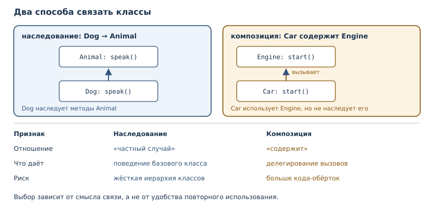

# Наследование, полиморфизм и композиция

<!-- syllanix:nav -->
**Навигация:** [← 26. Атрибуты, свойства и инкапсуляция](26-encapsulation.md) · [Оглавление книги](../README.md) · [Далее: 28. Модель данных: dunder-методы →](28-dunder.md)
<!-- /syllanix:nav -->

<!-- syllanix:topics -->
**Темы главы**
27.1. [Зачем это нужно](#why)  
27.2. [Что вы сможете после этой главы](#что-вы-сможете-после-этой-главы)  
27.3. [Наследование: базовый класс и подкласс](#inheritance)  
27.4. [Переопределение и super()](#override-super)  
27.5. [Полиморфизм](#polymorphism)  
27.6. [Когда наследование уместно](#when-inheritance)  
27.7. [isinstance, issubclass и проверки типов](#isinstance)  
27.8. [Порядок разрешения методов](#mro)  
27.9. [Композиция](#composition)  
27.10. [Наследование от встроенных классов: чего избегать](#inheritance-from-builtins)  
27.11. [Типичные ошибки](#mistakes)  
27.12. [Упражнения](#упражнения)  
27.13. [Проверка понимания](#проверка-понимания)  
27.14. [Что дальше](#что-дальше)  
<!-- /syllanix:topics -->


До сих пор каждый класс стоял сам по себе. Но у разных сущностей часто
совпадает поведение: у собаки и кошки есть имя и общий способ представиться,
у квадрата и круга есть площадь. Копировать одинаковые методы в каждый класс
плохо: исправление придётся повторять в нескольких местах, а забытое —
превратится в дефект. В этой главе вы научитесь строить классы на основе
существующих, подменять одни объекты другими через общий интерфейс и
выбирать между наследованием и композицией.

## Зачем это нужно {#why}

Представьте программу, которая считает суммарную площадь фигур. Если фигур
две — квадрат и круг, — можно написать две функции и две ветви условия. С
третьей фигурой появляется третья ветвь, и каждая новая фигура требует
правки в нескольких местах. Ошибка в одной ветви не видна компилятору и
проявляется только на конкретном наборе данных.

Полиморфизм убирает ветвления: функция просит у каждой фигуры её площадь и
не интересуется, какого та типа. Новый класс подключается без правки этой
функции. Наследование помогает описать общий контракт и переиспользовать
готовое поведение, а композиция — собрать объект из других объектов, когда
отношение «частный случай» не подходит.

Третья причина — единая точка изменения. Если у всех животных способ
представиться устроен одинаково, его место в базовом классе, а не в каждом
подклассе. Тогда исправление формата затрагивает одну строку.

## Что вы сможете после этой главы

- описывать базовый класс и подклассы, переопределять методы;
- вызывать поведение базового класса через `super()` и объяснять, зачем это
  нужно;
- писать функции, которые работают с объектами разных классов через общий
  интерфейс;
- читать порядок разрешения методов и понимать, откуда взялся вызванный
  метод;
- отличать отношение «частный случай» от отношения «содержит» и выбирать
  подходящий инструмент;
- проверять типы функциями `isinstance` и `issubclass`, не превращая код в
  набор проверок.

## Наследование: базовый класс и подкласс {#inheritance}

**Наследование** — создание класса на основе другого с наследованием его
поведения и возможностью расширения.

**Базовый класс** — класс, от которого наследует другой класс.

**Подкласс** — класс, наследующий поведение базового класса.

Синтаксис прост: имя базового класса указывают в скобках после имени нового.
Подкласс получает унаследованные атрибуты и методы базового класса (с учётом
порядка разрешения методов) и может добавить свои или заменить существующие.

```python exec
class Animal:
    def __init__(self, name):
        self.name = name

    def speak(self):
        return "..."

    def describe(self):
        return f"{self.name}: {self.speak()}"

class Dog(Animal):
    def speak(self):
        return "гав"

class Cat(Animal):
    def speak(self):
        return "мяу"

for animal in (Dog("Рекс"), Cat("Мурка"), Animal("неизвестный")):
    print(animal.describe())
```

```output
Рекс: гав
Мурка: мяу
неизвестный: ...
```

Разберём, что произошло. Метод `describe` объявлен один раз в `Animal` и
вызывает `self.speak()`. Подклассы не повторяют `describe`: они получают его
по наследству. Но `speak` они переопределяют, поэтому в момент вызова
`self.speak()` выбирается метод фактического класса объекта, а не базового.
Именно на этом держится весь дальнейший механизм.

Наследование задаёт отношение «частный случай»: собака — животное, поэтому
всё, что умеет животное, умеет и собака. Обратное неверно: не каждое
животное — собака.

## Переопределение и super() {#override-super}

**Переопределение** — замена метода базового класса одноимённым методом
подкласса.

Заменить поведение целиком просто: достаточно объявить метод с тем же именем.
Чаще нужно не заменить, а дополнить. Для этого служит **`super()`** —
функция, дающая доступ к методам базового класса из переопределённого метода.

```python exec
class Animal:
    def __init__(self, name):
        self.name = name

class Dog(Animal):
    def __init__(self, name, breed):
        super().__init__(name)
        self.breed = breed

d = Dog("Рекс", "лабрадор")
print(d.name, d.breed)
print(isinstance(d, Dog), isinstance(d, Animal))
print(issubclass(Dog, Animal))
```

```output
Рекс лабрадор
True True
True
```

Конструктор подкласса обязан позаботиться о состоянии базового класса.
Вызов `super().__init__(name)` передаёт имя в родительский метод, который
записывает `self.name`. Затем подкласс добавляет своё поле `breed`. Такой
порядок — сначала база, потом расширение — стандартный.

Если забыть про `super()`, объект окажется «недоделанным»: часть состояния
базового класса не создана. Ошибка проявится не в конструкторе, а позже, при
обращении к отсутствующему атрибуту:

```python exec expect-error
class Animal:
    def __init__(self, name):
        self.name = name

class Dog(Animal):
    def __init__(self, name, breed):
        self.breed = breed

d = Dog("Рекс", "лабрадор")
print(d.name)
```

```output
AttributeError: 'Dog' object has no attribute 'name'
```

`super()` полезен и в обычных методах, когда нужно расширить поведение, а не
выбросить его:

```python exec
class Logger:
    def log(self, message):
        return ["log: " + message]

class TimestampLogger(Logger):
    def log(self, message):
        records = super().log(message)
        records.append("готово")
        return records

print(TimestampLogger().log("старт"))
```

```output
['log: старт', 'готово']
```

Подкласс получил результат базового метода и дополнил его. Если бы он
переписал `log` целиком, формат записи пришлось бы дублировать.

## Полиморфизм {#polymorphism}

**Полиморфизм** — возможность работать с объектами разных классов через
общий интерфейс, не проверяя их конкретный тип.

Посмотрите, как выглядит функция, которая считает суммарную площадь:

```python exec
class Shape:
    def area(self):
        raise NotImplementedError

class Square(Shape):
    def __init__(self, side):
        self.side = side

    def area(self):
        return self.side ** 2

class Circle(Shape):
    def __init__(self, radius):
        self.radius = radius

    def area(self):
        return round(3.14159 * self.radius ** 2, 2)

def total_area(shapes):
    return round(sum(shape.area() for shape in shapes), 2)

print(total_area([Square(2), Circle(1)]))
print(Square(2).area(), Circle(1).area())
```

```output
7.14
4 3.14
```

Функция `total_area` не знает, какие именно фигуры ей передали: ей достаточно,
что у каждой есть метод `area`. Квадрат и круг здесь связаны общим базовым
классом `Shape`, но функция работает и без него — это показано ниже, в разделе
«Полиморфизм без общего базового класса». Для `total_area` важен не тип
объекта, а наличие метода `area`.

Базовый класс `Shape` здесь играет роль контракта: он объявляет `area` и
сообщает, что подкласс обязан её реализовать. Строка `raise NotImplementedError`
— обещание, что метод без реализации использовать нельзя. Формально Python
не требует общего базового класса: достаточно, чтобы метод существовал. Но
общий базовый класс делает контракт видимым и даёт общий тип для документации.

Добавление новой фигуры не требует правки `total_area`. Это главный признак
полиморфного решения: новый код подключается, а старый не меняется.

### Полиморфизм без общего базового класса {#duck-typing}

Общий базовый класс помогает описать контракт, но не обязателен. Python
смотрит на поведение объекта, а не на его родословную: если у объекта есть
метод `area`, его можно передать в `total_area`.

```python exec
class Square:
    def __init__(self, side):
        self.side = side

    def area(self):
        return self.side ** 2

class Circle:
    def __init__(self, radius):
        self.radius = radius

    def area(self):
        return round(3.14159 * self.radius ** 2, 2)

def total(shapes):
    return round(sum(shape.area() for shape in shapes), 2)

print(total([Square(3), Circle(2)]))
```

```output
21.57
```

Здесь у `Square` и `Circle` нет общего предка, и это не мешает функции.
Такой стиль называют утиной типизацией: «если это крякает как утка, то это
утка». У него есть цена: ошибка в имени метода обнаружится только при
вызове, а не при объявлении класса. Поэтому в больших программах общий
базовый класс или протокол (о них в главе 29) всё же полезен: он делает
контракт явным и позволяет проверить реализацию заранее.

## Когда наследование уместно {#when-inheritance}

Наследование — сильная связь. Подкласс зависит не только от имён методов
базового класса, но и от их поведения: если база изменит смысл метода,
подкласс может сломаться. Поэтому решение стоит принимать по трём вопросам.

Первый: **верно ли отношение «частный случай»**? Собака — животное, квадрат —
фигура, наследование уместно. Автомобиль — не двигатель, отчёт — не логгер,
здесь нужна композиция.

Второй: **можно ли подставить подкласс вместо базового класса**? Если
функция принимает `Animal` и вызывает `speak`, любой подкласс обязан
поддерживать этот вызов. Подкласс, который «почти подходит», но требует
особого обращения, ломает подстановочность и делает общий код хрупким.

Третий: **не придётся ли отключать унаследованное поведение**? Если подкласс
вынужден переопределять половину методов пустыми телами или запрещать часть
операций, иерархия выбрана неверно. Это сигнал, что общий базовый класс
объединяет слишком разные сущности.

Хороший пример наследования — иерархия исключений: `ValueError` — подкласс
`Exception`, и код, который ловит `Exception`, корректно работает с любым
подклассом. Хороший пример композиции — класс отчёта, который пишет в
логгер: отчёт — не логгер, он им пользуется. В сомнительных случаях
начинайте с композиции: её проще заменить на наследование позже, чем
наоборот.

## isinstance, issubclass и проверки типов {#isinstance}

**`isinstance`** — встроенная функция, которая отвечает на вопрос,
принадлежит ли объект классу или его подклассу.

```python exec
class Animal:
    pass

class Dog(Animal):
    pass

d = Dog()
print(isinstance(d, Dog), isinstance(d, Animal), type(d) is Dog, type(d) is Animal)
print(issubclass(Dog, Animal), issubclass(Animal, Dog))
```

```output
True True True False
True False
```

`isinstance` учитывает наследование: собака — экземпляр и `Dog`, и `Animal`.
`type` наследование не учитывает и возвращает ровно класс объекта, поэтому
сравнение `type(d) is Animal` даёт `False`. `issubclass` проверяет сами классы.

Проверка типа уместна на границе программы: например, при разборе входных
данных или в отладочном утверждении. Внутри объектного кода она часто
признак того, что полиморфизм не использован: вместо `if isinstance(...)`
стоит объявить общий метод и вызвать его. Каждая проверка типа добавляет
ветвь, которую придётся править при появлении нового класса.

## Порядок разрешения методов {#mro}

Когда классов несколько, важно понимать, в каком порядке Python ищет метод.
**Порядок разрешения методов (MRO)** — линейный порядок, в котором Python
ищет метод в иерархии классов; при множественном наследовании он строится
алгоритмом C3.

```python exec
class A:
    def who(self):
        return "A"

class B(A):
    def who(self):
        return "B + " + super().who()

class C(A):
    def who(self):
        return "C + " + super().who()

class D(B, C):
    pass

print(D().who())
print([cls.__name__ for cls in D.__mro__])
```

```output
B + C + A
['D', 'B', 'C', 'A', 'object']
```

Класс `D` наследует от `B` и `C`, оба наследуют от `A`. Порядок поиска:
`D`, `B`, `C`, `A`, `object`. У `D` своего `who` нет, поэтому находится
метод `B`. Внутри него `super().who()` идёт дальше по цепочке и попадает в
`C`, а не в `A` — вот почему получилось `B + C + A`, а не `B + A`.
`super()` не «вызывает базовый класс» вообще, а вызывает следующий класс в
порядке разрешения методов.



Для одиночного наследования порядок очевиден: класс, его база, база базы.
Множественное наследование усложняет картину, и без необходимости его лучше
избегать: цепочка `super()` становится трудной для чтения. Если классы всё
же совмещают, помогает привычка смотреть на `__mro__` и не полагаться на
догадки.

## Композиция {#composition}

**Композиция** — построение объекта из других объектов: «has-a» вместо
«is-a».

Объект хранит другой объект в атрибуте и вызывает его методы. Отношение
«содержит» не требует родства классов:

```python exec
class Engine:
    def __init__(self, power):
        self.power = power

    def start(self):
        return f"двигатель {self.power} л.с. запущен"

class Car:
    def __init__(self, model, engine):
        self.model = model
        self.engine = engine

    def start(self):
        return f"{self.model}: {self.engine.start()}"

car = Car("Седан", Engine(150))
print(car.start())
print(isinstance(car, Engine))
```

```output
Седан: двигатель 150 л.с. запущен
False
```

`Car` — не двигатель, поэтому наследование здесь было бы ошибкой.
Машина содержит двигатель и делегирует ему работу: метод `start` автомобиля
вызывает `start` двигателя. Такая связь гибче: двигатель можно заменить на
другой, не меняя класс автомобиля.

Сравним два отношения:

| Признак | Наследование | Композиция |
|---|---|---|
| Отношение | «частный случай» | «содержит» |
| Что даёт | поведение базового класса | делегирование вызовов |
| Изменение | правка иерархии | замена вложенного объекта |
| Риск | жёсткая структура | больше кода-обёрток |



## Наследование от встроенных классов: чего избегать {#inheritance-from-builtins}

Соблазн велик: список уже умеет хранить элементы, значит, стек можно сделать
наследником `list`. Проблема в том, что наследник получает все методы
родителя, включая те, что нарушают правила нового класса:

```python exec
class Stack(list):
    def push(self, item):
        self.append(item)

s = Stack()
s.push(1)
s.append(2)
s.insert(0, 99)
print(s)
```

```output
[99, 1, 2]
```

Метод `push` добавлен, но `append` и `insert` остались доступны и позволяют
обойти правило «элементы добавляются только в конец». Композиция решает
задачу иначе: список хранится внутри и доступен только через нужные методы.

```python exec
class Stack:
    def __init__(self):
        self._items = []

    def push(self, item):
        self._items.append(item)

    def pop(self):
        return self._items.pop()

    def size(self):
        return len(self._items)

s = Stack()
s.push("a")
s.push("b")
print(s.pop(), s.size())
print(hasattr(s, "append"))
```

```output
b 1
False
```

Наружу видны только `push`, `pop` и `size`. Внутренний список скрыт за
соглашением об имени, поэтому случайно обойти инвариант снаружи нельзя.
Сознательно — можно: `s._items.append(...)` доступен, но это явное нарушение
соглашения, как и любое обращение к имени с подчёркиванием. Правило простое:
наследование от встроенных коллекций оправдано редко; чаще достаточно
композиции или модуля `collections`, о котором пойдёт речь в главе 34.

## Типичные ошибки {#mistakes}

1. **Забыть `super().__init__()` в конструкторе подкласса.** Состояние
   базового класса не создаётся, и ошибка всплывает позже.
2. **Наследовать ради повторного использования кода, а не ради отношения
   «частный случай».** Класс `Car(Engine)` формально переиспользует методы,
   но ломает смысл: автомобиль — не двигатель.
3. **Считать, что `super()` вызывает базовый класс.** Он вызывает следующий
   класс в порядке разрешения методов, и при множественном наследовании это
   не обязательно прямой родитель.
4. **Проверять типы вместо полиморфизма.** Цепочка `isinstance` требует
   правки при каждом новом классе и плохо читается.
5. **Менять сигнатуру переопределённого метода.** Если базовый метод
   принимает два аргумента, подкласс должен принимать их же: иначе вызов
   через общий интерфейс сломается.
6. **Строить глубокую иерархию «на будущее».** Каждый уровень добавляет
   связь, которую потом трудно разорвать; начинайте с композиции.

## Упражнения

### 1. Прогноз вывода {#ex-ch27-01}

Определите, что напечатает программа, и объясните, откуда берётся каждый
метод:

```python
class Animal:
    def __init__(self, name):
        self.name = name

    def speak(self):
        return "..."

class Dog(Animal):
    def speak(self):
        return "гав"

print(Dog("Рекс").speak())
print(Animal("кто-то").speak())
print(Dog("Рекс").name)
```

### 2. Базовый класс и два подкласса {#ex-ch27-02}

Объявите класс `Vehicle` с `describe()`, возвращающим строку
`"<имя>: <скорость> км/ч"`. Сделайте подклассы `Car` (без изменений) и
`Truck`, который дополняет описание словом «грузовик». Проверьте оба.

### 3. Исправление конструктора {#ex-ch27-03}

Программа падает с `AttributeError`, потому что подкласс не вызвал
конструктор базового класса. Найдите ошибку и исправьте:

```text
class Animal:
    def __init__(self, name):
        self.name = name

class Dog(Animal):
    def __init__(self, name, breed):
        self.breed = breed

d = Dog("Рекс", "лабрадор")
print(d.name)
```

### 4. Расширение через super() {#ex-ch27-04}

Объявите класс `Logger` с методом `log(message)`, возвращающим список
`["log: " + message]`. Подкласс `TimestampLogger` должен вызвать базовый
метод, добавить в список строку `"готово"` и вернуть его. Проверьте вывод.

### 5. Полиморфная функция {#ex-ch27-05}

Объявите классы `Square` и `Circle` с методом `area()` и функцию `total`,
которая принимает список объектов и возвращает суммарную площадь с
округлением до двух знаков. Проверьте на квадрате со стороной 3 и круге
радиуса 2.

### 6. isinstance против type {#ex-ch27-06}

Для пары классов «животное — собака» выведите результаты проверок
`isinstance(d, Animal)`, `type(d) is Animal`, `issubclass(Dog, Animal)` и
`issubclass(Animal, Dog)`. Объясните разницу между функциями.

### 7. Порядок разрешения методов {#ex-ch27-07}

Дана иерархия `A ← B`, `A ← C`, `D(B, C)`, где каждый метод `who` добавляет
к результату префикс и вызывает `super().who()`. Предскажите результат
`D().who()` и выведите список имён классов из `__mro__`.

### 8. Композиция {#ex-ch27-08}

Объявите класс `Logger` с методом `write(message)` и класс `Report`, который
содержит логгер и в методе `build()` пишет в него строку отчёта, возвращая
словарь с названием и списком строк. Проверьте, что `Report` — не
`Logger`.

### 9. Стек без наследования {#ex-ch27-09}

Класс `Stack` унаследован от `list` и поэтому позволяет обходить правило
добавления. Перепишите его через композицию: внутренний список, методы
`push`, `pop`, `size`. Убедитесь, что `append` у нового класса отсутствует.

### 10. Мини-проект: расчёт зарплат {#ex-ch27-10}

Объявите базовый класс `Employee` с именем и окладом и методом `salary()`.
Подклассы: `Manager` с премией (оклад плюс премия) и `Intern`, получающий
половину оклада. Соберите список сотрудников разных классов, напечатайте
зарплату каждого и общую сумму. Объясните, почему функция подсчёта не
содержит проверок типа.

## Проверка понимания

1. Какое отношение описывает наследование, а какое — композиция?
2. Что делает `super()` и почему при множественном наследовании он может
   вызвать не прямой родительский класс?
3. Зачем базовому классу метод с `raise NotImplementedError`?
4. Чем `isinstance` отличается от `type(d) is X`?
5. Почему функция, работающая через общий интерфейс, лучше цепочки
   `isinstance`?
6. Почему наследование от `list` для стека может нарушить инвариант?

## Что дальше

Вы умеете строить иерархии и подменять объекты через общий интерфейс. Но
пока ваши классы не вписываются в синтаксис языка: `print(point)` печатает
адрес, а `point1 == point2` сравнивает ссылки. В главе
[«Модель данных: dunder-методы»](28-dunder.md) вы научитесь встраивать свои
типы в операторы, сравнения и встроенные функции.

<!-- syllanix:nav -->
**Перед этой главой:** [26. Атрибуты, свойства и инкапсуляция](26-encapsulation.md)
**Связанные главы:** [03. Значения, имена, объекты и типы](03-values-names-objects.md), [07. Функции: параметры, аргументы и области видимости](07-functions.md), [10. Ошибки и исключения](10-errors-exceptions.md), [15. Строки: методы, форматирование и Unicode](15-strings.md), [25. Объекты и классы](25-objects-classes.md), [29. Dataclasses, протоколы и абстрактные классы](29-dataclasses-protocols.md), [30. Проектирование классов и API](30-oop-design.md), [31. Аннотации типов и статическая проверка](31-typing.md)
**Далее:** [28. Модель данных: dunder-методы →](28-dunder.md)
<!-- /syllanix:nav -->
