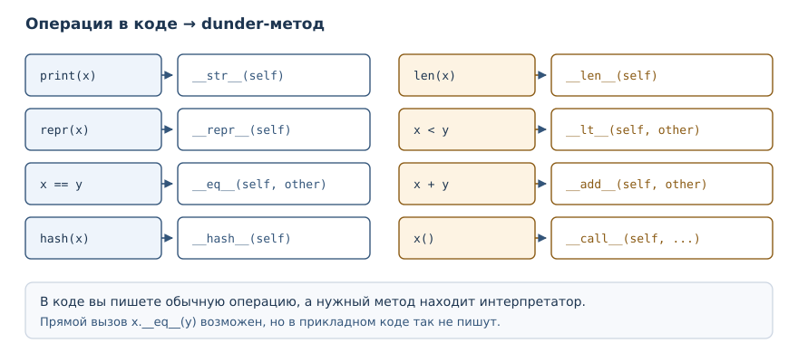
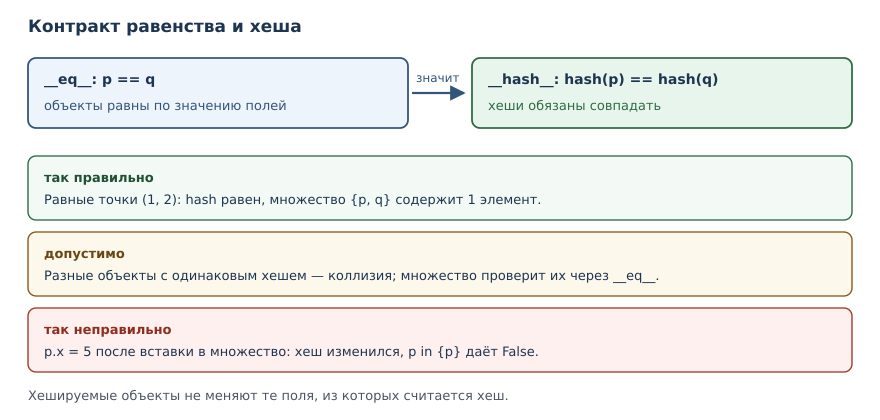

# Модель данных: dunder-методы

<!-- syllanix:nav -->
**Навигация:** [← 27. Наследование, полиморфизм и композиция](27-inheritance.md) · [Оглавление книги](../README.md) · [Далее: 29. Dataclasses, протоколы и абстрактные классы →](29-dataclasses-protocols.md)
<!-- /syllanix:nav -->

<!-- syllanix:topics -->
**Темы главы**
28.1. [Зачем это нужно](#why)  
28.2. [Что вы сможете после этой главы](#что-вы-сможете-после-этой-главы)  
28.3. [Что такое dunder-метод](#dunder)  
28.4. [__repr__: представление для разработчика](#repr)  
28.5. [__eq__: равенство по значению](#eq)  
28.6. [__hash__: объекты в множествах и словарях](#hash)  
28.7. [Богатые сравнения](#rich-comparison)  
28.8. [__len__ и истинность](#len)  
28.9. [Перегрузка операторов](#operator-overloading)  
28.10. [Вызываемые объекты](#callable)  
28.11. [Сколько методов реализовывать](#how-many-dunders)  
28.12. [Типичные ошибки](#mistakes)  
28.13. [Упражнения](#упражнения)  
28.14. [Проверка понимания](#проверка-понимания)  
28.15. [Что дальше](#что-дальше)  
<!-- /syllanix:topics -->


Ваши классы уже умеют хранить состояние и защищать его. Но за пределами
собственных методов они ведут себя как чужие объекты: `print(point)` печатает
непонятный адрес, `point1 == point2` сравнивает ссылки, `len(basket)` падает,
а `sorted(points)` поднимает исключение. Причина в том, что встроенные
операции языка не знают, что делать с вашим типом. В этой главе вы научитесь
описывать это поведение — через специальные методы, которые Python вызывает
сам.

## Зачем это нужно {#why}

Представьте отладочный вывод. Список точек печатается как набор служебных
строк с адресами памяти: по такому выводу невозможно понять, какие координаты
у элементов. Ещё хуже с равенством: две точки с одинаковыми координатами
считаются разными, потому что по умолчанию сравниваются ссылки. Если точки
попадают в множество или становятся ключами словаря, дубликаты не
объединяются, а поиск идёт не по значению.

Модель данных Python решает все эти задачи одинаково: для каждой встроенной
операции есть специальный метод, который интерпретатор вызывает у вашего
объекта. `print` обращается к методу представления, `==` — к методу
равенства, `len` — к методу длины, `+` — к методу сложения. Реализовав их,
вы получаете класс, который ведёт себя как встроенный тип: его можно
сравнивать, сортировать, складывать, печатать и хранить в множествах.

## Что вы сможете после этой главы

К концу главы ваши классы будут вести себя как встроенные типы в самых
частых операциях. Конкретно — вот чему вы научитесь:

- объяснять, зачем интерпретатор вызывает специальные методы сам;
- задавать читаемое и однозначное представление объекта;
- реализовывать равенство по значению и согласовывать его с хешированием;
- упорядочивать объекты и сортировать их встроенной сортировкой;
- определять длину, истинность, операторы и вызываемость объекта;
- замечать ошибки, которые ломают работу множеств и словарей.

## Что такое dunder-метод {#dunder}

**dunder-метод (специальный метод)** — метод с двумя подчёркиваниями по
краям, который Python вызывает для встроенных операций.

Название происходит от английского «double underscore»: `__repr__`,
`__eq__`, `__len__`. Вы уже встречали два таких метода — `__init__` и
`__repr__` в выводе ошибок. Их особенность в том, что вызывающий код редко
пишет их имя напрямую. Вместо этого он использует обычную запись языка, а
интерпретатор сам находит нужный метод.

| Запись в коде | Что вызывает Python | Смысл |
|---|---|---|
| `print(x)` | `x.__str__()` | читаемый текст |
| `repr(x)` | `x.__repr__()` | однозначное представление |
| `x == y` | `x.__eq__(y)` | равенство |
| `hash(x)` | `x.__hash__()` | хеш |
| `len(x)` | `x.__len__()` | длина |
| `x < y` | `x.__lt__(y)` | порядок |
| `x + y` | `x.__add__(y)` | сложение |
| `x()` | `x.__call__()` | вызов объекта |

Правило простое: имя метода — часть контракта языка. Придумывать свои методы
с двумя подчёркиваниями не нужно: они зарезервированы моделью данных, и
интерпретатор может искать их в неожиданных местах. Для собственных операций
используйте обычные имена.



### Почему методы вызывает интерпретатор {#lookup-on-type}

Специальные методы отличаются от обычных ещё и способом поиска. Когда вы
пишете `x + y`, Python ищет `__add__` в типе `x`, а не в самом объекте.
Обычный атрибут можно положить в экземпляр, и он найдётся; специальный —
нет.

```python exec
class Sneaky:
    pass

s = Sneaky()
s.__len__ = lambda: 5
try:
    print(len(s))
except TypeError as error:
    print("TypeError:", error)
```

```output
TypeError: object of type 'Sneaky' has no len()
```

Метод `__len__` присвоен экземпляру, но `len` его не видит: поиск идёт по
типу. Такое правило защищает язык от неожиданностей — иначе любой код мог бы
подменить поведение встроенных операций у отдельного объекта. Практический
вывод простой: специальные методы объявляют в теле класса, а не добавляют
объекту во время работы.

## __repr__: представление для разработчика {#repr}

**`__repr__`** — метод, возвращающий однозначное техническое представление
объекта для отладки.

По умолчанию объект печатается как нечто вроде `<Point object at 0x...>`.
Проверить это можно, не выводя адрес:

```python exec
class Empty:
    pass

e = Empty()
print(e.__repr__().startswith("<"))
```

```output
True
```

Стандартное представление начинается с угловой скобки и содержит адрес
памяти. Адрес меняется от запуска к запуску, поэтому такой вывод бесполезен
и в книге, и в тестах. Свой `__repr__` решает задачу:

```python exec
class Point:
    def __init__(self, x, y):
        self.x = x
        self.y = y

    def __repr__(self):
        return f"Point(x={self.x}, y={self.y})"

p = Point(3, 4)
print(p)
print(repr(p))
print([p, Point(0, 0)])
```

```output
Point(x=3, y=4)
Point(x=3, y=4)
[Point(x=3, y=4), Point(x=0, y=0)]
```

Три вывода показывают важное свойство: представление работает и для
одиночного объекта, и внутри коллекции. Хороший `__repr__` выглядит как код,
который создаёт такой же объект. Если скопировать `Point(x=3, y=4)`, получится
равная точка — это и означает «однозначное представление».

Если объявить ещё и `__str__`, он станет читаемой формой для `print`:

```python exec
class Money:
    def __init__(self, amount):
        self.amount = amount

    def __repr__(self):
        return f"Money({self.amount})"

    def __str__(self):
        return f"{self.amount} ₽"

print(Money(100))
print(repr(Money(100)))
print([Money(100)])
```

```output
100 ₽
Money(100)
[Money(100)]
```

`print` использует `__str__`, а `repr` и список — `__repr__`. Если `__str__`
не объявлен, `print` берёт `__repr__`: именно поэтому достаточно одного
метода в большинстве классов. Правило выбора: `__repr__` — для разработчика
и отладки, он должен быть однозначным; `__str__` — для пользователя, он
может быть красивым.

## __eq__: равенство по значению {#eq}

**`__eq__`** — метод, определяющий равенство объектов при сравнении через
`==`.

По умолчанию `==` сравнивает ссылки: два разных объекта не равны, даже если
их поля совпадают. Реализация по значению выглядит так:

```python exec
class Point:
    def __init__(self, x, y):
        self.x = x
        self.y = y

    def __eq__(self, other):
        if not isinstance(other, Point):
            return NotImplemented
        return (self.x, self.y) == (other.x, other.y)

print(Point(1, 2) == Point(1, 2))
print(Point(1, 2) == Point(3, 4))
print(Point(1, 2) == "точка")
print(Point(1, 2) != Point(3, 4))
```

```output
True
False
False
True
```

Здесь важны три решения. Первое: сравниваются поля, а не ссылки. Второе:
для объекта чужого типа возвращается `NotImplemented` — специальное значение,
которое говорит «я не умею сравнивать с этим». Python тогда попробует
отражённый метод другой стороны, а если и тот откажется, вернёт `False` для
равенства. Третье: `!=` объявлять не нужно, Python выводит его из `__eq__`.

Сравнение `Point(1, 2) == "точка"` не поднимает исключение и не падает:
правило `NotImplemented` превращает его в `False`. Если бы вместо этого
вернулось `False` напрямую, `!=` тоже работал бы, но отражённое сравнение с
другим классом, который умеет сравниваться с точкой, стало бы невозможно.

## __hash__: объекты в множествах и словарях {#hash}

**`__hash__`** — метод, вычисляющий хеш объекта; он должен согласовываться с
`__eq__`.

Хеш — это число, по которому объект раскладывается в множестве или словаре.
Требование к паре методов строгое: если два объекта равны, их хеши обязаны
быть равны. Иначе поиск в множестве не найдёт объект, который там лежит.

```python exec
class Point:
    def __init__(self, x, y):
        self.x = x
        self.y = y

    def __eq__(self, other):
        return isinstance(other, Point) and (self.x, self.y) == (other.x, other.y)

    def __hash__(self):
        return hash((self.x, self.y))

p1 = Point(1, 2)
p2 = Point(1, 2)
print(p1 == p2)
print(hash(p1) == hash(p2))
print(len({p1, p2}))
```

```output
True
True
1
```

Две равные точки дали одинаковый хеш, поэтому множество схлопнуло их в один
элемент. Если объявить `__eq__` и забыть про `__hash__`, объект станет
нехешируемым: Python специально запрещает использовать его в множествах и
как ключ словаря.

```python exec expect-error
class Point:
    def __init__(self, x, y):
        self.x = x
        self.y = y

    def __eq__(self, other):
        return (self.x, self.y) == (other.x, other.y)

p = Point(1, 2)
print(hash(p))
```

```output
TypeError: unhashable type: 'Point'
```

Это защита от логической ошибки: если равенство зависит от полей, а хеш
остался от стандартного поведения, множество будет считать равные объекты
разными. Решение — либо объявить `__hash__`, либо осознанно оставить тип
нехешируемым.



Второе ограничение связано с изменяемостью. Хеш вычисляется в момент
добавления, и если после этого изменить поля, объект «переедет» в другую
корзину, а множество продолжит искать его по старому хешу:

```python exec
class Point:
    def __init__(self, x, y):
        self.x = x
        self.y = y

    def __eq__(self, other):
        return (self.x, self.y) == (other.x, other.y)

    def __hash__(self):
        return hash((self.x, self.y))

p = Point(1, 2)
s = {p}
p.x = 5
print(p in s)
```

```output
False
```

Объект лежит в множестве, но найти его нельзя: хеш изменился. Отсюда правило:
хешируемые объекты делают неизменяемыми по тем полям, которые участвуют в
хеше.

## Богатые сравнения {#rich-comparison}

**Богатые сравнения** — набор dunder-методов `__lt__`, `__le__`, `__gt__`,
`__ge__` для упорядочивания объектов.

Часто достаточно объявить `__lt__`: `>` для своего типа заработает через
отражённое сравнение (`a > b` вызывает `b.__lt__(a)`), а `sorted` пользуется
именно `<`. А вот `<=` и `>=` по умолчанию не выводятся — их нужно объявлять
явно, если они нужны.

```python exec
class Version:
    def __init__(self, major, minor):
        self.major = major
        self.minor = minor

    def __repr__(self):
        return f"Version({self.major}, {self.minor})"

    def __lt__(self, other):
        return (self.major, self.minor) < (other.major, other.minor)

versions = [Version(1, 10), Version(1, 2), Version(2, 0)]
print(sorted(versions))
print(Version(1, 2) < Version(1, 10))
```

```output
[Version(1, 2), Version(1, 10), Version(2, 0)]
True
```

Сортировка не требует `__gt__` или `__le__`. Но если нужно полное
упорядочивание — например, чтобы работали все четыре операции, — объявляют
все четыре метода. Список их соответствий: `__lt__` для `<`, `__le__` для
`<=`, `__gt__` для `>`, `__ge__` для `>=`.

Для полного набора сравнений удобно реализовать `__eq__` и `__lt__`, а
остальные получить через `functools.total_ordering` из стандартной
библиотеки. Этот декоратор достраивает недостающие методы, если они
согласованы.

## __len__ и истинность {#len}

**`__len__`** — метод, возвращающий длину объекта для функции `len` и
проверки истинности.

```python exec
class Basket:
    def __init__(self, items):
        self.items = list(items)

    def __len__(self):
        return len(self.items)

b = Basket(["яблоко", "груша"])
print(len(b))
print(bool(b))
print(bool(Basket([])))
```

```output
2
True
False
```

`len` вызывает `__len__` напрямую. Проверка истинности в `if` тоже
обращается к `__len__`: пустая корзина даёт `False`, непустая — `True`.
Метод обязан вернуть неотрицательное целое число: отрицательное значение Python
отвергает с `ValueError`, а нецелое — с `TypeError`.

## Перегрузка операторов {#operator-overloading}

**Перегрузка операторов** — определение поведения операторов для своего типа
через dunder-методы (`__add__`, `__lt__` и другие).

```python exec
class Vector:
    def __init__(self, x, y):
        self.x = x
        self.y = y

    def __repr__(self):
        return f"Vector({self.x}, {self.y})"

    def __add__(self, other):
        return Vector(self.x + other.x, self.y + other.y)

print(Vector(1, 2) + Vector(3, 4))
```

```output
Vector(4, 6)
```

`__add__` получает второй операнд и возвращает новый объект. Три правила
делают перегрузку безопасной. Первое: не изменяйте `self`, создавайте новое
значение — так работают числа и строки, и читатель ожидает того же.
Второе: для чужого типа возвращайте `NotImplemented`, а не пытайтесь угадать.
Третье: реализуйте оператор только там, где его смысл очевиден. Сложение
векторов понятно, а `Vector * Vector` может означать скалярное произведение
или покомпонентное умножение — лучше метод с именем, чем неоднозначный
оператор.

## Вызываемые объекты {#callable}

**Вызываемый объект** — объект, который можно вызвать как функцию благодаря
методу `__call__`.

```python exec
class Multiplier:
    def __init__(self, factor):
        self.factor = factor

    def __call__(self, value):
        return value * self.factor

double = Multiplier(2)
print(double(5))
print(callable(double))
```

```output
10
True
```

Объект хранит состояние (`factor`) и при этом вызывается как функция.
`callable` проверяет, есть ли у объекта `__call__`. Такой приём удобен, когда
у операции есть настройки: вместо функции с замыканием можно создать объект
с методами и настройками, который при этом остаётся вызываемым.

## Сколько методов реализовывать {#how-many-dunders}

Специальных методов много, и реализовывать их все не нужно. Набор зависит от
того, какую роль играет класс.

| Роль класса | Обязательные методы | Обычно добавляют |
|---|---|---|
| значение с данными | `__repr__` | `__eq__`, `__hash__` |
| упорядоченное значение | `__repr__`, `__eq__` | `__lt__` и остальные сравнения |
| контейнер | `__repr__`, `__len__` | `__iter__`, `__getitem__` |
| число или вектор | `__repr__` | `__add__`, `__eq__` |
| операция с настройками | `__repr__` | `__call__` |

`__repr__` стоит реализовать почти всегда: это самый дешёвый способ сделать
класс удобным для отладки и логов. `__eq__` нужен, когда у объекта есть
понятие «такое же значение»; если объект представляет уникальную сущность
(например, соединение с базой), равенство по ссылке может быть правильным
решением. `__hash__` добавляют только к неизменяемым значениям, которые
действительно будут храниться в множествах или словарях.

Обратное правило тоже важно: не реализуйте метод «на всякий случай».
Например, `__add__` у класса, где сложение не имеет очевидного смысла, хуже
отсутствия метода: читатель потратит время на выяснение, что означает эта
операция. Специальный метод — часть публичного контракта, и он должен быть
понятен без документации.

И ещё одно ограничение: модель данных не терпит противоречий. Если `__eq__`
сравнивает поля, а `__lt__` — только одно из них, сортировка и равенство
начнут расходиться. Проверяйте согласованность на примерах: равные объекты
должны вести себя одинаково во всех операциях.

## Типичные ошибки {#mistakes}

1. **Оставлять стандартный `__repr__`.** Адрес памяти в выводе бесполезен и
   делает примеры недетерминированными; объявите представление явно.
2. **Сравнивать объекты через `is`.** `is` проверяет тождество ссылок.
   Равенство по значению задаётся `__eq__`, и для этого нужен `==`.
3. **Объявить `__eq__` и забыть `__hash__`.** Тип станет нехешируемым, и
   множество или словарь с ним не сработают.
4. **Сделать `__eq__` и `__hash__` несогласованными.** Если равные объекты
   дают разные хеши, поиск в множестве ломается.
5. **Изменять поля хешируемого объекта.** Объект останется в множестве, но
   перестанет находиться.
6. **Возвращать из `__repr__` не строку.** Даже число вызовет `TypeError`,
   потому что представление обязано быть текстом.
7. **Менять `self` в операторе.** `a + b` не должен незаметно изменять `a`:
   читатель ожидает новое значение.

## Упражнения

### 1. Прогноз вывода {#ex-ch28-01}

Определите, что напечатает программа, и объясните, какой метод вызывается в
каждой строке:

```python
class Tag:
    def __init__(self, name):
        self.name = name

    def __repr__(self):
        return f"Tag({self.name!r})"

print(Tag("python"))
print(repr(Tag("python")))
print([Tag("a"), Tag("b")])
```

### 2. Представление для денег {#ex-ch28-02}

Объявите класс `Money` с суммой и валютой. `__repr__` должен возвращать
строку вида `Money(100, 'руб.')`, а `__str__` — `100 руб.`. Проверьте оба
представления и печать списка.

### 3. Равенство точек {#ex-ch28-03}

Объявите класс `Point` с координатами и методом `__eq__`, сравнивающим
значения полей. Проверьте равенство двух точек с одинаковыми координатами,
неравенство разных и сравнение с объектом другого типа.

### 4. Согласование равенства и хеша {#ex-ch28-04}

Добавьте в `Point` из предыдущего упражнения `__hash__`. Убедитесь, что две
равные точки дают одинаковый хеш и что множество из них содержит один
элемент. Затем покажите, что без `__hash__` тот же класс нельзя хешировать.

### 5. Сортировка версий {#ex-ch28-05}

Объявите класс `Version` с номерами major и minor и методом `__lt__`,
сравнивающим версии по паре чисел. Отсортируйте список `1.10`, `1.2`, `2.0`
и объясните, почему `1.2` идёт раньше `1.10`.

### 6. Длина и истинность {#ex-ch28-06}

Объявите класс `Queue` с внутренним списком и методом `__len__`. Проверьте
`len(queue)`, истинность непустой и пустой очереди. Объясните, почему
проверка `if queue:` работает без отдельного метода.

### 7. Сложение векторов {#ex-ch28-07}

Объявите класс `Vector` с `__add__`, возвращающим новый вектор, и `__repr__`.
Проверьте сложение двух векторов и убедитесь, что исходные объекты не
изменились.

### 8. Вызываемый фильтр {#ex-ch28-08}

Объявите класс `StartsWith` с префиксом в конструкторе и методом `__call__`,
который принимает строку и возвращает логическое значение. Проверьте на
списке слов, отобрав подходящие, и объясните, почему объект можно передать
туда, где ожидается функция.

### 9. Исправление нехешируемого класса {#ex-ch28-09}

Класс хранит равенство по полям, но его нельзя положить в множество:

```text
class Point:
    def __init__(self, x, y):
        self.x = x
        self.y = y

    def __eq__(self, other):
        return (self.x, self.y) == (other.x, other.y)

p = Point(1, 2)
print(hash(p))
```

Объясните ошибку и исправьте класс, не теряя равенства по значению.

### 10. Мини-проект: карточка товара {#ex-ch28-10}

Объявите класс `Product` с названием и ценой. Реализуйте `__repr__`,
`__eq__` и `__hash__` по названию. Создайте множество товаров с повторяющимся
названием, словарь, где товар — ключ, и отсортируйте список товаров по цене
через `key`. Объясните, какие методы понадобились в каждом случае.

## Проверка понимания

1. Почему `__repr__` должен быть однозначным, а `__str__` — читаемым?
2. Что значит вернуть `NotImplemented` из `__eq__`? Чем это лучше `False`?
3. Почему после объявления `__eq__` тип становится нехешируемым, если не
   объявить `__hash__`?
4. Какое требование связывает `__eq__` и `__hash__`?
5. Почему опасно изменять поля объекта, лежащего в множестве?
6. Зачем `sorted` достаточно одного `__lt__`, а для всех сравнений нужны
   четыре метода?

## Что дальше

Модель данных делает ваши типы полноправными участниками языка. Следующая
глава сокращает ручную работу: в
[«Dataclasses, протоколы и абстрактные классы»](29-dataclasses-protocols.md)
вы увидите, как получить `__init__`, `__repr__` и сравнение из объявления
полей, а также как описывать контракты без жёсткой иерархии.

<!-- syllanix:nav -->
**Перед этой главой:** [27. Наследование, полиморфизм и композиция](27-inheritance.md)
**Связанные главы:** [03. Значения, имена, объекты и типы](03-values-names-objects.md), [04. Выражения, операторы и ввод данных](04-expressions-input.md), [05. Логика и управление потоком](05-control-flow.md), [07. Функции: параметры, аргументы и области видимости](07-functions.md), [10. Ошибки и исключения](10-errors-exceptions.md), [13. Списки: индексы, срезы и методы](13-lists.md), [15. Строки: методы, форматирование и Unicode](15-strings.md), [16. Множества и хеширование](16-sets.md)
**Далее:** [29. Dataclasses, протоколы и абстрактные классы →](29-dataclasses-protocols.md)
<!-- /syllanix:nav -->
