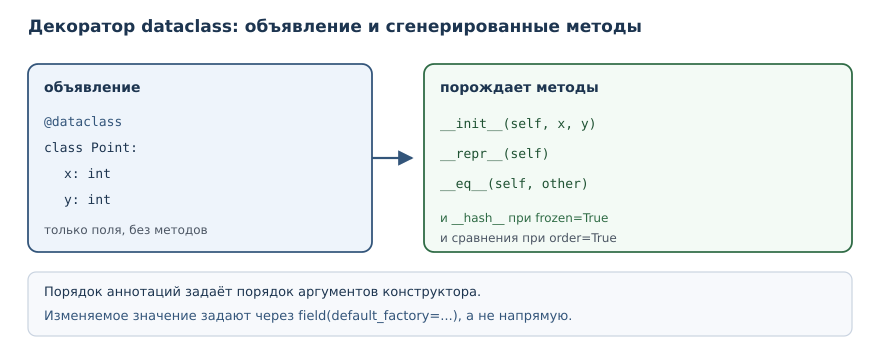
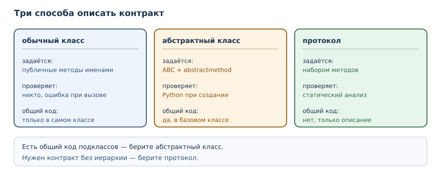

# Dataclasses, протоколы и абстрактные классы

<!-- syllanix:nav -->
**Навигация:** [← 28. Модель данных: dunder-методы](28-dunder.md) · [Оглавление книги](../README.md) · [Далее: 30. Проектирование классов и API →](30-oop-design.md)
<!-- /syllanix:nav -->

<!-- syllanix:topics -->
**Темы главы**
29.1. [Зачем это нужно](#why)  
29.2. [Что вы сможете после этой главы](#что-вы-сможете-после-этой-главы)  
29.3. [Dataclass: данные без церемоний](#dataclass)  
29.4. [namedtuple: компактная неизменяемая запись](#namedtuple)  
29.5. [Интерфейс и контракт](#interface)  
29.6. [Абстрактный базовый класс](#abc)  
29.7. [Структурная типизация и протоколы](#protocol)  
29.8. [Что выбрать](#choose)  
29.9. [Типичные ошибки](#mistakes)  
29.10. [Упражнения](#упражнения)  
29.11. [Проверка понимания](#проверка-понимания)  
29.12. [Что дальше](#что-дальше)  
<!-- /syllanix:topics -->


В прошлой главе вы вручную писали `__repr__`, `__eq__` и `__hash__` для
простого класса с двумя полями. Для класса данных это утомительно и
однообразно: одни и те же методы повторяются от класса к классу, а любое
изменение поля требует правки в нескольких местах. Стандартная библиотека
предлагает инструменты, которые убирают эту работу: `dataclass` порождает
методы из объявления полей, `namedtuple` даёт компактную неизменяемую запись,
а абстрактные классы и протоколы позволяют описывать контракты явно. В этой
главе вы научитесь выбирать подходящий инструмент, а не писать всё руками.

## Зачем это нужно {#why}

Класс данных встречается постоянно: точка, товар, заказ, настройки, строка
отчёта. У такого класса почти всегда нужны одинаковые вещи: конструктор с
полями, читаемое представление, сравнение по значению и, если объект
неизменяем, хеш. Писать это вручную — значит повторять один и тот же код и
ошибаться в мелочах: забыть поле в `__eq__`, перепутать порядок аргументов,
добавить метод сравнения и не обновить хеш.

Второй мотив — контракты. Функция, которая принимает «объект с методом
`area`», никак не сообщает об этом читателю. Общий базовый класс или
протокол делает требование явным: видно, какие методы обязательны, и видно,
когда класс им не соответствует. Контракт нужен не ради формальности, а
чтобы ошибка обнаруживалась раньше — при чтении кода и при проверке, а не
в момент вызова с реальными данными.

## Что вы сможете после этой главы

- объявлять классы данных через `@dataclass` и понимать, какие методы при
  этом появляются;
- правильно задавать значения по умолчанию, включая изменяемые;
- использовать неизменяемый dataclass для значений, которые должны быть
  хешируемыми;
- применять `namedtuple` там, где нужна совсем короткая запись;
- описывать обязательный интерфейс абстрактным базовым классом;
- описывать интерфейс протоколом, не требуя наследования, и объяснять
  разницу между этими подходами.

## Dataclass: данные без церемоний {#dataclass}

**dataclass** — класс, автоматически получающий `__init__`, `__repr__` и
сравнение по объявленным полям.

**`@dataclass`** — декоратор из модуля `dataclasses`, превращающий
объявленный класс в dataclass.

Поля объявляются переменными класса с аннотациями типа. Аннотация здесь
работает как объявление поля: по ней декоратор понимает, что перечислять в
конструкторе.

```python exec
from dataclasses import dataclass

@dataclass
class Point:
    x: int
    y: int

p = Point(3, 4)
print(p)
print(p == Point(3, 4))
print(p.x, p.y)
```

```output
Point(x=3, y=4)
True
3 4
```

Декоратор сгенерировал три метода. `__init__` принимает оба поля,
`__repr__` печатает их имена и значения, `__eq__` сравнивает по значениям.
Обратите внимание: сравнение работает «из коробки», хотя в прошлой главе для
этого пришлось писать метод вручную.

В dataclass можно добавлять собственные методы — он остаётся обычным
классом:

```python exec
from dataclasses import dataclass

@dataclass
class Point:
    x: int
    y: int

    def distance_from_origin(self):
        return (self.x ** 2 + self.y ** 2) ** 0.5

print(Point(3, 4).distance_from_origin())
print(Point.__dataclass_fields__.keys())
```

```output
5.0
dict_keys(['x', 'y'])
```

Атрибут `__dataclass_fields__` хранит описание полей. Он существует, но
обращаться к нему в прикладном коде почти никогда не нужно: это внутренняя
деталь, которая понадобится только своим инструментам.



### Значения по умолчанию и default_factory {#default-factory}

Значение по умолчанию указывают прямо у поля. Но изменяемое значение вроде
списка объявить так нельзя, и это правильная защита — та же ловушка, о
которой шла речь в главе 18:

```python exec expect-error
from dataclasses import dataclass

@dataclass
class Order:
    items: list = []

print(Order())
```

```output
ValueError: mutable default <class 'list'> for field items is not allowed: use default_factory
```

Сообщение подсказывает решение: `default_factory`. Это функция, которая
вызывается для каждого нового экземпляра и создаёт отдельное значение:

```python exec
from dataclasses import dataclass, field

@dataclass
class Order:
    title: str
    items: list = field(default_factory=list)
    paid: bool = False

a = Order("Первый")
b = Order("Второй")
a.items.append("книга")
print(a)
print(b)
print(a.items is b.items)
```

```output
Order(title='Первый', items=['книга'], paid=False)
Order(title='Второй', items=[], paid=False)
False
```

Списки разные, поэтому добавление в первый заказ не затронуло второй.
Порядок полей тоже важен: значения по умолчанию обязаны идти после полей без
умолчания. Нарушение приводит к ошибке при объявлении класса.

```python exec expect-error
from dataclasses import dataclass

@dataclass
class Point:
    x: int = 0
    y: int

print(Point(1, 2))
```

```output
TypeError: non-default argument 'y' follows default argument 'x'
```

### Неизменяемый dataclass {#frozen}

**Неизменяемый dataclass** — dataclass с `frozen=True`: после создания
атрибуты изменить нельзя, объект хешируем.

```python exec
from dataclasses import dataclass

@dataclass(frozen=True)
class Point:
    x: int
    y: int

p = Point(1, 2)
print(p)
print(hash(p) == hash(Point(1, 2)))
print(len({p, Point(1, 2)}))
```

```output
Point(x=1, y=2)
True
1
```

Неизменяемый dataclass получает `__hash__` автоматически, потому что его
поля нельзя изменить и хеш не «уедет». Две равные точки схлопываются в
множестве в одну. Попытка записать поле отклоняется:

```python exec expect-error
from dataclasses import dataclass

@dataclass(frozen=True)
class Point:
    x: int

p = Point(1)
p.x = 5
```

```output
dataclasses.FrozenInstanceError: cannot assign to field 'x'
```

Такие классы хорошо подходят для значений-справочников: координат, денежных
сумм, идентификаторов, настроек, которые не должны меняться после создания.

### Замена и словарь полей {#replace-asdict}

Неизменяемость не означает «нельзя получить изменённый вариант». Модуль
`dataclasses` даёт две функции: `replace` создаёт копию с изменёнными полями,
а `asdict` превращает объект в обычный словарь.

```python exec
from dataclasses import dataclass, replace, asdict

@dataclass(frozen=True)
class Point:
    x: int
    y: int

p = Point(1, 2)
q = replace(p, y=5)
print(p)
print(q)
print(asdict(p))
```

```output
Point(x=1, y=2)
Point(x=1, y=5)
{'x': 1, 'y': 2}
```

`replace` пригодится, когда нужно «изменить одно поле» у неизменяемого
значения: создаётся новый объект, старый остаётся прежним. `asdict` полезен
на границе программы — при сериализации в JSON или при передаче в код,
который ожидает словарь. Обратное превращение делают обычным конструктором:
`Point(**{"x": 1, "y": 2})`.

## namedtuple: компактная неизменяемая запись {#namedtuple}

**namedtuple** — кортеж с именованными полями: компактная неизменяемая
запись.

```python exec
from collections import namedtuple

Point = namedtuple("Point", "x y")
p = Point(3, 4)
print(p)
print(p.x + p.y)
print(p._asdict())
```

```output
Point(x=3, y=4)
7
{'x': 3, 'y': 4}
```

`namedtuple` создаёт новый тип-кортеж. У него есть поля по именам, но нет
методов, которые вы бы объявили сами: это лёгкая структура. Он занимает
меньше памяти, чем dataclass, и остаётся обычным кортежем — его можно
распаковать и передать туда, где ожидается последовательность.

| Инструмент | Изменяемость | Методы | Когда выбирать |
|---|---|---|---|
| словарь | изменяемый | нет | одноразовая структура, набор параметров |
| `namedtuple` | неизменяемый | минимальный набор | короткая запись, совместимая с кортежем |
| dataclass | по умолчанию изменяемый | любые, свои | сущности с поведением и валидацией |
| `frozen` dataclass | неизменяемый | любые, свои | значения-справочники, хешируемые ключи |

## Интерфейс и контракт {#interface}

**Интерфейс** — набор операций, которые объект предоставляет внешнему коду.

Интерфейс есть у любого класса, даже если он нигде не описан: это просто
перечень публичных методов. Проблема в том, что у неописанного интерфейса
нет ни документа, ни проверки. Если функция ожидает метод `area`, узнать об
этом можно только из её тела, а класс без такого метода обнаружится лишь при
вызове.

Явный контракт решает обе задачи. Его описывают двумя способами: через
абстрактный базовый класс, если нужны наследование и общее поведение, или
через протокол, если достаточно набора методов.

## Абстрактный базовый класс {#abc}

**Абстрактный базовый класс** — класс, задающий обязательный интерфейс и не
позволяющий создать экземпляр без реализации абстрактных методов.

```python exec
from abc import ABC, abstractmethod

class Shape(ABC):
    @abstractmethod
    def area(self):
        ...

class Square(Shape):
    def __init__(self, side):
        self.side = side

    def area(self):
        return self.side ** 2

print(Square(3).area())
```

```output
9
```

Класс `Shape` наследует `ABC` и объявляет `area` абстрактным. Создать
`Shape()` нельзя: интерпретатор проверяет, реализованы ли все абстрактные
методы, и отказывается создавать «недоделанный» объект.

```python exec expect-error
from abc import ABC, abstractmethod

class Shape(ABC):
    @abstractmethod
    def area(self):
        ...

print(Shape())
```

```output
TypeError: Can't instantiate abstract class Shape without an implementation for abstract method 'area'
```

Та же проверка срабатывает для подкласса, который забыл реализовать метод:

```python exec expect-error
from abc import ABC, abstractmethod

class Shape(ABC):
    @abstractmethod
    def area(self):
        ...

class Broken(Shape):
    pass

print(Broken())
```

```output
TypeError: Can't instantiate abstract class Broken without an implementation for abstract method 'area'
```

Абстрактный класс удобен, когда у подклассов есть общее поведение: его
реализуют в базовом классе, а абстрактными оставляют только те методы,
которые обязаны различаться. Например, у фигур может быть общий метод
описания, который вызывает абстрактную `area`.

## Структурная типизация и протоколы {#protocol}

Наследование — не единственный способ заявить о соответствии контракту.
Проверять можно не родословную, а набор методов.

**Структурная типизация** — совместимость типов по набору операций
(«утиная типизация», проверяемая статически), а не по наследованию.

**Протокол** — абстрактное описание интерфейса для структурной типизации:
класс соответствует протоколу, если реализует его методы.

```python exec
from typing import Protocol

class HasArea(Protocol):
    def area(self) -> float:
        ...

class Square:
    def __init__(self, side):
        self.side = side

    def area(self) -> float:
        return float(self.side ** 2)

def total(shapes):
    return sum(shape.area() for shape in shapes)

print(total([Square(2), Square(3)]))
```

```output
13.0
```

Класс `Square` не наследует `HasArea`, но соответствует протоколу: у него
есть метод `area`. Функция `total` принимает любые объекты с таким методом.
Протокол описывает требование, не добавляя классу поведение и не создавая
иерархию.

Проверить соответствие протоколу во время выполнения можно, если пометить
его `@runtime_checkable`:

```python exec
from typing import Protocol, runtime_checkable

@runtime_checkable
class HasArea(Protocol):
    def area(self) -> float:
        ...

class Square:
    def area(self) -> float:
        return 1.0

print(isinstance(Square(), HasArea))
print(isinstance(42, HasArea))
```

```output
True
False
```

`isinstance` с протоколом проверяет только наличие методов, а не их
сигнатуры: число 42 не имеет `area`, поэтому результат `False`. Без
`@runtime_checkable` такая проверка поднимает `TypeError`. Сам протокол
создать нельзя — это описание, а не класс:

```python exec expect-error
from typing import Protocol

class HasArea(Protocol):
    def area(self) -> float:
        ...

print(HasArea())
```

```output
TypeError: Protocols cannot be instantiated
```



### Ограничения протоколов {#protocol-limits}

У протокола есть цена, о которой стоит знать заранее. Во-первых,
`isinstance` с `@runtime_checkable` проверяет только имена методов и
вызываемость: класс с методом `area(self, depth)` пройдёт проверку, хотя
использовать его как площадь нельзя. Во-вторых, протокол ничего не даёт во
время выполнения, кроме этой грубой проверки: он не ограничивает класс и не
мешает объявить несовместимую сигнатуру. Полноценная проверка возможна
только статическими анализаторами, которые читают аннотации.

Отсюда практическое следствие: протокол полезен как документ и как средство
проверки для инструментов, но не заменяет тесты. Если функция зависит от
поведения, а не только от имени метода, нужен либо общий базовый класс с
реализацией, либо явная проверка предусловий.

У абстрактного класса свои ограничения. Он требует наследования, а значит,
создаёт зависимость: подкласс обязан импортировать базовый класс. Если
классов-реализаций много и они живут в разных модулях, иерархия становится
обузой. Кроме того, множественное наследование от нескольких абстрактных
классов быстро усложняет порядок разрешения методов — тему прошлой главы.

## Что выбрать {#choose}

Инструменты решают разные задачи, и выбор зависит от того, что важнее.

| Задача | Инструмент | Почему |
|---|---|---|
| хранить набор полей | `@dataclass` | конструктор, `repr` и сравнение бесплатно |
| значение-справочник | `@dataclass(frozen=True)` | неизменяемость и хеш |
| короткая запись, совместимая с кортежем | `namedtuple` | минимум памяти и кода |
| общий код плюс обязательные методы | абстрактный базовый класс | наследование и проверка при создании |
| контракт без наследования | протокол | классы не зависят от базового |

Практическое правило: начинайте с dataclass для данных и с протокола для
контракта. Абстрактный базовый класс берите тогда, когда подклассы
действительно делят код, а не только названия методов. Наследование ради
проверки «реализован ли метод» чаще всего избыточно: протокол решает ту же
задачу без жёсткой связи.

Инструменты хорошо сочетаются. Dataclass может наследовать абстрактный
класс, если у значений общий контракт, и может сам реализовать протокол,
просто объявив нужные методы. В одном проекте нормально встретить все три
подхода: настройки как `frozen` dataclass, семейство обработчиков с общим
абстрактным классом и протокол для внешних источников, которые нельзя
заставить наследоваться. Выбор — не религия, а ответ на вопрос «какая связь
здесь действительно нужна».

## Типичные ошибки {#mistakes}

1. **Забыть декоратор `@dataclass`.** Класс с аннотациями полей без него
   остаётся обычным: конструктора, `repr` и сравнения не появится.
2. **Объявить изменяемое значение по умолчанию.** Список или словарь прямо
   в объявлении поля даёт `ValueError`; нужен `default_factory`.
3. **Нарушить порядок полей.** Поле без значения по умолчанию не может
   идти после поля со значением.
4. **Ждать изменяемости от `frozen=True`.** Запись в поле поднимает
   `FrozenInstanceError`; для изменения создают новый объект.
5. **Считать `isinstance` с протоколом полной проверкой.** Он смотрит только
   на имена методов и не проверяет сигнатуры.
6. **Объявлять абстрактный класс без нужды.** Если общего кода нет, протокол
   проще и не создаёт иерархию.
7. **Оставлять `...` вместо реализации в подклассе.** Абстрактный метод
   обязан быть переопределён, иначе экземпляр не создастся.

## Упражнения

### 1. Прогноз вывода {#ex-ch29-01}

Определите, что напечатает программа, и объясните, какие методы породил
декоратор:

```python
from dataclasses import dataclass

@dataclass
class Book:
    title: str
    year: int

b = Book("Питон", 2026)
print(b)
print(b == Book("Питон", 2026))
print(b.title, b.year)
```

### 2. Dataclass для товара {#ex-ch29-02}

Объявите dataclass `Product` с названием, ценой и количеством. Создайте два
товара, сравните их и напечатайте. Добавьте метод `total()`, возвращающий
цену, умноженную на количество.

### 3. Список в заказе {#ex-ch29-03}

Объявите dataclass `Order` с названием и списком позиций. Список должен
создаваться отдельно для каждого заказа. Добавьте позицию в первый заказ и
покажите, что второй остался пустым. Объясните, зачем нужен
`default_factory`.

### 4. Неизменяемая точка {#ex-ch29-04}

Объявите dataclass `Point` с `frozen=True`. Проверьте, что две равные точки
дают одинаковый хеш и множество схлопывает их в один элемент. Покажите, что
присваивание полю отклоняется.

### 5. namedtuple для координат {#ex-ch29-05}

Создайте `namedtuple` с полями `x` и `y`, напечатайте его, сумму координат и
словарь полей. Сравните объём кода с dataclass из упражнения 4.

### 6. Абстрактная фигура {#ex-ch29-06}

Объявите абстрактный базовый класс `Shape` с абстрактным методом `area` и
подкласс `Circle`. Убедитесь, что экземпляр `Shape` создать нельзя, а
экземпляр `Circle` — можно.

### 7. Протокол без наследования {#ex-ch29-07}

Объявите протокол `HasArea` с методом `area` и два класса, которые его не
наследуют, но реализуют метод. Напишите функцию, суммирующую площади, и
проверьте её на обоих классах.

### 8. runtime_checkable {#ex-ch29-08}

Пометьте протокол из упражнения 7 декоратором `@runtime_checkable`.
Проверьте `isinstance` для класса с методом `area` и для числа. Объясните,
что именно проверяет `isinstance` в этом случае.

### 9. Анализ: dataclass или обычный класс {#ex-ch29-09}

Для трёх сущностей — настройки приложения, счёт в банке, точка на карте —
выберите инструмент и обоснуйте выбор. Для каждой ответьте, нужны ли
изменяемость, проверка инвариантов и хеширование.

### 10. Мини-проект: каталог книг {#ex-ch29-10}

Объявите dataclass `Book` (название, автор, год) и класс `Catalog` со
списком книг и методом `by_author(name)`. Добавьте две книги разных авторов
и одну повторную, напечатайте результат фильтра и объясните, почему
dataclass удобнее словаря в этом проекте.

## Проверка понимания

1. Какие методы порождает `@dataclass` и от чего зависит их состав?
2. Почему изменяемое значение по умолчанию для поля запрещено и что
   предлагается взамен?
3. Что даёт `frozen=True` и почему такой класс можно хешировать?
4. Чем `namedtuple` отличается от dataclass по назначению?
5. Что такое интерфейс и зачем описывать его явно?
6. Чем протокол отличается от абстрактного базового класса?

## Что дальше

Вы умеете описывать данные и контракты. Последняя глава части собирает эти
инструменты в практику проектирования: в
[«Проектирование классов и API»](30-oop-design.md) речь пойдёт о связности,
связанности, композиции и дизайне исключений.

<!-- syllanix:nav -->
**Перед этой главой:** [28. Модель данных: dunder-методы](28-dunder.md)
**Связанные главы:** [03. Значения, имена, объекты и типы](03-values-names-objects.md), [07. Функции: параметры, аргументы и области видимости](07-functions.md), [10. Ошибки и исключения](10-errors-exceptions.md), [13. Списки: индексы, срезы и методы](13-lists.md), [14. Кортежи, распаковка и неизменяемость](14-tuples.md), [15. Строки: методы, форматирование и Unicode](15-strings.md), [17. Словари: отображения и структурирование данных](17-dicts.md), [25. Объекты и классы](25-objects-classes.md)
**Далее:** [30. Проектирование классов и API →](30-oop-design.md)
<!-- /syllanix:nav -->
