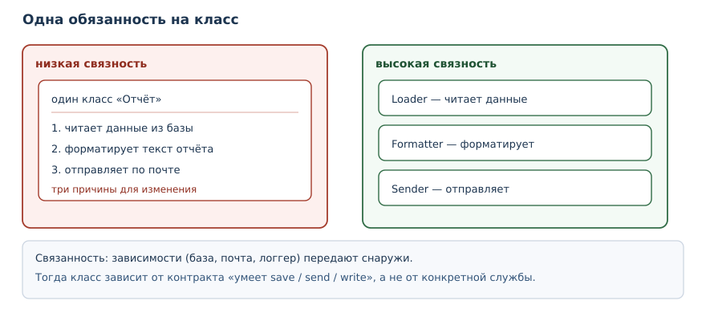
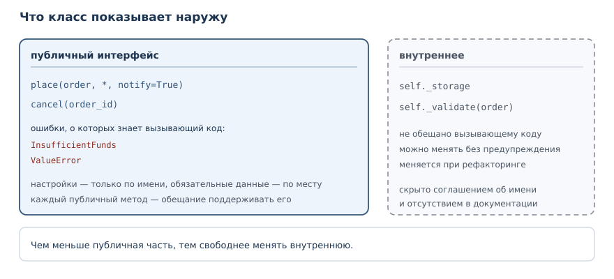

# Проектирование классов и API

<!-- syllanix:nav -->
**Навигация:** [← 29. Dataclasses, протоколы и абстрактные классы](29-dataclasses-protocols.md) · [Оглавление книги](../README.md) · [Далее: 31. Аннотации типов и статическая проверка →](31-typing.md)
<!-- /syllanix:nav -->

<!-- syllanix:topics -->
**Темы главы**
30.1. [Зачем это нужно](#why)  
30.2. [Что вы сможете после этой главы](#что-вы-сможете-после-этой-главы)  
30.3. [Связность](#cohesion)  
30.4. [Как найти границу класса](#boundaries)  
30.5. [Связанность](#coupling)  
30.6. [Композиция вместо наследования](#composition-over-inheritance)  
30.7. [Проектирование API](#api-design)  
30.8. [Собственные исключения](#custom-exceptions)  
30.9. [Собираем вместе](#putting-together)  
30.10. [Типичные ошибки](#mistakes)  
30.11. [Упражнения](#упражнения)  
30.12. [Проверка понимания](#проверка-понимания)  
30.13. [Что дальше](#что-дальше)  
<!-- /syllanix:topics -->


Вы умеете писать классы, защищать состояние, строить иерархии и описывать
контракты. Остался вопрос, который решают не синтаксисом, а решениями: какие
классы вообще нужны, что каждый из них делает и что показывает наружу.
Хороший класс легко изменить, не задевая остальную программу; плохой
приходится править в нескольких местах, и каждое исправление тянет за собой
следующее. В этой главе речь пойдёт о связности, связанности, композиции и
проектировании публичного интерфейса — с проверяемыми примерами.

## Зачем это нужно {#why}

Представьте класс, который читает заказы из базы, считает сумму, печатает
отчёт и отправляет его по почте. Пока программа маленькая, он работает.
Затем нужно поменять формат отчёта — и правка задевает класс, который
занимается базой. Затем нужно отправлять отчёт не по почте, а в мессенджер —
и снова правится тот же класс. Каждое изменение рискует сломать часть, не
связанную с задачей.

Проектирование начинается с разделения обязанностей. Класс, у которого одна
причина для изменения, меняется реже и безопаснее. Класс, который знает о
своих зависимостях только через узкий контракт, можно проверить отдельно.
Публичный интерфейс, спроектированный заранее, позволяет развивать код, не
ломая чужие вызовы. Всё это — не абстрактные принципы, а решения, которые
видно в коде: в количестве методов, в параметрах конструктора, в том, какие
исключения класс поднимает.

## Что вы сможете после этой главы

Глава даёт критерии, по которым проектное решение можно проверить, а не
только обсудить. Вот что вы будете уметь к концу:

- оценивать связность класса и замечать, когда он делает слишком много;
- уменьшать связанность, передавая зависимости снаружи;
- выбирать композицию там, где наследование создаёт лишнюю связь;
- проектировать небольшой публичный интерфейс: имена, параметры, ошибки;
- описывать ошибки предметной области собственными исключениями.

## Связность {#cohesion}

**Связность** — мера того, насколько элементы модуля или класса относятся к
одной ответственности.

Простой признак низкой связности — класс отвечает на вопрос «за что он
отвечает?» списком из нескольких несвязанных пунктов. Признак высокой
связности — все методы работают с одним набором данных и решают одну задачу.

Сравним два варианта. В первом классе собрано всё:

```python exec
class Report:
    def __init__(self, title, rows):
        self.title = title
        self.rows = rows

    def total(self):
        return sum(row["amount"] for row in self.rows)

    def as_text(self):
        lines = [self.title]
        for row in self.rows:
            lines.append(f"{row['name']}: {row['amount']}")
        lines.append(f"Итого: {self.total()}")
        return "\n".join(lines)

report = Report("Продажи", [{"name": "Книга", "amount": 500}, {"name": "Ручка", "amount": 50}])
print(report.as_text())
```

```output
Продажи
Книга: 500
Ручка: 50
Итого: 550
```

Пока в классе только строки отчёта и сумма, всё в порядке. Но если добавить сюда
загрузку из базы и отправку по почте, получится класс с тремя причинами для
изменения: структура данных, формат отчёта и способ доставки. Разделим
обязанности:

```python exec
class Order:
    def __init__(self, title, rows):
        self.title = title
        self.rows = rows

    def total(self):
        return sum(row["amount"] for row in self.rows)

class OrderFormatter:
    def __init__(self, width=20):
        self.width = width

    def format(self, order):
        lines = [order.title]
        for row in order.rows:
            lines.append(f"{row['name']:<{self.width}} {row['amount']}")
        lines.append(f"{'Итого':<{self.width}} {order.total()}")
        return "\n".join(lines)

order = Order("Продажи", [{"name": "Книга", "amount": 500}, {"name": "Ручка", "amount": 50}])
print(OrderFormatter().format(order))
```

```output
Продажи
Книга                500
Ручка                50
Итого                550
```

Теперь `Order` отвечает за строки и сумму, `OrderFormatter` — за вид. Формат
можно менять, не трогая записи, а записи — не трогая формат. Это и есть
высокая связность: каждый класс занят одной задачей, и его методы работают с
одним состоянием.



## Как найти границу класса {#boundaries}

Связность — критерий, но не рецепт. Практический способ провести границу —
выписать все причины, по которым класс может измениться, и посмотреть, какие
из них связаны с разными людьми или разными событиями.

Если бухгалтерия просит новый формат счёта, а отдел логистики — новый способ
доставки, это две разные причины. Они не должны вести к правке одного
класса. Если же обе просьбы меняют правило расчёта стоимости доставки, они
относятся к одной обязанности, и дробить её незачем.

Второй способ — посмотреть на состояние. Класс, который держит поля о заказе и
одновременно настройки шрифта для печати, работает с двумя наборами данных.
Скорее всего, это два класса. Третий способ — попробовать описать класс
одним предложением без союза «и». Если не получается, граница проведена
неудачно.

При этом не стоит дробить классы механически. Три класса по одному методу —
не признак хорошего дизайна: связи между ними могут оказаться теснее, чем
были внутри одного. Разделение оправдано, когда части меняются по разным
причинам и могут быть проверены отдельно.

## Связанность {#coupling}

**Связанность** — мера зависимости модулей друг от друга; низкая связанность
упрощает изменения.

Связанность видна по тому, сколько внешнего мира нужно классу, чтобы
работать. Если класс сам создаёт подключение к базе, пишет в файл и
обращается к сети, его нельзя проверить без всего этого окружения. Если
зависимости передают снаружи, класс работает с любым объектом, у которого
есть нужный метод.

```python exec
class NullLogger:
    def __init__(self):
        self.last = ""

    def write(self, message):
        self.last = message

class OrderService:
    def __init__(self, logger):
        self.logger = logger

    def place(self, order_id):
        self.logger.write(f"заказ {order_id} принят")
        return {"id": order_id, "status": "accepted"}

logger = NullLogger()
service = OrderService(logger)
print(service.place(7))
print(logger.last)
```

```output
{'id': 7, 'status': 'accepted'}
заказ 7 принят
```

`OrderService` знает про логгер только то, что у него есть метод `write`.
В тестах вместо настоящего логгера подойдёт `NullLogger`, а в рабочей
программе — запись в файл или в систему журналирования. Это не «магия
внедрения зависимостей», а обычная передача аргумента в конструктор.

Правило, которое стоит запомнить: **зависимость, созданная внутри класса,
привязывает его к конкретной реализации и окружению; переданная снаружи —
только к интерфейсу, который класс использует**. Связанность при этом не
исчезает совсем, но становится управляемой: реализацию можно заменить, а в
тесте подставить двойник. Каждый `open(...)` или HTTP-клиент, созданный в
методе, привязывает класс к окружению и делает тесты медленнее и хрупче.

## Композиция вместо наследования {#composition-over-inheritance}

**Композиция вместо наследования** — принцип предпочитать включение
объектов наследованию, если нет настоящей подстановочности.

В главе 27 вы видели, как наследование от `list` ломает инвариант стека.
Тот же выбор возникает при проектировании: иногда хочется унаследовать
готовый класс, чтобы получить пару методов.

```python exec
class EmailChannel:
    def send(self, text):
        return "email: " + text

class SmsChannel:
    def send(self, text):
        return "sms: " + text

class Notifier:
    def __init__(self, channel):
        self.channel = channel

    def notify(self, text):
        return self.channel.send(text)

print(Notifier(EmailChannel()).notify("заказ готов"))
print(Notifier(SmsChannel()).notify("заказ готов"))
```

```output
email: заказ готов
sms: заказ готов
```

`Notifier` — не канал, а его пользователь. Если завтра появится
канал в мессенджере, добавится один класс с методом `send`, а `Notifier` не
изменится. При наследовании пришлось бы создавать `EmailNotifier`,
`SmsNotifier` и дублировать логику уведомления в каждом.

Наследование остаётся уместным, когда отношение «это одно и то же» настоящее и
подкласс можно подставить вместо базового без оговорок. Собственные
исключения — хороший пример: `InsufficientFunds` — это `ValueError`, он
ведёт себя как ошибка значения. А `Notifier` — не канал, поэтому
композиция точнее описывает связь.

## Проектирование API {#api-design}

**Проектирование API** — проектирование публичного интерфейса так, чтобы им
было удобно и безопасно пользоваться и его можно было развивать.

Публичный интерфейс класса — это его методы, свойства и исключения. Хороший
интерфейс решает три задачи: его легко вызвать правильно, трудно вызвать
неправильно и можно расширять, не ломая существующий код.

```python exec
def render_report(rows, *, title="Отчёт", width=20, with_total=True):
    if width < 5:
        raise ValueError("ширина должна быть не меньше 5")
    lines = [title]
    for row in rows:
        lines.append(f"{row['name']:<{width}} {row['amount']}")
    if with_total:
        lines.append(f"{'Итого':<{width}} {sum(row['amount'] for row in rows)}")
    return "\n".join(lines)

print(render_report([{"name": "Книга", "amount": 500}], title="Продажи", width=10))
```

```output
Продажи
Книга      500
Итого      500
```

Здесь видны несколько решений проектирования. Обязательные значения
передаются по месту, настройки — только по имени: читатель сразу видит, что
влияет на результат. Значения по умолчанию позволяют короткий вызов, а
проверка параметра поднимает `ValueError` с понятным текстом вместо
непонятного результата.

Полезно сверять интерфейс с вопросами:

| Вопрос | Что проверяет |
|---|---|
| можно ли вызвать функцию одной строкой? | удобство |
| что произойдёт при неверном аргументе? | предсказуемость ошибок |
| можно ли добавить параметр, не сломав вызовы? | развиваемость |
| видно ли из сигнатуры, что важно? | читаемость |



Отдельное правило — не прятать ошибки. Функция, которая при неверных данных
возвращает `None` или пустую строку, заставляет вызывающий код гадать, что
произошло. Исключение с точным сообщением сообщает и факт ошибки, и причину.

### Совместимость и развитие API {#api-compatibility}

Публичный интерфейс живёт дольше одной задачи, поэтому его развитие
планируют. Три приёма позволяют добавлять возможности, не ломая вызовы.

Первый — новый параметр со значением по умолчанию. Вызов, написанный до
изменения, продолжает работать, а новый код может передать уточнение. Если
параметр идёт после `*`, он доступен только по имени, и порядок остальных
аргументов не важен. Второй приём — новый метод вместо изменения старого:
старый помечают устаревшим и через несколько версий удаляют. Третий —
расширение через отдельный объект настроек, когда параметров становится
много: вместо десяти аргументов функция принимает один объект с понятными
полями.

Опаснее всего менять смысл существующего метода. Переименование аргумента
ломает вызовы, использующие имя, а изменение формата возвращаемого значения
ломает весь вызывающий код, даже если типы совпадают. Если правка неизбежна,
её вводят как новую версию метода, а старую сохраняют как тонкую обёртку —
так у пользователей появляется время перейти.

## Собственные исключения {#custom-exceptions}

**Собственное исключение** — свой класс исключения, точно называющий
категорию ошибки предметной области.

Стандартные исключения хороши на уровне языка, но в предметной области они
теряют смысл. `ValueError` от банковского перевода не говорит, что именно
случилось; `KeyError` из хранилища выдаёт внутреннюю деталь реализации.

```python exec
class InsufficientFunds(ValueError):
    def __init__(self, balance, amount):
        super().__init__(f"нужно {amount}, доступно {balance}")
        self.balance = balance
        self.amount = amount

class Account:
    def __init__(self, balance=0):
        self._balance = balance

    def withdraw(self, amount):
        if amount > self._balance:
            raise InsufficientFunds(self._balance, amount)
        self._balance -= amount
        return self._balance

acc = Account(100)
print(acc.withdraw(30))
try:
    acc.withdraw(500)
except InsufficientFunds as error:
    print("отказ:", error, "| баланс:", error.balance)
```

```output
70
отказ: нужно 500, доступно 70 | баланс: 70
```

Собственное исключение наследует `ValueError`, поэтому старый код, который
ловил `ValueError`, продолжает работать. Оно добавляет текст и поля
`balance` и `amount`, поэтому вызывающий код может обработать ошибку
осмысленно, а не просто вывести сообщение. Такое исключение — часть
публичного интерфейса, и его имя тоже стоит выбирать аккуратно.

Два правила дизайна исключений. Первое: наследуйтесь от подходящего
стандартного исключения, чтобы не ломать существующую обработку. Второе: не
пропускайте наружу внутренние исключения хранилища или сети — оборачивайте
их в своё, сохраняя исходную причину. Так пользователь класса видит
предметную ошибку, а не деталь реализации.

### Иерархия исключений предметной области {#exception-hierarchy}

Когда ошибок одного рода несколько, их объединяют общим базовым классом.
Например, у склада три отказа: товара нет, не хватает количества и партия
заблокирована. Все три — ошибки склада, и вызывающий код может ловить их
вместе или по отдельности.

```python exec
class WarehouseError(ValueError):
    pass

class OutOfStock(WarehouseError):
    pass

class NotEnoughItems(WarehouseError):
    pass

def reserve(available, requested):
    if available == 0:
        raise OutOfStock("товара нет на складе")
    if requested > available:
        raise NotEnoughItems(f"запрошено {requested}, доступно {available}")
    return requested

print(reserve(10, 5))
try:
    reserve(0, 1)
except WarehouseError as error:
    print("склад:", error)
try:
    reserve(2, 5)
except NotEnoughItems as error:
    print("нехватка:", error)
```

```output
5
склад: товара нет на складе
нехватка: запрошено 5, доступно 2
```

Общий базовый класс `WarehouseError` позволяет коду, которому важна только
категория, ловить все складские ошибки одним `except`. Код, которому нужна
конкретика, ловит подкласс. Иерархия из двух уровней читается легко; глубже
трёх уровней обычно уже не нужно.

## Собираем вместе {#putting-together}

Небольшая система показывает, как решения работают вместе. Данные — в
dataclass, работа с хранилищем — в отдельном классе, бизнес-правило — в
сервисе, а зависимость передаётся снаружи.

```python exec
from dataclasses import dataclass

@dataclass
class Order:
    order_id: int
    amount: int

class InMemoryOrders:
    def __init__(self):
        self.items = []

    def save(self, order):
        self.items.append(order)
        return order.order_id

class OrderService:
    def __init__(self, storage):
        self.storage = storage

    def place(self, order):
        if order.amount <= 0:
            raise ValueError("сумма заказа должна быть положительной")
        return self.storage.save(order)

storage = InMemoryOrders()
service = OrderService(storage)
print(service.place(Order(1, 500)))
print(len(storage.items))
```

```output
1
1
```

`Order` не знает, где его хранят. `InMemoryOrders` не знает правил заказа.
`OrderService` не знает, как устроено хранилище, — ему достаточно метода
`save`. Каждый класс связан с другими через узкий контракт, и каждый можно
заменить или проверить отдельно. Это и есть практический результат
проектирования: не «правильная архитектура», а возможность менять части по
отдельности.

## Типичные ошибки {#mistakes}

1. **Сваливать в класс несколько обязанностей.** Признак: методы класса
   работают с разными наборами данных и меняются по разным причинам.
2. **Создавать зависимости внутри класса.** `open(...)` или клиент сети в
   конструкторе мешают тестам; передавайте зависимость аргументом.
3. **Наследовать ради пары методов.** Если подстановка невозможна,
   композиция точнее и безопаснее.
4. **Прятать ошибки за `None`.** Вызывающий код не отличит «пустой
   результат» от «сломалось»; поднимайте исключение с сообщением.
5. **Пропускать наружу внутренние исключения.** `KeyError` из хранилища
   раскрывает деталь реализации; оберните его в своё исключение.
6. **Менять сигнатуру публичного метода «по месту».** Добавляйте параметр
   со значением по умолчанию или новый метод, чтобы не ломать вызовы.
7. **Делать публичным всё подряд.** Каждый публичный метод — обещание
   поддерживать его; начинайте с минимума.

## Упражнения

### 1. Прогноз вывода {#ex-ch30-01}

Определите, что напечатает программа, и объясните, какие обязанности
распределены между классами:

```python
class Order:
    def __init__(self, title, rows):
        self.title = title
        self.rows = rows

    def total(self):
        return sum(row["amount"] for row in self.rows)

class OrderFormatter:
    def __init__(self, width=20):
        self.width = width

    def format(self, order):
        lines = [order.title]
        for row in order.rows:
            lines.append(f"{row['name']:<{self.width}} {row['amount']}")
        lines.append(f"{'Итого':<{self.width}} {order.total()}")
        return "\n".join(lines)

order = Order("Продажи", [{"name": "Книга", "amount": 500}, {"name": "Ручка", "amount": 50}])
print(OrderFormatter().format(order))
```

### 2. Разделение обязанностей {#ex-ch30-02}

Дан класс, который считает сумму и сам печатает отчёт. Разделите его на
класс данных и класс форматирования. Проверьте, что результат печати не
изменился.

```text
class Report:
    def __init__(self, rows):
        self.rows = rows

    def print_report(self):
        for row in self.rows:
            print(row["name"], row["amount"])
        print("Итого:", sum(row["amount"] for row in self.rows))
```

### 3. Связанность через зависимость {#ex-ch30-03}

Класс `Mailer` сам создаёт соединение и пишет в него. Переделайте его так,
чтобы соединение передавалось в конструктор. Проверьте работу с тестовым
объектом, который просто запоминает последнее сообщение.

### 4. Композиция вместо наследования {#ex-ch30-04}

Класс `FileLogger` унаследован от `FileWriter`, чтобы использовать его метод
записи. Перепишите его через композицию: `FileLogger` содержит writer и
вызывает его метод. Объясните, почему связь стала слабее.

### 5. Собственное исключение {#ex-ch30-05}

Объявите исключение `NegativeQuantity`, наследующее `ValueError`, с полями
`quantity` и `message`. Используйте его в функции `create_item(name,
quantity)` при неположительном количестве. Проверьте успешный и неуспешный
вызов.

### 6. API с настройками {#ex-ch30-06}

Напишите функцию `render_report(rows, *, title="Отчёт", width=20,
with_total=True)`, которая печатает строки таблицы и итог. Добавьте проверку
ширины: меньше 5 — `ValueError`. Проверьте два вызова с разными настройками.

### 7. Анализ связности {#ex-ch30-07}

Класс делает четыре вещи: загружает записи из файла, проверяет их,
сортирует и сохраняет результат. Предложите разбиение на классы, для каждого
назовите одну ответственность. Объясните, как изменится число причин для
изменения.

### 8. Исключение с данными {#ex-ch30-08}

Объявите исключение `InsufficientFunds(ValueError)` с полями `balance` и
`amount`. Используйте его в классе `Account` при попытке снять больше, чем
есть. В обработчике напечатайте сообщение и баланс из исключения.

### 9. Мини-проект: сервис заказов {#ex-ch30-09}

Объявите dataclass `Order` с номером и суммой, хранилище `InMemoryOrders` с
методом `save` и сервис `OrderService` с методом `place`, проверяющим, что
сумма положительна. Передайте хранилище в сервис. Проверьте успешный заказ и
отказ при нулевой сумме.

### 10. Рефакторинг большого класса {#ex-ch30-10}

Класс `Shop` умеет добавлять товар, считать сумму, применять скидку и
печатать чек. Разделите его на три класса: каталог, корзину с расчётом и
печать чека. Покажите, что расчёт и печать можно менять независимо.

## Проверка понимания

1. Что такое связность и по какому признаку видно, что она низкая?
2. Что такое связанность и почему зависимость, созданная внутри класса,
   увеличивает её?
3. Когда композиция точнее наследования? Приведите пример из главы.
4. Почему собственное исключение наследуют от стандартного?
5. Зачем в публичном API настройки делают параметрами только для
   именованных аргументов?
6. Почему не стоит возвращать `None` вместо исключения при ошибке?

## Что дальше

Часть об объектном программировании закончена: вы умеете моделировать
предметную область, защищать инварианты и проектировать интерфейсы. Дальше
книга переходит к надёжности кода. В главе
[«Аннотации типов и статическая проверка»](31-typing.md) вы научитесь
описывать типы формально — и тогда проектные решения можно будет проверять
инструментами, а не только чтением.

<!-- syllanix:nav -->
**Перед этой главой:** [29. Dataclasses, протоколы и абстрактные классы](29-dataclasses-protocols.md)
**Связанные главы:** [03. Значения, имена, объекты и типы](03-values-names-objects.md), [07. Функции: параметры, аргументы и области видимости](07-functions.md), [10. Ошибки и исключения](10-errors-exceptions.md), [13. Списки: индексы, срезы и методы](13-lists.md), [15. Строки: методы, форматирование и Unicode](15-strings.md), [17. Словари: отображения и структурирование данных](17-dicts.md), [24. Гибкие сигнатуры: *args, **kwargs и распаковка](24-signatures.md), [25. Объекты и классы](25-objects-classes.md)
**Далее:** [31. Аннотации типов и статическая проверка →](31-typing.md)
<!-- /syllanix:nav -->
