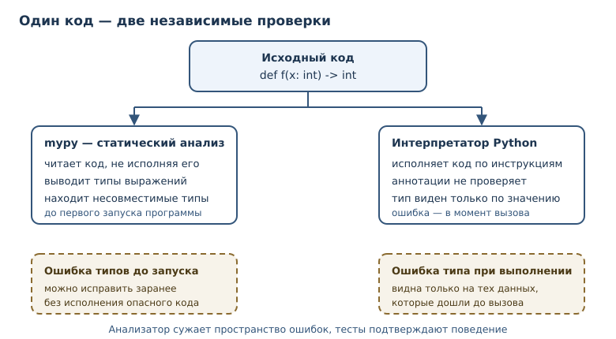
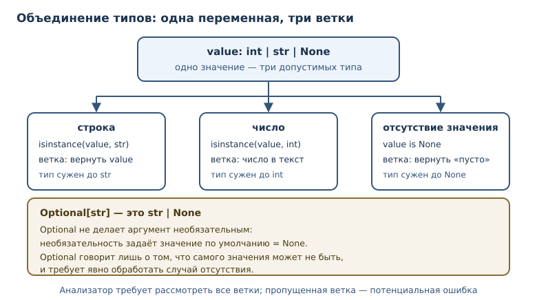

# Аннотации типов и статическая проверка

<!-- syllanix:nav -->
**Навигация:** [← 30. Проектирование классов и API](30-oop-design.md) · [Оглавление книги](../README.md) · [Далее: 32. Тестирование: pytest и TDD →](32-testing.md)
<!-- /syllanix:nav -->

<!-- syllanix:topics -->
**Темы главы**
31.1. [Что вы сможете после этой главы](#что-вы-сможете-после-этой-главы)  
31.2. [Аннотация: синтаксис и смысл](#annotations)  
31.3. [mypy: статическая проверка](#mypy)  
31.4. [Объединение типов и Optional](#union)  
31.5. [Обобщённые типы](#generics)  
31.6. [Типы во время выполнения](#runtime)  
31.7. [Типичные ошибки](#mistakes)  
31.8. [Упражнения](#упражнения)  
31.9. [Проверка понимания](#проверка-понимания)  
31.10. [Что дальше](#что-дальше)  
<!-- /syllanix:topics -->


К этому моменту вы умеете писать программы, в которых типы определяются
значениями: одно и то же имя может хранить число, затем строку, затем список.
Такая гибкость удобна в небольших сценариях и опасна в больших: читателю
приходится угадывать, что функция ожидает на входе и что обещает вернуть,
а ошибка обнаруживается только тогда, когда до неё дойдёт исполнение.

**Аннотация типа** — это запись ожидаемого типа рядом с именем или сигнатурой.
Она не меняет поведение программы, но служит документацией для людей и
входными данными для статических анализаторов. В этой главе вы научитесь
описывать контракты функций и структур данных, поймёте, что именно проверяет
**mypy** и где заканчиваются его гарантии.

Аннотации окупаются не сразу. В программе на пятьдесят строк они выглядят
канцелярией, зато в проекте на несколько тысяч строк экономят часы: вместо
чтения тела функции достаточно взглянуть на сигнатуру, а вместо отладки
`AttributeError` на проде — увидеть предупреждение до коммита. Плата за это —
дисциплина: аннотировать нужно последовательно, а результаты проверки
исправлять, а не подавлять.

## Что вы сможете после этой главы

- аннотировать переменные, параметры и возвращаемые значения;
- записывать «одно из нескольких» через **объединение типов** и честно
  обрабатывать отсутствие значения;
- описывать контейнеры **обобщёнными типами** и связывать типы входа и выхода
  через **TypeVar**;
- понимать разницу между статической проверкой и **типами во время
  выполнения**;
- читать сообщения mypy и не превращать аннотации в формальность.

## Аннотация: синтаксис и смысл {#annotations}

**Аннотация** — синтаксическая запись типа рядом с именем: `x: int = 0`,
`def f(a: str) -> bool`. Двоеточие после имени вводит тип переменной,
стрелка `->` — тип результата функции. Синтаксис доступен и для атрибутов
класса, и для элементов контейнеров.

```python exec
def greet(name: str, times: int = 1) -> str:
    return ("Привет, " + name + "! ") * times


print(greet("Аня", 2))
print(greet.__annotations__)
```

```output
Привет, Аня! Привет, Аня!
{'name': <class 'str'>, 'times': <class 'int'>, 'return': <class 'str'>}
```

Аннотации не исчезают: интерпретатор собирает их в словарь
`__annotations__`. Это обычные объекты Python, и их можно прочитать в
программе, например в библиотеке, которая строит документацию или
валидирует данные.

Важно различать два близких термина.

- **Аннотация** — синтаксическая запись: `count: int`.
- **Аннотация типа** (type hint) — указание ожидаемого типа, которое
  проверяют статические анализаторы, но не сам интерпретатор.

Разница проявляется при запуске: аннотация существует как объект, а
проверки типа при вызове не происходит.

```python exec
def double(value: int) -> int:
    return value * 2


print(double(21))
print(double("21"))
```

```output
42
2121
```

Второй вызов не вызвал ошибку: Python умножил строку на два. Аннотация
`int` — обещание, а не ограничение. Именно поэтому нужен отдельный
инструмент, который читает код, не исполняя его.

### Аннотации и docstring

Строка документации описывает назначение функции словами, а аннотации
фиксируют её контракт в машиночитаемом виде. Эти два инструмента не
конкурируют: docstring отвечает на вопрос «зачем и при каких условиях», а
аннотации — на вопрос «какие типы на входе и выходе».

```python
def convert(amount: int, rate: float) -> float:
    """Переводит сумму по курсу.

    amount — сумма в копейках, rate — множитель курса.
    Возвращает сумму в рублях с дробной частью.
    """
    return amount * rate / 100
```

Читатель видит и смысл, и типы. Редактор кода, получив аннотации, подсказывает
аргументы и проверяет вызовы ещё до запуска. Если аннотации расходятся с
docstring, доверять стоит аннотациям: их проверяет инструмент, а текст
docstring — только человек на ревью. Поэтому контракт лучше держать в одном
месте, а в docstring описывать то, что из типов не видно: единицы измерения,
допустимые диапазоны, смысл исключений.

## mypy: статическая проверка {#mypy}

**mypy** — статический анализатор типов для Python, проверяющий аннотации без
запуска кода. Он разбирает программу, выводит типы выражений и сообщает о
местах, где фактический тип не совпадает с обещанным. mypy не входит в
стандартную библиотеку: это внешняя зависимость, которую устанавливают в
виртуальное окружение проекта.

Пусть файл `app.py` содержит такой код:

```python
def double(value: int) -> int:
    return value * 2


print(double("21"))
```

Запуск анализатора даёт ошибку:

```console
$ mypy app.py
app.py:5: error: Argument 1 to "double" has incompatible type "str"; expected "int"  [arg-type]
Found 1 error in 1 file (checked 1 source file)
```

Сообщение читается слева направо: файл и строка, уровень, суть, код правила.
`arg-type` — необязательная метка, по ней удобно искать объяснение в
документации. Анализатор не исполнял программу: ошибка найдена до запуска,
как синтаксическая, но, в отличие от неё, код остаётся синтаксически
корректным и запускается. Имя правила зависит от механизма: `arg-type` —
неверный аргумент вызова, `call-overload` — не подошла ни одна перегрузка
(например, индекс списка оказался строкой), `union-attr` — обращение к
атрибуту, которого нет у одного из вариантов объединения.

Что mypy проверяет уверенно:

| Ситуация | Реакция mypy |
|---|---|
| передали `str` туда, где обещан `int` | ошибка `arg-type` |
| вернули не тот тип, что в `->` | ошибка `return-value` |
| обратились к атрибуту, которого нет у типа | ошибка `attr-defined` |
| передали в метод контейнера аргумент не того типа | ошибка `arg-type` |
| проиндексировали контейнер неподходящим типом | ошибка `call-overload` |
| значение может быть `None`, а код этого не учитывает | ошибка `union-attr` |

Чего mypy **не** делает: не проверяет значения, не ловит деление на ноль, не
доказывает, что ветка `if` недостижима, и не гарантирует соответствие
аннотаций реальным данным, если они пришли извне. Статический анализ
сужает пространство ошибок, но не заменяет тесты (глава 32).



### Строгий и мягкий режимы

У анализатора есть настройки строгости. В `pyproject.toml` проекта указывают
режим и исключения:

```toml
[tool.mypy]
python_version = "3.14"
strict = true
warn_unused_ignores = true
```

При `strict = true` mypy требует аннотаций у функций, запрещает неявный
`Any` и неразмеченные контейнеры. Начинать с полного `strict` в старом
проекте болезненно: сотни сообщений закрывают полезный сигнал. Разумнее
включать строгость постепенно.

Работающая стратегия внедрения выглядит так. Сначала аннотируют публичные
функции и границы модулей — там, где контракт важен другим людям. Затем
включают проверку в непрерывной интеграции, чтобы новые изменения не
добавляли ошибок. Старые модули переводят по одному и фиксируют прогресс
числом подавлений. На каждом шаге важно, чтобы отчёт оставался коротким:
если mypy выдаёт двести сообщений, его перестают читать, и проверка
превращается в формальность.

## Объединение типов и Optional {#union}

Иногда значение может быть одного из нескольких типов. **Объединение типов** —
тип «одно из нескольких»: `int | str` (в старом синтаксисе
`Union[int, str]`). Проверяющая программа должна рассмотреть каждую ветку.

```python exec
def stringify(value: int | float | str) -> str:
    if isinstance(value, str):
        return value
    return f"число: {value}"


print(stringify("готово"))
print(stringify(3.5))
print(stringify(7))
```

```output
готово
число: 3.5
число: 7
```

`isinstance` не только выбирает ветку исполнения, но и сужает тип для
анализатора: внутри `if` значение считается строкой. Этот приём называют
сужением типа.

Отдельный и самый частый случай — «значение или ничего». **Optional** —
объединение типа с `None`: `str | None`. Историческое имя `Optional` пришло
из модуля `typing`; смысл тот же, но новое написание короче.

```python
from typing import Optional


def find_user(user_id: int) -> Optional[str]:
    ...  # вернёт имя пользователя или None, если его нет
```

Почему это важно? `dict.get` возвращает не значение, а «значение или `None`».
Если забыть о второй возможности, программа упадёт на первом же отсутствующем
ключе.

```python exec expect-error
prices = {"яблоко": 50}
price = prices.get("слива")
print(price + 10)
```

```output
TypeError: unsupported operand type(s) for +: 'NoneType' and 'int'
```

Правильный код явно обрабатывает отсутствие значения:

```python exec
prices = {"яблоко": 50, "груша": 80}
price = prices.get("слива")
if price is None:
    print("нет в продаже")
else:
    print(price + 10)
```

```output
нет в продаже
```

Обратите внимание: `Optional[str]` — это не «необязательный аргумент». За
необязательность аргумента отвечает значение по умолчанию, а `Optional`
говорит лишь о том, что само значение может отсутствовать. Путаница между
этими двумя вещами — постоянный источник ошибок.



## Обобщённые типы {#generics}

Контейнер хранит элементы, и хочется описать не только «список», но и «список
чисел». **Обобщённый тип** — тип с параметрами: `list[int]`,
`dict[str, float]`, `tuple[int, ...]`. Параметры уточняют, что внутри.

```python exec
from typing import TypeVar

T = TypeVar("T")


def first(items: list[T]) -> T:
    return items[0]


numbers: list[int] = [10, 20, 30]
names: list[str] = ["Аня", "Борис"]
print(first(numbers))
print(first(names))
print(first.__annotations__)
```

```output
10
Аня
{'items': list[~T], 'return': ~T}
```

**TypeVar** — переменная типа, связывающая типы входа и выхода обобщённой
функции. Запись `list[T] -> T` обещает: если на вход пришёл список чисел, на
выходе будет число; если список строк — строка. Без такой связи пришлось бы
писать `object`, теряя информацию.

Параметры типов доступны и для анализа, и для интроспекции:

```python exec
from typing import get_args, get_origin

print(get_origin(dict[str, float]))
print(get_args(dict[str, float]))
print(get_args(tuple[int, ...]))
```

```output
<class 'dict'>
(<class 'str'>, <class 'float'>)
(<class 'int'>, Ellipsis)
```

`dict[str, float]` — это объект-описание типа, а не сам словарь. Создать
значение из него нельзя: обобщённые типы существуют для проверки и
документирования, а не для конструирования.

Начиная с Python 3.12 появился более короткий синтаксис параметров типа:

```python
def first[T](items: list[T]) -> T:
    return items[0]


type Pair[T] = tuple[T, T]
```

Он читается лучше, но требует 3.12+. Книга минимально поддерживает 3.11,
поэтому в примерах выше используется `TypeVar`: этот вариант работает во всех
поддерживаемых версиях.

### Обобщённые контейнеры на практике

Обобщённые типы описывают не только отдельное значение, но и форму данных.
Функция, которая раскладывает числа по группам, возвращает словарь списков;
аннотация фиксирует и тип ключей, и тип элементов.

```python exec
def group_by_parity(numbers: list[int]) -> dict[str, list[int]]:
    groups: dict[str, list[int]] = {"чётные": [], "нечётные": []}
    for number in numbers:
        key = "чётные" if number % 2 == 0 else "нечётные"
        groups[key].append(number)
    return groups


print(group_by_parity([1, 2, 3, 4]))
```

```output
{'чётные': [2, 4], 'нечётные': [1, 3]}
```

Без параметров типа пришлось бы писать `dict` и `list`, теряя информацию о
том, что внутри. С ними читатель видит форму результата без запуска кода, а
анализатор проверяет, что `append` получает именно числа.

## Типы во время выполнения {#runtime}

Фраза «типы во время выполнения» описывает ограниченность аннотаций: они не
проверяются при запуске. Интерпретатор не сверяет аргументы с аннотациями и не
останавливает вызов. Проверку можно сделать вручную — через `isinstance`, — но
это уже отдельный код, а не свойство аннотации.

```python exec
def area(width: float, height: float) -> float:
    if not isinstance(width, (int, float)) or not isinstance(height, (int, float)):
        raise TypeError("ширина и высота должны быть числами")
    return width * height


print(area(2, 3.5))
```

```output
7.0
```

Такая проверка полезна на границе программы, где данные приходят из файла,
сети или командной строки. Внутри программы, где типы уже известны из кода,
ручные проверки чаще мешают: они дублируют то, что должен был поймать
анализатор.

Отдельного разговора заслуживает тип `Any`. Он отключает проверку для
значения: с `Any` разрешено всё, и ошибка не будет найдена ни анализатором,
ни, возможно, тестами. `Any` неизбежен на границах, где данные ещё не
разобраны: JSON-ответ, аргументы командной строки, результат чтения файла.
Правило простое: `Any` допустим на входе границы, но сразу после проверки
значение должно получить конкретный тип. Если `Any` расползается по
программе, статическая проверка перестаёт что-либо гарантировать.

Есть и тонкость с самими аннотациями. Если аннотация записана строкой
(`"str"`) или включён режим отложенных аннотаций, в `__annotations__` лежит
строка, а не тип. Чтобы получить настоящие объекты типов, используют
`typing.get_type_hints`, который разрешает имена в текущем пространстве имён.

```python exec
from typing import get_type_hints


def parse(raw: "str", base: int = 10) -> int:
    return int(raw, base)


print(parse.__annotations__)
print(get_type_hints(parse))
```

```output
{'raw': 'str', 'base': <class 'int'>, 'return': <class 'int'>}
{'raw': <class 'str'>, 'base': <class 'int'>, 'return': <class 'int'>}
```

Практический вывод: не полагайтесь на `__annotations__` как на готовые типы.
Для библиотек, которые анализируют сигнатуры, есть `get_type_hints` и
`inspect.signature` — они корректно обрабатывают строковые аннотации.

## Типичные ошибки {#mistakes}

1. **Считать аннотацию проверкой.** `def f(x: int)` не мешает передать
   строку. Без запуска mypy аннотации остаются документацией.
2. **Аннотировать только часть кода.** Если функция объявлена без типов, mypy
   выводит их сам и может ошибиться молча. Строгий режим начинается с
   обязательных аннотаций на публичных границах.
3. **Путать `Optional` с аргументом по умолчанию.** `x: int | None = None`
   означает «значение может отсутствовать»; необязательность задаёт `= None`,
   а не сам тип.
4. **Игнорировать `None` в цепочках вызовов.** `prices.get(...) + 1` падает,
   если ключа нет. Анализатор предупреждает об этом заранее — не подавляйте
   предупреждение.
5. **Заглушать анализатор.** `# type: ignore` без причины скрывает реальную
   ошибку. Если подавление нужно, указывайте код правила и объясняйте
   причину комментарием.
6. **Обещать больше, чем даёте.** `-> int` при фактическом возврате `None`
   ломает доверие к типам; лучше честный `int | None`, чем красивая, но
   ложная сигнатура.
7. **Менять аннотацию вместо кода.** Когда mypy сообщает о несовместимости,
   соблазн велик — расширить тип до `object` или поставить `Any`. Это
   «лечение» отчёта, а не причины: ошибка остаётся, просто становится
   невидимой.

## Упражнения

### 1. Аннотации простой функции {#ex-ch31-01}

Напишите функцию `mean(a: float, b: float) -> float`, возвращающую среднее
двух чисел. Добавьте аннотации, вызовите функцию для `(3, 4)` и выведите
результат. Затем выведите `mean.__annotations__` и объясните, что в нём
лежит.

### 2. Прогнозирование вывода {#ex-ch31-02}

Что выведет программа и почему?

```python
def repeat(text: str, times: int) -> str:
    return text * times


print(repeat("да", 2))
print(repeat("да", "2"))
```

Запишите ответ, проверьте запуском и объясните, какую ошибку поймал бы mypy.

### 3. Исправление Optional {#ex-ch31-03}

Код падает на отсутствующем ключе:

```python
config = {"debug": True}
level = config.get("level")
print(level.upper())
```

Перепишите его так, чтобы при отсутствии значения выводилось `"INFO"`, а при
наличии — значение в верхнем регистре. Аннотируйте переменную как
`str | None` и объясните, где именно сужается тип.

### 4. Объединение типов {#ex-ch31-04}

Напишите функцию `describe(value: int | str | None) -> str`, которая
возвращает: для `None` — `"пусто"`, для строки — `"строка: <значение>"`, для
числа — `"число: <значение>"`. Проверьте все три ветки.

### 5. Обобщённый минимум {#ex-ch31-05}

Напишите обобщённую функцию `smallest(items: list[T]) -> T`, которая
возвращает первый элемент списка после сортировки копии. Используйте
`TypeVar`. Проверьте на `list[int]` и `list[str]`.

### 6. mypy по описанию {#ex-ch31-06}

Не запуская mypy, перечислите все ошибки, которые он найдёт в коде:

```python
def total(prices: list[float]) -> float:
    return sum(prices)


def label(count: int) -> str:
    return count


print(total(["10", "20"]))
print(label("три"))
```

Затем сверьтесь с решением и объясните каждую ошибку.

### 7. Сужение типа {#ex-ch31-07}

Напишите функцию `length(value: list[int] | str | None) -> int`, которая
возвращает длину значения, а для `None` — `0`. Внутри используйте `isinstance`
и ранний возврат. Покажите, что все три случая работают.

### 8. Проверка на границе {#ex-ch31-08}

Функция принимает `age: int`, но данные пришли из JSON, где возраст может быть
строкой. Напишите функцию `parse_age(raw: object) -> int`, которая проверяет
тип через `isinstance`, преобразует строку в число и поднимает `TypeError` с
понятным сообщением для остальных случаев. Проверьте три варианта.

### 9. Аннотации и реальность {#ex-ch31-09}

Объясните текстом (5–7 предложений), почему этот код не падает при запуске,
но должен вызвать ошибку mypy:

```python
def tag(value: int) -> str:
    return f"#{value}"


print(tag("десять"))
```

### 10. Мини-проект: контракт функции {#ex-ch31-10}

Спроектируйте сигнатуру функции `apply_discount(price: float, percent:
float, *, minimum: float = 0.0) -> float`. Опишите словами контракт:
допустимые значения, что происходит при отрицательной цене или проценте,
что возвращается при скидке больше 100 %. Реализуйте функцию с проверками и
аннотациями, проверьте граничные случаи.

## Проверка понимания

1. Чем аннотация отличается от аннотации типа в формулировке этой главы?
2. Что именно проверяет mypy и почему он не заменяет запуск программы?
3. Почему `str | None` требует явной обработки `None`, а `str` — нет?
4. Зачем нужен `TypeVar`, если можно написать `list[object] -> object`?
5. Где `__annotations__` содержит строки, а где типы? Как получить типы
   надёжно?
6. В чём разница между «аннотация не проверяется» и «проверка невозможна»?
7. Какую ошибку допускает программист, считающий `Optional` синонимом
   аргумента по умолчанию?

## Что дальше

Аннотации и mypy сужают пространство ошибок до запуска, но не подтверждают,
что программа делает правильные вещи. Следующая глава посвящена проверкам во
время выполнения — тестам: они фиксируют ожидаемое поведение на конкретных
данных и защищают от регрессий. Вместе получаются две линии защиты:
анализатор ловит несоответствия типов, тесты — неверное поведение.

Полезно помнить, откуда пришли эти инструменты. Сигнатуры функций, значения
по умолчанию и возврат результата разобраны в
[главе 7](07-functions.md); протоколы, на которых держится структурная
типизация, — в [главе 29](29-dataclasses-protocols.md). Тесты, которые
проверяют поведение функций, ждут в [главе 32](32-testing.md), а о том, как
интерпретатор исполняет аннотированный код на уровне байткода, — в главе 42.

<!-- syllanix:nav -->
**Перед этой главой:** [30. Проектирование классов и API](30-oop-design.md)
**Связанные главы:** [03. Значения, имена, объекты и типы](03-values-names-objects.md), [07. Функции: параметры, аргументы и области видимости](07-functions.md), [13. Списки: индексы, срезы и методы](13-lists.md), [14. Кортежи, распаковка и неизменяемость](14-tuples.md), [17. Словари: отображения и структурирование данных](17-dicts.md), [27. Наследование, полиморфизм и композиция](27-inheritance.md), [29. Dataclasses, протоколы и абстрактные классы](29-dataclasses-protocols.md)
**Далее:** [32. Тестирование: pytest и TDD →](32-testing.md)
<!-- /syllanix:nav -->
