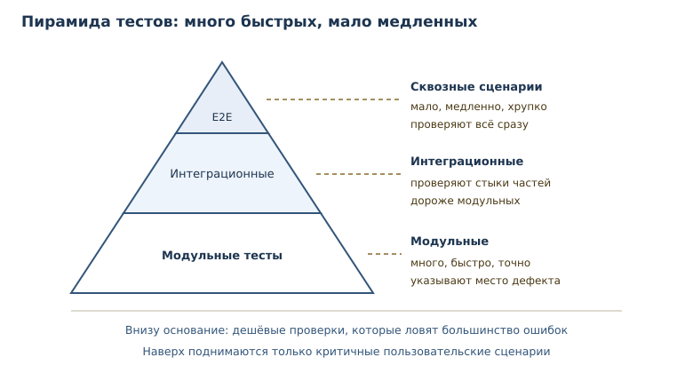
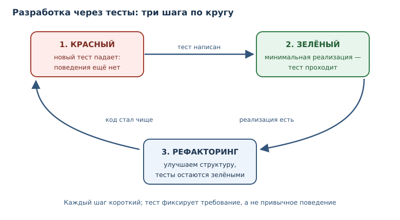

# Тестирование: pytest и TDD

<!-- syllanix:nav -->
**Навигация:** [← 31. Аннотации типов и статическая проверка](31-typing.md) · [Оглавление книги](../README.md) · [Далее: 33. Структура проекта, зависимости и инструменты →](33-project-tooling.md)
<!-- /syllanix:nav -->

<!-- syllanix:topics -->
**Темы главы**
32.1. [Что вы сможете после этой главы](#что-вы-сможете-после-этой-главы)  
32.2. [Модульный тест и тестовый случай](#unit-test)  
32.3. [pytest: соглашения и запуск](#pytest)  
32.4. [Фикстуры и параметризация](#fixtures)  
32.5. [Разработка через тесты](#tdd)  
32.6. [Покрытие, моки и регрессионные тесты](#coverage)  
32.7. [Типичные ошибки](#mistakes)  
32.8. [Упражнения](#упражнения)  
32.9. [Проверка понимания](#проверка-понимания)  
32.10. [Что дальше](#что-дальше)  
<!-- /syllanix:topics -->


Программа, которая «работает у меня на машине», — не аргумент. Поведение
меняется от данных, порядка вызовов, версии библиотеки и настроек окружения.
Единственный способ удерживать поведение под контролем — проверять его
автоматически и повторяемо.

**Модульный тест** — автоматическая проверка небольшой единицы поведения с
известным ожидаемым результатом. Тест исполняется вместе с кодом, падает при
расхождении и не требует ручного сравнения. В этой главе вы научитесь писать
такие проверки, организовывать их в набор, изолировать зависимости и строить
работу от теста, а не от готовой реализации.

## Что вы сможете после этой главы

- писать тесты на `assert` и понимать, что именно они проверяют;
- организовывать тесты в файлы и запускать их через pytest;
- готовить состояние через фикстуры и прогонять один тест на многих данных
  через параметризацию тестов;
- работать по циклу «красный — зелёный — рефакторинг»;
- отличать полезный тест от теста, который лишь увеличивает покрытие.

## Модульный тест и тестовый случай {#unit-test}

Любой тест состоит из трёх шагов: подготовка, действие, проверка. Такой
порядок называют AAA — arrange, act, assert. Сначала создаём данные, затем
вызываем проверяемое поведение, затем сравниваем результат с ожидаемым.

**Тестовый случай** — отдельная проверка: входные данные, вызов и ожидаемый
результат. Один тестовый случай проверяет одну ситуацию. Если в нём пять
разных вызовов и один упал, придётся выяснять, какой именно и почему.

Полезная привычка — добавлять к `assert` пояснение: `assert total == 42, f"total={total}"`.
Голый `assert` при падении не печатает значения — только `AssertionError`,
поэтому отладка начинается с добавления `print`. Сообщение в утверждении
сразу отвечает на вопрос «что было на самом деле». pytest переписывает
утверждения и показывает сравниваемые значения сам, но собственное сообщение
всё равно полезно: оно объясняет смысл проверки.

Начнём без фреймворков: обычный `assert` уже умеет проверять условие и
поднимать исключение.

```python exec
def add(a: int, b: int) -> int:
    return a + b


assert add(2, 3) == 5
assert add(-1, 1) == 0
assert add(0, 0) == 0
print("все проверки прошли")
```

```output
все проверки прошли
```

Если условие ложно, `assert` поднимает `AssertionError` и останавливает
выполнение.

```python exec expect-error
def add(a: int, b: int) -> int:
    return a - b


assert add(2, 3) == 5
```

```output
AssertionError
```

Такой тест уже полезен: он документирует ожидание и падает при регрессии.
Но у голых `assert` есть недостатки. Нет общего запуска и отчёта, нет
подготовки и очистки состояния, нельзя прогнать один случай на десяти наборах
данных без копирования кода. Для этого нужен фреймворк.

## pytest: соглашения и запуск {#pytest}

**pytest** — популярный фреймворк тестирования: функции `test_*`, `assert` и
богатый набор расширений. `pytest` не входит в стандартную библиотеку: это
внешний инструмент, который устанавливают в виртуальное окружение проекта
(глава 33). Код ниже показывает типичную структуру, но запускать его нужно в
проекте с pytest.

```python
# tests/test_calculator.py
from calculator import add


def test_add_positive():
    assert add(2, 3) == 5


def test_add_zero():
    assert add(0, 0) == 0
```

Фреймворк сам находит файлы `test_*.py`, функции `test_*` и запускает их.
Внутри теста не нужно печатать результат: pytest перехватывает `AssertionError`
и показывает, какие значения сравнивались. Именно поэтому `assert` в тестах
предпочтительнее `print`: проверка автоматическая, а сообщение об ошибке
содержательное.

Пусть в `calculator.py` функция `add` по ошибке возвращает `a - b`. Тогда
запуск покажет:

```console
$ pytest -q
F.                                                                 [100%]
FAILED tests/test_calculator.py::test_add_positive - assert -1 == 5
1 failed, 1 passed in 0.02s
```

Символы в строке прогресса — это результаты: точка означает успех, `F` —
падение. В конце pytest перечисляет упавшие тесты и показывает расхождение.
Такой отчёт можно читать в терминале и в непрерывной интеграции.

### Как выбрать, что тестировать

Тестируйте поведение, а не реализацию. Хороший тест переживает рефакторинг:
если вы переписали внутренности функции, но её контракт не изменился, тест
должен проходить. Плохой тест проверяет, что функция вызывает конкретный
приватный метод в конкретном порядке, — он ломается от любого улучшения.

Начинайте с границ и ветвей:

- типичный случай, ради которого функция написана;
- граничные значения: ноль, пустая строка, последний элемент;
- ошибочные входные данные и ожидаемые исключения;
- ветки `if`/`else`, которые легко забыть.

Полный перебор всех комбинаций быстро становится невыносимым, и это нормально.
Тестирование не доказывает отсутствие ошибок — оно повышает уверенность в тех
сценариях, которые вы посчитали важными. Выбирайте случаи по риску: там, где
ошибка дорого стоит или где логика запутана, проверок должно быть больше.

### Пирамида тестов

Не все тесты одинаковы. Модульный тест проверяет одну функцию и работает
доли секунды. Интеграционный тест соединяет несколько частей — например,
хранилище и бизнес-логику — и стоит дороже. Сквозной сценарий проходит через
всю систему, как пользователь, и может занимать минуты. Смешивать их в одну
кучу неудобно: набор становится медленным, а падение — неинформативным.



Пирамида задаёт пропорцию: в основании много дешёвых модульных тестов, выше —
меньше интеграционных, на вершине — единицы сквозных. Такое распределение даёт
быструю обратную связь: большинство ошибок ловится за секунды и с точным
адресом. Сквозные тесты нужны для критичных путей — входа в систему, оплаты,
сохранения заказа, — но делать их основным инструментом расточительно.

### Имена и расположение тестов

Имя теста — часть документации. `test_add_negative` сообщает, что проверяется
сложение отрицательных чисел; `test_1` не сообщает ничего. Хорошее имя
описывает ситуацию и ожидание: `test_total_with_zero_discount_returns_total`.
При падении именно оно попадёт в отчёт, и по нему должно быть понятно, что
сломалось, без открытия кода.

Тесты обычно складывают в каталог `tests/`, повторяющий структуру пакета:
`tests/test_cart.py` для `cart.py`. Такое расположение помогает найти нужный
файл и не смешивать проверки с production-кодом. Внутри файла тесты
группируют по проверяемой функции, а не по типу проверки.

### Проверка исключений

Ожидаемое исключение — такая же часть контракта, как возвращаемое значение.
В pytest его проверяют контекстным менеджером `pytest.raises`: он проходит,
только если исключение действительно поднято.

```python
import pytest


def divide(a: int, b: int) -> float:
    if b == 0:
        raise ValueError("деление на ноль")
    return a / b


def test_divide_by_zero():
    with pytest.raises(ValueError, match="деление на ноль"):
        divide(1, 0)
```

`match` принимает регулярное выражение и проверяет, что оно найдено в тексте
сообщения; поэтому `"деление на ноль"` сработает и внутри более длинной
фразы. Если исключение не поднялось, `pytest.raises` сам провалит тест —
ручной `try`/`except` с `assert` в тестах нужен редко.

## Фикстуры и параметризация {#fixtures}

Многим тестам нужно одинаковое начальное состояние: временный файл, тестовая
база, настроенный объект. Копировать подготовку в каждый тест плохо: она
разъедется, а очистка где-то забудется.

**Фикстура** — подготовка и очистка состояния, переиспользуемая между тестами.
В pytest фикстура объявляется декоратором и внедряется в тест по имени
параметра.

```python
import pytest


@pytest.fixture
def order():
    items = ["яблоко", "груша"]
    yield items
    items.clear()


def test_order_not_empty(order):
    assert order
```

Фикстура может возвращать значение или быть генератором: код до `yield` —
подготовка, после — очистка. Тест получает готовый объект и не думает о том,
как его создали и когда освободят. Фикстуры, нужные нескольким файлам,
выносят в `conftest.py`: pytest находит этот файл автоматически и делает его
фикстуры доступными всем тестам в каталоге и ниже — импортировать их не
нужно.

Встроенные фикстуры pytest закрывают частые нужды. Например, `tmp_path` даёт
уникальный временный каталог, отдельный для каждого теста; pytest сохраняет
каталоги нескольких последних сессий и постепенно удаляет старые:

```python
def test_write_report(tmp_path):
    report = tmp_path / "report.txt"
    report.write_text("итог: 42", encoding="utf-8")
    assert report.read_text(encoding="utf-8") == "итог: 42"
```

Тест работает с настоящей файловой системой, но не оставляет мусора и не
зависит от других тестов. Это важное свойство: тесты должны проходить в любом
порядке и на любой машине.

**Параметризация тестов** — запуск одного теста на множестве наборов входных
данных. Вместо копии функции с другим литералом вы описываете таблицу случаев.

```python
import pytest


@pytest.mark.parametrize(
    ("raw", "expected"),
    [("0", 0), ("41", 41), (" 42 ", 42)],
)
def test_parse_age(raw, expected):
    assert parse_age(raw) == expected
```

pytest создаст по тесту на каждую строку таблицы и покажет, какой именно набор
упал. Это одновременно документация поведения и защита от регрессий.

## Разработка через тесты {#tdd}

**Разработка через тесты** (TDD) — подход «красный — зелёный — рефакторинг»:
сначала падающий тест, затем минимальная реализация, затем улучшение кода при
зелёных тестах. Три шага короткие, и каждый имеет цель.



1. **Красный.** Пишем тест на ещё не существующее поведение. Он падает — это
   доказательство, что тест действительно проверяет что-то новое.
2. **Зелёный.** Пишем самую простую реализацию, которая проходит тест. Не
   самую красивую — минимальную.
3. **Рефакторинг.** Убираем дубли и улучшаем структуру, не меняя поведения.
   Тесты остаются зелёными и подтверждают, что ничего не сломали.

Покажем шаг «красный» на функции нормализации телефона.

```python exec expect-error
def normalize_phone(raw: str) -> str:
    return raw


assert normalize_phone("+7 (999) 123-45-67") == "+79991234567"
```

```output
AssertionError
```

Тест падает, потому что реализация возвращает вход без изменений. Теперь
минимальная реализация:

```python exec
def normalize_phone(raw: str) -> str:
    digits = "".join(char for char in raw if char.isdigit())
    return "+" + digits


print(normalize_phone("+7 (999) 123-45-67"))
print(normalize_phone("8 999 123 45 67"))
```

```output
+79991234567
+89991234567
```

Второй случай показывает, что реализация ещё неполная: она не заменяет
ведущую восьмёрку на семёрку. Добавим тест — он снова красный, — и только
затем код. Так TDD не даёт забыть о граничных случаях: каждый из них сначала
становится проверкой.

Полезно различать TDD и «тесты после кода». Второй подход тоже нормален:
много кода пишут, чтобы понять задачу, и покрывают его тестами задним числом.
Но если писать тест после реализации, легко невольно подогнать его под
текущее поведение, включая ошибку. Тест, написанный до кода, фиксирует
требование, а не привычку.

## Покрытие, моки и регрессионные тесты {#coverage}

**Покрытие** — доля кода, исполненного тестами; полезный, но недостаточный
показатель качества тестов. Покрытие измеряют инструментом `coverage.py`,
обычно через плагин `pytest-cov`: команда `pytest --cov=calculator` печатает
отчёт по модулям. Сто процентов покрытия не означают ста процентов проверок:
строка может исполниться, а её результат никто не сравнит.

```python
def divide(a: int, b: int) -> float:
    if b == 0:
        raise ValueError("деление на ноль")
    return a / b
```

Покрытие полезно как диагностика: оно показывает участки, о которых тесты
ничего не говорят. Если целая функция не исполнялась ни разу, это повод
написать тест. Но процент сам по себе ничего не доказывает — он не отличает
проверку результата от простого вызова. Поэтому покрытие смотрят вместе с
качеством утверждений, а не вместо него.

Тест `assert divide(10, 2) == 5.0` покрывает строку возврата, но не ветку
ошибки. Чтобы покрытие было осмысленным, добавьте тест на `ValueError` — и
проверьте, что исключение действительно поднимается.

**Мок (заглушка)** — подмена зависимости управляемым объектом, чтобы
изолировать тестируемую единицу. Если функция обращается к сети, часам или
базе, тест становится медленным и нестабильным. Мок возвращает заранее
известное значение и позволяет проверить, что зависимость вызвана правильно.
Модуль `unittest.mock` входит в стандартную библиотеку.

```python exec
from unittest.mock import patch


def fetch_price() -> int:
    return 100


def total_with_tax() -> int:
    return fetch_price() * 120 // 100


with patch("__main__.fetch_price", return_value=250):
    print(total_with_tax())
print(total_with_tax())
```

```output
300
120
```

Внутри `with` функция `fetch_price` заменена заглушкой, которая возвращает
`250`; после выхода восстанавливается настоящая. Тест проверяет логику
`total_with_tax`, не завися от источника цены.

**Регрессионный тест** — тест, закрепляющий исправленный дефект, чтобы он не
вернулся. Работают в два шага: сначала тест воспроизводит ошибку и падает,
затем исправление делает его зелёным, и тест остаётся в наборе навсегда. Если
закрепить тестом текущее, ещё не проверенное поведение, можно зафиксировать
сам дефект — поэтому сначала решают, что правильно.

Покажем первый шаг на скидке: пользователь сообщил, что 10 % от 999 рублей
дали 900 вместо 899. Тест фиксирует ожидание и падает на старой формуле:

```python exec expect-error
def discount(total: int, percent: int) -> int:
    return total - total * percent // 100


# сообщение пользователя: discount(999, 10) вернула 900, а должна 899
assert discount(999, 10) == 899
```

```output
AssertionError
```

Причина в порядке округления: `999 * 10 // 100 = 99`, и `999 - 99 = 900`.
Округлять нужно не скидку, а итоговую долю: `999 * 90 // 100 = 899`, а для
33 % — `999 * 67 // 100 = 669`. После исправления функции тест становится
зелёным и остаётся в наборе: теперь он не даст вернуть старую формулу.
Исправление этой функции — упражнение 7.

## Типичные ошибки {#mistakes}

1. **Тест без проверки.** Функция вызывает код и ничего не сравнивает: тест
   проходит всегда. Каждый тест обязан содержать `assert` или ожидание
   исключения.
2. **Один тест на всё.** Длинный сценарий с двадцатью проверками падает
   целиком, и непонятно, что сломалось. Лучше много маленьких тестов с ясными
   именами.
3. **Проверка реализации.** Тест, завязанный на приватные методы и порядок
   вызовов, ломается при рефакторинге и не ловит реальных дефектов.
4. **Зависимость от порядка и времени.** Тест, который проходит только после
   другого теста или зависит от текущей даты, называют нестабильным. Он хуже
   отсутствующего: ему перестают доверять.
5. **Погоня за покрытием.** Сотня тестов на геттеры и ни одного на граничный
   случай создаёт иллюзию защищённости. Покрытие — индикатор, а не цель.
6. **Мок на всё.** Если замокано всё, тест проверяет моки, а не программу.
   Заменяйте только внешние и нестабильные зависимости.
7. **Тест подогнан под баг.** Тест, написанный после кода и закрепляющий
   неверное поведение, мешает исправлению. Сначала решите, что правильно.

## Упражнения

### 1. Проверка без фреймворка {#ex-ch32-01}

Напишите функцию `is_even(number: int) -> bool` и проверьте её тремя
инструкциями `assert` для `0`, `7` и `-4`. Выведите строку об успехе.

### 2. Прогнозирование падения {#ex-ch32-02}

Что произойдёт при запуске и почему?

```python
def half(value: int) -> float:
    return value / 2


assert half(5) == 2.5
assert half(4) == 3
print("готово")
```

Запишите ответ, проверьте запуском и объясните, что показывает сообщение
`AssertionError`.

### 3. Тестовый случай по шагам {#ex-ch32-03}

Для функции `clamp(value: int, low: int, high: int) -> int`, ограничивающей
число диапазоном, опишите три тестовых случая по схеме «подготовка — действие
— проверка»: значение внутри диапазона, ниже границы, выше границы.
Реализуйте функцию и проверьте все три случая.

### 4. Параметризация без pytest {#ex-ch32-04}

Дан список пар `(вход, ожидание)`. Напишите цикл, который проверяет
`normalize_space` на каждой паре и сообщает номер упавшего случая:

```python
cases = [(" a  b ", "a b"), ("a\tb", "a b"), ("   ", "")]
```

Реализуйте `normalize_space` и добейтесь, чтобы все случаи прошли.

### 5. Красный — зелёный {#ex-ch32-05}

Функция `slugify(title: str) -> str` должна заменять пробелы на дефисы,
приводить текст к нижнему регистру и удалять лишние дефисы по краям. Сначала
напишите падающий тест для `"  Привет, Мир  "`, затем реализацию. Покажите
оба шага.

### 6. Ожидаемое исключение {#ex-ch32-06}

Функция `parse_percent(text: str) -> int` принимает строку с процентом и
поднимает `ValueError`, если число вне диапазона 0–100. Напишите тест в стиле
pytest: успешную проверку и проверку исключения через
`pytest.raises(ValueError, match="диапазон")`. Если pytest в вашем окружении
нет, воспроизведите ту же проверку через `try`/`except`/`else`.

### 7. Регрессия {#ex-ch32-07}

Пользователь сообщил: «Скидка 10 % на 999 рублей дала 900, а должна дать 899».
Воспроизведите дефект тестом, выясните причину и исправьте функцию
`discount(total, percent)`, сохранив регрессионный тест.

### 8. Мок зависимости {#ex-ch32-08}

Функция `greeting()` формирует приветствие из текущего часа, который берёт из
`current_hour()`. Замените `current_hour` моком, возвращающим `9`, и
проверьте, что `greeting()` возвращает утреннее приветствие. Затем проверьте
вечерний вариант с часом `21`.

### 9. Анализ покрытия {#ex-ch32-09}

Дана функция и один тест:

```python
def sign(value: int) -> str:
    if value > 0:
        return "плюс"
    if value < 0:
        return "минус"
    return "ноль"


assert sign(5) == "плюс"
```

Объясните, какие ветки не исполнены и почему покрытие в 100 % здесь
недостижимо одним тестом. Допишите тесты так, чтобы все возвраты были
проверены.

### 10. Мини-проект: набор тестов {#ex-ch32-10}

Для функции `to_fahrenheit(celsius: float) -> float` напишите набор проверок:
точка замерзания, точка кипения, отрицательное значение, дробное значение.
Добавьте проверку, что при нечисловом аргументе поднимается `TypeError`.
Оформите набор как функции `test_*` с `assert` и добейтесь успешного прогона
собственным мини-раннером.

## Проверка понимания

1. Чем модульный тест отличается от ручной проверки в терминале?
2. Что входит в тестовый случай и почему его лучше не смешивать с другими?
3. Зачем нужна фикстура, если подготовку можно написать в самом тесте?
4. Как параметризация тестов помогает при отладке упавшего набора?
5. Почему тест, написанный до кода, ловит ошибки лучше теста после кода?
6. Что показывает покрытие и чего оно не показывает?
7. В каких случаях мок полезен, а в каких превращает тест в проверку моков?

## Что дальше

Тесты запускаются в проекте, а проект требует окружения, зависимостей и
единых правил оформления. Следующая глава — о структуре проекта, виртуальных
окружениях и инструментах качества: без них тесты негде запускать
воспроизводимо. О том, как исключения проверяют в тестах, говорилось в
[главе 10](10-errors-exceptions.md); об аннотациях, которые дополняют тесты
статической проверкой, — в [главе 31](31-typing.md). О том, как тесты
встраиваются в автоматические проверки при каждом изменении, — в главе 45.

<!-- syllanix:nav -->
**Перед этой главой:** [31. Аннотации типов и статическая проверка](31-typing.md)
**Связанные главы:** [07. Функции: параметры, аргументы и области видимости](07-functions.md), [09. Модули, пакеты и импорты](09-modules.md), [10. Ошибки и исключения](10-errors-exceptions.md), [22. Функции как объекты: замыкания и декораторы](22-higher-order.md), [25. Объекты и классы](25-objects-classes.md), [29. Dataclasses, протоколы и абстрактные классы](29-dataclasses-protocols.md), [45. Git, CI, релизы и сопровождение](45-git-ci-releases.md), [53. Запахи кода, рефакторинг и сопровождение](53-refactoring.md)
**Далее:** [33. Структура проекта, зависимости и инструменты →](33-project-tooling.md)
<!-- /syllanix:nav -->
