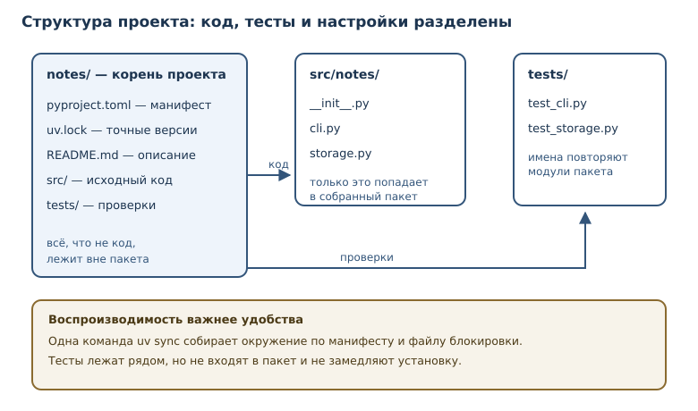
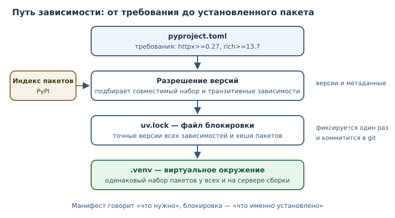

# Структура проекта, зависимости и инструменты

<!-- syllanix:nav -->
**Навигация:** [← 32. Тестирование: pytest и TDD](32-testing.md) · [Оглавление книги](../README.md) · [Далее: 34. Стандартная библиотека: collections, itertools, functools, pathlib →](34-stdlib.md)
<!-- /syllanix:nav -->

<!-- syllanix:topics -->
**Темы главы**
33.1. [Что вы сможете после этой главы](#что-вы-сможете-после-этой-главы)  
33.2. [Структура проекта](#layout)  
33.3. [Виртуальное окружение](#venv)  
33.4. [Зависимости и pyproject.toml](#dependencies)  
33.5. [Линтеры и форматтеры](#quality)  
33.6. [Версионирование](#versioning)  
33.7. [Типичные ошибки](#mistakes)  
33.8. [Упражнения](#упражнения)  
33.9. [Проверка понимания](#проверка-понимания)  
33.10. [Что дальше](#что-дальше)  
<!-- /syllanix:topics -->


Один файл `script.py` удобен ровно до тех пор, пока проект помещается в один
файл. Дальше появляются вопросы, на которые нельзя ответить кодом: где лежат
модули, как запустить программу на другой машине, откуда взялись библиотеки,
почему у коллеги те же тесты падают. Инструменты проекта отвечают на эти
вопросы воспроизводимо.

**Зависимость** — внешний пакет, без которого проект не работает; она
фиксируется с версией и источником. Зависимости устанавливаются не в систему,
а в **виртуальное окружение** — изолированный набор пакетов и интерпретатора
для проекта. Настройки хранятся в `pyproject.toml`, а точные версии — в
**файле блокировки**. В этой главе вы соберёте проект так, чтобы его можно
было одинаково запустить на любой машине.

## Что вы сможете после этой главы

К концу главы у вас будет проект, который собирается и проверяется одинаково
на любой машине. Вы научитесь:

- раскладывать код, тесты и настройки по каталогам проекта;
- создавать изолированное окружение и объяснять, зачем оно нужно;
- описывать зависимости и требования к Python в `pyproject.toml`;
- пользоваться файлом блокировки и индексом пакетов;
- автоматизировать форматирование и статическую проверку кода;
- присваивать версии по правилам семантического версионирования.

## Структура проекта {#layout}

Рабочая раскладка небольшого проекта выглядит так:

```text
notes/
├── pyproject.toml
├── README.md
├── uv.lock
├── src/
│   └── notes/
│       ├── __init__.py
│       ├── cli.py
│       └── storage.py
└── tests/
    ├── test_cli.py
    └── test_storage.py
```

В корне лежат файлы проекта: манифест `pyproject.toml`, описание
`README.md`, файл блокировки `uv.lock`. Код — в каталоге `src/notes/`, тесты —
в `tests/`, повторяющем структуру пакета. У такого разделения есть
практические причины.

- **Код отделён от всего остального.** Тесты, документация и настройки не
  попадают в пакет при сборке и не мешают импортам.
- **Тесты повторяют структуру.** Файлу `src/notes/storage.py` соответствует
  `tests/test_storage.py`; найти проверки легко.
- **У проекта один вход.** Запуск описан в `pyproject.toml`, а не собран из
  десятка разрозненных скриптов.

Пакет — это каталог с `__init__.py`, который Python импортирует как модуль;
внутри могут лежать подмодули и подпакеты. Файл `__init__.py` может быть
пустым: его наличие сообщает, что каталог — пакет, а не просто набор файлов.
Внутри пакета модули импортируют друг друга по именам, поэтому
переименование файла — изменение публичного контракта, а не косметика.

Каталог `src/` не обязателен, но он защищает от одной частой ошибки.
Если пакет лежит прямо в корне, то при запуске из корня Python импортирует
локальную копию вместо установленной. В результате тесты проверяют не то, что
получит пользователь. Раскладка `src/` заставляет устанавливать пакет явно и
проверять именно установленную версию.



### README: вход в проект

`README.md` — первое, что читает новый участник. В нём достаточно четырёх
блоков: что делает проект, как установить зависимости, как запустить тесты,
как запустить программу. Хороший README не пересказывает весь код, а доводит
до первой успешной команды. Если инструкция расходится с реальностью, её
исправляют в том же изменении, что и код: устаревшая документация хуже
отсутствующей.

## Виртуальное окружение {#venv}

**Виртуальное окружение** — изолированный набор установленных пакетов и
интерпретатора для проекта. Без него пакеты ставятся в общую систему: версии
двух проектов конфликтуют, а обновление библиотеки для одного ломает другой.

Окружение создают один раз, а затем активируют в терминале перед работой:

```console
$ python -m venv .venv
$ source .venv/bin/activate
(.venv) $ python -c "import sys; print(sys.prefix)"
/home/user/notes/.venv
```

В приглашении появляется имя окружения — признак того, что команды `python` и
`pip` относятся к проекту, а не к системе. На Windows активация выглядит иначе:
`.venv\Scripts\activate`. Каталог `.venv` не коммитят: он восстанавливается из
манифеста и файла блокировки.

Окружение можно выключить командой `deactivate`, а если оно сломалось —
удалить каталог `.venv` и собрать заново. Это безопасно именно потому, что
все требования записаны в манифесте и файле блокировки: окружение — расходный
материал, а не источник истины.

Современные проекты чаще используют `uv` — быстрый **менеджер пакетов**,
который создаёт окружение, разрешает зависимости и фиксирует результат. Но
принцип тот же: отдельное окружение на проект и воспроизводимая установка по
манифесту.

```console
$ uv sync
Resolved 12 packages in 0.18s
Installed 12 packages in 0.05s
```

### Что ещё фиксирует проект

Версия интерпретатора тоже часть окружения. Требование `requires-python` в
манифесте сообщает менеджеру пакетов, какие версии Python допустимы, а файл
`.python-version` позволяет автоматически выбрать нужную. Если проект
запускается на 3.11, а разработчик проверяет на 3.14, различия в поведении
могут проявиться уже в эксплуатации.

Кроме пакетов, проект зависит от системных вещей: библиотек для работы с
изображениями, компилятора для расширений, версии базы данных. Всё, что нельзя
выразить в `pyproject.toml`, описывают в README и в конфигурации
непрерывной интеграции. Полная воспроизводимость — цель, к которой идут
постепенно: сначала фиксируют версии пакетов, затем версию Python, затем
системные требования.

## Зависимости и pyproject.toml {#dependencies}

`pyproject.toml` — стандартный файл конфигурации проекта: метаданные,
зависимости, настройки инструментов. Формат TOML читается стандартной
библиотекой, поэтому манифест можно разобрать и проверить программой.

```toml
[project]
name = "notes"
version = "0.3.1"
description = "Заметки из командной строки"
requires-python = ">=3.11"
dependencies = [
    "httpx>=0.27",
    "rich>=13.7",
]

[project.optional-dependencies]
dev = ["pytest>=8.0", "ruff>=0.6"]

[project.scripts]
notes = "notes.cli:main"

[tool.ruff]
line-length = 100
```

Здесь указано всё, что нужно для установки: имя и версия проекта, требования
к интерпретатору, обязательные и необязательные зависимости, точка входа
команды `notes`. Зависимости разработки вынесены в отдельную группу: они не
нужны пользователю, который просто установил пакет.

Прочитать манифест можно стандартным модулем `tomllib`:

```python exec
import tomllib

raw = b"""
[project]
name = "notes"
version = "0.3.1"
dependencies = ["httpx>=0.27", "rich>=13.7"]
"""

data = tomllib.loads(raw.decode())
print(data["project"]["name"])
print(data["project"]["dependencies"])
```

```output
notes
['httpx>=0.27', 'rich>=13.7']
```

Диапазоны версий бывают разной строгости: `>=` разрешает любые новые версии,
`~=` — только совместимые в пределах указанной части (например, `~=1.4.5`
разрешает обновления в пределах `1.4` начиная с `1.4.5`, но не `1.5`), `==`
фиксирует ровно одну. Чем шире диапазон
в манифесте, тем больше свободы у менеджера пакетов и тем важнее файл
блокировки, который фиксирует фактический выбор.

Спецификация версии `httpx>=0.27` означает «не ниже 0.27». Диапазоны нужны,
чтобы получать исправления, но не терять совместимость. Слишком широкое
требование приводит к неожиданным обновлениям, слишком узкое — к конфликтам.

**Файл блокировки** — файл с точными версиями всех транзитивных зависимостей
для воспроизводимой установки. В манифесте написано «httpx не ниже 0.27», а в
блокировке — конкретная версия и хеши пакетов. Благодаря этому два разработчика
и сервер сборки получают одинаковый набор библиотек.



**Индекс пакетов** — репозиторий пакетов (обычно PyPI), откуда менеджер
пакетов их получает. Пакет в индексе имеет имя, версию, зависимости и
метаданные. Ставить пакеты следует только из доверенных источников: имя
пакета легко подделать, а установка выполняет код в вашем окружении.

## Линтеры и форматтеры {#quality}

Два инструмента следят за качеством кода, и их не стоит путать.

- **Линтер** — инструмент статического поиска ошибок и нарушений стиля в
  исходном коде. Он сообщает о неиспользуемых импортах, теневых именах,
  подозрительных конструкциях.
- **Форматтер** — инструмент автоматического приведения кода к единому стилю:
  отступы, кавычки, переносы строк.

Форматтер не ищет логических ошибок, а линтер не переставляет пробелы.
Обычно их запускают вместе: форматтер приводит код к общему виду, линтер
проверяет то, что нельзя исправить автоматически.

```console
$ ruff format .
1 file reformatted, 3 files left unchanged
$ ruff check .
All checks passed!
```

Настройки живут в том же `pyproject.toml`, в секции `[tool.ruff]`. Единые
правила важны не ради вкуса: когда весь код оформлен одинаково, на ревью
обсуждают поведение, а не расстановку запятых. Автоматические проверки в
непрерывной интеграции не дают стилю разъехаться.

### Команды проекта

Чтобы не запоминать длинные вызовы, повторяющиеся команды записывают в одно
место: в `Makefile`, скрипт или задачу менеджера. Тогда проверка перед
коммитом выглядит одинаково у всех.

```console
$ uv run pytest -q
$ uv run ruff check .
$ uv run ruff format --check .
```

`uv run` запускает команду в окружении проекта, поэтому активировать его
вручную не обязательно. Явные команды полезны и в документации: новый
участник видит точную последовательность проверок, а не догадывается о ней.

### Проверки перед коммитом

Запускать линтер и форматтер вручную легко забыть. Поэтому проверки
подключают к моменту коммита: специальный хук запускает быстрые команды и
останавливает коммит, если код не соответствует правилам. Медленные проверки —
полный набор тестов — оставляют для непрерывной интеграции.

```console
$ ruff check .
Found 2 errors.
$ ruff check --fix .
Found 2 errors (2 fixed, 0 remaining).
```

Разделение важное: быстрые проверки должны занимать секунды, иначе их начнут
обходить. Полный прогон тестов и сборка — задача сервера, а не ноутбука.
Правило хорошего тона: если проверка обязательна, она должна запускаться одной
командой и давать понятную причину отказа.

### Зачем фиксировать инструменты

Линтер и форматтер — тоже зависимости, и их версии влияют на результат. Новая
версия может добавить правило, и сборка внезапно «покраснеет» без изменений в
коде. Поэтому инструменты качества фиксируют в группе разработки и обновляют
осознанно, как и любые другие зависимости.

## Версионирование {#versioning}

**Версионирование** — присвоение версий выпускам проекта и зависимостям.
Версия нужна, чтобы пользователь понимал, что изменилось, а менеджер пакетов —
какие обновления безопасны.

**Семантическое версионирование** — схема `MAJOR.MINOR.PATCH`, где номер
сообщает о несовместимых изменениях, новых возможностях и исправлениях.

| Часть | Когда увеличивается | Пример |
|---|---|---|
| `MAJOR` | несовместимое изменение API | `1.4.2` → `2.0.0` |
| `MINOR` | новая возможность без поломки | `1.4.2` → `1.5.0` |
| `PATCH` | исправление без новых возможностей | `1.4.2` → `1.4.3` |

Сравнение версий — не сравнение строк: `1.10.0` новее `1.9.2`, хотя строка
`"1.10.0"` лексикографически меньше. Версии разбирают на числа.

```python exec
def parse_version(text: str) -> tuple[int, int, int]:
    major, minor, patch = text.split(".")
    return int(major), int(minor), int(patch)


releases = ["1.10.0", "1.9.2", "1.10.1", "2.0.0"]
print(parse_version("2.14.3"))
print(sorted(releases, key=parse_version))
```

```output
(2, 14, 3)
['1.9.2', '1.10.0', '1.10.1', '2.0.0']
```

У версии могут быть и дополнительные части: предварительный выпуск
`2.0.0rc1` и метаданные сборки `2.0.0+linux`. Предварительный выпуск
предупреждает, что API ещё может измениться. Локальная метка уточняет сборку:
по PEP 440 она участвует в сравнении только после совпадения публичной части,
поэтому `2.0.0+linux` считается новее `2.0.0`, хотя API у них один и тот же.
Пользователю библиотеки важно понимать эти пометки: не всякое обновление,
прошедшее проверку версий, безопасно, если оно помечено как предварительное.

Семантическое версионирование работает, только если ему следуют. Если
`MAJOR` увеличивают «когда захочется», пользователи перестают доверять
номерам и начинают проверять каждое обновление вручную. Обратная
совместимость — это обещание, а версия — его краткая запись.

## Типичные ошибки {#mistakes}

1. **Ставить пакеты в системный Python.** Это меняет окружение всей машины и
   рано или поздно ломает другой проект. Всегда используйте виртуальное
   окружение.
2. **Коммитить `.venv`.** Окружение содержит бинарники и абсолютные пути; его
   восстанавливают, а не переносят. В репозиторий попадают манифест и файл
   блокировки.
3. **Не фиксировать зависимости.** Без файла блокировки установка «сегодня» и
   «через месяц» даёт разные наборы версий, и ошибка воспроизводится не у всех.
4. **Смешивать зависимости и инструменты разработки.** `pytest` и `ruff` не
   нужны пользователю библиотеки. Их место — в группе разработки.
5. **Считать линтер гарантией качества.** Линтер находит нарушения правил, но
   не знает требований задачи. Чистый отчёт не отменяет тестов.
6. **Путать версию проекта и версию Python.** `requires-python = ">=3.11"`
   ограничивает интерпретатор, а `version` в `[project]` — выпуск вашего кода.
7. **Хранить секреты в манифесте.** Токены и пароли не место ни в
   `pyproject.toml`, ни в репозитории: их передают через переменные окружения
   или менеджер секретов.

## Упражнения

### 1. Разбор структуры {#ex-ch33-01}

Дан каталог проекта:

```text
shop/
├── shop/
│   └── __init__.py
├── test_shop.py
├── requirements.txt
└── .venv/
```

Назовите три проблемы раскладки и предложите исправленную структуру. Ответ
обоснуйте: что именно сломается из-за каждой проблемы.

### 2. Чтение манифеста {#ex-ch33-02}

Напишите функцию `read_project(text: str) -> dict[str, object]`, которая
разбирает TOML-строку и возвращает словарь `{name, version, requires_python,
dependencies}`. Проверьте её на манифесте из главы.

### 3. Сравнение версий {#ex-ch33-03}

Реализуйте `is_newer(candidate: str, current: str) -> bool`, которая
сравнивает версии по схеме `MAJOR.MINOR.PATCH`. Проверьте, что `1.10.0`
новее `1.9.2`, а `2.0.0` новее `1.99.99`.

### 4. Прогнозирование версии {#ex-ch33-04}

В проекте версия `1.4.2`. Выпуск добавляет новую функцию, не ломая старый
API, и исправляет две ошибки. Какую версию следует присвоить? А если бы
пришлось изменить сигнатуру публичной функции? Объясните правила.

### 5. Манифест с нуля {#ex-ch33-05}

Составьте `pyproject.toml` для проекта `weather`, который требует Python 3.12
и выше, зависит от `httpx>=0.27`, имеет группу `dev` с `pytest>=8.0` и
`ruff>=0.6`, и предоставляет команду `weather`. Проверьте файл разбором через
`tomllib`.

### 6. Изоляция окружения {#ex-ch33-06}

Объясните, что произойдёт, если установить две несовместимые версии одной
библиотеки: одну в системный Python, другую в проект. Как виртуальное
окружение решает конфликт? Приведите последовательность команд для чистого
окружения.

### 7. Манифест и блокировка {#ex-ch33-07}

Почему в `pyproject.toml` указывают диапазон `httpx>=0.27`, а в файле
блокировки — точную версию? Объясните роль каждого файла и что произойдёт,
если удалить блокировку.

### 8. Линтер и форматтер {#ex-ch33-08}

Код содержит неиспользуемый импорт, строку длиной 140 символов и
неоднородные кавычки. Что из этого исправит форматтер, а что найдёт линтер?
Опишите ожидаемые действия и порядок запуска.

### 9. Версии зависимостей {#ex-ch33-09}

Реализуйте `check_requirement(requirement: str, installed: str) -> bool`,
которая понимает спецификации `>=`, `==` и `>`. Проверьте три случая:
`httpx>=0.27` при `0.27.2`, `httpx==0.27.0` при `0.27.2`, `httpx>0.28` при
`0.27.2`.

### 10. Мини-проект: каркас проекта {#ex-ch33-10}

Спроектируйте каркас проекта `budget`: структуру каталогов, содержимое
`pyproject.toml`, команды создания окружения и запуска проверок. Опишите, где
лежат тесты, точка входа и документация, и объясните, как новый участник
воспроизведёт окружение одной командой.

## Проверка понимания

1. Зачем проекту виртуальное окружение, если Python уже установлен?
2. Чем `pyproject.toml` отличается от файла блокировки?
3. Что такое транзитивная зависимость и почему она попадает в блокировку?
4. Какую задачу решает форматтер и какую — линтер?
5. Почему `1.10.0` больше `1.9.2`, хотя как строка выглядит меньше?
6. Какой сигнал подаёт пользователю увеличение `MAJOR` в семантическом
   версионировании?
7. Почему каталог `.venv` не коммитят?

## Что дальше

Стиль, форматирование и именование кода подробно разобраны в главе 49.

Проект собран, зависимости зафиксированы, проверки автоматизированы. Дальше —
обзор стандартной библиотеки: инструментов, которые закрывают большинство
повседневных задач без внешних зависимостей. О виртуальных окружениях и
запуске программ говорилось в [главе 9](09-modules.md); о тестах, которые
запускаются в этом окружении, — в [главе 32](32-testing.md). В главе 34 речь
пойдёт о `collections`, `itertools`, `functools` и `pathlib` — от подсчёта
частот до работы с путями.

<!-- syllanix:nav -->
**Перед этой главой:** [32. Тестирование: pytest и TDD](32-testing.md)
**Связанные главы:** [01. Зачем Python и как устроена эта книга](01-introduction.md), [09. Модули, пакеты и импорты](09-modules.md), [19. Файлы, пути и текстовые форматы](19-files-formats.md), [35. ОС, процессы, сеть и API](35-os-network.md), [41. Безопасность приложений](41-security.md), [45. Git, CI, релизы и сопровождение](45-git-ci-releases.md), [47. Проект: HTTP API и база данных](47-project-api.md), [56. Визуализация данных](56-dataviz.md)
**Далее:** [34. Стандартная библиотека: collections, itertools, functools, pathlib →](34-stdlib.md)
<!-- /syllanix:nav -->
