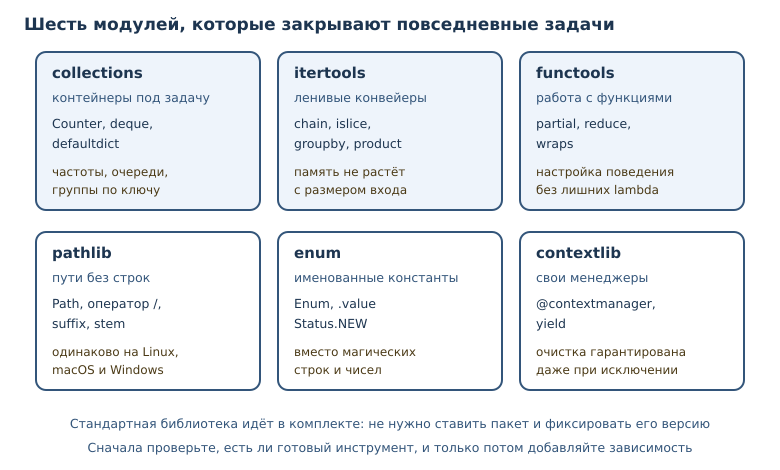
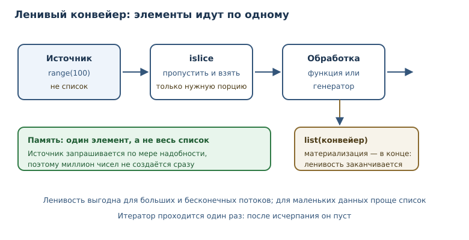

# Стандартная библиотека: collections, itertools, functools, pathlib

<!-- syllanix:nav -->
**Навигация:** [← 33. Структура проекта, зависимости и инструменты](33-project-tooling.md) · [Оглавление книги](../README.md) · [Далее: 35. ОС, процессы, сеть и API →](35-os-network.md)
<!-- /syllanix:nav -->

<!-- syllanix:topics -->
**Темы главы**
34.1. [Что вы сможете после этой главы](#что-вы-сможете-после-этой-главы)  
34.2. [Карта стандартной библиотеки](#map)  
34.3. [collections: контейнеры под задачу](#collections)  
34.4. [itertools: ленивые конвейеры](#itertools)  
34.5. [functools и pathlib: функции и пути](#functools-pathlib)  
34.6. [Enum: именованные константы](#enum)  
34.7. [contextlib: свои контекстные менеджеры](#contextlib)  
34.8. [Типичные ошибки](#mistakes)  
34.9. [Упражнения](#упражнения)  
34.10. [Проверка понимания](#проверка-понимания)  
34.11. [Что дальше](#что-дальше)  
<!-- /syllanix:topics -->


Стандартная библиотека Python — это сотни модулей, которые поставляются вместе
с интерпретатором. Она закрывает работу с текстом, файлами, датами, сетью,
архивами, базами данных и структурами данных. Знание её карты экономит время
и уменьшает число зависимостей: прежде чем искать пакет, стоит проверить, нет
ли готового решения в комплекте.

В этой главе — четыре опорных модуля повседневной разработки. `collections`
даёт специализированные контейнеры, `itertools` — инструменты ленивой
обработки последовательностей, `functools` — приёмы работы с функциями, а
`pathlib` — безопасные пути. К ним добавим перечисления и контекстные
менеджеры, которые делают код выразительнее.

## Что вы сможете после этой главы

- выбирать подходящий контейнер вместо самодельной структуры;
- считать частоты, хранить историю и группировать данные без ручных циклов;
- строить ленивые конвейеры из итераторов и объяснять, когда они экономят
  память;
- заменять «магические» строки перечислением `Enum`;
- писать собственные контекстные менеджеры через `contextlib`;
- свободно собирать и разбирать пути через `pathlib`.

## Карта стандартной библиотеки {#map}

Полезно держать в голове, за что отвечает каждый крупный модуль. Полный список
велик, но повседневность покрывает небольшой набор.

| Задача | Модуль |
|---|---|
| специализированные контейнеры | `collections` |
| комбинирование итераторов | `itertools` |
| работа с функциями | `functools` |
| пути и файлы | `pathlib` |
| дата и время | `datetime` |
| сериализация | `json`, `csv` |
| журналирование | `logging` |
| регулярные выражения | `re` |
| случайные числа | `random` |
| системные вызовы | `os`, `sys`, `subprocess` |

Правило простое: если задача типовая, вероятность найти готовый инструмент
высока. Самодельная реализация нужна, когда стандартная не подходит по
требованиям, а не потому, что о ней не знали.

У карты есть и вторая польза: она помогает выбирать между похожими
инструментами. Для очереди подходит `deque`, для частот — `Counter`, для
группировки — `groupby`, для путей — `pathlib`. Когда инструменты известны,
код становится короче, а ошибки исчезают вместе с самодельными циклами.
Внешняя зависимость оправдана, только если стандартная библиотека не решает
задачу или решает её заметно хуже. У зависимости есть цена: её нужно
устанавливать, обновлять и проверять на уязвимости. Поэтому «есть пакет
удобнее» — не аргумент, пока не показано, что стандартный инструмент
действительно не подходит.

Есть и обратная крайность: пытаться обойтись только стандартной библиотекой,
когда задача требует зрелого решения. HTTP-клиент из `urllib` работает, но
современные библиотеки дают удобные таймауты, повторные попытки и разбор
ответа с меньшим количеством кода. Выбор зависит от контекста, а не от
принципа. Здоровый подход — сначала изучить стандартный инструмент, затем
осознанно добавить зависимость и зафиксировать её версию.



## collections: контейнеры под задачу {#collections}

**Модуль collections** — модуль стандартной библиотеки со
специализированными контейнерами: `Counter`, `deque`, `defaultdict`, `ChainMap`.
Обычный словарь или список справятся со многим, но для частых операций есть
более точные инструменты.

### Counter: частоты

**Counter** — словарь-счётчик: количество вхождений каждого элемента; удобен
для частотного анализа.

```python exec
from collections import Counter

words = "кот пёс кот слон кот пёс".split()
counts = Counter(words)
print(counts)
print(counts["кот"])
print(counts.most_common(2))
```

```output
Counter({'кот': 3, 'пёс': 2, 'слон': 1})
3
[('кот', 3), ('пёс', 2)]
```

`Counter` — обычный словарь с дополнительными методами. `most_common(n)`
возвращает `n` самых частых элементов, а отсутствующий ключ даёт `0`, а не
`KeyError`. Счётчик можно складывать и вычитать: полезно при сравнении двух
периодов или наборов данных.

```python exec
from collections import Counter

january = Counter(["кот", "пёс", "кот"])
february = Counter(["кот", "слон"])
print(january + february)
print(february - january)
```

```output
Counter({'кот': 3, 'пёс': 1, 'слон': 1})
Counter({'слон': 1})
```

При вычитании нулевые и отрицательные результаты отбрасываются: в феврале
кот встречался реже, и разница `1 - 2 = -1` отброшена, поэтому «минус один
кот» в отчёте не появится. Для разницы без потерь есть `subtract`, который
сохраняет отрицательные значения.

### deque: очередь с двумя концами

**deque** — двусторонняя очередь с быстрыми операциями добавления и извлечения
с обоих концов.

```python exec
from collections import deque

queue = deque(["первый", "второй"])
queue.append("третий")
queue.appendleft("нулевой")
print(queue)
print(queue.popleft())
print(queue.pop())
print(queue)
```

```output
deque(['нулевой', 'первый', 'второй', 'третий'])
нулевой
третий
deque(['первый', 'второй'])
```

Список тоже умеет `append` и `pop`, но удаление из начала стоит дорого:
остальные элементы сдвигаются. `deque` поддерживает оба конца за постоянное
время и умеет ограничивать длину: `deque(maxlen=5)` автоматически выбрасывает
старые элементы — готовый буфер истории.

### defaultdict: значения по умолчанию

`defaultdict` создаёт отсутствующий ключ автоматически, вызывая фабрику
значений. Это убирает проверки «а есть ли уже такой ключ».

```python exec
from collections import defaultdict

groups = defaultdict(list)
for word in "кот пёс кот слон кот".split():
    groups[word[0]].append(word)
print(dict(groups))
```

```output
{'к': ['кот', 'кот', 'кот'], 'п': ['пёс'], 'с': ['слон']}
```

Обычный словарь потребовал бы `groups.setdefault(...)` или проверку через
`in`. `defaultdict` делает намерение явным: ключ будет, а значение создастся
по правилу.

Ещё один полезный контейнер — `ChainMap`: он объединяет несколько словарей в
одно представление, не копируя их. Это удобно для конфигурации: настройки по
умолчанию лежат в одном словаре, пользовательские — в другом, а поиск идёт
сначала по пользовательским. Изменения при этом попадают только в первый
словарь, что защищает значения по умолчанию.

## itertools: ленивые конвейеры {#itertools}

**Модуль itertools** — модуль с инструментами комбинирования и обработки
итераторов: `chain`, `groupby`, `product`, `islice`. Его функции не создают
списки целиком, а выдают элементы по одному, поэтому работают с большими и
даже бесконечными последовательностями.

```python exec
from itertools import chain, groupby, islice, product

print(list(chain([1, 2], "аб")))
print(list(islice(range(100), 4)))

data = [("фрукт", "яблоко"), ("фрукт", "груша"), ("овощ", "морковь")]
for kind, items in groupby(data, key=lambda pair: pair[0]):
    print(kind, [item[1] for item in items])

print(list(product("аб", [1, 2])))
```

```output
[1, 2, 'а', 'б']
[0, 1, 2, 3]
фрукт ['яблоко', 'груша']
овощ ['морковь']
[('а', 1), ('а', 2), ('б', 1), ('б', 2)]
```

Разберём функции:

- `chain` соединяет несколько итерируемых объектов в один поток;
- `islice` берёт срез итератора, не превращая его в список;
- `groupby` группирует соседние элементы с одинаковым ключом;
- `product` даёт декартово произведение.

У `groupby` есть важная особенность: она группирует **соседние** элементы.
Если одинаковые ключи идут не подряд, получится несколько групп. Поэтому перед
группировкой данные сортируют по тому же ключу.



### Бесконечные источники

Некоторые функции `itertools` создают бесконечные последовательности. Сами по
себе они опасны: `list(count())` никогда не завершится. Но вместе с `islice`
они превращаются в удобный источник.

```python exec
from itertools import count, cycle, islice

print(list(islice(count(10, 5), 4)))
print(list(islice(cycle("аб"), 5)))
```

```output
[10, 15, 20, 25]
['а', 'б', 'а', 'б', 'а']
```

`count` выдаёт числа с шагом, `cycle` повторяет последовательность по кругу.
Ограничитель `islice` делает поток конечным. Такой приём удобен для
тестовых данных, индексов страниц и циклических подписей.

Ленивость — не автоматическое преимущество. Если результат всё равно
потребуется целиком несколько раз, список окажется удобнее и предсказуемее.
Итератор можно пройти только один раз: после исчерпания он пуст.

## functools и pathlib: функции и пути {#functools-pathlib}

**Модуль functools** — набор инструментов для работы с функциями:
`partial`, `reduce`, `wraps`, `lru_cache`. Декоратор `wraps` и `lru_cache` вы
уже встречали; здесь добавим `partial`, который фиксирует часть аргументов.

```python exec
from functools import partial, reduce


def power(base: int, exponent: int) -> int:
    return base ** exponent


square = partial(power, exponent=2)
print(square(7))
print(reduce(lambda acc, value: acc + value, [1, 2, 3, 4], 0))
```

```output
49
10
```

`partial` возвращает новую функцию с заранее заполненными аргументами. Это
удобно для колбэков и настройки поведения без `lambda`. `reduce` сворачивает
последовательность в одно значение, применяя функцию слева направо; в
повседневном коде его часто заменяет `sum` или цикл, но знать его полезно.

У `reduce` есть репутация «умного» инструмента, и ею легко злоупотребить.
Если свёртка неочевидна, цикл с накопителем читается лучше: видно начальное
значение, условие и обновление. `reduce` уместен, когда операция уже
существует как функция и свёртка очевидна — например, перемножение или
объединение словарей.

**pathlib** — модуль объектного представления путей. Он уже появлялся в главе
о файлах; напомним ключевые операции.

```python exec
from pathlib import Path

path = Path("data") / "reports" / "2026-11-01.csv"
print(path)
print(path.name)
print(path.suffix)
print(path.stem)
print(path.parent.name)
print(path.with_suffix(".json"))
```

```output
data/reports/2026-11-01.csv
2026-11-01.csv
.csv
2026-11-01
reports
data/reports/2026-11-01.json
```

Оператор `/` соединяет части пути и работает одинаково на разных платформах.
`with_suffix` заменяет расширение, `stem` даёт имя без расширения, `parent` —
каталог. В отличие от ручной склейки строк, `pathlib` не теряет разделители и
не ломается на абсолютных путях.

`Path` умеет и проверять состояние файла: `exists()`, `is_dir()`,
`is_file()`, а также читать и писать текст методами `read_text` и
`write_text`. Для больших файлов эти методы не подходят — они загружают файл
целиком; там нужен `open` и построчное чтение. Выбор простой: небольшие файлы
удобнее читать методами `Path`, большие — потоково.

## Enum: именованные константы {#enum}

**Enum** — класс перечисления с именованными константами, заменяющий
«магические» строки и числа. Когда статус заказа принимает значения `"new"`,
`"paid"`, `"shipped"`, опечатка `"shippd"` не будет поймана ничем. Перечисление
делает допустимые значения явными.

```python exec
from enum import Enum


class Status(Enum):
    NEW = "new"
    PAID = "paid"
    DONE = "done"


print(Status.NEW)
print(Status.NEW.value)
print(Status("done"))
print(list(Status))
```

```output
Status.NEW
new
Status.DONE
[<Status.NEW: 'new'>, <Status.PAID: 'paid'>, <Status.DONE: 'done'>]
```

Член перечисления сравнивается по идентичности, а значение доступно через
`.value`. Конструктор `Status("done")` преобразует строку в член и поднимает
`ValueError` для неизвестного значения — удобная проверка на границе, где
данные приходят извне. Перечисление неизменяемо: после объявления его нельзя
расширить, и это защищает контракт.

Важно не путать член перечисления с его значением: `Status.NEW == "new"`
даёт `False`, потому что сравниваются разные типы. Если нужно сравнивать со
строками, используйте `Status.NEW.value == "new"` или наследуйте перечисление
от `str`. Второй вариант удобен для сериализации, но делает тип менее строгим:
значение снова можно перепутать со строкой.

```python exec
from enum import Enum


class Color(Enum):
    RED = "red"


print(Color.RED == "red")
print(Color.RED.value == "red")
print(isinstance(Color.RED, str))
```

```output
False
True
False
```

Такая строгость — преимущество: случайное сравнение с сырой строкой сразу
видно по результату, а не превращается в тихую ошибку.

## contextlib: свои контекстные менеджеры {#contextlib}

**contextlib** — модуль для создания и композиции контекстных менеджеров, в
том числе через `@contextmanager`. Контекстный менеджер гарантирует
освобождение ресурса, даже если внутри блока произошла ошибка. Обычно его
пишут классом с `__enter__` и `__exit__`, но для простых случаев достаточно
генератора.

```python exec
from contextlib import contextmanager


@contextmanager
def section(title: str):
    print(f"начало: {title}")
    try:
        yield title.upper()
    finally:
        print(f"конец: {title}")


with section("отчёт") as name:
    print("внутри:", name)
```

```output
начало: отчёт
внутри: ОТЧЁТ
конец: отчёт
```

Код до `yield` — вход в контекст, после — выход. Блок `finally` гарантирует
очистку даже при исключении. Так удобно оформлять временные файлы, блокировки,
замеры и подключения.

### Несколько ресурсов сразу

Иногда нужно открыть несколько ресурсов и закрыть их в обратном порядке.
Вложенные `with` быстро становятся громоздкими, особенно если число ресурсов
заранее неизвестно. `contextlib.ExitStack` собирает менеджеры в стек и
закрывает их автоматически.

```python
from contextlib import ExitStack

with ExitStack() as stack:
    first = stack.enter_context(open("a.txt", encoding="utf-8"))
    second = stack.enter_context(open("b.txt", encoding="utf-8"))
    process(first, second)
```

Здесь файлы закроются в обратном порядке открытия, даже если `process`
поднимет исключение. Тот же приём используют для динамических наборов
ресурсов, когда количество известно только во время выполнения.

## Типичные ошибки {#mistakes}

1. **Писать самодельный счётчик.** Цикл с `dict.get(word, 0) + 1` работает, но
   `Counter` короче и не содержит ошибок на границах.
2. **Использовать список как очередь.** `pop(0)` сдвигает все элементы и на
   больших данных становится узким местом. Для очереди есть `deque`.
3. **Забыть отсортировать данные перед `groupby`.** Функция группирует только
   соседние элементы; без сортировки группы разорвутся.
4. **Проходить итератор дважды.** После исчерпания он пуст; если нужен
   повторный проход, сохраните список.
5. **Сравнивать член перечисления со строкой.** `Status.NEW == "new"` даёт
   `False`; сравнивайте с членом или приводите значение явно.
6. **Считать ленивость всегда выгодной.** Для маленьких данных генератор
   добавляет накладные расходы и усложняет отладку.
7. **Собирать пути строками.** Ручные `"/".join(...)` ломаются на абсолютных
   путях и на Windows; используйте `pathlib`.
8. **Возвращать из фабрики `defaultdict` один и тот же объект.** Фабрика
   вызывается для каждого нового ключа, поэтому `defaultdict(list)` безопасно
   создаёт отдельный список. Ошибка — вернуть из неё заранее созданный
   изменяемый объект: тогда все ключи будут ссылаться на него, и изменение
   одного значения отразится на всех.
9. **Путать `Enum` с набором констант.** Члены перечисления нельзя создавать
   после объявления и нельзя изменять; это часть контракта, а не ограничение.

## Упражнения

### 1. Частотный анализ {#ex-ch34-01}

Дан текст: `"один два один три два один"`. С помощью `Counter` выведите
таблицу частот в порядке убывания и отдельно — самое частое слово.

### 2. История действий {#ex-ch34-02}

Реализуйте историю команд на `deque` с ограничением в три элемента: добавьте
пять команд и покажите, что хранятся только последние три. Объясните, почему
для этой задачи неудобен список.

### 3. Группировка по ключу {#ex-ch34-03}

Дан список пар `(категория, товар)`. Сгруппируйте товары по категориям через
`itertools.groupby`. Что нужно сделать с данными перед группировкой и почему?

### 4. Пагинация итератора {#ex-ch34-04}

С помощью `itertools.islice` выведите вторую страницу результатов по три
элемента из последовательности чисел от 0 до 20; страницы нумеруются с
единицы. Объясните, почему срез списка здесь не нужен.

### 5. Частичное применение {#ex-ch34-05}

Создайте функцию `format_price(amount: int, currency: str) -> str`, которая
возвращает строку вида `"1 250 ₽"`. С помощью `functools.partial` создайте
варианты для рублей и долларов и проверьте оба.

### 6. Пути и расширения {#ex-ch34-06}

Из пути `"reports/2026/october.csv"` получите имя файла без расширения,
каталог и новый путь с расширением `.json`. Используйте `pathlib` и проверьте
результат.

### 7. Статусы заказа {#ex-ch34-07}

Опишите `Enum` для статусов заказа: `NEW`, `PAID`, `SHIPPED`, `DONE`.
Реализуйте функцию `parse_status(value: str) -> Status`, которая возвращает
член перечисления и поднимает `ValueError` для неизвестного значения.

### 8. Контекстный менеджер {#ex-ch34-08}

Напишите контекстный менеджер `capture(log: list[str])`, который добавляет в
список строку `"вход"` при входе и `"выход"` при выходе — даже если внутри
блока произошло исключение. Проверьте оба сценария.

### 9. Прогнозирование вывода {#ex-ch34-09}

Что выведет программа? Объясните порядок элементов.

```python
from collections import deque

items = deque([1, 2, 3], maxlen=3)
items.append(4)
items.append(5)
print(items)
```

### 10. Мини-проект: анализ журнала {#ex-ch34-10}

Дан список строк журнала: `"INFO старт"`, `"ERROR сбой"`, `"INFO шаг"`,
`"ERROR сбой"`. С помощью `Counter` и `Enum` постройте отчёт: сколько записей
каждого уровня, какое сообщение встречается чаще всего. Оформите результат
как словарь.

## Проверка понимания

1. Чем `Counter` отличается от обычного словаря и когда он удобнее?
2. Почему `deque` лучше списка для очереди?
3. Почему `groupby` требует отсортированных данных?
4. Что означает ленивость `itertools` и в каких случаях она полезна?
5. Зачем нужен `partial`, если можно написать `lambda`?
6. Какую проблему решает `Enum` по сравнению со строками-константами?
7. Что гарантирует `finally` внутри `@contextmanager`?

## Что дальше

Стандартная библиотека даёт инструменты, но программа живёт не в вакууме: она
читает переменные окружения, запускает процессы и общается с сетью. Следующая
глава — о взаимодействии с операционной системой и HTTP-API. Там понадобятся
и ленивые конвейеры, и безопасная работа с путями.

О путях и файлах подробно говорилось в [главе 19](19-files-formats.md), о
декораторах и `functools` — в [главе 22](22-higher-order.md), о контекстных
менеджерах — в главе 19 и в этой главе. Итераторы и ленивые вычисления
разобраны в [главе 20](20-iterators.md) и [главе 21](21-generators.md).

<!-- syllanix:nav -->
**Перед этой главой:** [33. Структура проекта, зависимости и инструменты](33-project-tooling.md)
**Связанные главы:** [09. Модули, пакеты и импорты](09-modules.md), [13. Списки: индексы, срезы и методы](13-lists.md), [17. Словари: отображения и структурирование данных](17-dicts.md), [19. Файлы, пути и текстовые форматы](19-files-formats.md), [20. Итераторы и протокол итерации](20-iterators.md), [21. Генераторы и ленивые вычисления](21-generators.md), [22. Функции как объекты: замыкания и декораторы](22-higher-order.md), [23. Функциональные приёмы и включения](23-functional.md)
**Далее:** [35. ОС, процессы, сеть и API →](35-os-network.md)
<!-- /syllanix:nav -->
