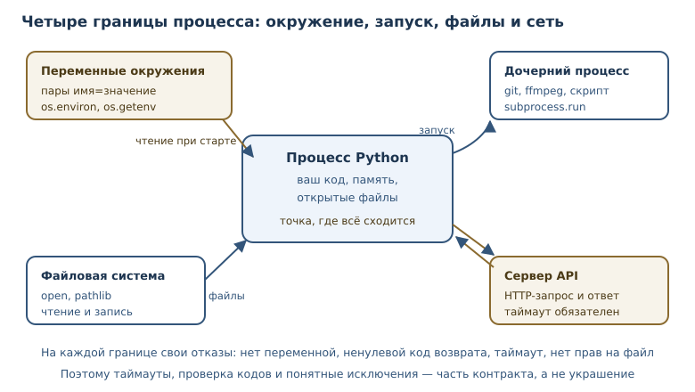
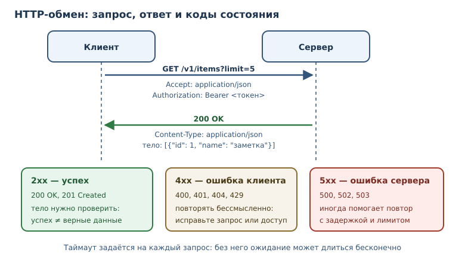

# ОС, процессы, сеть и API

<!-- syllanix:nav -->
**Навигация:** [← 34. Стандартная библиотека: collections, itertools, functools, pathlib](34-stdlib.md) · [Оглавление книги](../README.md) · [Далее: 36. Данные: SQLite, SQL и сериализация →](36-data-storage.md)
<!-- /syllanix:nav -->

<!-- syllanix:topics -->
**Темы главы**
35.1. [Что вы сможете после этой главы](#что-вы-сможете-после-этой-главы)  
35.2. [Модуль os: система и пути](#os)  
35.3. [Переменные окружения](#env)  
35.4. [Процессы и subprocess](#subprocess)  
35.5. [URL и HTTP-запрос](#http)  
35.6. [Клиент API](#api-client)  
35.7. [Типичные ошибки](#mistakes)  
35.8. [Упражнения](#упражнения)  
35.9. [Проверка понимания](#проверка-понимания)  
35.10. [Что дальше](#что-дальше)  
<!-- /syllanix:topics -->


До сих пор программы работали с данными, которые создавали сами. Настоящее
приложение взаимодействует с миром: читает настройки из окружения, запускает
внешние команды, обращается к серверам по HTTP и разбирает ответы. Каждое
такое взаимодействие пересекает границу процесса, а значит, требует аккуратной
обработки ошибок и внимания к безопасности.

В этой главе — четыре границы. Модуль `os` даёт доступ к системе и
**переменным окружения**. Модуль `subprocess` запускает внешние процессы.
HTTP-клиент отправляет запросы по **URL** и получает ответы с **кодом
состояния HTTP**. Вместе они позволяют построить **клиент API** — код,
который инкапсулирует работу с внешним сервисом.

## Что вы сможете после этой главы

К концу главы программа научится безопасно выходить во внешний мир и
возвращаться с данными. Вы сможете:

- читать настройки из переменных окружения и не хранить секреты в коде;
- безопасно запускать внешние процессы и проверять код возврата;
- разбирать и собирать URL, понимать структуру HTTP-запроса;
- обрабатывать коды состояния и ошибки сети;
- проектировать клиент API с таймаутами и явными ошибками.

## Модуль os: система и пути {#os}

**Модуль os** — модуль взаимодействия с операционной системой: каталоги,
переменные окружения, процессы. В современном Python часть его задач
перекрывается `pathlib`, но `os.path` и переменные окружения по-прежнему
нужны.

```python exec
import os

path = os.path.join("data", "reports", "2026-11-01.csv")
print(path)
print(os.path.basename(path))
print(os.path.splitext(path))
print(os.path.normpath("data/./reports/../reports/file.csv"))
```

```output
data/reports/2026-11-01.csv
2026-11-01.csv
('data/reports/2026-11-01', '.csv')
data/reports/file.csv
```

`os.path.join` собирает путь, подставляя разделитель, принятый в системе.
`os.path.normpath` убирает `.` и разрешает `..` без обращения к диску. Эти
функции работают со строками, а не с объектами `Path`; в новом коде чаще
используют `pathlib`, но при работе с чужими библиотеками оба стиля
встречаются.

Важно различать «путь как строка» и «путь как файл». Функции `os.path` ничего
не читают с диска и не проверяют существование. Если файла нет, вы узнаете об
этом только при попытке открыть его — и это нормально: проверка существования
затем открытие создаёт **состояние гонки**, когда файл удаляют между двумя
действиями. Правильный подход — открывать и обрабатывать `FileNotFoundError`.

### Платформенные различия

Модуль `os` скрывает часть различий между системами, но не все. Разделитель
пути, регистр букв в именах файлов, права доступа и переменные окружения
устроены по-разному. Поэтому код, который работает с путями, должен
использовать `os.path` или `pathlib`, а не жёстко вписанные `/` и `\`. Если
программа зависит от платформы, это стоит проверить в непрерывной интеграции
на целевой системе, а не обнаружить в production.

Ещё одно различие — кодировка имён файлов и текста. `pathlib` и `open`
принимают `encoding` явно; полагаться на локаль по умолчанию опасно, потому
что на разных машинах она разная.



## Переменные окружения {#env}

**Переменная окружения** — пара «имя — значение», передаваемая процессу извне;
стандартный способ конфигурации без секретов в коде. Один и тот же код в
разработке и в production отличается именно окружением: адресом базы, уровнем
журналирования, ключами доступа.

```python
import os

database_url = os.environ.get("DATABASE_URL", "sqlite:///local.db")
debug = os.environ.get("DEBUG", "0") == "1"
```

`os.environ` ведёт себя как словарь, но изменения в нём влияют на дочерние
процессы. Чтение через `os.environ["NAME"]` поднимает `KeyError`, если
переменной нет; `os.getenv("NAME", default)` возвращает значение по умолчанию.
Для необязательных настроек предпочтителен второй вариант: программа должна
запускаться с разумными значениями по умолчанию.

### Настройки и среды

Один и тот же код обычно запускается в нескольких средах: локально, на
тестовом стенде и в production. Отличаются адреса сервисов, уровни
журналирования и ключи. Хранить все варианты в коде плохо: секреты попадут в
репозиторий, а ветвления по имени среды расползутся по программе. Переменные
окружения разделяют код и конфигурацию: артефакт собирается один раз, а
поведение задаётся при запуске.

Для проверки удобно передавать окружение в функцию словарём, как обычные
сведения. Тогда тест не зависит от машины, а настройки читаются в одном месте.

Секреты — отдельная и самая важная тема. Токен, пароль или ключ доступа не
должны попадать в код, git и логи. Их передают через переменную окружения или
менеджер секретов, а в коде читают один раз при старте и проверяют, что
значение задано. Сообщение об ошибке должно говорить «переменная не задана», а не
печатать её значение.

## Процессы и subprocess {#subprocess}

**Модуль subprocess** — модуль запуска внешних процессов с контролем
аргументов, потоков ввода-вывода и кода возврата. Программа на Python может
вызвать `git`, `ffmpeg` или собственный скрипт и получить результат.

```python
import subprocess

result = subprocess.run(
    ["python", "-V"],
    capture_output=True,
    text=True,
    timeout=5,
)
print(result.returncode)
print(result.stdout.strip())
```

Параметры важны. `capture_output=True` перехватывает потоки, `text=True`
декодирует байты в строку, `timeout=5` не даёт процессу зависнуть навсегда.
Аргументы передаются списком: первый элемент — программа, остальные —
аргументы. Такой вызов не проходит через оболочку, поэтому пробелы и кавычки в
данных не превращаются в команды.

```console
$ python -c "print('привет')"
привет
```

Опасный вариант — `shell=True` со склейкой строки из пользовательских данных.
Если пользователь введёт `; rm -rf ~`, оболочка выполнит и вторую команду.
Запускайте процессы без оболочки и передавайте аргументы списком; если
оболочка действительно нужна, экранируйте значения или не используйте их вовсе.

## URL и HTTP-запрос {#http}

**URL** — адрес ресурса в сети: схема, хост, путь, параметры запроса. Разбор
URL — обычная работа со строками, и стандартная библиотека умеет её делать без
сети.

```python exec
from urllib.parse import parse_qs, urlencode, urljoin, urlparse

url = "https://api.example.com/v1/items?limit=5&page=2"
parsed = urlparse(url)
print(parsed.scheme, parsed.netloc, parsed.path)
print(parse_qs(parsed.query))
print(urlencode({"q": "python 3.14", "page": 2}))
print(urljoin("https://api.example.com/v1/", "items/42"))
```

```output
https api.example.com /v1/items
{'limit': ['5'], 'page': ['2']}
q=python+3.14&page=2
https://api.example.com/v1/items/42
```

`urlparse` разделяет адрес на части, `parse_qs` разбирает параметры, а
`urlencode` собирает их обратно, корректно экранируя пробелы и специальные
символы. `urljoin` соединяет базовый адрес с относительным — незаменим при
построении ссылок на ресурсы API.

**HTTP-клиент** — клиент, отправляющий HTTP-запросы и получающий ответы от
сервера. Запрос состоит из метода (`GET`, `POST`, …), пути, заголовков и
необязательного тела. Ответ содержит код состояния, заголовки и тело.

```python
from urllib.request import urlopen

with urlopen("https://api.example.com/v1/items", timeout=10) as response:
    body = response.read().decode("utf-8")
    print(response.status)
```

Сетевой вызов в книге не исполняется: пример зависит от внешнего сервера.
Важно другое — таймаут указывается всегда. Без него программа может ждать
ответа бесконечно, и никакой `try` не поможет. На 4xx и 5xx `urlopen`
поднимает `HTTPError`, а не возвращает ответ молча: тело ошибки доступно
через объект исключения, поэтому статус проверяют в `except`.

**Код состояния HTTP** — трёхзначный код ответа сервера: 2xx успех, 4xx
ошибка клиента, 5xx ошибка сервера.

| Диапазон | Значение | Примеры |
|---|---|---|
| 2xx | успех | 200 OK, 201 Created, 204 No Content |
| 3xx | перенаправление | 301 Moved Permanently, 304 Not Modified |
| 4xx | ошибка клиента | 400 Bad Request, 401 Unauthorized, 404 Not Found, 408 Request Timeout, 429 Too Many Requests |
| 5xx | ошибка сервера | 500 Internal Server Error, 503 Service Unavailable |



### Методы и повторные запросы

HTTP-метод сообщает намерение. `GET` читает записи и не меняет состояние
сервера; `POST` создаёт ресурс; `PUT` и `PATCH` обновляют; `DELETE` удаляет.
Повторная отправка `GET` безопасна: если ответ потерялся, запрос можно
повторить. Повтор `POST` без защиты может создать дубликат заказа, поэтому
операции создания либо не повторяют автоматически, либо снабжают ключом
уникальности. Это различие важно для клиента API: политика повторов зависит
от метода, а не только от кода ошибки.

Код — часть контракта. Успешный статус не означает «значения верные»: тело
ответа всё равно нужно проверить. Ошибка клиента означает, что запрос
некорректен или не авторизован; ошибка сервера — что проблема на стороне
сервиса и запрос можно повторить позже. Повторять `4xx` обычно бессмысленно:
без изменений запрос получит тот же ответ. Исключения — `408 Request Timeout`
и `429 Too Many Requests`: протокол прямо предусматривает здесь повтор с
задержкой, а заголовок `Retry-After` подсказывает, сколько ждать. `5xx` и
сетевые таймауты тоже имеет смысл повторить с задержкой.


## Клиент API {#api-client}

**Клиент API** — код, инкапсулирующий обращение к внешнему API: формирование
запросов, разбор ответов, обработка ошибок. Разбрасывать вызовы HTTP по всему
проекту плохо: адреса, заголовки и обработка ошибок дублируются, а изменить
поведение потом трудно. Клиент собирает это в одном месте.

**requests / httpx** — сторонние HTTP-клиенты с удобным API; выбираются по
требованиям проекта и фиксируются как зависимость. Оба умеют таймауты,
сессии и разбор JSON; повторные попытки настраивают отдельно или пишут
вручную — как в примере ниже. Выбор между ними — вопрос требований: `httpx`
поддерживает и синхронный, и асинхронный стиль, `requests` проще и шире
распространён.

Ответ API обычно приходит в JSON, а разбор — это уже знакомая работа со
словарями и списками. Покажем разбор на заранее подготовленном теле, без
сети:

```python exec
import json
from urllib.parse import urljoin

BASE_URL = "https://api.example.com/v1/"
raw = '{"id": 42, "name": "Аня", "tags": ["admin", "dev"]}'


def parse_user(payload: str) -> dict[str, object]:
    data = json.loads(payload)
    return {"id": data["id"], "name": data["name"], "tags": data["tags"]}


user = parse_user(raw)
print(user)
print(urljoin(BASE_URL, f"users/{user['id']}"))
```

```output
{'id': 42, 'name': 'Аня', 'tags': ['admin', 'dev']}
https://api.example.com/v1/users/42
```

### Ошибки как часть интерфейса

Клиент API должен различать ситуации, а не сообщать «что-то пошло не так».
Отсутствие ресурса (`404`) — нормальный сценарий для `get_note`: вызывающий
код решает, показать пустую страницу или создать заметку. Отказ в доступе
(`401`) требует обновить токен или сообщить пользователю. Ошибка сервера
(`5xx`) означает, что проблема временная и запрос можно повторить позже.
Разные исключения позволяют обработать каждый случай отдельно и не
превращать всю программу в один `except Exception`.

Хороший клиент API:

- задаёт базовый адрес и версию API в одном месте;
- указывает таймаут на каждый запрос;
- проверяет код состояния и поднимает понятное исключение;
- разбирает JSON и проверяет обязательные поля;
- не логирует токены и тела с персональными данными;
- имеет отдельные исключения для «не найдено», «нет доступа» и «сбой сервера».

### Пример клиента на httpx

Соберём эти правила в код. Соединение создаётся один раз: `httpx.Client`
держит пул соединений и общие заголовки, поэтому токен и базовый адрес не
повторяются в каждом вызове.

```python
import os

import httpx

token = os.environ["API_TOKEN"]

client = httpx.Client(
    base_url="https://api.example.com/v1/",
    timeout=httpx.Timeout(5.0),
    headers={"Authorization": f"Bearer {token}"},
)
```

Клиент закрывают через `client.close()` или создают в блоке
`with httpx.Client(...) as client:` — тогда соединения освобождаются
автоматически. `raise_for_status()` превращает ответ 4xx/5xx в
`httpx.HTTPStatusError`; без него тело ошибки легко принять за данные.
Повторяем только случаи, где он предусмотрен: `429` и `5xx`, удваивая
задержку, чтобы не добить перегруженный сервер.

```python
import time

import httpx


def fetch_with_retry(
    client: httpx.Client, path: str, attempts: int = 3
) -> httpx.Response:
    delay = 0.5
    for attempt in range(1, attempts + 1):
        try:
            response = client.get(path)
            response.raise_for_status()
            return response
        except httpx.HTTPStatusError as exc:
            status = exc.response.status_code
            retryable = status == 429 or status >= 500
            if not retryable or attempt == attempts:
                raise
        except httpx.TransportError:
            if attempt == attempts:
                raise
        time.sleep(delay)
        delay *= 2
    raise AssertionError("цикл всегда возвращает или поднимает исключение")


user = fetch_with_retry(client, "users/42").json()
print(user["name"])
```

Если сервер вернул `404`, исключение уходит вызывающему коду сразу: это не
временная ошибка, и повтор её не исправит. Сетевые сбои `httpx` сообщает
исключениями семейства `TransportError` — их и перехватывает вторая ветка.

## Типичные ошибки {#mistakes}

1. **Нет таймаута.** Запрос без таймаута может висеть бесконечно. Таймаут —
   обязательный параметр любого сетевого вызова.
2. **Игнорировать код состояния.** `urlopen` поднимает `HTTPError` на
   4xx/5xx, а клиенты вроде `requests` по умолчанию возвращают ответ: без
   `raise_for_status()` тело ошибки легко принять за данные.
3. **Складывать URL строками.** Ручная конкатенация теряет экранирование и
   ломается на параметрах с пробелами; используйте `urlencode` и `urljoin`.
4. **Запускать процесс с `shell=True`.** Пользовательский ввод попадает в
   оболочку и могут выполнить произвольную команду.
5. **Хранить секреты в коде.** Токен в репозитории — утечка; используйте
   переменные окружения или менеджер секретов.
6. **Смешивать транспорт и логику.** Функция, которая одновременно строит
   запрос, ходит в сеть и печатает отчёт, непроверяема. Разделяйте слои.
7. **Печатать секреты в логах.** Даже отладочный вывод заголовков может
   содержать `Authorization`.
8. **Считать, что сеть всегда доступна.** Мобильный интернет пропадает,
   сервер перезагружается, прокси отвечает ошибкой. Клиент должен уметь
   завершаться с понятной ошибкой, а не зависать.
9. **Доверять `Content-Type` без проверки.** Сервер может объявить
   `application/json`, а вернуть HTML страницы ошибки; проверяйте заголовок и
   статус до `json.loads`, иначе разбор упадёт с невнятной ошибкой.

## Упражнения

### 1. Разбор URL {#ex-ch35-01}

Разберите адрес `https://shop.example.com/catalog/items?category=books&page=3`
на схему, хост, путь и параметры. Выведите параметры как словарь.

### 2. Сборка параметров {#ex-ch35-02}

Соберите строку запроса для параметров `{"q": "язык python", "limit": 10}`.
Убедитесь, что пробел закодирован, а не потерян.

### 3. Пути через os.path {#ex-ch35-03}

Из пути `"backups/2026/october.tar.gz"` получите каталог, имя файла и
расширение. Соберите обратно полный путь и сравните с исходным.

### 4. Настройки из окружения {#ex-ch35-04}

Напишите функцию `load_settings(env: dict[str, str]) -> dict[str, object]`,
которая читает `DEBUG`, `PORT` и `DATABASE_URL` со значениями по умолчанию
`0`, `8000` и `sqlite:///local.db`. Проверьте пустое окружение и заполненное.

### 5. Команда процесса {#ex-ch35-05}

Напишите функцию, которая запускает `git status --short` в текущем каталоге и
возвращает код возврата и вывод. Объясните, почему аргументы передаются
списком и зачем нужен таймаут. Запускать в песочнице не нужно.

### 6. Коды состояния {#ex-ch35-06}

Реализуйте `classify(status: int) -> str`, которая возвращает `"успех"`,
`"перенаправление"`, `"ошибка клиента"` или `"ошибка сервера"`. Проверьте на
кодах 200, 301, 404, 503.

### 7. Клиент API {#ex-ch35-07}

Напишите `parse_items(payload: str) -> list[dict[str, object]]`, которая
разбирает JSON-массив товаров и возвращает список словарей с полями `id`,
`name`, `price`. Для отсутствующего поля поднимайте `ValueError`.

### 8. Безопасность команды {#ex-ch35-08}

Объясните, почему опасно выполнять
`subprocess.run(f"ls {user_input}", shell=True)`. Приведите пример
пользовательского ввода, который выполнит лишнюю команду, и покажите
безопасный вариант.

### 9. Ошибка сети {#ex-ch35-09}

Напишите функцию `safe_get(url: str, opener) -> str`, которая возвращает тело
ответа или строку `"недоступно"` при сетевой ошибке; `opener` — функция вроде
`urlopen`, параметр позволяет подменить транспорт в тесте. Опишите, какие
исключения перехватывать и почему нельзя глушить все ошибки подряд.

### 10. Мини-проект: описание клиента {#ex-ch35-10}

Спроектируйте клиент API для сервиса заметок: базовый адрес, методы
`list_notes`, `get_note`, `create_note`. Опишите структуру класса, обработку
кодов 404 и 401, таймауты и формат возвращаемых данных. Реализуйте разбор
ответа на подготовленном JSON без сетевых вызовов.

## Проверка понимания

1. Чем `os.path` отличается от `pathlib` и когда нужен каждый?
2. Почему настройки лучше хранить в переменных окружения, а не в коде?
3. Зачем нужен `timeout` при запуске процесса и сетевого запроса?
4. Чем опасен `shell=True` и как его избежать?
5. Что означают группы кодов 2xx, 4xx и 5xx для клиента?
6. Зачем выделять клиент API в отдельный слой?
7. Почему проверка «файл существует, затем открыть» считается ошибкой?

## Что дальше

Внешний мир отвечает сведениями, и эти сведения нужно где-то хранить. Следующая
глава — о SQLite, SQL и сериализации: как сохранять структурированные записи,
делать запросы и не терять целостность. О путях и файлах говорилось в
[главе 19](19-files-formats.md), о JSON — там же; о зависимостях и их
фиксации — в [главе 33](33-project-tooling.md).

<!-- syllanix:nav -->
**Перед этой главой:** [34. Стандартная библиотека: collections, itertools, functools, pathlib](34-stdlib.md)
**Связанные главы:** [07. Функции: параметры, аргументы и области видимости](07-functions.md), [09. Модули, пакеты и импорты](09-modules.md), [10. Ошибки и исключения](10-errors-exceptions.md), [19. Файлы, пути и текстовые форматы](19-files-formats.md), [33. Структура проекта, зависимости и инструменты](33-project-tooling.md), [41. Безопасность приложений](41-security.md), [47. Проект: HTTP API и база данных](47-project-api.md), [48. Проект: асинхронный сборщик данных](48-project-async.md)
**Далее:** [36. Данные: SQLite, SQL и сериализация →](36-data-storage.md)
<!-- /syllanix:nav -->
