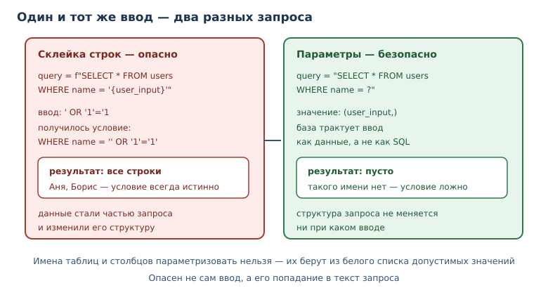
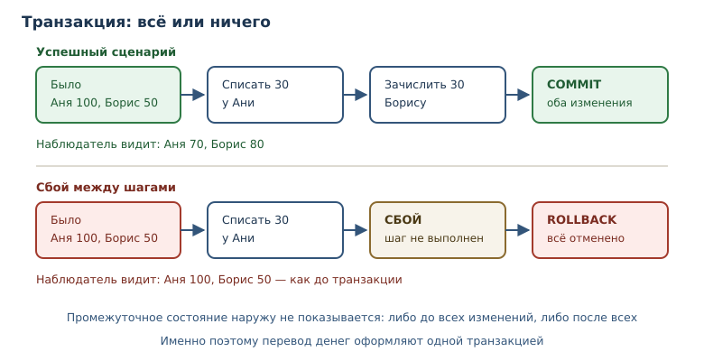

# Данные: SQLite, SQL и сериализация

<!-- syllanix:nav -->
**Навигация:** [← 35. ОС, процессы, сеть и API](35-os-network.md) · [Оглавление книги](../README.md) · [Далее: 37. Время, даты и логирование →](37-time-logging.md)
<!-- /syllanix:nav -->

<!-- syllanix:topics -->
**Темы главы**
36.1. [Что вы сможете после этой главы](#что-вы-сможете-после-этой-главы)  
36.2. [Таблицы и SQL](#tables)  
36.3. [sqlite3: встроенная база](#sqlite)  
36.4. [Параметризованные запросы](#injection)  
36.5. [Транзакции](#transactions)  
36.6. [Сериализация: JSON и CSV](#serialization)  
36.7. [Когда база не нужна](#when-not-db)  
36.8. [ORM](#orm)  
36.9. [Типичные ошибки](#mistakes)  
36.10. [Упражнения](#упражнения)  
36.11. [Проверка понимания](#проверка-понимания)  
36.12. [Что дальше](#что-дальше)  
<!-- /syllanix:topics -->


Пока данных немного, хватает JSON-файла. Когда записей становятся тысячи,
появляются вопросы, на которые файл не отвечает: как найти нужную строку, не
читая всё, как обновить одну запись, не перезаписывая остальные, как
гарантировать, что связанные изменения применятся вместе. Ответ — база данных.

Python поставляется со встроенной **SQLite**: полноценной реляционной базой,
которая хранится в одном файле и не требует отдельного сервера. На ней удобно
изучать **SQL-запросы**, **транзакции** и защиту от **SQL-инъекций**. А
**сериализация** в JSON и CSV остаётся нужна для обмена данными между
программами и для резервных копий.

## Что вы сможете после этой главы

- описывать записи таблицей и писать запросы на SQL;
- открывать соединение с базой и выполнять запросы через `sqlite3`;
- использовать параметризованные запросы и объяснять, почему склейка строк
  опасна;
- применять транзакции и понимать, что происходит при сбое;
- выбирать между базой, JSON и CSV и объяснять разницу;
- представлять, зачем нужен ORM и когда лучше обойтись SQL.

## Таблицы и SQL {#tables}

Реляционная база хранит записи в **таблицах**. **Таблица базы данных** —
именованный набор строк с фиксированным набором столбцов. Каждый столбец
имеет тип и имя, каждая строка описывает один объект. Для заметок таблица
может выглядеть так:

| id | title | done |
|---|---|---|
| 1 | купить хлеб | 0 |
| 2 | позвонить | 1 |

`id` — первичный ключ: значение, которое однозначно определяет строку. В
SQLite целочисленный первичный ключ умеет заполняться автоматически.
`done` хранится числом `0` или `1`, потому что в SQLite нет отдельного
логического типа; это деталь реализации, а не языка SQL.

**SQL-запрос** — декларативное описание выборки или изменения данных в
реляционной базе. Вы описываете, что нужно получить, а не как перебирать
строки. Четыре основные операции называют CRUD: создание (`INSERT`), чтение
(`SELECT`), обновление (`UPDATE`) и удаление (`DELETE`).

```sql
CREATE TABLE notes (
    id INTEGER PRIMARY KEY,
    title TEXT NOT NULL,
    done INTEGER NOT NULL DEFAULT 0
);

INSERT INTO notes (title) VALUES ('купить хлеб');
SELECT id, title, done FROM notes WHERE done = 0 ORDER BY id;
UPDATE notes SET done = 1 WHERE id = 1;
DELETE FROM notes WHERE id = 2;
```

`NOT NULL` запрещает пустое значение, `DEFAULT` задаёт значение по умолчанию.
Ограничения — часть схемы: они не дают записать бессмыслицу даже при ошибке в
коде.

Типы в SQLite гибкие: в столбец `INTEGER` технически можно записать строку,
если не включён строгий режим. Это наследие ради совместимости, а не
рекомендация. В новом коде полезно включать `STRICT` для таблиц или хотя бы
проверять значения на границе приложения. Ограничения `CHECK` позволяют
запретить бессмыслицу на уровне схемы, например отрицательную цену или
неизвестный статус. Схема решает, какие значения допустимы. Приложение может проверять их
дополнительно — ради понятных сообщений.

## sqlite3: встроенная база {#sqlite}

**sqlite3** — модуль стандартной библиотеки для встроенной базы данных SQLite
в одном файле. Он не требует установки сервера: база — это файл, а библиотека
входит в Python. Этого достаточно для настольных программ, прототипов и
небольших сервисов.

```python exec
import pathlib
import sqlite3

path = pathlib.Path("notes.db")
connection = sqlite3.connect(path)
connection.execute(
    "CREATE TABLE notes (id INTEGER PRIMARY KEY, title TEXT NOT NULL, done INTEGER NOT NULL DEFAULT 0)"
)
connection.execute("INSERT INTO notes (title) VALUES (?)", ("купить хлеб",))
connection.execute("INSERT INTO notes (title, done) VALUES (?, ?)", ("позвонить", 1))
connection.commit()
rows = connection.execute("SELECT id, title, done FROM notes ORDER BY id").fetchall()
print(rows)
connection.close()
```

```output
[(1, 'купить хлеб', 0), (2, 'позвонить', 1)]
```

Разберём шаги. `connect` открывает **соединение с базой** — объект, через
который приложение обменивается данными с базой; его нужно корректно
закрывать. `execute` выполняет один запрос. `commit` фиксирует изменения.
`fetchall` возвращает все строки результата списком кортежей.

SQLite создаёт файл базы, если его нет. В примере используется относительный
путь `notes.db`: в учебной песочнице это временный каталог, а в реальной
программе путь задают явно, обычно через переменную окружения.

### Соединение и ресурсы

Соединение — ресурс, который нужно освобождать. Конструкция `with
sqlite3.connect(...)` управляет транзакцией, но **не закрывает** соединение:
после выхода объект остаётся открытым. Надёжнее комбинировать контекстные
менеджеры.

```python
from contextlib import closing
import sqlite3

with closing(sqlite3.connect("notes.db")) as connection:
    with connection:
        connection.execute("INSERT INTO notes (title) VALUES (?)", ("новая",))
```

Внешний `closing` закрывает соединение гарантированно, внутренний `with`
фиксирует транзакцию при успехе и откатывает при исключении. Такая
комбинация — рабочий шаблон для небольших программ. В крупном приложении
соединением управляет пул, но принцип тот же: ресурс освобождается
детерминированно.

### Индексы

Поиск по таблице без индекса просматривает все строки. На сотнях записей это
незаметно, на миллионах — превращается в узкое место. Индекс — вспомогательная
структура, ускоряющая поиск по столбцу; его создают для полей, по которым
часто фильтруют и сортируют.

```sql
CREATE INDEX idx_notes_done ON notes (done);
```

У индекса есть цена: он занимает место и замедляет вставку, потому что при
каждом изменении его нужно обновлять. Поэтому индексы добавляют по результатам
измерений, а не «на всякий случай». В SQLite посмотреть план запроса можно
командой `EXPLAIN QUERY PLAN`: она показывает, используется ли индекс и не
приходится ли читать всю таблицу.

## Параметризованные запросы {#injection}

**Параметризованный запрос** — запрос с подстановкой значений через параметры
(`?` для позиционных и `:name` для именованных), а не конкатенацией строк.
Значения передаются отдельно от текста запроса, поэтому база трактует их как
значения, а не как SQL-код.

**SQL-инъекция** — атака через подстановку вредоносного SQL в пользовательский
ввод; предотвращается параметризацией. Покажем разницу на безобидном
примере: пользователь вводит строку, которую код вставляет в `WHERE`.

```python exec
import sqlite3

connection = sqlite3.connect(":memory:")
connection.execute("CREATE TABLE users (name TEXT)")
connection.executemany("INSERT INTO users VALUES (?)", [("Аня",), ("Борис",)])

user_input = "' OR '1'='1"

unsafe = connection.execute(
    f"SELECT name FROM users WHERE name = '{user_input}'"
).fetchall()
safe = connection.execute(
    "SELECT name FROM users WHERE name = ?", (user_input,)
).fetchall()

print(unsafe)
print(safe)
connection.close()
```

```output
[('Аня',), ('Борис',)]
[]
```

Небезопасный запрос вернул обе строки: ввод изменил условие `WHERE` так, что
оно стало истинным для всех записей. Параметризованный запрос искал
пользователя с буквальным именем `' OR '1'='1` и ничего не нашёл. Выглядит
безобидно только потому, что запрос читает записи. Если бы вместо `SELECT`
стоял `DELETE` или `UPDATE`, тот же приём изменил бы или удалил таблицу.

Правило простое: **никогда** не собирайте SQL строками из данных
пользователя. Подставляйте значения только через параметры; имена таблиц и
столбцов параметризовать нельзя, поэтому их берут из белого списка
допустимых значений.



## Транзакции {#transactions}

**Транзакция** — группа изменений, применяемая целиком или не применяемая
вовсе; обеспечивает целостность данных. Классический пример — перевод денег:
нужно списать сумму с одного счёта и зачислить на другой. Если после списания
произойдёт сбой, деньги исчезнут.

```python exec
import sqlite3

connection = sqlite3.connect(":memory:")
connection.execute("CREATE TABLE accounts (name TEXT, balance INTEGER)")
connection.executemany(
    "INSERT INTO accounts VALUES (?, ?)",
    [("Аня", 100), ("Борис", 50)],
)
connection.commit()

try:
    with connection:
        connection.execute(
            "UPDATE accounts SET balance = balance - 30 WHERE name = 'Аня'"
        )
        connection.execute(
            "UPDATE accounts SET balance = balance + 30 WHERE name = 'Борис'"
        )
        raise RuntimeError("сбой между переводами")
except RuntimeError:
    pass

print(connection.execute("SELECT name, balance FROM accounts ORDER BY name").fetchall())
connection.close()
```

```output
[('Аня', 100), ('Борис', 50)]
```

Изменения откатились: баланс не изменился, хотя первое обновление уже было
выполнено. `with connection` начинает транзакцию и фиксирует её при успешном
выходе, а при исключении откатывает. Это и есть атомарность: наблюдатель
видит либо состояние до всех изменений, либо после всех, но не промежуточное.
В многопользовательских базах к этому добавляется изоляция транзакций:
одновременные транзакции не должны видеть чужие незавершённые изменения.
SQLite сериализует запись, поэтому в учебных примерах этим можно пренебречь,
но в PostgreSQL уровень изоляции выбирают осознанно.



## Сериализация: JSON и CSV {#serialization}

База хранит записи, но обмениваться ими с другими программами удобнее в
текстовых форматах. **Сериализация** — преобразование объектов программы в
формат, пригодный для хранения или передачи, и обратное чтение. JSON — формат
для вложенных структур, CSV — для таблиц.

```python exec
import json

record = {"id": 1, "title": "купить хлеб", "tags": ["дом", "еда"]}
text = json.dumps(record, ensure_ascii=False, sort_keys=True)
print(text)
print(json.loads(text) == record)
```

```output
{"id": 1, "tags": ["дом", "еда"], "title": "купить хлеб"}
True
```

`ensure_ascii=False` сохраняет кириллицу читаемой, `sort_keys=True` делает
порядок ключей предсказуемым — удобно для сравнения и тестов. Кортеж при
сериализации становится массивом и при загрузке вернётся списком; множество
JSON не поддерживает вовсе — `json.dumps({1, 2})` поднимет `TypeError`.
Поэтому формат подходит для данных, а не для любого объекта Python.

CSV удобен для таблиц и открывается в электронных таблицах. Его ограничение —
плоская структура: вложенные списки и словари в одну ячейку не поместить без
дополнительного кодирования. Выбор простой: связи и вложенность — JSON,
однородные таблицы — CSV, запросы и обновление — база.

## Когда база не нужна {#when-not-db}

База — не универсальный ответ. Если данных единицы и они читаются целиком,
JSON-файл проще: его видно в редакторе, легко скопировать и сравнить. Если
записи — это журнал событий, который только дописывается, подойдёт
построчная запись в файл. База нужна, когда важны запросы, обновления,
согласованность и конкурентный доступ.

Практический признак: как только появляется «найди все записи, где...»,
«обнови одну строку, не трогая остальные» или «сделай два изменения вместе»,
начинается территория базы. До этого файла достаточно, и переход на базу
можно отложить — при условии, что доступ к данным идёт через функции, а не
через случайные `open` по всему проекту.

### Резервные копии и файл базы

База SQLite — это один файл, и это упрощает резервное копирование: достаточно
скопировать файл, когда в него никто не пишет. Копировать «на ходу» опасно:
можно получить несогласованный снимок. Правильный способ — встроенный механизм
резервного копирования или остановка записи на время копирования. Для учебной
программы достаточно второго варианта, для сервиса — первого.

Файл базы не стоит держать в каталоге с исходным кодом и тем более в git:
записи меняются, а история коммитов превращается в мусор. Путь задают через
конфигурацию, а каталог данных добавляют в `.gitignore`. Тесты используют
временный каталог, чтобы не затронуть рабочую базу.

## ORM {#orm}

**ORM** — слой, отображающий таблицы в классы и строки в объекты, скрывающий
ручной SQL. Вместо `SELECT ... WHERE id = ?` вы пишете `session.get(Note, 1)`,
а библиотека строит запрос. Крупнейший пример — SQLAlchemy; внешние ORM
устанавливают как зависимость.

У ORM есть плюсы: меньше повторяющегося кода, автоматическая параметризация,
связи между таблицами описываются декларативно. Есть и минусы: неочевидные
запросы, скрытые обращения к базе, сложная отладка производительности.
Практическое правило: ORM хорош для типовых операций и больших моделей, а
сложные аналитические запросы проще писать на SQL. Знание SQL остаётся
обязательным: ORM не отменяет базу, а надстраивается над ней.

## Типичные ошибки {#mistakes}

1. **Склеивать SQL из строк.** Это открывает SQL-инъекцию и ломается на
   апострофах в данных. Используйте параметры.
2. **Забывать `commit`.** Без фиксации изменения теряются при закрытии
   соединения; в SQLite по умолчанию транзакция остаётся открытой.
3. **Считать `with sqlite3.connect(...)` закрытием соединения.** Контекст
   управляет транзакцией, а не ресурсом; добавляйте `closing`.
4. **Оставлять соединение открытым.** Утечка соединений исчерпывает ресурсы и
   блокирует файл базы.
5. **Хранить деньги в `float`.** Двоичные дроби не представляют копейки точно;
   храните целые копейки или используйте тип `DECIMAL` в полноценных базах.
6. **Создавать таблицы на каждом запуске без миграций.** Схема меняется, а
   записи уже есть; нужны версионированные миграции.
7. **Путать `None` в Python и `NULL` в SQL.** Для сравнения с `NULL`
   используется `IS NULL`, а не `= NULL`.
8. **Хранить даты строками без формата.** Сортировка и сравнение строк
   работают случайно; храните ISO-даты или числа и документируйте формат.
9. **Игнорировать `PRAGMA foreign_keys`.** В SQLite проверка внешних ключей
   выключена по умолчанию, и ссылки на несуществующие строки проходят молча.

## Упражнения

### 1. Первая таблица {#ex-ch36-01}

Создайте в SQLite таблицу `books` с полями `id`, `title`, `author`, `year`.
Вставьте две книги и выведите все строки, упорядоченные по году.

### 2. Выборка с условием {#ex-ch36-02}

Для таблицы из задания 1 получите книги, изданные после 2020 года. Используйте
параметризованный запрос и объясните, почему год передаётся параметром, а не
через f-строку.

### 3. Обновление и удаление {#ex-ch36-03}

Обновите год у одной книги и удалите другую. Проверьте результат запросом.
Объясните, зачем выполнять оба изменения в одной транзакции.

### 4. Откат транзакции {#ex-ch36-04}

Воспроизведите пример с переводами между счетами, но с суммой 40. Убедитесь,
что при искусственном сбое балансы остаются прежними, а без сбоя — меняются.

### 5. Анализ инъекции {#ex-ch36-05}

Дан небезопасный код:

```python
query = f"SELECT * FROM users WHERE name = '{name}'"
```

Объясните, что вернёт запрос при `name = "' OR '1'='1"`, и перепишите код
безопасно. Проверьте оба варианта на тестовой таблице.

### 6. Агрегаты {#ex-ch36-06}

Для таблицы `orders` с полями `id`, `amount` посчитайте количество заказов,
сумму и среднюю сумму. Объясните, что произойдёт со средним, если в таблице
нет строк.

### 7. Связь двух таблиц {#ex-ch36-07}

Создайте таблицы `authors` и `books` со ссылкой `author_id`. Напишите запрос,
который возвращает название книги и имя автора. Объясните, что такое внешний
ключ.

### 8. JSON в базе {#ex-ch36-08}

Сохраните в таблице `settings` JSON-строку с настройками пользователя и
прочитайте её обратно. Сравните с хранением отдельных столбцов: когда какой
подход уместен?

### 9. Жизненный цикл соединения {#ex-ch36-09}

Объясните, почему `with sqlite3.connect("app.db") as connection:` не закрывает
соединение. Напишите корректный вариант с `closing` и проверьте, что файл
базы можно открыть повторно.

### 10. Мини-проект: хранилище заметок {#ex-ch36-10}

Реализуйте модуль `notes` с функциями `add(title)`, `list_notes()`,
`mark_done(note_id)`. Используйте параметризованные запросы, транзакции для
изменений и закрытие соединения. Проверьте полный сценарий: добавить две
заметки, отметить одну выполненной, вывести список.

## Проверка понимания

1. Что такое таблица базы данных и чем строка отличается от столбца?
2. Зачем нужны `PRIMARY KEY` и `NOT NULL`?
3. Почему параметризованный запрос защищает от инъекции, а f-строка — нет?
4. Что гарантирует транзакция и как она связана с атомарностью?
5. Чем `with sqlite3.connect(...)` отличается от `closing(...)`?
6. Когда выбрать JSON, CSV или базу данных?
7. Что даёт ORM и почему SQL всё равно нужно знать?

## Что дальше

База хранит факты, но у каждого факта есть время: когда он появился, когда
истекает срок, как восстановить последовательность событий. Следующая глава —
о времени, часовых поясах и логировании. О работе с файлами и форматами
говорилось в [главе 19](19-files-formats.md), о контекстных менеджерах — в
[главе 34](34-stdlib.md). Там же разобраны приёмы, которые понадобятся для
аккуратного закрытия соединений и файлов. Безопасная работа с ресурсами —
общая тема, а не особенность баз данных.

<!-- syllanix:nav -->
**Перед этой главой:** [35. ОС, процессы, сеть и API](35-os-network.md)
**Связанные главы:** [07. Функции: параметры, аргументы и области видимости](07-functions.md), [09. Модули, пакеты и импорты](09-modules.md), [10. Ошибки и исключения](10-errors-exceptions.md), [12. Коллекции и последовательности: введение](12-collections-intro.md), [13. Списки: индексы, срезы и методы](13-lists.md), [17. Словари: отображения и структурирование данных](17-dicts.md), [19. Файлы, пути и текстовые форматы](19-files-formats.md), [41. Безопасность приложений](41-security.md)
**Далее:** [37. Время, даты и логирование →](37-time-logging.md)
<!-- /syllanix:nav -->
