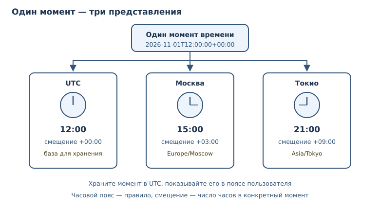
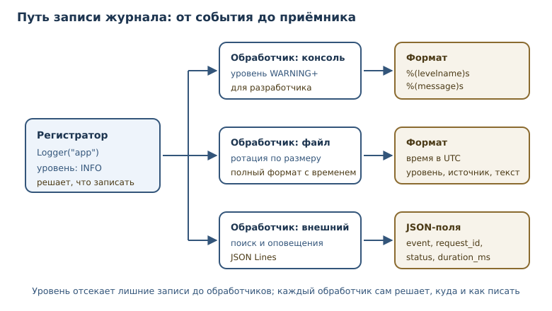

# Время, даты и логирование

<!-- syllanix:nav -->
**Навигация:** [← 36. Данные: SQLite, SQL и сериализация](36-data-storage.md) · [Оглавление книги](../README.md) · [Далее: 38. Конкурентность: потоки, процессы и GIL →](38-concurrency.md)
<!-- /syllanix:nav -->

<!-- syllanix:topics -->
**Темы главы**
37.1. [Что вы сможете после этой главы](#что-вы-сможете-после-этой-главы)  
37.2. [datetime: даты, время и интервалы](#datetime)  
37.3. [Часовые пояса](#timezone)  
37.4. [Отметки времени и ISO 8601](#timestamp)  
37.5. [Модуль logging: уровни и обработчики](#logging)  
37.6. [Структурированное логирование](#structured)  
37.7. [Типичные ошибки](#mistakes)  
37.8. [Упражнения](#упражнения)  
37.9. [Проверка понимания](#проверка-понимания)  
37.10. [Что дальше](#что-дальше)  
<!-- /syllanix:topics -->


Две вещи ломают программы тихо и больно: время и журналы. Время кажется
простым, пока не появляются часовые пояса, переход на летнее время и серверы в
других регионах. Журналы кажутся скучными, пока не нужно понять, почему
заказ не прошёл в три часа ночи.

В этой главе вы научитесь различать «наивное» и «осведомлённое» время,
хранить **отметки времени** в UTC и показывать их в нужном **часовом поясе**,
а также настраивать **модуль logging** так, чтобы записи были единообразными,
безопасными и пригодными для машинного разбора.

## Что вы сможете после этой главы

- создавать даты и интервалы, складывать и вычитать время;
- отличать наивный `datetime` от осведомлённого и объяснять, почему это
  важно;
- переводить моменты между часовыми поясами и хранить их в UTC;
- записывать и разбирать даты по стандарту ISO 8601;
- настраивать уровни, обработчики логов и формат записей;
- вести структурированное логирование в JSON и не утекать секретами.

## datetime: даты, время и интервалы {#datetime}

**datetime** — тип даты и времени; бывает «наивным» (без зоны) и
«осведомлённым» (с часовым поясом). Наивный объект знает числа года, месяца,
дня, часа и минуты, но не знает, к какому поясу они относятся. Осведомлённый
дополнительно хранит смещение и правило перехода на летнее время.

```python exec
from datetime import datetime, timedelta, timezone

naive = datetime(2026, 11, 1, 12, 0)
aware = datetime(2026, 11, 1, 12, 0, tzinfo=timezone.utc)
print(naive.tzinfo)
print(aware.tzinfo)
print(naive + timedelta(hours=3))
print(aware + timedelta(hours=3))
```

```output
None
UTC
2026-11-01 15:00:00
2026-11-01 15:00:00+00:00
```

`timedelta` — интервал времени. Сложение и вычитание работают и для дат, и для
интервалов. Обратите внимание: результат для наивного времени не содержит
смещения, а для осведомлённого содержит `+00:00`. Это не косметика:
порядковое сравнение наивного и осведомлённого времени Python запрещает и
поднимает `TypeError`, а равенство `==` всегда даёт `False` — моменты
несравнимы, пока неизвестен пояс.

```python exec expect-error
from datetime import datetime, timezone

naive = datetime(2026, 11, 1, 12, 0)
aware = datetime(2026, 11, 1, 12, 0, tzinfo=timezone.utc)
print(naive < aware)
```

```output
TypeError: can't compare offset-naive and offset-aware datetimes
```

Текущий момент получают функцией `datetime.now(timezone.utc)`: она возвращает
осведомлённое время в UTC. Вызов `datetime.now()` без аргумента даёт наивное
локальное время — его нельзя однозначно сопоставить с моментом.

```python
from datetime import datetime, timezone

now = datetime.now(timezone.utc)
print(now.isoformat(timespec="seconds"))  # 2026-11-01T12:00:00+00:00
```

### Арифметика дат

С датами и интервалами нужно обращаться осторожно: месяц и год имеют разную
длину, а переход на летнее время добавляет или убирает час. `timedelta`
складывает фиксированные интервалы — дни, часы, минуты. Если нужно «через
месяц», одного `timedelta` недостаточно: длина месяца зависит от календаря.
Для таких вычислений используют специализированные библиотеки или явно
определяют правило в бизнес-логике.

```python exec
from datetime import datetime, timezone

start = datetime(2026, 3, 1, tzinfo=timezone.utc)
finish = datetime(2026, 11, 1, 12, 30, tzinfo=timezone.utc)
delta = finish - start
print(delta.days, delta.seconds // 3600, (delta.seconds % 3600) // 60)
```

```output
245 12 30
```

Разница между осведомлёнными временами корректна, потому что оба момента
заданы в UTC. Если бы одно из времён было наивным, Python отказался бы
выполнять вычитание: `TypeError: can't subtract offset-naive and offset-aware
datetimes` — пояс второго операнда неизвестен, и результат был бы произвольным.

Правило рабочего проекта: внутри программы и в базе храните только
осведомлённое время в UTC, а в человекочитаемый вид переводите на границе —
при показе пользователю или формировании отчёта.

## Часовые пояса {#timezone}

**Часовой пояс** — правило смещения времени относительно UTC; обязательно для
корректной работы с датами. Смещение — не константа: в разных странах оно
разное, а переход на летнее время меняет его дважды в год.

Модуль `zoneinfo` из стандартной библиотеки знает правила поясов:

```python exec
from datetime import datetime, timezone
from zoneinfo import ZoneInfo

instant = datetime(2026, 11, 1, 12, 0, tzinfo=timezone.utc)
print(instant.isoformat())
print(instant.astimezone(ZoneInfo("Europe/Moscow")).isoformat())
print(instant.astimezone(ZoneInfo("Asia/Tokyo")).isoformat())
```

```output
2026-11-01T12:00:00+00:00
2026-11-01T15:00:00+03:00
2026-11-01T21:00:00+09:00
```

Это один и тот же момент времени, показанный в трёх поясах. `astimezone` не
меняет момент, а меняет представление. Сравнение осведомлённых времён работает
по моменту, а не по цифрам на циферблате:

```python exec
from datetime import datetime
from zoneinfo import ZoneInfo

moscow = datetime(2026, 11, 1, 15, 0, tzinfo=ZoneInfo("Europe/Moscow"))
tokyo = datetime(2026, 11, 1, 21, 0, tzinfo=ZoneInfo("Asia/Tokyo"))
print(moscow == tokyo)
print(moscow.astimezone(ZoneInfo("UTC")).isoformat())
```

```output
True
2026-11-01T12:00:00+00:00
```



Часовой пояс не равен смещению. Смещение — конкретное число часов в конкретный
момент; пояс — правило, по которому это число вычисляется. Поэтому хранить
`datetime` со смещением `+03:00` недостаточно, если затем нужно применить
правила другого региона: используйте имя пояса (`Europe/Moscow`) и `zoneinfo`.

### Неоднозначный час и fold

При обратном переводе часов локальное время повторяется. В ночь на 25 октября
2026 года Берлин возвращается с летнего времени на зимнее: 02:30 случается
дважды. Атрибут `fold` указывает, какое вхождение имеется в виду: `fold=0` —
первое, ещё летнее (`+02:00`), `fold=1` — второе, уже зимнее (`+01:00`).

```python exec
from datetime import datetime
from zoneinfo import ZoneInfo

berlin = ZoneInfo("Europe/Berlin")
first = datetime(2026, 10, 25, 2, 30, tzinfo=berlin, fold=0)
second = datetime(2026, 10, 25, 2, 30, tzinfo=berlin, fold=1)
print(first.isoformat(), first.utcoffset())
print(second.isoformat(), second.utcoffset())
print(first.timestamp() - second.timestamp())
```

```output
2026-10-25T02:30:00+02:00 2:00:00
2026-10-25T02:30:00+01:00 1:00:00
-3600.0
```

Цифры на циферблате одинаковые, а моменты различаются на час. Без `fold`
интерпретатор берёт значение по умолчанию `0`, и второе вхождение теряется:
два разных момента дают одну и ту же строку. Поэтому локальное время из
внешнего источника разбирают с оговоркой о вхождении, а хранят всё равно UTC.
Обратный случай — пропущенный час при переходе на летнее время: такого
локального времени не существует. `fold` и здесь выбирает смещение — до
перехода или после, поэтому один и тот же набор цифр может означать разные
моменты.


## Отметки времени и ISO 8601 {#timestamp}

**Отметка времени** — момент времени, обычно представленный числом секунд от
эпохи Unix. Число не зависит от пояса и удобно для сортировки, хранения и
сравнения.

```python exec
from datetime import datetime, timezone

moment = datetime(2026, 11, 1, 12, 0, tzinfo=timezone.utc)
stamp = moment.timestamp()
print(int(stamp))
print(datetime.fromtimestamp(stamp, tz=timezone.utc).isoformat())
```

```output
1793534400
2026-11-01T12:00:00+00:00
```

**ISO 8601** — стандартная текстовая запись даты и времени:
`2026-11-01T12:00:00+03:00`. Формат однозначен, сортируется как строка (при
одинаковом смещении) и понимается большинством языков и баз данных.

```python exec
from datetime import datetime, timezone

text = "2026-11-01T12:00:00+03:00"
parsed = datetime.fromisoformat(text)
print(parsed.utcoffset())
print(parsed.astimezone(timezone.utc).isoformat())
```

```output
3:00:00
2026-11-01T09:00:00+00:00
```

### Форматирование для человека

ISO 8601 хорош для обмена, но не всегда удобен для чтения. Для вывода
пользователю применяют `strftime` с явным шаблоном и явным поясом.

```python exec
from datetime import datetime, timezone
from zoneinfo import ZoneInfo

moment = datetime(2026, 11, 1, 12, 0, tzinfo=timezone.utc)
local = moment.astimezone(ZoneInfo("Europe/Moscow"))
print(local.strftime("%d.%m.%Y %H:%M"))
print(local.strftime("%d %B %Y"))
```

```output
01.11.2026 15:00
01 November 2026
```

Названия месяцев зависят от локали, поэтому для русских подписей нужна
настройка локали или собственная таблица. В книгах и отчётах безопаснее
числовой формат: он одинаково читается на любой машине. Для хранения и
передачи всегда используйте ISO 8601, а `strftime` — только для показа.

Для хранения выбирайте одно представление и следуйте ему везде: либо целые
секунды UTC, либо ISO-строка с явным смещением. Смешивать форматы в одной
таблице — верный способ получить «сегодня» и «вчера» в одном отчёте. Если
значения приходят без смещения, считайте их неполными: наивное время нельзя
однозначно перевести в момент.

## Модуль logging: уровни и обработчики {#logging}

**Модуль logging** — модуль стандартной библиотеки для управляемого
журналирования событий. Он разделяет три роли: регистратор (`Logger`) решает,
что записать; **обработчик логов** (`Handler`) решает, куда; форматтер —
как именно.

Уровни важности (`DEBUG`, `INFO`, `WARNING`, `ERROR`, `CRITICAL`) задают порог.
Если регистратор настроен на `INFO`, сообщения `DEBUG` не попадут в вывод.
Журнал — не замена `print`: записи имеют уровень, время, источник и
настраиваемый приёмник.

```python exec
import logging
from io import StringIO

stream = StringIO()
handler = logging.StreamHandler(stream)
handler.setFormatter(logging.Formatter("%(levelname)s:%(name)s:%(message)s"))

logger = logging.getLogger("demo")
logger.handlers.clear()
logger.propagate = False
logger.setLevel(logging.DEBUG)
logger.addHandler(handler)

logger.debug("отладка")
logger.info("задача %d запущена", 7)
logger.warning("файл %s не найден", "config.toml")
print(stream.getvalue(), end="")
```

```output
DEBUG:demo:отладка
INFO:demo:задача 7 запущена
WARNING:demo:файл config.toml не найден
```

В примере формат намеренно не содержит времени: иначе вывод зависел бы от
запуска. В рабочем журнале время обязательно, обычно в UTC и ISO 8601.


Параметры `%s` и `%d` подставляются лениво: строка форматируется, только
если запись действительно пройдёт фильтр по уровню. Поэтому f-строка в
вызове `logger.info` тратит работу впустую. От утечки секретов ленивое
форматирование не защищает: если значение попало в запись, оно окажется в
журнале в обоих случаях — маскируйте данные до логирования.


### Обработчики и уровни

Один регистратор может писать в несколько мест: в консоль для разработчика, в
файл для разбора и во внешнюю систему для мониторинга. Обработчики
настраиваются независимо, у каждого свой уровень и формат.

```python
import logging
from logging.handlers import RotatingFileHandler

logger = logging.getLogger("app")
logger.setLevel(logging.INFO)

console = logging.StreamHandler()
console.setLevel(logging.WARNING)

file_handler = RotatingFileHandler("app.log", maxBytes=1_000_000, backupCount=3)
file_handler.setLevel(logging.INFO)

formatter = logging.Formatter("%(asctime)s %(levelname)s %(name)s %(message)s")
for handler in (console, file_handler):
    handler.setFormatter(formatter)
    logger.addHandler(handler)
```

`RotatingFileHandler` ограничивает размер файла и хранит несколько копий:
журнал не растёт бесконечно. В production журнал обычно пишут в стандартный
поток, а сбором занимается инфраструктура; это упрощает контейнеры и
централизованный поиск.

### Время в тестах

Код, который читает текущее время напрямую, трудно проверять: результат
зависит от запуска. Правильный приём — передавать время как зависимость.
Функция принимает «сейчас» параметром или получает часы извне, а тест
подставляет фиксированный момент.

```python
from datetime import datetime


def greeting(now: datetime) -> str:
    if now.hour < 12:
        return "Доброе утро"
    return "Добрый день"
```

Такой код детерминирован: тест передаёт `datetime(2026, 11, 1, 9, 0)` и
проверяет утреннее приветствие без ожидания реального утра. В рабочем коде
функцию вызывают с текущим временем, полученным в одном месте программы.

## Структурированное логирование {#structured}

**Структурированное логирование** — запись логов как структурированных данных
(JSON, поля), пригодных для машинного анализа. Строка «что-то пошло не так»
бесполезна для поиска; запись с полями `event`, `order_id`, `duration_ms`,
`status` позволяет фильтровать и агрегировать.

```python exec
import json
import logging
from io import StringIO

stream = StringIO()
handler = logging.StreamHandler(stream)
logger = logging.getLogger("app")
logger.handlers.clear()
logger.propagate = False
logger.setLevel(logging.INFO)
logger.addHandler(handler)


def log_event(event: str, **fields: object) -> None:
    payload = {"event": event, **fields}
    logger.info(json.dumps(payload, ensure_ascii=False, sort_keys=True))


log_event("order_created", order_id=42, amount=900)
print(stream.getvalue().strip())
```

```output
{"amount": 900, "event": "order_created", "order_id": 42}
```

### Именование событий

Поле `event` — это короткое имя в змеином регистре: `order_created`,
`payment_failed`, `request_finished`. Единый словарь событий позволяет
строить графики и оповещения по имени, не разбирая текст сообщения. Если
каждый разработчик придумывает своё имя, журнал превращается в набор
уникальных строк, и машинный анализ становится невозможен.

Имена событий и наборы полей стоит зафиксировать в документации проекта.
Тогда новая запись либо вписывается в существующую схему, либо осознанно её
расширяет, а не добавляет очередной формат. Проверка схемы записи в тестах
ловит опечатки в именах полей до того, как журнал попадёт в систему поиска.

`sort_keys=True` делает порядок полей предсказуемым, `ensure_ascii=False`
сохраняет читаемую кириллицу. Каждая строка — самостоятельный JSON-объект, его
называют JSON Lines. Такие логи легко читать построчно и загружать в системы
поиска.

### Что писать и чего избегать

Уровни помогают читателю журнала: `DEBUG` — подробности для разработки,
`INFO` — значимые события, `WARNING` — неожиданное, но не сломавшее работу,
`ERROR` — операция не выполнена, `CRITICAL` — система не может продолжать.
Не пишите `ERROR` для ожидаемых ситуаций: если пользователь ввёл неверный
пароль, это `INFO` или `WARNING`, иначе журнал ошибок перестаёт быть сигналом.

Сообщение должно отвечать на вопрос «что произошло и с чем», а не «что-то не
так». «Не удалось создать заказ» лучше, чем «ошибка», а «не удалось создать
заказ order_id=42» лучше обоих. Но идентификаторы, персональные данные и
секреты требуют осторожности.

Что попадает в структурированную запись: идентификатор запроса или
пользователя, название события, длительность, результат, код ошибки. Чего там
быть не должно: паролей, токенов, номеров карт и полных персональных данных.
Маскируйте чувствительные поля до записи, а не после. Простое правило: если
значение нельзя показать в тикете поддержки, его нельзя и логировать.

### Журнал в файл и его пределы

Файл журнала растёт: за день работы сервис может записать миллионы строк. Без
ограничения диск заполнится, и упадёт уже не приложение, а вся машина.
`RotatingFileHandler` ограничивает размер, `TimedRotatingFileHandler` — срок
хранения: старые файлы удаляются автоматически. Политику хранения выбирают по
требованиям: для отладки достаточно недели, для аудита — месяцы, но аудит
обычно требует отдельного защищённого хранилища.

Журнал не заменяет метрики. По логам можно найти причину сбоя, но нельзя
быстро понять, что сбоев стало больше: для этого нужны счётчики и графики.
Логи, метрики и трассировки дополняют друг друга, и в зрелой системе есть все
три инструмента. Начинать достаточно с логов, но по мере роста нагрузки
счётчики и распределённая трассировка становятся необходимостью.

## Типичные ошибки {#mistakes}

1. **Хранить наивное время.** Без пояса невозможно восстановить момент;
   сервер переехал в другой регион — и отчёты сломались.
2. **Хранить локальное время вместо UTC.** Переход на летнее время создаёт
   дубликаты и пропуски; UTC избавляет от них.
3. **Считать смещение часовым поясом.** `+03:00` не описывает правила
   перехода; для конверсий нужно имя пояса.
4. **Сравнивать наивное и осведомлённое время.** Python поднимает
   `TypeError`, а в языках без такой проверки ошибка проходит молча.
5. **Писать в лог секреты и персональные данные.** Журналы копируются,
   индексируются и хранятся дольше, чем кажется.
6. **Использовать `print` вместо логирования.** Нет уровней, времени и
   возможности отключить вывод без правки кода.
7. **Собирать сообщение f-строкой с данными.** Это дороже и повышает риск
   утечки; передавайте параметры в `logger.info("...", value)`.
8. **Логировать в библиотеке без настроек.** Библиотека должна создавать
   регистратор и не настраивать глобальный вывод: это дело приложения.
9. **Забывать про локаль и формат дат в логах.** Смешение форматов мешает
   сравнивать записи между сервисами; фиксируйте UTC и ISO 8601.

## Упражнения

### 1. Наивное и осведомлённое {#ex-ch37-01}

Создайте наивный `datetime` на 1 ноября 2026 года, 12:00 и осведомлённый с
`timezone.utc`. Попробуйте сравнить их и объясните ошибку. Затем переведите
осведомлённое время в `Europe/Moscow`.

### 2. Перевод между поясами {#ex-ch37-02}

Дан момент `2026-11-01T12:00:00+00:00`. Покажите его в Москве, Токио и
Нью-Йорке. Убедитесь, что все три значения обозначают один момент.

### 3. Интервалы {#ex-ch37-03}

Вычислите, сколько дней, часов и минут прошло между
`2026-03-01T00:00:00+00:00` и `2026-11-01T12:30:00+00:00`. Используйте
`timedelta`.

### 4. Отметка времени {#ex-ch37-04}

Преобразуйте момент `2026-11-01T15:00:00+03:00` в число секунд от эпохи и
обратно в ISO-строку UTC. Убедитесь, что момент сохранился.

### 5. Переход на летнее время {#ex-ch37-05}

В ночь на 25 октября 2026 года Берлин возвращается на зимнее время, и 02:30
случается дважды. Создайте два `datetime` с `ZoneInfo("Europe/Berlin")` и
`fold=0`/`fold=1`, сравните их смещения и объясните, почему без `fold` второй
момент теряется. Затем переведите `2026-03-29T01:30:00+00:00` в Берлин и
Москву и объясните, почему результаты отличаются.

### 6. Настройка логирования {#ex-ch37-06}

Настройте регистратор так, чтобы в консоль попадали только `WARNING` и выше,
а в файл — всё начиная с `INFO`. Запишите три сообщения разных уровней и
объясните, где какое оказалось.

### 7. Разбор журнала {#ex-ch37-07}

Дан список строк вида `"INFO:start"`, `"ERROR:fail"`. Разберите их в список
словарей `{"level": ..., "message": ...}` и посчитайте, сколько записей
каждого уровня.

### 8. Структурированная запись {#ex-ch37-08}

Напишите функцию `log_request(request_id: str, path: str, status: int,
duration_ms: int)`, которая пишет одну JSON-запись. Проверьте, что JSON
разбирается обратно и содержит все поля.

### 9. Секреты в логах {#ex-ch37-09}

Дан код, который пишет в лог полный словарь запроса, включая заголовок
`Authorization`. Объясните, чем это опасно, и перепишите код с маскированием.
Опишите, какие поля нужно скрывать.

### 10. Мини-проект: журнал запросов {#ex-ch37-10}

Соберите функцию, которая принимает список событий с фиксированными моментами
времени и печатает структурированные записи в формате JSON Lines. Каждая
запись содержит `timestamp` в UTC, `event`, `path`, `status`. Проверьте вывод
и разберите его обратно в список словарей.

## Проверка понимания

1. Чем наивное время отличается от осведомлённого?
2. Почему в базе хранят UTC, а не локальное время?
3. Чем смещение отличается от часового пояса?
4. Что означает ISO 8601 и почему этот формат удобен?
5. Как связаны регистратор, обработчик и форматтер?
6. Зачем нужно структурированное логирование?
7. Какие сведения нельзя писать в журнал и почему?

## Что дальше

Время и журналы сопровождают программу в работе, а работа редко бывает
последовательной: сервер обслуживает много запросов одновременно. Логи с
отметками времени помогают восстановить порядок событий, когда несколько
потоков пишут в один журнал. Следующая
глава — о конкурентности, потоках, процессах и GIL. О модуле `datetime` в
контексте файлов говорилось в [главе 19](19-files-formats.md), об уровне
логирования — в [главе 11](11-debugging.md).

<!-- syllanix:nav -->
**Перед этой главой:** [36. Данные: SQLite, SQL и сериализация](36-data-storage.md)
**Связанные главы:** [07. Функции: параметры, аргументы и области видимости](07-functions.md), [09. Модули, пакеты и импорты](09-modules.md), [10. Ошибки и исключения](10-errors-exceptions.md), [11. Отладка и трассировка](11-debugging.md), [15. Строки: методы, форматирование и Unicode](15-strings.md), [19. Файлы, пути и текстовые форматы](19-files-formats.md), [25. Объекты и классы](25-objects-classes.md), [45. Git, CI, релизы и сопровождение](45-git-ci-releases.md)
**Далее:** [38. Конкурентность: потоки, процессы и GIL →](38-concurrency.md)
<!-- /syllanix:nav -->
