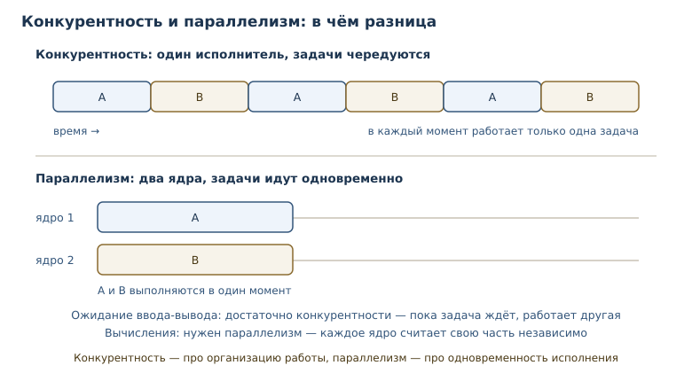
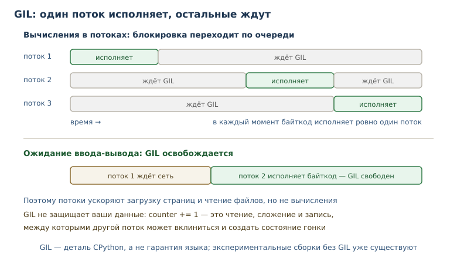

# Конкурентность: потоки, процессы и GIL

<!-- syllanix:nav -->
**Навигация:** [← 37. Время, даты и логирование](37-time-logging.md) · [Оглавление книги](../README.md) · [Далее: 39. Асинхронность: asyncio →](39-asyncio.md)
<!-- /syllanix:nav -->

<!-- syllanix:topics -->
**Темы главы**
38.1. [Что вы сможете после этой главы](#что-вы-сможете-после-этой-главы)  
38.2. [Конкурентность и параллелизм](#concepts)  
38.3. [Потоки](#threads)  
38.4. [GIL: что это и чего он не делает](#gil)  
38.5. [Состояние гонки и блокировки](#race)  
38.6. [Процессы и выбор инструмента](#processes)  
38.7. [Типичные ошибки](#mistakes)  
38.8. [Упражнения](#упражнения)  
38.9. [Проверка понимания](#проверка-понимания)  
38.10. [Что дальше](#что-дальше)  
<!-- /syllanix:topics -->


Программа проводит время не только за вычислениями. Она ждёт ответа базы,
читает файл, отправляет запрос в сеть. Если ждать последовательно, ресурсы
простаивают. **Конкурентность** — способ организовать работу так, чтобы
несколько задач продвигались с перекрытием во времени.

У этой темы много мифов, и главный из них — «потоки ускоряют любой код».
Реальность зависит от характера задачи: ожидание ввода-вывода и вычисления
ведут себя по-разному. В этой главе вы разберётесь, что такое **потоки** и
**процессы**, как **GIL** ограничивает параллелизм вычислений в CPython и как
писать **потокобезопасный** код с **блокировками**.

## Что вы сможете после этой главы

К концу главы вы будете понимать, где конкурентность помогает, а где создаёт
лишнюю сложность. Вы сможете:

- различать конкурентность и параллелизм;
- классифицировать задачу как связанную с вводом-выводом или с вычислениями;
- запускать потоки и пул потоков, дожидаться результата;
- объяснять, что делает GIL и чего он не делает;
- распознавать состояние гонки и защищать общие данные блокировкой;
- выбирать между потоками и процессами.

## Конкурентность и параллелизм {#concepts}

**Конкурентность** — выполнение нескольких задач с перекрытием во времени, не
обязательно одновременно. Один повар может готовить два блюда: пока суп
варится, он режет овощи. Задачи продвигаются параллельно по времени, но руки
у него одни.

**Параллелизм** — одновременное исполнение нескольких вычислений на разных
ядрах. Два повара действительно работают одновременно. Параллелизм — частный
случай конкурентности, когда задачи физически выполняются в один момент.

Разница определяет выбор инструмента. Задачи делят на две группы:

| Тип задачи | Что делает | Что помогает |
|---|---|---|
| связанная с вводом-выводом | ждёт сеть, диск, базу | потоки, `asyncio` |
| связанная с вычислениями | считает, не освобождая процессор | процессы |

Конкурентность не бесплатна. Она добавляет сложность: гонки, блокировки,
недетерминированные падения. Если задача выполняется за миллисекунды и не
ждёт внешних ресурсов, последовательный код проще и надёжнее. Оптимизацию
начинают с измерения, а не с добавления потоков «на всякий случай». Потоки и
процессы — инструменты для конкретной проблемы, а не признак «серьёзного»
кода.

Если программа ждёт, конкурентность даёт выигрыш даже на одном ядре:
пока один поток ждёт ответа, другой работает. Если программа считает, нужно
несколько ядер — а их дают процессы.




## Потоки {#threads}

**Поток** — единица исполнения внутри процесса, разделяющая с другими
потоками память. Потоки дешевле процессов, быстро создаются и видят одни и те
же объекты. Это удобно и опасно одновременно: любое изменение общего объекта
затрагивает все потоки.

```python exec
import threading

results: list[int] = []
lock = threading.Lock()


def worker(value: int) -> None:
    with lock:
        results.append(value * value)


threads = [threading.Thread(target=worker, args=(n,)) for n in range(5)]
for thread in threads:
    thread.start()
for thread in threads:
    thread.join()
print(sorted(results))
```

```output
[0, 1, 4, 9, 16]
```

### Завершение потоков

Поток может быть обычным или демоническим. Обычный поток программа ждёт: она
не завершится, пока он работает. Демонический поток (`daemon=True`)
останавливается вместе с основным процессом, не давая гарантий корректной
очистки. Демоны годятся для фоновых задач вроде периодической записи, но не
для работы, которую нельзя потерять.

`join` принимает таймаут: если поток не завершился за отведённое время,
программа может зафиксировать проблему и продолжить. Без `join` основной поток
может выйти раньше, и результат работы останется неизвестным: программа
завершилась «успешно», а данные не сохранились.

`start` запускает поток, `join` ждёт его завершения. Порядок завершения
непредсказуем, поэтому результат сортируют перед выводом. `lock` защищает
список: без него одновременный `append` теоретически мог бы привести к потере
элемента (хотя конкретный список в CPython защищён внутренне, полагаться на
это не стоит — речь о принципе).

Поток удобен, когда задача много ждёт: загрузка страниц, чтение файлов,
запросы к базе. Пока один поток ждёт сеть, остальные продолжают работу.

### Пул потоков

Создавать поток на каждую задачу расточительно: создание и переключение стоят
времени, а тысячи потоков конкурируют за память. **Пул потоков** — набор
заранее созданных потоков, распределяющих задачи; используется через
`concurrent.futures`.

```python exec
from concurrent.futures import ThreadPoolExecutor


def square(value: int) -> int:
    return value * value


with ThreadPoolExecutor(max_workers=4) as executor:
    print(list(executor.map(square, range(6))))
```

```output
[0, 1, 4, 9, 16, 25]
```

`executor.map` сохраняет порядок результатов, даже если задачи завершились в
другом порядке. Пул сам решает, какой поток берёт следующую задачу, и
корректно завершает работу при выходе из `with`.

Ограничение `max_workers` — не формальность. Если задач тысячи, а потоков
четыре, остальные ждут в очереди; это защищает память и сеть от перегрузки.
Если задач мало, а потоков много, лишние потоки просто простаивают. Значение
подбирают по характеру нагрузки, а не «чем больше, тем лучше».

### Очередь как средство связи

`queue.Queue` — потокобезопасная очередь: один поток кладёт задачи, другой
забирает. Она сама синхронизирует доступ, поэтому явная блокировка не нужна.
Это предпочтительный способ передавать работу между потоками: вместо общей
переменной с замком — канал с понятными правилами.

```python exec
import queue
import threading

tasks: queue.Queue[int] = queue.Queue()
results: list[int] = []


def producer() -> None:
    for number in range(5):
        tasks.put(number)
    tasks.put(-1)


def consumer() -> None:
    while True:
        number = tasks.get()
        if number == -1:
            break
        results.append(number * 10)


first = threading.Thread(target=consumer)
first.start()
producer()
first.join()
print(sorted(results))
```

```output
[0, 10, 20, 30, 40]
```

Маркер `-1` сообщает потребителю о конце работы. В реальном коде для этого
используют отдельное событие или `None`, но принцип тот же: очередь передаёт
не только данные, но и сигнал завершения. Без него потребитель ждал бы
бесконечно.

## GIL: что это и чего он не делает {#gil}

**GIL (глобальная блокировка интерпретатора)** — блокировка CPython, не
позволяющая нескольким потокам исполнять байткод одновременно; влияет на
выбор потоков или процессов. В стандартной сборке CPython в каждый момент
байткод исполняет только один поток. Другие ждут своей очереди.

Что это означает на практике:

- несколько потоков **не** ускоряют вычисления, потому что ядро всё равно
  занято одним потоком;
- потоки **ускоряют** ожидание ввода-вывода: пока поток ждёт сеть, GIL
  освобождается и другие потоки работают;
- GIL — деталь CPython, а не гарантия языка Python: другие реализации могут
  вести себя иначе; free-threaded сборка без GIL официально поддерживается
  начиная с 3.14, хотя по умолчанию её не включают.



Важно понимать, чего GIL **не** делает. Он не делает код потокобезопасным:
переключение между потоками происходит между байткодами, поэтому операция
`counter += 1` состоит из нескольких шагов — прочитать, сложить, записать, — и
другой поток может вклиниться между ними. GIL защищает внутренние структуры
интерпретатора, а не ваши инварианты.

### Сборки без GIL

В Python 3.13 появилась экспериментальная free-threaded сборка без GIL; в
3.14 она официально поддерживается (PEP 779), хотя по умолчанию её не
включают: её ставят отдельно, и исполняемый файл называется `python3.14t`.
В такой сборке потоки могут исполнять байткод одновременно, что меняет
привычную картину производительности. Но вместе с возможностями приходят
обязанности: код, который неявно полагался на GIL, начинает ловить настоящие
гонки.

Поэтому потокобезопасность важна уже сегодня. Программа, написанная с явными
блокировками и минимумом общего изменяемого состояния, переживёт смену
интерпретатора без переписывания. Код, который полагается на
GIL как на защиту от гонок, при переходе на такую сборку сломается. Правильный
код защищает общие данные явно.


## Состояние гонки и блокировки {#race}

**Состояние гонки** — дефект, при котором результат зависит от непредсказуемого
порядка доступа к общим данным. Классический пример — счётчик, который два
потока увеличивают одновременно.

```python
import threading

counter = 0


def increment() -> None:
    global counter
    for _ in range(100_000):
        counter += 1


threads = [threading.Thread(target=increment) for _ in range(2)]
for thread in threads:
    thread.start()
for thread in threads:
    thread.join()
print(counter)
```

На одном запуске программа может вывести `200000`, на другом — `199873`.
Расхождение возникает потому, что `counter += 1` не атомарна: поток прочитал
значение, но не успел записать, а второй уже записал своё. Ожидать конкретное
число нельзя — это и есть состояние гонки. Такие примеры в книге не
исполняются: вывод недетерминирован по определению.

**Блокировка** — примитив синхронизации, обеспечивающий доступ к общему
ресурсу только одному потоку за раз. В Python это `threading.Lock`.

```python exec
import threading

counter = 0
lock = threading.Lock()


def increment() -> None:
    global counter
    for _ in range(10_000):
        with lock:
            counter += 1


threads = [threading.Thread(target=increment) for _ in range(3)]
for thread in threads:
    thread.start()
for thread in threads:
    thread.join()
print(counter)
```

```output
30000
```

Теперь результат детерминирован: три потока по десять тысяч увеличений дают
ровно тридцать тысяч. Блокировка сериализует критическую секцию: пока один
поток внутри, остальные ждут.

**Потокобезопасность** — свойство кода работать корректно при одновременном
вызове из нескольких потоков. Достигается не «включением потоков», а
дисциплиной: минимизировать общее изменяемое состояние, защищать критически
секции, использовать потокобезопасные структуры (`queue.Queue`).

## Процессы и выбор инструмента {#processes}

**Процесс** — изолированный экземпляр программы с собственной памятью. У
процессов нет общих изменяемых объектов: обмен идёт через сериализацию
(аргументы, очереди, каналы). Это дороже, зато даёт настоящий параллелизм
вычислений и защищает от гонок по построению.

```python
from concurrent.futures import ProcessPoolExecutor


def is_prime(number: int) -> bool:
    if number < 2:
        return False
    for divisor in range(2, int(number**0.5) + 1):
        if number % divisor == 0:
            return False
    return True


def count_primes(limit: int) -> int:
    return sum(1 for number in range(2, limit) if is_prime(number))


if __name__ == "__main__":
    with ProcessPoolExecutor() as executor:
        print(list(executor.map(count_primes, [10_000, 20_000])))
```

### Особенности процессов

Процессы дают настоящий параллелизм вычислений, но у них есть цена. Запуск
процесса занимает десятки миллисекунд, память не разделяется, а результаты
передаются через сериализацию. Поэтому процессный пул выгоден для длительных
вычислений, а не для тысяч мелких задач.

Есть и платформенные различия. В Python 3.14 на Linux по умолчанию работает
`forkserver`: отдельный процесс-сервер создаётся один раз и уже он порождает
рабочих. На macOS и Windows по умолчанию `spawn`: новый интерпретатор
импортирует модуль заново. `fork` остаётся доступным, но по умолчанию не
выбирается. При `spawn` и `forkserver` код должен быть защищён проверкой
`if __name__ == "__main__":`, иначе дочерний интерпретатор при импорте снова
запустит создание процессов. Это не прихоть, а требование переносимости.

`ProcessPoolExecutor` запускает отдельные интерпретаторы. В учебной песочнице
такой код не исполняется: запуск процессов запрещён, поэтому пример приведён
как иллюстративный.

| Критерий | Потоки | Процессы |
|---|---|---|
| память | общая | изолированная |
| создание | дешёвое | дорогое |
| вычисления | мешает GIL | параллельны |
| ожидание ввода-вывода | выгодно | избыточно |
| обмен данными | быстрый, но опасный | через сериализацию |
| гонки | возможны | по общим данным исключены |

Практическое правило: ждёт — потоки или `asyncio`; считает — процессы. Если
задача одновременно и ждёт, и считает, её разбивают на части и применяют
разные инструменты к разным частям.

## Типичные ошибки {#mistakes}

1. **Ждать ускорения вычислений от потоков.** GIL не даст параллелизма; для
   CPU-bound нужны процессы.
2. **Полагать, что GIL защищает от гонок.** Он защищает интерпретатор, а не
   ваши данные.
3. **Держать блокировку во время ввода-вывода.** Пока поток ждёт сеть под
   замком, остальные не работают; критическую секцию делают короткой.
4. **Захватывать несколько блокировок в разном порядке.** Два потока могут
   заблокировать друг друга навсегда. Порядок захвата должен быть общим.
5. **Создавать поток на каждую задачу.** Тысячи потоков конкурируют за
   ресурсы; используйте пул.
6. **Передавать изменяемые объекты между процессами без сериализации.**
   Процессы не разделяют память; объект нужно передать через аргументы или
   очередь.
7. **Игнорировать завершение потоков.** Без `join` программа может выйти
   раньше, чем задачи закончат работу.
8. **Использовать общий список вместо очереди.** Очередь задаёт протокол
   обмена и снимает часть забот о синхронизации.
9. **Запускать процессы без защиты `__main__`.** На всех платформах при
   `spawn`/`forkserver` — а это выбор по умолчанию в 3.14 — это приводит к
   рекурсивному запуску и падению.

## Упражнения

### 1. Классификация задач {#ex-ch38-01}

Определите, что поможет каждой задаче: потоки, процессы или последовательный
код. Обоснуйте: скачивание десяти страниц, вычисление миллиона простых чисел,
чтение большого файла, сортировка списка из ста элементов.

### 2. Первый поток {#ex-ch38-02}

Запустите три потока, каждый из которых добавляет свой номер в общий список
под блокировкой. Дождитесь завершения и выведите отсортированный результат.

### 3. Пул потоков {#ex-ch38-03}

С помощью `ThreadPoolExecutor` вычислите кубы чисел от 1 до 8. Объясните,
почему `map` возвращает результаты в порядке исходных данных, а не завершения.

### 4. Защита счётчика {#ex-ch38-04}

Реализуйте счётчик, который три потока увеличивают по 5000 раз под
блокировкой. Проверьте, что итог равен 15000, и объясните, что было бы без
блокировки.

### 5. Объяснение гонки {#ex-ch38-05}

Почему программа с двумя потоками и `counter += 1` может вывести не
`200000`? Опишите последовательность шагов, при которой одно обновление
теряется. Почему GIL не спасает?

### 6. Очередь задач {#ex-ch38-06}

Реализуйте производителя и потребителя через `queue.Queue`: производитель
кладёт числа от 0 до 4, потребитель умножает их на 10 и складывает в список.
Дождитесь завершения и выведите результат.

### 7. Правда и мифы о GIL {#ex-ch38-07}

Определите, какие утверждения верны: (а) GIL ускоряет потоки; (б) GIL
освобождается при ожидании ввода-вывода; (в) GIL делает список потокобезопасным;
(г) GIL — часть языка Python; (д) процессы обходят ограничение GIL для
вычислений. Объясните каждое.

### 8. Потоки или процессы {#ex-ch38-08}

Для функции, которая считает хэши строк, выберите инструмент и обоснуйте.
Опишите, как изменится выбор, если функция вместо вычислений читает файлы.

### 9. Проверка потокобезопасности {#ex-ch38-09}

Дана функция, которая увеличивает общий словарь под блокировкой. Напишите
проверку: запустите четыре потока по 1000 операций и сравните итоговое
значение. Объясните, почему проверка детерминирована.

### 10. Мини-проект: параллельная загрузка {#ex-ch38-10}

Спроектируйте функцию `fetch_all(urls)`, которая загружает страницы
параллельно с ограничением на число одновременных запросов. Опишите выбор
инструмента, обработку ошибок и таймауты. Реализуйте версию с подставной
функцией загрузки, возвращающей длину «страницы», и проверьте результат.

## Проверка понимания

1. Чем конкурентность отличается от параллелизма?
2. Почему потоки помогают при вводе-выводе и не помогают при вычислениях?
3. Что такое GIL и почему он не делает код потокобезопасным?
4. Как блокировка предотвращает состояние гонки?
5. Почему процессы не разделяют память и как они обмениваются данными?
6. Когда пул потоков лучше создания потока на каждую задачу?
7. Почему порядок захвата блокировок должен быть одинаковым во всей программе?

## Что дальше

Потоки решают проблему ожидания, но требуют дисциплины и не масштабируются на
тысячи задач. Следующая глава — об `asyncio`: одном потоке, который
переключается между задачами на операциях ввода-вывода. Логи с отметками
времени из предыдущей главы помогут увидеть, как задачи чередуются: по
временным меткам видно, что ожидание одного запроса не блокирует остальные.
Это первый шаг к пониманию асинхронной модели. О работе с
сетью говорилось в [главе 35](35-os-network.md), о логировании — в
[главе 37](37-time-logging.md).

<!-- syllanix:nav -->
**Перед этой главой:** [37. Время, даты и логирование](37-time-logging.md)
**Связанные главы:** [01. Зачем Python и как устроена эта книга](01-introduction.md), [07. Функции: параметры, аргументы и области видимости](07-functions.md), [09. Модули, пакеты и импорты](09-modules.md), [10. Ошибки и исключения](10-errors-exceptions.md), [13. Списки: индексы, срезы и методы](13-lists.md), [17. Словари: отображения и структурирование данных](17-dicts.md), [19. Файлы, пути и текстовые форматы](19-files-formats.md), [48. Проект: асинхронный сборщик данных](48-project-async.md)
**Далее:** [39. Асинхронность: asyncio →](39-asyncio.md)
<!-- /syllanix:nav -->
