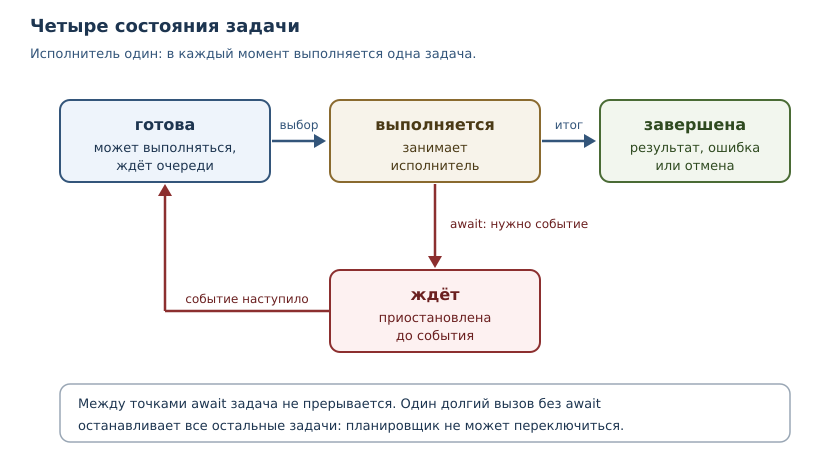
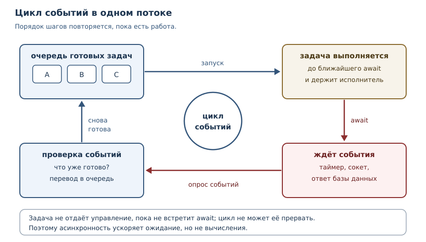

# Асинхронность: asyncio

<!-- syllanix:nav -->
**Навигация:** [← 38. Конкурентность: потоки, процессы и GIL](38-concurrency.md) · [Оглавление книги](../README.md) · [Далее: 40. Производительность и профилирование →](40-performance.md)
<!-- /syllanix:nav -->

<!-- syllanix:topics -->
**Темы главы**
39.1. [Что вы сможете после этой главы](#что-вы-сможете-после-этой-главы)  
39.2. [Задача, которую решает асинхронность](#why)  
39.3. [Модель выполнения задач](#task-model)  
39.4. [Корутины и await](#coroutines)  
39.5. [Awaitable-объекты](#awaitable)  
39.6. [Цикл событий](#event-loop)  
39.7. [Задачи](#tasks)  
39.8. [Конкурентность и порядок выполнения](#concurrency)  
39.9. [Структурная конкурентность: TaskGroup](#taskgroup)  
39.10. [Отмена задачи](#cancellation)  
39.11. [Таймауты](#timeouts)  
39.12. [Асинхронные контекстные менеджеры](#async-context-manager)  
39.13. [Блокирующие вызовы](#blocking)  
39.14. [Типичные ошибки](#mistakes)  
39.15. [Упражнения](#упражнения)  
39.16. [Проверка понимания](#check)  
39.17. [Связи](#links)  
<!-- /syllanix:topics -->


Сервер принимает запрос, идёт в базу данных за ответом и в это время не может
обслуживать другие запросы — так выглядит типичная программа, которая ждёт.
Ожидание занимает почти всё время работы: сеть отвечает за миллисекунды,
которые для процессора равны вечности. Асинхронность — способ не простаивать
в это время. В этой главе мы сначала разберём модель выполнения задач, а уже
потом посмотрим, как её реализует модуль `asyncio` из стандартной библиотеки.
Такой порядок важен: `async` и `await` — синтаксис, а модель задач — причина,
по которой этот синтаксис существует.

## Что вы сможете после этой главы

- объяснять, чем задача отличается от потока и почему асинхронность не даёт
  параллелизма;
- писать корутины, запускать их и понимать, когда именно начинается исполнение;
- строить конкурентные вычисления через `asyncio.gather` и `asyncio.TaskGroup`;
- корректно отменять задачи и освобождать ресурсы;
- находить в асинхронном коде блокирующие вызовы и убирать их.

## Задача, которую решает асинхронность {#why}

В главе 38 мы разделили работу на две категории. Задачи, ограниченные
процессором (CPU-bound), ускоряются процессами: каждому процессу достаётся
свой интерпретатор и свой GIL. Задачи, ограниченные вводом-выводом
(I/O-bound), упираются не в вычисления, а в ожидание внешнего мира: ответа
сети, диска, базы данных.

Для ожидания потоки подходят, но у них есть цена: каждый поток резервирует
стек, переключение между потоками делает операционная система, а совместно
используемые данные требуют блокировок, иначе возникает состояние гонки.
Если в программе тысяча одновременных соединений, тысяча потоков — это
дорого, а тысяча блокировок — это источник дефектов, которые трудно
воспроизвести.

Асинхронный подход меняет саму единицу работы. Вместо «поток, который ждёт»
появляется **задача** — единица работы, которую можно приостановить в
известной точке и позже продолжить с того же места. Пока задача ждёт ответа,
исполнитель занимается другими задачами. Один поток способен вести тысячи
задач, потому что ожидание не занимает поток: оно зарегистрировано как
«сообщите, когда будет готово».

## Модель выполнения задач {#task-model}

Прежде чем говорить о Python, опишем модель, которая годится для любой
асинхронной системы — от планировщика операционной системы до сервера
приложений.

**Задача** — это работа, у которой есть начало, конец и промежуточные точки
приостановки. В каждый момент задача находится в одном из состояний:

| Состояние | Что означает |
|---|---|
| готова | может выполняться, ждёт своей очереди |
| выполняется | прямо сейчас занимает исполнителя |
| ждёт | приостановлена до внешнего события (данные пришли, таймер сработал) |
| завершена | вернула результат или завершилась ошибкой (в том числе отменой) |

Состояния и переходы между ними показаны на рисунке.



Ключевое свойство модели: между точками приостановки задача выполняется
целиком, без переключений. Такую схему называют **кооперативной
многозадачностью** (cooperative multitasking): задача сама отдаёт управление,
и никто не может прервать её посреди вычисления. В этом её сила и её слабость.
Сила — не нужны блокировки для защиты данных между точками приостановки:
пока задача работает, её никто не прервёт. Слабость — если задача не
приостанавливается, она блокирует всех остальных: у планировщика нет
возможности её вытеснить.

Из модели следуют три правила, которые объясняют почти все ошибки
асинхронного кода.

1. **Исполнитель один.** В один момент времени выполняется ровно одна задача.
   Асинхронность — это конкурентность, а не параллелизм: ускорения вычислений
   она не даёт.
2. **Приостановка только в явных точках.** Пока код не встретил `await`,
   он владеет исполнителем безраздельно.
3. **Ожидание должно быть асинхронным.** Если задача ждёт, занимая поток,
   планировщик не может запустить других.

Теперь посмотрим, как эта модель выглядит в Python.

## Корутины и await {#coroutines}

**Корутина** — функция, объявленная через `async def`. Её особенность в том,
что при вызове она не исполняет тело, а возвращает объект-корутину, который
можно приостанавливать и возобновлять.

```python exec
import asyncio

async def greet():
    print("корутина начала работу")
    return "привет"

coro = greet()
print("после вызова корутины ничего не напечаталось")
print(asyncio.run(coro))
```

```output
после вызова корутины ничего не напечаталось
корутина начала работу
привет
```

Обратите внимание на порядок строк: вызов `greet()` не напечатал ничего.
Тело корутины начинает исполняться только тогда, когда её кто-то запустил —
здесь это сделала функция `asyncio.run`. Корутина похожа на генератор из
главы 21: оба объекта хранят приостановленное исполнение. Разница в том, что
генератор отдаёт значения через `yield` по требованию цикла `for`, а корутина
приостанавливается на `await` и возвращает ровно один результат.

**`async` / `await`** — синтаксис асинхронного кода: `async def` объявляет
корутину, `await` приостанавливает её до завершения ожидаемого объекта.
Внутри `await` исполнитель свободен и может заняться другой готовой задачей.

```python exec
import asyncio

async def fetch(name, value):
    await asyncio.sleep(0)
    print(f"{name} готов")
    return value * 2

async def main():
    results = await asyncio.gather(fetch("one", 1), fetch("two", 2), fetch("three", 3))
    print(results)

asyncio.run(main())
```

```output
one готов
two готов
three готов
[2, 4, 6]
```

Порядок здесь не случаен: `gather` запускает три корутины как задачи, каждая
доходит до `await asyncio.sleep(0)` — это точка приостановки, которая сразу
возвращает управление планировщику, — и только потом все три печатают
результат. `asyncio.sleep(0)` не ждёт времени: он уступает очередь.

### Углубление: почему корутину нельзя запустить дважды

Корутина — это одноразовый объект с состоянием. После завершения она
закрыта, и повторный `await` поднимает исключение.

```python exec expect-error
import asyncio

async def hello():
    return "привет"

async def main():
    coro = hello()
    print(await coro)
    print(await coro)

asyncio.run(main())
```

```output
RuntimeError: cannot reuse already awaited coroutine
```

## Awaitable-объекты {#awaitable}

**Awaitable-объект** — объект, который можно передать в `await`. В Python это
любой объект, реализующий метод `__await__`; проще запомнить три частых вида:

- **корутина** — результат вызова `async def`-функции;
- **задача** (`asyncio.Task`) — корутина, поставленная в план исполнения;
- **future** (`asyncio.Future`) — низкоуровневый контейнер будущего
  результата, которым управляет код, а не планировщик.

Различие удобно проверить функцией `inspect.isawaitable`.

```python exec
import asyncio
import inspect

async def hello():
    return "привет"

async def main():
    coro = hello()
    print("корутина:", inspect.isawaitable(coro))
    coro.close()
    task = asyncio.create_task(hello())
    print("задача:", inspect.isawaitable(task))
    await task
    future = asyncio.get_running_loop().create_future()
    print("future:", inspect.isawaitable(future))
    print("число:", inspect.isawaitable(42))

asyncio.run(main())
```

```output
корутина: True
задача: True
future: True
число: False
```

`await` работает с любым из этих объектов, но смысл разный: `await` корутины
запускает её прямо в текущей задаче, а `await` задачи означает «подожди, пока
другая задача закончит». Второй вариант позволяет получить конкурентность.

### Углубление: что можно и что нельзя ожидать

`await` применим только к awaitable-объектам. Число, строка или обычная
функция не умеют приостанавливать исполнение, поэтому попытка их ожидать —
ошибка типа, а не «пустое ожидание».

```python exec expect-error
import asyncio

async def main():
    await 42

asyncio.run(main())
```

```output
TypeError: 'int' object can't be awaited
```

## Цикл событий {#event-loop}

Кто-то должен решать, какую готовую задачу запустить следующей, и следить за
тем, чьё ожидание закончилось. Этот компонент называют **циклом событий**
(event loop): планировщик, который в одном потоке по очереди запускает
готовые задачи, переключается между ними в точках приостановки и переводит
задачи из ожидания в готовность, когда наступает внешнее событие.



У цикла событий две очереди работы. Первая — готовые задачи: их можно
запускать немедленно. Вторая — ожидающие события: таймеры, готовность сокета,
завершение операции ввода-вывода. Цикл забирает задачу из первой очереди,
исполняет её до `await`, а затем смотрит, не наступило ли чьё-то событие, и
переводит соответствующую задачу обратно в готовые. Такой цикл повторяется,
пока есть работа.

В `asyncio` цикл создаётся и запускается функцией `asyncio.run`. Она делает
три вещи: создаёт новый цикл событий, запускает переданную корутину как
задачу и закрывает цикл, когда задача завершилась. Именно поэтому точкой
входа асинхронной программы служит `asyncio.run(main())`, а не вызов
корутины напрямую.

```python exec
import asyncio

async def main():
    loop = asyncio.get_running_loop()
    print("цикл запущен:", loop.is_running())
    print("текущая задача существует:", asyncio.current_task() is not None)

asyncio.run(main())
```

```output
цикл запущен: True
текущая задача существует: True
```

Важная деталь: `asyncio.run` не допускает вызов из уже работающего цикла.
Попытка запустить второй цикл внутри корутины поднимает `RuntimeError`, и это
правильно: два цикла в одном потоке конкурировали бы за одни и те же события.

### Углубление: цикл и потоки

Цикл событий живёт в одном потоке и не потокобезопасен: трогать
задачи и цикл из другого потока напрямую нельзя. Если синхронный код в
отдельном потоке должен вернуть результат в цикл, используют
`loop.call_soon_threadsafe` или `asyncio.run_coroutine_threadsafe`. На практике
чаще достаточно `asyncio.to_thread`, который сам заботится о передаче
результата обратно в цикл.

## Задачи {#tasks}

**Задача** (`task`) — корутина, поставленная в план исполнения циклом
событий. Задачу создаёт функция `asyncio.create_task`: она оборачивает
корутину в объект, который цикл будет двигать самостоятельно, и возвращает
его. С этого момента задача живёт своей жизнью: её не нужно ожидать, чтобы
она начала выполняться, — но результат нужно забрать.

```python exec
import asyncio

async def task(name):
    print(f"{name}: шаг 1")
    await asyncio.sleep(0)
    print(f"{name}: шаг 2")

async def main():
    first = asyncio.create_task(task("A"))
    second = asyncio.create_task(task("B"))
    print("main: обе задачи запущены")
    await asyncio.gather(first, second)

asyncio.run(main())
```

```output
main: обе задачи запущены
A: шаг 1
B: шаг 1
A: шаг 2
B: шаг 2
```

Разбор по шагам. `create_task` создаёт две задачи и ставит их в очередь.
`main` доходит до `gather` и приостанавливается. Цикл берёт первую задачу,
та печатает «шаг 1» и уступает на `sleep(0)`; затем вторая делает то же.
Теперь обе ждут, очередь пуста, но `sleep(0)` уже готов к возобновлению,
поэтому задачи возвращаются в неё в том же порядке. Затем каждая печатает
«шаг 2» и завершается. Порядок строк здесь определяется моделью, а не
случайностью.

Задача хранит своё состояние. У неё есть методы `done()`, `cancelled()`,
`result()` и `exception()`. Если задача завершилась ошибкой, исключение
поднимется в том месте, где результат забирают.

```python exec expect-error
import asyncio

async def fail():
    await asyncio.sleep(0)
    raise ValueError("задача сломалась")

async def main():
    task = asyncio.create_task(fail())
    await task

asyncio.run(main())
```

```output
ValueError: задача сломалась
```

### Углубление: задача без владельца

Если создать задачу и не сохранить ссылку, сборщик мусора может уничтожить её
до завершения, а цикл событий — сообщить, что исключение задачи не было
получено. Правило простое: у каждой задачи должен быть владелец, который
дождётся её результата. `asyncio.TaskGroup` и `asyncio.gather` делают это
автоматически.

## Конкурентность и порядок выполнения {#concurrency}

Главная ошибка новичка — писать `await` подряд там, где нужна
конкурентность. Посмотрите на разницу.

```python exec
import asyncio

async def job(name):
    print(f"{name}: шаг 1")
    await asyncio.sleep(0)
    print(f"{name}: шаг 2")

async def sequential():
    await job("A")
    await job("B")

async def concurrent():
    await asyncio.gather(job("A"), job("B"))

print("последовательно")
asyncio.run(sequential())
print("конкурентно")
asyncio.run(concurrent())
```

```output
последовательно
A: шаг 1
A: шаг 2
B: шаг 1
B: шаг 2
конкурентно
A: шаг 1
B: шаг 1
A: шаг 2
B: шаг 2
```

В последовательном варианте каждая работа ждёт полного завершения предыдущей:
пока `A` спит, `B` даже не началась. В конкурентном обе доходят до точки
ожидания, и пока `A` ждёт, `B` успевает сделать первый шаг. Для операций
ввода-вывода это разница между суммой времён и максимумом времён.

## Структурная конкурентность: TaskGroup {#taskgroup}

Собирать задачи вручную и следить за их исключениями утомительно. Начиная с
Python 3.11 в стандартной библиотеке есть `asyncio.TaskGroup` — асинхронный
контекстный менеджер, который создаёт задачи, ждёт их все и корректно
обрабатывает ошибки.

```python exec
import asyncio

async def ok(name):
    await asyncio.sleep(0)
    print(f"{name} завершилась")

async def fail():
    await asyncio.sleep(0)
    raise ValueError("сломалось")

async def main():
    try:
        async with asyncio.TaskGroup() as group:
            group.create_task(ok("первая"))
            group.create_task(fail())
            group.create_task(ok("вторая"))
    except* ValueError as errors:
        print("перехвачено:", type(errors.exceptions[0]).__name__, errors.exceptions[0])

asyncio.run(main())
```

```output
первая завершилась
вторая завершилась
перехвачено: ValueError сломалось
```

Слово «структурная» здесь означает: группа живёт внутри блока `async with`,
и выйти из блока раньше, чем завершатся все её задачи, нельзя. Ошибка одной
задачи не теряется: она приходит как `ExceptionGroup`, который разбирают
конструкцией `except*`. Так исключения не «пропадают в фоне», а попадают
туда, где задачу создали.

## Отмена задачи {#cancellation}

**Отмена задачи** — механизм, который прекращает её работу. Вызванный
`task.cancel()` не убивает корутину мгновенно: он просит цикл событий
возбудить `asyncio.CancelledError` в ближайшей точке `await`. Задача успевает
выполнить `finally` и освободить ресурсы, а затем завершается в состоянии
«отменена».

```python exec
import asyncio

async def long_job():
    print("начали работу")
    try:
        await asyncio.sleep(10)
    except asyncio.CancelledError:
        print("получили отмену, убираем за собой")
        raise
    finally:
        print("блок finally выполнен")

async def main():
    task = asyncio.create_task(long_job())
    await asyncio.sleep(0)
    task.cancel()
    try:
        await task
    except asyncio.CancelledError:
        print("задача отменена:", task.cancelled())

asyncio.run(main())
```

```output
начали работу
получили отмену, убираем за собой
блок finally выполнен
задача отменена: True
```

Три правила отмены. Первое: `CancelledError` нужно пробрасывать дальше или
поднимать заново после уборки — иначе отмена «проглатывается» и задача
продолжает работу, о которой её никто не просил. Второе: точка отмены — это
`await`; код между точками приостановки выполнится до конца. Третье: если
задача уже завершена, `cancel()` вернёт `False` и ничего не сделает.

## Таймауты {#timeouts}

Ожидание без ограничения — это зависание при первой же проблеме. Для
ограничения времени в `asyncio` есть `asyncio.timeout` (Python 3.11+):
асинхронный контекстный менеджер, который отменяет задачу, если блок не
успел завершиться.

```python exec
import asyncio

async def slow():
    await asyncio.sleep(10)
    return "готово"

async def main():
    try:
        async with asyncio.timeout(0.01):
            await slow()
    except TimeoutError:
        print("не успели за отведённое время")

asyncio.run(main())
```

```output
не успели за отведённое время
```

Внутри `asyncio.timeout` поднимается `TimeoutError` — встроенное исключение,
которое в асинхронном контексте означает именно истечение срока. Старый
способ `asyncio.wait_for(coro, timeout)` делает то же самое, но требует
оборачивать каждую операцию отдельно.

## Асинхронные контекстные менеджеры {#async-context-manager}

**Асинхронный контекстный менеджер** — объект, у которого есть методы
`__aenter__` и `__aexit__`; он используется в инструкции `async with`.
Устройство то же, что у обычного `with` из главы 19, но вход и выход могут
приостанавливать задачу: открыть соединение, дождаться закрытия, освободить
ресурс.

```python exec
import asyncio

class AsyncResource:
    def __init__(self, name):
        self.name = name
    async def __aenter__(self):
        print(f"{self.name}: открыт")
        return self
    async def __aexit__(self, exc_type, exc, tb):
        print(f"{self.name}: закрыт")
        return False

async def main():
    async with AsyncResource("ресурс") as resource:
        print(f"работаем с {resource.name}")
    try:
        async with AsyncResource("второй"):
            raise ValueError("ошибка внутри блока")
    except ValueError as error:
        print("поймали:", error)

asyncio.run(main())
```

```output
ресурс: открыт
работаем с ресурс
ресурс: закрыт
второй: открыт
второй: закрыт
поймали: ошибка внутри блока
```

`__aexit__` вызывается всегда — и при нормальном выходе, и при исключении.
Возвращённое `False` означает «исключение не подавлено», поэтому оно
поднимается дальше и ловится снаружи. Это ровно та же семантика, что у
обычного контекстного менеджера.

## Блокирующие вызовы {#blocking}

**Блокирующий вызов** — вызов, который занимает поток на всё время операции и
не отдаёт управление циклу событий. Пока он выполняется, все остальные задачи
стоят.

```python exec
import asyncio

def blocking_work():
    total = 0
    for number in range(300_000):
        total += number
    return total

async def blocking_task():
    print("A: начало тяжёлой работы")
    total = blocking_work()
    print("A: работа закончена")
    return total

async def light_task():
    print("B: хочу выполниться")

async def main():
    first = asyncio.create_task(blocking_task())
    second = asyncio.create_task(light_task())
    await asyncio.sleep(0)
    await second
    print("main: после B")
    await first

asyncio.run(main())
```

```output
A: начало тяжёлой работы
A: работа закончена
B: хочу выполниться
main: после B
```

Задача `B` получила управление только после того, как `A` закончила: внутри
`blocking_work` нет ни одной точки приостановки. Лечится это вынесением
блокирующей работы в отдельный поток через `asyncio.to_thread`.

```python exec
import asyncio

def blocking_work():
    total = 0
    for number in range(300_000):
        total += number
    return total

async def blocking_task():
    print("A: начало тяжёлой работы")
    total = await asyncio.to_thread(blocking_work)
    print("A: работа закончена")
    return total

async def light_task():
    print("B: хочу выполниться")

async def main():
    first = asyncio.create_task(blocking_task())
    second = asyncio.create_task(light_task())
    await asyncio.sleep(0)
    await second
    print("main: после B")
    await first

asyncio.run(main())
```

```output
A: начало тяжёлой работы
B: хочу выполниться
main: после B
A: работа закончена
```

Теперь `B` выполняется, пока `blocking_work` считает в другом потоке.

### Углубление: какие вызовы блокируют

Блокируют почти все привычные операции: `time.sleep`, чтение файла, `requests`
из главы 35, `sqlite3` из главы 36, любой цикл с тяжёлыми вычислениями. Для
каждой из них есть асинхронная альтернатива или способ вынести работу в
поток. Правило: в корутине допустимы только операции, которые
приостанавливают задачу, а не занимают поток.

## Типичные ошибки {#mistakes}

1. **Забыть `await`.** Вызов корутины без `await` создаёт объект и ничего не
   делает; Python предупреждает об этом при сборке мусора. Проверяйте, что
   каждая корутина где-то awaited.
2. **Ждать по очереди вместо конкурентности.** Цепочка `await` подряд
   выполняет операции последовательно. Если операции независимы, нужны
   `gather` или `TaskGroup`.
3. **Блокировать цикл событий.** `time.sleep`, синхронный HTTP-клиент и
   тяжёлые вычисления останавливают все задачи. Используйте `asyncio.sleep`,
   асинхронные библиотеки и `asyncio.to_thread`.
4. **Терять задачи.** Задача без владельца может быть уничтожена сборщиком
   мусора, а её ошибка — потеряна. Дожидайтесь задач в `TaskGroup`.
5. **Проглатывать `CancelledError`.** Если поймать отмену и не пробросить её
   дальше, задача продолжит работу, хотя её отменили.
6. **Отменять без уборки.** Ресурсы освобождайте в `finally` или в
   `__aexit__`: отмена не гарантирует, что код после `await` выполнится.
7. **Запускать `asyncio.run` внутри корутины.** Вложенный цикл запрещён;
   `asyncio.to_thread` не обходит этот запрет, а решает другую задачу — вызов
   синхронного кода из асинхронного.

## Упражнения

### 1. Порядок строк {#ex-ch39-01}

Не запуская код, предскажите порядок вывода, затем проверьте:

```python
import asyncio

async def one():
    print("один")
    await asyncio.sleep(0)
    print("один после паузы")

async def two():
    print("два")

async def main():
    await asyncio.gather(one(), two())

asyncio.run(main())
```

Объясните, почему строки идут именно так.

### 2. Последовательное и конкурентное ожидание {#ex-ch39-02}

Даны три корутины, каждая печатает своё имя и делает `await asyncio.sleep(0)`.
Напишите две функции: одну, которая запускает их последовательно, и вторую —
конкурентно через `gather`. Сравните порядок вывода.

### 3. Исправление ошибки {#ex-ch39-03}

Корутина не выполняется, программа завершается без вывода — только с
предупреждением `RuntimeWarning` о корутине, которую так и не дождались:

```python
import asyncio

async def report():
    print("отчёт готов")

async def main():
    report()

asyncio.run(main())
```

Найдите причину, исправьте код и объясните, почему Python не поднимает
исключение сразу.

### 4. Блокирующий вызов {#ex-ch39-04}

В асинхронной программе вызывается `time.sleep(1)` внутри корутины. Опишите,
что при этом происходит с остальными задачами, и предложите два исправления
(одно для ожидания, одно для вычислений).

### 5. Отмена задачи {#ex-ch39-05}

Напишите корутину, которая в цикле каждые `await asyncio.sleep(0)` увеличивает
счётчик, и отмените её через две итерации. В `finally` выведите итоговое
значение счётчика. Обеспечьте, чтобы отмена не проглатывалась.

### 6. Таймаут {#ex-ch39-06}

Напишите функцию `run_with_limit(coro, seconds)`, которая запускает корутину и
возвращает её результат, но не дольше указанного времени. При истечении срока
верните строку `"таймаут"`, не пробрасывая исключение.

### 7. Асинхронный контекстный менеджер {#ex-ch39-07}

Реализуйте класс-счётчик, который в `__aenter__` печатает «начало», а в
`__aexit__` — «конец», и используйте его в `async with`. Проверьте, что
«конец» печатается и при исключении внутри блока.

### 8. Задача как объект {#ex-ch39-08}

Создайте задачу, дождитесь её завершения и выведите значения `task.done()`,
`task.cancelled()` и результат `task.result()`. Объясните, что означает
каждое значение.

### 9. Модель выполнения {#ex-ch39-09}

В одном потоке запущены две задачи. Первая считает сумму чисел от 0 до
1 000 000 без единого `await`. Вторая должна напечатать сообщение. Объясните,
когда напечатается сообщение второй задачи и почему. Как изменить программу,
чтобы сообщение появилось раньше?

### 10. Мини-задача: конкурентная загрузка {#ex-ch39-10}

Напишите асинхронную функцию `load_all(sources)`, где `sources` — список
кортежей `(имя, значение)`. Функция запускает для каждого элемента задачу,
которая «загружает» данные через `await asyncio.sleep(0)` и возвращает
`f"{имя}: {значение}"`. Соберите результаты в список в порядке исходных
элементов и обработайте случай, когда одна из задач завершается ошибкой
`ValueError`, не теряя остальные результаты.

## Проверка понимания {#check}

1. Чем задача отличается от потока? Что у них общего?
2. Почему асинхронность не ускоряет вычисления на одном ядре?
3. Когда начинает исполняться корутина: при вызове или при `await`?
4. Что делает `asyncio.sleep(0)` и зачем он нужен?
5. Чем `asyncio.gather` отличается от двух последовательных `await`?
6. Почему `time.sleep` в корутине — ошибка?
7. Что произойдёт, если поймать `CancelledError` и не пробросить его дальше?
8. Как `TaskGroup` гарантирует, что ошибка задачи не потеряется?

## Связи {#links}

Асинхронность продолжает разговор о конкурентности из главы 38: там были
потоки, процессы и GIL, здесь — задачи и цикл событий. Корутины выросли из
генераторов главы 21, а `async with` повторяет контекстные менеджеры главы 19.
Отмена и таймауты опираются на исключения главы 10 и трассировку главы 11.

Дальше — [производительность и профилирование](40-performance.md): мы научимся
измерять, где программа тратит время, и отличать настоящую оптимизацию от
переписывания. А в главе 48 асинхронность пригодится в проекте — конкурентном
сборщике данных.

<!-- syllanix:nav -->
**Перед этой главой:** [38. Конкурентность: потоки, процессы и GIL](38-concurrency.md)
**Связанные главы:** [07. Функции: параметры, аргументы и области видимости](07-functions.md), [09. Модули, пакеты и импорты](09-modules.md), [10. Ошибки и исключения](10-errors-exceptions.md), [11. Отладка и трассировка](11-debugging.md), [19. Файлы, пути и текстовые форматы](19-files-formats.md), [21. Генераторы и ленивые вычисления](21-generators.md), [48. Проект: асинхронный сборщик данных](48-project-async.md)
**Далее:** [40. Производительность и профилирование →](40-performance.md)
<!-- /syllanix:nav -->
