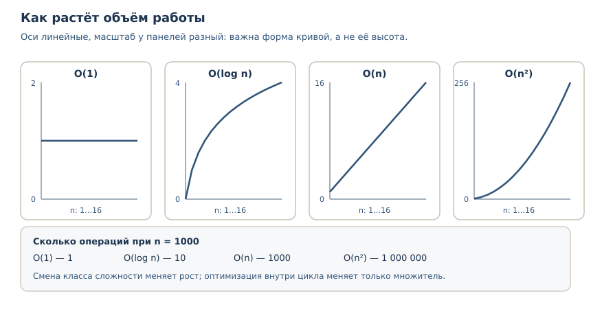
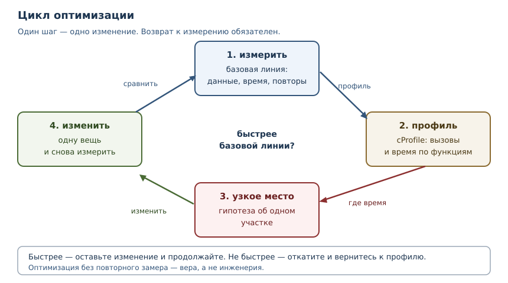

# Производительность и профилирование

<!-- syllanix:nav -->
**Навигация:** [← 39. Асинхронность: asyncio](39-asyncio.md) · [Оглавление книги](../README.md) · [Далее: 41. Безопасность приложений →](41-security.md)
<!-- /syllanix:nav -->

<!-- syllanix:topics -->
**Темы главы**
40.1. [Что вы сможете после этой главы](#что-вы-сможете-после-этой-главы)  
40.2. [Сначала измерение, потом изменение](#measure-first)  
40.3. [Алгоритмическая сложность](#complexity)  
40.4. [Профилирование](#profiling)  
40.5. [Узкое место](#bottleneck)  
40.6. [Мемоизация](#memoization)  
40.7. [Оптимизации, которые стоит знать](#optimizations)  
40.8. [Типичные ошибки](#mistakes)  
40.9. [Упражнения](#упражнения)  
40.10. [Проверка понимания](#check)  
40.11. [Связи](#links)  
<!-- /syllanix:topics -->


Программа работает правильно, но слишком медленно. Первое желание —
переписать «подозрительное» место, второе — добавить кэш, третье — заменить
цикл на включение. Обычно все три шага делают код сложнее, а время работы не
меняют: настоящая причина в другом участке. Эта глава о том, как перестать
угадывать. Вы научитесь измерять, строить профиль, находить узкое место и
проверять, что изменение действительно помогло.

## Что вы сможете после этой главы

- отличать измерение от догадки и проводить бенчмарк, которому можно верить;
- оценивать алгоритмическую сложность и замечать, когда дело не в коде, а в
  самом алгоритме;
- снимать профиль через `cProfile` и читать его без иллюзий;
- находить узкое место и проверять результат оптимизации повторным замером;
- применять мемоизацию и понимать, когда она вредит.

## Сначала измерение, потом изменение {#measure-first}

Дональд Кнут писал, что преждевременная оптимизация — корень всех зол. Смысл
не в том, что оптимизировать не нужно, а в том, что **нельзя оптимизировать
то, что вы не измерили**. Интуиция о скорости кода систематически ошибается:
дорогими оказываются не те строки, которые выглядят сложными, а те, которые
выполняются миллионы раз, или те, что прячут за собой ожидание.

Есть три величины, которые легко перепутать.

| Величина | Что показывает | Когда важна |
|---|---|---|
| время работы (wall time) | сколько прошло по часам | для пользователя и таймаутов |
| процессорное время | сколько процессор работал | для вычислений |
| число операций | сколько работы сделал алгоритм | для оценки сложности |

Если программа ждёт сеть, время работы большое, а процессорное — маленькое.
Ускорять вычисления в такой программе бессмысленно. И наоборот: если время
работы растёт квадратично от размера данных, никакая микрооптимизация цикла
не спасёт.

**Бенчмарк** — воспроизводимое измерение производительности по строго
заданному сценарию: те же данные, те же условия, несколько повторов.
Измерение «один раз в интерактивной сессии» — не бенчмарк: на
результат влияют прогрев, фоновые процессы и состояние кэшей.

Для коротких фрагментов в стандартной библиотеке есть **`timeit`** — модуль и
одноимённая команда, которые многократно запускают код и возвращают лучшее
время. Многократный запуск нужен, чтобы шум измерения не перекрыл разницу.
Вот типичный сеанс; числа на вашей машине будут другими, важны порядки
величин:

```console
$ python3 -m timeit -s "data = list(range(1000))" "999 in data"
100000 loops, best of 5: 2.89 usec per loop
$ python3 -m timeit -s "data = set(range(1000))" "999 in data"
10000000 loops, best of 5: 21.7 nsec per loop
```

Разница в сто с лишним раз объясняется не тем, что «множества быстрее
списков», а тем, что у них разная сложность поиска: список просматривает
элементы по одному, множество вычисляет хеш и обращается к таблице.

### Углубление: как измерять, не обманывая себя

Пять правил, без которых бенчмарк врёт.

1. **Измеряйте то, что оптимизируете.** Замер, включающий подготовку данных,
   покажет разницу в подготовке, а не в работе.
2. **Повторяйте.** Один замер — это шум. Команда `python -m timeit` по
   умолчанию делает пять раундов и печатает лучший: такой результат меньше
   всего искажён помехами. В коде для этого вызывают `timeit.repeat` и берут
   `min`, потому что сам `timeit.timeit` выполняет один раунд.
3. **Не смешивайте ожидание и вычисления.** Ввод-вывод измеряют отдельно от
   расчётов.
4. **Проверяйте одинаковость условий.** Разные данные, разный прогрев,
   включённый отладчик или профилировщик меняют результат.
5. **Сравнивайте с базовой линией.** Оптимизация измеряется как отношение:
   было столько, стало столько, при тех же входных данных.

## Алгоритмическая сложность {#complexity}

**Алгоритмическая сложность** — оценка того, как растёт объём работы
алгоритма при увеличении размера входа. Её записывают в O-нотации: `O(n)`
означает, что число операций растёт пропорционально `n`, `O(n ** 2)` — что
оно растёт как квадрат `n`. Константы и слагаемые низшего порядка при этом
отбрасывают: они важны на малых размерах, но проигрывают росту.

Посмотрите на разницу между линейным и двоичным поиском. Оба находят элемент
в отсортированном списке, но один просматривает элементы подряд, а второй
каждый раз отбрасывает половину.

```python exec
def linear_search(items, target):
    steps = 0
    for index, item in enumerate(items):
        steps += 1
        if item == target:
            return index, steps
    return -1, steps

def binary_search(items, target):
    low, high, steps = 0, len(items) - 1, 0
    while low <= high:
        steps += 1
        middle = (low + high) // 2
        if items[middle] == target:
            return middle, steps
        if items[middle] < target:
            low = middle + 1
        else:
            high = middle - 1
    return -1, steps

data = list(range(1000))
print("линейный поиск:", linear_search(data, 999))
print("двоичный поиск:", binary_search(data, 999))
```

```output
линейный поиск: (999, 1000)
двоичный поиск: (999, 10)
```

Линейный поиск сделал `1000` шагов, двоичный — `10`. Десять — это примерно
`log2(1000)`: каждый шаг уменьшает область поиска вдвое. На тысяче элементов
разница примерно в сто раз (`1000` шагов против `10`), а на миллионе — уже
примерно в пятьдесят тысяч раз (`10**6` против `20`): `O(n)` против
`O(log n)`.



Частые классы сложности, от лучшего к худшему:

| Сложность | Пример операции | Рост при `n` от 1000 до 2000 |
|---|---|---|
| `O(1)` | доступ по индексу, поиск в множестве | не меняется |
| `O(log n)` | двоичный поиск, `bisect` | +1 шаг |
| `O(n)` | обход списка, суммирование | вдвое больше работы |
| `O(n log n)` | сортировка слиянием, `sorted` | чуть больше, чем вдвое |
| `O(n ** 2)` | вложенный цикл по всем парам | вчетверо больше работы |

Из таблицы следует практический вывод: **смена алгоритма с `O(n ** 2)` на
`O(n log n)` даёт больше, чем любая оптимизация констант внутри цикла**. Зато
на малых данных, где `n` равно десяти, квадратичный алгоритм вполне может
оказаться быстрее: у него меньше накладных расходов. Сложность описывает
рост, а не абсолютную скорость.

### Углубление: сложность в среднем и в худшем случае

Поиск в множестве и словаре в среднем требует `O(1)`, но в худшем случае при
плохом хешировании вырождается в `O(n)`. Для встроенных типов с нормальными
хешами это редкость, но для своих классов, у которых `__hash__` возвращает
константу, — реальность. Поэтому при оценке производительности уточняйте, о
каком случае идёт речь.

## Профилирование {#profiling}

**Профилирование** — измерение того, сколько времени и вызовов приходится на
каждую функцию программы. Профиль отвечает на вопрос «где именно уходит
время», а не «почему программа медленная вообще».

Стандартная библиотека даёт два инструмента: `cProfile` и `profile`.
`cProfile` — обёртка над профилировщиком `_lsprof`, написанным на C, поэтому
накладные расходы у него ниже; для повседневной работы хватает его. `profile` —
реализация на чистом Python: медленнее, зато её проще читать и расширять. Оба
строят **детерминированный** профиль: подсчёт по вызовам, а не выборка по
таймеру.

```python exec
import cProfile

def fib(n):
    return n if n < 2 else fib(n - 1) + fib(n - 2)

def build(n):
    return [fib(i) for i in range(n)]

profiler = cProfile.Profile()
profiler.enable()
build(10)
profiler.disable()

rows = []
for entry in profiler.getstats():
    if isinstance(entry.code, str):
        continue
    rows.append((entry.code.co_name, entry.callcount))
rows.sort()
for name, count in rows:
    print(name, count)
```

```output
build 1
fib 276
```

Здесь нет случайности: профиль показывает точные счётчики. `build` вызвана
один раз, `fib` — 276 раз. Именно такие числа, а не время, позволяют увидеть
структуру работы. Время в профиле тоже есть, но его не стоит печатать в
примере: оно зависит от машины.

`pstats` форматирует профиль в таблицу. Её столбцы: число вызовов, суммарное
время в функции (`tottime`), время с учётом вызываемых функций (`cumtime`) и
адрес определения функции.

```console
$ python3 -m cProfile -s cumulative fib.py
         280 function calls (14 primitive calls) in 0.001 seconds

   Ordered by: cumulative time

   ncalls  tottime  percall  cumtime  percall filename:lineno(function)
        1    0.000    0.000    0.001    0.001 fib.py:6(build)
   276/10    0.000    0.000    0.001    0.000 fib.py:3(fib)
```

Запись `276/10` означает: функция `fib` вызвана 276 раз, из них 10 — не
рекурсивно. Большое число вызовов маленькой функции — сигнал: алгоритм
пересчитывает одно и то же. Здесь напрашивается мемоизация.

### Как читать профиль

1. **Смотрите на `cumtime`, чтобы найти цепочку** — время, включающее
   вызванные функции.
2. **Смотрите на `tottime`, чтобы найти точку** — время, потраченное в самой
   функции, без вызовов.
3. **Смотрите на `ncalls`** — часто проблема не в одной медленной операции, а
   в миллионе быстрых.
4. **Не оптимизируйте функции, которые не попали в верх таблицы.** 80 %
   времени обычно приносит небольшая часть кода.

## Узкое место {#bottleneck}

**Узкое место** — участок, который ограничивает общую производительность:
пока он не ускорен, оптимизация остального не даёт заметного эффекта. Это
следует из закона Амдала: если на участок приходится половина времени,
максимальное ускорение всей программы от его устранения — вдвое, сколько бы
остального вы ни оптимизировали.



Работа над производительностью — цикл, а не одноразовое действие:

1. **Измерить.** Зафиксировать базовую линию: данные, сценарий, время.
2. **Профилировать.** Понять, какие функции потребляют время и сколько раз
   вызываются.
3. **Сформулировать гипотезу.** «Время уходит на повторные вычисления
   `fib`» — конкретное утверждение, которое можно проверить.
4. **Изменить одну вещь.** Если менять сразу несколько, невозможно понять,
   что помогло, а что навредило.
5. **Измерить снова.** Сравнить с базовой линией на тех же данных.

Шаг 5 пропускают чаще всего, и именно поэтому многие «оптимизации» живут в
коде годами, не ускоряя ничего.

## Мемоизация {#memoization}

**Мемоизация** — кэширование результатов функции по её аргументам: если
функцию вызвали с теми же аргументами повторно, результат берётся из кэша, а
не вычисляется заново. Это обмен памяти на время, и он оправдан, если
функция чистая — при одинаковых аргументах всегда возвращает одно и то же —
и вызывается повторно.

В стандартной библиотеке для этого есть `functools.lru_cache` и его короткая
форма `functools.cache` (Python 3.9+).

```python exec
from functools import lru_cache

calls = 0

def fib_slow(n):
    global calls
    calls += 1
    return n if n < 2 else fib_slow(n - 1) + fib_slow(n - 2)

print("без кэша:", fib_slow(15), "вызовов:", calls)

@lru_cache(maxsize=None)
def fib_fast(n):
    return n if n < 2 else fib_fast(n - 1) + fib_fast(n - 2)

print("с кэшем:", fib_fast(15))
print(fib_fast.cache_info())
```

```output
без кэша: 610 вызовов: 1973
с кэшем: 610
CacheInfo(hits=13, misses=16, maxsize=None, currsize=16)
```

Без кэша `fib(15)` вызвана 1973 раза, потому что одни и те же значения
пересчитываются заново. С кэшем достаточно 16 вычислений: остальные 13
обращений попали в кэш. `cache_info` показывает попадания (`hits`),
промахи (`misses`) и текущий размер кэша (`currsize`). Это готовый счётчик
эффективности: если попаданий почти нет, кэш только тратит память.

### Углубление: у кэша есть цена

`lru_cache` хранит результаты, пока не достигнут `maxsize`; при переполнении
вытесняется давно не использованная запись. Видно, как это работает, если
поставить маленький размер.

```python exec
from functools import lru_cache

@lru_cache(maxsize=2)
def square(number):
    print("вычисляем", number)
    return number * number

print(square(2))
print(square(3))
print(square(2))
print(square(4))
print(square(2))
print(square.cache_info())
```

```output
вычисляем 2
4
вычисляем 3
9
4
вычисляем 4
16
4
CacheInfo(hits=2, misses=3, maxsize=2, currsize=2)
```

Пять вызовов, три вычисления, два попадания. Четвёртый вызов вытеснил запись
для `3`, поэтому последний вызов `square(2)` всё ещё попадает в кэш, а
`square(3)` пришлось бы считать заново. Размер кэша — компромисс между
памятью и долей попаданий.

Три ограничения мемоизации, о которых забывают:

1. **Аргументы должны быть хешируемыми.** Список или словарь в аргументах
   даст `TypeError`, потому что кэш устроен как словарь.
2. **Функция должна быть чистой.** Если результат зависит от внешнего
   состояния, кэш вернёт устаревшее значение.
3. **Кэш занимает память.** Для функции с миллионом разных аргументов
   `maxsize=None` — это утечка памяти, замаскированная оптимизацией.

```python exec expect-error
from functools import lru_cache

@lru_cache(maxsize=None)
def total(items):
    return sum(items)

print(total([1, 2, 3]))
```

```output
TypeError: unhashable type: 'list'
```

С кортежем тот же код работает: кортеж хешируем, в отличие от списка.

```python exec
from functools import lru_cache

@lru_cache(maxsize=None)
def total(items):
    return sum(items)

print(total((1, 2, 3)))
```

```output
6
```

## Оптимизации, которые стоит знать {#optimizations}

Микрооптимизации редко решают судьбу программы, но несколько приёмов полезно
узнавать в профиле.

| Приём | Почему работает | Когда не помогает |
|---|---|---|
| множество или словарь вместо списка для проверки вхождения | поиск `O(1)` вместо `O(n)` | если элементов мало и список уже построен |
| `str.join` вместо `+=` в цикле | одна аллокация вместо многих | если строк две |
| списковое включение вместо `append` в цикле | меньше накладных расходов Python | если внутри сложная логика |
| локальная переменная вместо глобальной | короче поиск имени | если функция вызывается один раз |
| вынести повторное вычисление из цикла | не делать одну и ту же работу | если вычисление уже кэшировано |

Проверять каждый приём нужно замером: выигрыш зависит от версии Python,
размера данных и того, где находится узкое место. Списковое включение из
главы 23 обычно быстрее цикла с `append`, но не в сто раз — и это не повод
переписывать весь код.

### Углубление: что показывает `perf_counter`

Для грубого замера в коде есть `time.perf_counter` — счётчик с наибольшим
доступным разрешением. Печатать его значение бессмысленно: оно зависит от
машины и момента запуска. Печатать имеет смысл только проверяемое
утверждение о результате измерения.

```python exec
from time import perf_counter

def work(limit):
    return sum(range(limit))

start = perf_counter()
value = work(100_000)
elapsed = perf_counter() - start
print("результат:", value)
print("измерение неотрицательно:", elapsed >= 0)
```

```output
результат: 4999950000
измерение неотрицательно: True
```

В учебном примере мы печатаем только инвариант — измеренное время не может
быть отрицательным. В реальном бенчмарке время печатают, но всегда вместе с
условиями: размер данных, число повторов, версия Python.

## Типичные ошибки {#mistakes}

1. **Оптимизировать без замера.** «Мне кажется, это место медленное» — не
   основание для изменения. Сначала профиль.
2. **Мерить один раз.** Один замер ловит шум, а не свойство программы.
3. **Включать подготовку в замер.** Создание данных в измеряемом блоке
   покажет время создания, а не работы.
4. **Путать сложность с константой.** Быстрый `O(n ** 2)` на десяти элементах
   не значит, что он останется быстрым на миллионе.
5. **Кэшировать всё.** Мемоизация функции с побочными эффектами или большим
   разнообразием аргументов вредит: память растёт, попаданий нет.
6. **Оптимизировать холодный код.** Функция, которая вызывается один раз при
   запуске, не влияет на общую скорость.
7. **Забыть про повторный замер.** Без сравнения с базовой линией
   «оптимизация» остаётся верой.

## Упражнения

### 1. Замер или догадка {#ex-ch40-01}

Возьмите любую функцию из своих прошлых упражнений и ответьте письменно:
какой сценарий вы измеряете, какие данные подаёте, сколько повторов делаете и
с какой базовой линией сравниваете. Объясните, почему замер «один раз,
в интерактивной сессии» не годится.

### 2. Сложность на счётчиках {#ex-ch40-02}

Напишите две функции поиска максимума: одну с сортировкой и взятием
последнего элемента, вторую с одним проходом по списку. Обе возвращают
найденный максимум и число выполненных шагов. Сравните шаги на списке из
1000 элементов и объясните результат в терминах сложности.

### 3. Исправление бенчмарка {#ex-ch40-03}

Бенчмарк показывает, что «функция стала быстрее», хотя код не менялся:

```text
start = time.perf_counter()
data = build_data(100000)
result = process(data)
print(time.perf_counter() - start)
```

Что измеряет этот код на самом деле? Перепишите замер так, чтобы он измерял
только `process`.

### 4. Чтение профиля {#ex-ch40-04}

Профиль показывает: функция `parse` вызвана 2 раза, `validate` — 500 000 раз,
`render` — 2 раза. Суммарное время `parse` и `render` — 0.4 с, `validate` —
0.1 с. Какой участок стоит оптимизировать в первую очередь и почему одного
`tottime` для ответа недостаточно?

### 5. Мемоизация своими руками {#ex-ch40-05}

Реализуйте мемоизацию без `functools`: функция `memo_fib(n)` хранит
вычисленные значения в словаре и возвращает их при повторном вызове.
Выведите число фактических вычислений для `n = 15`.

### 6. Хешируемость аргументов {#ex-ch40-06}

Функция кэшируется через `lru_cache`, но при вызове со списком падает с
`TypeError`. Объясните причину и предложите два исправления: преобразование
аргумента и отказ от кэша для этого случая.

### 7. Кэш с ограничением {#ex-ch40-07}

Создайте кэширующую функцию с `maxsize=3` и вызовите её с пятью разными
аргументами, затем повторите первые два вызова. Выведите `cache_info` и
объясните, сколько было попаданий и почему.

### 8. Узкое место {#ex-ch40-08}

Программа тратит 0.6 с на чтение файла, 0.3 с на разбор данных и 0.1 с на
вывод. Вы вдвое ускорили разбор. Насколько ускорится программа целиком?
Ответьте числом и объясните через закон Амдала.

### 9. Сложность в среднем {#ex-ch40-09}

Объясните, почему поиск в множестве в среднем `O(1)`, но может деградировать
до `O(n)`. Приведите пример класса, у которого это произойдёт, и напишите
такой класс, проверив, что `hash()` у всех экземпляров одинаков, а число
сравнений при вставке растёт квадратично.

### 10. Мини-задача: ускорение отчёта {#ex-ch40-10}

Дана функция, которая для списка чисел строит отчёт: сумму, минимум,
максимум и количество уникальных значений. Напишите её наивную версию
(несколько проходов по списку, проверка уникальности через список) и
оптимизированную (один проход, множество). Сравните число операций на списке
из 2000 чисел и объясните, какой алгоритм асимптотически лучше.

## Проверка понимания {#check}

1. Чем бенчмарк отличается от однократного замера?
2. Почему `python -m timeit` делает несколько повторов и берёт лучшее время?
3. Что означает запись `O(n log n)` и почему она лучше `O(n ** 2)`?
4. Что показывает `tottime`, а что `cumtime`?
5. Как по профилю понять, что проблема в количестве вызовов, а не в одной
   медленной операции?
6. Что такое узкое место и почему без него оптимизация остального бесполезна?
7. В каких случаях мемоизация ухудшает программу?
8. Почему аргументы кэшируемой функции должны быть хешируемыми?

## Связи {#links}

Подробный разбор O-нотации и выбора структур данных — в главе 52.

Оценка алгоритмов вводится здесь впервые. Генераторы, включения и декораторы
из глав 21–23 нужны потому, что `lru_cache` — декоратор, а кэш устроен как
словарь из главы 17. Модель конкурентности из главы 38 и главы 39
объясняет, почему ожидание и вычисления измеряют по-разному.

Дальше — [безопасность приложений](41-security.md): производительность важна,
но не ценой уязвимостей. Там мы разберём, как не открыть дверь, ускоряя код.

<!-- syllanix:nav -->
**Перед этой главой:** [39. Асинхронность: asyncio](39-asyncio.md)
**Связанные главы:** [02. Первая программа: вычисления и вывод](02-first-program.md), [07. Функции: параметры, аргументы и области видимости](07-functions.md), [09. Модули, пакеты и импорты](09-modules.md), [13. Списки: индексы, срезы и методы](13-lists.md), [16. Множества и хеширование](16-sets.md), [17. Словари: отображения и структурирование данных](17-dicts.md), [21. Генераторы и ленивые вычисления](21-generators.md), [22. Функции как объекты: замыкания и декораторы](22-higher-order.md)
**Далее:** [41. Безопасность приложений →](41-security.md)
<!-- /syllanix:nav -->
