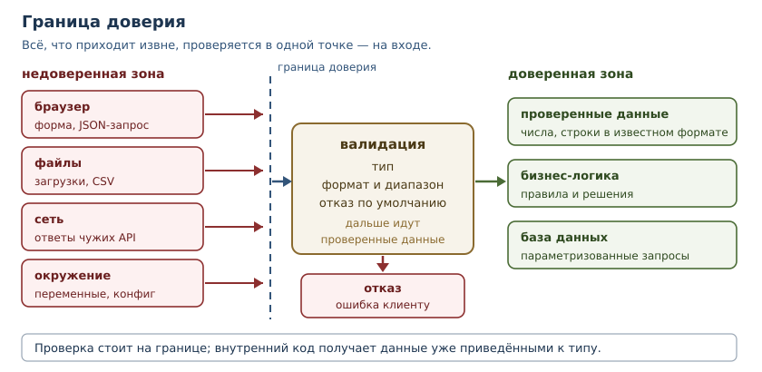
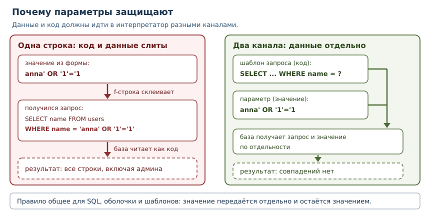

# Безопасность приложений

<!-- syllanix:nav -->
**Навигация:** [← 40. Производительность и профилирование](40-performance.md) · [Оглавление книги](../README.md) · [Далее: 42. Внутреннее устройство Python →](42-internals.md)
<!-- /syllanix:nav -->

<!-- syllanix:topics -->
**Темы главы**
41.1. [Что вы сможете после этой главы](#что-вы-сможете-после-этой-главы)  
41.2. [Модель угроз и границы доверия](#threat-model)  
41.3. [Валидация ввода](#validation)  
41.4. [Инъекция](#injection)  
41.5. [Управление секретами](#secrets)  
41.6. [Хеширование паролей](#password-hashing)  
41.7. [Небезопасная десериализация](#deserialization)  
41.8. [Уязвимости зависимостей](#dependencies)  
41.9. [Принцип наименьших привилегий](#least-privilege)  
41.10. [Что не защищает](#not-security)  
41.11. [Типичные ошибки](#mistakes)  
41.12. [Упражнения](#упражнения)  
41.13. [Проверка понимания](#check)  
41.14. [Связи](#links)  
<!-- /syllanix:topics -->


Безопасность — не отдельный модуль, который подключают в конце, и не список
запретов. Это свойство всей программы: она остаётся работоспособной и не
теряет данные, когда её используют неправильно или враждебно. Ошибку в
логике заметит пользователь, ошибку в безопасности заметит злоумышленник — и
не скажет о ней. В этой главе мы разберём типовые места, где программы
ломаются, и правила, которые закрывают эти места.

## Что вы сможете после этой главы

- определять границы доверия и проверять данные именно на них;
- узнавать инъекцию в коде и заменять её безопасным способом передачи данных;
- хранить секреты так, чтобы они не попадали в репозиторий, логи и сообщения
  об ошибках;
- хешировать пароли правильно и объяснять, почему быстрый хеш для этого не
  годится;
- отличать безопасную десериализацию от опасной и понимать, чем опасен
  `pickle` на недоверенных данных;
- оценивать уязвимости зависимостей и применять принцип наименьших
  привилегий.

## Модель угроз и границы доверия {#threat-model}

**Безопасность** — свойство системы сохранять конфиденциальность, целостность
и доступность данных при враждебных или ошибочных действиях. Это не бинарное
состояние «защищено / не защищено», а набор мер, каждая из которых закрывает
свой класс проблем.

Прежде чем что-то защищать, полезно ответить на три вопроса. Что мы защищаем:
данные пользователей, деньги, доступ к инфраструктуре? От кого: от
случайного пользователя, от авторизованного клиента, от внешнего сканера?
Каким путём данные попадают в систему: формы, файлы, сеть, переменные
окружения, база, сторонние API?

Ответы образуют **модель угроз** — описание того, что и от кого защищается.
Без неё защита превращается в набор случайных мер: где-то проверки есть,
где-то нет, и никто не знает почему.

Ключевое понятие — **граница доверия**: линия, разделяющая код, которому мы
доверяем, и данные, которые пришли извне. Всё, что пересекает границу, —
недоверенные данные, независимо от того, насколько солидно они выглядят.
Запрос из браузера, файл от пользователя, ответ чужого API, значение из
переменной окружения, даже строка из базы, которую мог изменить другой
сервис.



Практическое следствие: **проверяйте данные на границе и дальше работайте с
проверенными значениями**. Если функция внутри ядра получает строку «где-то
из сети» и сама решает, можно ли ей верить, — рано или поздно кто-то забудет
проверку. Внутренний код должен получать данные уже приведёнными к типу.

## Валидация ввода {#validation}

**Валидация ввода** — проверка данных на соответствие ожидаемому формату,
диапазону и смыслу до того, как программа начнёт с ними работать. Хорошая
валидация отвечает на вопрос «что допустимо», а не «что запрещено»: белый
список надёжнее чёрного, потому что не требует угадать все варианты атаки.

```python exec
import re

class ValidationError(ValueError):
    pass

def parse_age(raw):
    if not isinstance(raw, str):
        raise ValidationError("возраст должен быть строкой")
    raw = raw.strip()
    if not re.fullmatch(r"\d{1,3}", raw):
        raise ValidationError("возраст: ожидается 1–3 цифры")
    age = int(raw)
    if not 0 <= age <= 130:
        raise ValidationError("возраст вне допустимого диапазона")
    return age

for value in (" 42 ", "7", "abc", "999"):
    try:
        print(repr(value), "->", parse_age(value))
    except ValidationError as error:
        print(repr(value), "->", error)
```

```output
' 42 ' -> 42
'7' -> 7
'abc' -> возраст: ожидается 1–3 цифры
'999' -> возраст вне допустимого диапазона
```

Функция проверяет тип, формат и диапазон и возвращает уже число. Всё, что
пришло после неё, работает с `int`, а не с произвольной строкой. Обратите
внимание: проверка формата идёт регулярным выражением с полным совпадением
(`fullmatch`), поэтому строка `"42abc"` не пройдёт.

Три правила валидации:

1. **Проверяйте на границе.** Один раз, в точке входа, а не в каждом
   внутреннем вызове.
2. **Отказывайте по умолчанию.** Неизвестное значение отклоняется, а не
   пропускается «на всякий случай».
3. **Не подменяйте валидацию экранированием.** Проверка отвечает «допустимо
   ли», экранирование — «как безопасно передать». Это разные задачи, и обе
   нужны.

## Инъекция {#injection}

**Инъекция** — класс атак, при которых данные, предназначенные для значения,
интерпретируются как код или команда. Причина всегда одна: программа
склеивает данные и код в одну строку, а потом отдаёт её интерпретатору,
который не может отличить одно от другого.

Самый частый пример — SQL-запрос, собранный подстановкой. В главе 36 мы уже
видели, что параметризованный запрос решает проблему; посмотрим, как именно
она возникает.

```python exec
import sqlite3

connection = sqlite3.connect(":memory:")
connection.execute("CREATE TABLE users (name TEXT, role TEXT)")
connection.executemany(
    "INSERT INTO users VALUES (?, ?)",
    [("anna", "user"), ("boris", "admin")],
)

def find_user_unsafe(name):
    query = f"SELECT name, role FROM users WHERE name = '{name}'"
    return connection.execute(query).fetchall()

print("обычный ввод:", find_user_unsafe("anna"))
print("инъекция:", find_user_unsafe("anna' OR '1'='1"))

def find_user_safe(name):
    query = "SELECT name, role FROM users WHERE name = ?"
    return connection.execute(query, (name,)).fetchall()

print("безопасно:", find_user_safe("anna' OR '1'='1"))
```

```output
обычный ввод: [('anna', 'user')]
инъекция: [('anna', 'user'), ('boris', 'admin')]
безопасно: []
```

В первом случае строка `anna' OR '1'='1` сломала условие: запрос вернул всех
пользователей, включая администратора. Во втором случае база получила запрос
с параметром и значение отдельно, поэтому значение сравнивается буквально —
и такого пользователя нет.



Тот же механизм работает в командной строке. Склеивание команды из данных
превращает любую строку в часть команды:

```python
host = "example.com; echo взломано"
command = f"ping -c 1 {host}"
print(command)
```

Оболочка увидит не одно имя хоста, а две команды. Правило общее для всех
интерпретаторов — SQL, shell, HTML, шаблонов: **данные никогда не должны
становиться кодом**. Для каждого из них есть свой способ передать данные
отдельно: параметры запроса, список аргументов процесса без `shell=True`,
экранирование шаблона.

## Управление секретами {#secrets}

**Управление секретами** — набор практик хранения и передачи значений,
которые дают доступ: паролей, токенов, ключей. Секрет отличается от обычной
настройки тем, что его утечка необратима: пароль можно сменить, а
опубликованный в репозитории ключ остаётся в истории навсегда.

Правила, которые покрывают почти все инциденты:

1. **Секреты не в коде и не в репозитории.** Ни в файлах, ни в истории
   коммитов, ни в комментариях. Конфигурация читается из переменных окружения
   (глава 35) или хранилища секретов.
2. **Секреты не в логах.** Токен в строке лога равносилен публикации: логи
   читают люди и системы.
3. **Секреты не в сообщениях об ошибках.** Пользователь не должен видеть
   строку подключения, а traceback с параметрами — попадать в ответ API.
4. **Секреты генерируются криптостойко.** Модуль `secrets` использует
   генератор, пригодный для токенов; `random` для этого не годится.
5. **Сравнение секретов — постоянное по времени.** Обычное `==`
   останавливается на первом несовпадении, и по времени ответа можно
   постепенно угадать значение.

```python exec
import hashlib
import hmac
import secrets

token = secrets.token_hex(16)
print("длина токена:", len(token), "символов")
print("сравнение совпадающих:", secrets.compare_digest(token, token))
print("сравнение разных:", secrets.compare_digest(token, "0" * 32))

salt = b"demo-salt-0123456"
stored = hashlib.scrypt(b"secret", salt=salt, n=2**14, r=8, p=1, dklen=32)
print("длина производного ключа:", len(stored), "байт")
print("проверка:", hmac.compare_digest(stored, hashlib.scrypt(b"secret", salt=salt, n=2**14, r=8, p=1, dklen=32)))
```

```output
длина токена: 32 символов
сравнение совпадающих: True
сравнение разных: False
длина производного ключа: 32 байт
проверка: True
```

Токен из 16 байт даёт 32 шестнадцатеричных символа. `secrets.compare_digest`
и `hmac.compare_digest` сравнивают значения за постоянное время и возвращают
`True`/`False`; третий вывод — `False`, потому что сравниваются разные
значения: функция сообщает лишь факт совпадения и ничего не раскрывает о том,
в каком месте строки было различие.

### Углубление: где живут секреты

В разработке секреты берут из файла, который не попадает в репозиторий, а в
работе — из переменных окружения или хранилища. Один и тот же код читает
значение по имени, а не по адресу:

```python
import os

database_url = os.environ.get("DATABASE_URL")
if not database_url:
    raise RuntimeError("не задан DATABASE_URL")
```

Проверка на отсутствие важна: программа должна падать при запуске, а не
подключаться к «пустой» базе и терять данные. Имя переменной можно писать в
коде; её значение — никогда.

## Хеширование паролей {#password-hashing}

**Хеширование паролей** — преобразование пароля в необратимый отпечаток,
который хранится вместо самого пароля. При входе введённый пароль
преобразуется тем же способом, и отпечатки сравниваются. Даже при утечке базы
злоумышленник не получает паролей в открытом виде.

У этого правила две части, и обе обязательны.

**Соль.** Случайное значение, уникальное для каждой записи, добавляется к
паролю перед хешированием. Без соли одинаковые пароли дают одинаковые
отпечатки, и один вычисленный хеш раскрывает всех пользователей с тем же
паролем. Соль хранится рядом с хешем: она не секрет, её задача — сделать
хеши разными.

**Медленный алгоритм.** Обычные хеши вроде `sha256` спроектированы быстрыми:
миллиарды вычислений в секунду. Для проверки пароля это преимущество
злоумышленника. Поэтому используют алгоритмы, намеренно требующие времени и
памяти: `scrypt`, `bcrypt`, `argon2`. Стандартная библиотека даёт `scrypt`
через `hashlib`.

```python exec
import hashlib, hmac

salt = b"unique-salt-for-record"
password = "правильный пароль".encode()

def hash_password(raw, salt):
    return hashlib.scrypt(raw, salt=salt, n=2**14, r=8, p=1, dklen=32)

stored = hash_password(password, salt)
print("длина хеша:", len(stored), "байт")
print("верный пароль:", hmac.compare_digest(stored, hash_password(password, salt)))
print("неверный пароль:", hmac.compare_digest(stored, hash_password("другой пароль".encode(), salt)))
```

```output
длина хеша: 32 байт
верный пароль: True
неверный пароль: False
```

Параметры `n`, `r`, `p` задают стоимость вычисления: чем больше, тем медленнее
и тем дороже перебор. Их подбирают так, чтобы проверка занимала доли секунды
на целевом оборудовании, и хранят вместе с хешем, чтобы при смене параметров
старые записи продолжали проверяться.

## Небезопасная десериализация {#deserialization}

**Небезопасная десериализация** — восстановление объектов из данных, формат
которых допускает исполнение кода. В Python самый известный пример — `pickle`:
он умеет восстанавливать произвольные объекты, и вместе с данными
восстанавливается поведение.

Учебная модель: класс, который при восстановлении вызывает функцию.

```python exec
import pickle

class Payload:
    def __init__(self, message):
        self.message = message
    def __reduce__(self):
        return (print, (self.message,))

data = pickle.dumps(Payload("выполнился код из данных"))
print("данные выглядят безобидно:", len(data), "байт")
pickle.loads(data)
```

```output
данные выглядят безобидно: 85 байт
выполнился код из данных
```

Функция `print` здесь безопасна только потому, что мы сами её выбрали. В
реальной атаке на её месте оказалась бы любая функция, доступная в момент
загрузки. Вывод простой: **`pickle` допустим только для доверенных данных**,
например для собственного кеша на своей машине. Для обмена с внешним миром
используют форматы данных без исполнения: JSON (глава 19), CSV, YAML с
безопасным загрузчиком.

```python exec
import ast
import json

message = '{"user": "anna", "roles": ["admin"]}'
print("json:", json.loads(message))

text = "{'user': 'anna', 'roles': ['admin']}"
print("literal_eval:", ast.literal_eval(text))

try:
    ast.literal_eval("__import__('os').getcwd()")
except ValueError as error:
    print("отклонено:", type(error).__name__)
```

```output
json: {'user': 'anna', 'roles': ['admin']}
literal_eval: {'user': 'anna', 'roles': ['admin']}
отклонено: ValueError
```

`json` разбирает только данные. `ast.literal_eval` принимает лишь литералы —
строки, числа, списки, словари — и отклоняет вызовы функций, поэтому годится
для разбора строк, похожих на Python-литералы. Но и он не заменяет валидацию:
после разбора данные всё равно проверяют по схеме.

## Уязвимости зависимостей {#dependencies}

**Уязвимость зависимости** — известная проблема в сторонней библиотеке,
которую использует ваш проект. Код может быть безупречен, но уязвимость в
парсере или HTTP-клиенте открывает доступ к системе. Зависимости — часть
вашей программы, и отвечаете за них вы.

Работа с ними строится на трёх вещах.

1. **Фиксация версий.** `lockfile` (глава 33) фиксирует точные версии всех
   зависимостей, включая транзитивные. Сборка должна быть воспроизводимой:
   одинаковая версия кода — одинаковый набор пакетов.
2. **Регулярная проверка.** Специализированные инструменты сверяют
   зависимости с базами известных уязвимостей. Запускать их стоит в CI, а не
   «когда вспомним».
3. **Обновление.** Уязвимость закрывается обновлением, поэтому зависимости
   обновляют планово и проверяют тестами. Старый пакет без обновлений — это
   не «стабильность», а накопленный риск.

Типичный сеанс проверки выглядит так:

```console
$ uv lock --check
Resolved 42 packages
$ uvx pip-audit
No known vulnerabilities found
```

Числа и названия инструментов зависят от проекта; смысл в том, что проверка
встроена в процесс, а не выполняется вручную перед релизом.

## Принцип наименьших привилегий {#least-privilege}

**Принцип наименьших привилегий** — каждая часть системы получает только те
права и данные, которые нужны ей для работы, и ничего сверх этого. Функция,
которой нужны имя и почта, не должна получать хеш пароля и флаг
администратора: лишнее поле рано или поздно попадёт в лог, в ответ API или в
чужой код.

```python exec
class UserRecord:
    def __init__(self, name, email, password_hash, is_admin):
        self.name = name
        self.email = email
        self.password_hash = password_hash
        self.is_admin = is_admin

def public_view(record):
    return {"name": record.name, "email": record.email}

def render_card(view):
    print(f"{view['name']} <{view['email']}>")

user = UserRecord("anna", "anna@example.com", "хеш-пароля", False)
render_card(public_view(user))
```

```output
anna <anna@example.com>
```

`render_card` получает словарь из двух полей и физически не может вывести
пароль. Это надёжнее, чем правило «не логируй пароль»: правило можно забыть, а
отсутствующее поле забыть невозможно.

Принцип работает на всех уровнях: учётная запись базы имеет права только на
свою схему, процесс не запускается от администратора, токен API даёт доступ к
одному сервису, а не ко всем. Чем меньше прав у скомпрометированной части, тем
меньше ущерб.

## Что не защищает {#not-security}

Некоторые меры выглядят как защита, но ею не являются.

| Мера | Почему не защищает |
|---|---|
| проверка только в браузере | запрос можно отправить напрямую, минуя интерфейс |
| скрытие кнопки в интерфейсе | право доступа проверяется на сервере, а не в вёрстке |
| чёрный список опасных слов | вариантов обхода бесконечно много |
| обфускация кода | код всё равно исполняется, секреты в нём остаются |
| «сложный» пароль без ограничения попыток | перебор остановит только ограничение скорости |

Защита должна стоять там, где принимается решение: на сервере, в базе, в
коде, который выполняет операцию. Всё, что происходит на клиенте, — удобство,
а не контроль.

## Типичные ошибки {#mistakes}

1. **Склеивать данные и код.** `f"SELECT ... {value}"`, `shell=True` со
   строкой, шаблон, собранный конкатенацией. Используйте параметры и списки
   аргументов.
2. **Верить данным из базы.** Их мог записать другой сервис или
   злоумышленник через другую уязвимость. Проверяйте на границе каждого
   доверенного контура.
3. **Хранить секреты в репозитории.** Даже в приватном: история коммитов
   остаётся, а доступ к репозиторию не равен доверию.
4. **Хешировать пароли быстрым хешем.** `sha256` без соли и без замедления
   перебирается на видеокарте с огромной скоростью.
5. **Загружать `pickle` из сети.** Это исполнение чужого кода, а не разбор
   данных.
6. **Сравнивать секреты через `==`.** Утечка по времени позволяет угадывать
   значение посимвольно.
7. **Показывать внутренние ошибки пользователю.** Traceback и строка
   подключения — подарок для атакующего; логируйте подробности, а
   пользователю отдавайте общий ответ.
8. **Игнорировать зависимости.** Уязвимость в библиотеке — ваша уязвимость.

## Упражнения

### 1. Границы доверия {#ex-ch41-01}

Для приложения «заметки» перечислите пять источников данных и отнесите каждый
к доверенным или недоверенным: текст заметки из формы, имя пользователя из
сессии, ответ внешнего API погоды, значение из переменной окружения, строка
из вашей базы. Для каждого недоверенного источника укажите, где стоит
проверка.

### 2. Валидация по белому списку {#ex-ch41-02}

Напишите функцию `parse_status(raw)`, которая принимает только значения
`"new"`, `"in_progress"`, `"done"` и возвращает их, а на всё остальное
поднимает `ValueError` с понятным сообщением. Проверьте четыре варианта,
включая строку с пробелами по краям.

### 3. Поиск инъекции {#ex-ch41-03}

Дан код:

```python
def find_order(cursor, order_id):
    query = "SELECT * FROM orders WHERE id = " + order_id
    return cursor.execute(query).fetchall()
```

Объясните, как через `order_id` можно изменить смысл запроса, и перепишите
функцию безопасно. Что изменится в типе аргумента?

### 4. Команда без оболочки {#ex-ch41-04}

Функция запускает `ping` для имени хоста, полученного от пользователя:

```python
subprocess.run(f"ping -c 1 {host}", shell=True)
```

Почему это опасно? Перепишите вызов так, чтобы данные не могли стать частью
команды, и объясните роль `shell=True`.

### 5. Секреты в логах {#ex-ch41-05}

В лог пишется строка подключения с паролем. Предложите три уровня исправления:
что изменить в коде логирования, что — в конфигурации, и как проверить, что
секрет больше не появляется в логах.

### 6. Хеширование пароля {#ex-ch41-06}

Реализуйте функции `hash_password(raw, salt)` и `verify_password(raw, salt,
stored)` на основе `hashlib.scrypt` и `hmac.compare_digest`. Проверьте верный
и неверный пароль. Объясните, зачем нужна соль и почему нельзя использовать
`sha256`.

### 7. Опасная десериализация {#ex-ch41-07}

Приложение принимает от пользователя JSON и восстанавливает из него объекты
через `pickle`. Опишите, какую атаку это позволяет, и замените механизм на
безопасный: разбор JSON с последующей валидацией полей. Приведите реализацию
для структуры `{"name": str, "age": int}`.

### 8. Уязвимая зависимость {#ex-ch41-08}

Проект использует библиотеку версии `1.2.0`, в которой найдена уязвимость;
исправлена она в `1.2.3`. Опишите порядок действий: как зафиксировать
обновление, как убедиться, что оно не сломало проект, и что делать, если
обновление невозможно.

### 9. Наименьшие привилегии {#ex-ch41-09}

Функция формирования отчёта получает объект пользователя целиком, хотя
использует только `name` и `created_at`. Перепишите интерфейс так, чтобы
лишние данные были недоступны, и объясните, как это ограничивает ущерб при
утечке логов.

### 10. Мини-задача: безопасная регистрация {#ex-ch41-10}

Напишите функцию `register(payload)`, которая принимает словарь из внешнего
мира, валидирует `name` (2–40 символов), `email` (простая проверка формата) и
`password` (не короче 12 символов), хеширует пароль с солью и возвращает
словарь для сохранения — без пароля в открытом виде. Ошибки валидации
собирайте в один `ValueError` со списком проблем.

## Проверка понимания {#check}

1. Что такое граница доверия и почему данные из базы тоже могут быть
   недоверенными?
2. Чем валидация отличается от экранирования и почему нужны обе?
3. Почему параметризованный запрос защищает от инъекции, а экранирование
   кавычек — нет?
4. Почему для паролей нужен медленный алгоритм с солью?
5. Чем опасен `pickle` и что можно использовать вместо него?
6. Что такое уязвимость зависимости и почему `lockfile` помогает с ней
   работать?
7. Как принцип наименьших привилегий ограничивает ущерб от ошибки?
8. Почему проверка прав в браузере не даёт защиты?

## Связи {#links}

Глава опирается на SQL и параметризованные запросы из главы 36, на
сериализацию и JSON из главы 19, на хеширование из главы 16, на переменные
окружения из главы 35 и на управление зависимостями из главы 33. Логирование
из главы 37 объясняет, почему секрет в логе — это утечка, а обработка ошибок
из главы 10 — почему traceback нельзя отдавать наружу.

Дальше — [внутреннее устройство Python](42-internals.md): чтобы понимать,
почему утечки памяти и неожиданное поведение объектов возможны, полезно
увидеть, как устроены объекты и память.

<!-- syllanix:nav -->
**Перед этой главой:** [40. Производительность и профилирование](40-performance.md)
**Связанные главы:** [10. Ошибки и исключения](10-errors-exceptions.md), [11. Отладка и трассировка](11-debugging.md), [16. Множества и хеширование](16-sets.md), [19. Файлы, пути и текстовые форматы](19-files-formats.md), [33. Структура проекта, зависимости и инструменты](33-project-tooling.md), [35. ОС, процессы, сеть и API](35-os-network.md), [36. Данные: SQLite, SQL и сериализация](36-data-storage.md), [47. Проект: HTTP API и база данных](47-project-api.md)
**Далее:** [42. Внутреннее устройство Python →](42-internals.md)
<!-- /syllanix:nav -->
