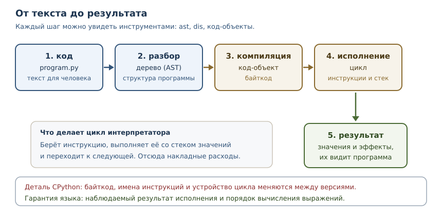
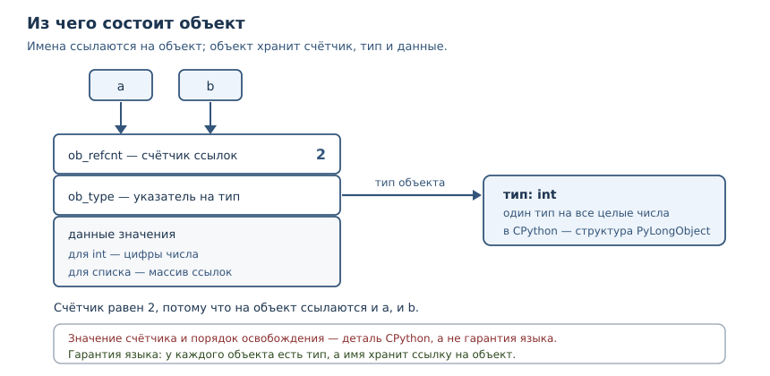

# Внутреннее устройство Python

<!-- syllanix:nav -->
**Навигация:** [← 41. Безопасность приложений](41-security.md) · [Оглавление книги](../README.md) · [Далее: 43. Метапрограммирование и дескрипторы →](43-metaprogramming.md)
<!-- /syllanix:nav -->

<!-- syllanix:topics -->
**Темы главы**
42.1. [Что вы сможете после этой главы](#что-вы-сможете-после-этой-главы)  
42.2. [Гарантия языка и деталь реализации](#guarantees)  
42.3. [От исходного кода к байткоду](#bytecode)  
42.4. [Цикл интерпретатора](#interpreter-loop)  
42.5. [PyObject: из чего состоит объект](#pyobject)  
42.6. [Подсчёт ссылок](#refcounting)  
42.7. [Сборка мусора](#garbage-collection)  
42.8. [Управление памятью](#memory-management)  
42.9. [Кэш малых целых](#small-int-cache)  
42.10. [Типичные ошибки](#mistakes)  
42.11. [Упражнения](#упражнения)  
42.12. [Проверка понимания](#check)  
42.13. [Связи](#links)  
<!-- /syllanix:topics -->


Обычно Python воспринимают как чёрный ящик: пишем текст, запускаем, получаем
результат. Пока всё работает, этого достаточно. Но стоит столкнуться с
утечкой памяти, странным поведением `is` или медленным участком кода, как
полезно заглянуть внутрь. Эта глава открывает коробку: вы увидите, как
программа превращается в байткод, как исполняется, как устроены объекты и
как освобождается память.

Сразу важная оговорка, которая будет повторяться: **Python — это язык, а
CPython — его основная реализация**. Часть того, что мы разберём, описывает
сам язык и верно всегда. Другая часть — детали CPython, которые могут
отличаться в другой реализации и даже в другой версии. Смешивать их —
источник ложных выводов, поэтому мы будем размечать каждое утверждение.

## Что вы сможете после этой главы

- отличать гарантии языка от деталей реализации CPython;
- читать байткод через `dis` и понимать, что он не обещает стабильности;
- объяснять, как устроен объект и почему переменная — это ссылка;
- понимать подсчёт ссылок, циклическую сборку мусора и их ограничения;
- объяснять, почему память не возвращается системе сразу, и что показывает
  `sys.getsizeof`;
- не полагаться на кэш малых целых и другие оптимизации там, где нужна
  переносимость.

## Гарантия языка и деталь реализации {#guarantees}

**Гарантия языка** — поведение, описанное в спецификации и обязательное для
любой реализации Python. **Деталь реализации** — особенность конкретной
реализации, которую можно наблюдать, но нельзя требовать: она меняется между
версиями и не обязана повторяться в PyPy, GraalPy или другой реализации.

| Вопрос | Статус |
|---|---|
| порядок вычисления операндов слева направо | гарантия языка |
| что переменная — ссылка на объект | гарантия языка |
| что память освобождается сразу после удаления последней ссылки | деталь CPython (подсчёт ссылок) |
| что байткод такой, как в этой главе | деталь CPython, меняется между версиями |
| что `int` от −5 до 256 переиспользуются | деталь CPython (кэш малых целых) |
| что `sys.getsizeof` показывает размер памяти | деталь CPython (и только часть правды) |
| что циклы без внешних ссылок будут собраны сборщиком | деталь CPython, время не гарантируется |
| что `__del__` вызовется в известный момент | не гарантируется |

Проверим гарантию порядка вычислений — она пригодится, чтобы отличать её от
оптимизаций.

```python exec
def first():
    print("первый")
    return 1

def second():
    print("второй")
    return 2

print(first() + second())
```

```output
первый
второй
3
```

Операнды вычисляются слева направо, и это свойство языка, а не случайность
CPython: на него можно опираться в любом коде. Дальше пойдут утверждения
слабее: их можно наблюдать в CPython 3.14.4, но переносить на другие условия
нельзя.

## От исходного кода к байткоду {#bytecode}

**Байткод** — внутреннее представление программы в виде последовательности
простых инструкций для виртуальной машины CPython. Исходный текст не
исполняется напрямую: сначала его разбирают, затем компилируют в байткод, и
только потом исполняют.



Блоки в `dis` показывают ровно эти шаги. Начнём с объектов кода: у каждого
код-объекта есть имена, локальные переменные и константы.

```python exec
import dis

def greet(name):
    message = "привет, " + name
    return message

code = greet.__code__
print("имена:", code.co_names)
print("локальные:", code.co_varnames)
print("константы:", code.co_consts)
print("инструкции:", [instruction.opname for instruction in dis.get_instructions(greet)])
```

```output
имена: ()
локальные: ('name', 'message')
константы: ('привет, ',)
инструкции: ['RESUME', 'LOAD_CONST', 'LOAD_FAST_BORROW', 'BINARY_OP', 'STORE_FAST', 'LOAD_FAST_BORROW', 'RETURN_VALUE']
```

Читать последовательность инструкций можно как рецепт для стека. `LOAD_CONST`
кладёт значение на стек, `LOAD_FAST_BORROW` — локальную переменную,
`BINARY_OP` снимает два значения и кладёт результат, `STORE_FAST` сохраняет в
локальную переменную, `RETURN_VALUE` возвращает верхушку стека. Подробности
имён меняются от версии к версии: в Python 3.12 здесь были бы `LOAD_FAST` и
`BINARY_OP` иначе, а в 3.11 — ещё другие. Это и есть деталь реализации.

**Модуль `dis`** — дизассемблер байткода из стандартной библиотеки. Он
показывает инструкции, которые исполнит интерпретатор, и помогает понять, что
на самом деле делает ваш код.

```console
$ python3 -c "import dis; dis.dis('result = 1 + 2')"
  0           RESUME                   0

  1           LOAD_SMALL_INT           3
              STORE_NAME               0 (result)
              LOAD_CONST               1 (None)
              RETURN_VALUE
```

Обратите внимание: сложение `1 + 2` исчезло ещё на этапе компиляции. Компилятор
вычислил константное выражение и оставил только загрузку результата. Такая
оптимизация допустима, потому что на результат она не влияет, — ещё один
пример того, что байткод свободен меняться, пока выполняется обещанное
поведение. Проверить это можно и программно: сравните инструкции для
`x = 2 * 3` и для `x = a * b`.

```python exec
import dis

folded = compile("x = 2 * 3", "<пример>", "exec")
dynamic = compile("x = a * b", "<пример>", "exec")
print("2 * 3:", [instruction.opname for instruction in dis.get_instructions(folded)])
print("a * b:", [instruction.opname for instruction in dis.get_instructions(dynamic)])
```

```output
2 * 3: ['RESUME', 'LOAD_SMALL_INT', 'STORE_NAME', 'LOAD_CONST', 'RETURN_VALUE']
a * b: ['RESUME', 'LOAD_NAME', 'LOAD_NAME', 'BINARY_OP', 'STORE_NAME', 'LOAD_CONST', 'RETURN_VALUE']
```

В первом случае нет ни загрузки двух операндов, ни операции умножения: остался
один загрузчик готового числа. Во втором случае видны `LOAD_NAME` и
`BINARY_OP`: значения известны только во время исполнения.

## Цикл интерпретатора {#interpreter-loop}

**Цикл интерпретатора** — главный цикл CPython, который берёт очередную
инструкцию байткода, выполняет её и переходит к следующей. Он устроен как
большой выбор по коду операции; в исходниках CPython это функция `_PyEval_EvalFrameDefault`
в файле `ceval.c`. Каждая инструкция работает со стеком значений: загружает,
складывает, вызывает, сохраняет.

Стек объясняет, почему байткод выглядит именно так. Для `a + b` нужно сначала
положить на стек `a`, затем `b`, затем выполнить сложение, которое снимет оба
значения и положит результат. Инструкции не знают имён переменных — они знают
индексы в таблице локальных имён, поэтому `co_varnames` и индексы в байткоде
связаны.

### Углубление: адаптивная специализация

Начиная с Python 3.11 цикл интерпретатора адаптивный: горячие инструкции
заменяются специализированными вариантами под конкретные типы данных. Пока
функция не прогрета, `dis` показывает базовые инструкции. После многих вызовов
с одинаковыми типами интерпретатор подставляет вариант, который не проверяет
типы заново, а если предположение нарушается — возвращается к общей версии.

```python exec
import dis

def add(a, b):
    return a + b

for number in range(20_000):
    add(number, number)

print("базовый вариант:", [instruction.opname for instruction in dis.get_instructions(add)])
print("адаптивный вариант:", [instruction.opname for instruction in dis.get_instructions(add, adaptive=True)])
```

```output
базовый вариант: ['RESUME', 'LOAD_FAST_BORROW_LOAD_FAST_BORROW', 'BINARY_OP', 'RETURN_VALUE']
адаптивный вариант: ['RESUME_CHECK', 'LOAD_FAST_BORROW_LOAD_FAST_BORROW', 'BINARY_OP_ADD_INT', 'RETURN_VALUE']
```

В адаптивном варианте `BINARY_OP` стала `BINARY_OP_ADD_INT`, а `RESUME` —
`RESUME_CHECK`: интерпретатор уже знает, что складываются целые числа, и
проверяет это быстрее. Ускорение достигается не изменением языка, а
перестройкой инструкций под наблюдаемое поведение. Имена таких инструкций —
самая изменчивая часть байткода, поэтому в учебных целях их читают, но в коде
на них не опираются.

Из устройства цикла следуют практические выводы. Каждая инструкция — это
небольшая работа интерпретатора, поэтому длинные цепочки простых операций
дороже, чем одна встроенная функция, написанная на C. Именно поэтому встроенные
`sum`, `min`, `sorted` обычно быстрее ручных циклов: работа выполняется в C, без
накладных расходов на каждую инструкцию.

## PyObject: из чего состоит объект {#pyobject}

**PyObject** — базовая структура C, с которой начинается любой объект CPython.
В ней два обязательных поля: счётчик ссылок и указатель на тип. Конкретные
значения — число, строка, список — хранятся в структуре-расширении, которая
начинается с `PyObject`.



Отсюда два следствия, которые важны каждый день.

1. **У каждого объекта есть тип, и он не меняется.** Тип хранится в самом
   объекте, поэтому `type(x)` работает для любого значения и не зависит от
   того, в какой переменной оно лежит. Это гарантия языка, хотя конкретное
   расположение поля — деталь CPython.
2. **Переменная — это имя, связанное со ссылкой на объект**, а не «коробка» со
   значением. Присваивание копирует ссылку, а не объект (глава 18). Именно
   поэтому два имени видят изменения одного списка.

Размер объекта можно посмотреть функцией `sys.getsizeof`. Она возвращает
размер самого объекта в байтах, без объектов, на которые он ссылается.
Конкретные числа — деталь CPython, но соотношения полезны.

```python exec
import sys

print("int 0:", sys.getsizeof(0))
print("float:", sys.getsizeof(1.0))
print("str пустая:", sys.getsizeof(""))
print("str 10 символов:", sys.getsizeof("0123456789"))
print("tuple пустой:", sys.getsizeof(()))
print("list пустой:", sys.getsizeof([]))
print("dict пустой:", sys.getsizeof({}))

data = [0] * 1000
print("list из 1000 элементов:", sys.getsizeof(data))
print("элементы не учтены:", sys.getsizeof(data) < sum(sys.getsizeof(item) for item in data))
```

```output
int 0: 28
float: 24
str пустая: 41
str 10 символов: 51
tuple пустой: 48
list пустой: 56
dict пустой: 64
list из 1000 элементов: 8056
элементы не учтены: True
```

Последняя строка важна: `getsizeof` списка считает только массив ссылок, а не
тысячу объектов, на которые он указывает. Для оценки реального потребления
памяти такой подсчёт нужно дополнять обходом структуры или `tracemalloc`.

## Подсчёт ссылок {#refcounting}

**Подсчёт ссылок** — стратегия управления памятью: каждый объект хранит число
ссылок на себя, и когда оно достигает нуля, память освобождается немедленно.
В CPython это основная стратегия. `sys.getrefcount` показывает текущее число
ссылок; переданный аргумент добавляет одну временную ссылку, поэтому
абсолютное число зависит от контекста. Надёжнее смотреть на изменения.

```python exec
import sys

def demo():
    data = [1, 2, 3]
    base = sys.getrefcount(data)
    alias = data
    print("прибавка ссылок:", sys.getrefcount(data) - base)
    del alias
    print("после del:", sys.getrefcount(data) == base)

demo()
```

```output
прибавка ссылок: 1
после del: True
```

Здесь видны обе стороны механизма: новая ссылка увеличивает счётчик, удаление
имени уменьшает его. Когда счётчик становится нулём, объект освобождается
сразу — это и есть причина, по которой в CPython файл закрывается, как только
на объект не осталось ссылок, без ожидания сборщика.

Но у подсчёта ссылок есть слабое место — циклы. Объект, который ссылается сам
на себя, никогда не получит ноль ссылок, даже если извне на него никто не
указывает. Для таких случаев нужен **сборщик мусора**.

### Углубление: подсчёт ссылок — не гарантия языка

В PyPy и многих других реализациях подсчёта ссылок нет: память освобождает
сборщик мусора, и объект может жить после удаления последней ссылки. Поэтому
код, который полагается на немедленное освобождение (например, на закрытие
файла «само собой»), переносится плохо. Правильный способ освобождать
ресурсы — контекстный менеджер `with` из главы 19, а не надежда на счётчик.

## Сборка мусора {#garbage-collection}

**Сборка мусора** — поиск и освобождение объектов, которые недостижимы из
корней программы, но не освобождены подсчётом ссылок. В CPython сборщик
занимается прежде всего циклами: он находит группы объектов, ссылающихся друг
на друга, и освобождает те, до которых нельзя добраться снаружи.

```python exec
import gc, weakref

class Node:
    def __init__(self, name):
        self.name = name

cyclic = Node("цикл")
cyclic.peer = cyclic
cyclic_ref = weakref.ref(cyclic)
del cyclic
print("циклический жив после del:", cyclic_ref() is not None)
gc.collect()
print("после gc.collect:", cyclic_ref() is not None)

plain = Node("обычный")
plain_ref = weakref.ref(plain)
del plain
print("обычный жив после del:", plain_ref() is not None)
```

```output
циклический жив после del: True
после gc.collect: False
обычный жив после del: False
```

Разница наглядна. Обычный объект освободился сразу: счётчик ссылок дошёл до
нуля. Циклический остался жить, потому что ссылка внутри самого цикла
поддерживает счётчик, и только явный вызов сборщика освободил его.
`weakref` здесь — слабая ссылка, которая не увеличивает счётчик и позволяет
проверить, жив ли объект.

Сборщик в CPython поколенческий: объекты переживают несколько проходов, и
молодые проверяются чаще. Порог срабатывания настраивается и по умолчанию в
CPython 3.14 равен `(2000, 10, 0)` — это деталь реализации, её не нужно
запоминать как свойство языка. Время сборки тоже не гарантируется: объект
может быть освобождён при следующем проходе, а может — только при явном
`gc.collect()`.

## Управление памятью {#memory-management}

**Управление памятью** — то, как интерпретатор выделяет память под объекты и
возвращает её. В CPython есть собственный распределитель для мелких объектов:
память берётся у системы крупными блоками (аренами) и нарезается на мелкие
куски. Благодаря этому создание множества небольших объектов дешевле, чем
обращение к системе за каждым из них.

Практические следствия:

1. **Освобождённая память не всегда возвращается системе.** Она остаётся в
   аренах и переиспользуется. Поэтому «процесс занимает много памяти» не
   обязательно означает утечку: он мог один раз обработать большой объём
   данных и сохранить арены.
2. **Пик памяти важнее среднего.** Если программа на пике держит в памяти
   большой список, а потом освобождает, процесс может остаться большим.
3. **Утечки бывают логическими.** Объект остаётся достижимым через глобальный
   кэш или список — сборщик его не тронет, потому что формально он нужен.

Для наблюдения за памятью полезна функция `tracemalloc`: она записывает
выделения и показывает текущий и пиковый объём.

```python exec
import tracemalloc

tracemalloc.start()
data = [bytes(1000) for _ in range(10)]
current, peak = tracemalloc.get_traced_memory()
print("текущий размер больше нуля:", current > 0)
print("пик не меньше текущего:", peak >= current)
tracemalloc.stop()
```

```output
текущий размер больше нуля: True
пик не меньше текущего: True
```

## Кэш малых целых {#small-int-cache}

**Кэш малых целых** — оптимизация CPython: объекты `int` в диапазоне от −5 до
256 создаются заранее и переиспользуются. Поэтому два независимо полученных
числа из этого диапазона могут оказаться одним и тем же объектом.

```python exec
a = int("256")
b = int("256")
print("256:", a is b)
c = int("257")
d = int("257")
print("257:", c is d)
print("граница снизу:", int("-5") is int("-5"))
print("за границей снизу:", int("-6") is int("-6"))
```

```output
256: True
257: False
граница снизу: True
за границей снизу: False
```

Это деталь CPython, а не гарантия языка. Использовать `is` для сравнения чисел
нельзя: результат зависит от реализации и версии. Для значений есть `==`,
для проверки одного и того же объекта — `is`, и эти операторы отвечают на
разные вопросы (глава 3). Кэш существует ради скорости: небольшие числа
встречаются в программах постоянно, и переиспользование экономит выделения.

### Углубление: почему `is` иногда «работает»

В интерактивной сессии `a = 1000; b = 1000; a is b` может дать `True`, потому
что компилятор сложил одинаковые константы в один объект в код-объекте. Это
тоже следствие конкретной реализации конкретной версии. Правило остаётся
одним: `is` проверяет идентичность объектов, а не равенство значений, и
опираться на него для чисел, строк и кортежей нельзя.

## Типичные ошибки {#mistakes}

1. **Полагаться на `is` для значений.** Кэш малых целых и интернирование строк
   делают результат непредсказуемым между версиями.
2. **Ждать немедленного освобождения памяти.** В другой реализации объект
   живёт дольше; освобождайте ресурсы через `with` и `finally`.
3. **Считать `sys.getsizeof` полным размером структуры.** Он не учитывает
   объекты, на которые ссылается контейнер.
4. **Принимать «процесс занимает много памяти» за утечку.** Арены остаются
   выделенными; измеряйте `tracemalloc` и пики.
5. **Верить, что байткод стабилен.** Он меняется между версиями; код,
   зависящий от конкретных инструкций, ломается при обновлении Python.
6. **Держать большие данные в глобальном кэше.** Сборщик не освободит то, что
   достижимо; кэш без ограничения размера — это утечка.
7. **Считать сборку мусора гарантией времени.** Момент освобождения цикла не
   определён; не полагайтесь на него в логике.

## Упражнения

### 1. Гарантия или деталь {#ex-ch42-01}

Для каждого утверждения укажите, гарантия это языка или деталь CPython:
«операнды вычисляются слева направо», «удаление последней ссылки освобождает
память немедленно», «`int` от −5 до 256 переиспользуются», «переменная хранит
ссылку на объект», «байткод состоит из инструкций `LOAD_FAST`». Объясните
каждое решение.

### 2. Чтение байткода {#ex-ch42-02}

Скомпилируйте функцию, которая возвращает `a + b`, и выведите список имён
инструкций через `dis.get_instructions`. Объясните, что делает каждая
инструкция со стеком. Сравните с функцией, которая вызывает `print(a + b)`.

### 3. Константные выражения {#ex-ch42-03}

Сравните инструкции для `x = 2 * 3` и `x = a * b`. Почему в первом случае нет
умножения? Что это говорит о свободе реализации менять байткод?

### 4. Размер объекта {#ex-ch42-04}

Напишите функцию, которая печатает `sys.getsizeof` для пустых `int`, `str`,
`list`, `dict` и для списка из 1000 нулей. Объясните, почему размер списка из
1000 элементов не равен тысяче размеров элемента.

### 5. Подсчёт ссылок {#ex-ch42-05}

Создайте список, измерьте число ссылок через `sys.getrefcount`, добавьте
второе имя и измерьте снова. Объясните разницу значений. Почему абсолютное
число зависит от контекста вызова?

### 6. Цикл и сборщик {#ex-ch42-06}

Создайте класс, экземпляр которого ссылается сам на себя. С помощью `weakref`
проверьте, что после `del` объект остаётся живым, а после `gc.collect()`
освобождается. Объясните, почему подсчёт ссылок не справился.

### 7. Кэш малых целых {#ex-ch42-07}

Проверьте через `is`, переиспользуются ли числа 256 и 257, полученные как
`int("256")` и `int("257")`. Объясните результат и сформулируйте правило,
когда `is` уместен.

### 8. Наблюдение за памятью {#ex-ch42-08}

Запустите `tracemalloc`, создайте список из 100 объектов `bytes(1000)`,
выведите текущий и пиковый объём. Объясните, почему текущий объём меньше
пикового или равен ему, и почему после `tracemalloc.stop()` измерения
прекращаются.

### 9. Утечка через кэш {#ex-ch42-09}

Функция складывает результаты в глобальный словарь и никогда их не удаляет.
Объясните, почему сборщик мусора не решит проблему, и предложите два
ограничения: по размеру кэша и по времени жизни записей.

### 10. Мини-задача: отчёт о памяти {#ex-ch42-10}

Напишите функцию `memory_report(objects)`, которая для каждого объекта
выводит его тип и `sys.getsizeof`, а затем общий размер контейнера и сумму
размеров элементов. Объясните расхождение между этими числами на примере
списка строк.

## Проверка понимания {#check}

1. Чем гарантия языка отличается от детали реализации? Приведите два примера
   каждого.
2. Зачем нужен байткод, если есть исходный код?
3. Что делает цикл интерпретатора и почему встроенные функции часто быстрее
   циклов на Python?
4. Из каких полей начинается любой объект CPython и что это объясняет?
5. Почему подсчёт ссылок не освобождает циклические структуры?
6. Что делает сборщик мусора и почему время сборки не гарантируется?
7. Почему `sys.getsizeof` списка не равен сумме размеров его элементов?
8. Почему `is` нельзя использовать для сравнения чисел?

## Связи {#links}

Глава опирается на объектную модель из глав 3 и 18: переменная — ссылка,
объект — значение с типом. Модель данных из главы 28 объясняет, как тип
объекта влияет на операции. Контекстные менеджеры из главы 19 — правильный
способ освобождать ресурсы вместо надежды на подсчёт ссылок.

Дальше — [метапрограммирование и дескрипторы](43-metaprogramming.md): зная,
как устроен поиск атрибутов и объекты, можно понять, зачем классам нужны
дескрипторы и метаклассы.

<!-- syllanix:nav -->
**Перед этой главой:** [41. Безопасность приложений](41-security.md)
**Связанные главы:** [01. Зачем Python и как устроена эта книга](01-introduction.md), [03. Значения, имена, объекты и типы](03-values-names-objects.md), [09. Модули, пакеты и импорты](09-modules.md), [10. Ошибки и исключения](10-errors-exceptions.md), [16. Множества и хеширование](16-sets.md), [21. Генераторы и ленивые вычисления](21-generators.md)
**Далее:** [43. Метапрограммирование и дескрипторы →](43-metaprogramming.md)
<!-- /syllanix:nav -->
