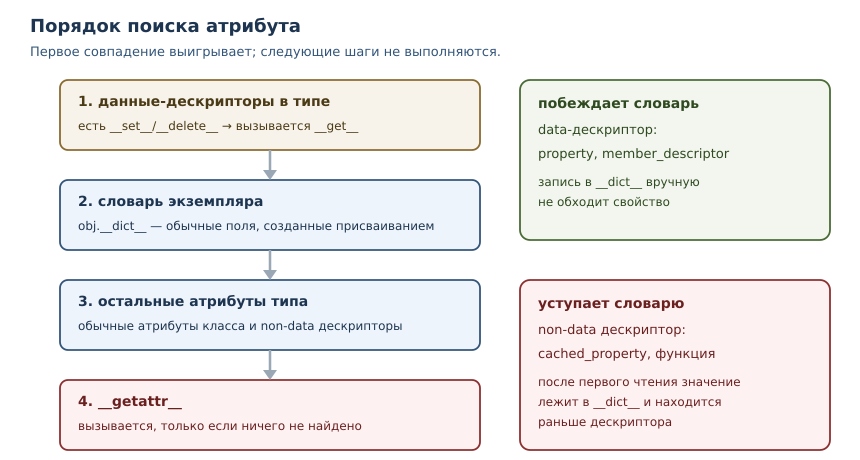
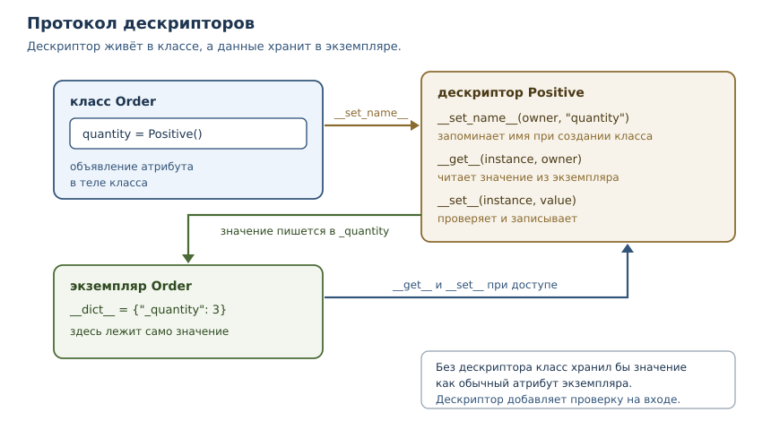

# Метапрограммирование и дескрипторы

<!-- syllanix:nav -->
**Навигация:** [← 42. Внутреннее устройство Python](42-internals.md) · [Оглавление книги](../README.md) · [Далее: 44. Архитектура, SOLID и паттерны →](44-architecture.md)
<!-- /syllanix:nav -->

<!-- syllanix:topics -->
**Темы главы**
43.1. [Что вы сможете после этой главы](#что-вы-сможете-после-этой-главы)  
43.2. [Что такое метапрограммирование](#what-is)  
43.3. [Интроспекция](#introspection)  
43.4. [Поиск атрибута](#attribute-lookup)  
43.5. [Дескрипторы](#descriptors)  
43.6. [Динамические атрибуты](#dynamic-attributes)  
43.7. [Метаклассы](#metaclasses)  
43.8. [Декораторы классов](#class-decorators)  
43.9. [Когда это оправдано](#when-justified)  
43.10. [Как тестировать метапрограммирование](#testing)  
43.11. [Типичные ошибки](#mistakes)  
43.12. [Упражнения](#упражнения)  
43.13. [Проверка понимания](#check)  
43.14. [Связи](#links)  
<!-- /syllanix:topics -->


Вы уже видели, как Python управляет атрибутами: `property` превращает метод в
поле, декоратор оборачивает функцию, `dataclass` сам пишет `__init__`. Всё это
работает благодаря механизмам, которые находятся ниже обычного кода: поиску
атрибутов, дескрипторам и метаклассам. В этой главе мы разберём их устройство,
чтобы перестать воспринимать такие инструменты как магию — и чтобы понимать,
когда применять их самим, а когда это лишняя сложность.

## Что вы сможете после этой главы

- объяснять порядок поиска атрибута и предсказывать, какое значение получится;
- писать собственные дескрипторы для проверки и вычисляемых полей;
- отличать `__getattr__` от `__getattribute__` и безопасно применять оба;
- создавать метаклассы и понимать, когда достаточно `__init_subclass__`;
- оценивать цену метапрограммирования и выбирать самый простой механизм,
  который решает задачу.

## Что такое метапрограммирование {#what-is}

**Метапрограммирование** — приём, при котором программа работает не только с
данными, но и со своей структурой: читает классы и функции, изменяет их,
создаёт новые во время исполнения. В Python для этого есть несколько уровней,
и их полезно различать по силе и цене.

| Уровень | Инструменты | Что меняет |
|---|---|---|
| интроспекция | `getattr`, `vars`, `__dict__`, `inspect` | читает структуру, ничего не меняя |
| динамические атрибуты | `__getattr__`, `__setattr__` | меняет доступ к атрибутам объекта |
| дескрипторы | `__get__`, `__set__`, `__set_name__` | управляет одним атрибутом класса |
| декораторы классов | функция над классом | меняет класс после создания |
| метаклассы | `type`, `metaclass=` | меняет сам процесс создания класса |

Чем ниже уровень в таблице, тем мощнее механизм и тем труднее читать код.
Правило простое: выбирайте верхний уровень, который решает задачу.
Интроспекция почти ничего не стоит, метакласс же делает поведение класса
неочевидным для читателя и для инструментов вроде `mypy`.

## Интроспекция {#introspection}

Самый простой уровень метапрограммирования ничего не меняет: программа читает
свою структуру и принимает решения по ней. Это нужно отладчикам,
сериализации, документации и тестам.

```python exec
import inspect

def area(width, height, unit="см"):
    """Площадь прямоугольника."""
    return width * height

signature = inspect.signature(area)
print("параметры:", list(signature.parameters))
print("значение по умолчанию:", signature.parameters["unit"].default)
print("документация:", area.__doc__)

class Point:
    def __init__(self, x, y):
        self.x = x
        self.y = y

point = Point(1, 2)
print("поля экземпляра:", sorted(vars(point)))
print("getattr по имени:", getattr(point, "x"))
```

```output
параметры: ['width', 'height', 'unit']
значение по умолчанию: см
документация: Площадь прямоугольника.
поля экземпляра: ['x', 'y']
getattr по имени: 1
```

`inspect.signature` описывает параметры функции, `vars` показывает словарь
объекта, `getattr` читает атрибут по имени из строки. Всё это работает без
изменения кода и не создаёт скрытой логики: читатель видит обычные вызовы
функций. Именно поэтому интроспекция — предпочтительный способ, если задача
сводится к «узнать и решить».

## Поиск атрибута {#attribute-lookup}

Прежде чем говорить о дескрипторах, нужно понять, что происходит при обращении
`subject.value`. Python не просто ищет ключ в словаре. Порядок такой.

1. **Данные-дескрипторы в типе.** Просматривается `type(subject).__mro__`
   (порядок разрешения методов из главы 27). Если в одном из классов найден
   дескриптор с методом `__set__` или `__delete__`, вызывается его `__get__`.
2. **Словарь экземпляра.** Если в `subject.__dict__` есть ключ, возвращается
   его значение.
3. **Остальные атрибуты типа.** Если в типе найден обычный атрибут или
   дескриптор без `__set__`, он используется; для дескриптора вызывается
   `__get__`.
4. **`__getattr__`.** Если ничего не найдено и у класса определён
   `__getattr__`, вызывается он.



Проверим ключевое различие: дескриптор с `__set__` побеждает словарь
экземпляра, а дескриптор без `__set__` — нет.

```python exec
class DataDescriptor:
    def __get__(self, instance, owner=None):
        return "значение из data-дескриптора"
    def __set__(self, instance, value):
        print("__set__ вызван, значение отброшено")

class NonDataDescriptor:
    def __get__(self, instance, owner=None):
        return "значение из non-data дескриптора"

class Subject:
    data = DataDescriptor()
    nondata = NonDataDescriptor()

subject = Subject()
subject.__dict__["data"] = "значение в словаре экземпляра"
subject.__dict__["nondata"] = "значение в словаре экземпляра"
print("data:", subject.data)
print("nondata:", subject.nondata)
```

```output
data: значение из data-дескриптора
nondata: значение в словаре экземпляра
```

Вот почему `property` (глава 26) всегда управляет доступом: у него есть
`__set__`, то есть он data-дескриптор. Прямая запись в `__dict__` не обходит
свойство.

```python exec
class Item:
    def __init__(self):
        self.__dict__["price"] = 999
    @property
    def price(self):
        return 100

item = Item()
print("property победил:", item.price)
print("в словаре экземпляра:", item.__dict__["price"])
```

```output
property победил: 100
в словаре экземпляра: 999
```

## Дескрипторы {#descriptors}

**Дескриптор** — объект, который управляет доступом к атрибуту другого
объекта: он объявлен в классе и реализует методы протокола дескрипторов.
**Протокол дескрипторов** — набор методов, которые Python вызывает при
доступе к атрибуту:

| Метод | Когда вызывается | Обязателен |
|---|---|---|
| `__get__(self, instance, owner)` | при чтении атрибута | да, иначе это не дескриптор |
| `__set__(self, instance, value)` | при присваивании | нет |
| `__delete__(self, instance)` | при `del` | нет |
| `__set_name__(self, owner, name)` | при создании класса | нет |

Дескриптор с `__set__` или `__delete__` называют **data-дескриптором**
(дескриптор данных), без них — **non-data дескриптором**. Это различие и
определяет место в порядке поиска.

Простейший полезный дескриптор — проверяющее поле. Он хранит значение в
отдельном атрибуте экземпляра и не пропускает недопустимые значения.

```python exec
class Positive:
    def __set_name__(self, owner, name):
        self.name = f"_{name}"

    def __get__(self, instance, owner=None):
        if instance is None:
            return self
        return getattr(instance, self.name)

    def __set__(self, instance, value):
        if value <= 0:
            raise ValueError("значение должно быть положительным")
        setattr(instance, self.name, value)

class Order:
    quantity = Positive()

    def __init__(self, quantity):
        self.quantity = quantity

order = Order(3)
print("количество:", order.quantity)
print("поле в словаре:", order.__dict__)

try:
    order.quantity = 0
except ValueError as error:
    print("ValueError:", error)
```

```output
количество: 3
поле в словаре: {'_quantity': 3}
ValueError: значение должно быть положительным
```

Разберём, что происходит. При создании класса Python вызывает
`__set_name__` и передаёт дескриптору имя атрибута. `__set__` проверяет
значение и кладёт его в `_quantity`. `__get__` читает оттуда же. Когда
`instance is None`, обращение идёт через класс (`Order.quantity`), и
дескриптор возвращает сам себя — так работают и `property`, и методы.



**Функция — тоже дескриптор.** Поэтому `Greeter.hello` — функция, а
`greeter.hello` — связанный метод: `__get__` функции возвращает метод,
который помнит экземпляр.

```python exec
class Greeter:
    def hello(self):
        return "привет"

greeter = Greeter()
print("атрибут класса:", type(Greeter.hello).__name__)
print("атрибут экземпляра:", type(greeter.hello).__name__)
print("вызов:", greeter.hello())
```

```output
атрибут класса: function
атрибут экземпляра: method
вызов: привет
```

### Углубление: порядок записи

Присваивание устроено зеркально чтению, но с одной оговоркой: сначала всегда
вызывается `__setattr__` объекта, а уже внутри него — `__set__` подходящего
дескриптора. Поэтому переопределённый `__setattr__` видит все записи, включая
те, которые затем обработает дескриптор.

```python exec
class Checked:
    def __set__(self, instance, value):
        print("__set__ дескриптора")
        instance.__dict__["checked"] = value

class Thing:
    checked = Checked()

    def __setattr__(self, name, value):
        print("__setattr__:", name)
        super().__setattr__(name, value)

thing = Thing()
thing.checked = 5
print("значение:", thing.__dict__["checked"])
```

```output
__setattr__: checked
__set__ дескриптора
значение: 5
```

Отсюда практическое правило: для проверки значений используйте дескриптор или
`property`, а `__setattr__` оставьте для задач, где нужно видеть все записи
сразу, — например, для аудита изменений. Переопределять `__setattr__` ради
валидации одного поля не стоит: он замедляет все присваивания и легко
превращается в источник рекурсии.

### Углубление: дескрипторы в стандартной библиотеке

Многие привычные инструменты — дескрипторы. `functools.cached_property` —
non-data дескриптор: при первом чтении он вычисляет значение и кладёт его в
словарь экземпляра. Дальше обычный поиск находит значение в `__dict__` раньше
дескриптора, и вычисление не повторяется.

```python exec
from functools import cached_property

class Box:
    def __init__(self, width, height):
        self.width = width
        self.height = height

    @cached_property
    def area(self):
        print("вычисляем площадь")
        return self.width * self.height

box = Box(3, 4)
print("первое чтение:", box.area)
print("второе чтение:", box.area)
print("тип атрибута класса:", type(Box.area).__name__)
```

```output
вычисляем площадь
первое чтение: 12
второе чтение: 12
тип атрибута класса: cached_property
```

Ещё пример — `__slots__`. Для каждого имени в `__slots__` класс получает
дескриптор-хранилище: он умеет читать и писать значение в заранее выделенном
месте, а словаря экземпляра при этом нет. Поэтому лишние атрибуты не
принимаются, а память экономится.

```python exec
class Slotted:
    __slots__ = ("value",)

print("тип слота в классе:", type(Slotted.value).__name__)
slotted = Slotted()
slotted.value = 1
print("значение:", slotted.value)
try:
    slotted.extra = 2
except AttributeError:
    print("лишний атрибут отклонён:", True)
```

```output
тип слота в классе: member_descriptor
значение: 1
лишний атрибут отклонён: True
```

Дескрипторы оправданы, когда одно и то же поведение нужно многим атрибутам
многих классов: проверка диапазона, ленивое вычисление, кэширование,
преобразование единиц. Для одного поля достаточно `property`.

## Динамические атрибуты {#dynamic-attributes}

**Динамический атрибут** — атрибут, который не хранится в объекте, а
вычисляется или подставляется в момент обращения. Для этого есть два метода,
и путать их опасно.

- `__getattr__(self, name)` вызывается, **только когда обычный поиск не
  нашёл атрибут**. Это безопасная точка расширения.
- `__getattribute__(self, name)` вызывается **при любом обращении** и
  заменяет весь механизм поиска. Ошибка в нём ломает объект целиком, включая
  доступ к собственным полям.

Типичное применение `__getattr__` — настройки с доступом через точку.

```python exec
class Settings:
    def __init__(self, values):
        self._values = values

    def __getattr__(self, name):
        if name.startswith("_"):
            raise AttributeError(name)
        try:
            return self._values[name]
        except KeyError:
            raise AttributeError(f"нет настройки {name!r}") from None

settings = Settings({"timeout": 30})
print("timeout:", settings.timeout)
print("значение по умолчанию:", getattr(settings, "retries", 3))
try:
    settings.unknown
except AttributeError as error:
    print("AttributeError:", error)
```

```output
timeout: 30
значение по умолчанию: 3
AttributeError: нет настройки 'unknown'
```

Три правила безопасного `__getattr__`. Первое: всегда поднимайте
`AttributeError` для неизвестного имени, иначе сломаются `hasattr`,
`getattr` с умолчанием и проверки в библиотеках. Второе: не обращайтесь
внутри к атрибутам, которых может не быть, — иначе получите бесконечную
рекурсию. Третье: не подменяйте опечатки — `settings.timout` должен падать,
а не возвращать `None`.

### Углубление: когда `__getattr__` вредит

Если `__getattr__` возвращает значение для любого имени, объект перестаёт
сообщать об ошибках: опечатка в имени метода превращается в вызов «чего-то».
Отладка становится дорогой, а статическая проверка типов вообще не видит таких
атрибутов. Поэтому динамические атрибуты применяют для узкого и понятного
набора имён, а не как универсальный заменитель полей.

## Метаклассы {#metaclasses}

**Метакласс** — класс, экземплярами которого являются классы. У обычного
класса метакласс — `type`: `type(Order)` возвращает `type`. Если нужно
вмешаться в создание класса, объявляют свой метакласс и указывают его в
`metaclass=`.

Типичная задача — реестр подклассов: классы регистрируются автоматически, и
никто не забывает добавить запись вручную.

```python exec
class Registry(type):
    def __new__(mcs, name, bases, namespace):
        cls = super().__new__(mcs, name, bases, namespace)
        if name != "Plugin":
            Registry.plugins[name] = cls
        return cls

    plugins = {}

class Plugin(metaclass=Registry):
    pass

class JsonPlugin(Plugin):
    pass

class CsvPlugin(Plugin):
    pass

print("метакласс Plugin:", type(Plugin).__name__)
print("зарегистрированы:", sorted(Registry.plugins))
```

```output
метакласс Plugin: Registry
зарегистрированы: ['CsvPlugin', 'JsonPlugin']
```

`__new__` метакласса получает имя, базовые классы и пространство имён и
возвращает готовый класс. Здесь же можно добавить методы, проверить
инварианты, переименовать атрибуты.

Однако для регистрации подклассов метакласс не обязателен: то же самое делает
`__init_subclass__`, и он проще.

```python exec
class Plugin:
    registry = {}

    def __init_subclass__(cls, **kwargs):
        super().__init_subclass__(**kwargs)
        Plugin.registry[cls.__name__] = cls

class JsonPlugin(Plugin):
    pass

class CsvPlugin(Plugin):
    pass

print("зарегистрированы:", sorted(Plugin.registry))
```

```output
зарегистрированы: ['CsvPlugin', 'JsonPlugin']
```

Правило выбора: если задача решается через `__init_subclass__`, декоратор
класса или `property`, метакласс не нужен. Метаклассы оправданы в библиотеках
и фреймворках, где поведение задаётся для целого семейства классов, а
пользователь не должен ничего писать вручную. Ещё одна причина избегать
метаклассов — конфликты: у класса может быть только один метакласс, и
наследование от двух классов с разными метаклассами приводит к `TypeError`.

### Углубление: классы, созданные во время исполнения

Метакласс — не единственный способ создать класс в runtime. `type` с тремя
аргументами создаёт класс из имени, базовых классов и словаря атрибутов.
Этим пользуются фабрики моделей, ORM и генераторы кода.

```python exec
def make_model(name, fields):
    namespace = {"__annotations__": {field: str for field in fields}}
    for field in fields:
        namespace[field] = None
    return type(name, (), namespace)

Record = make_model("Record", ["title", "author"])
record = Record()
record.title = "Python"
print("имя класса:", Record.__name__)
print("поля:", sorted(Record.__annotations__))
print("значение:", record.title)
print("экземпляр своего класса:", isinstance(record, Record))
```

```output
имя класса: Record
поля: ['author', 'title']
значение: Python
экземпляр своего класса: True
```

Такой класс ничем не отличается от объявленного через `class`: `class Record: ...`
компилируется в те же шаги — собрать пространство имён и вызвать метакласс.
Разница в читаемости: объявление в коде видно сразу, а создание в runtime
нужно проследить. Поэтому динамические классы применяют там, где набор полей
известен только при запуске, — например, по описанию из конфигурации.

## Декораторы классов {#class-decorators}

**Декоратор класса** — функция, которая получает класс и возвращает класс
(или другой объект). Это тот же приём, что и декораторы функций из главы 22,
но применённый к классу.

```python exec
def add_repr(cls):
    def __repr__(self):
        fields = ", ".join(f"{name}={value!r}" for name, value in vars(self).items())
        return f"{type(self).__name__}({fields})"
    cls.__repr__ = __repr__
    return cls

@add_repr
class Point:
    def __init__(self, x, y):
        self.x = x
        self.y = y

print(Point(1, 2))
```

```output
Point(x=1, y=2)
```

Декоратор класса — компромисс между явным кодом и метаклассом: он виден в
объявлении класса, применяется к одному классу и не влияет на наследников
автоматически. Для большинства задач этого достаточно. Недостаток тот же, что
у любого метапрограммирования: читатель должен знать, что декоратор делает,
поэтому имя должно быть говорящим, а поведение — документированным.

## Когда это оправдано {#when-justified}

Метапрограммирование стоит применять, когда выполняются все три условия.

1. **Повторение реально.** Один и тот же код нужен многим классам или
   атрибутам, и копирование уже стало источником ошибок.
2. **Поведение декларативно.** Пользователь механизма описывает *что*, а не
   *как*: `quantity = Positive()` читается лучше, чем ручная проверка в
   `__init__` каждого класса.
3. **Цена чтения оправдана.** Механизм документирован, протестирован и не
   скрывает ошибки: опечатки падают, типы проверяются, отладка возможна.

Проверочный список перед тем, как писать дескриптор или метакласс:

- сколько мест придётся изменить без механизма — одно, три или тридцать;
- сможет ли новый читатель понять класс, не открывая реализацию механизма;
- видит ли `mypy` атрибуты, которые создаёт механизм;
- что произойдёт с ошибкой: упадёт она с понятным сообщением или превратится
  в тихое значение `None`;
- есть ли более простой инструмент — `property`, `dataclass`, декоратор.

Если хотя бы одно условие не выполняется, лучше явный код. Явный код длиннее,
но его понимает каждый, кто открыл файл, и его видит `mypy`. Метапрограммирование
пишут один раз, а читают много раз.

## Как тестировать метапрограммирование {#testing}

Механизм, который меняет поведение классов, нужно проверять отдельно от
бизнес-логики. Минимальный набор тестов выглядит так.

1. **Успешный сценарий.** Атрибут читается и пишется, значение сохраняется.
2. **Отказ.** Недопустимое значение поднимает ожидаемое исключение, а не
   проходит молча.
3. **Наследование.** Подкласс ведёт себя так же; `__set_name__` получает
   правильные имена.
4. **Границы.** `None`, пустые значения, `bool` вместо `int` — всё, что легко
   перепутать.
5. **Читаемость.** Тот, кто открывает класс, должен видеть объявление поля и
   понимать, откуда берётся поведение. Если для этого нужно читать метакласс,
   механизм, вероятно, слишком сложен.

Тесты на дескриптор пишут как на обычный компонент: создают класс-носитель и
проверяют доступ к атрибуту. Это ещё один довод в пользу дескрипторов и
декораторов классов: их можно тестировать изолированно, а метакласс затрагивает
всю иерархию.

## Типичные ошибки {#mistakes}

1. **`__getattr__` не поднимает `AttributeError`.** Ломаются `hasattr`,
   `getattr` с умолчанием и проверки библиотек; опечатки перестают быть
   ошибками.
2. **Бесконечная рекурсия в `__getattr__`.** Внутри метода нельзя обращаться к
   отсутствующим атрибутам: используйте `object.__getattribute__` или поля,
   которые точно есть.
3. **Переопределение `__getattribute__` без необходимости.** Это самый
   рискованный метод: он вызывается для всех обращений, включая служебные.
4. **Дескриптор без `__set__` и ожидание, что он победит словарь экземпляра.**
   Non-data дескриптор уступает значению в `__dict__`; для контроля нужен
   data-дескриптор.
5. **Метакласс там, где хватает `__init_subclass__`.** Лишний уровень магии
   усложняет чтение и ломает композицию с другими метаклассами.
6. **Один метакласс на иерархию «на всякий случай».** Конфликт метаклассов
   проявляется при наследовании и лечится только переписыванием иерархии.
7. **`exec` и `eval` вместо механизмов языка.** Динамический код трудно
   проверять, отлаживать и защищать; почти всегда есть явная альтернатива.

## Упражнения

### 1. Порядок поиска {#ex-ch43-01}

Дан класс с `property` для `price` и запись `instance.__dict__["price"] = 999`.
Что вернёт `instance.price` и почему? А если заменить `property` на объект с
одним методом `__get__`? Объясните через порядок поиска атрибута.

### 2. Проверяющий дескриптор {#ex-ch43-02}

Напишите дескриптор `Bounded(min_value, max_value)`, который проверяет
диапазон при записи и хранит значение в закрытом атрибуте экземпляра.
Используйте его в классе `Sensor` для поля `temperature` с диапазоном от −50
до 150. Проверьте допустимое и недопустимое значения.

### 3. `__set_name__` {#ex-ch43-03}

Дескриптор `Field` должен сохранять имя атрибута, чтобы найти место хранения.
Реализуйте его и объясните, когда именно вызывается `__set_name__` и что
произойдёт, если назначить дескриптор после создания класса.

### 4. `__getattr__` или `__getattribute__` {#ex-ch43-04}

Класс конфигурации должен подставлять значения по умолчанию для отсутствующих
ключей. Какой из двух методов выбрать и почему? Покажите, что выбранный
вариант не мешает доступу к обычным полям.

### 5. Опечатка в динамическом атрибуте {#ex-ch43-05}

Объект с `__getattr__` возвращает `None` для любого имени. Приведите два
примера, как это скрывает ошибку, и перепишите `__getattr__` так, чтобы
опечатки падали с `AttributeError`.

### 6. Реестр подклассов {#ex-ch43-06}

Реализуйте реестр плагинов двумя способами: через `__init_subclass__` и через
метакласс. Сравните объём кода и читаемость. В каком случае метакласс даёт
что-то, чего не даёт `__init_subclass__`?

### 7. Декоратор класса {#ex-ch43-07}

Напишите декоратор `with_slots`, который добавляет классу атрибут `__slots__`
по списку полей, переданному в декоратор с аргументами. Проверьте, что
экземпляр не принимает лишних атрибутов.

### 8. Метод как дескриптор {#ex-ch43-08}

Объясните, почему `Greeter.hello` — функция, а `greeter.hello` — метод.
Что делает `__get__` функции и как связанный метод получает экземпляр?
Подтвердите выводом типов.

### 9. Кэширующий дескриптор {#ex-ch43-09}

Напишите non-data дескриптор `Lazy`, который при первом чтении вычисляет
значение функцией и запоминает его в словаре экземпляра. Почему здесь нужен
именно non-data дескриптор и что произойдёт, если добавить `__set__`?

### 10. Мини-задача: поля с валидацией {#ex-ch43-10}

Реализуйте дескриптор `Validated(checker)`, который принимает функцию-проверку
и поднимает `ValueError` при её провале. Соберите класс `User` с полями
`name` (непустая строка) и `age` (целое от 0 до 130). Проверьте, что оба поля
валидируются, а сообщение содержит имя поля.

## Проверка понимания {#check}

1. Перечислите шаги поиска атрибута при обращении `obj.name`.
2. Чем data-дескриптор отличается от non-data и почему это различие важно?
3. Зачем дескриптору метод `__set_name__`?
4. Почему `property` побеждает значение в `__dict__` экземпляра?
5. Чем `__getattr__` отличается от `__getattribute__` и какой из них безопаснее?
6. Что такое метакласс и почему `type(Order)` — это `type`?
7. Когда `__init_subclass__` предпочтительнее метакласса?
8. Почему метапрограммирование ухудшает читаемость и как это компенсировать?

## Связи {#links}

Глава опирается на модель данных из главы 28: dunder-методы и то, как Python
вызывает их при обращении к объекту. Наследование и порядок разрешения методов
из главы 27 объясняют, в каком порядке просматривается тип. `property` из
главы 26 — частный случай дескриптора, а декораторы функций из главы 22 —
предшественники декораторов классов. Понимание объектов из главы 42 объясняет,
почему атрибуты ищутся в двух местах: в экземпляре и в типе.

Дальше — [архитектура, SOLID и паттерны](44-architecture.md): метапрограммирование
полезно для инфраструктуры, а архитектура помогает решить, где эта
инфраструктура уместна.

<!-- syllanix:nav -->
**Перед этой главой:** [42. Внутреннее устройство Python](42-internals.md)
**Связанные главы:** [03. Значения, имена, объекты и типы](03-values-names-objects.md), [22. Функции как объекты: замыкания и декораторы](22-higher-order.md), [25. Объекты и классы](25-objects-classes.md), [26. Атрибуты, свойства и инкапсуляция](26-encapsulation.md), [27. Наследование, полиморфизм и композиция](27-inheritance.md), [28. Модель данных: dunder-методы](28-dunder.md)
**Далее:** [44. Архитектура, SOLID и паттерны →](44-architecture.md)
<!-- /syllanix:nav -->
