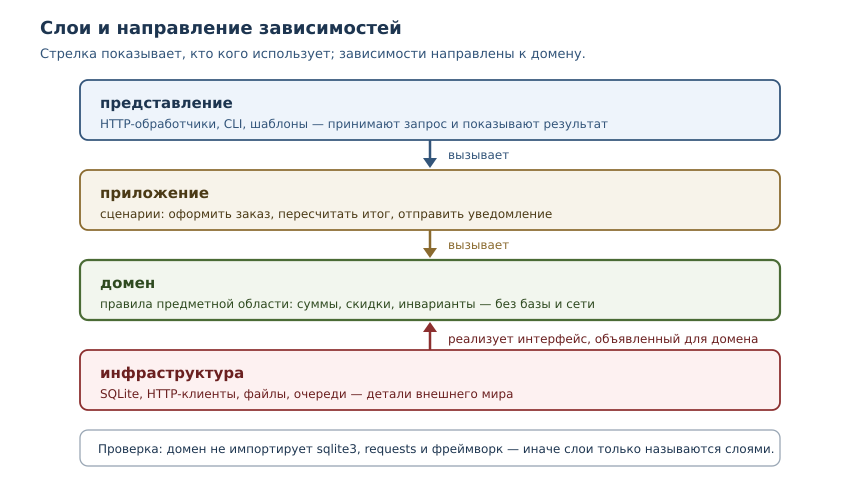
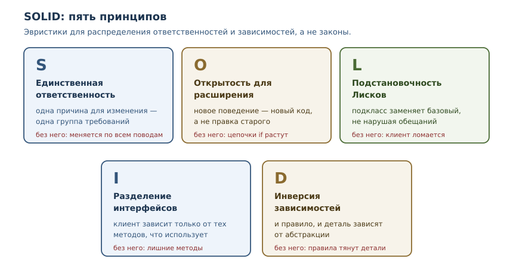

# Архитектура, SOLID и паттерны

<!-- syllanix:nav -->
**Навигация:** [← 43. Метапрограммирование и дескрипторы](43-metaprogramming.md) · [Оглавление книги](../README.md) · [Далее: 45. Git, CI, релизы и сопровождение →](45-git-ci-releases.md)
<!-- /syllanix:nav -->

<!-- syllanix:topics -->
**Темы главы**
44.1. [Что вы сможете после этой главы](#что-вы-сможете-после-этой-главы)  
44.2. [Архитектура — это решения о зависимостях](#architecture)  
44.3. [Слоистость](#layering)  
44.4. [SOLID](#solid)  
44.5. [Внедрение зависимостей](#dependency-injection)  
44.6. [Паттерны проектирования](#patterns)  
44.7. [Как выбирать](#how-to-choose)  
44.8. [Типичные ошибки](#mistakes)  
44.9. [Упражнения](#упражнения)  
44.10. [Проверка понимания](#check)  
44.11. [Связи](#links)  
<!-- /syllanix:topics -->


Программа, которая работает сегодня, завтра должна меняться: добавляются
функции, меняются требования, подключаются новые сервисы. Архитектура — это
ответ на вопрос, насколько дорого обойдётся каждое такое изменение. В этой
главе мы разберём, что делает структуру программы устойчивой, как
принципы SOLID помогают принимать решения и почему паттерны — словарь для
обсуждения, а не список обязательных конструкций.

## Что вы сможете после этой главы

- объяснять архитектуру через направление зависимостей, а не через папки;
- раскладывать программу на слои так, чтобы бизнес-логика не зависела от базы
  и веб-фреймворка;
- применять пять принципов SOLID и видеть, когда они превращаются в догму;
- внедрять зависимости через конструктор и подменять их в тестах;
- узнавать паттерны «адаптер» и «репозиторий» в чужом коде и понимать, когда
  их стоит вводить.

## Архитектура — это решения о зависимостях {#architecture}

**Архитектура** — совокупность решений о структуре системы: какие в ней
крупные части, где проведены границы и в какую сторону направлены
зависимости. Не каталоги и не диаграммы сами по себе, а именно правила: что
от чего может зависеть, а что — нет.

Два понятия из главы 30 описывают качество этой структуры.

- **Связность** (cohesion) — насколько содержимое одной части относится к
  одной задаче. Высокая связность означает, что модуль меняется целиком и по
  одной причине.
- **Связанность** (coupling) — насколько части зависят друг от друга. Низкая
  связанность означает, что изменение одной части не тянет за собой другую.

Хорошая архитектура повышает связность и понижает связанность. Практический
критерий проще: **сколько файлов нужно открыть, чтобы добавить одну функцию,
и сколько сломается, если изменится формат хранения данных**. Если ответ
«пять» и «половина проекта», структура стоит внимания.

## Слоистость {#layering}

**Слоистость** — разделение системы на уровни, где зависимости направлены в
одну сторону, к домену, а инфраструктура реализует интерфейсы, объявленные для
домена. Типичный набор для прикладной программы:

| Слой | Ответственность | Примеры |
|---|---|---|
| представление | принимает запрос и показывает результат | HTTP-обработчики, CLI, шаблоны |
| приложение | выполняет сценарии использования | «оформить заказ», «пересчитать итог» |
| домен | правила предметной области | суммы, скидки, инварианты |
| инфраструктура | детали внешнего мира | база, сеть, файлы, очереди |



Главное правило: **зависимости направлены к домену**. Домен описывает
правила и не знает, откуда пришли данные и куда уйдут. Приложение вызывает
домен и работает с внешним миром через интерфейсы. Представление
преобразует запрос в вызов приложения. Инфраструктура реализует интерфейсы,
объявленные внутри.

Проверить слоистость можно вопросом: может ли функция домена импортировать
`sqlite3` или `requests`? Если да, домен связан с деталями, и тестировать его
придётся вместе с базой. Если нет, домен проверяется обычными тестами без
подготовки окружения.

Слоистость не обязана быть буквальной. В маленькой программе достаточно трёх
модулей: правила, ввод-вывод, точка входа. Важно не число слоёв, а
направление зависимостей и то, что правила не знают о деталях.

### Углубление: как проверить границы

Правило «домен не импортирует инфраструктуру» можно проверить машинно, пока
нарушений мало: разобрать исходники через `ast` и посмотреть импорты. Такой
тест ловит нарушения раньше ревью.

```python exec
import ast

domain_sources = {
    "domain.py": "from decimal import Decimal\n",
    "domain_pricing.py": "import sqlite3\n",
}
forbidden = {"sqlite3", "requests", "flask"}

def imports_of(source):
    tree = ast.parse(source)
    names = set()
    for node in ast.walk(tree):
        if isinstance(node, ast.Import):
            names.update(alias.name for alias in node.names)
        elif isinstance(node, ast.ImportFrom) and node.module:
            names.add(node.module)
    return names

for name, source in domain_sources.items():
    print(name, sorted(imports_of(source)))

violations = [
    name for name, source in domain_sources.items()
    if imports_of(source) & forbidden
]
print("нарушения:", violations)
```

```output
domain.py ['decimal']
domain_pricing.py ['sqlite3']
нарушения: ['domain_pricing.py']
```

В реальном проекте вместо словаря строк читают файлы пакета, а проверку
включают в набор тестов. Это дешёвая защита от постепенного «затягивания»
инфраструктуры в домен: один импорт не выглядит проблемой, а через полгода
домен уже невозможно протестировать без базы.

## SOLID {#solid}

**SOLID** — набор из пяти принципов объектного проектирования, которые
сформулировал Роберт Мартин (аббревиатуру предложил Майкл Фезерс). Принципы
описывают, как распределять ответственности между классами и как направлять
зависимости. Это эвристики: они помогают принимать решения, но не заменяют
их и не являются законами.



### Единственная ответственность {#srp}

**Единственная ответственность** — у класса или модуля одна причина для
изменения: одна группа людей или одно требование. Формулировка «делает одну
вещь» вводит в заблуждение: класс может делать несколько операций, если все
они служат одной причине.

```python exec
class Report:
    def __init__(self, rows):
        self.rows = rows
    def as_text(self):
        return "\n".join(self.rows)

class ReportStorage:
    def __init__(self):
        self.saved = []
    def save(self, text):
        self.saved.append(text)
        return len(self.saved)

report = Report(["итог: 900", "позиций: 2"])
storage = ReportStorage()
print(report.as_text())
print("сохранено записей:", storage.save(report.as_text()))
```

```output
итог: 900
позиций: 2
сохранено записей: 1
```

Пока формат отчёта и способ хранения в одном классе, изменение формата и
переход на другой носитель — две причины менять один файл, и они мешают друг
другу. Разделение даёт две независимые причины: `Report` меняется, когда
меняется представление данных, `ReportStorage` — когда меняется хранение.

Типичная ошибка — превращать принцип в дробление ради дробления. Класс из
одного метода, который ничего не инкапсулирует, не стал лучше: он просто
переехал в отдельный файл. Ответственность измеряется причинами изменения, а
не числом строк.

### Открытость для расширения, закрытость для изменения {#ocp}

Принцип требует, чтобы новое поведение добавлялось новым кодом, а не правкой
существующего. На практике это означает замену цепочек условий на
полиморфизм.

```python exec
class NoDiscount:
    def apply(self, total):
        return total

class PercentDiscount:
    def __init__(self, percent):
        self.percent = percent
    def apply(self, total):
        return total - total * self.percent // 100

class FixedDiscount:
    def __init__(self, amount):
        self.amount = amount
    def apply(self, total):
        return max(0, total - self.amount)

def final_price(total, discount):
    return discount.apply(total)

print(final_price(1000, NoDiscount()))
print(final_price(1000, PercentDiscount(10)))
print(final_price(1000, FixedDiscount(150)))
```

```output
1000
900
850
```

Новый вид скидки добавляется отдельным классом, а `final_price` не меняется.
Абсолютной закрытости не бывает: рано или поздно интерфейс скидки придётся
поменять. Принцип полезен как направление мысли, а не как обещание «никогда не
трогать старый код».

### Подстановочность Лисков {#lsp}

Принцип подстановки Барбары Лисков: объект подкласса должен заменять объект
базового класса, не нарушая корректность программы. Речь не о синтаксисе
наследования, а о поведении: клиент, написанный для базового типа, не должен
узнавать, что получил другой.

```python exec
class Account:
    def withdraw(self, amount):
        raise NotImplementedError

class RegularAccount(Account):
    def __init__(self, balance):
        self.balance = balance
    def withdraw(self, amount):
        self.balance -= amount
        return self.balance

class FixedDeposit(Account):
    def __init__(self, balance):
        self.balance = balance
    def withdraw(self, amount):
        raise ValueError("снятие запрещено до окончания срока")

def pay_rent(account, amount):
    return account.withdraw(amount)

print("обычный счёт:", pay_rent(RegularAccount(1000), 300))
try:
    pay_rent(FixedDeposit(1000), 300)
except ValueError as error:
    print("подстановка сломана:", error)
```

```output
обычный счёт: 700
подстановка сломана: снятие запрещено до окончания срока
```

`FixedDeposit` наследует `Account`, но не может использоваться там, где ждут
счёт со снятием. Иерархия выглядит правильной, а контракт нарушен.
Исправление — не наследование «похожего», а отдельные интерфейсы:
`Withdrawable` с методом снятия и `Balanceable` с чтением баланса. Клиент
зависит только от той возможности, которая ему нужна.

### Разделение интерфейсов {#isp}

Клиент не должен зависеть от методов, которые он не использует. Большой
интерфейс «устройство со всем сразу» заставляет реализовывать лишнее и ломает
подстановку: принтер без сканера — не многофункциональное устройство.

```python exec
class MultiFunctionDevice:
    def print_document(self, text):
        return f"печать: {text}"
    def scan_document(self):
        return "скан: страница"

class PrinterOnly:
    def print_document(self, text):
        return f"печать: {text}"
    def scan_document(self):
        raise NotImplementedError("сканер не поддерживается")

def print_all(device, documents):
    return [device.print_document(text) for text in documents]

def process(device, documents):
    printed = print_all(device, documents)
    return printed, device.scan_document()

try:
    process(PrinterOnly(), ["отчёт"])
except NotImplementedError as exc:
    print("толстый интерфейс:", exc)

for line in print_all(PrinterOnly(), ["отчёт", "счёт"]):
    print(line)
```

```output
толстый интерфейс: сканер не поддерживается
печать: отчёт
печать: счёт
```

`process` требует и печать, и сканирование, поэтому принтер без сканера его
ломает. `print_all` требует только печать и работает с тем же объектом. Значит,
интерфейс нужно разделить: клиенту, которому нужна одна возможность, не следует
зависеть от второй. В Python это делают через отдельные протоколы и абстрактные
классы из главы 29, а не через один большой базовый класс.

### Инверсия зависимостей {#dip}

Высокоуровневый модуль не должен зависеть от низкоуровневого; оба должны
зависеть от абстракции. В Python абстракция — это протокол или абстрактный
класс: описание того, что нужно, без указания, как это сделано.

```python exec
from typing import Protocol

class OrderRepository(Protocol):
    def save(self, order_id: str, total: int) -> None: ...
    def total(self, order_id: str) -> int: ...

class InMemoryOrders:
    def __init__(self):
        self._data = {}
    def save(self, order_id, total):
        self._data[order_id] = total
    def total(self, order_id):
        return self._data[order_id]

class OrderService:
    def __init__(self, repository: OrderRepository) -> None:
        self.repository: OrderRepository = repository
    def place(self, order_id, amount):
        total = amount * 90 // 100
        self.repository.save(order_id, total)
        return total

service = OrderService(InMemoryOrders())
print("итог:", service.place("A-1", 1000))
print("в хранилище:", service.repository.total("A-1"))
```

```output
итог: 900
в хранилище: 900
```

`OrderService` не знает, где хранятся заказы: в памяти, в SQLite или в
удалённом сервисе. Он зависит от протокола, а конкретную реализацию получает
снаружи: аннотация `repository: OrderRepository` фиксирует контракт, а
`InMemoryOrders` соответствует ему структурно, без наследования. Это и есть
инверсия: направление зависимости развернулось, и деталь зависит от правила, а
не наоборот.

## Внедрение зависимостей {#dependency-injection}

**Внедрение зависимостей** — приём, при котором объект получает нужные ему
зависимости извне, а не создаёт их сам. В Python чаще всего это параметр
конструктора: сервис принимает репозиторий, клиент или часы.

```python
# test_orders.py
from orders import OrderService


class FakeOrders:
    def __init__(self):
        self.saved = []
    def save(self, order_id, total):
        self.saved.append((order_id, total))
    def total(self, order_id):
        raise AssertionError("в тесте не нужен")


def test_place_saves_total():
    fake = FakeOrders()
    service = OrderService(fake)
    assert service.place("A-1", 1000) == 900
    assert fake.saved == [("A-1", 900)]
```

```console
$ uv run pytest -q
1 passed in 0.02s
```

В тесте вместо базы подставлен `FakeOrders`, который записывает вызовы в
список. `OrderService` — тот же класс из раздела об инверсии зависимостей: его
конструктор уже принимает `OrderRepository`, поэтому подмена не требует
отдельной копии сервиса. Тест работает без файлов и сети, а проверяет именно то,
что нужно: правильную сумму и факт сохранения. Это главная практическая польза
внедрения зависимостей — не «модная архитектура», а возможность подменить
дорогую деталь дешёвой.

Три способа внедрения:

1. **Через конструктор** — основной: зависимость обязательна и видна в
   сигнатуре.
2. **Через параметр метода** — когда зависимость нужна только одной операции.
3. **Через контейнер** — фреймворк собирает объекты по описанию; оправдан в
   больших приложениях, где ручная сборка стала громоздкой.

Внедрение зависимостей не требует библиотеки. Фреймворк добавляет удобство
конфигурации, но не меняет идею: зависимости приходят снаружи. И не путайте
два термина: инверсия зависимостей — принцип про направление зависимостей,
внедрение зависимостей — приём передачи готовых объектов.

## Паттерны проектирования {#patterns}

**Паттерн проектирования** — названное типовое решение повторяющейся задачи
проектирования в определённом контексте. У паттерна есть имя, задача,
решение и последствия. Имя — главная ценность: оно позволяет обсудить
структуру одной фразой.

Паттерны — не чек-лист и не доказательство качества. Применённый без задачи
паттерн добавляет классы и уровни, не решая ничего. Полезен и обратный ход:
сначала появляется повторяющаяся боль, потом — решение, и только потом
выясняется, что у решения есть имя.

### Паттерн «адаптер» {#adapter}

**Паттерн «адаптер»** — обёртка, которая приводит интерфейс одного
компонента к интерфейсу, ожидаемому другим. Он нужен, когда менять чужой код
нельзя или невыгодно.

```python exec
class ThirdPartyWeather:
    def fetch(self, city):
        return {"temp": 21, "code": city.upper()}

class WeatherAdapter:
    def __init__(self, client):
        self.client = client
    def get_forecast(self, city_code):
        raw = self.client.fetch(city_code)
        return {"temperature_c": raw["temp"], "city_code": raw["code"]}

class WeatherReport:
    def __init__(self, source):
        self.source = source
    def summary(self, city):
        data = self.source.get_forecast(city.upper())
        return f"{data['city_code']}: {data['temperature_c']} °C"

adapter = WeatherAdapter(ThirdPartyWeather())
print(WeatherReport(adapter).summary("москва"))
```

```output
МОСКВА: 21 °C
```

Чужой клиент умеет только `fetch` и отдаёт поля `temp` и `code`, а
`WeatherReport` ждёт `get_forecast` и поля `temperature_c` и `city_code`.
Адаптер переводит и имя метода, и формат данных: без него `WeatherReport` не
мог бы работать с этим клиентом напрямую. Когда библиотеку заменят, изменится
только адаптер.
Адаптер особенно полезен для тестов: вместо чужого клиента подставляется
адаптер с заранее заданным ответом.

### Паттерн «репозиторий» {#repository}

**Паттерн «репозиторий»** — посредник между доменом и хранилищем, который
представляет хранилище как коллекцию объектов предметной области. Домен
просит «все заметки» или «сохрани заметку», не зная про таблицы и SQL.

```python exec
import sqlite3

class InMemoryNoteRepository:
    def __init__(self):
        self.items = []
    def add(self, text):
        self.items.append(text)
        return len(self.items)
    def all(self):
        return list(self.items)

class SqliteNoteRepository:
    def __init__(self, connection):
        self.connection = connection
        self.connection.execute("CREATE TABLE notes (id INTEGER PRIMARY KEY, text TEXT)")
    def add(self, text):
        cursor = self.connection.execute("INSERT INTO notes (text) VALUES (?)", (text,))
        return cursor.lastrowid
    def all(self):
        rows = self.connection.execute("SELECT text FROM notes ORDER BY id")
        return [row[0] for row in rows]

def render(repository):
    return " | ".join(repository.all())

memory = InMemoryNoteRepository()
memory.add("первая")
memory.add("вторая")
print("в памяти:", render(memory))

connection = sqlite3.connect(":memory:")
sqlite_repo = SqliteNoteRepository(connection)
sqlite_repo.add("первая")
sqlite_repo.add("вторая")
print("в базе:", render(sqlite_repo))
```

```output
в памяти: первая | вторая
в базе: первая | вторая
```

Одна и та же функция `render` работает с двумя реализациями: временной
памятью для тестов и SQLite для работы. Запросы параметризованы — об этом
заботится репозиторий, а не вызывающий код (глава 41).

У репозитория есть границы. Если интерфейс начинает повторять SQL — с
фильтрами, сортировками, соединениями, — абстракция протекает: домен всё
равно зависит от возможностей базы. В таком случае честнее дать
специализированный запрос с понятным именем, чем имитировать универсальный
язык запросов. Репозиторий не заменяет знание SQL и не равен ORM.

### Другие паттерны

Названия полезно знать, но вводить их стоит по задаче. **Стратегия** —
взаимозаменяемые алгоритмы за общим интерфейсом; скидки выше — её частный
случай. **Фабрика** — создание объектов, когда конструктор недостаточно
выразителен. **Фасад** — простой интерфейс над сложной подсистемой.
**Декоратор** в значении паттерна — добавление поведения обёрткой; в Python
он часто реализуется декораторами из главы 22.

## Как выбирать {#how-to-choose}

Три вопроса перед введением слоя, интерфейса или паттерна.

1. **Какая боль решается?** Если ответ «так принято» — не решается ничего.
2. **Сколько изменений это упростит?** Абстракция оправдана, когда
   подстановок две и больше: реализация, тестовая заглушка, вторая база.
3. **Сколько стоит понимание?** Каждый новый слой и интерфейс нужно читать.
   Выигрыш в гибкости оплачивается ясностью.

Полезное правило: **третье повторение**. Два похожих места — совпадение, три —
закономерность. Абстракция, введённая после третьего повторения, обычно
удачнее, чем угаданная заранее. И обратное: если абстракция оказалась
неудобной, её нужно упрощать, а не защищать.

| Ситуация | Инструмент |
|---|---|
| нужно подменить базу в тестах | интерфейс репозитория и внедрение через конструктор |
| чужой API отдаёт данные в другом формате | адаптер |
| правила смешаны с обработкой запроса | разделение слоёв |
| одна функция выбирает поведение по типу | полиморфизм вместо условий |
| класс меняется по нескольким причинам | разделение ответственностей |

## Типичные ошибки {#mistakes}

1. **Слои на бумаге.** Каталоги `domain`, `services`, `infrastructure` есть, а
   домен импортирует `sqlite3` и `requests`. Смотрите на импорты, а не на
   названия папок.
2. **SOLID как догма.** Дробление классов ради «одной ответственности» и
   интерфейсы ради «инверсии» без второй реализации дают сложность без пользы.
3. **Наследование вместо контракта.** Подкласс, который не может делать то,
   что обещает базовый класс, ломает подстановку.
4. **Паттерн вместо решения.** Паттерн, введённый до появления задачи,
   добавляет код, который никто не просил.
5. **Протекающая абстракция.** Репозиторий, который повторяет SQL, или
   «универсальный» интерфейс, который всё равно требует деталей базы.
6. **Фреймворк внедрения зависимостей в маленьком проекте.** Для трёх классов
   достаточно параметров конструктора.
7. **Отсутствие тестов на границах.** Архитектура без тестов не проверяется:
   слои ломаются незаметно, пока кто-то не импортирует базу в домен.

## Упражнения

### 1. Слои и импорты {#ex-ch44-01}

Дан набор модулей: `domain.py`, `storage.py`, `handlers.py`, `app.py`.
`domain.py` импортирует `sqlite3`, `handlers.py` содержит расчёт скидки,
`storage.py` импортирует `handlers.py`. Нарисуйте текущее направление
зависимостей, найдите нарушения слоистости и предложите исправление.

### 2. Единственная ответственность {#ex-ch44-02}

Класс `Invoice` умеет считать сумму, форматировать её в текст и отправлять по
электронной почте. Разделите его на части с одной причиной изменения каждая и
объясните, какие требования будут менять каждую часть.

### 3. Открытость для расширения {#ex-ch44-03}

Функция `shipping_cost(country, weight)` содержит цепочку `if` для пяти стран.
Перепишите её так, чтобы новая страна добавлялась новым классом или записью,
а не правкой функции. Объясните, что именно стало закрыто для изменения.

### 4. Нарушение подстановки {#ex-ch44-04}

Класс `ReadOnlyList` наследует `list` и поднимает `ValueError` в `append`.
Покажите, как это ломает функцию, написанную для `list`, и предложите
исправление через композицию или отдельный интерфейс.

### 5. Разделение интерфейсов {#ex-ch44-05}

Опишите протокол `Storage` с методами `read`, `write`, `delete`, `list`.
Клиенту, который только читает, нужен один метод. Разделите протокол на части
и покажите, как клиент зависит только от нужной.

### 6. Инверсия зависимостей {#ex-ch44-06}

Сервис уведомлений создаёт `SmtpClient` внутри конструктора. Перепишите его
так, чтобы клиент передавался снаружи, и покажите два варианта подстановки:
настоящий клиент и заглушка, записывающая вызовы.

### 7. Внедрение зависимостей {#ex-ch44-07}

Напишите сервис `PriceService`, который зависит от источника курсов валют.
Реализуйте два источника: фиксированный словарь и заглушку с журналом
вызовов. Проверьте расчёт цены в обоих случаях.

### 8. Адаптер {#ex-ch44-08}

Есть чужой клиент с методом `fetch(city)` и структурой ответа
`{"temp": 21, "code": "MSK"}`. Напишите адаптер к интерфейсу
`get_forecast(city_code) -> {"temperature_c": int, "city_code": str}` и
проверьте его на фиктивном клиенте.

### 9. Репозиторий {#ex-ch44-09}

Реализуйте репозиторий заметок с методами `add`, `all` в двух вариантах: в
памяти и на SQLite. Проверьте, что одна и та же функция отчёта работает с
обоими. Объясните, где заканчиваются возможности такого репозитория.

### 10. Мини-задача: оформление заказа {#ex-ch44-10}

Спроектируйте небольшой сценарий: домен считает итог заказа со скидкой,
приложение сохраняет его через репозиторий, представление печатает строку.
Реализуйте три слоя так, чтобы домен не импортировал хранилище, и напишите
тест с репозиторием в памяти.

## Проверка понимания {#check}

1. Что делает архитектуру хорошей: структура каталогов или направление
   зависимостей?
2. Что такое связность и связанность и как они соотносятся?
3. Почему домен не должен импортировать `sqlite3` или `requests`?
4. Сформулируйте принцип единственной ответственности без слов «делает одну
   вещь».
5. Почему подстановочность Лисков — про поведение, а не про наследование?
6. Чем инверсия зависимостей отличается от внедрения зависимостей?
7. Когда паттерн «адаптер» оправдан, а когда это лишний слой?
8. Почему репозиторий может «протекать» и что с этим делать?

## Связи {#links}

Глава завершает линию объектного проектирования: связность и связанность из
главы 30, композиция из главы 27, интерфейсы и протоколы из главы 29. Тесты
из главы 32 дают инструмент проверки границ, а параметризованные запросы из
глав 36 и 41 — безопасную работу репозитория. Декораторы из главы 22 и
метапрограммирование из главы 43 объясняют, как устроены инфраструктурные
решения, которые в этой главе стали архитектурными.

Дальше — [Git, CI, релизы и сопровождение](45-git-ci-releases.md): архитектура
проверяется не на диаграммах, а в командной работе, автоматических проверках
и выпусках.

<!-- syllanix:nav -->
**Перед этой главой:** [43. Метапрограммирование и дескрипторы](43-metaprogramming.md)
**Связанные главы:** [27. Наследование, полиморфизм и композиция](27-inheritance.md), [29. Dataclasses, протоколы и абстрактные классы](29-dataclasses-protocols.md), [30. Проектирование классов и API](30-oop-design.md), [32. Тестирование: pytest и TDD](32-testing.md), [36. Данные: SQLite, SQL и сериализация](36-data-storage.md)
**Далее:** [45. Git, CI, релизы и сопровождение →](45-git-ci-releases.md)
<!-- /syllanix:nav -->
