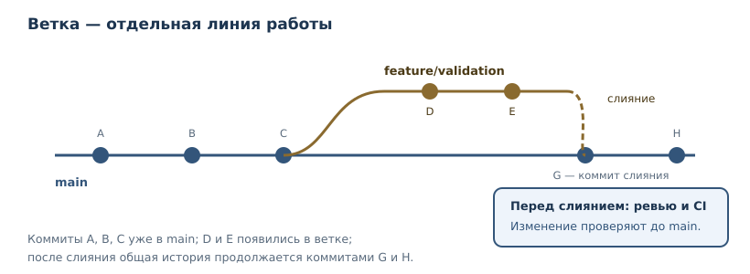
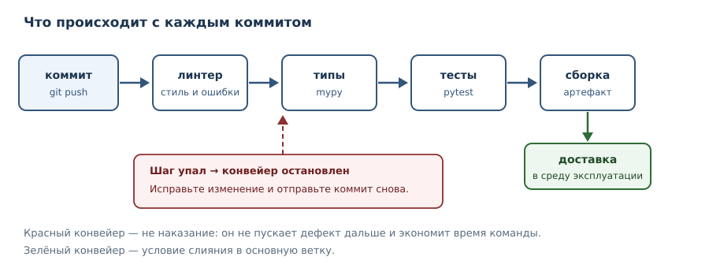

# Git, CI, релизы и сопровождение

<!-- syllanix:nav -->
**Навигация:** [← 44. Архитектура, SOLID и паттерны](44-architecture.md) · [Оглавление книги](../README.md) · [Далее: 46. Проект: консольный менеджер задач →](46-project-cli.md)
<!-- /syllanix:nav -->

<!-- syllanix:topics -->
**Темы главы**
45.1. [Контроль версий: зачем он нужен](#контроль-версий-зачем-он-нужен)  
45.2. [Базовый цикл Git](#базовый-цикл-git)  
45.3. [Ветки и слияние](#ветки-и-слияние)  
45.4. [Ревью кода](#ревью-кода)  
45.5. [Непрерывная интеграция](#непрерывная-интеграция)  
45.6. [Версионирование и релизы](#версионирование-и-релизы)  
45.7. [Сопровождение и мониторинг](#сопровождение-и-мониторинг)  
45.8. [Типичные ошибки](#типичные-ошибки)  
45.9. [Упражнения](#упражнения)  
45.10. [Проверка понимания](#проверка-понимания)  
45.11. [Что дальше](#что-дальше)  
<!-- /syllanix:topics -->


До этой главы вы работали с кодом в одиночку и «здесь и сейчас». Настоящая
разработка устроена иначе: код меняется десятки раз в день, изменения делают
несколько человек, а ошибка в выпущенной версии стоит дорого. Поэтому
инженерная практика строится вокруг трёх механизмов: **истории изменений**,
**автоматической проверки каждого изменения** и **управляемого выпуска**.

Эта глава — о том, как код живёт во времени: как фиксировать изменения, как не
пускать дефекты в основную ветку, как выпускать версии и как понимать, что
происходит в работающей системе.

## Контроль версий: зачем он нужен

**Контроль версий** — система, которая хранит историю изменений файлов и
позволяет вернуться к любому зафиксированному состоянию. Он решает четыре
задачи, с которыми «папка с копиями» не справляется:

1. **История.** Видно, кто, когда и зачем изменил каждую строку.
2. **Воспроизводимость.** Любую версию можно получить точно в том виде, в
   котором она была.
3. **Совместная работа.** Изменения нескольких людей объединяются
   контролируемо, а конфликты обнаруживаются явно.
4. **Эксперименты без риска.** Ветка позволяет пробовать идею, не ломая
   основную версию.

**Git** — распределённая система контроля версий: у каждого разработчика есть
полная история, а не только последняя версия файлов. Это стандарт индустрии;
в этой главе мы разберём минимальный рабочий набор команд. Git — инструмент, а
не религия: цель не «идеальная история», а понятность изменений и возможность
безопасно откатиться.

## Базовый цикл Git

Рабочий цикл состоит из трёх шагов: изменить файлы, зафиксировать изменения,
отправить их в общий репозиторий.

```console
$ git status
On branch main
Changes not staged for commit:
  modified:   calculator.py

$ git diff calculator.py
diff --git a/calculator.py b/calculator.py
index 3f9c1a2..8b7d4e1 100644
--- a/calculator.py
+++ b/calculator.py
@@ -3,6 +3,9 @@ def add(a, b):
     return a + b

+def subtract(a, b):
+    return a - b
+
$ git add calculator.py
$ git commit -m "Добавить функцию вычитания"
[main 3f9c1a2] Добавить функцию вычитания
 1 file changed, 3 insertions(+)

$ git push origin main
```

Обратите внимание на `git status` и `git diff` — это две команды, которые
стоит выполнять перед каждым коммитом. Они отвечают на вопросы «что я изменил»
и «то ли я изменил», и предотвращают большинство случайных коммитов.

**Коммит** — зафиксированная версия изменений с сообщением и автором. Хороший
коммит обладает двумя свойствами:

- **атомарность**: одна логическая порция изменений, а не «всё за день»;
- **понятное сообщение**: что изменилось и, главное, зачем.

Плохо: `fix`, `update`, `правки`. Хорошо: `Исправить округление при расчёте
скидки`, `Вынести валидацию в отдельный модуль`. Сообщение пишется в
повелительном наклонении, как указание: «Добавить», «Исправить», «Удалить».

## Ветки и слияние

**Ветка** — независимая линия изменений. Основная ветка (`main`) всегда должна
быть в рабочем состоянии; новая функциональность разрабатывается в отдельной
ветке и затем сливается.



```console
$ git switch -c feature/validation
$ # ... изменения, коммиты ...
$ git push -u origin feature/validation
$ # ... после ревью и зелёного CI ...
$ git switch main
$ git merge feature/validation
```

**Слияние** объединяет изменения. Если две ветки изменили одни и те же строки,
возникает **конфликт**: Git не угадывает, какой вариант правильный, и просит
человека решить. Конфликт — не сбой, а нормальный сигнал: две линии изменений
пересеклись, нужно осознанно выбрать результат.

Практические правила:

- ветка живёт недолго; чем дольше, тем больше конфликтов;
- из основной ветки регулярно забирайте изменения (`git pull`), чтобы
  расходиться меньше;
- не делайте `push --force` в общую ветку: это переписывает историю и ломает
  работу коллег;
- удаляйте слитые ветки, иначе их список превращается в свалку.

## Ревью кода

**Ревью кода** — проверка изменения другим человеком до включения в основную
ветку. Цели: найти дефекты, передать знание, выровнять стиль. Ревью — не
контроль и не демонстрация превосходства; это дешёвый способ найти проблему до
пользователя.

Что смотреть в первую очередь:

1. **Корректность** — решает ли код задачу, есть ли граничные случаи.
2. **Читаемость** — поймёт ли это через полгода другой человек.
3. **Тесты** — покрывают ли они новое поведение и его отсутствие.
4. **Безопасность** — не появляются ли секреты, небезопасный ввод, новые
   зависимости без причины.
5. **Область изменения** — не затронуто ли лишнее.

Как давать замечания: конкретно, с аргументом, без оценки личности. «Здесь
возможна ошибка на пустом списке, предлагаю тест» полезнее, чем «плохо».

## Непрерывная интеграция

**CI (непрерывная интеграция)** — автоматическая проверка каждого изменения:
линтеры, проверка типов, тесты, сборка. Конвейер запускается на каждый коммит и
останавливает изменение на первом провале.



Почему это важнее, чем кажется:

- **Проверки не забываются.** Человек может забыть запустить тесты; конвейер —
  нет.
- **Обратная связь быстрая.** Ошибка обнаруживается через минуты, а не через
  неделю.
- **Основная ветка всегда работоспособна.** Красный конвейер — стоп-сигнал для
  слияния.

Минимальный пример конфигурации для GitHub Actions:

```yaml
name: ci
on: [push, pull_request]
jobs:
  test:
    runs-on: ubuntu-latest
    steps:
      - uses: actions/checkout@v4
      - uses: astral-sh/setup-uv@v5
        with:
          python-version: "3.14"
          enable-cache: true
      - run: uv sync --frozen
      - run: uv run ruff check .
      - run: uv run mypy src
      - run: uv run pytest -q
      - run: uv build
```

Ключевые принципы: зафиксированные версии Python и зависимостей (`uv.lock` +
`--frozen`), быстрые шаги сначала, кэширование зависимостей, одинаковые команды
локально и в CI. Локально те же проверки запускаются так:

```console
$ uv run ruff check .
$ uv run mypy src
$ uv run pytest -q
```

`mypy src` соответствует раскладке с каталогом `src/` из главы 33; если пакет
проекта лежит в `tasks/`, замените путь на `tasks`.

Если проверка проходит только в CI — это дефект конфигурации.

## Версионирование и релизы

**Семантическое версионирование** задаёт номер версии из трёх чисел
`MAJOR.MINOR.PATCH`:

- `MAJOR` увеличивается при несовместимых изменениях;
- `MINOR` — при добавлении совместимых возможностей;
- `PATCH` — при исправлениях без изменения API.

Проверить формат версии можно программно — это типичная проверка в конвейере:

```python exec
version = "1.4.2"
major, minor, patch = version.split(".")
print(major, minor, patch)
print(all(part.isdigit() for part in (major, minor, patch)))
```

```output
1 4 2
True
```

**Журнал изменений** (`CHANGELOG.md`) — понятный пользователю перечень
изменений по версиям. Он нужен не для отчётности, а чтобы потребитель мог
понять, что сломается при обновлении.

```text
# Changelog

## [1.5.0] — 2026-11-01
### Добавлено
- Проверка дубликатов при импорте задач.
### Изменено
- Команда `tasks list` сортирует задачи по статусу.
### Удалено
- Устаревший флаг `--legacy`.
### Исправлено
- Ошибка при пустом названии задачи.
```

**Тег** — неизменяемая метка коммита, из которой собирается выпуск. Версия в
`pyproject.toml` и заголовок `CHANGELOG.md` должны совпадать с тегом; иначе
потребитель не поймёт, что именно ему поставили. Минимальный сценарий релиза:

```console
$ git tag v1.5.0
$ git push --tags
$ uv build
$ ls dist
tasks_cli-1.5.0-py3-none-any.whl
tasks_cli-1.5.0.tar.gz
```

Артефакт собирается из тега, а не из рабочей копии: так релиз можно
воспроизвести позже. CI может запускать `uv build` на теге и прикреплять
`dist/*` к релизу. Если сборка из тега не воспроизводится, тег не годится для
поставки.

**CD (непрерывная доставка)** — автоматизированная поставка проверенной версии
в среду эксплуатации. Ключевые понятия: артефакт (то, что поставляется),
окружение (где запускается), откат (как вернуться к предыдущей версии). Откат
проектируется заранее: если вы не знаете, как откатить релиз, вы не готовы его
выпускать.

## Сопровождение и мониторинг

После выпуска начинается самая длинная фаза — сопровождение. **Мониторинг** —
наблюдение за системой через метрики, логи и оповещения. Минимальный набор:

- **доступность** — работает ли система;
- **задержка** — сколько времени занимают операции;
- **ошибки** — доля неуспешных запросов;
- **насыщение** — не кончаются ли ресурсы (память, диск, соединения).

Оповещение должно быть привязано к действию: если на сигнал никто не реагирует,
это шум, а не мониторинг. Логи без структуры и уровней превращаются в свалку;
структурированное логирование разбирается в главе 37.

Сопровождение — это ещё и работа с долгом: устаревшие зависимости, обходные
решения, отсутствие тестов. **Технический долг** не плох сам по себе; плохо,
когда он невидим. Ведите список известных проблем и возвращайтесь к нему
регулярно, а не только при аварии.

## Типичные ошибки

1. **Коммит секретов.** Ключ, попавший в историю Git, остаётся там навсегда;
   его нужно считать скомпрометированным и заменить. Секреты хранят в
   переменных окружения или хранилищах секретов (глава 41), а `.gitignore`
   защищает от случайного добавления.
2. **Гигантские коммиты.** Такой коммит невозможно осмысленно проверить и
   трудно откатить. Дробите изменения.
3. **Красный CI «потом починим».** Разрешение мержить при красном конвейере
   быстро превращает проверки в декорацию.
4. **Релиз без плана отката.** Любой выпуск может сломать систему; план отката
   обязателен.
5. **Force push в общую ветку.** Переписывает историю у всех и ломает чужие
   ветки.
6. **Мониторинг без владельца.** Оповещения, на которые никто не смотрит, —
   иллюзия контроля.

## Упражнения

### 1. Первый репозиторий {#ex-ch45-01}

Создайте локальный репозиторий, добавьте файл, сделайте два коммита. Покажите
вывод `git log --oneline` и объясните, чем `git add` отличается от
`git commit`.

### 2. Статус и diff {#ex-ch45-02}

Измените файл, но не коммитьте. Объясните, что покажут `git status` и
`git diff`, и почему эти команды полезно запускать перед коммитом.

### 3. Хорошее сообщение коммита {#ex-ch45-03}

Для каждого плохого сообщения предложите хорошее: `fix`, `update code`,
`правки после обеда`. Сформулируйте правило, которому должны соответствовать
сообщения.

### 4. Ветка и слияние {#ex-ch45-04}

Опишите последовательность команд: создать ветку `feature/calc`, внести
изменение, слить в `main`. Что произойдёт, если обе ветки изменили одну и ту же
строку?

### 5. Что не коммитить {#ex-ch45-05}

Составьте `.gitignore` для Python-проекта: виртуальное окружение, кэш,
собранные файлы, файлы с секретами. Объясните, почему `.env` не должен
попадать в репозиторий.

### 6. Красный конвейер {#ex-ch45-06}

Конвейер падает на шаге тестов. Какие действия правильные? Перечислите не менее
четырёх, включая то, что делать нельзя.

### 7. Семантическое версионирование {#ex-ch45-07}

Определите, какую часть версии нужно увеличить: (а) добавлен новый
необязательный аргумент функции; (б) удалён параметр; (в) исправлена опечатка в
сообщении об ошибке.

### 8. Журнал изменений {#ex-ch45-08}

Напишите фрагмент `CHANGELOG.md` для версии `1.5.0`, в которой добавлена
возможность и исправлена ошибка. Какие разделы нужны и почему?

### 9. Метрики и оповещения {#ex-ch45-09}

Предложите четыре метрики для веб-сервиса и по одному оповещению на каждую.
Объясните, почему оповещение без действия бесполезно.

### 10. План отката {#ex-ch45-10}

Опишите план отката для сервиса, развёрнутого из артефакта версии `1.5.0`.
Что должно быть готово до выпуска, чтобы откат занял минуты, а не часы?

## Проверка понимания

1. Какие задачи решает контроль версий и почему папка с копиями их не решает?
2. Чем `git add` отличается от `git commit`, а `commit` — от `push`?
3. Что такое ветка и зачем она нужна?
4. Почему конфликт при слиянии — не сбой?
5. Что проверяет CI и почему основная ветка должна быть всегда работоспособной?
6. Как семантическое версионирование сообщает потребителю о несовместимости?
7. Чем мониторинг отличается от логирования и зачем нужны оба?

## Что дальше

Сопровождение, технический долг и рефакторинг — в главе 53.

Вы прошли путь от основ языка до инженерной практики. Осталась часть 10 —
проекты, где все изученные инструменты нужно применить вместе: спроектировать,
реализовать, протестировать, упаковать и задокументировать работающую систему.

<!-- syllanix:nav -->
**Перед этой главой:** [44. Архитектура, SOLID и паттерны](44-architecture.md)
**Связанные главы:** [01. Зачем Python и как устроена эта книга](01-introduction.md), [32. Тестирование: pytest и TDD](32-testing.md), [33. Структура проекта, зависимости и инструменты](33-project-tooling.md), [37. Время, даты и логирование](37-time-logging.md), [48. Проект: асинхронный сборщик данных](48-project-async.md), [53. Запахи кода, рефакторинг и сопровождение](53-refactoring.md)
**Далее:** [46. Проект: консольный менеджер задач →](46-project-cli.md)
<!-- /syllanix:nav -->
