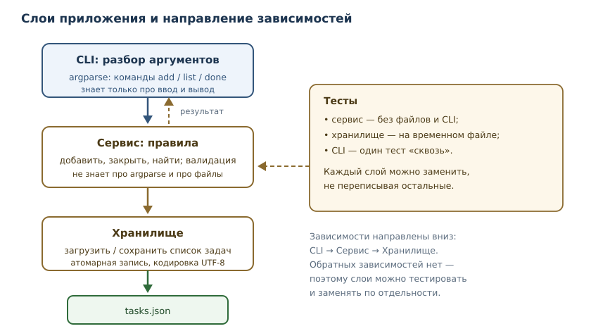

# Проект: консольный менеджер задач

<!-- syllanix:nav -->
**Навигация:** [← 45. Git, CI, релизы и сопровождение](45-git-ci-releases.md) · [Оглавление книги](../README.md) · [Далее: 47. Проект: HTTP API и база данных →](47-project-api.md)
<!-- /syllanix:nav -->

<!-- syllanix:topics -->
**Темы главы**
46.1. [Зачем этот проект](#зачем-этот-проект)  
46.2. [Что должно получиться](#что-должно-получиться)  
46.3. [Архитектура: три слоя](#архитектура-три-слоя)  
46.4. [Шаг 1. Модель и валидация](#шаг-1-модель-и-валидация)  
46.5. [Шаг 2. Сервис](#шаг-2-сервис)  
46.6. [Шаг 3. Хранилище](#шаг-3-хранилище)  
46.7. [Шаг 4. Командная строка](#шаг-4-командная-строка)  
46.8. [Шаг 5. Тесты](#шаг-5-тесты)  
46.9. [Шаг 6. Упаковка и точка входа](#шаг-6-упаковка-и-точка-входа)  
46.10. [Типичные ошибки проекта](#типичные-ошибки-проекта)  
46.11. [Упражнения](#упражнения)  
46.12. [Проверка понимания](#проверка-понимания)  
46.13. [Что дальше](#что-дальше)  
<!-- /syllanix:topics -->


До сих пор каждая глава давала отдельный инструмент. В проекте инструменты
собираются в систему: нужно спроектировать слои, договориться о формате данных,
обработать ошибки, написать тесты, упаковать приложение и объяснить, как его
запускать. Именно это отличает «умею писать код» от «умею делать продукт».

Мы построим **менеджер задач** — консольное приложение, которое хранит задачи в
JSON-файле и поддерживает команды добавления, просмотра и закрытия. Проект
небольшой по объёму, но содержит все инженерные элементы настоящего
приложения: слои, валидацию, атомарную запись, коды возврата, тесты и точку
входа.

## Зачем этот проект

Небольшой проект позволяет пройти полный цикл разработки без «учебных
упрощений»: от требований и архитектуры до тестов, упаковки и релиза. Именно на
таком масштабе видно, зачем нужны слои, зачем отделять правила от интерфейса и
почему «работает у меня» — не критерий готовности.

## Что должно получиться

Функциональные требования:

1. `tasks add "Купить хлеб"` — добавить задачу.
2. `tasks list` — показать все задачи с идентификаторами и статусом.
3. `tasks done 3` — отметить задачу выполненной.
4. `tasks remove 3` — удалить задачу.
5. Данные сохраняются между запусками в `tasks.json`.

Нефункциональные требования, без которых проект не считается готовым:

- **детерминизм**: одинаковые команды на одинаковых данных дают одинаковый
  вывод;
- **коды возврата**: `0` — успех, `1` — ошибка предметной области (нет задачи,
  пустое название), `2` — неверные аргументы;
- **устойчивость к сбоям**: файл не должен остаться частично записанным;
- **тестируемость**: логику можно проверить без запуска CLI;
- **воспроизводимость**: установка зависимостей и запуск описаны одной
  командой.

## Архитектура: три слоя

Приложение делится на три слоя, и зависимости идут строго в одну сторону.



- **CLI** знает про аргументы, вывод и коды возврата. Он не знает, как задачи
  хранятся.
- **Сервис** содержит правила: что считается допустимым названием, как
  назначаются идентификаторы, что значит «закрыть задачу». Он не знает про
  `argparse` и файлы.
- **Хранилище** умеет загрузить и сохранить список задач. Оно не знает, откуда
  пришли данные.

Такое разделение — не бюрократия. Оно позволяет тестировать правила без файлов,
менять формат хранения без переписывания CLI и добавлять второй интерфейс
(например, веб-API) поверх того же сервиса. Это и есть практическое следствие
принципа единственной ответственности из главы 44.

## Шаг 1. Модель и валидация

Начнём с типа задачи и правила проверки названия. Слой сервиса не должен
доверять внешнему вводу: даже если проверка есть в CLI, сервис проверяет сам —
его могут вызвать из другого места.

```python exec
from dataclasses import dataclass

@dataclass
class Task:
    id: int
    title: str
    done: bool = False

def validate_title(title: str) -> str:
    title = title.strip()
    if not title:
        raise ValueError("название задачи не может быть пустым")
    if len(title) > 200:
        raise ValueError("название длиннее 200 символов")
    return title

task = Task(id=1, title=validate_title("  Купить хлеб "))
print(task)
try:
    validate_title("   ")
except ValueError as exc:
    print(type(exc).__name__, "-", exc)
```

```output
Task(id=1, title='Купить хлеб', done=False)
ValueError - название задачи не может быть пустым
```

Обратите внимание: `strip()` применяется до проверки — иначе строка из одних
пробелов считалась бы непустой. Это типичный граничный случай, который ловят
тесты, а не «здравый смысл».

## Шаг 2. Сервис

Сервис хранит список задач и реализует операции. Идентификаторы выдаются
монотонно и не переиспользуются: если удалить задачу 3, следующая получит 4, а
не 3. Это упрощает ссылки на задачи в логах и обсуждениях.

```python exec
from dataclasses import dataclass

@dataclass
class Task:
    id: int
    title: str
    done: bool = False

# В проекте эта функция живёт в tasks/model.py и импортируется сервисом.
# Здесь она повторена, чтобы блок исполнялся отдельно.
def validate_title(title: str) -> str:
    title = title.strip()
    if not title:
        raise ValueError("название задачи не может быть пустым")
    if len(title) > 200:
        raise ValueError("название длиннее 200 символов")
    return title

class TaskService:
    def __init__(self, tasks: list[Task]) -> None:
        self._tasks = list(tasks)
        self._next_id = max((task.id for task in self._tasks), default=0) + 1

    def all(self) -> list[Task]:
        return list(self._tasks)

    def add(self, title: str) -> Task:
        task = Task(id=self._next_id, title=validate_title(title))
        self._tasks.append(task)
        self._next_id += 1
        return task

    def close(self, task_id: int) -> Task:
        for task in self._tasks:
            if task.id == task_id:
                task.done = True
                return task
        raise KeyError(f"задача {task_id} не найдена")

    def remove(self, task_id: int) -> None:
        before = len(self._tasks)
        self._tasks = [task for task in self._tasks if task.id != task_id]
        if len(self._tasks) == before:
            raise KeyError(f"задача {task_id} не найдена")

service = TaskService([])
service.add("Купить хлеб")
service.add("Написать главу")
service.close(1)
for task in service.all():
    mark = "x" if task.done else " "
    print(f"[{mark}] {task.id}. {task.title}")
```

```output
[x] 1. Купить хлеб
[ ] 2. Написать главу
```

Чтобы пример запускался отдельно, `Task` и `validate_title` повторены в этом
блоке. В проекте они лежат в `tasks/model.py`, а `tasks/service.py` импортирует
их оттуда: один тип задачи на все слои.

`TaskService.add` вызывает `validate_title`, поэтому правило из шага 1 действительно
действует: название обрезается, пустое и слишком длинное отклоняются. Тест на
границу в 200 символов проверяет именно это поведение, а не отдельную функцию.

Заметьте: `all()` возвращает копию списка. Если бы он возвращал внутренний
список, вызывающий код мог бы незаметно менять состояние сервиса в обход
правил — классическая ловушка изменяемых объектов из главы 18.

## Шаг 3. Хранилище

Хранилище преобразует задачи в JSON и обратно. **Файловое хранение** (file
persistence) — сохранение состояния между запусками в файле. Требование «файл не
должен остаться частично записанным» решается **атомарной записью**: сначала
данные пишутся во временный файл в том же каталоге, затем `os.replace` подменяет
основной файл одной операцией.

```python exec
import json
import os
import tempfile
from pathlib import Path

def save_tasks(path: Path, tasks: list[dict]) -> None:
    path.parent.mkdir(parents=True, exist_ok=True)
    fd, tmp_name = tempfile.mkstemp(dir=path.parent, prefix=".tasks-", suffix=".tmp")
    try:
        with os.fdopen(fd, "w", encoding="utf-8") as tmp:
            json.dump(tasks, tmp, ensure_ascii=False, indent=2)
            tmp.flush()
            os.fsync(tmp.fileno())
        os.replace(tmp_name, path)
        dir_fd = os.open(path.parent, os.O_RDONLY)
        try:
            os.fsync(dir_fd)
        finally:
            os.close(dir_fd)
    except BaseException:
        Path(tmp_name).unlink(missing_ok=True)
        raise

def load_tasks(path: Path) -> list[dict]:
    if not path.exists():
        return []
    with open(path, encoding="utf-8") as source:
        return json.load(source)

with tempfile.TemporaryDirectory() as tmp_dir:
    path = Path(tmp_dir) / "tasks.json"
    save_tasks(path, [{"id": 1, "title": "Купить хлеб", "done": False}])
    print("после сохранения:", load_tasks(path))
    print("отсутствующий файл:", load_tasks(Path(tmp_dir) / "missing.json"))
```

```output
после сохранения: [{'id': 1, 'title': 'Купить хлеб', 'done': False}]
отсутствующий файл: []
```

Почему не просто `path.write_text(...)`? Потому что такая запись может быть
прервана (нет места, процесс убит) и оставить файл пустым или обрезанным.
Атомарная замена гарантирует: читатель видит либо старую версию файла целиком,
либо новую целиком.

Но атомарность для читателя и долговечность после сбоя питания — разные
гарантии. `os.replace` переставляет имя файла, однако данные временного файла
могут ещё не дойти до диска. Поэтому `save_tasks` вызывает `fsync` для самого
временного файла, а после замены — для каталога: первый сбрасывает содержимое,
второй фиксирует новое имя. Без этих вызовов после обрыва питания можно
увидеть старую версию или потерять только что записанную.

## Шаг 4. Командная строка

`argparse` из стандартной библиотеки разбирает аргументы и сам формирует
справку. Подкоманды задаются через `add_subparsers`.

```python exec
import argparse

def build_parser() -> argparse.ArgumentParser:
    parser = argparse.ArgumentParser(prog="tasks", description="Менеджер задач")
    sub = parser.add_subparsers(dest="command", required=True)

    add = sub.add_parser("add", help="добавить задачу")
    add.add_argument("title", help="название задачи")

    done = sub.add_parser("done", help="закрыть задачу")
    done.add_argument("id", type=int, help="идентификатор задачи")

    remove = sub.add_parser("remove", help="удалить задачу")
    remove.add_argument("id", type=int, help="идентификатор задачи")

    sub.add_parser("list", help="показать задачи")
    return parser

parser = build_parser()
print(parser.parse_args(["add", "Купить хлеб"]))
print(parser.parse_args(["done", "3"]))
```

```output
Namespace(command='add', title='Купить хлеб')
Namespace(command='done', id=3)
```

Главная функция собирает сервис из хранилища и возвращает код. На границе
хранения словари превращаются в `Task`: слой сервиса не должен получать
«сырые» данные и угадывать их тип.

```python
import sys
from dataclasses import asdict
from pathlib import Path

from tasks.model import Task
from tasks.service import TaskService
from tasks.storage import load_tasks, save_tasks

DATA_PATH = Path("tasks.json")


def format_task(task: Task) -> str:
    mark = "x" if task.done else " "
    return f"[{mark}] {task.id}. {task.title}"


def main(argv: list[str] | None = None) -> int:
    args = build_parser().parse_args(argv)
    service = TaskService([Task(**row) for row in load_tasks(DATA_PATH)])
    try:
        if args.command == "add":
            task = service.add(args.title)
            print(f"добавлена задача {task.id}")
        elif args.command == "list":
            for task in service.all():
                print(format_task(task))
        elif args.command == "done":
            task = service.close(args.id)
            print(f"задача {task.id} закрыта")
        elif args.command == "remove":
            service.remove(args.id)
            print(f"задача {args.id} удалена")
        save_tasks(DATA_PATH, [asdict(task) for task in service.all()])
        return 0
    except KeyError as exc:
        print(f"ошибка: {exc.args[0]}", file=sys.stderr)
        return 1
    except ValueError as exc:
        print(f"ошибка: {exc}", file=sys.stderr)
        return 1


if __name__ == "__main__":
    raise SystemExit(main())
```

Коды возврата — часть контракта приложения: скрипты и CI используют их, чтобы
отличить успех от ошибки. `raise SystemExit(main())` превращает код в статус
завершения процесса.

```console
$ tasks add "Купить хлеб"
добавлена задача 1
$ tasks list
[ ] 1. Купить хлеб
$ tasks done 1
задача 1 закрыта
$ tasks list
[x] 1. Купить хлеб
$ tasks remove 1
задача 1 удалена
$ tasks list
$ tasks done 99
ошибка: задача 99 не найдена
$ echo $?
1
```

## Шаг 5. Тесты

Тестируются слои по отдельности: правила — без файлов, хранилище — на временном
каталоге, CLI — одним сквозным тестом.

```python
import pytest

from tasks.cli import main
from tasks.service import TaskService
from tasks.storage import load_tasks, save_tasks


def test_add_trims_title():
    service = TaskService([])
    task = service.add("  Купить хлеб  ")
    assert task.title == "Купить хлеб"


def test_add_rejects_empty_title():
    service = TaskService([])
    with pytest.raises(ValueError):
        service.add("   ")


def test_add_rejects_too_long_title():
    service = TaskService([])
    with pytest.raises(ValueError):
        service.add("я" * 201)


def test_ids_are_not_reused():
    service = TaskService([])
    first = service.add("первая")
    service.remove(first.id)
    second = service.add("вторая")
    assert second.id == first.id + 1


def test_close_unknown_raises():
    service = TaskService([])
    with pytest.raises(KeyError):
        service.close(99)


def test_store_roundtrip(tmp_path):
    path = tmp_path / "tasks.json"
    save_tasks(path, [{"id": 1, "title": "тест", "done": False}])
    assert load_tasks(path) == [{"id": 1, "title": "тест", "done": False}]
    assert load_tasks(tmp_path / "missing.json") == []


def test_cli_add_and_list(tmp_path, monkeypatch, capsys):
    monkeypatch.setattr("tasks.cli.DATA_PATH", tmp_path / "tasks.json")
    assert main(["add", "Купить хлеб"]) == 0
    assert main(["list"]) == 0
    assert "[ ] 1. Купить хлеб" in capsys.readouterr().out
```

```console
$ python -m pytest -q
.......                                                                  [100%]
7 passed in 0.03s
```

Обратите внимание на `tmp_path` — это встроенная фикстура pytest, создающая
временный каталог для каждого теста. Так тесты не зависят друг от друга и не
мусорят в рабочем каталоге.

## Шаг 6. Упаковка и точка входа

Чтобы приложение запускалось командой `tasks`, его нужно установить как пакет
и указать точку входа.

```toml
[project]
name = "tasks-cli"
version = "1.0.0"
requires-python = ">=3.11"
dependencies = []

[project.scripts]
tasks = "tasks.cli:main"

[build-system]
requires = ["setuptools>=68"]
build-backend = "setuptools.build_meta"
```

```console
$ uv sync
$ uv run tasks add "Купить хлеб"
добавлена задача 1
$ uv run tasks list
[ ] 1. Купить хлеб
```

`[project.scripts]` создаёт исполняемую команду, которая вызывает функцию
`main`. `uv sync` создаёт изолированное окружение по `pyproject.toml` и
`uv.lock` и устанавливает проект в режиме разработки: изменения в исходниках
видны сразу, переустанавливать не нужно. `uv run` выполняет команду в этом
окружении, поэтому отдельная активация venv не требуется.

## Типичные ошибки проекта

1. **Вся логика в обработчике CLI.** Тогда её нельзя протестировать без
   запуска процесса и нельзя переиспользовать в другом интерфейсе.
2. **Запись файла «как получится».** Обрыв записи портит данные; нужна
   атомарная замена.
3. **Доверие к вводу.** Проверка только в CLI обходится вторым вызывающим
   кодом; правила должны жить в сервисе.
4. **Молчаливое проглатывание ошибок.** Пользователь должен получить понятное
   сообщение и ненулевой код возврата.
5. **Формат хранения без версии.** Если завтра добавится поле, старые файлы
   должны читаться; заложите версию схемы или обратную совместимость.
6. **Тесты, зависящие от рабочего каталога.** Используйте временные каталоги и
   явные пути.

## Упражнения

### 1. Добавление команды {#ex-ch46-01}

Добавьте команду `tasks undone <id>`, снимающую отметку выполнения. Опишите
изменения в трёх слоях: CLI, сервис, ничего ли не нужно менять в хранилище.

### 2. Приоритеты {#ex-ch46-02}

Добавьте полю `priority` значения `low`, `normal`, `high` (по умолчанию
`normal`). Как обеспечить обратную совместимость со старыми файлами, где поля
нет?

### 3. Поиск {#ex-ch46-03}

Реализуйте команду `tasks find <подстрока>`, выводящую задачи, в названии
которых встречается подстрока, без учёта регистра. Где должна жить эта логика?

### 4. Коды возврата {#ex-ch46-04}

Составьте таблицу: команда, ситуация, сообщение, код возврата. Опишите, почему
`2` (неверные аргументы) отличается от `1` (ошибка предметной области).

### 5. Атомарность {#ex-ch46-05}

Объясните, что произойдёт при обрыве питания в момент записи файла: (а) при
прямой записи в `tasks.json`; (б) при записи во временный файл с последующей
заменой. Сформулируйте гарантию, которую даёт второй вариант.

### 6. Тесты на границы {#ex-ch46-06}

Напишите тесты для `validate_title`: пустая строка, строка из пробелов, 200
символов, 201 символ. Какие ещё граничные случаи стоит проверить?

### 7. Некорректный JSON {#ex-ch46-07}

Что должно делать приложение, если `tasks.json` содержит синтаксически
неверный JSON? Предложите поведение и реализуйте его.

### 8. Вывод и форматирование {#ex-ch46-08}

Сделайте так, чтобы `tasks list` выводил задачи в порядке: сначала
невыполненные, затем выполненные, внутри — по идентификатору. Объясните, почему
сортировка должна быть в CLI, а не в сервисе.

### 9. Множественный вывод {#ex-ch46-09}

Добавьте флаг `--json` для машиночитаемого вывода. Почему это удобнее, чем
парсить человекочитаемый текст?

### 10. Мини-релиз {#ex-ch46-10}

Опишите шаги выпуска версии `1.1.0`: изменения, тесты, CI, версия в
`pyproject.toml`, запись в `CHANGELOG.md`, тег. Что должно быть зелёным до
публикации?

## Проверка понимания

1. Зачем разделять CLI, сервис и хранилище, если приложение небольшое?
2. Почему валидация должна жить в сервисе, а не только в CLI?
3. Что даёт атомарная запись файла и как она реализуется?
4. Почему идентификаторы не должны переиспользоваться?
5. Какие коды возврата использовать и зачем они нужны?
6. Почему `all()` возвращает копию списка?

## Что дальше

Приложение работает локально, но данные живут в одном файле и доступны только
на одной машине. Следующий проект — HTTP API с базой данных: та же предметная
область, но доступ по сети, одновременные запросы и другой уровень требований
к надёжности.

<!-- syllanix:nav -->
**Перед этой главой:** [45. Git, CI, релизы и сопровождение](45-git-ci-releases.md)
**Связанные главы:** [09. Модули, пакеты и импорты](09-modules.md), [10. Ошибки и исключения](10-errors-exceptions.md), [19. Файлы, пути и текстовые форматы](19-files-formats.md), [25. Объекты и классы](25-objects-classes.md), [29. Dataclasses, протоколы и абстрактные классы](29-dataclasses-protocols.md), [30. Проектирование классов и API](30-oop-design.md), [32. Тестирование: pytest и TDD](32-testing.md), [33. Структура проекта, зависимости и инструменты](33-project-tooling.md)
**Далее:** [47. Проект: HTTP API и база данных →](47-project-api.md)
<!-- /syllanix:nav -->
