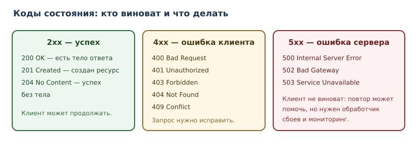

# Проект: HTTP API и база данных

<!-- syllanix:nav -->
**Навигация:** [← 46. Проект: консольный менеджер задач](46-project-cli.md) · [Оглавление книги](../README.md) · [Далее: 48. Проект: асинхронный сборщик данных →](48-project-async.md)
<!-- /syllanix:nav -->

<!-- syllanix:topics -->
**Темы главы**
47.1. [Зачем этот проект](#зачем-этот-проект)  
47.2. [Что должно получиться](#что-должно-получиться)  
47.3. [REST: ресурсы и методы](#rest-ресурсы-и-методы)  
47.4. [Путь запроса](#путь-запроса)  
47.5. [Коды состояния](#коды-состояния)  
47.6. [Валидация полезной нагрузки](#валидация-полезной-нагрузки)  
47.7. [Хранилище: SQLite](#хранилище-sqlite)  
47.8. [Обработчик и маршрутизация](#обработчик-и-маршрутизация)  
47.9. [Промышленный вариант: FastAPI](#промышленный-вариант-fastapi)  
47.10. [Тесты API](#тесты-api)  
47.11. [Безопасность и типичные ошибки](#безопасность-и-типичные-ошибки)  
47.12. [Упражнения](#упражнения)  
47.13. [Проверка понимания](#проверка-понимания)  
47.14. [Что дальше](#что-дальше)  
<!-- /syllanix:topics -->


В предыдущем проекте задачи хранились в файле на одной машине. Теперь та же
предметная область превращается в **HTTP API**: клиентом становится программа
на другом компьютере, данные хранятся в базе, а запросы приходят одновременно.
Это меняет требования: нужны контракт (что и как вызывается), коды состояния,
валидация недоверенного ввода и защита от ошибок, которые нельзя показать
пользователю.

## Зачем этот проект

API — самая распространённая форма взаимодействия между системами: мобильное
приложение общается с сервером, сервисы — друг с другом, скрипты — с
внешними платформами. Навык «спроектировать понятный HTTP-интерфейс и не
потерять данные при сбоях» универсален: он остаётся, даже если меняется язык
или фреймворк.

Проект учит трём вещам, которых не было в CLI:

1. **Контракт.** Клиент не видит ваш код; он видит только URL, методы, коды
   ответа и формат данных.
2. **Недоверенный ввод.** Всё, что приходит по сети, может быть чем угодно.
3. **Одновременность и сохранность.** База данных, транзакции, блокировки.

## Что должно получиться

REST API для задач:

| Метод и путь | Действие | Успех | Ошибки |
|---|---|---|---|
| `GET /tasks` | список задач | `200` + массив | `500` |
| `POST /tasks` | создать задачу | `201` + объект | `400`, `422` |
| `GET /tasks/{id}` | одна задача | `200` + объект | `404` |
| `PATCH /tasks/{id}` | изменить | `200` + объект | `400`, `404`, `422` |
| `DELETE /tasks/{id}` | удалить | `204` без тела | `404` |

Формат задачи: `{"id": 1, "title": "Купить хлеб", "done": false}`.
Ошибка: `{"error": "сообщение"}`. Код `422` означает, что тело не прошло
валидацию; `400` — что запрос синтаксически корректен, но противоречит правилам
(например, недопустимый переход состояния).

Нефункциональные требования:

- валидация тела запроса до бизнес-логики;
- параметризованные SQL-запросы (никакой конкатенации);
- понятные коды состояния и отсутствие стектрейсов в ответах;
- тесты на успешные и ошибочные сценарии;
- запуск одной командой и воспроизводимое окружение.

## REST: ресурсы и методы

**REST API** — стиль, в котором адресами служат **ресурсы** (`/tasks`,
`/tasks/3`), а действие выражается методом HTTP: `GET` читает, `POST`
создаёт, `PATCH` изменяет, `DELETE` удаляет. Путь описывает **что**, метод —
**что с этим сделать**. Такая схема предсказуема: клиент может догадаться об
устройстве API, не читая документацию целиком.

Хороший контракт обладает свойствами:

- **ресурсы во множественном числе**: `/tasks`, а не `/getTasks`;
- **никаких глаголов в пути**: действие — это метод, а не `/tasks/create`;
- **стабильные идентификаторы**: `/tasks/3`, а не `/tasks?title=...`;
- **одинаковые ошибки**: формат `{"error": ...}` во всех конечных точках.

**Конечная точка** (endpoint) — сочетание пути и метода. `GET /tasks` и
`POST /tasks` — разные конечные точки с разным поведением.

## Путь запроса


Порядок обработки принципиален:

1. **Маршрутизация** — по методу и пути выбрать обработчик.
2. **Валидация** — проверить, что тело и параметры вообще допустимы.
3. **Бизнес-логика** — применить правила (например, название не пустое).
4. **Хранилище** — прочитать или изменить данные.
5. **Ответ** — сформировать код состояния и тело.

Валидация стоит **до** бизнес-логики: бессмысленно проверять уникальность
названия, если в поле `title` пришёл массив. Ранний отказ экономит работу и
упрощает ошибки.

## Коды состояния



**Статус ответа** (код состояния, HTTP status) — часть контракта, а не
украшение. Правила:

- `2xx` — операция выполнена; `201` при создании ресурса, `204` при успехе без
  тела;
- `4xx` — клиент ошибся: неверные данные (`400`), нет ресурса (`404`),
  отсутствует или недействительна аутентификация (`401`), аутентификация есть,
  но прав нет (`403`);
- `5xx` — ошибся сервер; клиент не должен получать внутренние детали.

Практическая ошибка новичков — возвращать `200` с полем `{"error": ...}`.
Это ломает клиентов, которые ориентируются на код, и мониторинг, который
считает долю `5xx`. Код состояния должен соответствовать смыслу.

## Валидация полезной нагрузки

**Полезная нагрузка** (payload) — тело запроса. Валидация — первая и самая
дешёвая граница между недоверенным миром и вашим кодом; за ней остаются
аутентификация, права и ограничения базы.

```python exec
import json

class ValidationError(Exception):
    pass

def parse_task_payload(raw: bytes) -> dict:
    try:
        data = json.loads(raw)
    except json.JSONDecodeError as exc:
        raise ValidationError(f"тело запроса не JSON: {exc.msg}") from exc
    if not isinstance(data, dict):
        raise ValidationError("ожидался объект JSON")
    title = data.get("title")
    if not isinstance(title, str):
        raise ValidationError("поле title обязательно и должно быть строкой")
    title = title.strip()
    if not title:
        raise ValidationError("поле title обязательно и должно быть непустой строкой")
    if len(title) > 200:
        raise ValidationError("поле title длиннее 200 символов")
    done = data.get("done", False)
    if not isinstance(done, bool):
        raise ValidationError("поле done должно быть true или false")
    return {"title": title, "done": done}

cases = [
    '{"title": "  Купить хлеб "}',
    '{"title": ""}',
    "[]",
    "not json",
    '{"title": "Новая", "done": "false"}',
]
for raw in (case.encode("utf-8") for case in cases):
    try:
        print("ok:", parse_task_payload(raw))
    except ValidationError as exc:
        print("400:", exc)
```

```output
ok: {'title': 'Купить хлеб', 'done': False}
400: поле title обязательно и должно быть непустой строкой
400: ожидался объект JSON
400: тело запроса не JSON: Expecting value
400: поле done должно быть true или false
```

Обратите внимание на порядок: сначала проверяется, что тело вообще
JSON, затем — что это объект, затем — типы полей. Каждая проверка даёт
конкретное сообщение, потому что клиенту нужно понимать, что исправить.
`done` проверяется через `isinstance`, а не через `bool(...)`: иначе строка
`"false"` превратилась бы в `True` и валидация пропустила бы неверный тип.

## Хранилище: SQLite

**SQLite** — встроенная база данных: один файл, не нужен сервер. Стандартная
библиотека `sqlite3` даёт всё необходимое. Ключевое правило — **параметризация**
запросов: значения передаются отдельно от текста SQL.

```python exec
import sqlite3
import tempfile
from pathlib import Path

with tempfile.TemporaryDirectory() as tmp_dir:
    db_path = Path(tmp_dir) / "tasks.db"
    conn = sqlite3.connect(db_path)
    conn.row_factory = sqlite3.Row
    conn.execute(
        """
        CREATE TABLE tasks (
            id INTEGER PRIMARY KEY AUTOINCREMENT,
            title TEXT NOT NULL,
            done INTEGER NOT NULL DEFAULT 0
        )
        """
    )
    conn.execute("INSERT INTO tasks (title) VALUES (?)", ("Купить хлеб",))
    conn.execute("INSERT INTO tasks (title) VALUES (?)", ("Написать главу",))
    conn.commit()
    for row in conn.execute("SELECT id, title, done FROM tasks ORDER BY id"):
        print(dict(row))
    conn.close()
```

```output
{'id': 1, 'title': 'Купить хлеб', 'done': 0}
{'id': 2, 'title': 'Написать главу', 'done': 0}
```

Параметризация `VALUES (?)` — не стилистическая мелочь, а защита: значение с
кавычками или `; DROP TABLE tasks` останется значением и не станет частью
SQL-кода. Подстановка через f-строку в SQL — учебная ошибка, которая в
промышленном коде называется **SQL-инъекцией** (глава 36).

Соберём доступ к таблице в репозиторий: HTTP-обработчики будут вызывать его
методы, а не работать с `sqlite3` напрямую. Это тот же паттерн «репозиторий» из
главы 44, и он же делает хранилище подменяемым в тестах.

```python exec
import sqlite3
import tempfile
from pathlib import Path


class TaskRepository:
    def __init__(self, db_path: str | Path) -> None:
        self._conn = sqlite3.connect(db_path, check_same_thread=False)
        self._conn.row_factory = sqlite3.Row
        self._conn.execute(
            """
            CREATE TABLE IF NOT EXISTS tasks (
                id INTEGER PRIMARY KEY AUTOINCREMENT,
                title TEXT NOT NULL,
                done INTEGER NOT NULL DEFAULT 0
            )
            """
        )
        self._conn.commit()

    def _row(self, row: sqlite3.Row) -> dict:
        return {"id": row["id"], "title": row["title"], "done": bool(row["done"])}

    def add(self, title: str, done: bool = False) -> dict:
        cursor = self._conn.execute(
            "INSERT INTO tasks (title, done) VALUES (?, ?)", (title, int(done))
        )
        self._conn.commit()
        task = self.get(cursor.lastrowid)
        assert task is not None
        return task

    def all(self) -> list[dict]:
        rows = self._conn.execute("SELECT id, title, done FROM tasks ORDER BY id")
        return [self._row(row) for row in rows]

    def get(self, task_id: int) -> dict | None:
        row = self._conn.execute(
            "SELECT id, title, done FROM tasks WHERE id = ?", (task_id,)
        ).fetchone()
        return self._row(row) if row is not None else None

    def update(self, task_id: int, title: str, done: bool) -> dict | None:
        cursor = self._conn.execute(
            "UPDATE tasks SET title = ?, done = ? WHERE id = ?",
            (title, int(done), task_id),
        )
        self._conn.commit()
        return self.get(task_id) if cursor.rowcount else None

    def delete(self, task_id: int) -> bool:
        cursor = self._conn.execute("DELETE FROM tasks WHERE id = ?", (task_id,))
        self._conn.commit()
        return cursor.rowcount > 0


with tempfile.TemporaryDirectory() as tmp_dir:
    repository = TaskRepository(Path(tmp_dir) / "tasks.db")
    first = repository.add("Купить хлеб")
    repository.add("Написать главу")
    print("все:", repository.all())
    print("одна:", repository.get(first["id"]))
    print("изменена:", repository.update(first["id"], "Купить хлеб и молоко", True))
    print("удалена вторая:", repository.delete(2))
    print("после удаления:", repository.all())
```

```output
все: [{'id': 1, 'title': 'Купить хлеб', 'done': False}, {'id': 2, 'title': 'Написать главу', 'done': False}]
одна: {'id': 1, 'title': 'Купить хлеб', 'done': False}
изменена: {'id': 1, 'title': 'Купить хлеб и молоко', 'done': True}
удалена вторая: True
после удаления: [{'id': 1, 'title': 'Купить хлеб и молоко', 'done': True}]
```

**Транзакции**: `conn.commit()` фиксирует изменения, `conn.rollback()` (или
выход из `with conn:`) отменяет их. Если создание задачи требует двух
изменений, они должны применяться вместе — иначе база останется в
противоречивом состоянии.

## Обработчик и маршрутизация

Минимальный HTTP-сервер есть в стандартной библиотеке. Он подходит для
понимания механизма, но не для промышленной эксплуатации: нет асинхронности,
сложной маршрутизации, готовой валидации.

Ниже — `server.py`; `storage.py` содержит `TaskRepository` из предыдущего
раздела, а `validation.py` — `ValidationError` и `parse_task_payload`.

```python
from http.server import BaseHTTPRequestHandler, HTTPServer
import json
from pathlib import Path

from storage import TaskRepository
from validation import ValidationError, parse_task_payload

repository = TaskRepository(Path("tasks.db"))


class TasksHandler(BaseHTTPRequestHandler):
    def do_GET(self) -> None:
        if self.path == "/tasks":
            self._send_json(200, repository.all())
            return
        task_id = self._task_id()
        if task_id is None:
            self._send_json(404, {"error": "не найдено"})
            return
        task = repository.get(task_id)
        if task is None:
            self._send_json(404, {"error": "задача не найдена"})
        else:
            self._send_json(200, task)

    def do_POST(self) -> None:
        if self.path != "/tasks":
            self._send_json(404, {"error": "не найдено"})
            return
        length = int(self.headers.get("Content-Length", "0"))
        try:
            payload = parse_task_payload(self.rfile.read(length))
        except ValidationError as exc:
            self._send_json(400, {"error": str(exc)})
            return
        task = repository.add(payload["title"], payload["done"])
        self._send_json(201, task)

    def _task_id(self) -> int | None:
        prefix = "/tasks/"
        if not self.path.startswith(prefix):
            return None
        raw = self.path[len(prefix):]
        return int(raw) if raw.isdigit() else None

    def _send_json(self, status: int, body: object) -> None:
        data = json.dumps(body, ensure_ascii=False).encode("utf-8")
        self.send_response(status)
        self.send_header("Content-Type", "application/json; charset=utf-8")
        self.send_header("Content-Length", str(len(data)))
        self.end_headers()
        self.wfile.write(data)


if __name__ == "__main__":
    HTTPServer(("127.0.0.1", 8000), TasksHandler).serve_forever()
```

Для краткости здесь показаны чтение и создание; удаление и изменение удобнее
разобрать на FastAPI, где маршрутизация уже готова. Важно другое: обработчики
вызывают `TaskRepository`, поэтому данные живут в SQLite, а не в глобальном
списке.

Запуск и проверка:

```console
$ python server.py &
$ sleep 1
$ curl -s http://127.0.0.1:8000/tasks
[{"id": 1, "title": "Купить хлеб", "done": false}]
$ curl -s -X POST http://127.0.0.1:8000/tasks -d '{"title": "Новая"}' -H "Content-Type: application/json"
{"id": 2, "title": "Новая", "done": false}
$ curl -s -o /dev/null -w "%{http_code}\n" -X POST http://127.0.0.1:8000/tasks -d '{"title": ""}'
400
$ kill %1
```

Сервер занимает терминал, поэтому `&` отправляет его в фон, а `kill %1`
останавливает после проверки. Пример запускается отдельно от книги; тесты ниже
проверяют те же обработчики и хранилище без сети.

## Промышленный вариант: FastAPI

**Веб-фреймворк** берёт на себя маршрутизацию, разбор запросов, сериализацию
ответов и валидацию. В Python часто выбирают **FastAPI**: он использует
аннотации типов из главы 31 и автоматически проверяет данные.

Код выше — это модули `validation.py` (разбор payload) и `storage.py`
(`TaskRepository`). Ниже — `app.py`, который связывает их с HTTP. Тот же
`TaskRepository` можно подставить в минимальный сервер.

```python
import os

from fastapi import FastAPI, HTTPException, Request, Response
from fastapi.exceptions import RequestValidationError
from fastapi.responses import JSONResponse
from pydantic import BaseModel, Field, field_validator

from storage import TaskRepository

app = FastAPI(title="Tasks API")
repository = TaskRepository(os.environ.get("TASKS_DB", "tasks.db"))


class TaskIn(BaseModel):
    title: str = Field(min_length=1, max_length=200)
    done: bool = False

    @field_validator("title")
    @classmethod
    def title_must_not_be_blank(cls, value: str) -> str:
        value = value.strip()
        if not value:
            raise ValueError("поле title обязательно")
        return value


class TaskPatch(BaseModel):
    title: str | None = Field(default=None, min_length=1, max_length=200)
    done: bool | None = None

    @field_validator("title")
    @classmethod
    def title_must_not_be_blank(cls, value: str | None) -> str | None:
        if value is None:
            return None
        value = value.strip()
        if not value:
            raise ValueError("поле title обязательно")
        return value


class TaskOut(BaseModel):
    id: int
    title: str
    done: bool


@app.exception_handler(RequestValidationError)
async def validation_handler(request: Request, exc: RequestValidationError) -> JSONResponse:
    return JSONResponse(status_code=422, content={"error": "неверные данные запроса"})


@app.get("/tasks", response_model=list[TaskOut])
def list_tasks() -> list[TaskOut]:
    return [TaskOut(**task) for task in repository.all()]


@app.post("/tasks", response_model=TaskOut, status_code=201)
def create_task(payload: TaskIn) -> TaskOut:
    return TaskOut(**repository.add(payload.title, payload.done))


@app.get("/tasks/{task_id}", response_model=TaskOut)
def get_task(task_id: int) -> TaskOut:
    task = repository.get(task_id)
    if task is None:
        raise HTTPException(status_code=404, detail="задача не найдена")
    return TaskOut(**task)


@app.patch("/tasks/{task_id}", response_model=TaskOut)
def update_task(task_id: int, payload: TaskPatch) -> TaskOut:
    current = repository.get(task_id)
    if current is None:
        raise HTTPException(status_code=404, detail="задача не найдена")
    title = payload.title if payload.title is not None else current["title"]
    done = payload.done if payload.done is not None else current["done"]
    changed = repository.update(task_id, title, done)
    if changed is None:
        raise HTTPException(status_code=404, detail="задача не найдена")
    return TaskOut(**changed)


@app.delete("/tasks/{task_id}", status_code=204)
def delete_task(task_id: int) -> Response:
    if not repository.delete(task_id):
        raise HTTPException(status_code=404, detail="задача не найдена")
    return Response(status_code=204)
```

Что даёт фреймворк:

- валидация тела по типу `TaskIn` — автоматически, до вызова функции;
- `422` при неверных данных — автоматически; `400` — если вы поднимаете его
  явно для семантических ошибок;
- документация API (`/docs`) генерируется из типов;
- асинхронные обработчики (`async def`) — для операций ввода-вывода.

Что остаётся вашей ответственностью: бизнес-логика, транзакции, доступ к
данным, аутентификация, обработка исключений и отсутствие утечек внутренних
деталей. Фреймворк не проектирует контракт за вас.

## Тесты API

Тестируются три группы сценариев: успех, ошибка клиента, границы.

```python
import os

os.environ["TASKS_DB"] = ":memory:"

from fastapi.testclient import TestClient

from app import app

client = TestClient(app)


def test_create_and_get():
    created = client.post("/tasks", json={"title": "Купить хлеб"})
    assert created.status_code == 201
    task_id = created.json()["id"]

    fetched = client.get(f"/tasks/{task_id}")
    assert fetched.status_code == 200
    assert fetched.json()["title"] == "Купить хлеб"


def test_list_contains_created_task():
    created = client.post("/tasks", json={"title": "В списке"}).json()
    listed = client.get("/tasks")
    assert listed.status_code == 200
    assert any(task["id"] == created["id"] for task in listed.json())


def test_patch_changes_title_and_done():
    created = client.post("/tasks", json={"title": "Черновик"}).json()
    changed = client.patch(
        f"/tasks/{created['id']}", json={"title": "Готово", "done": True}
    )
    assert changed.status_code == 200
    assert changed.json()["title"] == "Готово"
    assert changed.json()["done"] is True


def test_empty_title_rejected():
    response = client.post("/tasks", json={"title": ""})
    assert response.status_code == 422


def test_too_long_title_rejected():
    response = client.post("/tasks", json={"title": "я" * 201})
    assert response.status_code == 422


def test_unknown_task_returns_404():
    assert client.get("/tasks/999999").status_code == 404


def test_delete_returns_204():
    created = client.post("/tasks", json={"title": "временная"}).json()
    response = client.delete(f"/tasks/{created['id']}")
    assert response.status_code == 204
    assert client.get(f"/tasks/{created['id']}").status_code == 404
```

```console
$ python -m pytest -q
.......                                                                  [100%]
7 passed in 0.31s
```

## Безопасность и типичные ошибки

1. **Конкатенация SQL.** Приводит к SQL-инъекции; только параметры.
2. **Возврат стектрейса клиенту.** Раскрывает устройство системы; логируйте
   внутри, отдавайте нейтральное сообщение и `500`.
3. **`200` вместо `4xx/5xx`.** Ломает клиентов и мониторинг.
4. **Доверие к `Content-Length` без ограничения.** Огромное тело может
   исчерпать память; нужен лимит.
5. **Отсутствие таймаутов.** Внешний вызов без таймаута подвешивает сервер.
6. **Секреты в коде.** Только переменные окружения или хранилище секретов.
7. **Изменяемое глобальное состояние вместо базы.** `TASKS = [...]` из первых
   версий примера — учебное упрощение: после перезапуска данные исчезнут. В
   собранном варианте состояние живёт в SQLite и переживает перезапуск.

## Упражнения

### 1. Контракт API {#ex-ch47-01}

Опишите таблицей контракт для ресурса `notes`: методы, пути, коды ответов,
формат ошибок. Почему `GET /notes/3` лучше, чем `GET /notes?id=3`?

### 2. Валидация {#ex-ch47-02}

Добавьте в `parse_task_payload` проверку необязательного поля `priority` со
значениями `low`, `normal`, `high`. Какое значение использовать по умолчанию и
какой код вернуть при неверном?

### 3. Коды состояния {#ex-ch47-03}

Для каждой ситуации укажите код: (а) задача создана; (б) задачи с таким `id`
нет; (в) тело запроса — не JSON; (г) база недоступна; (д) удаление прошло
успешно.

### 4. SQL-инъекция {#ex-ch47-04}

Объясните, почему `"SELECT * FROM tasks WHERE title = '" + title + "'"` опасно.
Приведите пример вредоносного `title` и покажите, как параметризация решает
проблему.

### 5. Транзакции {#ex-ch47-05}

Создание задачи пишет запись в `tasks` и в `history`. Что произойдёт без
транзакции, если вторая запись упадёт? Как исправить?

### 6. Тесты ошибок {#ex-ch47-06}

Напишите тесты для: пустого `title`, слишком длинного `title`, несуществующего
`id`, неверного JSON. Какие коды ожидаются?

### 7. Ограничение размера {#ex-ch47-07}

Предложите способ ограничить размер тела запроса. Что вернуть клиенту при
превышении?

### 8. Ошибки без утечек {#ex-ch47-08}

Сервер получил исключение из базы. Что записать в лог и что вернуть клиенту?
Почему нельзя вернуть текст исключения?

### 9. Пагинация {#ex-ch47-09}

Добавьте `limit` и `offset` в `GET /tasks`. Какие значения по умолчанию
разумны и как ограничить максимум?

### 10. Мини-релиз API {#ex-ch47-10}

Опишите шаги выпуска API-версии `1.0.0`: тесты, миграции базы, конфигурация,
мониторинг, план отката. Что должно быть зелёным до публикации?

## Проверка понимания

1. Что такое REST и почему путь описывает ресурс, а метод — действие?
2. Чем конечная точка отличается от ресурса?
3. Почему валидация должна выполняться до бизнес-логики?
4. Чем `4xx` отличается от `5xx` и почему это важно для мониторинга?
5. Почему параметризация SQL обязательна?
6. Что даёт веб-фреймворк и что остаётся ответственностью разработчика?
7. Почему нельзя возвращать клиенту стектрейс?

## Что дальше

API работает, но каждый запрос обрабатывается в одном потоке, а внешние
сервисы отвечают медленно. Последний проект — асинхронный сборщик данных:
конкурентные запросы, ограничение параллелизма и частоты, повторы с задержкой и
наблюдаемость.

<!-- syllanix:nav -->
**Перед этой главой:** [46. Проект: консольный менеджер задач](46-project-cli.md)
**Связанные главы:** [19. Файлы, пути и текстовые форматы](19-files-formats.md), [30. Проектирование классов и API](30-oop-design.md), [35. ОС, процессы, сеть и API](35-os-network.md), [36. Данные: SQLite, SQL и сериализация](36-data-storage.md), [41. Безопасность приложений](41-security.md), [44. Архитектура, SOLID и паттерны](44-architecture.md)
**Далее:** [48. Проект: асинхронный сборщик данных →](48-project-async.md)
<!-- /syllanix:nav -->
