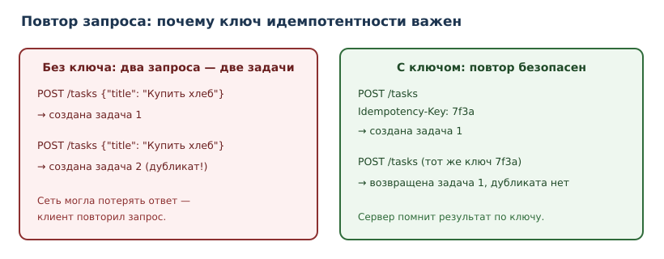

# Проект: асинхронный сборщик данных

<!-- syllanix:nav -->
**Навигация:** [← 47. Проект: HTTP API и база данных](47-project-api.md) · [Оглавление книги](../README.md) · [Далее: 49. Стиль, форматирование и именование кода →](49-style-naming.md)
<!-- /syllanix:nav -->

<!-- syllanix:topics -->
**Темы главы**
48.1. [Зачем этот проект](#зачем-этот-проект)  
48.2. [Что должно получиться](#что-должно-получиться)  
48.3. [Асинхронный клиент](#асинхронный-клиент)  
48.4. [Ограничение параллелизма](#ограничение-параллелизма)  
48.5. [Политика повторов](#политика-повторов)  
48.6. [Идемпотентность](#идемпотентность)  
48.7. [Наблюдаемость](#наблюдаемость)  
48.8. [Сборка проекта](#сборка-проекта)  
48.9. [Отмена и таймауты](#отмена-и-таймауты)  
48.10. [Тесты](#тесты)  
48.11. [Типичные ошибки](#типичные-ошибки)  
48.12. [Упражнения](#упражнения)  
48.13. [Проверка понимания](#проверка-понимания)  
48.14. [Что дальше](#что-дальше)  
<!-- /syllanix:topics -->


Последний проект — о программах, которые большую часть времени **ждут**.
Сетевой запрос, ответ базы, чтение файла: процессор простаивает, пока данные
идут по сети. Асинхронный код позволяет одному потоку обслуживать сотни
ожиданий одновременно. Но вместе с возможностями приходят новые способы
сломаться: перегрузка чужого сервиса, бесконечные повторы, «зависшие» задачи,
потерянные ошибки.

Мы построим **сборщик данных**: он принимает список адресов, конкурентно
загружает их, повторяет неудачные запросы с задержкой, сохраняет результат и
оставляет след для диагностики.

## Зачем этот проект

Асинхронность — не «более быстрый Python», а инструмент для задач, где узкое
место — ожидание ввода-вывода. Три инженерных навыка из этого проекта
применяются в любой системе, работающей с внешними сервисами:

1. **Ограничение параллелизма.** Слишком много одновременных запросов — это
   отказ в обслуживании чужого сервиса и ваших сокетов.
2. **Повторы с задержкой.** Сбой сети — норма, а не исключение; повтор должен
   быть обоснованным и ограниченным.
3. **Наблюдаемость.** Без логов и метрик невозможно понять, почему сборщик
   вернул 47 записей вместо 50.

## Что должно получиться

- вход: файл `urls.txt` со списком адресов;
- выход: `result.json` — успешно загруженные записи; `errors.json` — неудачи;
- ограничение: не более `K` одновременных запросов (например, `K = 5`);
- повторы: при сетевых ошибках и ответах `429`, `5xx` — до 4 попыток с
  задержками `1, 2, 4` секунды;
- таймаут на запрос — обязателен;
- каждая неудача фиксируется с адресом и причиной;
- итоговый отчёт: сколько успешно, сколько ошибок, сколько повторов.

## Асинхронный клиент

**Асинхронный клиент** — HTTP-клиент, который не блокирует цикл событий: пока
один запрос ждёт ответа, другие выполняются. В промышленном коде используют
`httpx` или `aiohttp`; в примерах этой главы сеть заменена управляемой
имитацией, потому что песочница книги запрещает сетевые вызовы.

```python
import httpx

RETRYABLE_STATUSES = {429, 500, 502, 503, 504}


class TransientError(Exception):
    """Ошибка, которую имеет смысл повторить."""


class HttpClient:
    def __init__(self, timeout: float = 10.0, limit: int = 5) -> None:
        self._client = httpx.AsyncClient(
            timeout=httpx.Timeout(timeout),
            limits=httpx.Limits(max_connections=limit),
            headers={"User-Agent": "syllanix-collector/1.0"},
        )

    async def get_json(self, url: str) -> dict:
        try:
            response = await self._client.get(url)
        except (httpx.TimeoutException, httpx.TransportError) as exc:
            raise TransientError(f"сетевая ошибка: {url}") from exc
        if response.status_code in RETRYABLE_STATUSES:
            raise TransientError(f"статус {response.status_code}: {url}")
        if response.status_code >= 400:
            raise httpx.HTTPStatusError(
                f"статус {response.status_code}",
                request=response.request,
                response=response,
            )
        return response.json()

    async def close(self) -> None:
        await self._client.aclose()
```

Две детали важны: **таймаут** (иначе задача может ждать вечно) и **лимит
соединений** (иначе клиент откроет сотни сокетов). Оба параметра — часть
контракта надёжности, а не «настройки на потом».

Клиент классифицирует ошибки у границы: таймауты, обрывы соединения и ответы
`429`/`5xx` он превращает в `TransientError`, а остальные `4xx` — в
`httpx.HTTPStatusError`. Благодаря этому политике повторов достаточно ловить
один тип, и она не зависит от деталей `httpx`.

## Ограничение параллелизма

Ограничение параллелизма реализуется **семафором**: счётчиком, который
пропускает не более `K` задач одновременно.

```python exec
import asyncio

async def collect_limited(count: int, limit: int) -> tuple[list[int], int]:
    semaphore = asyncio.Semaphore(limit)
    active = 0
    peak = 0

    async def job(number: int) -> int:
        nonlocal active, peak
        async with semaphore:
            active += 1
            peak = max(peak, active)
            await asyncio.sleep(0.01)   # имитация сетевого ожидания
            active -= 1
            return number

    results = await asyncio.gather(*(job(i) for i in range(count)))
    return list(results), peak

results, peak = asyncio.run(collect_limited(count=9, limit=3))
print("обработано:", len(results))
print("пик одновременно:", peak)
```

```output
обработано: 9
пик одновременно: 3
```

Семафор не ускоряет саму работу, он **ограничивает** её. Это осознанный
компромисс: мы жертвуем максимальной скоростью ради предсказуемой нагрузки на
внешний сервис и собственные ресурсы.

**Ограничение частоты** (rate limiting) — другое ограничение: сколько запросов
отправляется в единицу времени. Семафор его не обеспечивает: при быстрых
ответах `K` одновременных задач успевают отправить сотни запросов в секунду.
Если сервис задаёт квоту, нужен отдельный ограничитель — пауза между запусками
или token bucket. В этом проекте мы ограничиваем параллелизм, а частоту
оговариваем отдельно, чтобы не путать два разных механизма.


## Политика повторов

**Политика повторов** отвечает на три вопроса: что повторять, сколько раз и с
какой задержкой.

Что повторять:

- сетевые ошибки (таймаут, обрыв соединения);
- ответы `429 Too Many Requests` (после задержки);
- ответы `5xx`.

Что **не** повторять:

- `400`, `401`, `403`, `404` — повтор не изменит результат, только потратит
  время и нагрузку.

```python exec
RETRYABLE_STATUSES = {429, 500, 502, 503, 504}
for status in (200, 400, 401, 404, 429, 500, 503):
    verdict = "повторять" if status in RETRYABLE_STATUSES else "не повторять"
    print(status, "->", verdict)
```

```output
200 -> не повторять
400 -> не повторять
401 -> не повторять
404 -> не повторять
429 -> повторять
500 -> повторять
503 -> повторять
```

Тот же набор статусов использует `HttpClient` из предыдущего раздела: политика
и клиент не расходятся в том, что считать временным сбоем.

**Экспоненциальная задержка** (backoff) увеличивает паузу между попытками:
`1, 2, 4` секунды. Это снижает нагрузку на сбойную систему и даёт ей время
восстановиться. Полезно добавлять небольшой случайный разброс, чтобы клиенты
не повторяли синхронно («стадо»), но в учебном примере достаточно чистой
экспоненты.

```python exec
import asyncio

class TransientError(Exception):
    pass

async def flaky_fetch(attempt: int) -> str:
    if attempt < 3:
        raise TransientError(f"временный сбой, попытка {attempt}")
    return "данные получены"

async def with_retry(
    fetch, attempts: int = 4, base_delay: float = 1.0
) -> tuple[object, int]:
    last_error: Exception | None = None
    for attempt in range(1, attempts + 1):
        try:
            return await fetch(attempt), attempt
        except TransientError as exc:
            last_error = exc
            print(f"попытка {attempt}: {exc}")
            if attempt < attempts:
                delay = base_delay * (2 ** (attempt - 1))
                print(f"  пауза {delay:.3f} с")
                await asyncio.sleep(delay)
    raise RuntimeError("все попытки исчерпаны") from last_error

value, used = asyncio.run(with_retry(flaky_fetch, base_delay=0.01))
print(value)
print("попыток:", used)
```

```output
попытка 1: временный сбой, попытка 1
  пауза 0.010 с
попытка 2: временный сбой, попытка 2
  пауза 0.020 с
данные получены
попыток: 3
```

В демонстрации паузы сжаты до миллисекунд, чтобы пример выполнялся быстро; в
собранном проекте `base_delay=1.0`, то есть паузы `1` и `2` секунды перед второй
и третьей попытками (и `4` — перед четвёртой). `with_retry` возвращает не только
результат, но и номер успешной попытки: по нему `collect` считает повторы.

Повтор не должен быть бесконечным: ограничение попыток и общего времени —
обязательно. Иначе сбойный сервис получает бесконечный поток запросов, а
сборщик никогда не завершается.

## Идемпотентность

**Идемпотентность** — свойство операции давать тот же результат при повторном
выполнении. `GET` идемпотентен по определению: чтение не меняет состояние.
С `POST` сложнее: повторное создание задачи создаст дубликат.



Практические правила:

- для операций, которые можно повторять, используйте идемпотентные методы
  (`GET`, `PUT`, `DELETE`) там, где это уместно;
- для создания ресурсов передавайте **ключ идемпотентности** — уникальный
  идентификатор запроса; сервер сохраняет результат и при повторе с тем же
  ключом возвращает его, а не создаёт новую запись;
- в сборщике данных (только чтение) проблема дубликатов не возникает, но
  правило важно для любого кода, который что-то меняет.

## Наблюдаемость

**Наблюдаемость** — способность понять состояние системы по её выходам.
Минимальный набор для сборщика:

- **счётчики**: успешно, ошибок, повторов, отброшено;
- **логи** с полями: адрес, попытка, статус, длительность, идентификатор
  запуска;
- **итоговый отчёт** с числами, а не только «готово».

```python
import logging

logger = logging.getLogger("collector")


def log_request(
    *, url: str, attempt: int, status: int, duration_ms: float, run_id: str
) -> None:
    logger.info(
        "запрос завершён",
        extra={
            "url": url,
            "attempt": attempt,
            "status": status,
            "duration_ms": duration_ms,
            "run_id": run_id,
        },
    )
```

Структурированные поля позволяют искать «все ошибки по адресу X» и считать
статистику без регулярных выражений. Строка «что-то пошло не так» бесполезна:
в ней нет ни адреса, ни причины, ни попытки.

## Сборка проекта

Полный цикл в файле `collector.py` выглядит так:

```python
import argparse
import asyncio
import json
from pathlib import Path

async def collect(urls: list[str], client, limit: int = 5) -> dict:
    semaphore = asyncio.Semaphore(limit)
    results: list[dict] = []
    errors: list[dict] = []
    stats = {"ok": 0, "errors": 0, "retries": 0}

    async def one(url: str) -> None:
        async with semaphore:
            try:
                data, attempts = await with_retry(
                    lambda attempt: client.get_json(url), base_delay=1.0
                )
                stats["retries"] += attempts - 1
                results.append({"url": url, "data": data})
                stats["ok"] += 1
            except Exception as exc:  # намеренно широкий перехват на границе
                errors.append({"url": url, "error": str(exc)})
                stats["errors"] += 1

    await asyncio.gather(*(one(url) for url in urls))
    return {"results": results, "errors": errors, "stats": stats}

def build_parser() -> argparse.ArgumentParser:
    parser = argparse.ArgumentParser(description="Асинхронный сборщик данных")
    parser.add_argument("--urls", default="urls.txt", help="файл со списком адресов")
    parser.add_argument("--limit", type=int, default=5, help="одновременных запросов")
    parser.add_argument("--timeout", type=float, default=10.0, help="таймаут запроса")
    return parser

async def main(argv: list[str] | None = None) -> int:
    args = build_parser().parse_args(argv)
    urls = [
        line.strip()
        for line in Path(args.urls).read_text(encoding="utf-8").splitlines()
        if line.strip()
    ]
    client = HttpClient(timeout=args.timeout, limit=args.limit)
    try:
        report = await collect(urls, client, limit=args.limit)
    finally:
        await client.close()
    Path("result.json").write_text(
        json.dumps(report["results"], ensure_ascii=False, indent=2), encoding="utf-8"
    )
    Path("errors.json").write_text(
        json.dumps(report["errors"], ensure_ascii=False, indent=2), encoding="utf-8"
    )
    print(report["stats"])
    return 0 if not report["errors"] else 1

if __name__ == "__main__":
    raise SystemExit(asyncio.run(main()))
```

Четыре решения, которые стоит заметить:

1. **`finally`** гарантирует закрытие клиента даже при исключении.
2. **Ошибка одной задачи не останавливает остальные** — сборщик продолжает
   работу и фиксирует неудачу.
3. **Код возврата** отражает наличие ошибок: скрипт можно использовать в CI и
   мониторинге.
4. **Счётчик повторов** берётся из `with_retry`: `attempts - 1` — это число
   неудачных попыток перед успехом, поэтому `stats["retries"]` не остаётся
   нулём.

`if __name__ == "__main__"` превращает `main` в точку входа: без него запуск
файла только определил бы функции и ничего не сделал. `argparse` позволяет
запускать сборщик в CI с другим входным файлом и лимитами, не правя код:
`python collector.py --urls urls.txt --limit 5 --timeout 10`.

## Отмена и таймауты

Асинхронные задачи могут «зависнуть», если внешний сервис не отвечает.
`asyncio.timeout` ограничивает общее время операции, а отмена задачи
освобождает ресурсы.

```python
async def fetch_with_deadline(url: str, client, seconds: float = 10.0) -> dict:
    async with asyncio.timeout(seconds):
        return await client.get_json(url)
```

При отмене внутри задачи может быть занятый ресурс; используйте
`try/finally` или асинхронные контекстные менеджеры, чтобы освободить его.
Подавление `CancelledError` без повторного поднятия — ошибка: задача будет
считать себя выполненной, хотя её прервали.

## Тесты

```python
import asyncio

from collector import collect


class FakeClient:
    def __init__(self, responses: dict[str, object]) -> None:
        self.responses = responses
        self.calls: list[str] = []

    async def get_json(self, url: str):
        self.calls.append(url)
        value = self.responses[url]
        if isinstance(value, Exception):
            raise value
        return value


class SlowClient:
    def __init__(self, delay: float = 0.01) -> None:
        self.delay = delay
        self.active = 0
        self.peak = 0

    async def get_json(self, url: str) -> dict:
        self.active += 1
        self.peak = max(self.peak, self.active)
        try:
            await asyncio.sleep(self.delay)
            return {"url": url}
        finally:
            self.active -= 1


def test_collect_records_errors_without_stopping():
    client = FakeClient({
        "https://a.example": {"id": 1},
        "https://b.example": RuntimeError("сбой"),
        "https://c.example": {"id": 3},
    })
    report = asyncio.run(collect(list(client.responses), client))
    assert report["stats"]["ok"] == 2
    assert report["stats"]["errors"] == 1
    assert [error["url"] for error in report["errors"]] == ["https://b.example"]


def test_limit_is_respected_never_exceeded():
    client = SlowClient()
    urls = [f"https://example.com/{number}" for number in range(12)]
    report = asyncio.run(collect(urls, client, limit=3))
    assert report["stats"]["ok"] == 12
    assert client.peak <= 3
```

Тест с `FakeClient` не ходит в сеть: он детерминирован, быстр и проверяет
именно логику обработки ошибок. Тест с `SlowClient` считает активные задачи и
проверяет, что семафор не пропустил больше `K` одновременно.

## Типичные ошибки

1. **`await` внутри цикла без параллелизма.** `for url in urls: await fetch(url)`
   выполняет запросы последовательно; если хотите конкурентность — `gather`.
2. **Бесконечные повторы.** Ограничивайте попытки и общее время.
3. **Повтор `4xx`.** Бессмысленно и вредно.
4. **Отсутствие таймаута.** «Зависшая» задача не завершится никогда.
5. **`time.sleep` вместо `asyncio.sleep`.** Синхронный сон блокирует весь цикл
   событий, и остальные задачи не могут выполняться.
6. **Неконтролируемое число задач.** `gather` на 100 000 адресов создаст
   100 000 задач и исчерпает память; используйте лимит и очереди.
7. **Подавление `CancelledError`.** Задача должна корректно завершаться.
8. **Логи без идентификаторов.** Невозможно сопоставить записи одного запуска.

## Упражнения

### 1. Почему конкурентно быстрее {#ex-ch48-01}

Объясните, почему 10 запросов по одной секунде последовательно занимают около
10 секунд, а конкурентно — около одной. В каком случае конкурентность не
поможет?

### 2. Семафор {#ex-ch48-02}

Объясните, что произойдёт, если убрать семафор. Какие риски для внешнего
сервиса и для вашей программы?

### 3. Политика повторов {#ex-ch48-03}

Составьте таблицу: тип ошибки → повторять или нет → почему. Включите таймаут,
обрыв соединения, `429`, `400`, `500`, `404`.

### 4. Экспоненциальная задержка {#ex-ch48-04}

Вычислите задержки для 5 попыток при базе 1 секунда. Почему чистую экспоненту
часто дополняют случайным разбросом?

### 5. Таймауты {#ex-ch48-05}

Где нужно ставить таймаут: на отдельный запрос, на всю задачу, на весь запуск?
Приведите аргументы и предложите значения.

### 6. Отмена задачи {#ex-ch48-06}

Что произойдёт с открытым соединением, если задачу отменить? Как гарантировать
освобождение ресурса?

### 7. Ошибки не останавливают сбор {#ex-ch48-07}

Почему ошибка одного адреса не должна останавливать остальные? Как сообщить о
частичном успехе вызывающему коду?

### 8. Наблюдаемость {#ex-ch48-08}

Предложите набор полей для структурированного лога одного запроса. Какие
метрики вы бы собирали для сборщика?

### 9. Идемпотентность {#ex-ch48-09}

Почему `GET` можно повторять без ключа идемпотентности, а `POST` — нет?
Приведите пример сценария, где повтор `POST` создаёт проблему.

### 10. Мини-релиз сборщика {#ex-ch48-10}

Опишите запуск сборщика в CI: входной файл, лимиты, таймауты, коды возврата,
сохранение артефактов, уведомление о частичном успехе. Что должно быть
зелёным до публикации?

## Проверка понимания

1. Чем конкурентность отличается от параллелизма и почему для сетевых
   запросов достаточно первой?
2. Зачем нужен семафор и что произойдёт без него?
3. Какие ошибки имеет смысл повторять и почему?
4. Что такое экспоненциальная задержка и какую проблему она решает?
5. Почему операция должна быть идемпотентной, если её можно повторить?
6. Что делает `asyncio.timeout` и почему таймаут обязателен?
7. Какие поля должны быть в структурированном логе запроса?

## Что дальше

На этом основной маршрут книги завершён. Вы прошли путь от первого выражения
до асинхронного проекта с ограничениями, повторами и наблюдаемостью. Дальше —
практика: расширяйте проекты, читайте чужой код, участвуйте в открытых
проектах и возвращайтесь к главам как к справочнику. Хороший следующий шаг —
взять один из проектов и довести его до состояния, которым не стыдно
поделиться: тесты, документация, CI, релиз.

<!-- syllanix:nav -->
**Перед этой главой:** [47. Проект: HTTP API и база данных](47-project-api.md)
**Связанные главы:** [10. Ошибки и исключения](10-errors-exceptions.md), [19. Файлы, пути и текстовые форматы](19-files-formats.md), [37. Время, даты и логирование](37-time-logging.md), [39. Асинхронность: asyncio](39-asyncio.md)
**Далее:** [49. Стиль, форматирование и именование кода →](49-style-naming.md)
<!-- /syllanix:nav -->
