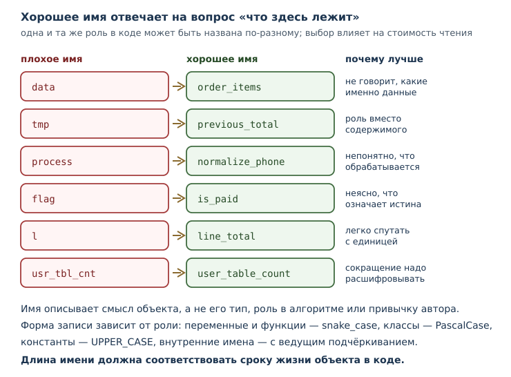
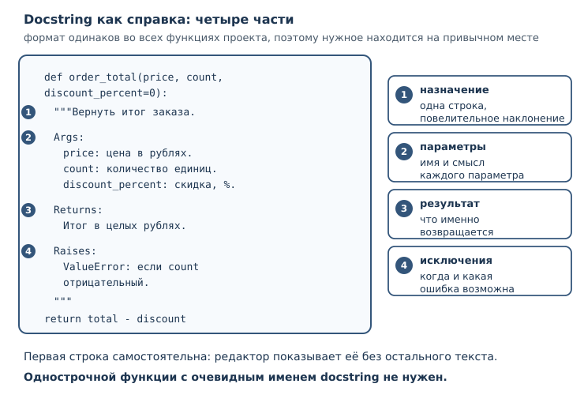

# Стиль, форматирование и именование кода

<!-- syllanix:nav -->
**Навигация:** [← 48. Проект: асинхронный сборщик данных](48-project-async.md) · [Оглавление книги](../README.md) · [Далее: 50. Pythonic-код и типичные ловушки →](50-pythonic-gotchas.md)
<!-- /syllanix:nav -->

<!-- syllanix:topics -->
**Темы главы**
49.1. [Что вы сможете после этой главы](#что-вы-сможете-после-этой-главы)  
49.2. [Почему стиль — инженерный инструмент](#why-style)  
49.3. [PEP 8: что нормирует стандарт](#pep8)  
49.4. [Форматтер и линтер: что автоматизируется](#tools)  
49.5. [Соглашение об именовании](#naming)  
49.6. [Комментарии: объяснять причину](#comments)  
49.7. [Стиль docstring](#docstrings)  
49.8. [Магические числа и константы](#magic-numbers)  
49.9. [Как стиль закрепляется в проекте](#adoption)  
49.10. [Типичные ошибки](#mistakes)  
49.11. [Упражнения](#упражнения)  
49.12. [Проверка понимания](#проверка-понимания)  
49.13. [Что дальше](#что-дальше)  
<!-- /syllanix:topics -->


Код читают чаще, чем пишут. Автор проводит за набором текста часы, а
коллеги — годы: они разбираются в чужой логике при ревью, ищут причину сбоя,
добавляют функцию через полгода после того, как автор уволился. Поэтому
профессиональный код оценивают не только по тому, что он делает, но и по тому,
насколько легко его понять и безопасно изменить.

Стиль — это способ снизить стоимость чтения. Он не про красоту и не про
личный вкус: одинаково оформленный код быстрее разбирать, в нём легче
замечать настоящие ошибки, а разногласия о запятых заменяются одной командой
форматтера. В этой главе мы разберём, что именно нормирует PEP 8, как
передать оформление инструментам, каких имён избегать и как писать
комментарии и docstring, которые помогают, а не мешают.

## Что вы сможете после этой главы

К концу главы вы будете уметь следующее.

- объяснять, зачем команде единый стиль кода и почему это инженерное решение;
- применять базовые правила PEP 8 и понимать, где стандарт оставляет выбор;
- передавать форматирование и проверки инструментам, а не делать их вручную;
- выбирать имена по соглашению об именовании и объяснять свой выбор;
- писать комментарии, которые объясняют причину, а не пересказывают код;
- оформлять docstring так, чтобы им можно было пользоваться как справкой;
- заменять магические числа именованными константами.

## Почему стиль — инженерный инструмент {#why-style}

Представьте две функции, которые делают одно и то же.

```python
def c(a, b, d=0):
    t = a * b
    return t - t * d // 100
```

```python
def order_total(price, count, discount_percent=0):
    total = price * count
    return total - total * discount_percent // 100
```

Поведение одинаковое, но вторую функцию можно понять, не заглядывая в тело:
видно, что считаются деньги, что скидка задана в процентах и что результат —
целые рубли. Стиль здесь работает как документация, которую невозможно
забыть обновить.

**Стиль кода** — согласованный набор правил оформления, который делает код
единообразным и предсказуемым для читателя. У этого определения два важных
следствия.

Первое: стиль — про **согласованность**, а не про оригинальность. Два
разработчика могут предпочитать разные способы расстановки пробелов; если
каждый следует своему вкусу, файл становится пёстрым. Единое правило, даже не
идеальное, читается лучше, чем идеальные правила вразнобой.

Второе: стиль — часть **инструментов**, а не ритуал. Форматтер убирает
обсуждение оформления из ревью; линтер ловит то, что человек пропускает
усталым глазом; проверка типов находит несовместимые вызовы. Всё это снижает
число дефектов и стоимость сопровождения.

У стиля есть и измеримая польза для истории изменений. Если весь код оформлен
одинаково, диффы показывают смысловые правки, а не переставленные пробелы.
Одна перемешанная с форматированием правка способна скрыть настоящую ошибку в
сотне строк шума.

## PEP 8: что нормирует стандарт {#pep8}

**PEP 8** — официальное руководство по стилю кода Python: отступы, пробелы,
длина строк, именование. Оно входит в серию документов PEP (Python Enhancement
Proposal), в которых сообщество описывает устройства языка и договорённости
вокруг него.

PEP 8 — не синтаксис. Код, нарушающий его, работает, и интерпретатор не
скажет ни слова. Это договорённость людей, которую поддерживают инструменты.
Название пишется с пробелом: PEP 8.

Перечислим то, что встречается чаще всего.

**Отступы.** Четыре пробела на уровень, табуляция не используется. Это
правило вы уже применяли, когда писали блоки; теперь оно стало частью
договорённости о стиле.

**Длина строки.** PEP 8 рекомендует не превышать 79 символов. Практика
современных инструментов иная: `black` и `ruff format` по умолчанию
переносят строки после 88 символов. Обе границы разумны, но выбрать нужно
одну и зафиксировать в конфигурации, иначе форматтер и стандарт будут спорить
друг с другом.

**Пробелы.** Вокруг операторов присваивания и сравнения — по одному пробелу;
после запятой — пробел, перед ней — нет. Внутри скобок лишних пробелов нет.

```python
total = price * count          # пробелы вокруг оператора
print(total, "рублей")         # пробел после запятой
```

Знак `=` ведёт себя по-разному в зависимости от смысла: в присваивании
пробелы есть, а в значении параметра по умолчанию и в именованном аргументе
их нет, потому что там `=` обозначает не присваивание.

```python
def order_total(price, count, discount=0):
    return price * count

result = order_total(price=250, count=3, discount=10)
```

**Пустые строки.** Две пустые строки между определениями функций верхнего
уровня, одна — между методами внутри класса. Внутри тела функции пустая
строка разделяет логические части.

**Импорты.** Каждый импорт на своей строке, группы разделены пустой строкой:
сначала стандартная библиотека, затем сторонние пакеты, затем модули проекта.

```python
import math
from pathlib import Path

from pricing import order_total

import cli
```

**Сравнения с `None`.** По PEP 8 сравнение с `None` выполняется через `is` и
`is not`, а не через `==`: `None` — единственный объект своего типа, и
проверка идентичности точнее выражает намерение.

Следовать всем правилам вручную не нужно и вредно: на это уходит внимание,
которое лучше потратить на логику. Правила существуют, чтобы их применял
инструмент.

## Форматтер и линтер: что автоматизируется {#tools}

Разделение обязанностей между инструментами мы уже обсуждали в главе о
структуре проекта ([линтеры и форматтеры](33-project-tooling.md#quality)).
Здесь важно понять, что именно каждый из них делает с точки зрения стиля.

**Форматтер** переписывает код по правилам оформления: отступы, пробелы,
кавычки, переносы. Он не меняет поведение программы и не спорит о смысле.
Современный стандарт — `black` и совместимый с ним `ruff format`; они дают
почти одинаковый результат, поэтому переход между ними почти незаметен.

Посмотрим на файл, оформленный небрежно:

```python
def order_total(price,count,discount = 0):
    total=price*count
    return total-total*discount//100


def format_receipt(price,count,discount=0):
    amount=order_total(price,count,discount)
    return f"Товаров: {count}, к оплате: {amount} рублей"
```

Команда проверки показывает, что изменит форматтер, ничего не записывая:

```console
$ ruff format --diff pricing.py
--- pricing.py
+++ pricing.py
@@ -1,8 +1,8 @@
-def order_total(price,count,discount = 0):
-    total=price*count
-    return total-total*discount//100
+def order_total(price, count, discount=0):
+    total = price * count
+    return total - total * discount // 100
 
 
-def format_receipt(price,count,discount=0):
-    amount=order_total(price,count,discount)
+def format_receipt(price, count, discount=0):
+    amount=order_total(price, count, discount)
     return f"Товаров: {count}, к оплате: {amount} рублей"

1 file would be reformatted
```

Обратите внимание: изменилось только оформление. Если запустить команду без
`--diff`, файл будет перезаписан, и обсуждать расстановку запятых на ревью
больше не придётся. `black --check` делает то же самое в режиме проверки: он
ничего не меняет, но сообщает, какие файлы отформатированы иначе.

**Линтер** ищет то, что нельзя исправить перестановкой пробелов: неиспользуемые
импорты, подозрительные сравнения, вводящие в заблуждение имена. Вот файл с
несколькими типичными нарушениями:

```python
import os
import sys


def order_total(price, count, discount=0):
    total = price * count
    l = total - total * discount // 100
    if discount == True:
        return l
    return l
```

Проверка сообщает о каждом нарушении отдельно, с именем правила:

```console
$ ruff check --output-format=concise discounts.py
discounts.py:1:8: F401 [*] `os` imported but unused
discounts.py:2:8: F401 [*] `sys` imported but unused
discounts.py:7:5: E741 Ambiguous variable name: `l`
discounts.py:8:8: E712 Avoid equality comparisons to `True`; use `discount:` for truth checks
Found 4 errors.
[*] 2 fixable with `--fix` (1 unsafe fix available with `--fix --unsafe-fixes`).
```

Коды правил полезно знать: `F401` — неиспользуемый импорт, `E741` — имя,
которое легко спутать (`l`, `O`, `I`), `E712` — сравнение с `True` там, где
достаточно самого значения. Часть нарушений линтер исправляет сам ключом
`--fix`, остальные требуют решения человека.

**Проверка типов** идёт дальше и сверяет значения с аннотациями. Инструмент
`mypy` читает подсказки типов и сообщает о несовместимых вызовах ещё до
запуска программы.

```python
def format_total(total: int) -> str:
    return f"Итого: {total} рублей"


def main() -> None:
    total = format_total("675")
    print(total)
```

```console
$ mypy report.py
report.py:6: error: Argument 1 to "format_total" has incompatible type "str"; expected "int"  [arg-type]
Found 1 error in 1 file (checked 1 source file)
```

Сообщение указывает файл, строку, аргумент и ожидаемый тип. Подробнее о mypy —
в главе про [аннотации типов](31-typing.md#mypy).

Все три инструмента настраиваются в `pyproject.toml` и запускаются в
непрерывной интеграции: тогда стиль проверяется автоматически, а не по
настроению ревьюера.

## Соглашение об именовании {#naming}

**Соглашение об именовании** — правила выбора имён: snake_case, PascalCase,
UPPER_CASE, осмысленность, длина, отсутствие вводящих в заблуждение
сокращений.

В Python приняты четыре формы записи, и каждая связана с ролью объекта.

| Что именуем | Форма | Пример |
|---|---|---|
| переменные и функции | `snake_case` | `order_total`, `max_count` |
| классы и исключения | `PascalCase` | `Order`, `ValidationError` |
| константы | `UPPER_CASE` | `MAX_RETRIES`, `DEFAULT_TIMEOUT` |
| внутренние имена | `_snake_case` | `_cache`, `_normalize` |

Форма записи — только начало. Осмысленность важнее: имя должно отвечать на
вопрос «что здесь лежит» без чтения тела.

```python
total = 0
for item in items:
    total += item.price
```

```python
s = 0
for x in y:
    s += x.price
```

Второй вариант короче на несколько символов и дороже на минуту чтения. Имена
`x`, `y`, `s` не сообщают ничего; в крупном файле через час их значение
придётся восстанавливать по контексту.



Несколько практических правил.

**Длина.** Короткое имя годится для очевидного контекста (`i` в маленьком
цикле), длинное — для того, что живёт долго. Слишком длинные имена тоже
вредны: `total_price_of_all_items_in_cart_with_discount` превращает код в
простыню.

**Единицы измерения** полезно включать в имя: `timeout_seconds`,
`price_kopecks`. Это защищает от ошибок, когда рядом живут значения в разных
единицах.

**Логические значения** называют так, чтобы они читались как утверждение:
`is_active`, `has_access`, `can_retry`. Тогда условие `if is_active:` читается
почти как фраза.

**Не перекрывайте встроенные имена.** Если связать имя `list`, `sum` или
`print` со своим значением, стандартная функция перестанет работать, и ошибка
проявится не там, где она возникла. Линтер подскажет о перекрытии, но лучше
не создавать его вовсе.

**Сокращения** допустимы только общепринятые. `url`, `id`, `http` понятны
всем, `usr_tbl_cnt` — нет. Если приходится расшифровывать имя вслух, его стоит
переписать.

Имя — это часть контракта. Читатель верит имени, поэтому обманывать нельзя:
функция `get_user` не должна изменять данные, а переменная `count` не должна
хранить список.

## Комментарии: объяснять причину {#comments}

**Стиль комментариев** — правила работы с пояснениями в коде: объяснять
«почему», не пересказывать код, поддерживать актуальность, не комментировать
очевидное.

Комментарий оправдан, когда код не может рассказать важное сам. Сравните:

```python
# умножаем цену на количество
total = price * count
```

```python
# Скидка считается в целых рублях: копейки округляются вниз,
# чтобы итог совпадал с бухгалтерским расчётом.
discount = total * 10 // 100
```

Первый комментарий бесполезен: он повторяет то, что видно из строки. Второй
объясняет решение, которое нельзя вывести из кода: почему используется `//`,
а не `/`, и откуда взялось правило.

Проверим, что комментарии не влияют на результат, — это единственное, о чём
стоит помнить, глядя на примеры выше:

```python exec
total = 250 * 3
discount = total * 10 // 100
print(total - discount)
```

```output
675
```

Ещё несколько правил, которые экономят время.

**Пишите о причине, а не о механике.** «Почему так» переживает рефакторинг;
«что здесь происходит» устаревает при первой же правке.

**Следите за актуальностью.** Устаревший комментарий хуже отсутствующего: он
уверенно сообщает неправду. Если меняете поведение, проверьте комментарии
рядом.

**Не оставляйте закомментированный код.** Он не исполняется, не проверяется и
постепенно превращается в мусор. История изменений хранит старые версии лучше,
чем комментарий.

**Пометки о будущей работе** полезны, если у них есть владелец и срок. В
командах их оформляют единообразно и проверяют линтером: правила группы `TD`
следят за тем, чтобы такая пометка содержала автора и описание задачи, а не
висела безымянной годами. Безымянная пометка — это способ забыть о проблеме,
а не напоминание.

**Не дублируйте docstring.** Если функция уже описана строкой документации,
комментарий перед ней обычно лишний.

**Комментарии и язык.** В русскоязычной команде комментарии пишут по-русски,
код и имена — латиницей. Главное — единообразие: смесь двух языков в одном
файле читается хуже любого из них.

## Стиль docstring {#docstrings}

Docstring — строковый литерал первым оператором функции, класса или модуля
([подробнее](07-functions.md#docstring)). Он остаётся частью объекта и служит
справкой: его показывают `help()`, среды разработки и генераторы
документации.

**Стиль docstring** — согласованный формат описания: краткое назначение,
параметры, возвращаемое значение, исключения. Формат важен не меньше
содержания: читатель привыкает к структуре и находит нужное в привычном месте.

Самый распространённый формат — Google style. Первая строка — короткое
описание в повелительном наклонении, затем пустая строка, затем разделы.

```python exec
def order_total(price, count, discount_percent=0):
    """Вернуть итог заказа в целых рублях.

    Args:
        price: цена единицы товара в рублях.
        count: количество единиц.
        discount_percent: скидка в процентах от суммы.

    Returns:
        Итог заказа после скидки, в целых рублях.

    Raises:
        ValueError: если количество отрицательное.
    """
    total = price * count
    return total - total * discount_percent // 100

print(order_total(250, 3, 10))
print(order_total.__doc__.splitlines()[0])
```

```output
675
Вернуть итог заказа в целых рублях.
```

Первая строка печатается как краткая справка. Именно её видят в подсказке
редактора, поэтому она должна быть самостоятельной: «Вернуть итог заказа», а
не «Эта функция делает то, что описано ниже».

Другие форматы решают ту же задачу иначе. NumPy style перечисляет параметры
столбцом под заголовком `Parameters`, reStructuredText (его использует Sphinx)
— директивами `:param:` и `:returns:`. Выбор формата — вопрос договорённости в
проекте; смешивать форматы в одном файле не стоит.

Docstring нужен не каждой функции. Однострочная функция с очевидным именем
(`def double(n): return n * 2`) в пояснении не нуждается. Но как только у
функции появляются нетривиальные параметры, побочные эффекты или исключения,
docstring становится частью контракта.

Проверим, что бывает без него:

```python exec
def area(width, height):
    return width * height

print(area.__doc__)
```

```output
None
```

Значение `None` означает, что документации нет. Это не ошибка, но читателю
придётся выяснять смысл параметров самостоятельно.



## Магические числа и константы {#magic-numbers}

**Магическое число** — числовая или строковая константа в коде без объяснения
смысла. Заменяется именованной константой.

```python
def seconds_per_day(days):
    return days * 86400
```

Число `86400` знает наизусть не каждый. Сравните:

```python
SECONDS_PER_MINUTE = 60
MINUTES_PER_HOUR = 60
HOURS_PER_DAY = 24


def seconds_per_day(days):
    return days * HOURS_PER_DAY * MINUTES_PER_HOUR * SECONDS_PER_MINUTE
```

Поведение то же, но теперь видно, из чего складывается сутки. Проверим:

```python exec
SECONDS_PER_MINUTE = 60
MINUTES_PER_HOUR = 60
HOURS_PER_DAY = 24

def seconds_per_day(days):
    return days * HOURS_PER_DAY * MINUTES_PER_HOUR * SECONDS_PER_MINUTE

print(seconds_per_day(2))
```

```output
172800
```

Именованная константа полезна ещё и тем, что её можно изменить в одном месте.
Если завтра правило изменится, поиск по имени найдёт все места использования,
а поиск по числу — нет.

Есть и обратная крайность: не стоит превращать в константу каждое число.
`range(2, 10)` в локальном цикле читается нормально, а `START_INDEX = 2` в
единственном месте добавляет лишний уровень косвенности. Правило простое:
именуйте то, у чего есть **смысл**, а не то, что просто встретилось.

Где объявлять константы? В начале модуля, сразу после импортов: тогда они
видны и доступны всем функциям модуля. Если константа нужна нескольким
модулям, её выносят в отдельный модуль настроек — об этом в главе о структуре
проекта.

## Как стиль закрепляется в проекте {#adoption}

Правила работают, только если их применяет инструмент, а не память.

**Один форматтер на проект.** Два форматтера с разными настройками будут
переписывать файлы друг за другом. Выберите один, зафиксируйте в
`pyproject.toml` и запускайте одинаково у всех.

**Форматтер — до ревью, линтер — в ревью.** Переформатирование смешивается с
смысловыми правками и прячет их. Хорошая привычка — отдельный коммит «только
форматирование», а затем коммиты с изменениями.

**Не переформатируйте чужой код без причины.** Массовая правка оформления в
файле, который вы не меняли по смыслу, создаёт шум в истории и конфликты в
ветках. Стиль — повод договориться, а не повод переписать всё вокруг.

**Проверки — в непрерывной интеграции.** Если проверка стиля обязательна, она
должна запускаться командой и давать понятный отказ
([непрерывная интеграция](45-git-ci-releases.md#непрерывная-интеграция)).
Ручная проверка «когда вспомним» не работает.

**Стиль проекта важнее личного вкуса.** Придя в команду, вы принимаете её
правила оформления — как принимаете язык общения. Исключения обсуждаются, но
не вводятся молча.

## Типичные ошибки {#mistakes}

1. **Считать стиль вкусовщиной.** Единые правила снижают стоимость чтения и
   ревью; это измеримая польза, а не эстетика.
2. **Форматировать вручную.** Пробелы и переносы должен расставлять
   инструмент, иначе они отвлекают от логики.
3. **Смешивать форматирование и смысловые правки.** Дифф становится
   нечитаемым, а ошибка — незаметной.
4. **Давать имена по типу, а не по смыслу.** `data`, `info`, `tmp`, `value` не
   объясняют, что внутри.
5. **Перекрывать встроенные имена.** Своя функция `sum` ломает ожидания
   читателя и стандартную библиотеку.
6. **Комментировать очевидное.** Комментарий «умножаем на два» рядом с `n * 2`
   занимает место и не добавляет знания.
7. **Оставлять устаревшие комментарии.** Они хуже отсутствующих: уверенно
   вводят в заблуждение.
8. **Писать docstring без разделов.** Сплошной абзац трудно читать; параметры
   и возвращаемое значение должны быть на своих местах.
9. **Разбрасывать магические числа.** `86400` и `0.15` без имени невозможно
   проверить и опасно менять.
10. **Превращать каждое число в константу.** Косвенность ради косвенности
    усложняет код не меньше, чем магические числа.

## Упражнения

### 1. Нарушения оформления {#ex-ch49-01}

Найдите нарушения PEP 8 в фрагменте и запишите исправленный вариант:

```python
def area(width,height):
    result=width*height
    return result
```

Объясните, какие именно правила нарушены.

### 2. Длинная строка {#ex-ch49-02}

Перепишите строку так, чтобы она не превышала 88 символов, не меняя смысла:

```python
print(f"Товаров: {count}, сумма без скидки: {total}, скидка: {discount}, к оплате: {total - discount} рублей")
```

### 3. Именование переменных {#ex-ch49-03}

Переименуйте переменные так, чтобы код читался без пояснений:

```python
a = 250
b = 3
c = 10
d = a * b
e = d * c // 100
print(d - e)
```

### 4. Формы записи {#ex-ch49-04}

Для каждого имени определите, что оно обозначает, и проверьте, соответствует
ли форма роли: `max_retries`, `HttpClient`, `parse_config`, `DEFAULT_TIMEOUT`,
`_cache`, `OrderError`.

### 5. Плохие имена {#ex-ch49-05}

Объясните, чем плохи имена `data`, `tmp`, `process`, `flag`, `l`. Предложите
по одному осмысленному варианту для каждого, указав контекст, в котором имя
уместно.

### 6. Комментарий о причине {#ex-ch49-06}

Замените комментарий, пересказывающий код, комментарием о причине:

```python
# прибавляем единицу к счётчику
counter += 1
```

Придумайте ситуацию, в которой такой код действительно требует пояснения.

### 7. Docstring {#ex-ch49-07}

Напишите docstring в стиле Google для функции:

```python
def ticket_price(age, base=600):
    if age < 18:
        return base // 2
    return base
```

Опишите параметры, возвращаемое значение; проверьте первую строку через
`__doc__`.

### 8. Магические числа {#ex-ch49-08}

Замените магические числа именованными константами, не меняя результата:

```python
def late_fee(amount):
    return amount + amount * 5 // 100
```

Проверьте, что результат совпадает для `amount = 200`.

### 9. Разбор сообщений линтера {#ex-ch49-09}

Даны сообщения:

```text
report.py:3:1: F401 `os` imported but unused
report.py:7:5: E741 Ambiguous variable name: `l`
report.py:9:8: E712 Avoid equality comparisons to `True`; use `flag:` for truth checks
```

Объясните, что нарушено в каждом случае и как исправить код.

### 10. Мини-задача: привести модуль в порядок {#ex-ch49-10}

Перепишите модуль целиком: оформление, имена, магические числа, docstring,
комментарии.

```python
import os
def c(p,q,d = 0):
    t=p*q
    # вычитаем скидку
    l=t-t*d//100
    return l
```

Что изменилось и почему? Проверьте, что функция возвращает то же значение для
`c(250, 3, 10)`.

## Проверка понимания

1. Почему единый стиль кода называют инженерным инструментом, а не вкусовщиной?
2. Что нормирует PEP 8 и почему нарушение этих правил не ошибка для
   интерпретатора?
3. Чем занимается форматтер, а чем — линтер?
4. Что проверяет mypy и почему это не заменяет тесты?
5. Какие формы записи имён приняты для переменных, классов, констант?
6. Почему не стоит перекрывать встроенные имена?
7. Чем полезный комментарий отличается от бесполезного?
8. Какие разделы обычно включает docstring в стиле Google?
9. Что такое магическое число и как его заменить?
10. Почему массовое переформатирование чужого кода не приветствуется?

## Что дальше

Вы научились делать код единообразным и объяснимым. Но стиль — только часть
профессиональной привычки: следующий шаг — идиомы языка и ловушки, на которых
спотыкаются даже опытные разработчики. О них — в главе о Pythonic-коде.

<!-- syllanix:nav -->
**Перед этой главой:** [33. Структура проекта, зависимости и инструменты](33-project-tooling.md)
**Связанные главы:** [01. Зачем Python и как устроена эта книга](01-introduction.md), [02. Первая программа: вычисления и вывод](02-first-program.md), [03. Значения, имена, объекты и типы](03-values-names-objects.md), [07. Функции: параметры, аргументы и области видимости](07-functions.md), [09. Модули, пакеты и импорты](09-modules.md), [10. Ошибки и исключения](10-errors-exceptions.md), [25. Объекты и классы](25-objects-classes.md), [31. Аннотации типов и статическая проверка](31-typing.md)
**Далее:** [50. Pythonic-код и типичные ловушки →](50-pythonic-gotchas.md)
<!-- /syllanix:nav -->
