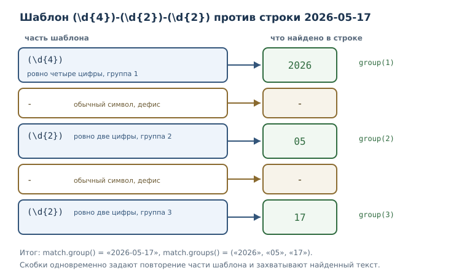
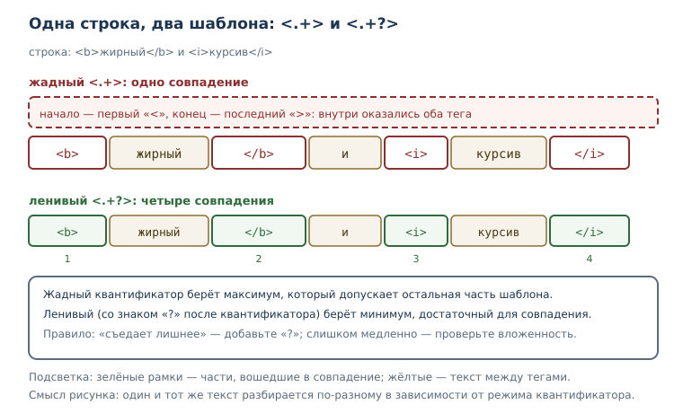

# Регулярные выражения

<!-- syllanix:nav -->
**Навигация:** [← 50. Pythonic-код и типичные ловушки](50-pythonic-gotchas.md) · [Оглавление книги](../README.md) · [Далее: 52. Алгоритмическое мышление: сложность и выбор структур →](52-complexity.md)
<!-- /syllanix:nav -->

<!-- syllanix:topics -->
**Темы главы**
51.1. [Что вы сможете после этой главы](#что-вы-сможете-после-этой-главы)  
51.2. [Зачем нужны регулярные выражения](#why)  
51.3. [Первый шаблон: поиск по структуре](#first-pattern)  
51.4. [Классы символов](#classes)  
51.5. [Квантификаторы](#quantifiers)  
51.6. [Якоря и границы](#anchors)  
51.7. [Группы и альтернативы](#groups)  
51.8. [Жадность и ленивость](#greedy)  
51.9. [Флаги](#flags)  
51.10. [Модуль re: основные функции](#re-module)  
51.11. [Практика: проверки, логи, замены](#practice)  
51.12. [Когда регулярные выражения — плохой выбор](#limits)  
51.13. [Типичные ошибки](#mistakes)  
51.14. [Упражнения](#упражнения)  
51.15. [Проверка понимания](#проверка-понимания)  
51.16. [Что дальше](#что-дальше)  
<!-- /syllanix:topics -->


До сих пор работа с текстом опиралась на точные подстроки и методы строк:
найти `"error"`, разбить по запятой, заменить слово. Этого достаточно, пока
известно точное содержимое. Но часто нужна не подстрока, а **структура**:
дата в формате «четыре цифры, дефис, две цифры, дефис, две цифры», номер
телефона, артикул из двух букв и четырёх цифр, строка журнала, начинающаяся
с отметки времени. Для таких задач и придуманы **регулярные выражения
(regex)** — шаблоны, описывающие не конкретный текст, а его форму.

Регулярные выражения — мощный инструмент и одновременно источник трудно
читаемого кода. Поэтому в главе мы будем не только разбирать синтаксис, но и
учиться вовремя останавливаться: если задачу решают строковые методы, лучше
взять их.

## Что вы сможете после этой главы

- писать шаблоны с классами символов, квантификаторами и якорями;
- извлекать части совпадения через группы, в том числе именованные;
- понимать разницу между жадным и ленивым сопоставлением;
- пользоваться функциями модуля `re` и объектом `Match`;
- включать нужные флаги и объяснять, что они меняют;
- проверять форматы, разбирать строки журнала и делать замены по шаблону;
- узнавать задачи, где регулярные выражения — плохой выбор.

## Зачем нужны регулярные выражения {#why}

Сравним две задачи. Первая — найти в тексте слово «кот». Здесь хватает
строкового метода. Вторая — найти все даты в формате `2026-05-17`, где цифры
могут быть любыми. Перебирать все возможные даты бессмысленно: их слишком
много, а нужен шаблон «четыре цифры, дефис, две цифры, дефис, две цифры».

Регулярное выражение задаёт именно такой шаблон. В Python его компилирует и
исполняет модуль стандартной библиотеки `re`; сами шаблоны записывают
строками, обычно «сырыми» — о них ниже.

Правило выбора простое. Точная подстрока, фиксированный префикс или суффикс,
разбиение по одному символу — это строковые методы: `in`, `startswith`,
`endswith`, `split`, `replace`. Регулярное выражение нужно, когда важна
структура: повторы, классы символов, необязательные части, группы.
Начинающих обычно тянет решать шаблоном всё подряд; опытные разработчики
сначала спрашивают, хватит ли `str`.

## Первый шаблон: поиск по структуре {#first-pattern}

Самая частая операция — найти первое совпадение. Функция `re.search`
возвращает объект `Match` или `None`.

```python exec
import re

text = "заказ 42 от 2026-05-17"
match = re.search(r"\d+", text)
print(match.group())
print(match.start(), match.end())
```

```output
42
6 8
```

Шаблон `\d+` означает «одна или более цифр». `search` ищет совпадение в любом
месте строки, а `Match` хранит найденный фрагмент и его позицию: `start` и
`end` — индексы начала и конца. Метод `group()` возвращает сам текст
совпадения.

Обратите внимание на `r` перед строкой: `r"\d+"` — «сырая» строка, в которой
обратная косая черта не начинает escape-последовательность. Без `r` пришлось
бы писать `"\\d+"`, и легко ошибиться. Сравните длину двух строк.

```python exec
print(len("\b"))
print(len(r"\b"))
```

```output
1
2
```

В обычной строке `"\b"` — один служебный символ (забой), а в сырой
`r"\b"` — два символа: обратная косая черта и `b`. Для шаблонов почти всегда
нужна сырая строка, иначе `\b` или `\d` превратятся не в то, что задумано
(подробнее — в главе о [строках](15-strings.md)).

Три функции поиска различаются привязкой к началу строки.

```python exec
import re

print(re.match(r"\d+", "заказ 42"))
print(bool(re.search(r"\d+", "заказ 42")))
print(bool(re.fullmatch(r"\d{4}", "2026")))
print(bool(re.fullmatch(r"\d{4}", "20261")))
```

```output
None
True
True
False
```

`re.match` проверяет совпадение **с начала** строки, поэтому в «заказ 42» он
ничего не находит: строка начинается с буквы. `re.search` ищет в любом месте.
`re.fullmatch` требует, чтобы шаблон покрыл строку целиком, — это главный
инструмент проверки формата.

## Классы символов {#classes}

**Класс символов** — запись набора допустимых символов: `[abc]`, `[0-9]`,
`\d`, `\w`; внутри квадратных скобок действуют свои правила.

| Запись | Что означает |
|---|---|
| `[abc]` | любой из символов `a`, `b`, `c` |
| `[a-z]` | любая строчная латинская буква |
| `[^0-9]` | любой символ, кроме цифры |
| `\d` | цифра (то же, что `[0-9]`) |
| `\w` | буква, цифра или подчёркивание |
| `\s` | пробельный символ |
| `.` | любой символ, кроме перевода строки |

Заглавные варианты `\D`, `\W`, `\S` означают дополнение: «не цифра», «не
буква и не цифра», «не пробел».

```python exec
import re

text = "abc 123 _-!"
print(re.findall(r"\w+", text))
print(re.findall(r"\d+", text))
print(re.findall(r"\s", text))
print(re.findall(r"[^0-9]+", "a1b22c"))
```

```output
['abc', '123', '_']
['123']
[' ', ' ']
['a', 'b', 'c']
```

`findall` возвращает список всех совпадений; это удобнее `search`, когда
нужны все вхождения, а не первое. Обратите внимание: `\w` включает
подчёркивание, поэтому `_` попало в первый результат.

Внутри квадратных скобок правила особые: квантификаторы не действуют, `^`
в начале означает отрицание, а `-` задаёт диапазон. Если дефис нужен как
символ, его ставят в начало или конец класса.

Отдельная ловушка русскоязычных текстов: диапазон `[а-я]` не включает букву
`ё`, потому что она стоит в таблице символов отдельно.

```python exec
import re

print(re.findall(r"[а-я]+", "кот пёс"))
print(re.findall(r"[а-яё]+", "кот пёс"))
```

```output
['кот', 'п', 'с']
['кот', 'пёс']
```

Если текст бывает с `ё`, добавляйте её в класс явно. О кодировках и Unicode
рассказано в главе о [строках](15-strings.md).

## Квантификаторы {#quantifiers}

**Квантификатор** — указание количества повторений: `*`, `+`, `?`, `{m,n}`.

| Квантификатор | Сколько раз |
|---|---|
| `?` | ноль или один |
| `*` | ноль или больше |
| `+` | один или больше |
| `{m}` | ровно `m` |
| `{m,}` | `m` или больше |
| `{m,n}` | от `m` до `n` |

```python exec
import re

print(re.findall(r"a+", "aaa aa a"))
print(re.findall(r"a{2}", "aaa"))
print(re.findall(r"ab?c", "ac abc abbc"))
```

```output
['aaa', 'aa', 'a']
['aa']
['ac', 'abc']
```

В последней строке `b?` означает «возможно, есть `b`», поэтому шаблон находит
`ac` и `abc`, а в `abbc` совпадением становится `abc`, начиная со второго
символа.

Квантификатор применяется к тому, что стоит перед ним: к символу, классу или
группе. Если нужно повторить последовательность, её заключают в скобки —
об этом [следующий раздел](#groups).

## Якоря и границы {#anchors}

Якоря не потребляют символы, а задают позицию. `^` требует начала строки,
`$` — конца, `\b` — границы слова.

```python exec
import re

text = "строка 1\nстрока 2"
print(re.findall(r"^строка", text))
print(re.findall(r"^строка", text, re.MULTILINE))
print(re.findall(r"\bкот\b", "кот котёнок кот"))
```

```output
['строка']
['строка', 'строка']
['кот', 'кот']
```

Без флага `MULTILINE` якорь `^` срабатывает только в начале всей строки;
с флагом — в начале каждой строки текста. Граница слова `\b` не даёт найти
«кот» внутри «котёнок»: между `т` и `ё` границы нет.

Для проверки формата целиком удобно сочетать якоря с `fullmatch`. Второй
вариант — использовать `re.fullmatch`, которая привязывает шаблон к обоим
концам автоматически.

## Группы и альтернативы {#groups}

**Группа в регулярном выражении** — скобочная конструкция, выделяющая часть
шаблона: для повторения, захвата значения или выбора альтернативы. Круглые
скобки решают сразу три задачи, и это главная причина, по которой они так
часто встречаются.

```python exec
import re

match = re.search(r"(\d{4})-(\d{2})-(\d{2})", "дата: 2026-05-17")
print(match.group())
print(match.group(1), match.group(2), match.group(3))
print(match.groups())
```

```output
2026-05-17
2026 05 17
('2026', '05', '17')
```

`group(0)` — всё совпадение, `group(1)` и дальше — захваченные группы по
порядку. `groups()` возвращает кортеж всех групп. Альтернатива `(a|b)`
выбирает один из вариантов.

```python exec
import re

print(re.findall(r"\b(кот|пёс)\b", "кот пёс кот"))
```

```output
['кот', 'пёс', 'кот']
```

Именованные группы делают разбор читаемым: вместо номеров используют имена.

```python exec
import re

pattern = r"(?P<year>\d{4})-(?P<month>\d{2})-(?P<day>\d{2})"
match = re.search(pattern, "2026-05-17")
print(match.group("year"))
print(match.groupdict())
```

```output
2026
{'year': '2026', 'month': '05', 'day': '17'}
```

Если группа нужна только для повторения или альтернативы, а её значение
захватывать не нужно, применяют незахватывающую запись `(?:...)`. Разница
видна в результатах `findall`: при наличии захватывающих групп функция
возвращает только их.

```python exec
import re

print(re.findall(r"(ab)+", "ababab"))
print(re.findall(r"(?:ab)+", "ababab"))
```

```output
['ab']
['ababab']
```

Оба шаблона находят одну и ту же последовательность, но первый возвращает
содержимое группы (последнее повторение), а второй — всё совпадение. Это
одна из самых частых причин удивления: «почему `findall` вернул не то».



## Жадность и ленивость {#greedy}

**Жадное и ленивое сопоставление** — два режима квантификаторов: жадные берут
максимум возможного, ленивые (`*?`, `+?`) — минимум, достаточный для
совпадения. По умолчанию все квантификаторы жадные.

```python exec
import re

text = "<b>жирный</b> и <i>курсив</i>"
print(re.findall(r"<.+>", text))
print(re.findall(r"<.+?>", text))
```

```output
['<b>жирный</b> и <i>курсив</i>']
['<b>', '</b>', '<i>', '</i>']
```

Жадный `.+` забрал всё до последнего `>`, поэтому совпадение поглотило обе
разметки. Ленивый `.+?` останавливается на первом подходящем `>`. Когда
шаблон «съедает лишнее», почти всегда помогает добавить `?` к квантификатору.



У ленивости есть цена: чем больше вариантов перебирает движок, тем медленнее
работа. Шаблоны вида `(a+)+$` на длинной строке из `a` могут вызывать
**катастрофический перебор** (бэктрекинг): время растёт взрывообразно, и
программа словно зависает. Признак опасного места — вложенные квантификаторы
вокруг одной и той же группы. Защита проста: избегать таких конструкций,
ограничивать длину входа и проверять шаблон на реалистичных данных (об
измерении времени — в главе о [производительности](40-performance.md)).

## Флаги {#flags}

**Флаг регулярного выражения** — режим разбора: `re.IGNORECASE`,
`re.MULTILINE`, `re.DOTALL`, `re.VERBOSE`. Флаги передают последним
аргументом в функции модуля или вторым аргументом в `re.compile`.

```python exec
import re

print(re.findall(r"python", "Python и PYTHON", re.IGNORECASE))
text = "a\nb"
print(re.findall(r"a.b", text))
print(re.findall(r"a.b", text, re.DOTALL))
```

```output
['Python', 'PYTHON']
[]
['a\nb']
```

`IGNORECASE` снимает различие регистра. `DOTALL` позволяет точке совпадать с
переводом строки: без него `.` не переходит через конец строки. `MULTILINE`
влияет на якоря `^` и `$`, а `VERBOSE` разрешает пробелы и комментарии внутри
шаблона — это спасает сложные выражения от превращения в нечитаемую строку.

```python exec
import re

pattern = re.compile(r"""
    \d{4}   # год
    -
    \d{2}   # месяц
""", re.VERBOSE)
print(bool(pattern.search("2026-05")))
```

```output
True
```

## Модуль re: основные функции {#re-module}

**Модуль re** — модуль стандартной библиотеки с функциями поиска, замены и
разбора по регулярным выражениям: `search`, `match`, `findall`, `sub`,
`compile`. Кроме них полезны `fullmatch`, `finditer`, `split` и `escape`.

| Функция | Что делает | Что возвращает |
|---|---|---|
| `search` | ищет первое совпадение в любом месте | `Match` или `None` |
| `match` | ищет совпадение с начала строки | `Match` или `None` |
| `fullmatch` | требует совпадения со всей строкой | `Match` или `None` |
| `findall` | ищет все совпадения | список строк или кортежей |
| `finditer` | ищет все совпадения по одному | итератор `Match` |
| `sub` | заменяет совпадения | новая строка |
| `split` | разбивает по шаблону | список частей |
| `compile` | компилирует шаблон | объект `Pattern` |

`findall` и `finditer` различаются тем, что вернуть: список готовых значений
или итератор объектов `Match` с позициями и группами.

```python exec
import re

text = "a1 b2"
print(re.findall(r"[a-z](\d)", text))
for match in re.finditer(r"[a-z](\d)", text):
    print(match.group(), match.group(1), match.start())
```

```output
['1', '2']
a1 1 0
b2 2 3
```

`findall` вернул только группы, а `finditer` даёт полный доступ к каждому
совпадению. Если совпадений много, `finditer` экономнее: он не строит весь
список сразу ([итераторы](20-iterators.md)).

Замена выполняется функцией `sub`; в строке замены можно ссылаться на группы.

```python exec
import re

text = "кот и котёнок"
print(re.sub(r"\bкот\b", "пёс", text))
print(re.sub(r"(\d{4})-(\d{2})-(\d{2})", r"\3.\2.\1", "2026-05-17"))
print(re.split(r"[,;]\s*", "яблоко, банан; вишня"))
```

```output
пёс и котёнок
17.05.2026
['яблоко', 'банан', 'вишня']
```

Компиляция шаблона полезна, когда он используется многократно: `compile`
разбирает выражение один раз, а найденный объект `Pattern` хранит функции
`search`, `findall`, `sub`. Для читаемости шаблон стоит выносить в именованную
константу.

Если нужно вставить в шаблон пользовательский текст как есть, применяют
`re.escape`: она экранирует символы, которые иначе были бы управляющими.

```python exec
import re

print(re.escape("1+1=2"))
print(re.sub(re.escape("."), "!", "a.b.c"))
```

```output
1\+1=2
a!b!c
```

## Практика: проверки, логи, замены {#practice}

Проверка формата — типичная задача, но с оговоркой: регулярное выражение
проверяет **форму**, а не существование и не полное соответствие стандарту.
Для адреса электронной почты настоящее правило огромно и всё равно не
гарантирует доставку; на практике ограничиваются разумным упрощением.

```python exec
import re

email_pattern = re.compile(r"^[\w.+-]+@[a-z0-9-]+(\.[a-z0-9-]+)+$", re.IGNORECASE)
for address in ["anna@example.com", "anna@example", "anna@exa_mple.com"]:
    print(address, bool(email_pattern.fullmatch(address)))
```

```output
anna@example.com True
anna@example False
anna@exa_mple.com False
```

Такая проверка отсекает явно неверные адреса, но не обещает, что адрес
существует. Это честная формулировка: форма проверена, доставка — нет.

Разбор строк журнала — вторая частая задача. Именованные группы превращают
строку в подобие словаря.

```python exec
import re

log = "2026-05-17 12:00:00 ERROR база недоступна"
pattern = re.compile(
    r"(?P<date>\d{4}-\d{2}-\d{2}) "
    r"(?P<time>\d{2}:\d{2}:\d{2}) "
    r"(?P<level>[A-Z]+) "
    r"(?P<message>.+)"
)
match = pattern.match(log)
print(match.group("date"), match.group("level"))
print(match.group("message"))
```

```output
2026-05-17 ERROR
база недоступна
```

Такой разбор устойчивее деления строки по пробелам: сообщение может содержать
пробелы, а формат — меняться. Именованные группы документируют, что именно
извлечено.

## Когда регулярные выражения — плохой выбор {#limits}

Есть задачи, которые шаблоном формально решаются, но делать этого не стоит.

1. **HTML и XML.** Разметка вложенная, а регулярное выражение не умеет
   считать вложенность надёжно. Для разметки есть парсеры; шаблон годится
   только для грубой предварительной выборки.
2. **JSON и другие структурированные форматы.** Их разбирают
   специализированными средствами: `json`, CSV-модуль и т. п. Шаблон не
   учитывает экранирование и вложенность.
3. **Сложные проверки с множеством условий.** Если выражение не помещается
   в голову, его невозможно сопровождать. Часто понятнее написать функцию с
   несколькими проверками.
4. **Случаи, где хватает строковых методов.** `str.startswith`,
   `str.split`, `str.partition` читаются проще и работают быстрее.

Отдельно стоит помнить о безопасности: шаблон, построенный из
пользовательского ввода, может стать способом атаки (подробнее — в главе о
[безопасности](41-security.md)). Никогда не подставляйте ввод в шаблон без
`re.escape` и ограничивайте длину проверяемого текста.

## Типичные ошибки {#mistakes}

1. **Забыть сырую строку.** `"\b"` — это служебный символ, а не граница
   слова; для шаблонов нужен `r"\b"`.
2. **Путать `match` и `search`.** `match` привязан к началу строки и часто
   возвращает `None` там, где `search` находит совпадение.
3. **Забыть о жадности.** `.*` забирает максимум; если нужно «до первого»,
   добавляют `?`.
4. **Ждать от `findall` полных совпадений при группах.** Если в шаблоне есть
   группы, `findall` вернёт их содержимое, а не весь фрагмент.
5. **Проверять формат через `search`.** Для проверки «строка целиком
   соответствует» нужен `fullmatch`, иначе шаблон найдёт совпадение внутри
   мусора.
6. **Забыть про `ё`.** Класс `[а-я]` не включает `ё`.
7. **Строить шаблон из пользовательского ввода без `re.escape`.** Символы
   вроде `.` или `+` начнут работать как управляющие.
8. **Вкладывать квантификаторы.** Конструкции вида `(a+)+` приводят к
   катастрофическому перебору на неудачных строках.

Проверим четвёртую ошибку: шаблон с группой возвращает из `findall` только
содержимое группы.

```python exec
import re

print(re.findall(r"(кот|пёс)", "кот и пёс"))
print(re.findall(r"кот|пёс", "кот и пёс"))
```

```output
['кот', 'пёс']
['кот', 'пёс']
```

В этом примере результат совпал: группа охватывала всё совпадение. Стоит
поменять шаблон, и различие станет заметным.

```python exec
import re

print(re.findall(r"(\w+)@", "anna@example.com, boris@example.org"))
print(re.findall(r"\w+@", "anna@example.com, boris@example.org"))
```

```output
['anna', 'boris']
['anna@', 'boris@']
```

## Упражнения

### 1. Прогнозирование вывода {#ex-ch51-01}

Не запуская код, запишите результат. Затем проверьте и объясните, почему
списки различаются.

```python
import re

print(re.findall(r"\d+", "a1 b22 c333"))
print(re.findall(r"\d", "a1 b22 c333"))
print(re.findall(r"([a-z])\d+", "a1 b22 c333"))
```

### 2. Первый шаблон {#ex-ch51-02}

Дан текст с числами, в том числе отрицательными: `"температура -5, потом 12,
затем -3"`. Напишите шаблон, который найдёт все числа с их знаком, и выведите
список.

### 3. Классы символов {#ex-ch51-03}

Из строки `"заказ A12, B7, C345"` извлеките коды: заглавная латинская буква и
цифры после неё. Выведите список найденных кодов целиком, а затем только
числовые части.

### 4. Проверка формата {#ex-ch51-04}

Артикул состоит из двух заглавных латинских букв и четырёх цифр, например
`AB1234`. Напишите проверку через `fullmatch` и проверьте три значения:
`AB1234`, `A1234`, `ab1234`. Объясните, какое правило отсекает каждое
неверное.

### 5. Группы и дата {#ex-ch51-05}

Дан текст `"срок: 2026-05-17"`. Извлеките дату именованными группами и
выведите её в формате `17.05.2026`, используя `groupdict` и f-строку.

### 6. Жадность {#ex-ch51-06}

В строке `"<a>раз</a><b>два</b>"` найдите содержимое каждого тега: сначала
жадным шаблоном, затем ленивым. Объясните различие результатов.

### 7. Флаги {#ex-ch51-07}

Дан многострочный текст с сообщениями `Error`, `ERROR`, `error`. Найдите все
варианты без учёта регистра и выведите их. Затем найдите строки, начинающиеся
со слова «шаг», с помощью флага `MULTILINE`.

### 8. Замена по шаблону {#ex-ch51-08}

Дана строка `"12-03-2025, 05-11-2024"` с датами в формате `ДД-ММ-ГГГГ`.
Перепишите её в формат `ГГГГ.ММ.ДД`, используя группы и `re.sub`. Выведите
результат.

### 9. Мини-проект: разбор журнала {#ex-ch51-09}

Дан многострочный журнал, где каждая строка имеет вид
`2026-05-17 12:00:00 ERROR сообщение`. Напишите функцию `parse_log(text)`,
которая возвращает список словарей с ключами `date`, `level`, `message`, и
затем посчитайте, сколько записей каждого уровня. Используйте именованные
группы и `finditer`.

### 10. Когда шаблон лишний {#ex-ch51-10}

Для каждой задачи определите, нужен ли шаблон, и обоснуйте ответ:

- найти все строки файла, начинающиеся с `DEBUG`;
- проверить, что строка состоит только из цифр;
- извлечь все ссылки `https://…` из текста;
- разобрать JSON-строку и получить значение поля.

Для одного случая «шаблон нужен» напишите рабочий пример, для одного случая
«шаблон не нужен» — тоже.

## Проверка понимания

1. Чем задача для регулярного выражения отличается от задачи для `str.find`?
2. Зачем нужна сырая строка при записи шаблона?
3. Что означают `\d`, `\w`, `\s` и их заглавные варианты?
4. Чем `match` отличается от `search` и когда нужен `fullmatch`?
5. Как захватить часть совпадения и как обратиться к ней по имени?
6. Чем жадный квантификатор отличается от ленивого и как получить ленивый?
7. Что делают флаги `IGNORECASE`, `MULTILINE`, `DOTALL`, `VERBOSE`?
8. Почему `findall` иногда возвращает не то, что ожидалось?
9. Почему для разбора HTML регулярное выражение — плохой выбор?

## Что дальше

Регулярные выражения дают точный инструмент для текста, но у него есть цена:
время работы растёт непредсказуемо на неудачных шаблонах, а читаемость падает
с каждым новым условием. Дальше речь пойдёт о том, как оценивать стоимость
алгоритмов и выбирать структуры данных осознанно — в главе об
[алгоритмическом мышлении](52-complexity.md), чтобы отличать «работает» от
«работает быстро и предсказуемо».

<!-- syllanix:nav -->
**Перед этой главой:** [50. Pythonic-код и типичные ловушки](50-pythonic-gotchas.md)
**Связанные главы:** [03. Значения, имена, объекты и типы](03-values-names-objects.md), [04. Выражения, операторы и ввод данных](04-expressions-input.md), [05. Логика и управление потоком](05-control-flow.md), [06. Циклы: while и for](06-loops.md), [07. Функции: параметры, аргументы и области видимости](07-functions.md), [09. Модули, пакеты и импорты](09-modules.md), [10. Ошибки и исключения](10-errors-exceptions.md), [12. Коллекции и последовательности: введение](12-collections-intro.md)
**Далее:** [52. Алгоритмическое мышление: сложность и выбор структур →](52-complexity.md)
<!-- /syllanix:nav -->
