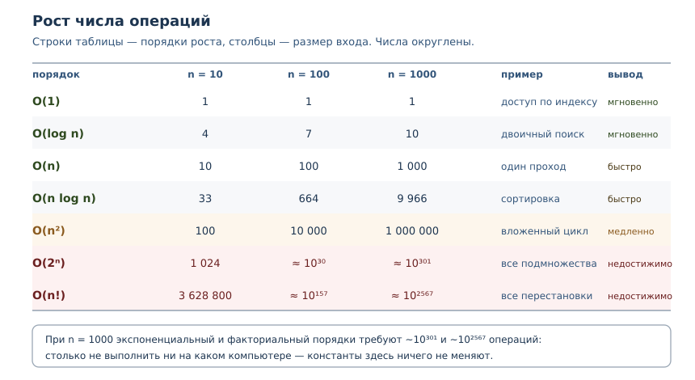

# Алгоритмическое мышление: сложность и выбор структур

<!-- syllanix:nav -->
**Навигация:** [← 51. Регулярные выражения](51-regex.md) · [Оглавление книги](../README.md) · [Далее: 53. Запахи кода, рефакторинг и сопровождение →](53-refactoring.md)
<!-- /syllanix:nav -->

<!-- syllanix:topics -->
**Темы главы**
52.1. [Что вы сможете после этой главы](#что-вы-сможете-после-этой-главы)  
52.2. [Почему «на моей машине быстро» — не аргумент](#why-growth)  
52.3. [O-нотация](#big-o)  
52.4. [Порядки роста](#orders)  
52.5. [Как измерять рост](#measuring)  
52.6. [Сложность встроенных структур](#builtin)  
52.7. [Выбор структуры под задачу](#choice)  
52.8. [Пространственная сложность](#space)  
52.9. [Преждевременная оптимизация](#premature)  
52.10. [Типичные ошибки](#mistakes)  
52.11. [Упражнения](#упражнения)  
52.12. [Проверка понимания](#check)  
52.13. [Связи](#links)  
<!-- /syllanix:topics -->


Почти каждый спор о скорости кода заканчивается фразой «на моей машине это
быстро». Фраза бессмысленна: она ничего не говорит о том, что будет при
худшем входе, на слабом сервере или через год, когда данных станет в тысячу
раз больше. Алгоритмическое мышление начинается с другого вопроса: **как
растёт работа программы при росте входа**. В этой главе вы научитесь
оценивать рост, измерять его и выбирать структуру данных под задачу, а не по
привычке.

## Что вы сможете после этой главы

К концу главы вы сможете делать следующее.

- записывать сложность алгоритма в O-нотации и объяснять, что она означает;
- отличать рост от константы и понимать, почему константа не спасает;
- измерять рост: сравнивать время на разных размерах входа;
- знать сложность операций у `list`, `dict`, `set` и `deque`;
- объяснять амортизированную стоимость и не путать её со «средней»;
- выбирать структуру по требованиям задачи и не оптимизировать раньше времени.

## Почему «на моей машине быстро» — не аргумент {#why-growth}

Замер на одной машине отвечает на вопрос «сколько заняло сейчас». Для
инженерного решения нужен ответ на вопрос «что будет, когда вход вырастет».
Разница принципиальна: быстрый процессор уменьшает время в постоянное число раз, но не
меняет форму кривой.

Покажем это на числах. Пусть один алгоритм делает `100n` операций, а другой —
`n * n`. Константа `100` выглядит устрашающе, но при росте `n` она перестаёт
иметь значение.

```python exec
def linear_steps(n):
    return 100 * n

def quadratic_steps(n):
    return n * n

print(f"{'n':>6} {'100n':>10} {'n*n':>12} {'линейный дешевле':>18}")
for n in (10, 50, 100, 500, 1000):
    linear = linear_steps(n)
    quadratic = quadratic_steps(n)
    print(f"{n:>6} {linear:>10} {quadratic:>12} {str(linear < quadratic):>18}")
```

```output
     n       100n          n*n   линейный дешевле
    10       1000          100              False
    50       5000         2500              False
   100      10000        10000              False
   500      50000       250000               True
  1000     100000      1000000               True
```

До `n = 100` квадратичный алгоритм выигрывал, потому что у него меньше
константа. После точки пересечения линейный уходит вперёд и больше не
проигрывает. Вывод: **константы решают на малых данных, рост — на больших**.
Инженер обязан знать, в каком режиме живёт его задача.

## O-нотация {#big-o}

**O-нотация (Big O)** — асимптотическая оценка роста времени или памяти
алгоритма при увеличении размера входа. Запись `O(n)` читается как «растёт не
быстрее, чем пропорционально `n`»; `O(n ** 2)` — «не быстрее, чем квадрат».

Три правила, которые избавляют от путаницы.

1. **Отбрасываем константы.** `3n + 7` — это `O(n)`: при больших `n`
   множитель и слагаемое не влияют на форму роста.
2. **Оставляем старшее слагаемое.** `n ** 2 + n` — это `O(n ** 2)`:
   квадрат растёт быстрее линейной части.
3. **Указываем, о каком случае речь.** Лучший, худший и типичный случаи могут
   отличаться. Для поиска в списке лучший случай — `O(1)` (элемент первый),
   худший — `O(n)` (элемента нет). Обычно оценивают худший или типичный.

**Временная сложность** — как растёт число операций алгоритма с ростом входа.
**Пространственная сложность** — как растёт объём дополнительной памяти.
Время и память оценивают отдельно: алгоритм может быть быстрым, но требовать
памяти `O(n)`.

Разберём разницу случаев на линейном поиске.

```python exec
def find_index(items, target):
    checks = 0
    for index, item in enumerate(items):
        checks += 1
        if item == target:
            return index, checks
    return -1, checks

data = list(range(1000))
print("в начале:", find_index(data, 0))
print("в конце:", find_index(data, 999))
print("нет такого:", find_index(data, -1))
```

```output
в начале: (0, 1)
в конце: (999, 1000)
нет такого: (-1, 1000)
```

Один и тот же алгоритм сделал одну проверку и тысячу — в зависимости от
данных. Говоря «поиск в списке — `O(n)`», мы имеем в виду худший случай.

### Углубление: O — это оценка сверху

Строго говоря, `O` обозначает верхнюю границу: «работает за `O(n ** 2)`»
верно и для линейного алгоритма. В инженерии `O` используют как «порядок
роста», указывая самую тесную известную границу; для выбора структуры данных
этого достаточно.

## Порядки роста {#orders}

Семь порядков покрывают почти весь практический код. Для каждого важны
интуитивный пример и поведение при росте.

| Порядок | Что означает | Пример в Python |
|---|---|---|
| `O(1)` | работа не зависит от входа | доступ по индексу, поиск в словаре |
| `O(log n)` | каждый шаг сокращает вход | двоичный поиск, `bisect` |
| `O(n)` | один проход по данным | `sum`, поиск в списке |
| `O(n log n)` | почти линейно | `sorted`, сортировка слиянием |
| `O(n ** 2)` | все пары элементов | вложенный цикл |
| `O(2 ** n)` | все подмножества | перебор подмножеств |
| `O(n!)` | все перестановки | полный перебор маршрутов |

Таблица роста показывает, почему порядок важнее константы.

```python exec
import math

def format_ops(value):
    if value < 10 ** 7:
        return f"{value:,}".replace(",", " ")
    return f"~10^{len(str(value)) - 1}"

orders = [
    ("O(1)", lambda n: 1),
    ("O(log n)", lambda n: n.bit_length()),
    ("O(n)", lambda n: n),
    ("O(n log n)", lambda n: round(n * math.log2(n))),
    ("O(n^2)", lambda n: n * n),
    ("O(2^n)", lambda n: 2 ** n),
    ("O(n!)", lambda n: math.factorial(n)),
]
print(f"{'порядок':10} {'n=10':>10} {'n=100':>10} {'n=1000':>10}")
for label, fn in orders:
    cells = " ".join(f"{format_ops(fn(n)):>10}" for n in (10, 100, 1000))
    print(f"{label:10} {cells}")
```

```output
порядок          n=10      n=100     n=1000
O(1)                1          1          1
O(log n)            4          7         10
O(n)               10        100      1 000
O(n log n)         33        664      9 966
O(n^2)            100     10 000  1 000 000
O(2^n)          1 024     ~10^30    ~10^301
O(n!)       3 628 800    ~10^157   ~10^2567
```

Читать таблицу нужно по строкам: переход от `n=10` к `n=100` для `O(n)`
увеличивает работу в 10 раз, для `O(n ** 2)` — в 100. Для `O(2 ** n)` работа
превращается в `10^30`, а это больше, чем число операций, которое компьютер
успеет сделать за время жизни Вселенной. Никакая оптимизация констант такого
не компенсирует.



Практическая граница: `O(n log n)` работает до миллионов элементов,
`O(n ** 2)` терпим до десятков тысяч, `O(2 ** n)` — до двадцати-тридцати.
Смена порядка — главный рычаг производительности, а не микротюнинг.

## Как измерять рост {#measuring}

Сложность оценивают двумя способами: аналитически (посчитать операции в коде)
и экспериментально (замерить на нескольких размерах входа). Второй способ
опаснее: по одному замеру порядок не виден. Правило — **мерить на нескольких
размерах и сравнивать отношения**.

`timeit` показывает, как меняется время при удвоении входа. У линейного
алгоритма время удваивается, у квадратичного — учетверяется, у константного —
не меняется. Числа на вашей машине будут другими; важны отношения.

```console
$ python3 -m timeit -s "data = list(range(1000))" "999 in data"
50000 loops, best of 5: 4.35 usec per loop
$ python3 -m timeit -s "data = list(range(2000))" "1999 in data"
50000 loops, best of 5: 8.09 usec per loop
$ python3 -m timeit -s "data = set(range(1000))" "999 in data"
10000000 loops, best of 5: 28.6 nsec per loop
$ python3 -m timeit -s "data = set(range(2000))" "1999 in data"
10000000 loops, best of 5: 28.7 nsec per loop
```

Список при удвоении замедлился примерно вдвое — линейный рост. Множество
осталось на месте — константа. Это и есть экспериментальное определение
порядка: не абсолютное время, а зависимость от размера.

Оценить функцию по коду можно без запуска. Достаточно ответить на пять
вопросов: сколько в ней вложенных циклов по одним и тем же данным; есть ли
внутри цикла поиск по списку или строке; есть ли сортировка; создаются ли
копии данных на каждом шаге; какова глубина рекурсии. Каждое «да» повышает
порядок, и обычно этого достаточно, чтобы увидеть разницу между `O(n)` и
`O(n ** 2)` ещё до профилирования.

`cProfile` отвечает на другой вопрос: какие функции съели время. Он не
показывает внутренности одной функции, поэтому для циклов его дополняют
замерами на разных `n`.

```console
$ python3 -m cProfile -s tottime bench_demo.py
         2004 function calls in 0.011 seconds

   Ordered by: internal time

   ncalls  tottime  percall  cumtime  percall filename:lineno(function)
     1000    0.010    0.000    0.010    0.000 bench_demo.py:3(expensive_check)
        1    0.000    0.000    0.011    0.011 bench_demo.py:9(run_benchmark)
     1000    0.000    0.000    0.000    0.000 {method 'append' of 'list' objects}
```

Здесь тысяча вызовов `expensive_check` дала почти всё время профиля: рост
времени определяется количеством вызовов, а не одной «медленной строкой».
Профиль и замеры на разных `n` дополняют друг друга: первый находит участок,
второй — его порядок роста.

Для грубой проверки в коде есть `perf_counter`. Печатать его значение в
учебном примере нельзя: оно зависит от машины. Печатают только инвариант.

```python exec
from time import perf_counter

def work(limit):
    return sum(range(limit))

measurements = []
for _ in range(3):
    start = perf_counter()
    work(100_000)
    measurements.append(perf_counter() - start)
print("измерений:", len(measurements))
print("все неотрицательны:", all(value >= 0 for value in measurements))
```

```output
измерений: 3
все неотрицательны: True
```

## Сложность встроенных структур {#builtin}

Выбор структуры — это выбор сложности операций. В Python четыре структуры
закрывают почти все задачи, и у каждой свой профиль.


Проверим главное различие на счётчиках сравнений. Список при поиске
просматривает элементы по одному, множество вычисляет хеш и обращается к
корзине.

```python exec
comparisons = 0

class Key:
    def __init__(self, value):
        self.value = value
    def __hash__(self):
        return hash(self.value)
    def __eq__(self, other):
        global comparisons
        comparisons += 1
        return isinstance(other, Key) and self.value == other.value

target = Key(999)
as_list = [Key(number) for number in range(1000)]
as_set = set(as_list)

comparisons = 0
print("в списке:", target in as_list, "сравнений:", comparisons)
comparisons = 0
print("в множестве:", target in as_set, "сравнений:", comparisons)
```

```output
в списке: True сравнений: 1000
в множестве: True сравнений: 1
```

Тысяча сравнений против одного — это и есть разница между `O(n)` и `O(1)` в
среднем. Обратите внимание на оговорку «в среднем»: у множества и словаря
поиск зависит от хеширования. Если все ключи попадают в одну корзину, поиск
вырождается в линейный. Для встроенных типов это редкость, для своих классов
с плохим `__hash__` — закономерность.

### Углубление: O(1) не всегда быстрее

Запись `O(1)` говорит о числе сравнений, а не об абсолютном времени. У
словаря и множества выше накладные расходы: нужно вычислить хеш, найти
корзину, проверить коллизии. Поэтому на пяти элементах список может оказаться
быстрее словаря, хотя формально проигрывает по порядку. Для строк хеш
вычисляется при первом обращении и кэшируется в объекте — это деталь CPython,
благодаря которой повторные поиски по одному ключу дешевле.

Отсюда практическое правило: сравнивать варианты нужно на том размере данных,
который будет в работе. Порядок роста подсказывает, куда смотреть, а замер
показывает, что происходит на самом деле.

### Амортизированная сложность {#amortized}

**Амортизированная сложность** — средняя стоимость операции с учётом редких
дорогих перестроек, например расширения списка. Когда список заполнен,
`append` выделяет больший массив и копирует в него элементы. Одна такая
операция стоит `O(n)`, но происходит редко, поэтому в среднем на один
`append` приходится постоянная работа.

Посчитаем копирования для модели с удвоением ёмкости.

```python exec
def simulated_appends(count):
    size = 0
    capacity = 1
    copies = 0
    for _ in range(count):
        if size == capacity:
            copies += size
            capacity *= 2
        size += 1
    return copies

for n in (100, 1000, 10000):
    copies = simulated_appends(n)
    print(f"n={n}: копирований {copies}, отношение {copies / n:.2f}")
```

```output
n=100: копирований 127, отношение 1.27
n=1000: копирований 1023, отношение 1.02
n=10000: копирований 16383, отношение 1.64
```

Отношение всегда меньше двух: сумма `1 + 2 + 4 + ... + n` меньше `2n`.
Значит, на `n` добавлений приходится `O(n)` копирований, то есть **в
среднем** `O(1)` на операцию. Это и есть амортизированная оценка: не «обычно
быстро», а «суммарно дёшево».

Амортизированную оценку нельзя читать как «каждая операция быстрая»: один
конкретный `append` может быть дорогим. Для систем реального времени это
важно, для большинства прикладных задач — нет.

## Выбор структуры под задачу {#choice}

**Выбор алгоритма и структуры** — сопоставление требований задачи (доступ,
вставка, поиск, порядок, память) со сложностью операций. Начинают всегда с
требований, а не с «что быстрее».

| Требование | Структура | Почему |
|---|---|---|
| доступ по позиции, порядок важен | `list` | `O(1)` по индексу |
| проверка «есть ли элемент» | `set` | `O(1)` в среднем |
| связь «ключ → значение» | `dict` | `O(1)` в среднем |
| очередь с двух концов | `deque` | `O(1)` на обоих концах |
| частые вставки в середину | `list` или связный список | у `list` `O(n)` |
| сортировка и двоичный поиск | `list` + `bisect` | `O(log n)` после `O(n log n)` сортировки |

Хрестоматийная задача — поиск повторяющихся значений. Наивная версия хранит
уже встреченные элементы в списке и для каждого нового просматривает его
целиком: `O(n ** 2)`. Версия с множеством делает один проход: `O(n)`.

```python exec
def unique_naive(items):
    operations = 0
    seen = []
    for item in items:
        found = False
        for previous in seen:
            operations += 1
            if previous == item:
                found = True
                break
        if not found:
            seen.append(item)
    return len(seen), operations

def unique_set(items):
    operations = 0
    seen = set()
    for item in items:
        operations += 1
        seen.add(item)
    return len(seen), operations

data = [number % 500 for number in range(1000)]
print("наивно:", unique_naive(data))
print("множество:", unique_set(data))
```

```output
наивно: (500, 250000)
множество: (500, 1000)
```

Обе версии нашли 500 уникальных значений, но наивная сделала 250 000
сравнений, а версия с множеством — 1000 добавлений. При удвоении `n` первая
учетверит работу, вторая удвоит.

Другой пример — подсчёт частот. Словарь даёт `O(1)` на обновление счётчика,
поэтому подсчёт слов — один проход.

```python exec
words = "раз два раз три два раз".split()
counts = {}
for word in words:
    counts[word] = counts.get(word, 0) + 1
print(sorted(counts.items()))
print("всего слов:", len(words), "уникальных:", len(counts))
```

```output
[('два', 2), ('раз', 3), ('три', 1)]
всего слов: 6 уникальных: 3
```

Если данные уже отсортированы, поиск стоит `O(log n)`: двоичный поиск
отбрасывает половину диапазона на каждом шаге. Модуль `bisect` делает это без
ручного цикла.

```python exec
import bisect

comparisons = 0

class Item:
    def __init__(self, value):
        self.value = value
    def __lt__(self, other):
        global comparisons
        comparisons += 1
        return self.value < other.value
    def __eq__(self, other):
        global comparisons
        comparisons += 1
        return isinstance(other, Item) and self.value == other.value

data = [Item(number * 2) for number in range(1000)]
target = Item(1998)
position = bisect.bisect_left(data, target)
print("позиция:", position)
print("сравнений:", comparisons)
```

```output
позиция: 999
сравнений: 10
```

Десять сравнений на тысяче элементов — это `O(log n)`: `2 ** 10` примерно
равно `1000`. Ручной цикл сделал бы до тысячи сравнений. Обратите внимание:
`bisect` требует отсортированную последовательность; сортировка стоит
`O(n log n)` и окупается, только если поисков много.

## Пространственная сложность {#space}

**Пространственная сложность** — как растёт объём дополнительной памяти при
увеличении входа. Её оценивают отдельно от временной: иногда выгоднее
потратить память, иногда — время.

Простейший пример: список квадратов против генератора. Список материализует
все значения сразу, генератор выдаёт по одному и хранит только текущее.

```python exec
import sys

def squares_list(limit):
    return [number * number for number in range(limit)]

def squares_generator(limit):
    return (number * number for number in range(limit))

materialized = squares_list(100_000)
lazy = squares_generator(100_000)
print("список из 100000 значений:", sys.getsizeof(materialized), "байт")
print("генератор:", sys.getsizeof(lazy), "байт")
print("список тяжелее генератора:", sys.getsizeof(materialized) > sys.getsizeof(lazy))
```

```output
список из 100000 значений: 800984 байт
генератор: 208 байт
список тяжелее генератора: True
```

Память списка растёт как `O(n)`, генератор занимает `O(1)`. Числа конкретные
для CPython 3.14 и для другой версии будут другими, но соотношение остаётся:
материализация стоит памяти.

Другие типичные источники пространственной сложности:

- **рекурсия** — глубина стека `O(depth)` (глава 8);
- **кэш** — мемоизация из главы 40 обменивает память `O(n)` на время;
- **копии данных** — `sorted` создаёт новый список, `list.sort` сортирует на
  месте;
- **промежуточные коллекции** — цепочка из `map`, `filter` и `list` может
  материализовать данные несколько раз.

## Преждевременная оптимизация {#premature}

**Преждевременная оптимизация** — оптимизация без измерения узкого места;
она усложняет код, не улучшая реальную производительность. Дональд Кнут
называл её корнем всех зол, и речь не о том, что оптимизировать не нужно, а о
том, что нельзя оптимизировать то, что не измерено.

Важное различие, которое часто теряют: **выбор структуры — не преждевременная
оптимизация**. Заменить список на множество там, где нужен поиск, — это
решение о сложности, и оно принимается на этапе проектирования. Такое решение
почти ничего не стоит сейчас и дорого обходится при переделке позже. А
микрооптимизация вроде замены `for` на включение без замера — трата времени
на изменение, которое может не влиять ни на что.

Критерий «достаточно быстро» задают требования, а не ощущения: обработка
запроса должна укладываться в 100 мс, отчёт за ночь — в 2 часа. Пока
требование выполняется с запасом, оптимизировать нечего. Когда перестаёт —
сначала профиль (глава 40), потом изменение, потом повторный замер.

Порядок действий:

1. Сформулировать требование к скорости и способ его проверки.
2. Выбрать структуру и алгоритм по требованиям задачи.
3. Измерить на реальных данных; если требование нарушено — найти узкое место
   профилем и менять одну вещь, проверяя результат повторным замером.

## Типичные ошибки {#mistakes}

1. **Оценивать по одному замеру.** Один размер входа не показывает порядок
   роста; нужны как минимум два-три размера.
2. **Путать константу с порядком.** «У нас быстрый сервер» не спасает от
   `O(n ** 2)` на миллионе записей.
3. **Использовать список для проверки вхождения в цикле.** Получается
   `O(n ** 2)` там, где множество даёт `O(n)`.
4. **Считать амортизированную оценку гарантией на каждую операцию.** Один
   `append` может быть дорогим.
5. **Забывать про память.** Материализация большого списка может уронить
   процесс раньше, чем закончится вычисление.
6. **Сортировать без нужды.** Сортировка стоит `O(n log n)`; если нужен
   только поиск, возможно, хватит множества.
7. **Оптимизировать холодный код.** Функция, вызываемая один раз, не влияет
   на общую скорость.
8. **Менять всё сразу.** Несколько изменений без повторного замера не
   позволяют понять, что помогло.

## Упражнения

### 1. Оценка по коду {#ex-ch52-01}

Для каждого фрагмента определите сложность по `n`:

```python
for item in items:
    print(item)

for first in items:
    for second in items:
        print(first, second)

for item in items:
    if item in seen_set:
        print(item)

while n > 1:
    n = n // 2

print(items[0])
```

Объясните, какой случай (лучший, худший, типичный) вы оцениваете.

### 2. Константа или рост {#ex-ch52-02}

Функция `A` делает `500n` операций, функция `B` — `n ** 2`. При каком `n`
`B` перестаёт быть быстрее? Найдите точку пересечения аналитически, затем
проверьте таблицей через программу.

### 3. Порядок по замерам {#ex-ch52-03}

Даны три замера времени для алгоритма: `n=1000` — 2 мс, `n=2000` — 8 мс,
`n=4000` — 32 мс. Какой порядок роста у алгоритма? Какие замеры нужно
добавить, чтобы отличить `O(n ** 2)` от `O(n ** 3)`?

### 4. Поиск в списке и множестве {#ex-ch52-04}

Дан список из 5000 чисел. Напишите две функции проверки вхождения и
посчитайте, сколько сравнений делает каждая (используйте класс со счётчиком в
`__eq__`). Объясните разницу и укажите, когда список всё же уместен.

### 5. Амортизированная стоимость {#ex-ch52-05}

Смоделируйте `append` для списка с удвоением ёмкости: посчитайте копирования
при 10, 100 и 1000 добавлениях. Докажите формулой, что суммарная стоимость
меньше `2n`.

### 6. Дубликаты {#ex-ch52-06}

Напишите две функции поиска повторяющихся значений: с вложенным циклом и с
множеством. Посчитайте операции для 2000 элементов и объясните, во сколько
раз отличается работа при удвоении входа.

### 7. Выбор структуры {#ex-ch52-07}

Для каждого требования выберите структуру и обоснуйте: (а) хранить словарь
переводов; (б) проверять, входил ли пользователь сегодня; (в) держать очередь
задач, из которой берут с начала и добавляют в конец; (г) хранить топ-10
результатов, которые обновляются.

### 8. Двоичный поиск {#ex-ch52-08}

Реализуйте двоичный поиск вручную и через `bisect`. Посчитайте сравнения для
списка из 1024 элементов. Сколько сравнений нужно в худшем случае и почему
это `O(log n)`?

### 9. Память или время {#ex-ch52-09}

Функция считает сумму квадратов чисел от 1 до `n`. Напишите три версии:
цикл с накоплением, список с `sum`, генератор. Сравните память через
`sys.getsizeof` и объясните, какую версию выбрать для `n = 10 ** 8`.

### 10. Мини-задача: частотный анализ {#ex-ch52-10}

Дан список слов. Найдите слова, которые встречаются чаще одного раза, и
выведите их в порядке убывания частоты. Реализуйте через `dict` (сложность
`O(n)`), затем через сортировку пар. Объясните, какая часть решения даёт
`O(n log n)` и можно ли её избежать.

## Проверка понимания {#check}

1. Что означает запись `O(n log n)` и почему константы в ней отброшены?
2. Чем отличаются лучший, худший и типичный случаи? Приведите пример, где
   они различаются.
3. Почему «на моей машине быстро» не годится как аргумент в выборе алгоритма?
4. Как по замерам на нескольких размерах определить порядок роста?
5. Почему поиск в множестве в среднем `O(1)`, а в списке — `O(n)`?
6. Что такое амортизированная сложность и почему она не гарантирует каждую
   операцию?
7. Когда материализация списка хуже генератора?
8. Чем выбор структуры отличается от преждевременной оптимизации?

## Связи {#links}

Глава продолжает разговор о производительности из главы 40: там были
профилирование и измерение, здесь — оценка роста и выбор структуры. Словари,
множества и `deque` разобраны в главах 16, 17 и 34; генераторы и ленивые
вычисления — в главе 21. Амортизированная стоимость опирается на устройство
списка, а мемоизация — на словарь.

Дальше — [запахи кода и рефакторинг](53-refactoring.md): понимание сложности
помогает замечать места, которые деградируют при росте данных, и заменять их
до того, как они станут проблемой.

<!-- syllanix:nav -->
**Перед этой главой:** [51. Регулярные выражения](51-regex.md)
**Связанные главы:** [02. Первая программа: вычисления и вывод](02-first-program.md), [07. Функции: параметры, аргументы и области видимости](07-functions.md), [13. Списки: индексы, срезы и методы](13-lists.md), [16. Множества и хеширование](16-sets.md), [17. Словари: отображения и структурирование данных](17-dicts.md), [21. Генераторы и ленивые вычисления](21-generators.md), [34. Стандартная библиотека: collections, itertools, functools, pathlib](34-stdlib.md), [40. Производительность и профилирование](40-performance.md)
**Далее:** [53. Запахи кода, рефакторинг и сопровождение →](53-refactoring.md)
<!-- /syllanix:nav -->
